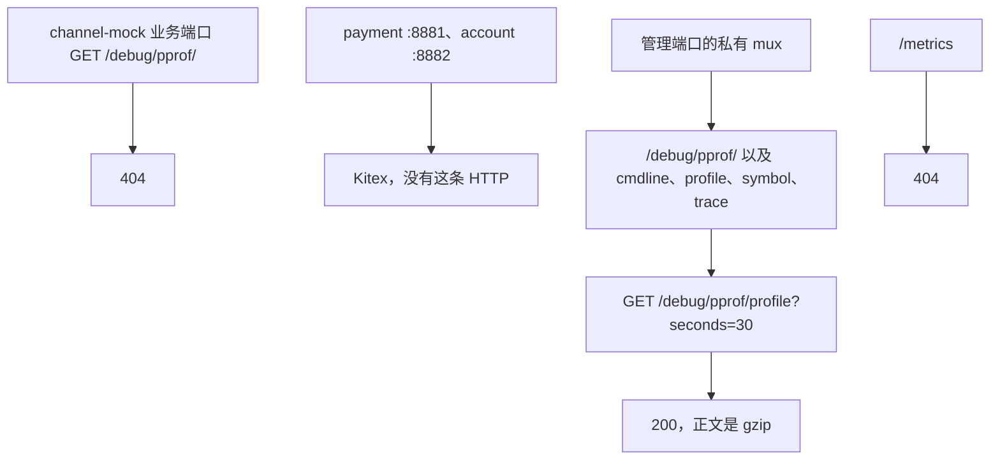
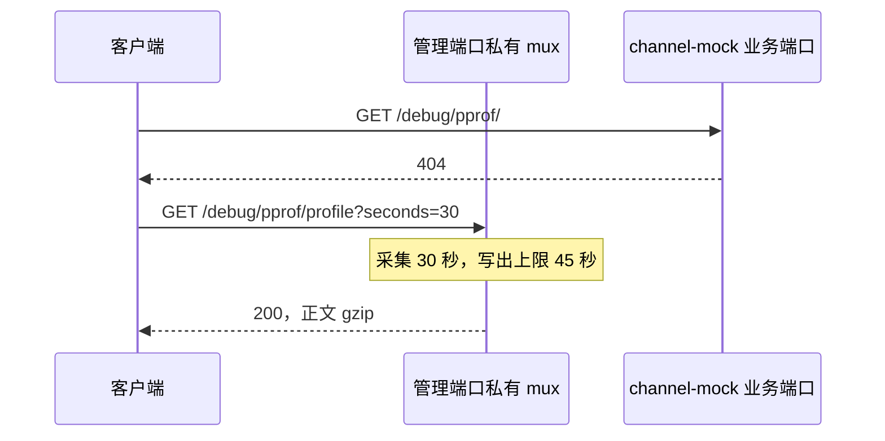

# OPS-05 pprof 与管理端口

| 项 | 内容 |
|---|---|
| 功能点 | OPS-05（P0，第 3 周） |
| 所属链路 | 基础设施 |
| 代码提交 | `40792e8` `[OPS-05] add admin pprof`（完整 `40792e84fc5d684c0a0b45a82f72826dbfb64938`，2026-11-01 20:55:21 +0800） |
| 分支 | `feat/OPS-05-pprof` |
| 日期 | 2026-11-01 |
| 状态 | DONE |

本报告写在上面这次代码提交之后，不在那次提交的文件里。健康检查与优雅退出已经完成。本次只在管理端口上增加 pprof。网关 HTTP、指标、Kafka 投递都还没做。

## 一句话结论

pprof 只在管理端口。channel-mock 的业务端口访问 `/debug/pprof/` 是 404，证据是 `TestBusinessPortPprofNotFound`。管理端口能采到 30 秒 CPU profile，正文是 gzip，证据是 `TestAdminPortCPUProfile`。

## 1. 背景

### 1.1 系统简介

pay-system 是一个用 Go 编写的小型支付后端，模拟商户收款、退款、商户间转账三条资金链路，重点在数据一致性和性能。系统由 5 个部分组成：gateway（对外 HTTP 入口，负责签名校验和限流）、payment（支付单、退款单、转账单的状态管理和流程推进）、account（账户余额与记账，数据按商户分到 2 个数据库分片）、channel-mock（模拟微信、支付宝这类外部支付渠道）、recon（对账，核对系统内外数据是否一致）。服务之间用 Kitex RPC 同步调用，或通过 Kafka 消息异步通知；数据存在 MySQL 8.4，Redis 用于防重放。所有金额用整数“分”表示，所有记账只追加不修改。当前已完成：工程骨架、账户、模拟渠道、商户凭证与费率、故障注入、创建支付单、发起支付、outbox 写入、支付结果推进、商户关单、支付单查询、健康检查与优雅退出，以及本次 pprof。网关 HTTP、指标、Kafka 投递都还没做。

上面这段里还没展开的词：Kitex 是本项目的 Go RPC 框架，RPC 是一个进程同步调用另一个进程里的函数。签名校验用密钥确认报文没有被改过；限流限制单位时间内的调用次数。这两件事都在 gateway，本次不做网关 HTTP。Kafka 是异步消息队列，把消息投递出去还没做。分片是把账户数据按商户拆进 2 个库。1 元 = 100 分，金额全程用整数。记账只追加，是指账本只插入新行，不回头改旧行。本次不改余额，不写分录，也不改支付单。Redis 防重放是系统别处的能力，本次不连接 Redis。P0 是必须先做的优先级。

创建支付单、发起支付、支付结果推进、商户关单、支付单查询已经能在 payment 里工作。outbox 是和业务写在同一事务里、稍后才发送的消息表，发送是以后的投递器。商户凭证是商户身份和密钥，费率是算手续费用的比例。故障注入是测试时故意让某一步失败的开关。这些都不是本次改的业务。

管理端口是给本机探活和采样用的 HTTP 端口，不是商户下单的端口，也不是渠道收单的端口。业务端口才是对外干活的端口：channel-mock 的业务端口是 HTTP（Hertz，生产是 `:9080` 这一类），payment 的业务端口是 Kitex `:8881`，account 的业务端口是 Kitex `:8882`。`/healthz` 只回答进程还活着没有。`/readyz` 回答现在能不能接新流量。pprof 是进程的采样页面，路径在 `/debug/pprof/` 下。指标是 `/metrics` 上的计数，本次仍是 404，留给以后的 OPS-03。

### 1.2 本功能点在系统中的位置

pprof 加在 `pkg/server` 已经在听的管理端口上。正在听这个端口的是 payment、account、channel-mock。gateway 和 recon 仍不监听。merchant-demo 仍没有管理端口。这三件事都是已有行为，不是还要在本功能点里补上的监听。



图下：业务端口和采样页面分开。channel-mock 的业务 HTTP 对这条路径是 404。payment 和 account 的业务端口是 Kitex，不提供 HTTP `/debug/pprof/`，也没有另挂一个只为了返回 404 的 HTTP。管理端口上的索引和 30 秒 CPU profile 可以访问。`/metrics` 仍不在这张图的成功路径上。宿主机发布仍是 compose 里已有的 `127.0.0.1`。进程仍听 `:606x`，没有改成 `127.0.0.1`。

### 1.3 为什么需要它

采样要能拿到一段真实的 CPU profile，同时不能出现在业务端口上。

channel-mock 的业务端口是 Hertz，生产是 `:9080` 这一类。如果 `/debug/pprof/` 注册在这里，调用方可以对着业务端口要一份 30 秒的 CPU 采样。payment 的 `:8881` 和 account 的 `:8882` 是 Kitex，本来就不是 HTTP；如果为了“看起来也返回 404”再挂一个 HTTP，业务端口上就会多出一个 HTTP 服务。

管理端口以前把写出响应的上限写成 3 秒。CPU profile 要先采集 30 秒，再把正文写出去。3 秒短于这 30 秒，正文写不完。本次把这个上限改成 45 秒。`/healthz` 和 `/readyz` 的处理函数仍是马上返回。

导入标准库 `net/http/pprof` 时，它的 init 还会把相同路径注册到 `http.DefaultServeMux`。如果生产进程把这个默认 mux，或者把 nil handler 交给 `ListenAndServe`，采样页面会跟那台服务器一起对外。本次没有这样做。真正对外的是管理端口上的私有 mux。

数据库检查失败时，原始错误里可能有连接串。连接串里有地址和口令。pprof 的正文不能带上这段文字。`/readyz` 的失败正文也不能带。

## 2. 术语

按正文第一次出现的顺序。

| 术语 | 含义 |
|---|---|
| gateway | 对外 HTTP 入口。本次不监听管理端口，也不做网关 HTTP。 |
| payment | 支付单所在的进程。业务端口是 Kitex `:8881`。它会听管理端口。 |
| account | 账户进程。数据在 2 个数据库分片。业务端口是 Kitex `:8882`。它会听管理端口。 |
| channel-mock | 模拟外部支付渠道的进程。业务端口是 Hertz HTTP，生产是 `:9080` 这一类。它会听管理端口。 |
| recon | 对账进程。本次仍不监听管理端口。 |
| merchant-demo | 模拟商户后台。仍没有管理端口。 |
| Kitex | 本项目的 Go RPC 框架。 |
| RPC | 一个进程同步调用另一个进程里的函数。 |
| Hertz | channel-mock 业务端口用的 HTTP 框架。 |
| Kafka | 异步消息队列。投递还没做。本次不连接。 |
| 分片 | 账户数据按商户拆进 2 个库。 |
| 分 | 金额最小单位。100 分 = 1.00 元。类型是整数。本次不改金额。 |
| 分录 | 账本上追加的一行。本次不插入。 |
| 支付单 | 商户的一笔收款。本次不改这一行。 |
| Redis | 内存库。系统别处用它防重放。本次不连接。 |
| outbox | 和业务写在同一事务里、稍后才发送的消息表。本次不写。 |
| 商户凭证 | 商户身份和密钥。本次不改。 |
| 费率 | 算手续费的比例。本次不改。 |
| 故障注入 | 测试时故意让某一步失败的开关。本次不新增故障点。 |
| 管理端口 | 本机探活和采样用的 HTTP 端口。进程听 `:606x`。不是业务端口。 |
| 业务端口 | 对外干活的端口。channel-mock 是 HTTP；payment、account 是 Kitex。 |
| `/healthz` | 存活检查。进程还在服务这个端口就返回 200，正文 `ok`。 |
| `/readyz` | 就绪检查。不能接流量时失败正文是 `unavailable`，不带连接串。 |
| pprof | 进程采样页面。本次只注册在管理端口。 |
| `/debug/pprof/` | pprof 的索引路径。其下还有 cmdline、profile、symbol、trace。 |
| CPU profile | 一段时间内的 CPU 采样。验收采集长度是 30 秒。 |
| gzip | 一种压缩格式。CPU profile 正文的前两字节是 `1f 8b`。 |
| `/metrics` | 运行指标的路径。本次仍是 404，留给 OPS-03。 |
| mux | HTTP 路径到处理函数的表。管理端口用自己新建的那张，不共用默认的那张。 |
| `http.DefaultServeMux` | 标准库的默认 mux。导入 pprof 的 init 会往这里注册。生产不用它对外。 |
| `WriteTimeout` | 管理 HTTP 写出响应的上限。本次是 45 秒，常量名 `profileWriteTimeout`。 |
| `ReadHeaderTimeout` | 只限制读请求头。仍是 1 秒。 |
| DSN | 数据库连接串。里面有地址和口令。失败正文和 pprof 正文都不带测试用的这一串。 |
| 200 / 404 / 405 / 503 | HTTP 状态。200 成功。404 没有这条路径。405 路径在但方法不被接受。503 现在不能接新流量。 |
| `127.0.0.1` | 本机回环地址。宿主机发布仍绑在这里。进程没有改成只听这个地址。 |
| OPS-03 | 以后的功能点：在管理端口提供 `/metrics`。 |
| 覆盖率 | 测试执行到的语句占该包语句的比例。70% 门禁只覆盖指定的几个包。 |
| `cached` | Go 复用了已有测试结果，没有重跑那个包。 |
| `integration` | 构建标签。带上它才编译连 MySQL 的测试文件。 |
| IDL | RPC 的接口定义文件。本次没改。 |
| `make gen` | 按 IDL 生成代码的命令。本次没运行。 |
| `mmdc` | 把 Mermaid 源图渲染成 SVG 的命令。本次没运行。 |
| SVG | 渲染后的图文件。本次没有新的。 |
| CF-31 | 健康检查与退出的那张控制流图。本次不改它的节点。 |

## 3. 技术讲解

### 3.1 要解决的问题

1. pprof 只在管理端口，和业务端口分开。channel-mock 业务端口（Hertz，`:9080` 这一类）访问 `GET /debug/pprof/` 必须是 404。
2. payment `:8881`、account `:8882` 是 Kitex，不提供 HTTP `/debug/pprof/`。不为它们加一个 HTTP 404 垫片。
3. 管理端口要能采到 30 秒 CPU profile。这是采集本身，不是另写一段等待。
4. 管理端口 `WriteTimeout` 从 3 秒改为 45 秒，这样 30 秒的采集还能把正文写完。`ReadHeaderTimeout` 仍是 1 秒。`/healthz`、`/readyz` 仍马上返回。
5. 进程仍听 `:606x`，不改为 `127.0.0.1`。宿主机发布仍是 compose 里已有的 `127.0.0.1`。
6. `/metrics` 仍是 404。本功能点不注册它。
7. 导入 pprof 会注册到 `http.DefaultServeMux`。生产进程不把这份默认 mux 或 nil handler 交给 `ListenAndServe`。对外的是私有 mux。
8. 失败正文不带 DSN。pprof 索引的正文也不带测试用的连接串。
9. 不新增错误码，不改 IDL，不新增迁移，不新增环境变量。不改余额，不写分录，不改支付单。

### 3.2 方案

`pkg/server` 继续使用自己新建的 mux。`/healthz` 和 `/readyz` 仍只接受 GET。pprof 的五条路径注册在同一张 mux 上，不带方法前缀。这段在 `pkg/server/server.go`。

```go
mux := http.NewServeMux()
mux.HandleFunc("GET /healthz", s.healthz)
mux.HandleFunc("GET /readyz", s.readyz)
// net/http/pprof 的 init 把相同路径注册到 DefaultServeMux。真正对外的是这个 mux。
mux.HandleFunc("/debug/pprof/", pprof.Index)
mux.HandleFunc("/debug/pprof/cmdline", pprof.Cmdline)
mux.HandleFunc("/debug/pprof/profile", pprof.Profile)
mux.HandleFunc("/debug/pprof/symbol", pprof.Symbol)
mux.HandleFunc("/debug/pprof/trace", pprof.Trace)
```

五条路径是索引、命令行、CPU profile、符号和执行跟踪。索引还会分发它自己名下的 heap、goroutine 等。没有单独的测试去打 cmdline 和 trace。索引、30 秒 profile，以及 symbol 的 POST，有测试。

`symbol` 没有写成 `GET /debug/pprof/symbol`。`go tool pprof` 会 POST 这条路径。`TestPprofSymbolAcceptsPost` 对正在使用的这个 handler 发 POST，正文是 `0+`，状态是 200，不是 405。

`TestPprofNotOnOtherMux` 是对照：另建一张 mux，只注册一条别的路径，再访问 `/debug/pprof/`，状态仍是 404。它说明“注册在这张私有 mux 上”不会让别的 mux 也出现这条路径。它不是业务端口验收本身。业务端口验收是 `TestBusinessPortPprofNotFound`：拉起 channel-mock 的业务 HTTP，`GET /debug/pprof/` 是 404。

管理 HTTP 的写出上限改成命名常量。读请求头的上限不动。常量在文件顶部，服务器字面量在 `Run` 里。两处都在 `pkg/server/server.go`。

```go
// profileWriteTimeout 是管理端口写出响应的上限，让 30 秒 CPU profile 能写完。
profileWriteTimeout = 45 * time.Second
```

```go
httpSrv := &http.Server{
    Handler:           s.handler(),
    ReadHeaderTimeout: time.Second,
    WriteTimeout:      profileWriteTimeout,
}
```

`Handler` 是上面那个私有 mux，不是 `http.DefaultServeMux`，也不是 nil。`profileWriteTimeout` 是常量，不出现在函数覆盖率表里。没有新增导出函数。

`TestAdminPortCPUProfile` 在 `Run` 已经在服务的管理端口上请求 `GET /debug/pprof/profile?seconds=30`。客户端超时是 45 秒。实测状态 200，正文非空，前两字节是 gzip 的 `1f 8b`。报告只写这个实测结果，以及写超时是 45 秒。不把标准库说成还会把写截止时间再延长。

`/healthz` 和 `/readyz` 的处理函数仍是立刻写完固定正文。服务器级别的写出上限现在是 45 秒，所以一个不读完的慢客户端可以把这条连接占得比原来的 3 秒更久。处理函数本身没有改成等待。

`TestReadyzFollowsDatabase` 原来把管理端口的 `/debug/pprof/` 断言成 404。本次改成 200。正文不含测试用的那条连接串。`/metrics` 仍是 404。`/readyz` 在检查失败时仍是 503，正文仍是 `unavailable`。



图下：左边是业务端口，右边才是采样。30 秒是这条请求自己的采集长度。

### 3.3 为什么这样做

| 方案 | 做法 | 优点 | 缺点 | 结论 |
|---|---|---|---|---|
| 采用：只在管理端口的私有 mux 上注册，写出上限改成 45 秒 | 五条 pprof 路径和探活在同一张私有 mux 上。业务端口不注册 | 管理端口能采 30 秒 CPU profile。channel-mock 业务端口仍是 404 | 导入 pprof 仍会改默认 mux。整个管理 HTTP 的写出上限变成 45 秒 | 采用 |
| 备选：注册到 channel-mock 的业务 HTTP，或在 Kitex 端口上加 HTTP | 业务端口也能看到或拒绝这条路径 | 少依赖管理端口 | 采样和收单混在一个端口上。Kitex 的 `:8881`、`:8882` 不是 HTTP，加 404 垫片会多出一个 HTTP 服务 | 不采用 |
| 备选：自己不注册，只用 init 放进 `http.DefaultServeMux` 的那份 | 少写五行 | 路径看起来已经有了 | 生产若把默认 mux 或 nil handler 交出去，采样页面就跟着那台服务器。现在对外的是私有 mux | 不采用 |
| 备选：`WriteTimeout` 保持 3 秒 | 不改原来的上限 | 慢响应更早被掐掉 | 3 秒短于要采集的 30 秒，profile 的正文写不完 | 不采用 |
| 备选：进程改听 `127.0.0.1` | 管理端口只在回环上 | 少暴露一张网卡 | 以后容器端口发布连的是容器网卡，不是容器里的回环。宿主机发布已经是 `127.0.0.1` | 不采用 |

### 3.4 正确性

本功能点不改余额，不写分录，不改支付单。资金上的四项都不涉及。下面第一张表就是这四项。第二张表才是端口和正文。这些测试不断言余额、分录或支付单，代码路径里也没有这些写入。

| 场景 | 系统行为 | 最终状态 | 证明 |
|---|---|---|---|
| 同一请求重复到达 | 不涉及。没有记账或改单的写路径，不存在“再记一次” | 不产生新的余额、分录或支付单 | 无此类测试 |
| 两个冲突请求并发 | 不涉及。没有两个请求抢同一笔扣款 | 同上 | 无此类测试 |
| 在写入的中途进程崩溃 | 不涉及。没有余额或支付单的写入步骤，没有写到一半的账 | 同上 | 无崩溃后查账的测试 |
| 下游调用超时 | 不涉及。不调用渠道，也不把超时当成支付失败 | 支付单不会因此被改掉 | 代码路径不调用渠道 |

| 场景 | 系统行为 | 最终状态 | 证明 |
|---|---|---|---|
| 业务端口没有 pprof | channel-mock 的业务 HTTP（`:9080` 这一类）`GET /debug/pprof/` 是 404。payment `:8881`、account `:8882` 是 Kitex，不提供这条 HTTP，也没有 404 垫片 | 不改库 | `TestBusinessPortPprofNotFound` |
| 管理端口能采到 profile | 正在 `Run` 的管理端口接受 `GET /debug/pprof/profile?seconds=30`。客户端超时 45 秒。状态 200，正文非空，前两字节是 gzip `1f 8b`。写超时是 45 秒 | 不改库。这是采集本身，不是另写一段等待 | `TestAdminPortCPUProfile` |
| 失败正文不带 DSN | 数据库检查返回带地址和口令的错误时，`/readyz` 是 503，正文是 `unavailable`。管理端口 `/debug/pprof/` 是 200，正文不含那条测试连接串。`/metrics` 仍是 404。`/healthz` 仍是 200，正文 `ok` | 不改库 | `TestReadyzFollowsDatabase` |

`TestPprofNotOnOtherMux` 不在上表里。它只证明另一张新建的 mux 上这条路径仍是 404，不是业务端口验收。`TestPprofSymbolAcceptsPost` 证明 POST `/debug/pprof/symbol` 是 200，不是 405。

### 3.5 性能

不涉及。这次没有优化前和优化后的对比。30 秒是验收规定的采集长度，不是性能优化数据。

## 4. 已完成内容

### 4.1 改动清单

这些文件都在代码提交 `40792e8` 里。`cmd` 下的 `main`、compose、业务处理函数都不在其中。谁在听管理端口，这次没有改。

| 文件 | 新增 / 修改 | 作用 |
|---|---|---|
| `pkg/server/server.go` | 修改 | 私有 mux 注册五条 pprof 路径。写出上限从 3 秒改为 45 秒 |
| `pkg/server/server_test.go` | 修改 | 30 秒 CPU profile、symbol 的 POST、另一张 mux 的对照。索引从 404 改为 200，并检查不含连接串 |
| `service/channel_mock/handler/pay_test.go` | 修改 | 业务端口 `GET /debug/pprof/` 为 404 |
| `docs/02-requirements.md` | 修改 | OPS-05 改为 DONE，验收勾上 |
| `docs/04-dev-plan.md` | 修改 | 只勾 OPS-05 |
| `docs/05-api.md` | 修改 | 版本到 3.3.0，写上 pprof 路径和 45 秒写出上限 |
| `docs/06-flows.md` | 修改 | 版本到 v2.28。CF-31 节点不改 |
| `docs/interview-notes.md` | 修改 | 补一条写超时 |

### 4.2 对外变化

| 类别 | 变化 |
|---|---|
| 接口 | 不是商户接口。管理端口增加 `/debug/pprof/`、cmdline、profile、symbol、trace。不签名，不用支付错误码。`WriteTimeout` 改为 45 秒，`ReadHeaderTimeout` 仍是 1 秒。进程仍听 `:606x`。宿主机发布仍是 `127.0.0.1`。channel-mock 业务端口对该路径是 404。payment、account 的 Kitex 端口不提供这条 HTTP。`/metrics` 仍是 404。IDL 没改，`make gen` 没运行。渠道管理的两条路径仍未实现，和 pprof 不是同一件事 |
| 表结构 | 无。没有新列、新索引，也没有新迁移 |
| 配置项 | 无。不新增环境变量。约定仍是 v2.23 |
| 错误码 | 无新增 |
| 指标 / 故障点 | 无新指标，无新故障点。`/metrics` 仍是 404，留给 OPS-03 |

### 4.3 验收对照

需求里的验收是一条，里面有两件事：业务端口访问 `/debug/pprof/` 返回 404；管理端口可采集 30 秒 CPU profile。两件事各有一个测试。后面三行是同一次整包命令跑到的补充，不是第二条需求。结果都是通过。这些测试包含在第 4.4 节的整包命令里，没有按名字单独重跑。

| 验收条目 | 测试函数 | 类型 | 结果 |
|---|---|---|---|
| 业务端口访问 `/debug/pprof/` 返回 404 | `TestBusinessPortPprofNotFound` | 单元 | 通过。测的是 channel-mock 的 Hertz 业务端口，`:9080` 这一类 |
| 管理端口可采集 30 秒 CPU profile | `TestAdminPortCPUProfile` | 单元 | 通过。状态 200，正文非空，前两字节是 gzip `1f 8b`。客户端超时 45 秒 |
| 另一张 mux 上 `/debug/pprof/` 仍是 404 | `TestPprofNotOnOtherMux` | 单元 | 通过。对照，不是业务端口验收 |
| POST `/debug/pprof/symbol` 不是 405 | `TestPprofSymbolAcceptsPost` | 单元 | 通过。状态是 200 |
| 管理端口 `/debug/pprof/` 为 200，正文不含测试连接串；`/metrics` 仍是 404 | `TestReadyzFollowsDatabase` | 单元 | 通过。失败正文仍是 `unavailable`，不含那条连接串 |

`TestBusinessPortPprofNotFound` 实际走到的路径：业务 HTTP 起来之后，`GET /debug/pprof/` 的状态是 404。

`TestAdminPortCPUProfile` 实际走到的路径：管理端口已经在 `Run`。先看到 `/healthz` 是 200。然后采集 `seconds=30`。客户端最多等 45 秒。响应状态 200，正文非空，前两字节是 `1f 8b`。

`TestReadyzFollowsDatabase` 实际走到的路径：检查失败时 `/readyz` 是 503、正文 `unavailable`，`/healthz` 是 200、正文 `ok`。`/debug/pprof/` 是 200，`/metrics` 是 404。两份正文都不含测试连接串。检查改为成功后，`/readyz` 是 200。

### 4.4 验证记录

日期是 2026-11-01。环境：`go version go1.27.2 darwin/arm64`。golangci-lint 2.14.0，built with go1.27.1，commit `114493f`，时间 2026-09-24T10:54:53Z。当时工作区就是后来提交为 `40792e8` 的那棵树。耗时是 `/usr/bin/time -p` 的 real。下面只记这次输出里记录下来的包。`make gen` 会按 IDL 生成代码；IDL 没改，所以没运行。`mmdc` 是把 Mermaid 源图渲染成 SVG 的命令，本次没运行，没有新的 SVG。

| 命令 | 结果 |
|---|---|
| `gofmt -l .` | 无文件名，exit 0，real 0.05s |
| `make lint` | `0 issues.`，exit 0，real 0.95s |
| `make test` | `go test -race ./...`，exit 0，real 34.52s。不打印覆盖率。根包 `ok github.com/yym108/pay-system 4.535s`。`cmd/account` 1.541s，`cmd/channel-mock` 1.461s，`cmd/payment` 1.545s，`pkg/idgen` 3.195s，`pkg/server` 33.441s，`service/channel_mock/handler` 1.273s |
| `make test-integration` | `go test -race -tags integration ./...`，exit 0，real 38.30s。根包 `ok github.com/yym108/pay-system 37.874s`。`cmd/account` 1.543s，`cmd/channel-mock` 1.477s，`cmd/payment` 1.561s，`pkg/idgen` 3.876s，`pkg/server` 32.570s，`service/account/dal` 11.324s，`service/channel_mock/handler` 11.341s，`service/payment/biz` 26.294s |
| `make cover` | exit 0，real 36.36s。全仓 total 27.9%（含 `kitex_gen` 生成代码，不是门禁）。根包 `ok github.com/yym108/pay-system 35.391s`，coverage `[no statements]`。`pkg/server` 33.590s / 84.4%。`cmd/account` 1.543s / 27.3%。`cmd/channel-mock` 1.472s / 16.4%。`cmd/payment` 1.556s / 39.6%。`cmd/gateway` cached 87.5%。`cmd/recon` cached 87.5%。`pkg/idgen` 6.607s / 88.1%。`pkg/outbox` cached 95.0%。`service/account/biz` cached 91.1%。`service/account/dal` 11.559s / 95.2%。`service/account/handler` cached 83.0%。`service/channel_mock/biz` cached 94.0%。`service/channel_mock/handler` 10.457s / 95.5%。`service/payment/biz` 25.922s / 86.1%。`service/payment/handler` cached 85.6% |

70% 门禁只覆盖 `service/*/biz`、`pkg/money`、`pkg/sign`、`pkg/idgen`、`pkg/outbox`。这次记录里落在门禁中的是 account biz 91.1%、payment biz 86.1%、channel_mock biz 94.0%、idgen 88.1%、outbox 95.0%，都不低于 70%。本功能点没有改这些包。`pkg/server` 不在门禁里，84.4% 只是信息。

`make cover` 那次，`pkg/server/server.go` 按函数，和健康检查时的这张表相同：`FuncGroup` 100.0，`Serve` 100.0，`Stop` 100.0，`New` 66.7，`RequireDB` 100.0，`RegisterCheck` 100.0，`RegisterGroup` 100.0，`RegisterFlusher` 100.0，`RegisterCloser` 100.0，`PingCheck` 66.7，`Run` 79.1，`ensureDB` 100.0，`snapshot` 100.0，`listen` 33.3，`signals` 33.3，`stopGroups` 88.2，`flushAll` 87.5，`closeAll` 75.0，`handler` 100.0，`healthz` 100.0，`readyz` 100.0，`dependenciesReady` 100.0，`runCheck` 77.8，`writeText` 100.0。没有新增导出函数。`profileWriteTimeout` 是常量，不在函数表里。

`make gen` 未运行。`mmdc` 未运行，没有新的 SVG。

### 4.5 同步的文档

这些文档都在代码提交 `40792e8` 里。约定没有改，仍是 v2.23。表结构文档没改。

- 需求：版本仍是 v3.0。OPS-05 为 DONE。验收已勾。§8.2 有一行 2026-11-01：pprof 只注册在管理端口的私有 mux 上；channel-mock 业务端口访问 `/debug/pprof/` 为 404；payment、account 的业务端口是 Kitex，不另挂 HTTP；管理端口可采集 30 秒 CPU profile；`WriteTimeout` 改为 45 秒，`ReadHeaderTimeout` 仍是 1 秒；进程仍听 `:606x`，宿主机发布仍是 `127.0.0.1`；`/metrics` 仍不提供；不新增错误码，不改表，不改商户接口。
- 开发计划：只勾了 OPS-05。
- 接口：版本 3.3.0。最后修改 2026-11-01。变更记录写明这不是商户 API，`/metrics` 仍是 404，不改商户 HTTP，不改 IDL，不新增错误码。§12 写了五条 pprof 路径、45 秒写出上限，以及业务端口的差异。§9.8 的渠道管理路径仍未实现。
- 流程图：现为 v2.28，最后修改 2026-11-01。覆盖矩阵里 OPS-05 指向 CF-31。CF-31 的节点不改。图下写了 pprof 只在管理端口，`/metrics` 仍不提供。没有 `mmdc`，所以没有新的 SVG。不改资金流向。
- interview-notes：在健康检查那一节补了一条。管理端口写超时从 3 秒改成 45 秒，是为了 30 秒 CPU profile；进程监听地址没改。

## 5. 未完成与风险

- `/metrics` 仍是 404，留给 OPS-03。本功能点不注册它。
- gateway 和 recon 仍不监听。merchant-demo 仍没有管理端口。这是已有行为，不是还要在本功能点里补的监听。
- payment `:8881` 和 account `:8882` 不提供 HTTP `/debug/pprof/`。没有加 HTTP 404 垫片。验收里的 404 是 channel-mock 的业务 HTTP。
- cmdline 和 trace 已经注册在同一张私有 mux 上。这次没有单独的断言。有断言的是索引 200、30 秒 profile 的 200 和 gzip，以及 symbol 的 POST 200。
- 导入 `net/http/pprof` 的 init 仍会注册到 `http.DefaultServeMux`。生产进程把 `Handler` 设成私有 mux，没有把默认 mux 或 nil handler 交给 `ListenAndServe`。以后如果改成 nil handler，这些路径会出现在那台服务器上。
- 写出上限对整个管理 HTTP 都是 45 秒。`/healthz`、`/readyz` 仍马上写完。慢客户端把连接占住时，上限比原来的 3 秒长。
- 用 profile 做优化并写出前后数据，是以后的 QA-03。本次没有那份对比。
- `listen` 是 33.3%，`signals` 是 33.3%。测试注入了现成的监听和信号通道，没有走到真正绑定端口和 `signal.Notify` 的那两支。这次没有新增导出函数。

## 6. 如何复现

在仓库根目录、分支 `feat/OPS-05-pprof`、代码提交 `40792e84fc5d684c0a0b45a82f72826dbfb64938` 上执行。环境是 2026-11-01 的 `go version go1.27.2 darwin/arm64`。集成测试沿用已有基座：需要 Docker，或已经设置 `TEST_MYSQL_DSN`。本次记录没有另打印当时连的是哪台库。不要启动 profile `apps` 里的占位容器。

```bash
/usr/bin/time -p gofmt -l .
/usr/bin/time -p make lint
/usr/bin/time -p make test
/usr/bin/time -p make test-integration
/usr/bin/time -p make cover
```

预期与第 4.4 节的表一致。`gofmt -l .` 不打印文件名。`make lint` 打印 `0 issues.`。测试命令的退出码是 0。`make test` 不打印覆盖率。`make cover` 的 total 是 27.9%，不作判据；`pkg/server` 是 84.4%，只是信息。`make gen` 和 `mmdc` 这次没有运行。再跑时墙钟会随机器变化，第 4.4 节的 real 是这次实测。

`TestBusinessPortPprofNotFound` 和 `TestAdminPortCPUProfile` 都在 `make test` 里。第二个会真正采集 30 秒。通过的标准仍是状态 200，正文非空，前两字节是 `1f 8b`。

## 7. 讲解要点

1. 为什么采样不在业务端口，也不靠默认 mux？channel-mock 的业务 HTTP 若挂上 `/debug/pprof/`，调用方就能向收单端口要 30 秒 CPU 采样。`TestBusinessPortPprofNotFound` 看到的是 404。导入 pprof 的 init 会注册到 `http.DefaultServeMux`，生产却把 `Handler` 设成私有 mux。`TestPprofNotOnOtherMux` 说明另一张 mux 不会因此出现这条路径。
2. 为什么写出上限是 45 秒，证据停在哪里？原先 3 秒短于采集用的 30 秒，正文写不完。现在的上限是 45 秒，客户端也最多等 45 秒。`TestAdminPortCPUProfile` 实测到状态 200，正文是 gzip（前两字节 `1f 8b`）。不要把标准库说成还会把写截止时间再延长。`/healthz` 和 `/readyz` 的处理函数仍马上返回。
3. 为什么 Kitex 端口不加 404，失败正文里又没有连接串？`:8881` 和 `:8882` 不是 HTTP，加垫片会多出一个 HTTP 服务。404 只要求 channel-mock 的业务端口。数据库检查失败时，`/readyz` 用固定的 `unavailable`，不用原始错误。`TestReadyzFollowsDatabase` 同时看到 pprof 索引是 200、正文不含测试连接串，`/metrics` 仍是 404。

## 延伸阅读

- `docs/02-requirements.md`：OPS-05 的规则和验收。版本仍是 v3.0。
- `docs/05-api.md`：§12 进程探针。版本 3.3.0。
- `docs/03-conventions.md`：金额用分。版本仍是 v2.23，本次没改。
- `docs/06-flows.md`：CF-31。版本 v2.28，节点不改，SVG 未渲染。
- `docs/04-dev-plan.md`：OPS-05 已勾选。
- `docs/interview-notes.md`：写超时从 3 秒改为 45 秒的那一条。
- `pkg/server/server.go`：私有 mux 和 `profileWriteTimeout`。
- `pkg/server/server_test.go`：`TestAdminPortCPUProfile`、`TestPprofSymbolAcceptsPost`、`TestPprofNotOnOtherMux`、`TestReadyzFollowsDatabase`。
- `service/channel_mock/handler/pay_test.go`：`TestBusinessPortPprofNotFound`。

## 修订记录

| 日期 | 提交 | 修订内容 |
|---|---|---|
| 2026-11-01 | 报告尚未提交 | 首版。对应代码提交 `40792e8` `[OPS-05] add admin pprof` |
