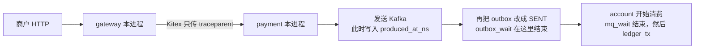
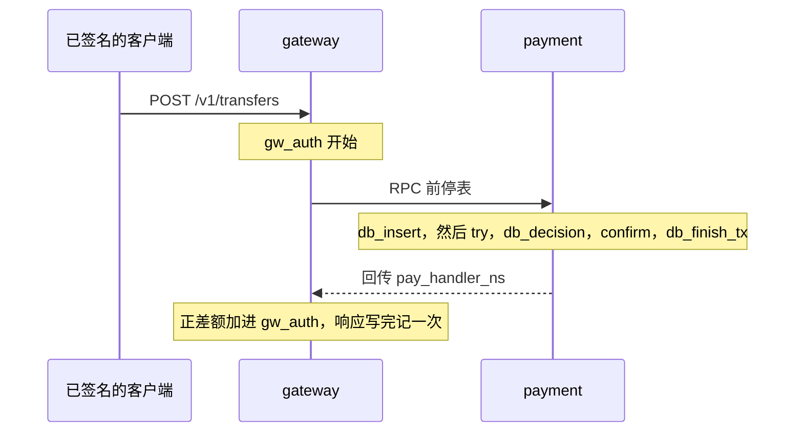

# OPT-01 分阶段耗时埋点

| 项 | 内容 |
|---|---|
| 功能点 | OPT-01（P0，第 5 周） |
| 所属链路 | 性能 |
| 代码提交 | `a8bf9b8` `[OPT-01] add stage timing` |
| 分支 | `feat/OPT-01-stage-timing` |
| 日期 | 2026-11-11 |
| 状态 | DONE |

## 一句话结论

六条资金链路上，规定好的每个阶段现在都会记一次耗时：已有的直方图 `pay_stage_duration_seconds{chain,stage}` 增加一个样本，当前追踪 span 上再写一条同名事件，属性是 `chain`、`stage` 和整数 `duration_ns`。它不改余额，也不改订单状态。官方门禁日志 `/tmp/opt01-verify.log` 从 Wed Nov 11 18:53:21 CST 2026 跑到 DONE Wed Nov 11 19:01:04 CST 2026，`gofmt`、`make lint`、`make test`、`make test-integration`、`make cover` 的退出码都是 0。日志里没有 `req_ns` / `sum_ns`。门禁前另有三次复测，当时这台机器还在跑别的集成测试，不是并发压测。那三次里，跨分片转账六个阶段之和与接口耗时的差都低于 5%。那三次不是这份日志里的数字。

## 1. 背景

埋点只回答「这一段花了多久」。它不决定转账成功还是失败。

### 1.1 系统简介

pay-system 是一个用 Go 编写的小型支付后端，模拟商户收款、退款、商户间转账三条资金链路，重点在数据一致性和性能。系统由 5 个部分组成：gateway（对外 HTTP 入口，负责签名校验和限流）、payment（支付单、退款单、转账单的状态管理和流程推进）、account（账户余额与记账，数据按商户分到 2 个数据库分片）、channel-mock（模拟微信、支付宝这类外部支付渠道）、recon（对账，核对系统内外数据是否一致）。服务之间用 Kitex RPC 同步调用，或通过 Kafka 消息异步通知；数据存在 MySQL 8.4，Redis 用于防重放。所有金额用整数「分」表示，100 分等于 1.00 元。所有记账只追加不修改。当前已完成：工程骨架、账户、支付、退款、转账、outbox、Kafka 消费、商户通知、网关验签、nonce、限流、链路追踪、`/metrics`，以及这次的分阶段耗时。批量记账、热点对比和按阶段去做的延迟优化还没做。

这里的防重放就是 nonce：商户请求头里的一次性随机串，放在 Redis 里，同一串在时间窗内不能再用。`gw_nonce` 只量「占用这一下」花了多久。

### 1.2 本功能点在系统中的位置

一次商户请求先到 gateway，再由 Kitex 调到 payment。阶段槽和链名留在各自进程的上下文里，RPC 只多传一个 `traceparent`。支付成功之后，payment 把事件发给 Kafka，发送时写入 `produced_at_ns`，然后才把 outbox 行改成 SENT。account 再消费入账。耗时记在 gateway、payment、account，不记在 recon。



发送时先写 `produced_at_ns`，这早于 SENT。`outbox_wait` 到回写 SENT 才结束，不能画成先结束再写这个头。`mq_wait` 从写头开始，到 account 开始消费结束。gateway 和 payment 各写各的上下文。验收测试把真实 Kitex 听在 `127.0.0.1:0`，不把网关的上下文直接送进 payment 的业务函数。

### 1.3 为什么需要它

付款商户 `M100001` 的账户在一个 MySQL 库，收款商户 `M100002` 的账户在另一个 MySQL 库。跨分片就是这两个库，各有一个商户账户。验收里先给付款方记入 10000 分（100.00 元），再转 500 分（5.00 元）。这笔转账要经过验签、插入转账单、付款方分片和收款方分片各自尝试、写下决定、确认、写下终态。没有分阶段耗时的话，接口慢了只能看到一整段墙钟（真实流逝的时间，不是 CPU 时间），看不出慢在插单，还是慢在某一个分片上的尝试。后面的优化要先知道哪一段占比高。这一步只负责把段切开并记下来，不负责把某一段变短。

## 2. 术语

下面每个词都按这一张表的意思使用。

| 术语 | 含义 |
|---|---|
| gateway | 对外 HTTP 入口。商户写接口在这里验签，再调用 payment。 |
| payment | 管支付单、退款单、转账单的服务。阶段槽建在这个进程的四个写方法上。 |
| account | 管余额和记账的服务。消费支付成功事件时记 `mq_wait` 和 `ledger_tx`。 |
| channel-mock | 模拟外部支付渠道。`channel_call` 记在 payment 发起 HTTP 的一侧，不记在这个进程里。 |
| 分 | 金额的整数单位。100 分等于 1.00 元。这次不改任何金额字段。 |
| 分录 | 账户里只追加、不修改的一条资金记录。少记一个耗时样本，不会因此多写一条分录。 |
| 分片 | 账户数据拆在 2 个 MySQL 库。商户号数字部分对 2 取模。`M100001` 在分片 1，`M100002` 在分片 0。跨分片转账时，付款方账户和收款方账户不在同一个库。 |
| nonce | 一次性随机串，放在 Redis 里。同一串在时间窗内不能再用，用来防重放。Redis 防重放就是这件事。`gw_nonce` 只量占用这一下。 |
| Kitex | 本仓库的 RPC 框架。传输用 TTHeader。这次确认它只把 `traceparent` 带过去。 |
| TTHeader | Kitex 的头。`pay_handler_ns` 是服务端写回的内部头，不是商户请求头，也不是 JSON 字段。 |
| traceparent | W3C 追踪上下文的一串文本。网关和 payment 靠它接上同一条 trace。阶段槽和链名靠它传不过去。 |
| span | 一条追踪上的一段时间。阶段结束时，如果当前上下文里有 span，就在上面加一个事件。没有 span 仍然记直方图。 |
| 回调 | 渠道在支付成功后打过来的 HTTP。`callback_tx` 量的是 payment 处理这次回调时的写库。这条 span 在事务提交时已经结束。 |
| Jaeger | 接收并查询追踪的进程。验收用镜像 `jaegertracing/jaeger:2.22.0`。整数属性在它的 `/api/v3/traces` 里常常是 `"intValue":"200"` 这种字符串，测试用十进制解析，不用浮点。 |
| Prometheus | 拉取指标的文本格式。直方图是其中一种：把耗时放进桶，并给出样本个数。 |
| `pay_stage_duration_seconds` | 阶段耗时直方图，标签只有 `chain` 和 `stage`。上一个功能点 OPS-03 已经注册。这次只记样本，没有再注册一次。 |
| 桶 | 直方图上界。全进程仍是 5ms、10ms、25ms、50ms、100ms、250ms、500ms、1s、2.5s、5s，另加 `+Inf`。 |
| chain | 链路名。六条分别是哪一次调用，见第 3.1 节的表。空字符串记成 `unknown`。 |
| stage | 阶段名。每个名字量哪一段，见第 3.1 节的表。空字符串也记成 `unknown`。 |
| 阶段槽 | 放在一次请求上下文里的一个位子，同一时刻只留一个还没结束的阶段。开始下一段之前先结束上一段。 |
| 响应转换 | 业务函数返回之后，把结果写成 RPC 或 HTTP 响应的那段代码。调用方已经有阶段槽时，业务层不关槽，好让最后一段把这段转换也量进去。 |
| `gw_auth` | 网关上、payment 处理方法以外的耗时，含验签。从追踪中间件进入商户写路由开始，RPC 期间停表，响应写完记一次。 |
| `pay_handler_ns` | payment 把处理方法耗时用十进制纳秒写回的 TTHeader。网关用「RPC 墙钟减去这个值」的正差额当作编解码，加进 `gw_auth`。键没有、解析失败或差额不是正数，就不加。 |
| 墙钟 | 真实流逝的时间，不是 CPU 时间。两段代码在不同进程里同时进行时，墙钟会重叠，加总就会算重。 |
| 单调钟 | 只会向前走的时间读数，不受把时钟拨回去的影响。`clock.Mono` 保留它。`clock.Real.Now` 换到东八区时会丢掉它，不能拿来和 `time.Since` 相减。 |
| 接口耗时 | 验收里只包住已经签好名的 `client.Do`。响应头一到就停。读 body 不算。用 `clock.Mono` 再 `time.Since`。 |
| outbox | payment 库里的待发送表。业务事务提交后，投递器再把行发给 Kafka，成功后把状态改成 SENT。 |
| 信封 | Kafka 消息的 JSON 正文。里面的 `trace_context` 仍然只有 `traceparent`。`produced_at_ns` 不是信封里的字段。 |
| `produced_at_ns` | 每条生产消息上的 Kafka 头，值是发送时的十进制纳秒。它早于把 outbox 行改成 SENT。不是商户头，也不进信封。 |
| `mq_wait` | 从 `produced_at_ns` 到 account 开始处理这条 `payment.succeeded`。头缺失或无法解析不记样本，也不把消息送进死信。 |
| `outbox_wait` | 从支付成功事务提交之后，到这次投递把该行回写成 SENT。起点和结束都在 payment 进程。 |
| `ledger_tx` | 只包住 account 里支付入账那一个数据库事务。 |
| TRYING | 转账单已经开始尝试，还没写下确认或取消。恢复任务看到这个状态时不再次 Try。 |
| TCC | 跨分片转账。先在付款方分片和收款方分片各自尝试（Try），再确认（Confirm）或取消（Cancel）。同分片不走 TCC，走一次本地转账。 |
| CAS | 比较并交换。更新状态时带上「当前必须仍是这个状态」。这次不改 CAS 条件。 |
| 幂等 | 同一个商户单号再来一次，不重复插单、不重复动钱。耗时直方图不去重。原来的幂等键这次没有改。 |
| DLQ | 死信队列。坏消息才会进去。`mq_wait` 的头有问题不算坏消息。 |
| 故障点 | 以前登记的、测试里可以触发的失败位置。这次没有新的故障点。 |

## 3. 技术讲解

同一次请求在阶段槽里先结束上一段，再开始下一段。跨进程的等待不传递结束函数，改用时间戳或本进程内存。

### 3.1 要解决的问题

六条链各自是哪一次调用，以及要记哪些阶段：

| chain | 哪一次调用 | 记哪些阶段 |
|---|---|---|
| `pay_create` | 创建支付单 | `gw_auth`、`gw_nonce`、`rpc`、`db_insert` |
| `pay_submit` | 提交渠道支付 | `gw_auth`、`db_tx1`、`channel_call`、`db_tx2` |
| `pay_settle` | 支付成功后的入账 | `callback_tx`、`outbox_wait`、`mq_wait`、`ledger_tx` |
| `refund` | 退款 | `gw_auth`、`db_quota_tx`、`rpc_freeze`、`db_tx`、`channel_call` |
| `transfer_local` | 同分片转账。付款方和收款方在同一个 MySQL 库 | `gw_auth`、`db_insert`、`rpc_transfer_local`、`db_finish_tx` |
| `transfer_tcc` | 跨分片转账。两个 MySQL 库，各有一个商户账户 | `gw_auth`、`db_insert`、`try`、`db_decision`、成功记 `confirm` 或取消记 `cancel`、然后 `db_finish_tx` |

每个阶段名量的是哪一段：

| 阶段 | 量的是哪一段 |
|---|---|
| `gw_auth` | 验签，以及网关上 payment 处理方法以外的时间。RPC 期间停表。验签失败时也记这一段，链名用当时已经知道的 `pay_create`、`pay_submit` 或 `refund`。转账这时还没有 `Mode`，不记。 |
| `gw_nonce` | 占用一次防重放 nonce。只量占用这一下，不量整段验签。 |
| `rpc` | 网关等待创建支付的那一次 RPC。只有 `pay_create` 有这一段。 |
| `db_insert` | 插入订单。转账里幂等读和收款方校验也算在这一段。 |
| `db_tx1`、`db_tx2` | 提交渠道支付时的两段数据库事务。第一段把支付单改成支付中，第二段写下渠道流水号。 |
| `channel_call` | 调用渠道 HTTP。只在链名已经是 `pay_submit` 或 `refund` 时记。查单、关单不记。 |
| `callback_tx` | 渠道回调进来之后的写库。回调是渠道在支付成功后打过来的 HTTP。 |
| `outbox_wait` | 从事务提交后，到 outbox 行被标成 SENT。 |
| `mq_wait` | 从消息发出（写入 `produced_at_ns`）到 account 开始消费。 |
| `ledger_tx` | 入账事务。只包住把支付成功记成分录的那一个数据库事务。 |
| `db_quota_tx` | 退款额度事务。占用原支付单还能退多少。 |
| `rpc_freeze` | 冻结余额的 RPC。退款在提交渠道之前先冻住这笔钱。 |
| `db_tx` | 退款写库。冻结成功之后，把退款单改成处理中。 |
| `rpc_transfer_local` | 同分片转账时，payment 调用 account、在一个库里把钱转完的那一次。 |
| `try` | 跨分片转账的尝试。付款方分片和收款方分片各做一次。 |
| `db_decision` | 写下确认或取消的决定。 |
| `confirm` | 跨分片转账的确认。两个分片按已经写下的决定把钱转完。 |
| `cancel` | 跨分片转账的取消。两个分片把尝试放开。 |
| `db_finish_tx` | 写下转账终态。成功或失败都在这一段落库。 |

其余约束：

1. 阶段槽和链名过不了 Kitex。网关和 payment 各自写本进程的上下文。不要把网关上下文直接交给业务函数冒充已经跨过 RPC。
2. `gw_auth` 不能把 payment 处理方法本身算进去，否则和 payment 里的阶段加在一起会远超接口耗时。RPC 墙钟比 `pay_handler_ns` 多出来的正差额要加回去，否则编解码会从总和里漏掉。
3. 转账在验签时还不知道是同分片还是跨分片。链名要等响应里的 `Mode`：`LOCAL` 记 `transfer_local`，`TCC` 记 `transfer_tcc`，其他值不记成别的链。验签失败时记的是 `gw_auth`，链名用当时已经知道的 `pay_create`、`pay_submit` 或 `refund`。转账还没有 `Mode`，不记。
4. `outbox_wait` 的起点和结束都在 payment。span 事件用投递当时的上下文。回调 span 已经结束，不能把事件补到回调上。`mq_wait` 不把结束函数送到另一个进程。
5. `channel_call` 的事件写在发起调用的当前 span 上，直方图仍然加样本。
6. 不新增错误码、IDL、表和指标名。金额仍是 int64 分。需求版本仍是 v3.0。接口文档改到 3.6.0，只增加 Kafka 头 `produced_at_ns` 的说明。没有新的故障点。

### 3.2 方案

`obs.Stage` 记下开始时刻，返回一个结束函数。结束时给已经注册的直方图记一次，并在当前 span 上写事件。结束函数内部只做一次，放进 `defer` 再调用也只会记一个样本。耗时为负时记 0。`chain` 参数为空时，结束那一刻再读上下文里的链名，这样转账可以先开表、等知道分片后再改链名。

`stageOnBackground` 是 ctx 为 nil 时用的计时，不继承父 ctx。`sinceFunc` 默认是 `time.Since`，测试可以换成假的，所以能测出负数并记 0。5% 能比，是因为阶段的 `duration_ns` 和接口耗时都来自保留单调钟的 `time.Since`：阶段在 `pkg/obs` 里计，接口耗时用 `clock.Mono`（不换时区）。`clock.Real.Now` 换到东八区时会丢掉单调钟，不能拿来和 `time.Since` 相减。

这段代码在做「记一次样本和一条事件」。看 `once` 和 `duration_ns` 是整数。ctx 为 nil 时走 `stageOnBackground`。

```go
// pkg/obs/stage.go
func Stage(ctx context.Context, chain, stage string) func() {
	if ctx == nil {
		return stageOnBackground(chain, stage)
	}
	start := time.Now()
	stageName := label(stage)
	var once sync.Once
	return func() {
		once.Do(func() {
			elapsed := sinceFunc(start)
			if elapsed < 0 {
				elapsed = 0
			}
			chainName := chainLabel(ctx, chain)
			stageDuration.WithLabelValues(chainName, stageName).Observe(seconds(elapsed))
			trace.SpanFromContext(ctx).AddEvent(stageName, trace.WithAttributes(
				attribute.String("chain", chainName),
				attribute.String("stage", stageName),
				attribute.Int64("duration_ns", elapsed.Nanoseconds()),
			))
		})
	}
}
```

`Begin` 在有槽时先调用上一阶段的结束函数，再 `Stage`。返回的函数只有在「自己仍是槽里的当前阶段」时才结束它，所以后一段已经开始之后，前一段的 `defer` 不会再记一次。`CloseSlot` 在 span 结束前把还开着的最后一段记上。调用方已经有阶段槽时，业务层不关槽，好让最后一段把响应转换也量进去。响应转换是业务函数返回之后，把结果写成 RPC 或 HTTP 响应的那段代码。业务层自己建的槽才由业务层关闭。

`CreatePayment`、`Pay`、`CreateRefund`、`CreateTransfer` 在取出 `traceparent` 之后套上槽。`CreateTransfer` 从处理方法入口就 `Begin` `db_insert`；这一段已经开着时，业务层不再 `Begin`，避免同名事件出现两次。

`transferReady` 先看 ctx 是不是 nil 或已经取消，是就不写单。`WithChain(nil)` 会换成 `context.Background()`，取消信号就没了，所以必须先做 `transferReady`，然后才写入链名。

网关的 `gw_auth` 不用这个槽，用一块可以暂停的计时。追踪中间件一进商户写路由就 `StartAuth`。真正调用 payment 之前 `Pause`，返回后 `Resume`。响应写完，已知链 `Observe` 一次，记的就是 `gw_auth`。转账则等 `Mode`，用 `ObserveTransfer`。验签失败、到不了 RPC 时，`pay_create`、`pay_submit`、`refund` 仍把已经过去的时间记成各自链上的 `gw_auth`。转账没有 `Mode`，不记。

这段代码在做「RPC 期间停表，并把编解码差额加回去」。看 `pay_handler_ns` 缺失就不加。

```go
// service/gateway/middleware.go
func pauseRPC(c *app.RequestContext, ctx context.Context) (context.Context, func()) {
	ctx = metainfo.WithBackwardValues(ctx)
	pauseAuth(c)
	start := time.Now()
	return ctx, func() {
		addCodecGap(c, ctx, time.Since(start))
		resumeAuth(c)
	}
}
```

`pay_create` 在网关本进程还有 `gw_nonce` 和 `rpc`。`gw_nonce` 只包住占用 nonce 那一下，发生时 `gw_auth` 还在走，这两段的墙钟重叠。`rpc` 开始前 `gw_auth` 已经停表，所以不和 `gw_auth` 重叠。它和 payment 的 `db_insert` 会在墙钟上重叠，因为一个在网关、一个在 payment，量的是同一段等待。转账验收的六段里没有 `rpc`，5% 不把这段重叠算进去。`pay_create` 的四段相加不能拿来和接口耗时做同样的比较。

`channel_call` 只包住真正发出的 HTTP。链名对不上就返回空函数。查单和关单的链名不是 `pay_submit` 或 `refund`，所以不计。退款恢复、以及查单补偿里再次提交渠道之前，会在上下文不是 nil 时写上 `refund`。nil 不调用 `WithChain`。

```go
// service/payment/biz/channel_http.go
func stopChannelStage(ctx context.Context, chain string) func() {
	if obs.ChainOf(ctx) != chain {
		return func() {}
	}
	return obs.Stage(ctx, chain, obs.StageChannelCall)
}
```

`HoldWait` 的键按事件编号组成。支付成功的事务提交之后，用它记住 `outbox_wait` 的起点，不抓住当时的回调 span。投递回写 SENT 成功时，`FinishWait` 用投递当时的上下文写事件。事务回滚不会开始这段等待。同一键再绑定，上一次只记直方图、不补 span 事件，避免闭包留在内存里。被否决的 `Bind` 就是把结束函数放进这类映射的旧想法，和 `HoldWait` 是同一类机制。另一个进程对不上这张映射。

`mq_wait`：生产者在组 Kafka 记录时写 `produced_at_ns`，这比 SENT 回写早。account 在消费 span 已经开始之后计算。头缺失或解析失败就返回，不记样本，也不返回错误，所以不进 DLQ。`ledger_tx` 在这之后，只包住入账事务。`callback_tx` 在提交前结束。`outbox_wait` 从提交后到 SENT。`mq_wait` 从发送时刻到消费开始。数据库事务里不等 Kafka。`outbox_wait` 和 `mq_wait` 在「已经发给 Kafka、还没回写 SENT」这一小段墙上重叠，谁也不包含谁。

恢复任务不走商户 HTTP，没有 `gw_auth`。转账恢复按行上的 `Mode` 写链名。TRYING 表示转账已经开始尝试、还没写下确认或取消。恢复任务不再次 Try，只把决定记在 `db_decision`，然后取消。退款恢复走和创建退款相同的冻结、改状态、提交渠道。

跨分片转账成功时，Jaeger 里要能对上的是 `gw_auth`、`db_insert`、`try`、`db_decision`、`confirm`、`db_finish_tx`。这六段不重叠，所以可以加总。取消路径把 `confirm` 换成 `cancel`，那是指标验收里的另一笔请求，不是 Jaeger 这一条。



图里的接口耗时从 `client.Do` 开始，到响应头返回结束。签名和读 body 在这个区间外面。

### 3.3 为什么这样做

「阶段和能加总」只对转账验收那六段成立：它们不重叠。`pay_create` 的 `rpc` 和 payment 的 `db_insert` 会在墙钟上重叠。`outbox_wait` 和 `mq_wait` 在已经发给 Kafka、还没回写 SENT 的那一小段上也重叠。

| 方案 | 做法 | 优点 | 缺点 | 结论 |
|---|---|---|---|---|
| 采用：本进程阶段槽，加 Kafka 时间戳 | 同一请求槽里互不嵌套；`gw_auth` 在 RPC 期间停表；`mq_wait` 用 `produced_at_ns` | 转账验收的六段不重叠，可以加总；头坏了不进死信 | `pay_create` 的 `rpc` 与 `db_insert` 墙钟重叠；`outbox_wait` 与 `mq_wait` 有一小段重叠；进程重启会丢掉还没结束的 `outbox_wait` | 采用 |
| 备选：把阶段名塞进 TTHeader | 网关把槽传到 payment | 看起来像一条连续表 | TTHeader 这次只传 `traceparent`，槽和链名过不去 | 不采用 |
| 备选：把结束函数 Bind 到另一个进程 | 把结束函数放进和 `HoldWait` 同一类的进程内映射，指望 account 来结束 | 调用方式和进程内一样 | 另一个进程对不上这张映射，闭包会留在原进程 | 不采用 |
| 备选：把 `outbox_wait` 补到回调 span | 投递结束时往渠道回调那条 span 上补事件 | 看起来和支付成功在同一条追踪上 | 回调 span 在事务提交时已经结束，事件补不上去。所以用投递当时的 ctx | 不采用 |
| 备选：用 `clock.Real.Now` 做接口耗时 | 业务时钟换到东八区再和 `time.Since` 相减 | 和订单时间同一只钟 | 换时区丢掉单调钟，相减会错 | 不采用 |
| 备选：再注册一遍直方图 | OPT-01 里再注册同名指标 | 读代码能看见名字是在这里诞生的 | OPS-03 已经注册，再注册会启动失败 | 不采用 |

### 3.4 正确性

这不是资金功能。阶段函数不写余额，也不改 CAS 条件。下表说的是样本会怎样，不是账户里还剩多少分。钱是否再动，仍由原来的幂等键决定。这次没有新的重放集成测试，也没有新的超时集成测试。第 5 节是同一句话。

| 场景 | 系统行为 | 最终状态 | 证明 |
|---|---|---|---|
| 同一请求重复到达 | 直方图不去重。转账若命中已有单，停在已经开着的 `db_insert`，不再执行 `try` / `confirm`。`gw_auth` 仍按这次请求记一次。 | 不因为记耗时再插一张转账单。钱是否再动，仍由原来的幂等键决定。 | `TestBeginSlotOnce` 只证明同一次结束函数调用两次只记一个样本。它不证明钱不会重记。没有新的重放集成测试。 |
| 两个请求并发 | 每个请求自己的上下文里一个槽。槽有锁。两个请求不会共用一个槽。 | 两笔记两套样本。余额仍由原来的行锁和 CAS 决定。 | 没有「两个请求抢同一槽」的测试。 |
| 进程在提交之后、投递之前崩溃 | `outbox_wait` 的起点只在本进程内存里，键是事件编号。新进程没有这个键，`FinishWait` 什么都不做，这一次不记样本。outbox 行仍会被稍后的投递器再发送。`mq_wait` 靠消息头，不跟这笔丢失绑在一起。 | 订单和 outbox 行停在原来的业务状态。少一个耗时样本，不会因此多写一条分录。 | 无崩溃测试。依据是 `HoldWait` 使用进程内映射。 |
| 下游调用超时 | 渠道 HTTP 无论成功还是错误，只要链名匹配，`channel_call` 都会结束。`pay_handler_ns` 没写回来时，编解码差额不加。冻结超时后订单怎么走，这次没有改原来的退款超时结果。 | 订单是否仍是处理中，由原来的超时分支决定。 | 这次没有改原来的退款超时结果，也没有新的超时集成测试。 |

### 3.5 性能

这次没有优化开关，也没有「埋点关闭 / 打开」的吞吐对比。P50、P99 和各阶段占比留给基线压测，本次没有计算。

5% 只针对 Jaeger 那一条成功的 `transfer_tcc`，不是指标那一条。比的是 `gw_auth`、`db_insert`、`try`、`db_decision`、`confirm`、`db_finish_tx` 的 `duration_ns` 之和，对上这次接口耗时。差的绝对值乘 100，小于接口耗时乘 5，才算通过。阶段的 `duration_ns` 和接口耗时都用保留单调钟的 `time.Since`。接口耗时只包住已经签好名的 `client.Do`，响应头一到就停，读 body 不算。

官方日志里没有这些纳秒。`go test` 不打印通过用例的 stdout。`service/payment/biz` 在官方集成日志里是 `ok`，172.320s。`go test` 在 Skip 时包也是 `ok`，所以官方日志分不出 Pass 和 Skip。

下面三行是门禁之前的复测，不是 `/tmp/opt01-verify.log` 里的数字，也没有单独的日志文件。命令是：

```bash
go test -race -tags integration -count=1 -run 'TestOPT01JaegerTransferTCC$' ./service/payment/biz/
```

同时另一个进程在跑 account、gateway、dbx、outbox、mq 的集成测试。这里的「负载」是机器同时还在跑别的集成测试，不是并发压测。三次都打印了纳秒，并且断言通过，所以那三次不是 Skip。

| 次序 | 接口耗时 `req_ns` | 阶段和 `sum_ns` | 差 | 约占接口耗时 |
|---|---|---|---|---|
| 1 | 44319666 | 43783251 | 536415 ns | 1.21% |
| 2 | 29647875 | 29061584 | 586291 ns | 1.98% |
| 3 | 34882458 | 34393957 | 488501 ns | 1.40% |

第一次的接口耗时大约 44.3 毫秒，阶段和大约 43.8 毫秒，差大约 0.54 毫秒。这不是优化前后的对比，只说明这六段加起来和接口墙钟还对得上。

## 4. 已完成内容

阶段名按第 3.1 节的表记上了。直方图没有新名字。官方门禁五个命令的退出码都是 0。

### 4.1 改动清单

提交 `a8bf9b8`（完整哈希 `a8bf9b89834eb17c1ba13b64adef516eb42dab8b`，2026-11-11 19:02:12 +0800）相对父提交 `ec3adea` 是 37 个文件，2215 行插入，16 行删除。`ec3adea` 是上一个功能点 OPS-03（业务与运行指标）的报告提交，只加了那份报告。这次 diff 的 37 个文件是 OPT-01 的代码和文档，因为代码直到 `a8bf9b8` 才提交。

| 文件 | 新增 / 修改 | 作用 |
|---|---|---|
| `pkg/obs/stage.go` | 新增 | `Stage`、阶段槽、`gw_auth` 停表、`outbox_wait`、`mq_wait` |
| `pkg/obs/stage_test.go` | 新增 | 直方图、空标签、负耗时、同一次结束只记一个样本、坏的 Kafka 头 |
| `pkg/obs/kitex.go` | 修改 | 回传 `pay_handler_ns` |
| `pkg/obs/metrics.go` | 修改 | 只改直方图的说明文字。不再次注册 |
| `pkg/clock/clock.go` | 修改 | 增加 `Mono`，保留单调钟 |
| `pkg/clock/clock_test.go` | 修改 | `Mono` 不换时区 |
| `pkg/mq/message.go` | 修改 | 生产消息增加头 `produced_at_ns` |
| `pkg/mq/producer.go` | 修改 | 注释改成四个头总会写入 |
| `pkg/mq/retry_test.go` | 修改 | 头是发送时刻的十进制纳秒 |
| `pkg/outbox/outbox.go` | 修改 | 事务里记住刚插入的事件编号。没有新增 `time.Now` |
| `pkg/outbox/dispatch.go` | 修改 | SENT 回写成功后结束 `outbox_wait` |
| `service/gateway/middleware.go` | 修改 | `gw_auth`、nonce 阶段、RPC 停表和编解码差额 |
| `service/gateway/route.go` | 修改 | 创建支付记 `rpc`；转账留下 `Mode` |
| `service/gateway/response.go` | 修改 | 存放 `Mode` 的键 |
| `service/payment/handler/middleware.go` | 修改 | 四个写方法套槽，span 结束前关闭，再回传处理方法耗时 |
| `service/payment/handler/handler.go` | 修改 | 转账从方法入口开始 `db_insert` |
| `service/payment/biz/payment.go` | 修改 | 创建支付的 `db_insert` |
| `service/payment/biz/pay.go` | 修改 | `db_tx1`、`db_tx2` |
| `service/payment/biz/channel_http.go` | 修改 | 只在 `pay_submit` 或 `refund` 记 `channel_call` |
| `service/payment/biz/result.go` | 修改 | `callback_tx`，提交成功后才开始 `outbox_wait` |
| `service/payment/biz/refund.go` | 修改 | `db_quota_tx` |
| `service/payment/biz/refund_submit.go` | 修改 | `rpc_freeze`、`db_tx` |
| `service/payment/biz/refund_recover.go` | 修改 | 恢复前写上 `refund`。nil 上下文不写 |
| `service/payment/biz/query_compensate.go` | 修改 | 再次提交渠道前写上 `refund` |
| `service/payment/biz/transfer.go` | 修改 | 沿用或自建槽；已有 `db_insert` 不再开始一次 |
| `service/payment/biz/transfer_local.go` | 修改 | `rpc_transfer_local`、`db_finish_tx` |
| `service/payment/biz/transfer_tcc.go` | 修改 | `try`、`db_decision`、`confirm` 或 `cancel`、`db_finish_tx` |
| `service/payment/biz/transfer_recover.go` | 修改 | 按 `Mode` 写链名；TRYING 的决定记在 `db_decision`，然后取消 |
| `service/payment/biz/opt01_integration_test.go` | 新增 | 两条验收，各测各的 |
| `service/account/biz/post_pay.go` | 修改 | `ledger_tx` 只包入账事务 |
| `service/account/consumer/ledger_single.go` | 修改 | 消费 span 上计算 `mq_wait` |
| `docs/01-tech-decisions.md` | 修改 | 补阶段槽、验签耗时和 `produced_at_ns` 的口径 |
| `docs/02-requirements.md` | 修改 | OPT-01 标为 DONE，两条验收勾上。版本仍是 v3.0 |
| `docs/04-dev-plan.md` | 修改 | 第 105 行勾上。同一行里的 OPS-02、OPS-03 也已经完成 |
| `docs/05-api.md` | 修改 | 接口文档 3.6.0，只增加这个 Kafka 头 |
| `docs/06-flows.md` | 修改 | 跨分片转账图下补一句阶段名。图的节点不改 |
| `docs/interview-notes.md` | 修改 | 三条实现时容易踩错的点 |

生产消息总会写的四个头是 `event_id`、`event_type`、`traceparent`、`produced_at_ns`。死信上的 `x-orig-topic` 等不是这四个。

`biz`、`job`、`pkg/outbox` 不能写 `time.Now`，是为了测试能用注入的时钟停住业务时间。这次计时的 `time.Now` 在 `pkg/obs`。网关停表和发消息处也有墙钟，不在那三个目录里。

### 4.2 对外变化

| 类别 | 变化 |
|---|---|
| 接口 | 商户 HTTP 不改。IDL 不改。每条 Kafka 生产消息多一个头 `produced_at_ns`。信封仍是原来的 JSON 正文，`trace_context` 仍然只有 `traceparent`。 |
| 表结构 | 无。 |
| 配置项 | 无。没有埋点开关。 |
| 错误码 | 无。 |
| 指标 / 故障点 | 无新指标名。故障点是以前登记的、测试里可以触发的失败位置，这次没有新的。`pay_stage_duration_seconds` 从「只注册」变成会记样本。标签仍只有 `chain`、`stage`。空标签记 `unknown`。 |

### 4.3 验收对照

两条验收不是同一次请求，金额也不能混着看。

| 验收条目 | 测试函数 | 类型 | 结果 |
|---|---|---|---|
| 一次成功的跨分片转账在 Jaeger 中能看到 `gw_auth`、`db_insert`、`try`、`db_decision`、`confirm`、`db_finish_tx`，各阶段耗时之和与接口耗时的差值小于 5% | `TestOPT01JaegerTransferTCC` | 集成 | 所在包在官方集成日志里是 `ok`。日志分不出 Pass 和 Skip，也没有 `req_ns`。门禁前三次复测打印了纳秒并且断言通过，见 3.5 |
| 6 条链路各执行一次后，第 3.1 节表里每个 `(chain, stage)` 的样本数都大于等于 1。`transfer_tcc` 的 `confirm` 和 `cancel` 都要有 | `TestOPT01AllChainsMetrics` | 集成 | 同一个包是 `ok`。官方日志不打印样本数。通过用例的 stdout 被测试工具丢掉 |

Jaeger 那一条：成功的跨分片转账，金额 500 分（5.00 元），商户单号 `OPT01-JAEGER`，付款方 `M100001`，收款方 `M100002`。付款方分片和收款方分片是两个 MySQL 库。

指标那一条另做一组调用，用来把六条链的每个阶段都打出至少一个样本。创建支付 10000 分（100.00 元），退款 1000 分（10.00 元），同分片转账 500 分（5.00 元）给 `M100003`，成功的跨分片转账 500 分（5.00 元）给 `M100002`。取消用的是另一笔：商户单号 `OPT01-CANCEL`，金额 100000 分（1000.00 元），HTTP 409，业务码是原来的余额不足码 `40002`。这笔只负责让 `cancel` 出现一次。它和 Jaeger 那条不是同一次断言。

单元测试不替代上面两条，只钉住口径：`TestStageHistogramAndEvent`、`TestStageEmptyLabelsAndNoSpan`、`TestStageNegativeDuration`、`TestBeginSlotOnce`、`TestChainHintUpdatesOpenStage`、`TestBindReleaseOnce`、`TestAuthWatchFreezesBeforeObserve`、`TestAuthWatchAddOnlyWhilePaused`、`TestFinishWaitUsesCallerSpan`、`TestObserveMQWaitSkipsBadHeader`、`TestMessageRecordProducedAt`、`TestMonoKeepsLocalZone`。其中 `TestBeginSlotOnce` 只证明同一次结束函数调用两次只记一个样本。`TestAuthWatchAddOnlyWhilePaused` 只说明正在计时或已经记过时 `Add` 不会再加，不说明超时后订单怎么走。

### 4.4 验证记录

环境是本机 macOS。集成测试用 Docker testcontainers。日志是 `/tmp/opt01-verify.log`。日志跑的是当时工作区里的代码。结束后只改了 `docs/04-dev-plan.md` 第 105 行的勾，然后提交成 `a8bf9b8`。没有再改计时逻辑，也没有重跑这五条命令。所以日志对应的代码和提交只差这一行勾选。开始时 HEAD 还是父提交 `ec3adea`，因为 OPT-01 当时还没提交。

| 命令 | 结果 |
|---|---|
| `gofmt -l .` | `gofmt_exit:0` |
| `make lint` | `0 issues.`，`lint_exit:0`。命令是 `golangci-lint run --build-tags integration ./...` |
| `make test` | `test_exit:0`。命令是 `go test -race ./...`。`service/payment/biz` 6.019s，`service/account/biz` 1.536s，`pkg/outbox` 1.522s |
| `make test-integration` | `integration_exit:0`。命令是 `go test -race -tags integration ./...`。`service/payment/biz` 172.320s，`service/account/biz` 72.594s，`pkg/outbox` 178.779s。两个 OPT-01 测试在 payment 这个包里，包是 `ok`。Skip 时包也是 `ok`。日志里没有 `req_ns` / `sum_ns` |
| `make cover` | `cover_exit:0`。命令是 `go test -race -tags integration -coverprofile=coverage.out ./...`。随后删除 `coverage.out`（`no_coverage_out`）。total 40.7%，含生成代码 `kitex_gen`，不是门槛。这一次的读数：`pkg/money` 100.0%，`pkg/sign` 100.0%，`pkg/idgen` 88.1%，`pkg/outbox` 84.4%，`pkg/dbx` 89.5%，`service/account/biz` 90.8%，`service/channel_mock/biz` 91.7%，`service/payment/biz` 85.2%。`pkg/obs` 70.9% 不在门槛清单里，只是这次的读数 |

覆盖率门槛是这些包各自不低于 70%：`service/*/biz`、`pkg/money`、`pkg/sign`、`pkg/idgen`、`pkg/outbox`、`pkg/dbx`。表里的百分数是这一次的结果，下次不必等于这些数，但这些包仍要不低于 70%。`pkg/outbox` 和 `pkg/dbx` 这次都高于 70%，符合第 5 周交付线。

### 4.5 同步的文档

- `docs/02-requirements.md`：OPT-01 改为 DONE，两条验收框勾上。版本号仍是 v3.0。变更记录写了阶段槽、`gw_auth` 和 `produced_at_ns`。
- `docs/01-tech-decisions.md`：可观测和延迟优化两节补了同一口径。基线 P50 / P99 仍等后面的压测。
- `docs/05-api.md`：升到 3.6.0。消息头一节增加 `produced_at_ns`。
- `docs/06-flows.md`：只改跨分片转账图下面的一句。未生成新的 SVG。
- `docs/04-dev-plan.md`：第 105 行勾上，因为 OPS-02、OPS-03、OPT-01 都已经完成。日志结束之后，提交前只改了这一行勾。
- `docs/interview-notes.md`：记下 nil 上下文不能先 `WithChain`；测试要先让 testcontainers 把容器拉起来，再 `obs.Install` 接 Jaeger；整数属性按字符串解析。

## 5. 未完成与风险

- 基线压测还没做。各阶段的 P50、P99 和占比没有官方数字。后面的批量记账、热点子账户对比、按占比做的延迟优化都还没开始。不要把第 105 行理解成那些优化已经开始。
- 官方日志不能单独证明 Jaeger 那条没有 Skip，也不能证明每个 `(chain, stage)` 的样本数。包是 `ok` 只说明没有失败。5% 的三个纳秒来自门禁前的三次复测，当时机器还在跑别的集成测试。
- `outbox_wait` 的起点在进程内存里，键是事件编号。payment 在投递前重启，这一次样本就没了。业务重试仍会发消息。少一个耗时样本，不会因此多写一条分录。
- `pay_create` 的 `gw_nonce` 落在 `gw_auth` 里面，`rpc` 又和 payment 的 `db_insert` 在墙钟上重叠。把这四段相加会大于接口耗时。5% 不覆盖这条链路。
- `mq_wait` 用发送时刻而不是 SENT 时刻。它和 `outbox_wait` 在已经发给 Kafka、还没回写 SENT 的那一小段上重叠。头缺失的消息照常入账，只是直方图里少一个样本。
- 幂等重放和并发抢槽没有专门的集成测试。钱是否再动仍由原来的幂等键决定。冻结超时后订单怎么走，这次没有改原来的退款结果，也没有新的超时集成测试。

## 6. 如何复现

前置：本机 Docker 可用，仓库在 `feat/OPT-01-stage-timing`，代码已经是 `a8bf9b8`。集成测试会自己拉起 MySQL、Jaeger 和既有的 Kafka 测试装置，不需要先 `make up`，也不需要读者另做一次安装。测试先让 testcontainers 把 Docker 容器拉起来，再调用 `obs.Install` 接 Jaeger。否则 Docker 自己的 HTTP span 会占满按 `service.name=gateway` 查到的结果。官方那次日志没有留下 `req_ns`。要看到纳秒，需要自己加 `-v`，而且数字会和 3.5 的三次不同。

```bash
gofmt -l .
make lint
make test
make test-integration
make cover
rm -f coverage.out
```

预期：`gofmt -l .` 没有文件名。lint 是 `0 issues.`。后三条的进程退出码都是 0。`make cover` 会写出 `coverage.out`，对过之后删掉。门槛是 `service/*/biz`、`pkg/money`、`pkg/sign`、`pkg/idgen`、`pkg/outbox`、`pkg/dbx` 各自不低于 70%。4.4 里的百分数是那一次的读数，下次不必相等。total 含生成代码 `kitex_gen`，不是门槛。`pkg/obs` 不在这张门槛清单里。

只跑两条验收时：

```bash
go test -race -tags integration -count=1 -v \
  -run 'TestOPT01JaegerTransferTCC|TestOPT01AllChainsMetrics' \
  ./service/payment/biz/
```

预期：Jaeger 那条在通过时打印一行 `OPT-01 jaeger`，里面有 `req_ns`、`sum_ns`，并且测试没有因为超过 5% 失败。它测的是 `OPT01-JAEGER` 那笔 500 分（5.00 元）。指标那条为第 3.1 节表里的每一对打印 `count=`，每个数都大于等于 1，其中 `OPT01-CANCEL` 那笔 100000 分（1000.00 元）用来记 `cancel`。容器起不来、Jaeger 查询路径不可用时会 Skip。Skip 时包仍然是 `ok`，那一次不能当作 5% 通过。

## 7. 讲解要点

1. 为什么转账那六段能跟接口耗时比？它们不重叠。`gw_auth` 在 RPC 期间停表，payment 处理方法不算进去；`pay_handler_ns` 的正差额把编解码加回去。转账没有 `rpc` 阶段，所以不会把网关和 payment 重叠的那段再加一遍。接口耗时不含签名和读 body。阶段的 `duration_ns` 和接口耗时都用保留单调钟的 `time.Since`。
2. 为什么不把结束函数传到 account？另一个进程对不上 payment 内存里的映射，闭包会留在原进程。`mq_wait` 改用发送时写进 Kafka 的 `produced_at_ns`，在 account 自己的消费 span 上计算。头坏了只是不记样本。`outbox_wait` 则是另一件事：回调 span 已经结束，事件只能写在投递当时的 ctx 上。
3. 为什么 `WithChain` 不能放在 `transferReady` 前面？`transferReady` 先看 ctx 是不是 nil 或已经取消，是就不写单。`WithChain(nil)` 会换成 `context.Background()`，取消信号就没了。

## 延伸阅读

- `docs/02-requirements.md` 的 OPT-01（阶段表和两条验收）
- `docs/01-tech-decisions.md` 的 D14、D21（2026-11-11 补充）
- `docs/05-api.md` 的消息头一节（`produced_at_ns`）
- `docs/06-flows.md` 跨分片转账图下的那一句
- `docs/04-dev-plan.md` 第 5 周第 105 行

## 修订记录

| 日期 | 提交 | 修订内容 |
|---|---|---|
| 2026-11-11 | 待提交 | 初稿 |
