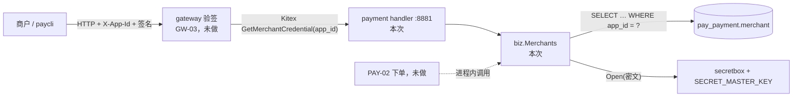
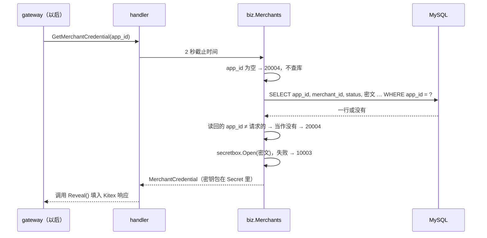

# PAY-01 商户与密钥

| 项 | 内容 |
|---|---|
| 功能点 | PAY-01（P0，第 3 周） |
| 所属链路 | 支付 |
| 代码提交 | `8a0cf99` `[PAY-01] add merchant credential rpc and config cache`（完整 `8a0cf9917abd5ef5926add4808e16f80ff1eb2db`，2026-10-27 17:09:36 +0800） |
| 分支 | `feat/PAY-01-merchant-credential` |
| 日期 | 2026-10-27 |
| 状态 | DONE |

这次代码提交 18 个文件，2690 行新增，13 行删除。本报告在该提交之后写，不在这 18 个文件里。

## 一句话结论

payment 进程现在在 `:8881` 提供 Kitex 方法 `GetMerchantCredential`：按 `app_id` 读出商户，用主密钥解开库里加密存放的商户密钥，交给网关验签用。三个种子商户经真实 Kitex 客户端取回的密钥与演示值一致，不存在的 `app_id` 返回 `20004`，大小写或首尾空格不同也返回 `20004`。明文密钥包在专用类型里，`fmt`、`json`、`slog` 各种嵌套输出都只出现 `***`。另外提供进程内的商户配置缓存和按时刻取生效费率的方法，供后面的下单使用。payment 相关 3 个包的 35 个测试全部通过，覆盖率 biz 100.0%、handler 89.2%。

## 1. 背景

### 1.1 系统简介

pay-system 是一个用 Go 编写的小型支付后端，模拟商户收款、退款、商户间转账三条资金链路，重点在数据一致性和性能。系统由 5 个部分组成：gateway（对外 HTTP 入口，负责签名校验和限流）、payment（支付单、退款单、转账单的状态管理和流程推进）、account（账户余额与记账，数据按商户分到 2 个数据库分片）、channel-mock（模拟微信、支付宝这类外部支付渠道）、recon（对账，核对系统内外数据是否一致）。服务之间用 Kitex RPC 同步调用，或通过 Kafka 消息异步通知；数据存在 MySQL 8.4，Redis 用于防重放。所有金额用整数“分”表示，所有记账只追加不修改。

当前已完成：公共库（金额、ID、错误码、时钟、配置、日志、数据库访问、签名、密钥加密）；account 的开户、查询、记账、冻结、转账分支、余额核对和 RPC 服务；商户费率历史与手续费核对；模拟渠道的受理、查单、关单、回调和 4 种故障场景；以及本次 payment 的第一个 RPC 方法。gateway 进程、支付单、退款、转账、Kafka 消息还没做，所以 `GetMerchantCredential` 现在只被测试和本次手测调用。

Kitex 是本项目的 Go RPC 框架；RPC 是一个进程同步调用另一个进程的函数。P0 是必须先做的优先级。开发计划共 8 周，每周一个里程碑，编号 M1～M8；M3 即第 3 周的里程碑“支付主链路与模拟渠道”，PAY-01 排在其中。

### 1.2 本功能点在系统中的位置

商户每个 HTTP 请求都带签名，网关要先拿到这个商户的密钥才能验签。密钥只存在 payment 的库里，所以网关要通过 RPC 向 payment 要。



上游是 gateway（GW-03 商户验签，未做），下游是 payment 自己的 `merchant` 表和密钥解密包。虚线是以后的下单（PAY-02），它会在 payment 进程内直接调用本次的配置缓存和费率方法，不走 RPC。

为什么密钥放在 payment，网关不直接读库：

- 每个服务有自己的库和数据库账号，只能写自己的库。系统里没有 gateway 的库，`merchant` 表在 payment 的库 `pay_payment` 里（技术决策 D10）。
- 解密要用主密钥 `SECRET_MASTER_KEY`。配置里只有 payment 和种子程序读这个变量。网关直接读库的话，也得拿到主密钥和 payment 库的账号，持有主密钥的进程就多了一个。

### 1.3 为什么需要它

没有这个方法，网关无法验签，所有商户请求都只能拒绝，或者不验签就放行。不验签的后果：任何人知道 `app_id` 就能冒充商户 `M100001` 下单、退款。

密钥不能像密码一样只存哈希。HMAC 签名要求平台和商户持有同一把可还原的密钥，所以库里存的是加密后的密文，用时解开（技术决策 D11）。

## 2. 术语

| 术语 | 含义 |
|---|---|
| 商户 | 在平台收款的一方，商户号形如 `M100001`。 |
| `app_id` | 商户的应用 ID，形如 `app_m100001`，商户每个请求都放在请求头 `X-App-Id` 里。 |
| 商户密钥 `app_secret` | 平台和商户共有的一串字符，用来算签名。种子商户的明文是 32 字节。 |
| 签名 / 验签 | 发送方用密钥对请求算一个 HMAC-SHA256 值放进 `X-Signature`；接收方用同一把密钥重算并比较。改动请求的任何一个字节，签名就对不上。 |
| 签名串 | 参与签名的那串文本：方法名、路径和查询串、时间戳、nonce、body 摘要，用换行连起来。`X-App-Id` 不在其中。 |
| 时间窗 | 请求头 `X-Timestamp`（Unix 秒）与网关服务器时间相差超过 300 秒（前后各 300 秒）就拒绝（`20002`），过期的旧请求重发不会被接受（接口 §3.2，GW-04 规则 1）。 |
| nonce | 请求头 `X-Nonce` 里的随机串。验签通过后，网关在 Redis 里写键 `gw:nonce:{app_id}:{nonce}`，保留 600 秒（10 分钟）；同一个键再来就拒绝（`20003`），防止别人在时间窗内把截获的请求原样重发（重放）（GW-04 规则 3）。键里的 `app_id` 是请求头原文。 |
| 时间窗与 nonce 的关系 | 一个请求的时间戳最多在 600 秒内有效（服务器时间从 `ts-300` 到 `ts+300`）。nonce 在第一次被接受时写入、保留 600 秒，所以到 nonce 过期时时间戳也已过期，重放会被时间窗拒绝。两者合起来才挡住所有重放。 |
| 主密钥 | 环境变量 `SECRET_MASTER_KEY`，base64 编码的 32 字节。只用来加解密商户密钥，不用来签名。 |
| secretbox | 本项目的密钥加密包 `pkg/secretbox`（BASE-14），用 AES-256-GCM。密文 = 1 字节版本号 + 12 字节随机数 + 加密内容 + 16 字节校验标签。32 字节明文得到 61 字节密文，本次手测库里三行都是 61。 |
| `Open` | secretbox 的解密方法。主密钥不对、密文被改过、版本号不认识、长度不够都会失败。 |
| GCM 校验标签 | 密文末尾的 16 字节。密文或密钥有任何不对，解密都会失败，不会解出一串错误的明文。 |
| DISABLED | 商户状态之一，表示已停用。另一个是 `ACTIVE`。 |
| 种子 | 启动前写入的演示数据：3 个商户 `M100001`～`M100003`，各有一把演示密钥。演示密钥按 `deploy/.env.example` 里的 `DEMO_APP_SECRET_FORMAT` 生成，`M100001` 的那把也是接口文档签名测试向量用的密钥。 |
| `DEMO_APP_SECRET_FORMAT` | 一个 Go 格式串，必须恰好含一个 `%`，且是 `%s`，否则种子报错退出。种子用 `fmt.Sprintf(格式串, 商户号)` 得到明文，代入的是商户号（如 `M100001`），不是 `app_id`（`internal/seed/seed.go` 的 `merchantSecret`）。变量为空时用种子代码里同样结构的默认格式串；集成测试断言 `.env.example` 的值与这个默认值相同。本报告不写出格式串本身。 |
| 排序规则（collation） | MySQL 比较字符串的规则。`utf8mb4_bin` 按字符编码比较，区分大小写；`utf8mb4_0900_ai_ci` 不区分大小写（ci）和重音（ai），`A` 等于 `a`，`ä` 等于 `a`。 |
| PAD SPACE / NO PAD | 排序规则的另一个属性。PAD SPACE 比较前忽略尾部空格，`'abc '` 等于 `'abc'`；NO PAD 不忽略。 |
| 按字节精确匹配 | 在 Go 里用 `==` 比较两个字符串，每个字节都相同才算相同。 |
| Kitex handler | 网络层。把 Thrift 请求转成 Go 调用，把结果和错误转回去，不写 SQL。 |
| biz | 业务规则所在的包，这里是 `service/payment/biz`。 |
| TTHeader | Kitex 的一种传输头。业务错误码写在这个头里，客户端也要开启它，否则会把业务错误当成成功的空响应。 |
| 业务码 | 错误码数字。本报告用到 4 个：`10001` 参数不合法（`invalid parameter`）；`10003` 内部错误（`internal error`），对外不带原因；`10004` 依赖暂时不可用；`20004` 商户不存在或已停用（`invalid merchant`）。都是已有的码，本次没有新增。 |
| TTL | 缓存条目的有效期。本次由环境变量 `MERCHANT_CONFIG_CACHE_TTL` 配置，默认 60 秒，0 表示不缓存。 |
| 费率档 | 表 `merchant_fee_rate` 的一行：某商户从 `effective_from` 时刻起按多少基点收手续费。1 基点 = 0.01%，60 基点即 0.6%。只追加，不改旧行（PAY-10）。 |
| singleflight | 一种合并并发请求的写法：同一个键同时有多个请求未命中缓存时，只让一个去读库，其余等它的结果。本次没有用。 |
| 时钟回拨 | 机器时间被往回调，例如 NTP 校时。当前时间可能早于缓存的装载时间。 |
| `pkg/clock` | 本项目的可注入时钟。生产用真实时间，测试用可手动拨动的假时钟。 |
| OPT-04 | 以后的性能功能点：把配置缓存开和关各压一次，比较延迟。 |
| GW-03 / GW-04 / GW-08 | 以后的网关功能点。GW-03 做商户验签（第 3 周），GW-04 做时间窗和 nonce 防重放（第 5 周），GW-08 在网关进程里缓存商户凭证。 |
| OPS-01 | 以后的功能点：健康检查和收到退出信号后的 10 秒排空。 |

## 3. 技术讲解

### 3.1 要解决的问题

1. 网关拿得到密钥：按 `app_id` 返回商户号、状态、明文密钥、密钥版本、默认通知地址。只走内部 RPC，不对外开放 HTTP（机制和验证情况见 4.3 规则 1 那一行）。
2. 明文密钥不能出现在日志、trace、错误信息、panic 信息里。它一旦进了日志，看得到日志的人就能冒充商户。
3. 只认库里完全相同的 `app_id`。`X-App-Id` 不在签名串里，换个写法不会让签名失效，但会让 nonce 记录换个键（例子见 3.2.3）。
4. 停用商户仍返回记录，由网关返回 `20004`。这是需求 PAY-01 规则 2 的规定。理由：网关对“不存在”和“已停用”统一返回 `20004`（GW-03 规则 2），判断放在网关一处；payment 只如实报告状态，不同的调用方以后可以按状态做不同处理，GW-08 的网关缓存也能连状态一起缓存。代价是停用商户的明文密钥仍会经 RPC 交给网关，而网关判断 DISABLED 时用不到它：按 GW-03 的规则顺序，规则 2 先按状态返回 `20004`，规则 3 才验签。风险是密钥在网关进程里多停留一段时间（有 GW-08 缓存时最长一个缓存 TTL）。改进建议：DISABLED 时不返回 `app_secret`（返回空串），但这会改变接口语义，要由 GW-03 / GW-08 和用户决定，本次没有做。
5. 解密失败和查库失败要能和“商户不存在”分开，否则运维看到的只是一堆 `20004`，发现不了主密钥配错。
6. 给以后的下单准备按 `merchant_id` 读商户配置的方法，进程内缓存，TTL 可关（需求 PAY-01 规则 3）。生效费率要和 PAY-10 的手续费核对用同一个口径。
7. 资金规则：本功能点只读，不写任何表，不涉及金额变动和记账。

### 3.2 方案

整体是三层：Kitex handler 只做协议和错误码转换；`biz.Merchants` 查库、比较、解密；查询直接走 `merchant` 表的唯一索引 `uk_app_id`。

#### 3.2.1 一次调用的流程



没有缓存，每次调用都查一次库。payment 不缓存凭证，网关侧的凭证缓存属于 GW-08。

#### 3.2.2 错误映射，按场景分

| 场景 | 调用方收到 | 日志 | 证明 |
|---|---|---|---|
| 商户存在且 `ACTIVE` | 成功，5 个字段 | 一条访问日志，`err_code` 为 `0` | `TestRPCMerchantCredentialSeeded`；手测 |
| 商户 `DISABLED` | 成功，`status` 为 `DISABLED`，密钥照常返回 | 同上 | `TestPAY01DisabledAndBadCipher`、`TestRPCMerchantCredentialSeeded`；手测 |
| `app_id` 不存在 | `20004` `invalid merchant` | 访问日志 `err_code` 为 `20004`，不打 ERROR | `TestPAY01UnknownAppID`、`TestRPCMerchantCredentialSeeded`；手测 |
| `app_id` 为空串 | `20004`，不查库 | 同上 | `TestGetMerchantCredentialUnknown` 断言查库次数为 1（只有非空那次）；手测 |
| 大小写、重音、首尾空格与库里不同 | `20004` | 同上 | `TestPAY01UnknownAppID`（大小写、重音）；首尾空格只有手测 |
| 密文解不开 | `10003` `internal error` | 一条 ERROR `decrypt merchant secret failed`，只有 `app_id` 和 `merchant_id` | `TestGetMerchantCredentialDecryptFailure`（4 种坏法）、`TestPAY01DisabledAndBadCipher`；手测 |
| 查库失败 | `10003`，响应里没有原因 | 一条 ERROR `map internal error`，`error` 字段是原因 | `TestKitexGetMerchantCredentialErrors`、`TestCredentialNotLogged`；手测停掉 MySQL |
| 服务端 2 秒到期，或调用方自己超时 | Kitex 超时错误，不是 `10003` | 访问日志 `err_code` 为 `timeout` | `TestServerTimeoutTwoSeconds` |
| 调用方已取消 | 取消原样返回，由 Kitex 变成超时，不是 `10003` | 同上 | `TestGetMerchantCredentialErrors` 在 biz 层断言 |
| 其余 11 个方法（下单、支付、退款等） | `10003`，不进 biz | 访问日志 `err_code` 为 `10003` | `TestUnimplementedMethodsReturnInternal`；手测 `CreatePayment` |
| handler 里 panic | `10003`，响应不含 panic 值 | 固定一句 `handler panicked`，不记 panic 值 | `TestHandlerPanicReturns10003AndServerStaysUp` 只断言了响应；日志不记值由代码保证，测试没有抓日志 |

解密失败为什么是 `10003`，不是 `20004` 或 `10004`：

- 不是 `20004`：商户没有做错任何事，是平台的主密钥配错或数据坏了。返回“商户无效”会误导商户，也会让运维以为是商户配置问题。
- 不是 `10004`：`10004` 表示依赖暂时不可用，调用方可以稍后重试。主密钥不对时重试多少次结果都一样。
- 只打一条 ERROR：解密失败返回不带原因的 `10003`，handler 看到没有原因就不再打第二条（与 account RPC 同一口径：未识别错误的原因进日志，不进对外消息）。日志不记 secretbox 的错误、密文和明文。

查库失败的 ERROR 带原因。手测里是 `dial tcp 127.0.0.1:3306: connect: connection refused`：有数据库地址，没有口令。

#### 3.2.3 按字节精确匹配

结论：SQL 查到行以后，在 Go 里再比一次读回的 `app_id` 和请求里的是否逐字节相同，不同就按不存在返回 `20004`。

不比会怎样，举例。商户 `M100001` 发一个下单请求，`X-App-Id: app_m100001`，`X-Nonce: n1`，签名 `S`。网关验签通过，写下 nonce 键 `gw:nonce:app_m100001:n1`（键里是请求头原文，GW-04 规则 3）。攻击者在 300 秒的时间窗内重发同一个请求，只把 `X-App-Id` 换一种写法 `X'`：

1. 签名串里没有 `app_id`，所以签名串没变。
2. 如果 payment 把 `X'` 也当成 `app_m100001`，返回同一把密钥，`S` 依然验得过。
3. 网关去查 `gw:nonce:{X'}:n1`，没有，放行。

nonce 这一层防线就被绕过了。重复请求最后会不会造成重复交易，取决于各接口自己的幂等键，这里不展开。

第 2 步成不成立，取决于 SQL 会不会把 `X'` 和 `app_m100001` 当成相同，也就是列的排序规则。两个环境不一样，本次都实际执行了 SQL：

| 环境 | 列的排序规则 | 大小写不同 | 重音不同 | 尾部空格 | 首部空格、尾部 Tab | 来源 |
|---|---|---|---|---|---|---|
| compose 本地环境（`make migrate` 建的库），代表真实部署 | `utf8mb4_bin`，PAD SPACE | 0 行 | 0 行 | 1 个、2 个空格都查到 1 行 | 0 行 | 手测：查 `information_schema`，在 `pay_payment` 上执行 `WHERE` |
| 集成测试的临时库（`internal/testkit` 建的库） | `utf8mb4_0900_ai_ci`，NO PAD | 查到 1 行（`APP_M100001`、`app_M100001`） | 查到 1 行（`äpp_m100001`） | 0 行 | 0 行 | 在 compose 的 MySQL 上新建 `utf8mb4_0900_ai_ci` 临时库，执行同一份迁移，插入 1 行后执行 `WHERE`；用完已删除。命令见 §6。`merchant_id = 'm100001'` 也查到 1 行 |

迁移文件没有给表或列指定排序规则，所以列跟随所在库的默认值。约定规定库用 `utf8mb4_bin`（约定 §7.2），建库脚本 `bootstrap` 也这样建；只有测试基座 `testkit` 建库时用了 `utf8mb4_0900_ai_ci`。所以 compose 的结果代表真实部署，测试库的结果只代表集成测试。

这次比较在两个环境里挡的东西不同：真实部署里挡尾部空格，测试库里挡大小写和重音。手测在 compose 上发了 `"app_m100001 "`（尾部一个空格），SQL 能查到行，比较后返回 `20004`。

在真实部署里，这个风险有多大：

- 大写、重音这类写法，即使没有 Go 里的比较，SQL 也查不到，攻击不成立。
- 只有尾部空格能让 SQL 查到行。但它要先原样到达 payment：HTTP/1.1 规范（RFC 9110 §5.5）规定字段值首尾的空格和 Tab 不属于值，符合规范的解析器会去掉。网关用的 Hertz 是否这样做，本次没有验证（gateway 还没写）。
- 所以没有这次比较时，风险取决于一个未验证的框架行为；有了比较，不论框架怎么处理，payment 都只认完全相同的 `app_id`。这次比较的代价是一次字符串比较。

实现阶段做过一次反向验证：去掉这次比较后，`TestPAY01UnknownAppID` 失败，测试库能用 `APP_M100001` 查到行。那次验证在本报告之前，本次没有重跑，因为重跑要改代码。尾部空格目前没有自动化测试：测试库是 NO PAD，构造不出“SQL 查到但字节不同”的尾部空格情形（见 §5）。

这段代码在做比较。看 `stored != appID`：只有完全相同才往下走。查询仍走唯一索引 `uk_app_id`。

```go
// service/payment/biz/merchant.go
func (s sqlMerchantStore) credentialByAppID(ctx context.Context, appID string) (credentialRow, bool, error) {
	var row credentialRow
	var stored string
	err := s.db.QueryRowContext(ctx, credentialByAppIDSQL, appID).
		Scan(&stored, &row.MerchantID, &row.Status, &row.Cipher, &row.SecretVersion, &row.NotifyURL)
	if errors.Is(err, sql.ErrNoRows) {
		return credentialRow{}, false, nil
	}
	if err != nil {
		return credentialRow{}, false, err
	}
	if stored != appID {
		return credentialRow{}, false, nil
	}
	return row, true, nil
}
```

按 `merchant_id` 读配置用同样的比较，`TestPAY01UnknownAppID` 断言 `m100001` 返回 `20004`。

建议 GW-04 记 nonce 时用 payment 返回的 `merchant_id` 作键，不用请求头原文（目前 GW-04 规则 3 写的是 `{app_id}`）。这样即使以后有人改了匹配规则，或 HTTP 层没有裁掉空白，nonce 也不会因为写法不同而分家。这会改 GW-04 的规则，要由 GW-04 和用户决定。

#### 3.2.4 明文密钥不泄露

结论：明文只在一处被取出来，就是 handler 组 Kitex 响应的那一行；其他所有输出路径看到的都是 `***`。

做法分四层：

1. 专用类型 `Secret`。明文放在一个指针后面，只有 `Reveal()` 返回明文。`Format` 处理 `fmt` 的所有格式动词（`%v %+v %#v %s %q %x %d` 等，`%q` 输出 `"***"`），`MarshalJSON` 让 `json.Marshal` 输出 `"***"`，`LogValue` 让 `slog` 输出 `***`。零值也输出 `***`，从输出看不出密钥是不是空的。
2. `MerchantCredential` 自己的 `LogValue` 只记商户号、状态、密钥版本三个字段，键名是 `merchant_id`、`status`、`secret_version`。
3. 访问日志中间件不读请求和响应对象，`merchant_id` 留空。Kitex 生成的响应结构体的 `String()` 会把 `app_secret` 原样打出来，所以任何地方都不能记录响应对象。
4. panic 恢复后只记固定一句 `handler panicked`，不记 panic 的值，值里可能带着凭证。

这段代码是 `Secret` 的定义，看 `p *string` 和 `Format`：

```go
// service/payment/biz/merchant.go（节选）
type Secret struct {
	p *string
}

func NewSecret(plain string) Secret { return Secret{p: &plain} }

func (s Secret) Reveal() string {
	if s.p == nil {
		return ""
	}
	return *s.p
}

func (Secret) Format(f fmt.State, verb rune) {
	if verb == 'q' {
		_, _ = io.WriteString(f, `"`+redacted+`"`)
		return
	}
	_, _ = io.WriteString(f, redacted)
}

func (Secret) MarshalJSON() ([]byte, error) { return []byte(`"` + redacted + `"`), nil }
func (Secret) LogValue() slog.Value         { return slog.StringValue(redacted) }
```

为什么要放在指针后面。`fmt` 打印结构体时，遇到未导出字段调不了它的方法，只能用反射直接读字段内容。如果 `Secret` 是 `type Secret string`，反射读到的就是明文。换成 `struct{ p *string }` 后，反射读到的是一个指针；`fmt` 对不在最外层的指针只打印地址，不解引用。审查修复阶段（代码提交之前）用临时探针打印过 `struct{ c MerchantCredential }` 的 `%+v`，输出是 `AppSecret:{p:0x5e4419f38a70}`；写报告时没有重跑这个探针，同样的形态由下面的 `TestSecretRedactedWhenNested` 覆盖。

审查发现的问题和修复前的实测。第一版只给 `MerchantCredential` 写了 `String`、`GoString`、`LogValue`，`AppSecret` 是普通 `string`。审查指出嵌套输出会漏。修复前用临时测试在当时的代码上跑了三条路径，三条都带出了明文：

| 路径 | 修复前 | 修复后 |
|---|---|---|
| `json.Marshal([]MerchantCredential{…})` | 含明文 | `"AppSecret":"***"` |
| slog JSON handler 记录 `[]MerchantCredential`（内部走 `json.Marshal`） | 含明文 | 不含 |
| `fmt.Sprintf("%+v", struct{ c MerchantCredential }{…})`，未导出字段 | 含明文 | 打印指针地址 |

修复前的复现是审查修复阶段（同日、提交前）跑的，临时测试已删除。修复后由 `TestSecretRedactedWhenNested` 固定下来：11 种形态（Secret 本身和它的指针、凭证切片、指针切片、导出字段嵌套及其指针、未导出字段嵌套及其指针、未导出的 Secret 字段、map、Secret 切片）× 8 个格式动词，加 `json.Marshal`、slog JSON、slog Text 和项目日志库 `logx`，输出都不含明文，也不含明文的十六进制。写报告时在 `8a0cf99` 和 `0af48da` 上各跑了一次，都通过。

`Reveal()` 在非测试代码里只有一个调用点，本次用 `grep` 确认：

```go
// service/payment/handler/convert.go
		AppSecret:        in.AppSecret.Reveal(),
```

手测里 payment 进程跑了两次，在日志里搜了三样东西，出现次数都是 0：演示密钥（按 `DEMO_APP_SECRET_FORMAT` 里 `%s` 之前的固定开头搜索，能命中任何一个种子商户的演示密钥）、主密钥 `SECRET_MASTER_KEY` 的值、`MYSQL_DSN` 里的口令。命令见 §6。

还没堵住的路径见 §5：会解引用指针的第三方打印库、gateway 侧对响应对象的处理。

#### 3.2.5 商户配置缓存

结论：按 `merchant_id` 缓存商户的静态配置，TTL 内不再查库；TTL 为 0 时每次查库。缓存的方法已经写好，但本次还没有调用方。

缓存里只有三个字段：`merchant_id`、`status`、`notify_url`（默认通知地址）。费率不放进缓存，原因见 3.2.6。

| 规则 | 做法 | 证明 |
|---|---|---|
| 命中区间 | `[装载时刻, 装载时刻 + TTL)`，左闭右开。TTL 60 秒时，第 59.999 秒命中，第 60 秒重新查库 | `TestMerchantConfigCacheHitAndExpire` 用假时钟拨到 59.999 秒和 60 秒 |
| 装载时刻 | 取查库之前的时间 | 代码；见下 |
| 时钟回拨 | 当前时间早于装载时刻就视为过期，重新查库 | `TestMerchantConfigClockRollbackRefreshes` 回拨 1 秒，查库次数从 1 变 2 |
| TTL 为 0 或负数 | 不写缓存，每次查库 | `TestMerchantConfigTTLZeroAlwaysReads`：4 次调用查 4 次库；配置加载会拒绝负数，负数只在单元测试里构造 |
| 不存在、查库失败 | 都不写进缓存，下次照常查库 | `TestMerchantConfigMissAndErrorNotCached` |
| 空 `merchant_id` | `20004`，不查库 | 同上 |
| 并发 | 读写锁保护一个 map | `TestMerchantConfigConcurrentReads`，带 `-race` |
| 时间来源 | 注入的 `pkg/clock`，测试用假时钟 | 全部缓存测试 |

装载时刻为什么取查库之前。假设 10:00:00.000 开始查库，查询花了 300 毫秒，结果在 10:00:00.300 拿到。如果用 10:00:00.300 当装载时刻，这条数据最晚会用到 10:01:00.300，而它反映的是 10:00:00.000 之后某个时刻的库。用 10:00:00.000，缓存最晚 10:01:00.000 过期，从开始查库算起不会超过一个 TTL。

没有用 singleflight，这是一个取舍。缓存冷启动时，如果 50 个请求同时来查 `M100002`，50 个都会去查一次库，之后才会命中。商户数量少、每次查询是一次按唯一键 `uk_merchant_id` 的等值查找（`merchant` 表的主键是自增列 `id`，`merchant_id` 是唯一键），所以先用简单的写法。并发测试里 64 个 goroutine 各调 50 次，共 3200 次，测试只断言查库次数少于 3200，即确实有命中；没有记录具体次数。

map 没有容量上限，过期条目在下次装载时被覆盖，不主动删除。不存在的商户不进缓存，所以条目数不会超过真实商户数，别人用随机商户号也撑不大这个 map。

和 OPT-04 的关系：OPT-04 会用 `MERCHANT_CONFIG_CACHE_TTL=0` 跑一次基线，再用默认 60 秒跑一次，比较延迟。本次只保证两种设置的行为正确，没有压测。

#### 3.2.6 生效费率不走缓存

结论：`FeeRateAt(merchant_id, at)` 每次查 `merchant_fee_rate`，取 `effective_from <= at` 的最近一档，和 PAY-10 的手续费核对是同一条规则。不读 `merchant.fee_rate_bp`，那一列只是种子写进去的初始费率。

```sql
SELECT merchant_id, fee_rate_bp, effective_from
FROM merchant_fee_rate
WHERE merchant_id = ? AND effective_from <= ?
ORDER BY effective_from DESC
LIMIT 1
```

为什么不缓存。费率按时刻生效。`M100002` 原来是 60 基点，运营追加一档 80 基点、10:00 生效。若缓存住“当前档 60”，10:00 之后 60 秒内下的单会按 60 基点算手续费，而 PAY-10 的核对按订单创建时刻找到 80 基点，这些单都会被报成手续费不符。

边界：`at` 为零值或 `merchant_id` 为空返回 `10001`。`at` 早于第一档时返回“未找到”（`found=false`、无错误），不是错误码，由 PAY-02 决定下单时怎么处理。`TestFeeRateAt` 用 10:00 生效 60 基点、11:00 生效 80 基点两档，检查 5 个时刻：9:59:59.999 未找到、10:00 得 60、10:59:59.999 得 60、11:00 得 80、12:00 得 80；5 次调用查了 5 次库，说明没有缓存。集成测试 `TestPAY01MerchantConfigCacheAndFeeRate` 在真实库上追加一档 80 基点后马上读到 80，`merchant.fee_rate_bp` 仍是 60。

#### 3.2.7 最小 Kitex 服务端

为什么在 PAY-01 搭：验收要求经真实 Kitex 客户端调用，GW-03 也要通过 RPC 调用。payment 之前没有 RPC 服务端，这次按 account RPC（ACC-11）的写法搭了一个最小版本。

- 端口 `:8881`，写死在代码里，与接口文档和 compose 的端口映射一致，没有环境变量。地址只写了端口，所以监听本机所有网卡（手测时 `lsof` 显示 `*:8881`）。
- 没有调用方鉴权：任何连得上 8881 的进程都能取到任意商户的明文密钥。“只给网关用”目前完全靠网络隔离，见 4.3 规则 1 和 §5。
- 服务端处理超时 2 秒，与 account 相同。调用方的截止时间更短时，先到期的那个生效。以后要调渠道的方法（支付、关单、退款、转账）由各自功能点重新确定超时。
- 业务错误码走 TTHeader。
- 生成的接口有 12 个方法，必须全部实现。本次只实现 `GetMerchantCredential`，其余 11 个固定返回 `10003`，不进 biz。这是“还没做”的占位，不是这些方法将来的错误码。
- trace 和指标只留了空接口，不产生数据（OPS-02、OPS-03 以后填）。

#### 3.2.8 `cmd/payment` 启动顺序

1. 读环境变量配置，失败则输出变量名并以非 0 退出。
2. 打印脱敏后的配置：`MYSQL_DSN`、`SECRET_MASTER_KEY`、`CHANNEL_MOCKPAY_KEY` 显示为 `***`。手测确认。
3. `logx.SetDefault`：之后的日志都是 JSON。
4. 校验主密钥：不是 base64 或不是 32 字节就失败，不去连库。
5. 3 秒内打开连接池。失败只输出固定文本 `open payment database failed`，不带地址和口令。
6. 用 `MERCHANT_CONFIG_CACHE_TTL` 构造 `biz.Merchants`，启动 Kitex，阻塞到收到 SIGINT 或 SIGTERM。

没有健康检查，也没有 10 秒排空，这两项属于 OPS-01。compose 里的 payment 容器仍是占位，所以手测把二进制直接跑在宿主机上。

### 3.3 为什么这样做

| 方案 | 做法 | 优点 | 缺点 | 结论 |
|---|---|---|---|---|
| 采用：payment 提供 RPC，网关调用 | 密钥和主密钥只在 payment | 持有主密钥的进程只有 payment 和种子；网关没有库也能验签 | 每次验签多一次 RPC，要靠 GW-08 的网关缓存降下来 | 采用 |
| 备选：网关直接读 `merchant` 表 | 给网关一个 `pay_payment` 的只读账号和主密钥 | 少一次 RPC | 网关也要持有主密钥，跨服务读库，违反每个服务只用自己的库 | 不采用 |
| 采用：SQL 查完在 Go 里逐字节比较 | 一个 `==` | 不依赖库的排序规则，两个环境行为一致；仍走唯一索引 | 每次多一次字符串比较 | 采用 |
| 备选：`WHERE app_id = ? COLLATE utf8mb4_bin` | 让 SQL 按 `utf8mb4_bin` 比较 | 不用读回 `app_id`；真实部署的库上仍按唯一索引常量查找（`EXPLAIN` 为 `const`） | `utf8mb4_bin` 也是 PAD SPACE，实测在 `utf8mb4_bin` 库上 `'app_m100001 '` 仍查到 1 行，挡不住尾部空格。在 `utf8mb4_0900_ai_ci` 库上 `EXPLAIN` 变成索引范围扫描再过滤，尾部空格查到 0 行，结果随库和执行计划变化 | 不采用 |
| 备选：`WHERE BINARY app_id = ?` | 把列转成二进制串再比较，二进制串按字节比较、不忽略尾部空格 | 实测两种库上大写、尾部空格都查到 0 行，只有完全相同的查到 1 行 | 实测两种库上 `EXPLAIN` 都是 `type=index`、`possible_keys=NULL`：用不上唯一索引查找，要扫整个索引，商户越多越慢。MySQL 8.4 对这种写法给出警告 1287（`'BINARY expr' is deprecated`，以后会删除）。改成 `CAST(app_id AS BINARY)` 同样是给列套函数，按同一道理推断也用不上索引，本次没测 | 不采用 |
| 采用：`Secret` 专用类型，明文在指针后 | 所有输出路径输出 `***`，取明文要显式 `Reveal()` | 嵌套、切片、未导出字段都安全；`grep Reveal` 就能列出所有取明文的地方 | 比较密钥要写 `.Reveal()`，测试多几个字 | 采用 |
| 备选：`type Secret string` 加同样的方法 | 写法更短 | — | 未导出字段走反射，直接打出明文 | 不采用 |
| 备选：只在 `MerchantCredential` 上写 `String`、`LogValue` | 第一版的做法 | 改动最小 | 切片经 `json.Marshal`、未导出字段经 `%+v` 都实测漏出明文 | 不采用，审查后改掉 |
| 采用：配置缓存不用 singleflight | 读写锁加 map | 代码短，容易证明并发安全 | 冷启动时同一商户的并发请求各查一次库 | 采用，商户少；OPT-04 压测后再看 |
| 备选：费率也放进缓存 | 下单少查一次库 | 少一次查询 | 新档生效后最多一个 TTL 内算错手续费，与 PAY-10 核对冲突 | 不采用 |

### 3.4 正确性

本功能点只读，不写表，不动资金，没有“重复请求写两次”的问题。重复调用 `GetMerchantCredential` 每次都按库里当时的数据回答。

| 场景 | 系统行为 | 最终状态 | 证明 |
|---|---|---|---|
| 并发读缓存 | 64 个 goroutine 各调 50 次 `MerchantConfig`，轮流读 3 个商户；第 0 个 goroutine 每 10 次把假时钟拨快 5 秒，TTL 10 秒，所以过程中有过期和重新装载 | 每次都拿到对应商户号，没有数据竞争，查库次数少于 3200 | `TestMerchantConfigConcurrentReads`，`-race` 通过 |
| 缓存过期 | 第 0 秒装载 `ACTIVE`；之后库里改成 `DISABLED`；第 59.999 秒仍返回 `ACTIVE`；第 60 秒查库，返回 `DISABLED` | 改动最晚一个 TTL 后被看到；TTL 为 0 的实例立刻看到 | `TestMerchantConfigCacheHitAndExpire`（假存储）；`TestPAY01MerchantConfigCacheAndFeeRate`（真实库，同时用 TTL 60 秒和 0 两个实例对比） |
| 解密失败 | 主密钥不对、密文末字节被改、版本号改成 9、密文是 7 字节的 `fixture`，都返回 `10003`，ERROR 日志只有两个标识 | 不返回任何字段；日志里没有密文的原文、十六进制、base64，也没有明文 | `TestGetMerchantCredentialDecryptFailure` 4 个子测试；`TestPAY01DisabledAndBadCipher`；手测把 `M100003` 密文末字节异或 0xFF 后得到 `10003` 和一条 ERROR |
| 数据库故障 | 查询报错，handler 返回 `10003`，ERROR 日志带原因 | 不进缓存，库恢复后下一次调用正常 | `TestMerchantConfigMissAndErrorNotCached`；手测停掉 MySQL 连调两次都是 `10003`，启动 MySQL 后再调成功 |
| 超时 | handler 卡住时，2 秒后调用方收到 Kitex 超时，不是 `10003`；之后的调用正常 | 进程还在 | `TestServerTimeoutTwoSeconds`，本次耗时 2.16 秒（含启停服务） |
| panic | 第一次调用里 handler panic，返回 `10003`；关掉 panic 后第二次调用成功 | 进程没有退出 | `TestHandlerPanicReturns10003AndServerStaysUp` |
| 进程重启 | 缓存在内存里，重启后清空，第一次调用查库；凭证本来就不缓存 | 重启后的回答与库里一致 | 手测：改库后重启 payment，`M100002` 返回 `DISABLED`、`M100003` 返回 `10003`，与库一致 |
| 多实例 | 每个 payment 实例各有一份配置缓存。改库后，各实例在各自的 TTL 到期前可能读到不同的状态，例如一个已看到 `DISABLED`、另一个还是 `ACTIVE`，最长相差一个 TTL（默认 60 秒）。凭证不缓存，各实例都按库回答 | 一个 TTL 后一致 | 未验证。没有起多个实例。这是 TTL 缓存的固有性质，依据是上面单实例的过期规则 |

收到 SIGTERM：手测里 payment 从发信号到进程退出用了 185 毫秒，退出码 0。这只说明 Kitex 会停下来，不是排空：正在处理的请求可能被掐断，排空属于 OPS-01。

### 3.5 性能

未测。本次没有压测，也没有对比缓存开和关。手测里单次调用耗时 0～24 毫秒，是探针程序打印的单次耗时，不是性能数据。缓存开关的对比留给 OPT-04。

## 4. 已完成内容

### 4.1 改动清单

| 文件 | 新增 / 修改 | 作用 |
|---|---|---|
| `service/payment/biz/merchant.go` | 新增 | `Secret` 类型、`MerchantCredential`、`Merchants`（凭证查询与解密、配置缓存、`FeeRateAt`）、SQL 读路径和逐字节比较 |
| `service/payment/biz/merchant_test.go` | 新增 | 14 个单元测试：解密、停用、不存在、解密失败、脱敏、嵌套脱敏、错误与空值保护、缓存 6 项、费率 |
| `service/payment/biz/merchant_mem_test.go` | 新增 | 2 个测试，用内存 SQL 驱动测 SQL 读路径的扫描、精确匹配和错误分支 |
| `service/payment/biz/merchant_integration_test.go` | 新增 | 4 个集成测试，真实迁移加种子 |
| `service/payment/biz/fee_integration_test.go` | 修改 | PAY-10 的测试辅助记下库连接，给种子用 |
| `service/payment/handler/`（`handler.go`、`service.go`、`convert.go`、`middleware.go`、`server.go`） | 新增 | Kitex 服务端：协议与错误码转换、2 秒超时、panic 恢复、访问日志、TTHeader、未实现方法返回 `10003` |
| `service/payment/handler/handler_test.go` | 新增 | 9 个测试，真实 Kitex 客户端加假 biz |
| `service/payment/handler/rpc_integration_test.go` | 新增 | 1 个集成测试，真实库、真实 biz、真实 Kitex |
| `cmd/payment/main.go` | 修改 | 启动装配：脱敏打印配置、校验主密钥、3 秒连库、启动 Kitex |
| `cmd/payment/main_test.go` | 修改 | 新增 3 个启动测试，改写 1 个 |
| `docs/` 下 4 个文档（`02-requirements.md`、`04-dev-plan.md`、`05-api.md`、`interview-notes.md`） | 修改 | 见 4.5 |

上表按 `git show --stat 8a0cf99` 核对：`cmd/payment` 2 个、`docs` 4 个、`service/payment/biz` 5 个、`service/payment/handler` 7 个，共 18 个文件。之后的文字更正提交 `0af48da` 另改了 6 个文件，见 4.5。

### 4.2 对外变化

| 类别 | 变化 |
|---|---|
| 接口 | payment 开始在 `:8881` 提供 PaymentService，只有 `GetMerchantCredential` 可用，其余方法返回 `10003`。IDL 没改，字段没变。新增的是文字澄清：`app_id` 精确匹配，大小写不同也是 `20004`。接口文档在 `8a0cf99` 里升到 2.1.6，这是本功能点的接口说明变更；之后的 `0af48da` 升到 2.1.7，只更正 2.1.6 里排序规则的说法，不改契约 |
| 表结构 | 无 |
| 配置项 | 无新增。`MERCHANT_CONFIG_CACHE_TTL` 原来就有，这次第一次被使用 |
| 错误码 | 无新增。用到的是已有的 `10001`、`10003`、`20004` |
| 指标 / 故障点 | 无。trace 和指标是空接口 |

### 4.3 验收对照

需求里 PAY-01 有两条验收，另有三条规则。规则也按条列出。

| 验收条目 | 测试函数 | 类型 | 结果 |
|---|---|---|---|
| 种子商户可查到，密钥解密结果与 `.env` 演示值一致 | `TestRPCMerchantCredentialSeeded` | 集成，真实迁移、种子、biz、Kitex | 通过。3 个种子商户的密钥都等于按 `.env.example` 的 `DEMO_APP_SECRET_FORMAT` 生成的值，`M100001` 等于接口文档签名测试向量的密钥 |
| 同上 | `TestPAY01SeedMerchantCredential` | 集成，直接调 biz | 通过。另外断言 `.env.example` 的格式与种子默认格式相同 |
| 不存在的 `app_id` 返回 `20004` | `TestRPCMerchantCredentialSeeded` | 集成，真实 Kitex | 通过，`app_m100099` 得 `20004` |
| 同上，含大小写、重音、空串 | `TestPAY01UnknownAppID` | 集成 | 通过。5 个 `app_id`：`app_m100099`（不存在）、`APP_M100001`、`app_M100001`（大小写）、`äpp_m100001`（重音）、空串，都是 `20004`；`MerchantConfig("m100001")`（商户号小写）也是 `20004` |
| 同上 | `TestGetMerchantCredentialUnknown`、`TestKitexGetMerchantCredentialErrors` | 单元 | 通过 |
| 规则 1 前半：只走内部 RPC | 无专门测试 | 代码检查、compose 文件检查 | 部分验证。已验证：payment 进程只启动 Kitex 服务端，`cmd/payment` 和 `service/payment` 里没有 HTTP 服务（代码检查）；compose 文件把 payment 的 8881 只发布到宿主机的 `127.0.0.1`（`"127.0.0.1:8881:8881"`），不限地址发布的只有 gateway 的 `8080`、channel-mock 的 `9080`、merchant-demo 的 `9100`。未验证：compose 里的 payment 容器仍是占位，没有真正跑过容器里的 payment；同一 compose 网络里的其他容器都能连 8881，这一点没有限制；Kitex 端口本身没有调用方鉴权（见 3.2.7、§5） |
| 规则 1 后半：明文不进日志、trace | `TestMerchantCredentialRedacted`、`TestSecretRedactedWhenNested`、`TestCredentialNotLogged`、`TestGetMerchantCredentialDecryptFailure` | 单元 | 通过。trace 是空实现，没有可检查的输出 |
| 规则 2：停用商户仍返回记录 | `TestRPCMerchantCredentialSeeded`、`TestPAY01DisabledAndBadCipher`、`TestGetMerchantCredentialDisabledStillReturned`、`TestKitexGetMerchantCredential` | 集成、单元 | 通过 |
| 规则 3：按 `merchant_id` 读配置，进程内缓存，TTL 可设为 0 | `TestMerchantConfigCacheHitAndExpire`、`TestMerchantConfigTTLZeroAlwaysReads`、`TestMerchantConfigClockRollbackRefreshes`、`TestMerchantConfigMissAndErrorNotCached`、`TestMerchantConfigGuards`、`TestMerchantConfigConcurrentReads`、`TestPAY01MerchantConfigCacheAndFeeRate` | 单元、集成 | 通过 |
| 规则 3 的费率，与 PAY-10 同口径 | `TestFeeRateAt`、`TestPAY01MerchantConfigCacheAndFeeRate` | 单元、集成 | 通过 |
| 服务端：2 秒超时、未实现方法 `10003`、panic 后仍可用 | `TestServerTimeoutTwoSeconds`、`TestServerTimeoutCanBeShortForTests`、`TestUnimplementedMethodsReturnInternal`、`TestHandlerPanicReturns10003AndServerStaysUp`、`TestHooksAndGuards`、`TestListenAddrAndTimeout` | 单元，真实 Kitex | 通过 |
| 启动：缺主密钥失败、输出脱敏、连库失败不带口令 | `TestPaymentMissingSecretMasterKey`、`TestPaymentStartupRedactsSecrets`、`TestPaymentStartFailureHidesSecrets`、`TestPaymentServeHidesOpenError`、`TestPaymentServeRejectsBadMasterKey` | 单元 | 通过。前两个是配置功能点 BASE-09 的测试，本次改写了第二个 |

测试数目：biz 20 个（单元 14、内存驱动 2、集成 4），handler 10 个（单元 9、集成 1），`cmd/payment` 5 个，共 35 个顶层测试函数。三个包里另有 31 个属于 PAY-10，一共 66 个，本次 `-v` 运行全部通过。

### 4.4 验证记录

环境：2026-10-27，`go version go1.27.2 darwin/arm64`，Apple M5。集成测试用 testcontainers 起的 MySQL；手测用 compose 的 MySQL 8.4.11。下表前 6 行在代码提交 `8a0cf9917abd5ef5926add4808e16f80ff1eb2db` 上运行；第 7 行在文字更正提交 `0af48da90b4ac97e383986a5246f28b95dfcbc7f` 上运行。

| 命令 | 结果 |
|---|---|
| `gofmt -l .` | 无输出 |
| `make lint`（`golangci-lint run --build-tags integration ./...`） | `0 issues.` |
| `make test`（`go test -race ./...`） | 退出码 0，29 个包 `ok`。payment 相关 3 个包命中缓存，所以下一行用 `-count=1` 重跑 |
| `go test -race -count=1 ./service/payment/... ./cmd/payment/` | 全部 `ok`：biz 1.403s，handler 5.003s，cmd/payment 1.494s |
| `go test -race -tags integration -count=1 -cover ./service/payment/... ./cmd/payment/` | 全部 `ok`。biz `coverage: 100.0%`（17.505s），handler `coverage: 89.2%`（15.588s），cmd/payment `coverage: 69.2%`（1.493s） |
| `go test -race -tags integration -count=1 -v ./service/payment/... ./cmd/payment/` | 66 个顶层测试全部 `PASS`，0 个 `FAIL`。`TestRPCMerchantCredentialSeeded` 8.04s，`TestServerTimeoutTwoSeconds` 2.16s |
| 在 `0af48da` 上：`go test -race -tags integration -count=1 ./service/payment/... ./cmd/payment/` | 全部 `ok`：biz 18.491s，handler 15.929s，cmd/payment 1.796s |
| `make test-integration` | 没有跑全仓库，只跑了上面 payment 相关的 3 个包。代码提交只改了这 3 个包和 PAY-10 的一个测试辅助文件 |
| `make cover` | 没跑。覆盖率取自上面带 `-cover` 的那一行 |

`0af48da` 只改文字和注释。用 `git diff 8a0cf99 0af48da -- '*.go'` 检查，增删的行全部以 `//` 开头，没有一行代码改动，所以第 1～6 行在 `0af48da` 上仍然成立；第 7 行是在 `0af48da` 上实际重跑的结果。

覆盖率门槛：需求 NFR-TEST-05 和验收 A10 要求 `service/account`、`service/payment`、`pkg/dbx`、`pkg/outbox` 不低于 70%，`pkg` 下其余包不低于 80%；开发流程（`pay-feature-dev` 技能 §7 第 6 条）要求核心包（`service/*/biz`、`pkg/money`、`pkg/sign`、`pkg/idgen`、`pkg/outbox`）不低于 70%。本次 `service/payment/biz` 100.0%、`service/payment/handler` 89.2%，都达标。`cmd/payment` 不在任何一条门槛的范围里，69.2% 不违规。这个包只负责启动装配，没覆盖到的主要是真正监听端口、阻塞到退出信号的那条路径，手测覆盖了它。

compose 手测（payment 二进制跑在宿主机上，连 compose 的 MySQL；用 `deploy/.env.example`，不需要 `deploy/.env`）：

| 步骤 | 结果 |
|---|---|
| `information_schema` 查库和列的排序规则 | 5 个库默认 `utf8mb4_bin`；`merchant.app_id`、`merchant.merchant_id` 都是 `utf8mb4_bin`；`utf8mb4_bin` 为 PAD SPACE，`utf8mb4_0900_ai_ci` 为 NO PAD |
| 直接执行 SQL `WHERE app_id = …` | 精确 1 行；`APP_M100001`、`app_M100001`、`äpp_m100001` 0 行；尾部一个或两个空格 1 行；首部空格 0 行；尾部 Tab 0 行；`merchant_id = 'm100001'` 0 行 |
| 探针调 `app_m100001`、`app_m100002`、`app_m100003` | 都成功，`ACTIVE`，版本 1，密钥 32 字节且等于演示值 |
| 探针调 `app_m100099`、`APP_M100001`、`"app_m100001 "`、`" app_m100001"`、空串 | 都是 `20004` `invalid merchant` |
| 探针调 `CreatePayment` | `10003` `internal error` |
| 把 `M100002` 改成 `DISABLED`，把 `M100003` 密文末字节异或 0xFF | `M100002` 成功且 `status=DISABLED`；`M100003` 得 `10003`，日志一条 ERROR，只有 `app_id`、`merchant_id` |
| 停掉 MySQL 后连调两次 | 都是 `10003`，各一条 `map internal error`，原因是 `dial tcp 127.0.0.1:3306: connect: connection refused`；启动 MySQL 后再调成功 |
| 日志检查 | 两次运行的日志里，三样东西出现次数都是 0：演示密钥（按 `DEMO_APP_SECRET_FORMAT` 中 `%s` 之前的固定开头搜索，任何种子商户的演示密钥都会命中）、`SECRET_MASTER_KEY` 的值、`MYSQL_DSN` 里的口令。启动配置里三个密钥类变量显示为 `***` |
| 重启后再调 | 结果与库里一致（见 3.4“进程重启”） |
| SIGTERM | 第二次运行 185 毫秒退出，退出码 0。第一次运行 199 毫秒退出，退出码没有拿到（`wait` 在另一个 shell 里执行） |

探针第一次在“恢复 MySQL 后再调”那步打印 `secret_matches_demo=false`，原因是那个 shell 没有加载 `DEMO_APP_SECRET_FORMAT`，探针拿空串去比。第二次运行加载了环境变量，三个商户都是 `true`。

结束后执行了 `make down V=1 ENV_FILE=deploy/.env.example`，容器、卷、网络已删除；探针、二进制和日志已删除。

可读性自检修订时又在 compose 上补测了一次（只起 MySQL）：新建 `utf8mb4_0900_ai_ci` 的临时库 `pay01_ci` 和 `utf8mb4_bin` 的临时库 `pay01_bin`，各执行一遍 `migrations/payment/000001_init.up.sql`，插入不含真实密文的测试行（密文列填 `0x00`），然后执行 SQL：

| 步骤 | `pay01_bin`（`utf8mb4_bin`） | `pay01_ci`（`utf8mb4_0900_ai_ci`） |
|---|---|---|
| 列的排序规则 | — | `app_id`、`merchant_id` 都是 `utf8mb4_0900_ai_ci` |
| `WHERE app_id = …` | — | 精确、`APP_M100001`、`app_M100001`、`äpp_m100001` 都是 1 行；尾部一个或两个空格、首部空格、尾部 Tab 都是 0 行；`merchant_id = 'm100001'` 1 行 |
| `… COLLATE utf8mb4_bin` | 大写 0 行，尾部空格 1 行；`EXPLAIN` 为 `const`，用 `uk_app_id` | 大写 0 行，尾部空格 0 行；`EXPLAIN` 为 `range`，用 `uk_app_id` 再过滤 |
| `BINARY app_id = …` | 大写 0 行，尾部空格 0 行，精确 1 行；`EXPLAIN` 为 `index`，`possible_keys` 为 NULL；警告 1287 | 同左 |
| 不加修饰的 `WHERE app_id = …` 的 `EXPLAIN` | `const`，用 `uk_app_id` | `const`，用 `uk_app_id` |

`pay01_bin` 那一列在本表中只测了 `COLLATE`、`BINARY` 和 `EXPLAIN`；它和 `pay_payment` 用同一排序规则，普通 `WHERE` 的结果见上一张手测表。两个临时库用完已删除，之后又执行了一次 `make down V=1 ENV_FILE=deploy/.env.example`。

### 4.5 同步的文档

- `docs/02-requirements.md`：PAY-01 加“口径澄清”说明，共 7 条（精确匹配、解密失败、凭证不缓存与 `Secret`、缓存只存静态配置、费率不缓存、Kitex 服务端、启动顺序）；两条验收勾选；§3 状态改为 DONE；§8.2 加一行变更记录。
- `docs/05-api.md`：版本 2.1.6，加一行变更记录；§1 中 Account、Payment、Recon 三个服务那一行的修改日期改为 2026-10-27；§10.2 写明 `GetMerchantCredential` 的匹配规则和错误码，以及其余方法暂时返回 `10003`。
- `docs/04-dev-plan.md`：PAY-01 单独成行并勾选。
- `docs/interview-notes.md`：加 PAY-01 一节：排序规则与 nonce、嵌套输出漏明文的三条路径、费率不进缓存的原因。

上面 4 项在代码提交 `8a0cf99` 里。之后单独提交了文字更正 `0af48da` `[PAY-01] fix collation notes`（6 个文件，12 行新增、8 行删除），改正排序规则的表述，只改文字和注释。本报告和索引是第三个提交，单独提交。`0af48da` 的内容：

- `docs/02-requirements.md`：PAY-01 说明第 1 条改为“`merchant` 表列跟随库默认 `utf8mb4_bin`，集成测试临时库为 `utf8mb4_0900_ai_ci`”；§8.2 原行不动，另加一行 2026-10-27 的更正。
- `docs/05-api.md`：升到 2.1.7，加一行文字更正（不改契约）；§10.2 同步。
- `docs/interview-notes.md`：PAY-01 第 1 条同步。
- `service/payment/biz/merchant.go` SQL 上方的注释、`merchant_integration_test.go` 和 `merchant_mem_test.go` 的注释同步。

## 5. 未完成与风险

- 文档与实测不一致，已在单独的文字更正提交 `0af48da` 中改正，本报告另行提交。代码提交 `8a0cf99` 时，需求 PAY-01 说明、§8.2 变更记录、接口文档 2.1.6 变更记录与 §10.2、`interview-notes`、`merchant.go` 里 SQL 上方的注释，都写成“`merchant` 表列的排序规则是 `utf8mb4_0900_ai_ci`，不区分大小写”。实测 compose 环境是 `utf8mb4_bin`（区分大小写，PAD SPACE），与约定（`docs/03-conventions.md` §7.2）和建库脚本一致；`utf8mb4_0900_ai_ci` 只是集成测试临时库的设置。已提交的 §8.2 原行和 2.1.6 原行不改，各加一行更正（接口文档 2.1.7）；其余位置直接改正，清单见 4.5。代码行为不受影响，逐字节比较在两种环境下都生效。
- 集成测试库和 compose 库的排序规则不同（`testkit` 建库用 `utf8mb4_0900_ai_ci`，迁移脚本 `bootstrap` 建库用 `utf8mb4_bin`）。集成测试通过，不代表在 compose 的排序规则下行为相同。PAY-01 的尾部空格只在 compose 手测里覆盖过，没有自动化测试：测试库是 NO PAD，SQL 本身就查不到带尾部空格的写法，测不到 Go 比较挡住它的那一步。这是测试基座（BASE-11）的问题，影响所有用到字符串比较的功能点，本次不改 `testkit`，由 lead 报给用户。
- GW-04 要决定 nonce 用什么作键：目前规则写的是请求头原文 `{app_id}`，建议改用 payment 返回的 `merchant_id`。GW-03 要决定 payment 返回 `10003`（解密失败或查库失败）时网关返回什么，需求目前只写了“调用失败（payment 不可用）→ 503 / `10004`”。两项都要用户确认。
- Hertz 是否裁掉请求头首尾空白没有验证。它决定在真实部署里尾部空格这种写法能不能到达 payment（见 3.2.3）；有了 Go 里的比较，结果都是 `20004`。
- payment 的 Kitex 端口没有调用方鉴权，监听所有网卡。能连上 8881 的进程都能取到任意商户的明文密钥。compose 只把端口发布到宿主机的 `127.0.0.1`，但同一 compose 网络里的容器都能连。限制调用方（网络策略、mTLS 或服务间令牌）不在 PAY-01 范围，需求也没有规定，建议在 OPS 或 GW 相关功能点里由用户决定。
- DISABLED 商户的明文密钥照常返回（需求规则 2），网关判断停用时用不到它。是否改为 DISABLED 时不返回密钥，要由 GW-03 / GW-08 和用户决定（见 3.1 第 4 条）。
- GW-03 拿到 Kitex 响应后，不能记录响应对象，生成代码的 `String()` 会打印 `app_secret`。网关侧的脱敏不在本功能点。
- 还没堵住的泄漏路径：会解引用指针的第三方打印或比较库（例如调试用的结构体 dump）、进程内存转储。`Reveal()` 返回的 Go 字符串无法清零。
- PAY-02 要定义：下单时间早于商户第一档费率时（`FeeRateAt` 返回未找到）怎么处理。
- 配置缓存和 `FeeRateAt` 目前没有生产调用方，第一个调用方是 PAY-02。
- 配置缓存没有 singleflight，冷启动时同一商户的并发请求会各查一次库；map 没有容量上限，条目数最多等于商户数。
- 多实例下配置最多相差一个 TTL，没有测试。
- payment 的 middleware 和 account 的几乎相同。两个服务不能互相 import，先各留一份，以后可以抽到公共包。
- compose 的 payment 容器仍是占位；健康检查、`/readyz`、10 秒排空属于 OPS-01。
- 性能未测，留给 OPT-04。

## 6. 如何复现

前置：Go 1.27.2，Docker 可用（集成测试和手测都要 MySQL）。在仓库根目录执行。

```bash
gofmt -l .
make lint
make test
go test -race -count=1 ./service/payment/... ./cmd/payment/
go test -race -tags integration -count=1 -cover ./service/payment/... ./cmd/payment/
go test -race -tags integration -count=1 -v ./service/payment/... ./cmd/payment/ | grep -E '^--- '
```

预期：`gofmt` 无输出；`make lint` 打印 `0 issues.`；其余全部 `ok`；覆盖率 biz 100.0%、handler 89.2%、cmd/payment 69.2%；`-v` 那条有 66 行 `--- PASS`，没有 `--- FAIL`。

compose 上查排序规则（只用示例环境文件）：

```bash
make up-lite ENV_FILE=deploy/.env.example
make migrate ENV_FILE=deploy/.env.example
make seed ENV_FILE=deploy/.env.example
. deploy/load-env.sh; load_env_file deploy/.env.example; export ENV_FILE=deploy/.env.example
q() { sh deploy/compose.sh exec -T mysql mysql -uroot -p"$MYSQL_ROOT_PASSWORD" --default-character-set=utf8mb4 -e "$1"; }
q "SELECT COLUMN_NAME, COLLATION_NAME FROM information_schema.COLUMNS
   WHERE TABLE_SCHEMA='pay_payment' AND TABLE_NAME='merchant' AND COLUMN_NAME IN ('app_id','merchant_id');
   SELECT COLLATION_NAME, PAD_ATTRIBUTE FROM information_schema.COLLATIONS
   WHERE COLLATION_NAME IN ('utf8mb4_bin','utf8mb4_0900_ai_ci');
   SELECT COUNT(*) FROM pay_payment.merchant WHERE app_id='app_m100001 ';
   SELECT COUNT(*) FROM pay_payment.merchant WHERE app_id='APP_M100001';"
```

预期：两列都是 `utf8mb4_bin`；`utf8mb4_bin` 为 `PAD SPACE`，`utf8mb4_0900_ai_ci` 为 `NO PAD`；尾部空格那条 1，大写那条 0。

在 `utf8mb4_0900_ai_ci` 临时库上验证测试库的行为，以及 `COLLATE`、`BINARY` 两种写法（同一个 shell，接着上面；`q` 改成能接库名和标准输入）：

```bash
q2() { sh deploy/compose.sh exec -T mysql mysql -uroot -p"$MYSQL_ROOT_PASSWORD" --default-character-set=utf8mb4 "$@"; }
q2 -e "CREATE DATABASE pay01_ci CHARACTER SET utf8mb4 COLLATE utf8mb4_0900_ai_ci;"
q2 pay01_ci < migrations/payment/000001_init.up.sql
q2 pay01_ci -e "INSERT INTO merchant (merchant_id, merchant_name, app_id, app_secret_cipher) VALUES ('M100001','t','app_m100001',0x00);
  SELECT COUNT(*) FROM merchant WHERE app_id='APP_M100001';   -- 预期 1
  SELECT COUNT(*) FROM merchant WHERE app_id='äpp_m100001';   -- 预期 1
  SELECT COUNT(*) FROM merchant WHERE app_id='app_m100001 ';  -- 预期 0
  EXPLAIN SELECT app_id FROM merchant WHERE BINARY app_id='app_m100001'; SHOW WARNINGS;"
q2 -e "DROP DATABASE pay01_ci;"
```

预期：三条计数为 1、1、0；`EXPLAIN` 的 `type` 为 `index`、`possible_keys` 为 `NULL`，警告 1287。`utf8mb4_bin` 库上的 `COLLATE` / `BINARY` 对比可以把建库语句里的排序规则换成 `utf8mb4_bin` 再做一遍，结果见 4.4 补测表。

在宿主机启动 payment（同一个 shell，接着上面）。`WORKER_ID` 是 ID 生成器 `pkg/idgen` 雪花 ID 里的机器号（0–1023），每个发号进程必须不同，否则不同进程可能生成相同的 ID。配置要求 payment 必须提供它（本次 payment 还没有发号）。取 2 是因为约定给 compose 里的 6 个业务进程分配了固定值（gateway 1、payment 2、account 3、recon 4、channel-mock 5、merchant-demo 6，约定 §2.5），与其他进程不冲突即可。

```bash
go build -o /tmp/pay01-payment ./cmd/payment
export WORKER_ID=2
export MYSQL_DSN="$(printf '%s' "$MYSQL_DSN" | sed 's/tcp(mysql:3306)/tcp(127.0.0.1:3306)/')"
/tmp/pay01-payment > /tmp/pay01-run.log 2>&1 &
```

仓库里没有现成的 Kitex 命令行客户端（paycli 是 TL-01，还没做）。本次手测用了一个临时探针：在仓库外建一个 Go module，`replace github.com/yym108/pay-system => <仓库路径>`，用 `paymentservice.NewClient` 连 `127.0.0.1:8881`，必须开 `transport.TTHeader` 和 `transmeta.ClientTTHeaderHandler`。对每个 `app_id` 调一次 `GetMerchantCredential`，只打印商户号、状态、版本，以及密钥是否等于 `DEMO_APP_SECRET_FORMAT` 生成的值，不打印密钥本身。探针运行时也要先加载示例环境文件，否则最后一项会因为格式为空而打印 `false`。探针已删除，不在仓库里。预期结果见 4.4 手测表。

收尾：

```bash
kill -TERM %1
for m in M100001 M100002 M100003; do                                 # 三个种子商户的演示密钥，各预期 0
  grep -cF "${DEMO_APP_SECRET_FORMAT/\%s/$m}" /tmp/pay01-run.log
done
grep -cF "$SECRET_MASTER_KEY" /tmp/pay01-run.log                     # 主密钥，预期 0
dsn_pw=$(printf '%s' "$MYSQL_DSN" | sed -E 's#^[^:]*:(.*)@tcp\(.*$#\1#')  # 从 DSN 取出口令，不打印
grep -cF "$dsn_pw" /tmp/pay01-run.log; unset dsn_pw                  # DSN 口令，预期 0
make down V=1 ENV_FILE=deploy/.env.example
rm -f /tmp/pay01-payment /tmp/pay01-run.log
```

## 7. 讲解要点

1. 问：库里已经有唯一索引，为什么还要在 Go 里再比一次 `app_id`？答：SQL 认为相同的字符串，字节不一定相同。真实部署（compose）用的 `utf8mb4_bin` 区分大小写，但会忽略尾部空格；集成测试库的 `utf8mb4_0900_ai_ci` 会忽略大小写和重音。`X-App-Id` 不在签名串里，换个写法签名照样有效，按请求头原文记的 nonce 却换了键，重放就能通过。真实部署里只有尾部空格这一种写法可能被 SQL 当成相同，而且还要看 HTTP 层会不会先裁掉空白（未验证）；Go 里的比较让结果不依赖这两点。
2. 问：给结构体写了 `String` 和 `LogValue`，为什么还会漏密钥？答：放进切片交给 slog 的 JSON handler 时走的是 `json.Marshal`，不调 `LogValue`；作为未导出字段被 `%+v` 打印时，`fmt` 调不了方法，改用反射直接读字段。所以要给密钥本身一个类型，并把明文放在指针后面：反射遇到非最外层的指针只打印地址。
3. 问：为什么商户配置能缓存，费率不能？答：状态和通知地址晚一个 TTL 生效可以接受。费率按时刻生效，晚 60 秒就会按旧费率算手续费，和 PAY-10 的核对对不上。所以费率每次按订单时刻查最近一档。

## 延伸阅读

- `docs/02-requirements.md` 的 PAY-01 小节（含口径澄清）、GW-03、GW-04、GW-08、PAY-10、NFR-TEST-05。
- `docs/03-conventions.md` §2.5（worker 分配）、§7.2（数据库排序规则）。
- `docs/05-api.md` §3.1–§3.2（签名串和 nonce）、§3.7（测试向量）、§10.2（PaymentService），版本 2.1.7。
- `docs/01-tech-decisions.md` D10（数据库划分）、D11（签名算法与密钥存储）。
- `docs/database.md` 的 `merchant` 和 `merchant_fee_rate` 表。
- 报告 `BASE-14-secretbox.md`、`ACC-11-account-rpc.md`、`PAY-10-fee-rate.md`。

## 修订记录

| 日期 | 提交 | 修订内容 |
|---|---|---|
| 2026-10-27 | 与报告同提交 | 初稿 |
| 2026-10-27 | 与报告同提交 | 排序规则表述的文字更正已完成：§5 第 1 条改为“已改正”，§4.5 补更正清单，延伸阅读的接口文档版本改为 2.1.7 |
| 2026-10-27 | 与报告同提交 | 可读性自检修订：4.1 按 `git show --stat` 改为 4 个文档并核对 18 个文件；3.2.6 补全 5 个检查时刻；4.3 列出 5 个 `app_id`；4.2 区分 2.1.6（`8a0cf99`）与 2.1.7（`0af48da`）；3.2.3 测试库一行改为在 `utf8mb4_0900_ai_ci` 临时库上实测，并补复现命令；4.5、§5 写明更正是单独提交 `0af48da`；4.4 加 `0af48da` 上的重跑并说明只改注释；日志检查写明搜什么，§6 补 DSN 口令检查；术语表补 `DEMO_APP_SECRET_FORMAT` 结构、时间窗及其与 nonce 的关系；4.4 写明覆盖率门槛出处，`cmd/payment` 不在门槛内；3.2.3 写明真实部署只有尾部空格可能绕过，HTTP 层裁剪未验证；nonce 规则归 GW-04；4.3 拆开规则 1，写明内部 RPC 的机制与未验证部分，3.2.7、§5 补端口无鉴权；3.1 第 4 条补 DISABLED 仍返回的理由、风险和建议；3.2.5 改为唯一键查找；3.3 拆开 `COLLATE` 与 `BINARY`，补 `EXPLAIN` 实测；1.1 解释 M3；§6 解释 `WORKER_ID` |
