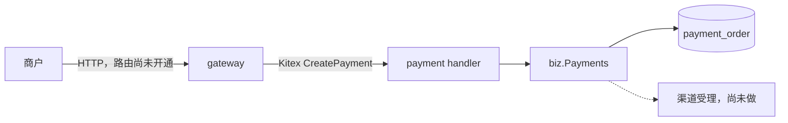
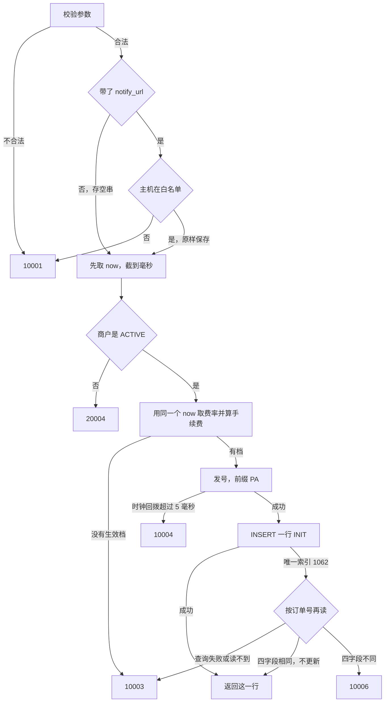

# PAY-02 创建支付单

| 项 | 内容 |
|---|---|
| 功能点 | PAY-02（P0，第 3 周） |
| 所属链路 | 支付 |
| 代码提交 | `8934e12` `[PAY-02] add create payment`（完整 `8934e12b44db0b6480ff41931d1923011f90cc7a`，2026-10-28 00:56:53 +0800） |
| 分支 | `feat/PAY-02-create` |
| 日期 | 2026-10-28 |
| 状态 | DONE |

本报告写在上面这次代码提交之后，不包含在那 15 个文件里。报告是随后单独的一次提交。

## 一句话结论

payment 进程的 Kitex 方法 `CreatePayment` 现在会插入一张状态为 `INIT` 的支付单。同一商户的同一个商户订单号只能有一行：100 个并发的相同请求只有一次 `INSERT` 成功，其余撞上唯一索引后读到同一个 `pay_no`，库里 `count = 1`（`TestPAY02ConcurrentSameRequest`）。金额 10000 分（100.00 元）、下单当时生效费率 60 个基点（0.60%）时，手续费按已有公式 `(10000×60+5000)/10000 = 60` 分（0.60 元）写死在这张单上，以后改费率不改这张单。金额不同返回 `10006`，不覆盖原行。本功能点不调用外部支付渠道。

## 1. 背景

### 1.1 系统简介

pay-system 是一个用 Go 编写的小型支付后端，模拟商户收款、退款、商户间转账三条资金链路，重点在数据一致性和性能。系统由 5 个部分组成：gateway（对外 HTTP 入口，负责签名校验和限流）、payment（支付单、退款单、转账单的状态管理和流程推进）、account（账户余额与记账，数据按商户分到 2 个数据库分片）、channel-mock（模拟微信、支付宝这类外部支付渠道）、recon（对账，核对系统内外数据是否一致）。服务之间用 Kitex RPC 同步调用，或通过 Kafka 消息异步通知；数据存在 MySQL 8.4，Redis 用于防重放。所有金额用整数“分”表示，所有记账只追加不修改。当前已完成：工程骨架、账户记账与转账、模拟渠道的受理/查单/关单/回调（CH-06 只完成了 FAIL、DROP_NOTIFY、DUP_NOTIFY、NEVER_FINISH）、商户凭证与费率、故障注入点，以及本次的创建支付单。

上面这段里还没展开的词：Kitex 是本项目的 Go RPC 框架，RPC 是一个进程同步调用另一个进程里的函数。签名校验是用商户密钥确认请求没有被改过；限流是限制单位时间内的调用次数。这两件事都在 gateway，本次不做。Kafka 是用来异步投递消息的队列，本功能点不发消息。分片是把账户数据按商户拆进 2 个库。1 元 = 100 分，金额全程用整数，不用小数。记账只追加，是指账本只插入新行，不回头改旧行。Redis 防重放是拦住“把同一份请求原样再发一次”。P0 是必须先做的优先级。第 3 周是开发计划里“支付主链路”这一段，PAY-02 排在其中。第三周里发起支付、查单、关单、退款、网关 HTTP 路由都还没做。

CH-06 是模拟渠道上的确定性故障，目前只做了四种：`FAIL`（渠道直接失败）、`DROP_NOTIFY`（丢掉回调）、`DUP_NOTIFY`（重复回调）、`NEVER_FINISH`（渠道一直不结束）。故障注入点是代码里预先留的挂钩，测试可以让某一步失败；创建支付单不调用这些挂钩。

### 1.2 本功能点在系统中的位置

商户最终会用 HTTP 来下单，但对外的 HTTP 路由还没做。本次只做 payment 进程内部的“创建支付单”：收到 RPC 后写入自己的 `payment_order` 表，不把请求转给渠道。



实线是本次：handler 做协议转换，`biz.Payments` 做校验、算手续费、插入一行。虚线是以后的发起支付（PAY-03），才会去调 channel-mock。gateway 上的 `POST /v1/payments` 路由留给以后的 GW-02。本功能点不改账户余额，也不发 Kafka 消息。

### 1.3 为什么需要它

商户用自己的订单号 `OUT-1` 来收 10000 分（100.00 元）。如果不拦住重复：

1. 网络重试或用户连点，同一订单号会插出两张支付单。顾客可能付两次。
2. 第一次金额是 10000 分，第二次有人改成 9999 分（99.99 元）还用同一个订单号。若当成同一次请求返回，商户以为收的是 99.99 元，库里却是 100.00 元。
3. 手续费若留到“支付成功”再算：下单时费率是 60 个基点（0.60%），应付 60 分（0.60 元）；成功前有人把费率改成更高，这张已经给出的单会被改价。

所以创建时就把单插进库，用唯一索引保住“一商户一订单号一行”，金额对不上就拒绝，手续费按当时生效的费率算死。

## 2. 术语

按正文第一次出现的顺序。

| 术语 | 含义 |
|---|---|
| 支付单 | 商户的一笔收款。表名 `payment_order`。本次只负责创建，不负责去渠道扣款。 |
| `INIT` | 支付单刚创建、还没向渠道发起时的状态。新建行固定是这个状态。 |
| 商户订单号 `out_trade_no` | 商户自己的订单号，1–64 个字符，只允许字母、数字、下划线和连字符。 |
| `pay_no` | 平台给这张支付单的单号，前缀 `PA`，创建时发出。集成测试里成功的单号长度为 21。 |
| 分 | 金额的最小单位。100 分 = 1.00 元。代码类型是 `money.Amount`，底层是 `int64`。 |
| 基点 | 费率单位。1 个基点 = 0.01%。60 个基点 = 0.60%。 |
| 手续费 `fee_amount` | 平台从这笔收款里收取的金额，单位也是分。创建时算好后写入，之后不因改费率而变。 |
| `money.Fee` | 已有的手续费函数。对非负金额，公式是 `(金额×基点+5000)/10000`，也就是四舍五入到分。 |
| gateway | 对外 HTTP 入口。签名校验和限流在这里。本次没有做它的路由。 |
| payment | 管支付单、退款单、转账单的进程。本次改的是这个进程。 |
| account | 管账户余额和记账的进程。数据按商户分到 2 个库。本次不调用它。 |
| 分片 | 账户数据按商户拆开存放的那 2 个库之一。 |
| 记账 | 记录余额变动的账本行。只插入，不修改已有行。本次不记账。 |
| channel-mock | 模拟微信、支付宝的进程。受理、查单、关单、回调已经有了。本次不调用它。 |
| recon | 对账进程，核对系统内外数据。本次不涉及。 |
| Kitex | 本项目使用的 Go RPC 框架。 |
| RPC | 一个进程同步调用另一个进程里的函数。 |
| Kafka | 异步消息队列。本次不发消息。 |
| MySQL 8.4 | 业务数据所在的数据库。 |
| Redis | 用来挡住把同一请求原样再发一次。本次创建支付单不访问 Redis。 |
| 防重放 | 拒绝“截获旧请求后再原样提交一次”。 |
| P0 | 必须先做的优先级。 |
| 第 3 周 | 开发计划中的支付主链路阶段。发起支付、查单、关单、退款、网关路由还没做。 |
| CH-06 | 模拟渠道的确定性故障。已完成的只有 `FAIL`、`DROP_NOTIFY`、`DUP_NOTIFY`、`NEVER_FINISH`。 |
| `FAIL` / `DROP_NOTIFY` / `DUP_NOTIFY` / `NEVER_FINISH` | 渠道直接失败、丢掉回调、重复发回调、渠道一直不结束。都不是本次的行为。 |
| 故障注入点 | 预先留在代码里的挂钩，测试可以让某一步失败。本次不调用。 |
| handler | 网络层。把 RPC 请求转成 Go 调用，把结果和错误转回去，不写 SQL。 |
| biz | 业务规则所在的包，这里是 `service/payment/biz`。`Payments` 是创建支付单的类型。 |
| GW-02 | 以后的功能点：把商户的 HTTP 路径接到 payment 的 RPC。`POST /v1/payments` 还没开通。 |
| PAY-03 | 以后的功能点：把 `INIT` 支付单发给渠道。本次不进入 `PAYING`，也不调渠道。 |
| `PAYING` | 已经向渠道发起、还没终态的状态。本次只在“重复请求读到旧行”时可能把已有的 `PAYING` 原样返回，不会把新行写成 `PAYING`。 |
| 幂等 | 同一请求做一次和做多次，对外结果一样，不会多插一行、也不会改掉已有行。 |
| 幂等键 | 用来判断“是不是同一次请求”的列。本次是 `(merchant_id, out_trade_no)`。 |
| 唯一索引 | MySQL 不允许这两列的组合出现第二行。冲突时返回错误号 1062。索引名 `uk_merchant_out_trade_no`。`pay_no` 另有唯一索引 `uk_pay_no`。 |
| 1062 | MySQL 的重复键错误号。 |
| 自动提交 | 这一条 `INSERT` 自己成功就提交，不包在更大的事务里。后面的读取是另一条语句。 |
| `10001` | 参数不合法。对外文字是 `invalid parameter`。 |
| `10003` | 内部错误。对外文字固定是 `internal error`，不带数据库或发号器的原文。 |
| `10004` | 依赖暂时不可用。对外文字是 `service unavailable`。本次只用于发号时钟回拨超过 5 毫秒。 |
| `10006` | 幂等键相同，但比较的业务字段不同。对外文字是 `idempotent conflict`。 |
| `20004` | 商户不存在，或状态不是 `ACTIVE`。对外文字是 `invalid merchant`。 |
| `ACTIVE` | 商户可以下单的状态。必须与这个英文大写完全一致。`DISABLED` 表示停用。 |
| `notify_url` | 以后通知商户“支付结果”时用的地址。本次只保存和校验，不发送。 |
| 白名单 `NOTIFY_URL_ALLOW_HOSTS` | 已有的环境变量，逗号分隔允许的主机名。本次不新增配置项。名单在进程启动时拆开，空段丢掉。 |
| 码点 | Unicode 的一个字符。`subject` 最长 128 个码点，`notify_url` 最长 512 个码点。不按字节数截。 |
| 注入时钟 | 业务代码不自己读机器时间，时间由调用方传入。生产用真实时钟，测试用可拨动的假时钟。 |
| `DATETIME(3)` | MySQL 的时间类型，精确到毫秒。秒以下四舍五入，所以写入前先把时间截到毫秒。 |
| 费率档 | 表 `merchant_fee_rate` 的一行：从 `effective_from` 起，这个商户按多少基点收费。只追加，不改旧行。 |
| `effective_from` | 这一档费率开始生效的时刻。取值是“不晚于下单时刻”的最近一档。 |
| `merchant.fee_rate_bp` | 商户表上的一个费率列。创建支付单不读它。种子数据会按它插第一档，但下单以费率档为准。 |
| `MerchantConfig` | 按商户号读状态和默认通知地址。状态可以走已有的进程内缓存。费率不进这个缓存。 |
| `FeeRateAt` | 按商户号和某个时刻读生效费率档。每次读库。没有生效档时返回“没找到”，不是错误。 |
| CAS | 比较并交换：更新语句带上当前状态，状态已经变了就改不到行。本次不更新状态，所以没有 CAS。 |
| `version` | 这一行的版本号。以后更新状态时用「旧版本号对得上才更新」，防止两个请求同时改同一行、后写的覆盖先写的。本次只插入 0，不更新。 |
| goroutine | Go 里同时执行的一段程序。并发测试起 100 个。 |
| `errgroup` | 等待一组 goroutine 全部结束再看结果。本次不等待第一个错误去取消其余 99 个。 |
| 覆盖率 | 测试执行到的代码占该包代码的比例。 |
| `kitex_gen` | 由接口定义生成的代码。全仓合计覆盖率把它算进去，不作为是否达标的依据。 |
| 门禁 | 核心包 `service/payment/biz` 的覆盖率要不低于 70%。看的是包，不是单个函数。 |
| IDL | 接口定义。本次没有改，所以没有重新生成 RPC 代码。 |
| NTF | 以后真正给商户发 HTTP 通知的功能。未传 `notify_url` 时，通知那一步才改用商户默认地址。 |
| 签名校验 | 用商户密钥确认 HTTP 请求没有被改过。在 gateway，本次不做。 |
| 限流 | 限制一段时间里能调用多少次。在 gateway，本次不做。 |
| DNS | 把主机名解析成 IP 地址。校验通知地址时不做这一步，只比较名字。 |
| `READ-COMMITTED` | 数据库会话的隔离级别：后执行的语句能看见其他会话已经提交的行。 |
| worker 编号 | 发号器用来区分不同进程的已有配置，避免两台机器生成同一个单号。本次不新增这个配置。 |
| 种子商户 | 启动前写入库里的演示商户。创建支付单的 RPC 测试用的是 `M100002`。 |
| 上下文 | 一次调用携带的 Go `context`。调用方取消后，参数已经合法的创建会把这次取消原样返回。 |
| 缓存有效期 | 进程内记住商户状态的那段时间，过了再读库。费率不使用这段缓存。 |

## 3. 技术讲解

### 3.1 要解决的问题

1. 同一商户、同一 `out_trade_no` 不能有两张支付单。这是收款身份，不是临时流水号。
2. 重复请求若金额、币种、商品名、通知地址都相同，返回已经那一行，不更新，不论当前状态是 `INIT` 还是以后变成了 `PAYING`。
3. 这四项里有一项不同，返回 `10006`。过期分钟数不参与比较：它不改变“这是不是同一笔订单”。
4. 手续费在插入前算死。费率取 `effective_from` 不晚于 `created_at` 的最近一档，不读 `merchant.fee_rate_bp`，也不把费率放进缓存。没有生效档就不要这张单，更不能把手续费写成 0。
5. 商户号为空、商户不存在、或状态不是正好 `ACTIVE`：返回 `20004`，不插入。
6. 显式给出的 `notify_url` 必须是 `http` 或 `https`，主机（去掉端口）在白名单里。不解析 DNS，不访问这个 URL。没传则存空串。名单为空时，任何显式 URL 都是 `10001`。
7. 发号时钟回拨超过 5 毫秒：返回 `10004`，不插入。
8. 本次不调用渠道、不调用账户、不发消息。进程在任意两步之间停掉，库里要么没有这张单，要么是一行已提交的 `INIT`。

### 3.2 方案

先在内存里校验参数（含通知地址）。通过后立刻取一次注入时钟，截断到毫秒，记为 `now`。然后再读商户。商户是 `ACTIVE` 之后，用这同一个 `now` 取费率、算手续费、发 `pay_no`，最后一条 `INSERT`，写入的 `created_at` 也是这个 `now`。插入若因为唯一索引失败，再按商户订单号把已有行读出来比较。比较通过就返回那一行；比较失败或根本读不到行，都不会再插一次。



参数不合法时还没碰数据库，也还没取时刻。白名单只在请求确实带了 `notify_url` 时做，并且做在取 `now` 之前。`now` 在查商户之前就定下来：后面读商户还要花时间，如果读完再取一次时钟，取费率和写入的 `created_at` 就会变成两个时刻。`INSERT` 成功和“1062 后读到一致的旧行”都对调用方返回一张支付单；后者不是新插入的。图里这两条都进同一个「返回这一行」。

参数规则：

- `out_trade_no` 长度 1–64，匹配 `^[A-Za-z0-9_-]+$`。空、超长、含空格都是 `10001`。
- `amount` 用已有的支付金额校验，范围 1 到 10000000 分（0.01 元到 100000.00 元）。
- `subject` 为 1–128 个码点，不去掉首尾空格。
- `currency` 没传或空串当成 `CNY`。`cny`、带空格的 `CNY` 以及其他值都是 `10001`。显式传入的 `CNY` 与省略等价，幂等比较时两边都是 `CNY`。
- `expire_minutes` 没传默认 15。传了就必须在 1–120，含 0 和 121 都是 `10001`。RPC 里这个字段是可选指针：没传和传 0 不是一回事，handler 把指针原样交给 biz，不用“取出零值”的方法。
- 请求整体为 nil 是 `10001`。`Payments` 接收者本身为 nil 是 `10003`，这个判断在检查请求之前。
- 商户号为空不是 `10001`。它和“查无此商户”一样走 `20004`。
- 非法参数先于“调用方已取消”的检查。取消了的调用若 URL 不合法，仍是 `10001`；参数合法才把这次取消原样返回。

通知地址：没传指针就存 `''`。传了指针（包括空串）才校验。用标准库解析 URL；协议只接受 `http` 和 `https`（解析结果里的协议是小写）；主机名去掉端口；与名单里每一项做大小写不敏感的整段相等比较。不查 DNS（不把主机名解析成 IP），不发 HTTP，不跟随跳转。超长、解析失败、空主机、协议不对、主机不在名单，都是 `10001`。名单拆开后一个主机都没有，则任何显式 URL 都是 `10001`，但“没传 URL”仍然可以下单并存空串。入库的是调用方原来的字符串，不改写成规范形式。地址里可以带用户信息（`http://alice@merchant-demo/default` 这种），只要主机在名单里就接受，并且不把这个地址写进日志。显式地址即使等于商户的默认通知地址，也按传入的字符串保存，不改成空串。真正发通知时若库里是空串，才改用商户默认地址，那一步不是本次。

商户与费率：参数通过后，先执行 `now := p.clk.Now().Truncate(time.Millisecond)`，再调 `MerchantConfig`。`MerchantConfig` 可以走已有缓存，只看状态是不是 `ACTIVE`。`DISABLED` 和小写的 `active` 都是 `20004`，不插入；这时 `now` 已经取过，但不会写入。先取时刻，是因为后面读商户还要花时间，不能等它返回再读一次时钟，否则取费率和写入的 `created_at` 会变成两个时刻。商户确认是 `ACTIVE` 之后，用这同一个 `now` 调 `FeeRateAt`，并把它写入 `created_at` 和 `updated_at`。`FeeRateAt` 每次读 `merchant_fee_rate`，不读商户表上的 `fee_rate_bp`，也不缓存。没找到档：打一条只有 `merchant_id` 的错误日志，返回 `10003`，不发号、不插入。找到档后调用 `money.Fee`。基点超出 0–10000（例如 10001）时这个函数失败，同样是 `10003`，不把手续费写成 0。费率为 0 的一档是合法的，手续费就是 0；“没有档”和“费率是 0”不是一回事。

例子：金额 10000 分，费率 60 基点。`(10000×60+5000)/10000 = 605000/10000 = 60` 分。`money.Fee` 把乘法拆成整万和余数，避免大金额溢出；这个例子用上面的式子就能算完。

时间与新行：`expire_at = created_at + expire_minutes`。`created_at` 和 `updated_at` 都是这个截断后的时刻，`INSERT` 把它们写进语句，不用数据库自己的当前时间。若漏写 `created_at`，库里的时间会是插入那一刻机器上的真实时间，和取费率的时刻、和测试拨定的假时钟都不一致。新建行：`status = INIT`，`channel`、`paid_at`、`closed_at`、`fail_code`、`fail_msg` 为 `NULL`，`refunded_amount = 0`，`version = 0`。`version` 是这一行的版本号，以后更新状态时要带上旧版本号，对得上才更新，用来防止并发覆盖；本次只插入 0，不更新。

发号：插入前调用已有的发号器，前缀 `PA`。时钟回拨超过 5 毫秒映射成不带内部原因的 `10004`。其他发号错误走 `10003`，对外文字是 `internal error`，不会出现发号器自己的句子。

插入与 1062：只有这一条 `INSERT`，自动提交，不把读取包进同一个事务。1062 之后在这条插入之外再 `SELECT`，才能看见另一个请求已经提交的那一行。已有的数据库打开逻辑会把会话隔离级别设成 `READ-COMMITTED`，后读的语句看得到已提交的赢者。查询本身失败返回 `10003`。只有没有行，或者读回的商户号、订单号和请求逐字节不同，才走「读不到行 → `10003`」。然后只比较 `amount`、`currency`、`subject`、`notify_url`。四项相同就返回那一行，不执行 `UPDATE`，所以 `updated_at` 保持插入时的值。这四项有一项不同才是 `10006`。1062 了但按商户订单号读不到行（例如撞的是 `pay_no` 的唯一索引，而不是商户订单号）：同样返回 `10003`，不当作成功，也不再循环重试。

崩溃的两个窗口：

- 单号已经发出、`INSERT` 还没执行：库里没有行。调用方重试会再发一个新的 `pay_no`，然后插入。丢掉的那个单号不会对应任何行。
- `INSERT` 已经提交、响应还没送出：重试会撞上 1062，读到原来那一行，`pay_no` 不变。

本功能点在这两步之间不调用外部系统，所以没有“渠道超时但本地未知”这种中间态。

下面按已提交代码的顺序摘出这一段：先把时钟截到毫秒得到 `now`，再读商户；不是 `ACTIVE` 就返回 `20004`。通过后仍用这同一个 `now` 取费率，并写入 `CreatedAt`。读商户花掉的时间不会再取一次时钟：

```go
// service/payment/biz/payment.go
now := p.clk.Now().Truncate(time.Millisecond)
cfg, err := p.merchants.MerchantConfig(ctx, filled.merchantID)
// ... 非 ACTIVE 则 20004 ...
rate, found, err := p.merchants.FeeRateAt(ctx, filled.merchantID, now)
// ... 没有档则 10003 ...
fee, err := money.Fee(filled.amount, rate.RateBP)
payNo, err := p.ids.NewNo(ctx, payNoPrefix)
// 时钟回拨超过 5ms → 10004
row := PaymentOrder{
    PayNo: payNo, MerchantID: filled.merchantID, OutTradeNo: filled.outTradeNo,
    Amount: filled.amount, FeeAmount: fee, Currency: filled.currency,
    Subject: filled.subject, Status: payStatusInit, NotifyURL: filled.notifyURL,
    ExpireAt: now.Add(time.Duration(filled.expireMinutes) * time.Minute),
    CreatedAt: now, UpdatedAt: now,
}
```

1062 之后的读取在插入语句之外。查询失败（`readErr` 不为空）返回 `10003`。只有没有行，或者读回的商户号、订单号和请求逐字节不同，才走「读不到行 → `10003`」。金额、币种、商品名、通知地址这四项不同才是 `10006`；四项相同就返回已有行，不更新：

```go
// service/payment/biz/payment.go
existing, ok, readErr := p.orders.paymentByOutTradeNo(ctx, row.MerchantID, row.OutTradeNo)
if readErr != nil {
    return PaymentOrder{}, callErr(readErr)
}
if !ok || existing.MerchantID != row.MerchantID || existing.OutTradeNo != row.OutTradeNo {
    return PaymentOrder{}, errno.ErrInternal
}
if existing.Amount == row.Amount && existing.Currency == row.Currency &&
    existing.Subject == row.Subject && existing.NotifyURL == row.NotifyURL {
    return existing, nil
}
return PaymentOrder{}, errno.ErrIdempotentConflict
```

插入语句显式写状态、空渠道字段、退款额、版本和两个时间，渠道相关列用 SQL 的 `NULL`：

```sql
-- service/payment/biz/order_sql.go
INSERT INTO payment_order (
  pay_no, merchant_id, out_trade_no, amount, currency, subject, status,
  channel, fee_amount, refunded_amount, notify_url, expire_at,
  paid_at, closed_at, fail_code, fail_msg, version, created_at, updated_at
) VALUES (
  ?, ?, ?, ?, ?, ?, ?,
  NULL, ?, ?, ?, ?,
  NULL, NULL, NULL, NULL, ?, ?, ?
)
```

进程装配：先打开数据库，再用已有的 `NOTIFY_URL_ALLOW_HOSTS` 和真实时钟构造 `Payments`。发号器沿用配置里已有的 worker 编号，用来和其他进程错开单号。`GetMerchantCredential` 保持原样。`Pay` 等其余 RPC 仍返回 `10003`。

### 3.3 为什么这样做

| 方案 | 做法 | 优点 | 缺点 | 结论 |
|---|---|---|---|---|
| 采用：直接插入，把 1062 当成正常结果 | 不先查。唯一索引挡住第二行。1062 后按商户订单号读已提交的行，只比较金额、币种、商品名、通知地址 | 100 个并发相同请求只能留下 1 行。相同请求返回原行，不同金额得到 `10006` | 单号发出后、插入前若进程停掉，这个单号作废，重试会换一个新单号 | 采用 |
| 备选：先按订单号查询，没有再插入 | 只先查，读不到就 `INSERT`。不把 1062 当成并发下的正常路径 | 读代码直观 | 没有唯一索引时，两个请求都先读到「没有」，然后都插入成功，同一订单号两张单。即便有唯一索引，两个请求仍会都先看到「没有」；后到的那个若不会处理 1062，调用方只会看到失败，而不是同一张单 | 不采用 |
| 备选：支付成功时再算手续费 | 创建时 `fee_amount` 先写 0 或留空，渠道返回成功后再按当时费率计算 | 创建路径更短 | 下单之后、成功之前如果改了费率，已经给出的那张单的手续费会变。没有生效档时还可能被误写成 0 | 不采用 |

过期时间不放进幂等比较：它描述这张单多久失效，不描述“是不是同一笔商户订单”。把过期分钟从 15 改成 30 再重试，只要金额等四项相同，仍然返回原行，`expire_at` 不变。

### 3.4 正确性

| 场景 | 系统行为 | 最终状态 | 证明 |
|---|---|---|---|
| 同一请求重复到达 | 第一次插入 `INIT`。之后的请求撞上 `uk_merchant_out_trade_no`，读出原行。金额、币种、商品名、通知地址相同则返回该行，不执行更新。测试把已有行改成 `PAYING`、手续费改成 1 分后再重放，返回的仍是改过的那一行，说明命中路径只读。过期分钟不同被忽略。商品名不同，或一边没传通知地址，返回 `10006`。币种省略和显式 `CNY` 视为相同 | 仍然 1 行。集成测试里重放之后 `updated_at` 仍等于插入时的假时钟，行数仍是 1 | `TestCreatePaymentIdempotentHitDoesNotUpdate`；`TestPAY02ConcurrentSameRequest` 末尾的重放 |
| 两个冲突请求并发 | 相同请求：100 个 goroutine 同时调用，输入只读、共用。只有一个 `INSERT` 成功，其余 1062 后读到同一个 `pay_no`。金额 10000 分，费率档 60 基点，每个返回值的手续费都是 60 分，状态都是 `INIT`。金额不同：先插入 10000 分，再拿 9999 分（集成）或 10001 分（单元）用同一订单号请求，得到 `10006`。没有“100 个并发且金额各不相同”的测试 | 相同请求：库里 `count = 1`，退款额 0，版本 0，渠道、支付时间、关闭时间、失败码、失败信息都是空，通知地址是空串，`created_at` 等于假时钟，`expire_at` 等于该时刻加 15 分钟。金额冲突：仍是原来的 10000 分那一行 | 相同：`TestPAY02ConcurrentSameRequest`。金额不同：`TestPAY02AmountConflict`、`TestCreatePaymentIdempotentAmountConflict` |
| 发号之后、插入之前崩溃；或插入提交之后、响应之前崩溃 | 前一个窗口库里没有行，重试会发新的 `pay_no` 再插入。后一个窗口重试走 1062，返回原行。没有把进程杀死的测试。作为“1062 但按商户订单号读不到行”的替身，单元测试强迫插入返回 1062 且表里没有行，结果是 `10003`，不会假装成功 | 没有进程崩溃演练留下的半行。替身用例结束时行数是 0。提交之后的重试由上一行的幂等测试覆盖：行还在，且不被更新 | 读不到行：`TestCreatePaymentDuplicateWithoutRow`。提交后重试：`TestCreatePaymentIdempotentHitDoesNotUpdate`、`TestPAY02ConcurrentSameRequest` |
| 下游调用超时 | 本功能点不调用渠道、HTTP 或消息队列，没有下游超时可以当成成功或失败。上下文已取消且参数合法时，原样返回取消，而不是 `10003`。参数不合法时仍是 `10001`，即使上下文已经取消。数据库本身超时这次没有单独注入 | 取消且参数合法：不插入。参数不合法：不插入 | `TestCreatePaymentGuards` |

手续费与“不读商户表那一列”由 `TestCreatePaymentFeeAmount`（假商户，60 基点 × 10000 分 = 60 分）和 `TestPAY02FeeUsesEffectiveTier` 证明。后者把商户表的 `fee_rate_bp` 设成 80，生效档设成 60，断言手续费是 60 分且那一列仍是 80。`pay_no` 前缀是 `PA`。

商户停用、没有费率档、时钟回拨：

- `TestCreatePaymentMerchantAndMissingRate`：`DISABLED` 和 `active` 都是 `20004`；商户号空串是 `20004`；没有生效档是 `10003`，行数 0，发号次数 0；基点 10001 也是 `10003`，不插入。
- `TestPAY02DisabledAndBadNotify`：库里把商户改成 `DISABLED` 后下单，`20004`，行数 0。同一商户再传 `expire_minutes = 0`，得到的是 `10001`，因为参数校验在读商户之前。
- `TestCreatePaymentClockRollback`：回拨错误是 `10004` 且不插入；其他发号错误是 `10003`，对外文字等于内部错误的固定句子。
- `TestCreatePaymentExpireAndNotifyURL`：0 分钟、121 分钟、不在名单里的 URL 都是 `10001`，不读商户、不插入。
- `TestCreatePaymentNotifyURLStoredAsGiven`：带用户信息的 URL 原样入库；与默认地址相同的显式 URL 原样入库；空名单拒绝显式 URL，允许不传并保存空串。
- `TestCreatePaymentHandlerPassesOptionals`：可选字段的指针原样送进 biz。`INIT` 响应不带渠道、支付时间、失败码。时间格式形如 `2026-10-17T10:00:00.000+08:00`，过期时间是其后 15 分钟。
- `TestRPCMerchantCredentialSeeded` 里追加的创建支付单：nil 请求和 `expire_minutes = 0` 是 `10001`；预先写入的演示商户 `M100002`、金额 10000 分得到手续费 60 分、状态 `INIT`、`pay_no` 长度 21 且前缀 `PA`。紧接着的 `Pay` 仍是 `10003`。

### 3.5 性能

不涉及。本次没有性能开关，也没有基准或压测。验收看的是同一订单号只有一行、手续费按当时费率写死，不看延迟。

## 4. 已完成内容

### 4.1 改动清单

代码提交 `8934e12` 包含下面这些文件。

| 文件 | 新增 / 修改 | 作用 |
|---|---|---|
| `service/payment/biz/payment.go` | 新增 | `CreatePayment`：校验、取费率、发号、处理 1062。`App` 把商户读取和创建支付单交给 handler |
| `service/payment/biz/order_sql.go` | 新增 | 一条插入和按商户订单号读取。不在这里更新状态 |
| `service/payment/biz/payment_test.go` | 新增 | 不连库的规则测试 |
| `service/payment/biz/payment_integration_test.go` | 新增 | 连 MySQL 的并发、金额冲突、费率和停用测试。构建标签 `integration` |
| `service/payment/handler/handler.go` | 修改 | `CreatePayment` 转发可选字段指针。`Pay` 仍返回 `10003` |
| `service/payment/handler/service.go` | 修改 | handler 依赖的接口增加 `CreatePayment` |
| `service/payment/handler/convert.go` | 修改 | 把支付单转成 RPC 响应。`INIT` 的空渠道字段不写出 |
| `service/payment/handler/handler_test.go` | 修改 | 可选字段被原样传递；nil 请求是 `10001` 且不调用 biz |
| `service/payment/handler/rpc_integration_test.go` | 修改 | 真实 RPC 上创建一笔种子商户的支付单，并确认 `Pay` 仍未实现 |
| `cmd/payment/main.go` | 修改 | 打开数据库之后接上发号器和 `Payments` |
| `docs/02-requirements.md` | 修改 | PAY-02 规则写明空通知地址、费率、错误码；四条验收勾选；状态改为 DONE |
| `docs/05-api.md` | 修改 | 文档版本 3.1.2。写明未传通知地址存空串，`CreatePayment` 已实现 |
| `docs/03-conventions.md` | 修改 | 版本 v2.20。写明白名单为空时拒绝一切显式 URL，主机按大小写不敏感的精确比较，不解析 DNS |
| `docs/06-flows.md` | 修改 | 版本 v2.20。创建支付单的源图按上述口径改过 |
| `docs/04-dev-plan.md` | 修改 | 只勾选 PAY-02。PAY-03 仍未勾选 |

### 4.2 对外变化

| 类别 | 变化 |
|---|---|
| 接口 | Kitex 的 `CreatePayment` 从“一律 `10003`”改为按本节规则创建或返回已有支付单。HTTP `POST /v1/payments` 仍要等 GW-02，现在没有这条路由。`Pay` 以及其余未实现方法仍返回 `10003`。没有新增请求字段，没有改 IDL |
| 表结构 | 无。沿用已有的 `payment_order`。没有新表、新列、新索引 |
| 配置项 | 无新增。沿用已有的 `NOTIFY_URL_ALLOW_HOSTS`：逗号分隔，去掉空段；空名单拒绝任何显式通知地址 |
| 错误码 | 无新增。参数 `10001`，商户无效 `20004`，无生效档、发号的其他失败、1062 后读不到行、内部故障 `10003`，时钟回拨超过 5 毫秒 `10004`，四字段不一致 `10006` |
| 单号前缀 | 无新增。使用已登记的 `PA` |
| 指标 / 故障点 | 无。不调用故障注入点，也不新增指标 |

### 4.3 验收对照

| 验收条目 | 测试函数 | 类型 | 结果 |
|---|---|---|---|
| 100 个并发相同请求只生成 1 条订单，全部返回同一 `pay_no` | `TestPAY02ConcurrentSameRequest` | 集成 | 通过。断言 100 个返回值相同，手续费 60 分，状态 `INIT`，库里 `count = 1`；重放不改 `updated_at` |
| 相同 `out_trade_no`、不同金额返回 `10006` | `TestPAY02AmountConflict` | 集成 | 通过。10000 分之后再请求 9999 分，原行金额仍是 10000 |
| 同上 | `TestCreatePaymentIdempotentAmountConflict` | 单元 | 通过。第二次金额 10001 分，得到 `10006`，行仍是第一张 |
| `expire_minutes` 为 0 或 121，或 `notify_url` 不在白名单，返回 `10001` | `TestCreatePaymentExpireAndNotifyURL` | 单元 | 通过。不读商户、不插入 |
| 费率 60 基点的商户，金额 10000 分，`fee_amount = 60` | `TestCreatePaymentFeeAmount` | 单元 | 通过 |
| 同上，并且不使用商户表上的费率列 | `TestPAY02FeeUsesEffectiveTier` | 集成 | 通过。列是 80 基点，生效档是 60 基点，手续费 60 分，`pay_no` 前缀 `PA` |

### 4.4 验证记录

日期 2026-10-28。环境 `go1.27.2 darwin/arm64`。`golangci-lint` 2.14.0，该二进制用 go1.27.1 编译。下面每条命令退出码都是 0。

| 命令 | 结果 |
|---|---|
| `gofmt -l .` | 无输出。墙钟 0.050s |
| `make lint` | `0 issues.` 墙钟 1.024s |
| `make test`（`go test -race ./...`） | 通过。墙钟 5.012s。根包 `ok ... 4.499s`。这次 `service/payment/biz` 和 `service/payment/handler` 显示 cached |
| `go test -race -count=1 -cover ./service/payment/biz/ ./service/payment/handler/ ./cmd/payment/` | 通过。墙钟 6.366s。biz `1.688s` 覆盖率 90.4%（不含 `integration` 标签）；handler `5.105s` 覆盖率 83.3%；cmd/payment `1.635s` 覆盖率 63.6% |
| `make test-integration`（`go test -race -tags integration ./...`） | 通过。墙钟 36.002s。根包 `ok ... 35.557s`。这次 payment 的 biz 和 handler 显示 cached |
| `go test -race -count=1 -tags integration -cover ./service/payment/biz/ ./service/payment/handler/` | 通过。墙钟 14.768s。biz `14.085s` 覆盖率 95.2%；handler `13.388s` 覆盖率 84.0% |
| `make cover` | 通过。墙钟 36.921s。全仓 total 25.3%（含 `kitex_gen`，不作为判据）。`service/payment/biz` 95.2%，`service/payment/handler` 84.0%。函数表里 `Payments.CreatePayment` 97.0%，`insertPayment` 100%，`paymentByOutTradeNo` 63.6%，`normalize` 100%。`App.NewApp`、`App.GetMerchantCredential`、`App.CreatePayment` 在这份覆盖率结果里是 0.0%，因为测试直接调用 `Payments`。门禁看的是包覆盖率 95.2%，不低于 70% |

`cached` 表示 Go 复用了已有测试结果，没有重跑这两个包，所以它们的覆盖率以带 `-count=1` 的命令为准。两份 biz 覆盖率不是同一次测量：不含集成标签是 90.4%，带集成标签以及 `make cover` 是 95.2%。`cmd/payment` 的 63.6% 只来自不含集成标签的那次，不在 70% 那条门禁的包范围内。

只读审查没有发现必须修改的问题。

### 4.5 同步的文档

这些文档都在代码提交 `8934e12` 里。

- 需求：PAY-02 写明未传通知地址存空串、显式地址原样入库、非 `ACTIVE` 为 `20004`、没有生效档为 `10003` 且不把手续费当成 0、时钟回拨为 `10004`、1062 后读不到行为 `10003`。四条验收已勾选，状态为 DONE。变更记录有 2026-10-28 这一行。不新增错误码，不改表，不改 IDL。
- 接口文档：版本 3.1.2，最后修改 2026-10-28。创建支付单未传 `notify_url` 时存空串，通知时才取商户默认地址。`CreatePayment` 已实现；其余未实现方法仍是 `10003`。业务错误列仍是 `10001`、`10006`，另外三个码写在说明里。
- 约定：版本 v2.20，2026-10-28。白名单补了三句：空名单拒绝一切显式 URL；主机大小写不敏感且整段相等；不解析 DNS。没有新的配置项。
- 流程图：版本 v2.20，2026-10-28。创建支付单的源图改成上述分支。当时没有 mermaid-cli，没有渲染 SVG。
- 开发计划：PAY-02 勾选，PAY-03 未勾选。

## 5. 未完成与风险

- 商户还不能通过 HTTP 下单。路由是 GW-02。本次只有 Kitex 的 `CreatePayment`。
- 支付单停在 `INIT`。向渠道发起、进入 `PAYING`、处理渠道超时，都是 PAY-03。本次若把“已经创建”理解成“已经支付”，就错了。
- 给商户发通知、以及空通知地址改用商户默认地址，是以后的 NTF。本次只存字符串。
- 没有进程被杀死的测试。单号发出后、插入前停掉：库里没有行，重试会再发一个新 `pay_no` 并插入，丢掉的单号没有对应行。这一窗口没有测试。插入已经提交、响应还没送出就停掉：重试撞上商户订单号的唯一索引，读到原来那一行；这一窗口由幂等测试覆盖。另一支不是这个崩溃窗口：1062 之后按商户订单号读不到行（例如新单号撞上 `pay_no` 的唯一索引）返回 `10003`，不当作成功。`TestCreatePaymentDuplicateWithoutRow` 只覆盖这一支，做法是强迫插入返回 1062 且表里没有该订单号；它没有在真实 MySQL 上制造 `pay_no` 冲突，也不是“插入前崩溃”的测试。
- 唯一索引上的锁若等到数据库驱动超时，失败的一方看到的是超时而不是 1062，调用方得到 `10003`，不会当成又下了一张单。这次运行没有注入锁等待，这条路径未验证。
- `paymentByOutTradeNo` 在 `make cover` 的函数表里是 63.6%。包覆盖率 95.2% 仍高于 70% 的门禁。`App` 的三个方法在这份覆盖率结果里是 0.0%，因为测试调用的是 `Payments`，不是这层转发。
- 商户状态仍可能来自 `MerchantConfig` 的进程内缓存，多实例之间最多差一个缓存有效期；费率每次读库。本次没有为这个状态差值加测试。
- 流程图只改了源文件，SVG 未渲染。

## 6. 如何复现

在仓库根目录、分支 `feat/PAY-02-create`、提交 `8934e12b44db0b6480ff41931d1923011f90cc7a` 上执行。本次环境是 2026-10-28 的 `go1.27.2 darwin/arm64`。集成测试和 `make cover` 需要能连上 MySQL 的环境；下面给出的是已经跑过且退出码为 0 的命令。

```bash
gofmt -l .
make lint
make test
go test -race -count=1 -cover ./service/payment/biz/ ./service/payment/handler/ ./cmd/payment/
make test-integration
go test -race -count=1 -tags integration -cover ./service/payment/biz/ ./service/payment/handler/
make cover
```

预期与第 4.4 节的表一致：`gofmt` 无输出；`make lint` 打印 `0 issues.`；其余命令通过。不含集成标签时 biz 覆盖率 90.4%、handler 83.3%、cmd/payment 63.6%。带集成标签时 biz 95.2%、handler 84.0%。`make cover` 的全仓 total 是 25.3%，不作为判据；biz 包 95.2% 不低于 70%。

## 7. 讲解要点

1. 为什么不能只先查再插？那个做法不把 1062 当成正常路径。没有唯一索引时，两个请求都会先看到「没有」，然后各插一行。有唯一索引时，后到的请求若不会处理 1062，调用方只看到失败，拿不到已经插入的那张单。采用的做法是直接插入，1062 后再读已提交的行。
2. 手续费为什么在下单时算死？10000 分、60 基点，按 `(10000×60+5000)/10000` 得到 60 分。若拖到支付成功再算，中间改费率会改掉已经给出的单。算的时候用的是 `created_at` 当时生效的费率档，不是商户表上的那一列。
3. 进程停在两段之间会怎样？停在发号和插入之间：没有行，重试换新单号。停在插入提交和响应之间：重试撞上唯一索引，返回原来的 `pay_no`。这两段都不调用外部系统。

## 延伸阅读

- `docs/02-requirements.md`：PAY-02 的规则、异常和四条验收。
- `docs/05-api.md` §4.1、§10.2：创建支付单的字段和已实现说明。版本 3.1.2。
- `docs/03-conventions.md` §8：`NOTIFY_URL_ALLOW_HOSTS`。版本 v2.20。
- `docs/06-flows.md`：CF-04 创建支付单的源图。版本 v2.20，SVG 未渲染。
- `docs/04-dev-plan.md`：PAY-02 已勾选，PAY-03 未勾选。
- `service/payment/biz/payment.go`、`service/payment/biz/order_sql.go`：本节引用的实现。
- `pkg/money/money.go`：`Fee` 的公式。

## 修订记录

| 日期 | 提交 | 修订内容 |
|---|---|---|
| 2026-10-28 | 报告尚未提交 | 首版。对应代码提交 `8934e12` `[PAY-02] add create payment` |
| 2026-10-28 | 报告尚未提交 | 可读性：取时刻改到查商户之前，并写明原因；先查再插写明「不处理 1062」的前提；1062 后的摘录补上查询失败；术语表说明 `version` |
