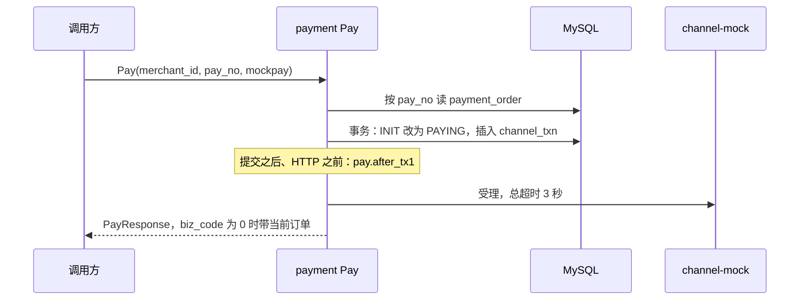

# PAY-03 发起支付

| 项 | 内容 |
|---|---|
| 功能点 | PAY-03（P0，第 3 周） |
| 所属链路 | 支付 |
| 代码提交 | `7a5e19f` `[PAY-03] add start payment`（完整 `7a5e19f2049dcf2465077435c1db2c7439beb606`，2026-10-28 02:24:16 +0800） |
| 分支 | `feat/PAY-03-pay` |
| 日期 | 2026-10-28 |
| 状态 | DONE |

本报告写在上面这次代码提交之后，不在那 26 个文件里。

## 一句话结论

payment 进程的 Kitex 方法 `Pay` 把一张 `INIT` 支付单改成 `PAYING`，并在同一次数据库事务里插入一条渠道流水，事务提交之后才去调用模拟渠道。同一张 10000 分（100.00 元）的订单并发调用 20 次，库里只有 1 条 `channel_txn`，渠道只被受理 1 次（`TestPayConcurrentOneChannelTxn`）。渠道超过调用超时不响应时，订单停在 `PAYING`，流水号仍为空，不当成失败（`TestPayChannelTimeoutStaysPaying`）。生产渠道总超时是 3 秒，连接超时是 500 毫秒；`Pay` 这一方法的服务端处理超时是 5 秒，其他方法仍是 2 秒。

## 1. 背景

### 1.1 系统简介

pay-system 是一个用 Go 编写的小型支付后端，模拟商户收款、退款、商户间转账三条资金链路，重点在数据一致性和性能。系统由 5 个部分组成：gateway（对外 HTTP 入口，负责签名校验和限流）、payment（支付单、退款单、转账单的状态管理和流程推进）、account（账户余额与记账，数据按商户分到 2 个数据库分片）、channel-mock（模拟微信、支付宝这类外部支付渠道）、recon（对账，核对系统内外数据是否一致）。服务之间用 Kitex RPC 同步调用，或通过 Kafka 消息异步通知；数据存在 MySQL 8.4，Redis 用于防重放。所有金额用整数“分”表示，所有记账只追加不修改。当前已完成：工程骨架、账户、模拟渠道（CH-06 只完成 FAIL、DROP_NOTIFY、DUP_NOTIFY、NEVER_FINISH）、商户凭证与费率、故障注入、创建支付单，以及本次发起支付。

上面这段里还没展开的词：Kitex 是本项目的 Go RPC 框架，RPC 是一个进程同步调用另一个进程里的函数。签名校验用商户密钥确认请求没有被改过；限流限制单位时间内的调用次数。这两件事都在 gateway，本次不做网关路由。Kafka 是异步消息队列，本次不发消息。分片是把账户数据按商户拆进 2 个库。1 元 = 100 分，金额全程用整数。记账只追加，是指账本只插入新行，不回头改旧行。Redis 防重放是系统别处的能力，不拦这次 Kitex 调用。这次 `Pay` 不访问 Redis。同一请求再来，靠再读订单状态：已经是 `PAYING` 或 `SUCCESS` 就直接返回。本次也不改账户余额。P0 是必须先做的优先级。第 3 周是开发计划里支付主链路这一段。

CH-06 是模拟渠道上的确定性故障，目前只做了四种：`FAIL`（渠道直接失败）、`DROP_NOTIFY`（丢掉回调）、`DUP_NOTIFY`（重复回调）、`NEVER_FINISH`（渠道一直不结束）。故障注入是代码里预先留的挂钩，测试可以在某一步观察或打断进程。本次使用已有挂钩 `pay.after_tx1`，不新增挂钩名称。

创建支付单已经能插入状态为 `INIT` 的 `payment_order`。`INIT` 表示单已创建、还没向渠道发起。本次把这次发起的本地变更提交之后写成 `PAYING`：订单已经离开 `INIT`，渠道 HTTP 可能还没发出，并留下一条渠道流水。没有这一步，创建出来的单永远不会被渠道受理。查单补偿、商户关单、outbox（和业务写在同一事务里、稍后才发出的消息表）发消息、网关 HTTP 路由都还没做。

### 1.2 本功能点在系统中的位置

商户最终会用 HTTP 发起支付，但对外路由还没做。本次只做 payment 进程内部的 `Pay`：按支付单号读自己的 `payment_order`，改状态并写 `channel_txn`，然后用 HTTP 调用 channel-mock 的受理接口。



`biz_code = 0` 时带上的是当前订单，不总是 `PAYING`。第一次抢到发起并走完时是 `PAYING`。订单已经是 `SUCCESS` 时再调用，返回的仍是这张 `SUCCESS` 单，`biz_code` 仍是 0，不再调渠道。`TestPayTerminalAndSuccess` 证明业务层这次返回的就是这张 `SUCCESS` 单，且 error 为 nil。handler 里 RPC error 为 nil 有两条：业务错误恰好是渠道拒绝时，`biz_code` 是 `30006` 并带上订单；只有业务层 error 本身是 nil 时，`biz_code` 才是 0。图上的每一步都是本次已经接通的路径。调用方目前是测试或别的进程里的 Kitex 客户端，不是商户的 HTTP。需求里给以后的网关客户端定的调用超时也是 5 秒；这次提交没有改 gateway 的代码。这次改的是 payment 进程里 `Pay` 这一个方法的服务端处理超时，改成 5 秒，其他方法仍是 2 秒。网关路由还没做，所以商户现在还打不到这条 RPC。account 和 recon 不参与。渠道返回拒绝时，本次只把参数交给一个结果推进接口；把订单改成失败并记账，留给以后的 PAY-04。渠道一直没有明确结果时，靠以后的查单补偿（PAY-05）再问渠道，本次不实现查单。

### 1.3 为什么需要它

商户已经有一张 10000 分（100.00 元）的支付单，状态是 `INIT`。顾客点了支付。如果不做发起支付，这张单一直停在创建完成，渠道不会收款。

如果做得不小心，会出另外三种错：

1. 顾客连点或调用方重试，20 个请求同时进来。若每个都去调渠道，渠道可能受理 20 次，顾客被扣多次。
2. 先告诉渠道“请收款”，再改本地状态。受理接口已经返回 `OK`，本地事务却没提交：库里仍是 `INIT`，这笔受理对不上任何一张已经离开 `INIT` 的单。
3. 渠道 3 秒没回应，本地却把单改成失败。钱可能已经扣了，商户却看到失败。超时必须当成“还不知道”，留下 `PAYING` 和一条待查的流水。

所以顺序是：先用条件更新抢到唯一的一次本地变更，提交之后再调渠道；超时不改回失败。

## 2. 术语

按正文第一次出现的顺序。

| 术语 | 含义 |
|---|---|
| 支付单 | 商户的一笔收款。表名 `payment_order`。创建时状态是 `INIT`。 |
| `INIT` | 已创建、还没向渠道发起。本次成功发起后离开这个状态。 |
| `PAYING` | 这次发起的本地变更已经提交：订单状态已从 `INIT` 改掉。渠道 HTTP 可能还没发出。故障点停在提交之后、HTTP 之前时，订单就是这个状态。 |
| `SUCCESS` / `FAILED` / `CLOSED` | 支付成功、支付失败、已关闭。再调用 `Pay` 时，`SUCCESS` 直接返回当前单；`FAILED` 和 `CLOSED` 返回 `30003`，不带订单。本次不把单推进到这三个状态。 |
| `pay_no` | 平台支付单号。`Pay` 用它找单，也把它当作发给渠道的请求号 `req_no`。 |
| `merchant_id` | 商户号。请求里的商户号必须与订单上的商户号逐字节相同，否则返回 `30001`。它不和 `pay_no` 互相比较。 |
| `channel` | 本次请求要走的渠道名。必须恰好是 `mockpay`。空串、`MockPay`、带空格的 `mockpay `、`alipay` 都拒绝。 |
| `mockpay` | 本系统目前唯一允许的渠道名，对应 channel-mock。 |
| channel-mock | 模拟外部支付渠道的进程。本次用 HTTP 调它的受理接口，测试里用假客户端代替，不起这个进程。 |
| `channel_txn` | 渠道流水表。一笔支付单对应一条。本次插入 `txn_type = PAY`、`status = PROCESSING`。 |
| `PROCESSING` | 渠道流水还在处理中，流水号可以先空着。 |
| `channel_txn_no` | 渠道返回的流水号。受理前是空。渠道受理接口返回 `OK` 且带了号码时才回填。这不是顾客已经付完，订单仍是 `PAYING`。 |
| `next_query_at` | 下次可以查单的时刻。本次写成“这次时钟 + 10 秒”。查单本身是 PAY-05，本次不跑。 |
| CAS | 比较并交换。更新语句带上“当前必须仍是 `INIT`”。已经不是 `INIT` 时影响 0 行，调用方不能再去调渠道。 |
| 事务 | 几条 SQL 一起成功或一起撤销。入口是已有的 `dbx.WithTx`。事务里只改库，不调用 HTTP、RPC 或消息队列。 |
| 幂等 | 同一请求做一次和做多次，不会多插流水，也不会再次受理。这次不靠 Redis。再读订单，已经是 `PAYING` 或 `SUCCESS` 就直接返回当前单。 |
| Redis | 系统别处用来挡住把同一请求原样再发一次。这次 `Pay` 不访问它，它也不拦这次 Kitex 调用。 |
| 唯一索引 | MySQL 不允许某几列的组合出现第二个已填值。`uk_biz_no` 保证一个 `biz_no`（取值就是这张单的 `pay_no`）只有一行流水。`uk_channel_txn_no` 是 `(channel, channel_txn_no)`。唯一索引把 NULL 当成互不相同，所以多张单可以同时让 `channel_txn_no` 为空。一旦写成具体号码，同一渠道不能再有同一个号码。本次不新建索引。 |
| `version` | 一行的版本号。流水插入时是 0。支付单这次会写成 `version = version + 1`，留给以后的更新用。这次 `UPDATE` 的 WHERE 不含版本号。 |
| 分 | 金额最小单位。100 分 = 1.00 元。渠道收到的金额是订单金额，例子是 10000 分（100.00 元）。类型是 `money.Amount`，底层 `int64`。 |
| 注入时钟 | 业务代码不调用 `time.Now()`。时间来自传入的 `clock.Clock`，先截到毫秒。测试用可拨动的假时钟。 |
| 故障点 `pay.after_tx1` | 已有挂钩，名字不变。放在事务提交之后、HTTP 之前。进程在这里停掉时，订单已经是 `PAYING`，流水已经是 `PROCESSING`，渠道还没被调用。 |
| 结果未知 | HTTP 不是 200、读失败、验签失败、JSON 坏了、`result` 既不是 `OK` 也不是 `REJECTED`，以及 `result` 为 `OK` 但 `channel_txn_no` 为空。这些都在进入拒绝分支之前处理：不调 `ApplyPayResult`，不回填，返回当时的 `PAYING`，`biz_code = 0`。超时和网络错误也算这一类。 |
| `CHANNEL_REJECTED` | 渠道受理接口在验签通过的 HTTP 200 里把 `result` 写成 `REJECTED` 时使用的失败码。本次不自己把订单改成 `FAILED`，只把这个码交给 `ApplyPayResult`。 |
| `SYNC` | 来源名，表示“渠道受理当时同步拒绝”。已有来源是 NOTIFY、QUERY、CLOSE、JOB、ADMIN，没有同义名称，所以用这个新名字。它不是新的错误码。 |
| `ApplyPayResult` | 把渠道结果写进订单的窄接口。参数固定为业务单号、结果、失败码、失败说明、来源。生产实现还是空的：不改订单，返回 `10003`。真正改成 `FAILED` 并返回 `30006` 是 PAY-04。 |
| `10001` | 参数不合法。`Pay` 的请求是 nil 时返回它。 |
| `10003` | 内部错误。handler 走 `statusErr`：RPC error 是 `BizStatusError`，响应体里没有订单。渠道客户端没装上发生在事务前，库里仍是 `INIT`。签名或地址配置在提交之后、HTTP 发出前失败时，库里已经是 `PAYING`，但这一次响应带不出那张单；下一次 `Pay` 读到 `PAYING` 才以 `biz_code = 0` 把单带回去，并且不再调渠道。回填那条事务外语句失败、以及生产上的空 `ApplyPayResult`，也是这个码。日志只记 `pay_no` 和错误码。 |
| `30001` | 没有这张单、商户号与订单不一致、或订单上的 `pay_no` 与请求的 `pay_no` 有任一字节不同。三种情况同一个码，不透露另一家商户的单在不在。`pay_no` 和 `merchant_id` 这两列不互相比较。 |
| `30003` | 状态冲突。`FAILED` 或 `CLOSED` 时返回，走错误状态，不带订单。 |
| `30004` | 订单即将过期或已过期。`INIT` 且 `expire_at` 小于等于“现在 + 30 秒”（含等于）时返回，不改单。 |
| `30006` | 渠道拒绝。handler 先看业务错误是不是这个码。是的话走 `RPCExit(err, true)`：RPC error 为 nil，`PayResponse.biz_code` 是 `30006` 而不是 0，并带上订单。三条验收不含这条。 |
| `30007` | 渠道不支持。`channel` 不是恰好 `mockpay` 时返回，不读库。 |
| `PayResponse` | `Pay` 的 RPC 返回包装。字段是 `biz_code` 和 `payment_order`。`biz_code = 0` 时带当前订单：第一次发起完成是 `PAYING`；订单已经是 `SUCCESS` 时再调用，带的是这张 `SUCCESS` 单。 |
| `BizStatusError` | Kitex 携带业务错误码的错误。除 `30006` 以外的业务错误（含 `10003`）走 `statusErr`，也就是 `RPCExit(err, false)`，返回 `(nil, BizStatusError)`，响应里没有订单。 |
| `ClosePaymentResponse` | 关单方法的返回包装，形状与 `PayResponse` 相同。关单仍未实现，调用返回 `10003`，不进业务层。 |
| IDL | 接口定义文件。本次只改 `Pay` 和 `ClosePayment` 的返回类型，然后用 `make gen` 生成 `kitex_gen`，不手改生成代码。 |
| `kitex_gen` | 由 IDL 生成的代码。全仓合计覆盖率把它算进去，不作为达标依据。 |
| handler | 网络层。做协议转换，不写 SQL。 |
| biz | 业务规则所在的包 `service/payment/biz`。`Payments.Pay` 在这里。 |
| gateway | 对外 HTTP 入口。路由还没做。需求里以后网关客户端调用 `Pay` 的超时是 5 秒。这次提交没有改 gateway 的代码。 |
| 服务端处理超时 | payment 进程自己的配置 `Config.Timeout`，不是环境变量，也不是网关客户端超时。大于 0 时所有方法都用这个时长；等于 0 时 `Pay` 用 5 秒，其他方法用 2 秒。生产不填这个字段。这次没有改 gateway 的代码。 |
| 覆盖率 | 测试执行到的语句占该包语句的比例。门禁是 `service/payment/biz` 不低于 70%，看包，不看单个函数。 |
| `cached` | Go 复用了已有测试结果，没有重跑那个包。 |
| goroutine | Go 里同时执行的一段程序。并发验收起 20 个。 |
| `errgroup` | 等待一组 goroutine 都结束。 |
| PAY-04 | 以后的功能点：实现 `ApplyPayResult`，把同步拒绝写成 `FAILED` 并返回 `30006`。 |
| PAY-05 | 以后的功能点：按 `next_query_at` 查单，把停在 `PAYING` 的未知结果推进下去。 |
| PAY-06 | 以后的功能点：商户关单。本次只改了 `ClosePayment` 的返回类型。 |
| GW-02 | 以后的功能点：把商户 HTTP 接到 payment 的 RPC。 |
| outbox | 和业务写在同一事务里的待发消息表。本次不写。 |
| 基点 | 费率单位。创建支付单时已经算过手续费。本次不再计算，渠道收到的是订单金额。 |

## 3. 技术讲解

### 3.1 要解决的问题

发起支付要同时满足这些约束：

1. 只有 `channel` 恰好是 `mockpay` 才继续。别的值返回 `30007`，连库都不读，避免用错误渠道名探测订单在不在。
2. 商户只能操作自己的单。没有这张单，或商户号有一个字节不同（含空商户号），都是 `30001`。
3. 同一张单只能有一次“从 `INIT` 变成 `PAYING` 并插入流水”。重复调用和 20 路并发都不能多调渠道。
4. 离过期不足 30 秒（含刚好 30 秒）的 `INIT` 单不再发起，返回 `30004`，单保持 `INIT`。时间用注入时钟，先截到毫秒。
5. 调渠道之前，本地事务必须已经提交。进程在此后被打断，留下的是可再查的 `PAYING`，不是“渠道收了钱、库里还是 `INIT`”。
6. 渠道超时或返回无法确认的结果时，不把单打成失败，也不编造流水号。
7. 渠道明确拒绝时，本次只把固定参数交出去。生产上的接收方尚未实现，不能假装订单已经失败。
8. 事务内部不访问外部系统。密钥不进日志和错误文本。

### 3.2 方案

整体顺序是：先拒绝非法渠道，再读单，再在一个事务里抢 `INIT`，提交之后打故障点，然后才 HTTP。只有抢到的那一次调用渠道。

```text
nil 请求 → 10001
channel 不是 mockpay → 30007，不读库
按 pay_no 读单；没有或商户号不同 → 30001
PAYING 或 SUCCESS → 返回当前单，biz_code = 0
FAILED 或 CLOSED → 30003，不带订单
INIT 且 expire_at <= now+30s → 30004，不改单
渠道客户端没装上 → 10003，事务还没开始，订单仍是 INIT
事务：UPDATE ... WHERE pay_no、merchant_id、status='INIT' 影响 1 行
      才 INSERT channel_txn；version 加 1，但不是 WHERE 条件
影响 0 行 → 回滚，事务外再读一次
提交成功 → pay.after_tx1 → HTTP 受理（3 秒）
签名或地址配置在发出前失败 → 10003，订单已是 PAYING
OK 且有流水号 → 仅在流水号仍为空时回填，返回当前 PAYING 单
REJECTED → ApplyPayResult(...)
超时 / 非 200 / OK 但没有流水号 → 仍返回 PAYING
```

读单的 SQL 按 `pay_no`。读到行之后，Go 再比一次：订单上的 `pay_no` 与请求的 `pay_no` 有任一字节不同，函数当作没找到。订单上的 `merchant_id` 再与请求的 `merchant_id` 比。这两列不互相比较。没有这张单、商户号对不上、单号有字节不同，调用方都返回 `30001`。不把“另一家商户的单存在”和“单不存在”分成两种错误。

抢占用下面两条语句，包在 `dbx.WithTx` 里。影响行数不是 1 就让事务回滚，不插入流水。

```sql
UPDATE payment_order
   SET status = 'PAYING', channel = 'mockpay', version = version + 1, updated_at = ?
 WHERE pay_no = ? AND merchant_id = ? AND status = 'INIT'

INSERT INTO channel_txn (
  channel, txn_type, biz_no, channel_txn_no, amount, status,
  notify_count, query_count, next_query_at, version, created_at, updated_at
) VALUES ('mockpay', 'PAY', ?, NULL, ?, 'PROCESSING', 0, 0, ?, 0, ?, ?)
```

这段 SQL 在 `service/payment/biz/pay_sql.go`。挡住并发的是 WHERE 里的 `pay_no`、`merchant_id` 和 `status = 'INIT'`。`version = version + 1` 只是把新版本写上，给以后的更新用，不是这条 WHERE 的条件。`amount` 用订单金额。`next_query_at` 是这次时钟加 10 秒。`created_at` 和 `updated_at` 都写成这次时钟，不靠数据库自己填“现在”。流水的 `version` 插入时写 0。`channel_txn_no` 显式写成 NULL。插入语句的第一个 `?` 是 `biz_no`，取值就是这张单的 `pay_no`。`uk_biz_no` 保证一个 `pay_no` 只有一行流水。`uk_channel_txn_no` 是 `(channel, channel_txn_no)`；唯一索引把 NULL 当成互不相同，所以多张单可以同时插入流水号为空的行。

影响 0 行时不循环、不睡眠。事务外再读一次，商户号和单号仍须与请求相同，然后按状态返回。`PAYING` 或 `SUCCESS`：业务层 error 为 nil，handler 写成 `biz_code = 0` 并带上这张单。`FAILED` 或 `CLOSED` 返回 `30003`。还有一支：商户号、单号仍与请求相同，且状态仍是 `INIT`。业务层返回这张 `INIT` 单、error 为 nil，handler 写成 `biz_code = 0`，不调渠道。这是代码里的一支，本次没有测试把它造出来。20 次并发里，输家的 `UPDATE` 会等到赢家的事务提交（行锁），然后影响 0 行，再读到的是 `PAYING`，所以不再调渠道。`TestPayConcurrentOneChannelTxn` 断言这 20 个返回值都是 `PAYING`。只有本次更新影响 1 行的调用者继续往下走。

提交之后、HTTP 之前调用已有的 `fault.Point(ctx, "pay.after_tx1")`。挂钩不放进事务回调：若进程在事务未提交时被杀掉，回滚会把单留在 `INIT`；放在提交之后，杀掉时单已经是 `PAYING`。

然后调渠道。请求号是 `pay_no`，金额是订单金额，标题是订单标题。`notify_url` 用已有配置 `CHANNEL_NOTIFY_URL`（默认 `http://gateway:8080/callback/mockpay`），不是订单上留给商户的通知地址。测试把商户地址设成 `http://merchant-demo/notify`，并断言渠道收到的是平台回调地址。地址是已有的 `CHANNEL_MOCKPAY_URL` 加上 `/mockpay/v1/pay`。签名用已有的 `pkg/sign` 和 `CHANNEL_MOCKPAY_KEY`，算法与渠道受理一致。payment 不引用 channel-mock 的代码。

连接超时 500 毫秒，总超时 3 秒，不重试，不跟随重定向。渠道调用用的是父上下文：父上下文更早到期时，先到期的生效。这和下面的服务端配置是两层，不是“更短的那个覆盖另一层”。密钥不写入日志。渠道客户端没装上时，在事务之前返回 `10003`，库里仍是 `INIT`，这次响应不带订单（`TestPayNilChannelBeforeCAS`）。签名或地址配置在 HTTP 发出前失败时，事务已经提交，库里已是 `PAYING`，这次仍返回 `10003`，响应里没有那张单。`TestPayEmptyKeyAfterCAS` 用空密钥走这支，断言库里的订单已是 `PAYING`、流水号仍空。日志只记 `pay_no` 和错误码，不记密钥。下一次 `Pay` 读到 `PAYING` 才以 `biz_code = 0` 把单带回去，并且不再调渠道（`TestPayPayingDoesNotAcceptAgain`）。

渠道结果分三支：

- 受理接口返回 `OK` 且带 `channel_txn_no`：事务外单独一条 `db.Exec`（自动提交），`UPDATE channel_txn SET channel_txn_no = ?, updated_at = updated_at WHERE biz_no = ? AND channel_txn_no IS NULL`。这里的 `biz_no` 仍是这张单的 `pay_no`。`updated_at = updated_at` 是为了不让“更新时自动改成数据库时钟”覆盖注入时钟。它不在第一条已经提交的事务里。这条语句失败不会把已经提交的 `PAYING` 和 `PROCESSING` 流水改回去；这次调用返回 `10003`，响应不带订单。之后再 `Pay` 看到 `PAYING`，不再调渠道，也不会再补回填。影响 0 行就再读，不覆盖已经写上的流水号。成功则返回当前订单，状态仍是 `PAYING`，`biz_code = 0`。这只表示受理接口给了流水号，不是顾客已经付完。
- `REJECTED` 只在这一串都成立时才出现：HTTP 状态是 200，响应验签通过，JSON 的 `result` 恰好是 `REJECTED`。`reason` 是 JSON 字段 `reason`，空字符串也原样传给 `ApplyPayResult(pay_no, "FAILED", "CHANNEL_REJECTED", reason, "SYNC")`。接口返回什么，调用方就得到什么。生产装配的是空实现：不改订单，返回 `10003`，响应不带订单。
- HTTP 不是 200、读失败、验签失败、JSON 坏了、`result` 不是 `OK` 也不是 `REJECTED`，都在进拒绝分支之前当成结果未知：不调 `ApplyPayResult`，返回当时的 `PAYING`，`biz_code = 0`。`result` 为 `OK` 但 `channel_txn_no` 为空，同样当成结果未知，不回填。超时和网络错误也是这一类。

handler 的 `Pay` 先看 `errors.Is(callErr, ErrChannelRejected)`。是的话调用 `errno.RPCExit(callErr, true)`；若返回的 rpcErr 为 nil，就给出 `PayResponse{BizCode: 那个码, PaymentOrder: 订单}`，RPC error 为 nil。这条才是 `30006`，`biz_code` 不是 0。其他 `callErr != nil`（含 `10003`）走 `statusErr`，也就是 `RPCExit(err, false)`，返回 `(nil, BizStatusError)`，响应里没有订单。只有 `callErr == nil` 才是 `PayResponse{BizCode: 0, PaymentOrder: 当前订单}`。第一次发起完成时这张当前订单是 `PAYING`。订单已经是 `SUCCESS` 时再调用，带上的是这张 `SUCCESS` 单，`biz_code` 仍是 0。`30001`、`30003`、`30004`、`30007` 都走上面的 `statusErr`，不带订单。

payment 进程自己的服务端配置是 `Config.Timeout`，不是环境变量，也不是网关客户端超时。大于 0 时，所有方法都用这个时长（测试里曾写成 80 毫秒）。等于 0 时，`Pay` 用 5 秒，其他方法用 2 秒。生产不填这个字段。等于 0 时若仍用原来的 2 秒，`Pay` 会比渠道的 3 秒更早被取消，所以 `Pay` 单独用 5 秒，让渠道的 3 秒先到期。渠道调用另用父上下文，父上下文更早到期时先到期的生效。这次没有改 gateway 的代码。需求里以后网关客户端调用 `Pay` 的超时也是 5 秒，路由还没做。

### 3.3 为什么这样做

| 方案 | 做法 | 优点 | 缺点 | 结论 |
|---|---|---|---|---|
| 采用：先提交本地，再调渠道 | `WHERE status='INIT'` 抢到 1 行才插入流水，提交后才 HTTP。超时保持 `PAYING` | 并发只有一个调用者接触渠道。进程在 HTTP 前停掉时，库里已有可查的 `PAYING` | 渠道若最终没收到请求，单会停在 `PAYING`，要等以后的查单 | 采用 |
| 备选：先调渠道，受理接口返回 `OK` 后再改本地 | 渠道返回 `OK` 再 `UPDATE` 成 `PAYING` | 渠道失败时本地可以保持 `INIT`，少一次“本地已提交但渠道 HTTP 还没发出”的单 | 受理接口已经返回 `OK`、本地事务没提交时，这笔受理没有对应的 `PAYING` 单，重试可能再受理一次 | 不采用。会丢单，也会在崩溃后重复受理 |

不再采用“超时就当成失败”。3 秒没有响应，钱可能已经扣了，改成 `FAILED` 会和渠道真实结果相反。

### 3.4 正确性

本功能点不改账户余额，不写记账分录。正确性看的是同一张支付单不会被受理两次，以及超时后库里的状态还能再查。

| 场景 | 系统行为 | 最终状态 | 证明 |
|---|---|---|---|
| 同一请求重复到达 | 第一次 CAS 成功并受理。第二次读到已经是 `PAYING`，直接返回这张单 | 仍是 1 条流水，受理次数保持 1，流水号不被第二次请求改掉 | `TestPayPayingDoesNotAcceptAgain` |
| 两个冲突请求并发 | 20 个 goroutine 同时 `Pay` 同一张 10000 分的单。只有一次 `UPDATE ... WHERE status='INIT'` 影响 1 行，同一次事务插入 1 条流水。输家等到赢家提交（行锁）后影响 0 行，再读是 `PAYING`，不再调渠道。再读仍是 `INIT` 时业务层会返回那张 `INIT` 单且 error 为 nil，handler 写成 `biz_code = 0`；这是代码里的另一支，本次没有测试把它造出来 | `channel_txn` 只有 1 行，状态 `PROCESSING`，金额 10000 分；渠道受理次数是 1。测试断言的 20 个返回值都是 `PAYING` | `TestPayConcurrentOneChannelTxn` |
| 在事务提交之后、HTTP 之前进程崩溃 | 故障点 `pay.after_tx1` 在提交之后才执行。测试把“杀掉进程”换成观察函数：进入该点时订单已是 `PAYING`、已有 1 条流水、渠道受理次数还是 0 | 设计上停在 `PAYING` + `PROCESSING`，`next_query_at` 为当时时钟加 10 秒，交给以后的 PAY-05。本测试没有真的杀掉进程，也没有在崩溃后重连 MySQL | `TestPayFaultPointAfterCommit` |
| 下游调用超时 | 假渠道一直不返回，直到这次调用的上下文到期。不改状态，不回填 | 接口返回 `PAYING`，订单仍是 `PAYING`，流水仍是 `PROCESSING`，`channel_txn_no` 为空。生产常量被断言为 3 秒和 500 毫秒；这条测试注入 40 毫秒，走同一条超时选择 | `TestPayChannelTimeoutStaysPaying` |

补充：网络错误以及 `OK` 但没有流水号，同样保持 `PAYING` 且流水号为空，由 `TestPayUnknownAndEmptyTxnNo` 证明。`expire_at` 等于“现在 + 30 秒”返回 `30004` 且不改单，多 1 毫秒才进入 `PAYING`，由 `TestPayExpireBoundary` 证明。

### 3.5 性能

不涉及。本次没有性能开关，也没有压测数据。

## 4. 已完成内容

### 4.1 改动清单

这些文件都在代码提交 `7a5e19f` 里，共 26 个文件，+2081 / −109 行。

| 文件 | 新增 / 修改 | 作用 |
|---|---|---|
| `service/payment/biz/pay.go` | 新增 | `Pay` 的规则：校验、CAS 之后的分支、故障点、渠道结果分类 |
| `service/payment/biz/pay_sql.go` | 新增 | 按 `pay_no` 读单、事务里的 CAS 与插入、回填流水号 |
| `service/payment/biz/channel_http.go` | 新增 | 生产用的渠道 HTTP 客户端：签名、500 毫秒连接、3 秒总超时、不重试、不跟随重定向 |
| `service/payment/biz/pay_test.go` | 新增 | 不连库的规则测试，含假适配器和故障点观察 |
| `service/payment/biz/pay_integration_test.go` | 新增 | 连 MySQL 的三条验收。构建标签 `integration` |
| `service/payment/biz/channel_http_test.go` | 新增 | 用本地假 HTTP 服务检查签名、未知结果和超时，不起 channel-mock |
| `service/payment/biz/payment.go` | 修改 | `Payments` 接上渠道、结果适配器和回调地址；`App.Pay` 转发 |
| `service/payment/biz/payment_test.go` | 修改 | 内存订单能做 CAS、插入流水和回填 |
| `service/payment/biz/order_sql.go` | 修改 | 抽出读支付单的扫描，供按单号读取复用 |
| `service/payment/handler/handler.go` | 修改 | `Pay` 返回 `PayResponse`。`30006` 放进 `biz_code`。`ClosePayment` 只改签名，仍返回 `10003` |
| `service/payment/handler/service.go` | 修改 | handler 依赖的接口增加 `Pay` |
| `service/payment/handler/server.go` | 修改 | 增加 `Pay` 的 5 秒常量。其余方法仍是 2 秒 |
| `service/payment/handler/middleware.go` | 修改 | 按方法名选择超时。配置里的正数超时覆盖全部方法 |
| `service/payment/handler/handler_test.go` | 修改 | `30006` 带订单；`Pay` 的 5 秒超时；nil 请求是 `10001` |
| `service/payment/handler/rpc_integration_test.go` | 修改 | 真实 RPC 上用 `alipay` 得到不支持渠道，订单保持 `INIT` |
| `cmd/payment/main.go` | 修改 | 启动时装上 HTTP 客户端、空的 `ApplyPayResult` 和 `CHANNEL_NOTIFY_URL` |
| `idl/payment.thrift` | 修改 | 增加 `PayResponse`、`ClosePaymentResponse`，两个方法改返回它们 |
| `kitex_gen/payment/` 下 4 个生成文件 | 修改 | `make gen` 的结果。`Pay` 返回 `*PayResponse` |
| `docs/02-requirements.md` | 修改 | PAY-03 规则、5 秒超时、来源名 `SYNC`、空适配器；状态 DONE，三条验收勾选 |
| `docs/03-conventions.md` | 修改 | 版本 v2.21。来源增加 `SYNC`，并说明按方法区分超时 |
| `docs/04-dev-plan.md` | 修改 | 只勾选 PAY-03 |
| `docs/05-api.md` | 修改 | 文档版本 3.1.3。写明返回类型已经落地 |
| `docs/06-flows.md` | 修改 | 版本 v2.21。发起支付的源图与上述顺序一致。没有渲染 SVG |

### 4.2 对外变化

| 类别 | 变化 |
|---|---|
| 接口 | Kitex 的 `Pay` 从“一律 `10003`”改为按本节规则返回。业务层 error 为 nil 时，`PayResponse.biz_code = 0` 并带当前订单：第一次发起完成是 `PAYING`，已经是 `SUCCESS` 时再调用仍是这张 `SUCCESS` 单。`30006` 也是 RPC error 为 nil，但 `biz_code` 是 `30006` 并带订单。`10003` 以及其他业务错误是 `BizStatusError`，响应里没有订单。`ClosePayment` 的返回类型改为 `ClosePaymentResponse`，调用仍返回 `10003`，不进业务层。这是接口文档事先写好的返回类型变更。没有改商户 HTTP 的字段，也没有改 gateway 的代码 |
| 表结构 | 无。沿用已有的 `payment_order` 和 `channel_txn`。没有新表、新列、新索引，也没有改已经应用的迁移 |
| 配置项 | 无新增。沿用 `CHANNEL_MOCKPAY_URL`、`CHANNEL_MOCKPAY_KEY`、`CHANNEL_NOTIFY_URL`。不新增环境变量 |
| 错误码 | 无新增。使用已有的 `10001`、`10003`、`30001`、`30003`、`30004`、`30006`、`30007`。`SYNC` 是来源名，不是错误码 |
| 单号前缀 | 无新增。不发新的单号，沿用创建支付单时的 `pay_no` |
| 指标 / 故障点 | 不新增指标，不新增故障点名称。调用已有的 `pay.after_tx1` |

### 4.3 验收对照

三条验收都不包含渠道 `REJECTED`。假渠道客户端只存在于测试进程里，验收没有启动 channel-mock。

| 验收条目 | 测试函数 | 类型 | 结果 |
|---|---|---|---|
| 同一订单并发调用 Pay 20 次，只插入 1 条 `channel_txn`，渠道只受理 1 次 | `TestPayConcurrentOneChannelTxn` | 集成 | 通过。20 个调用都返回 `PAYING`，受理次数为 1，流水 1 行且金额 10000 分 |
| 渠道返回 `OK`：接口返回 PAYING，订单为 PAYING，`channel_txn` 为 PROCESSING 且已回填 `channel_txn_no` | `TestPayChannelOKFillsTxnNo` | 集成 | 通过。流水号为测试给定的 `CH-OK`，金额 10000 分，`next_query_at` 等于注入时钟加 10 秒，通知次数和查询次数都是 0 |
| 假渠道超过调用超时仍不响应：返回 PAYING，订单仍为 PAYING，流水仍为 PROCESSING，流水号为空 | `TestPayChannelTimeoutStaysPaying` | 集成 | 通过。断言生产总超时是 3 秒、连接超时是 500 毫秒；本测试把同一条路径上的总超时注入为 40 毫秒，避免等满 3 秒 |
| `channel` 不是恰好 `mockpay` 时返回 `30007`，不读库 | `TestPayNilAndUnsupportedChannel` | 单元 | 通过。空串、`MockPay`、`mockpay `、`alipay` 的读库次数都是 0，订单保持 `INIT`。nil 请求是 `10001` |
| `expire_at` 等于现在加 30 秒时返回 `30004`；多 1 毫秒则进入 `PAYING` | `TestPayExpireBoundary` | 单元 | 通过。相等时不调渠道、不插流水；多 1 毫秒后受理 1 次 |
| 其他商户或不存在的 `pay_no` 返回 `30001` | `TestPayOtherMerchantAndMissing` | 单元 | 通过。订单保持 `INIT`，受理次数为 0 |
| 已经是 `PAYING` 再调用一次，不增加受理次数 | `TestPayPayingDoesNotAcceptAgain` | 单元 | 通过。受理次数保持 1，流水仍是 1 条 |
| 假适配器收到固定的拒绝参数；生产空实现不改单 | `TestPayRejectedAdapter` | 单元 | 通过。参数是单号、`FAILED`、`CHANNEL_REJECTED`、渠道 reason、`SYNC`。空实现返回 `10003`，订单仍是 `PAYING`。不属于三条验收 |
| 适配器返回 `30006` 时，RPC 的 error 为 nil，`biz_code` 带这个码和订单；`30001` 不带响应体 | `TestPayHandlerCarriesChannelRejected` | 单元 | 通过 |

### 4.4 验证记录

日期 2026-10-28。环境 `go1.27.2 darwin/arm64`。`golangci-lint` 2.14.0，该二进制用 go1.27.1 编译。格式、检查和测试命令的退出码都是 0。`make gen` 跑了两次：第一次的退出码没有单独记下来；第二次是 0。

| 命令 | 结果 |
|---|---|
| `gofmt -l .` | 无输出。墙钟 0.051s |
| `make lint` | `0 issues.` 墙钟 0.986s |
| `make test`（`go test -race ./...`） | 通过。墙钟 4.849s。根包 `ok ... 4.339s`。这次 `service/payment/biz` 和 handler 显示 cached |
| `go test -race -count=1 -cover ./service/payment/biz/ ./service/payment/handler/ ./cmd/payment/` | 通过。墙钟 11.542s。biz `3.703s` 覆盖率 82.4%（不含 integration）；handler `10.241s` 覆盖率 84.1%；cmd/payment `1.645s` 覆盖率 56.8% |
| `make test-integration`（`go test -race -tags integration ./...`） | 通过。墙钟 35.916s。根包 `ok ... 35.467s`。这次 payment biz 和 handler 显示 cached |
| `go test -race -count=1 -tags integration -cover ./service/payment/biz/ ./service/payment/handler/` | 通过。墙钟 19.441s。biz `16.536s` 覆盖率 89.9%；handler `18.483s` 覆盖率 84.7% |
| `make cover` | 通过。墙钟 35.847s。全仓 total 25.7%（含 `kitex_gen`，不作为判据）。biz 89.9%，handler 84.7%。`Pay` 84.8%，`callChannel` 90.9%，`casInitToPaying` 81.2%，`channelTxnByBizNo` 0.0%（只在回填影响 0 行时才读）。包覆盖率高于 70% 门禁 |
| `make gen` 连续两次 | 第一次的退出码没有单独记下来。第二次退出码 0。两次之后 `kitex_gen` 相对提交前的差异都是 4 个文件、+394/−18 |

`cached` 表示那次全量命令没有重跑这两个包，覆盖率以带 `-count=1` 的命令为准。两份 biz 覆盖率不是同一次测量：不含集成标签是 82.4%，带集成标签以及 `make cover` 是 89.9%。`cmd/payment` 的 56.8% 只来自不含集成标签的那次，不在 70% 那条门禁的包范围内。`channelTxnByBizNo` 的 0.0% 是 SQL 函数没被集成路径走到；“不覆盖已有流水号”由内存存储上的 `TestPayDoesNotOverwriteTxnNo` 覆盖行为，不覆盖这个 SQL 函数。

提交前对照了写路径幂等、并发只成功写入一次、崩溃后停在可再查的状态、超时当未知、错误码都是已登记的、日志不写密钥、每个 IO 有超时，没有必须修改的问题。审查时跑过 `gofmt`，以及 `go test -race` 的 `service/payment/biz`、`service/payment/handler`、`cmd/payment`，还有三条集成测试 `TestPayConcurrentOneChannelTxn`、`TestPayChannelOKFillsTxnNo`、`TestPayChannelTimeoutStaysPaying`。

### 4.5 同步的文档

这些文档都在代码提交 `7a5e19f` 里。

- 需求：写明 `Pay` 的服务端处理超时是 5 秒，其他方法仍是 2 秒；同步拒绝的来源名是 `SYNC`；PAY-04 之前，生产用的 `ApplyPayResult` 不改订单并返回已有的 `10003`。状态为 DONE，三条验收已勾选。变更记录有 2026-10-28 这一行，写明不新增错误码。
- 接口文档：版本 3.1.3，最后修改 2026-10-28。返回类型从“当时 IDL 仍返回支付单”改成已经落地的 `PayResponse` 和 `ClosePaymentResponse`。`Pay` 已实现；`ClosePayment` 仍返回 `10003`。没有改商户 HTTP 字段。
- 约定：版本 v2.21，2026-10-28。来源列表加入 `SYNC`。另记一笔：服务端按方法区分超时，`Pay` 5 秒，其余 2 秒，无新错误码、无新环境变量。没有升错误码表。
- 流程图：版本 v2.21，2026-10-28。发起支付的源图改成“先提交，再故障点，再 HTTP”，来源名是 `SYNC`，并写上 5 秒服务端超时。当时没有 mermaid-cli，没有渲染 SVG。
- 开发计划：只勾选 PAY-03。

## 5. 未完成与风险

- 商户还不能通过 HTTP 发起支付。路由是 GW-02。本次只有 Kitex 的 `Pay`。
- 生产上的 `ApplyPayResult` 仍是空的。渠道若在这次调用里返回 `REJECTED`，订单保持 `PAYING`，调用方得到 `10003`，不会得到 `30006`。假适配器只证明参数会传过去。把订单改成 `FAILED`、写入 `CHANNEL_REJECTED` 并在接口里返回 `30006`，是 PAY-04。三条验收不含这条路径。
- 超时后的单停在 `PAYING`，流水号为空，`next_query_at` 是当时加 10 秒。没有查单任务把它们推进到成功或失败。那是 PAY-05。
- 关单 `ClosePayment` 只改了返回类型，调用仍是 `10003`。与 `Pay` 并发谁赢，是 PAY-06。
- 故障点测试没有真的杀掉进程。它只证明挂钩执行时本地状态已是 `PAYING` 且渠道还没被调用。崩溃之后用新进程再读 MySQL，本次没有做。
- `channelTxnByBizNo` 在 `make cover` 里是 0.0%。包覆盖率 89.9% 仍高于 70%。回填撞上 `uk_channel_txn_no` 时返回 `10003`、不覆盖本单流水号，由 `TestPayDuplicateTxnNoIsInternal` 在内存存储上证明，没有在真实 MySQL 上制造这个唯一索引冲突。
- 回填流水号是事务外的一条自动提交，不在第一条已经提交的事务里。这条语句失败不会把已经提交的 `PAYING` 和 `PROCESSING` 改回去；这次调用返回 `10003`，响应不带订单。之后再 `Pay` 看到 `PAYING`，不再调渠道，也不会再补回填。回填已经成功、响应还没送出时进程停掉，重试同样看到 `PAYING`，不再调渠道，也不再补回填。流水号若当时没写上，要等 PAY-05 用 `pay_no` 再问渠道。
- 流程图只改了源文件，SVG 未渲染。

## 6. 如何复现

在仓库根目录、分支 `feat/PAY-03-pay`、提交 `7a5e19f2049dcf2465077435c1db2c7439beb606` 上执行。本次环境是 2026-10-28 的 `go1.27.2 darwin/arm64`。不需要手填库地址或库名。`TEST_MYSQL_DSN` 为空时，集成测试用 testcontainers 自己启动 MySQL 8.4.11；该变量非空时连那台已有实例，不再起容器。下面的格式、检查和测试命令已经跑过，退出码是 0。`make gen` 跑了两次：第一次的退出码没有单独记下来，第二次是 0；两次之后 `kitex_gen` 相对提交前的差异都是 4 个文件、+394/−18。验收使用假渠道客户端，不需要启动 channel-mock。

```bash
gofmt -l .
make lint
make test
go test -race -count=1 -cover ./service/payment/biz/ ./service/payment/handler/ ./cmd/payment/
make test-integration
go test -race -count=1 -tags integration -cover ./service/payment/biz/ ./service/payment/handler/
make cover
make gen
make gen
```

预期与第 4.4 节的表一致：`gofmt` 无输出；`make lint` 打印 `0 issues.`；测试命令通过。不含集成标签时 biz 覆盖率 82.4%、handler 84.1%、cmd/payment 56.8%。带集成标签时 biz 89.9%、handler 84.7%。`make cover` 的全仓 total 是 25.7%，不作为判据；biz 包 89.9% 不低于 70%。两次 `make gen` 之后，`kitex_gen` 相对提交前的差异都是 4 个文件、+394/−18。第一次 `make gen` 的退出码没有单独记下来。

## 7. 讲解要点

1. 为什么不先调渠道？受理接口先返回 `OK`、本地没提交时，10000 分已经在渠道侧受理，库里仍是 `INIT`。重试还会再受理。采用的顺序是先用 `WHERE status='INIT'` 抢到唯一一行并插入流水，提交后再 HTTP。20 个并发里只有 1 次受理。
2. 超时为什么仍返回 `PAYING`？3 秒没有响应，不能区分“渠道没收到”和“渠道已经收款但响应丢了”。改成失败会和真实扣款相反。所以不回填、不改状态，留下 `next_query_at = now+10s` 给以后的查单。
3. 进程停在故障点会怎样？`pay.after_tx1` 在事务提交之后。停在这里时订单已是 `PAYING`，流水是 `PROCESSING`，渠道还没被调用。这次不查单，所以单会一直停着，直到 PAY-05。

## 延伸阅读

- `docs/02-requirements.md`：PAY-03 的规则和三条验收。
- `docs/05-api.md`：`PayResponse` 与 5 秒超时。版本 3.1.3。
- `docs/03-conventions.md`：来源名 `SYNC`，以及按方法区分的服务端超时。版本 v2.21。
- `docs/06-flows.md`：发起支付的源图。版本 v2.21，SVG 未渲染。
- `docs/04-dev-plan.md`：PAY-03 已勾选。
- `service/payment/biz/pay.go`、`service/payment/biz/pay_sql.go`、`service/payment/biz/channel_http.go`：本节引用的实现。
- `pkg/sign`：渠道请求的签名。`pkg/fault`：`pay.after_tx1`。`pkg/dbx`：事务入口 `WithTx`。

## 修订记录

| 日期 | 提交 | 修订内容 |
|---|---|---|
| 2026-10-28 | 报告尚未提交 | 首版。对应代码提交 `7a5e19f` `[PAY-03] add start payment` |
| 2026-10-28 | 报告尚未提交 | 可读性：`PAYING` 是本地提交后的状态，不是“已经向渠道发起”；`biz_code = 0` 含 `SUCCESS` 再调用；这次 WHERE 不含版本号；20 次并发的再读都是 `PAYING`；商户号和单号各自与请求比较；客户端未装上与签名失败的 `10003` 分开；受理 `OK` 不是顾客已付完；5 秒服务端超时只改了 payment 的 `Pay` |
| 2026-10-28 | 报告尚未提交 | 第二轮可读性：handler 的两条 nil RPC error；`biz_no` 就是 `pay_no`；空流水号不撞唯一索引；再读仍是 `INIT` 没有测试造出；`pay_no` 任一字节不同也是 `30001`；这次 `Pay` 不靠 Redis；`10003` 的响应不带订单；`Config.Timeout` 与渠道父上下文是两层；`REJECTED` 的判定；回填在事务外；第一次 `make gen` 的退出码未记；复现不手填库地址 |
