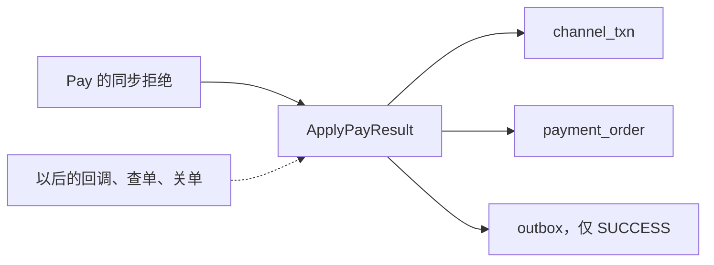
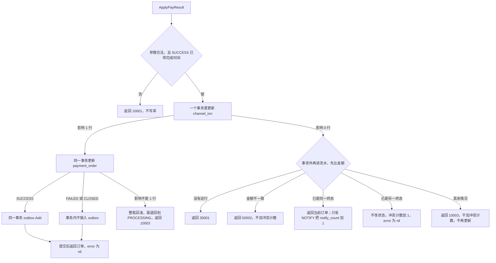

# PAY-04 支付结果推进

| 项 | 内容 |
|---|---|
| 功能点 | PAY-04（P0，第 3 周） |
| 所属链路 | 支付 |
| 代码提交 | `d0f4fe9` `[PAY-04] add pay result apply`（完整 `d0f4fe9e2cb76b6b1ed824459cb98a808c844f0c`，2026-11-01 16:58:20 +0800） |
| 分支 | `feat/PAY-04-apply-result` |
| 日期 | 2026-11-01 |
| 状态 | DONE |

本报告写在上面这次代码提交之后，不在那 12 个文件里。报告日期是 2026-11-01。第 3 周是开发计划里本功能点所在的那一段；这次只完成支付结果推进。查单补偿、商户关单、支付查询、网关、投递器都还没做。

## 一句话结论

`ApplyPayResult` 在一次数据库事务里，把渠道流水从 `PROCESSING` 条件更新到终态，再把支付单从 `PAYING` 条件更新到同一个终态。只有 `SUCCESS` 在同一事务里调用已有的 `outbox.Add`，插入一条 `payment.succeeded`。同一笔 10000 分（100.00 元）的成功结果、来源 `NOTIFY`，调用 10 次且其中 5 次并发：订单只推进一次，outbox 只有 1 条，`notify_count` 为 10（`TestApplyNotifyDuplicateOneOutbox`）。

## 1. 背景

### 1.1 系统简介

pay-system 是一个用 Go 编写的小型支付后端，模拟商户收款、退款、商户间转账三条资金链路，重点在数据一致性和性能。系统由 5 个部分组成：gateway（对外 HTTP 入口，负责签名校验和限流）、payment（支付单、退款单、转账单的状态管理和流程推进）、account（账户余额与记账，数据按商户分到 2 个数据库分片）、channel-mock（模拟微信、支付宝这类外部支付渠道）、recon（对账，核对系统内外数据是否一致）。服务之间用 Kitex RPC 同步调用，或通过 Kafka 消息异步通知；数据存在 MySQL 8.4，Redis 用于防重放。所有金额用整数“分”表示，所有记账只追加不修改。当前已完成：工程骨架、账户、模拟渠道（CH-06 只完成 FAIL、DROP_NOTIFY、DUP_NOTIFY、NEVER_FINISH）、商户凭证与费率、故障注入、创建支付单、发起支付、outbox 写入，以及本次支付结果推进。查单补偿、商户关单、支付查询、网关、投递器都还没做。

上面这段里还没展开的词：Kitex 是本项目的 Go RPC 框架，RPC 是一个进程同步调用另一个进程里的函数。签名校验用商户密钥确认请求没有被改过；限流限制单位时间内的调用次数。这两件事都在 gateway，本次不做网关。Kafka 是异步消息队列。分片是把账户数据按商户拆进 2 个库。1 元 = 100 分，金额全程用整数。记账只追加，是指账本只插入新行，不回头改旧行。本次推进不写分录，也不改账户余额。Redis 防重放是系统别处的能力，不拦这次函数。P0 是必须先做的优先级。

CH-06 是模拟渠道上的确定性故障，目前只做了四种：`FAIL`（渠道直接失败）、`DROP_NOTIFY`（丢掉回调）、`DUP_NOTIFY`（重复回调）、`NEVER_FINISH`（渠道一直不结束）。回调是渠道把结果通知回来。故障注入是代码里预先留的挂钩，测试可以在某一步观察或打断进程。本次不新增挂钩，事务里也不调用已有挂钩。

创建支付单已经能插入状态为 `INIT` 的支付单。发起支付已经能把 `INIT` 改成 `PAYING`，并留下一条状态为 `PROCESSING` 的渠道流水，然后才去调用渠道。outbox 写入已经能在调用方打开的事务里插入一行待发消息。本次把渠道的终态写回这两张表；支付成功时调用那个已有的插入函数。

### 1.2 本功能点在系统中的位置

本次只实现 `ApplyPayResult`。回调、查单、关单、同步拒绝这四个调用方共用这一份实现。来源名有六个：`NOTIFY`、`QUERY`、`CLOSE`、`JOB`、`ADMIN`、`SYNC`。`JOB` 和 `ADMIN` 现在没有调用方，只是合法的 `Source`。现在真正调用它的，是发起支付里渠道当场拒绝的那一支。HTTP 回调入口是以后的 GW-06，查单补偿是 PAY-05，商户关单 RPC 是 PAY-06，支付查询是 PAY-08，把 outbox 行发出去是 MQ-02。`ClosePayment` 仍然直接返回 `10003`，不进业务，也不进本函数。



实线是这次已经接通的调用。虚线是以后才会进来的入口，本次没有 HTTP、没有查单循环、没有关单 RPC。`channel_txn` 是发给渠道的那条流水。`payment_order` 是商户的支付单。outbox 是和业务写在同一事务里、稍后才发送的消息表。只有结果为成功时才插入。account、gateway、recon 不参与。

### 1.3 为什么需要它

商户 `M100060` 有一笔 10000 分（100.00 元）的支付。创建时按 60 个基点算出手续费 60 分（0.60 元），写在订单上。1 个基点是万分之一，60 个基点是 0.60%。公式是 `(金额 × 基点 + 5000) / 10000`。10000 × 60 = 600000。600000 除以 10000 正好是 60，余数是 0。公式在做整数除法之前先加 5000，得到 605000。605000 = 60 × 10000 + 5000，整数除法的商是 60，余数 5000 被丢掉。余数要凑满 10000，商才会变成 61。这一笔加完 5000 还差 5000，所以手续费是 60 分（0.60 元），不是 61 分。订单已经是 `PAYING`，流水已经是 `PROCESSING`。渠道后来通知“这笔成功了”。

如果不做推进，订单会一直停在支付中，账户侧也看不到“可以入账”的消息。入账是以后账户服务按金额写分录，本次不写分录。

如果推进做得不小心，同一笔通知来 10 次会出三种错：

1. 每次都把订单再改一次，并再插一条 `payment.succeeded`。下游会按 10 条消息去入账，10000 分被记 10 次。
2. 先收到失败，后收到成功，却把已经失败的单改成成功。顾客没付成，商户却看到成功。
3. 渠道通知的金额是 10001 分（100.01 元），本地流水 `channel_txn.amount` 是 10000 分（100.00 元）。若仍推进成成功，渠道记下的数和本地记下的数不是同一个。本函数这时返回 `50002`，不改订单、不改流水、不写成功消息。成功消息只在金额一致并且提交成功时才有，里面的金额抄订单上的 10000 分，不会写成通知里的 10001 分。

所以第一次用条件更新抢到唯一的一次状态变化，成功才在同一事务插入一条 outbox；后来的同一终态只计通知次数；另一终态保持原状态；金额不一致则整笔不动。

## 2. 术语

按正文第一次出现的顺序。

| 术语 | 含义 |
|---|---|
| 支付单 | 商户的一笔收款。表名 `payment_order`。创建时状态是 `INIT`。 |
| `INIT` | 已创建，还没向渠道发起。 |
| `PAYING` | 发起支付的本地变更已经提交。渠道结果可能还没回来。 |
| `SUCCESS` / `FAILED` / `CLOSED` | 支付成功、支付失败、已关闭。三者都是终态，终态不再改成别的状态。 |
| `pay_no` | 平台支付单号。本函数用它找订单，也把它当作渠道流水的 `biz_no`。 |
| 渠道流水 | 发给渠道的那条记录。表名 `channel_txn`。发起支付时状态是 `PROCESSING`。 |
| `PROCESSING` | 渠道流水还在处理中，结果还没推进到终态。 |
| 分 | 金额最小单位。100 分 = 1.00 元。类型 `money.Amount` 是 `int64`。 |
| 基点 | 费率单位。1 基点 = 0.01%。60 基点 = 0.60%。 |
| 手续费 | 创建订单时就算好，存在 `fee_amount`。本函数不重算，成功消息里抄订单上的整数。 |
| outbox | 待发消息表。业务数据和这一行放在同一个数据库事务里。发送是以后的 MQ-02。 |
| `payment.succeeded` | 支付成功这条消息的类型。`topic` 是以后投递到 Kafka 的主题名，支付成功是 `pay.payment.succeeded`。 |
| `msg_key` | 消息键。支付成功用 `pay_no`，让同一笔支付的消息可以排在一起。 |
| 信封 | 存在 outbox 行里的 JSON 正文。 |
| `out_trade_no` | 商户自己的订单号。成功消息里原样抄上。 |
| 回调 / `NOTIFY` | 渠道把结果通知回来。来源名是 `NOTIFY`。HTTP 入口本次不做。 |
| 查单 / `QUERY` | 再问渠道这笔结果。来源名是 `QUERY`。补偿任务是 PAY-05，本次不做。 |
| 关单 / `CLOSE` | 把未支付的单关掉。来源名是 `CLOSE`。商户关单 RPC 是 PAY-06，本次不做。 |
| `JOB` / `ADMIN` | 两个来源名。现在没有调用方，只是合法的 `Source`。 |
| 同步拒绝 / `SYNC` | 发起支付时，渠道当场拒绝。来源名是 `SYNC`。它是来源名，不是新的错误码。 |
| `ApplyPayResult` | 本次的推进函数。回调、查单、关单、同步拒绝这四个调用方共用这一份实现。来源名有六个：`NOTIFY`、`QUERY`、`CLOSE`、`JOB`、`ADMIN`、`SYNC`。 |
| `biz_no` | 本函数入参里的业务单号。支付这里就是 `pay_no`。 |
| CAS | 条件更新。`WHERE` 里带上期望状态，影响行数必须是 1 才算抢到。别人已经改过，影响行数就是 0。 |
| `version` | 行上的整数，每次成功的条件更新加 1，用来让以后的更新看见这行被改过。本次 `WHERE` 不看 `version`，防重靠 `status = 'PROCESSING'` 只能成功一次。创建订单时 `version` 是 0；发起支付把它加成 1；成功推进再加成 2，所以测试里订单是 2。渠道流水插入时是 0；第一次抢到加成 1；后面 9 次同一终态只加 `notify_count`，不加 `version`，所以仍是 1。 |
| 事务 | 几条 SQL 一起成功或一起撤销。`dbx.WithTx` 是已有入口：函数返回 nil 就提交，返回错误就回滚。 |
| `notify_count` | 渠道流水上的通知次数。只有来源 `NOTIFY` 才加 1。 |
| 冲突 | 先比金额。带了金额且与流水 `amount` 不同时返回 `50002`，不加冲突计数，即使已经是终态。只有金额相同或这次没带金额，并且已是另一个终态，才不改状态，把进程内计数加 1。 |
| `pay_callback_conflicts_total` | 上面那个计数的名字。按渠道分桶，放在进程内，不起指标 HTTP。 |
| 注入时钟 | 业务代码不调用 `time.Now()`。时间来自构造时放进 `Payments` 的 `clock.Clock`。测试用可拨动的假时钟。 |
| 渠道完成时间 | 调用方传入的 `FinishedAt`。成功时的 `paid_at` 用它，不用本事务的注入时钟。 |
| `paid_at` | 订单上的支付完成时间。 |
| `closed_at` | 订单上的关闭时间。 |
| `fail_code` / `fail_msg` | 失败原因码和说明。渠道当场拒绝时，码是 `CHANNEL_REJECTED`，说明是渠道的 `reason`。 |
| `10001` | 已有错误码。参数不合法。空单号、未知结果、未知来源、成功却没带完成时间，都是它。 |
| `10003` | 已有错误码。内部错误。订单条件更新没抢到时整笔回滚并返回它。渠道更新已经影响 0 行、再读仍不是终态时也返回它，不再试一次更新。 |
| `10004` | 已有错误码。发号器发现时钟回拨。本函数把这个错误映射成它。 |
| `30001` | 已有错误码。按单号再读，没有这条渠道流水。 |
| `30006` | 已有错误码。渠道拒绝。本函数自己不返回它；`Pay` 在推进成功后再返回它。 |
| `50002` | 已有错误码。结果里的金额和流水上的金额不一致。 |
| `biz_code` | RPC 响应里的业务码字段。`30006` 放在这里，RPC 的 error 为 nil，并带上订单。 |
| 发号器 | `pkg/idgen` 的 `Generator`。outbox 的 `event_id` 由已有的 `outbox.Add` 发放，前缀 `EV`。 |
| 时钟回拨 | 注入时钟比这个发号器上次见到的时间倒退超过 5 毫秒。发号器返回 `idgen.ErrClockRollback`。 |
| 幂等 | 同一笔结果再来，不把状态再推进一次，也不再插第二条 outbox。 |
| 覆盖率 | 测试执行到的语句占该包语句的比例。核心包看带集成测试的数字，门槛 70%。 |
| `cached` | Go 复用了已有测试结果，没有重跑那个包。 |
| `integration` | 构建标签。带上它才编译连 MySQL 的测试文件。 |

## 3. 技术讲解

### 3.1 要解决的问题

1. 订单和流水必须一起离开“处理中”。只改其中一张，另一张仍是旧状态，对账时会对不上。
2. 成功消息必须和订单成功出现在同一次提交里。事务回滚后不能留下 `payment.succeeded`；提交之后必须留有一行，供以后的投递器发送。
3. 同一终态可以来很多次。状态只改一次，outbox 只留一条。来源是 `NOTIFY` 时，每次仍把 `notify_count` 加 1，用来看出渠道重复通知了多少次。
4. 已经是终态时，另一个终态不能把状态倒回去。先比金额：带了金额且与流水 `amount` 不同，返回 `50002`，不加冲突计数。只有金额相同或这次没带金额，并且已是另一个终态，才加计数。冲突单等以后的对账处理。
5. 金额比较的是 `channel_txn.amount`，不是订单金额。发起支付插入流水时，`amount` 写成订单金额，所以这一笔在推进前两者相同。本函数不拿订单金额做这次比较。不一致时不改订单、不改流水、不加冲突计数。已经是终态也先比金额。成功消息里的 `amount` 和 `fee_amount` 抄订单上已经写好的整数。
6. 成功的 `paid_at` 用渠道完成时间，截到毫秒。没传完成时间则写库前返回 `10001`。对账按这个时间归属，不能改成本事务的注入时钟。
7. 事务里没有 HTTP、RPC、Kafka，也不调用故障点。验签是用渠道密钥核对渠道响应没有被改过。超时或验签失败时，发起支付把结果当成未知，不调用本函数，订单停在 `PAYING`。本报告的验收表没有这条测试，这里只说明分支，不把它算进本次验收。

金额是 `int64` 分。写操作靠条件更新实现幂等，不靠先查后改。状态只用 CAS 更新（约定 §6.2）。

### 3.2 方案

调用方传入结构体 `PayResult`：`BizNo`、`Result`（`SUCCESS` / `FAILED` / `CLOSED`）、`Source`（`NOTIFY` / `QUERY` / `CLOSE` / `JOB` / `ADMIN` / `SYNC`）、可选的 `FailCode`、`FailMsg`、可选的 `Amount`、可选的 `ChannelTxnNo`、`ChannelStatusRaw`、`FinishedAt`。`Amount` 为 nil 表示这次没带金额，条件里不加金额。

先检查参数。空 `BizNo`、未知结果、未知来源，以及 `SUCCESS` 的 `FinishedAt` 是零值，都返回 `10001`，此时还没碰数据库。合法参数才会要数据库。生产库存在 `sqlOrderStore` 里；内存订单存储不是这种类型，合法参数会在写库前返回 `10003`。`SUCCESS` 时发号器不是 `*idgen.Generator` 或是 nil：写库前返回已有的 `10003`，不进入事务。类型正确才往下调用 `outbox.Add`。

然后进入一次 `dbx.WithTx`。连接的隔离级别是 `READ COMMITTED`。这个入口的总时长默认 3 秒；只有 MySQL 死锁 `1213` 和锁等待 `1205` 会重试，含第一次最多 4 次。渠道没抢到时返回的是普通 Go 错误，不会被当成死锁重试。

事务里的顺序固定：先更新 `channel_txn`，影响行数是 1 才更新 `payment_order`，订单也是 1 行且结果是 `SUCCESS` 才调用 `outbox.Add`。`FAILED` 和 `CLOSED` 在订单更新后就结束，不插入 outbox。

下面这条是“来源为 `NOTIFY` 且带了金额”的渠道更新。另外三条是它的组合：去掉 `notify_count` 加 1，或去掉 `AND amount = ?`，或两样都去掉。`service/payment/biz/result.go` 里四个常量按这次入参选用。

```go
const applyChannelNotifyAmountSQL = `
UPDATE channel_txn
   SET status = ?,
       channel_txn_no = COALESCE(channel_txn_no, ?),
       channel_status_raw = ?,
       channel_finished_at = ?,
       next_query_at = NULL,
       notify_count = notify_count + 1,
       version = version + 1,
       updated_at = ?
 WHERE biz_no = ? AND status = 'PROCESSING' AND amount = ?`
```

`COALESCE` 只在原来的流水号是 NULL 时写入新号码。调用方没带号码时，参数写成 SQL NULL，已有号码不会被盖成空。`channel_status_raw` 为空同样写成 NULL。没传完成时间时，`channel_finished_at` 写成 NULL。终态把 `next_query_at` 写成 NULL，查单任务以后不会再捞到它。`updated_at` 显式写成这次注入时钟截到毫秒，避免 MySQL 的 `ON UPDATE CURRENT_TIMESTAMP(3)` 改用数据库时钟。`version` 是行上的整数，每次成功的条件更新加 1，用来让以后的更新看见这行被改过。本次 `WHERE` 不看 `version`，防重靠 `status = 'PROCESSING'` 只能成功一次。创建订单时 `version` 是 0；发起支付把它加成 1；成功推进再加成 2。渠道流水插入时是 0；第一次抢到加成 1；后面同一终态只加 `notify_count`，不加 `version`。

订单的 `WHERE` 是 `pay_no = ? AND status = 'PAYING'`，同时 `version` 加 1，`updated_at` 同样是注入时钟。`SUCCESS` 的 `paid_at` 是渠道完成时间截到毫秒。`FAILED` 的 `fail_code` 用调用方的非空值，空则写成 `CHANNEL_FAILED`；`fail_msg` 用传入值，可以是空字符串。`CLOSED` 传了完成时间则 `closed_at` 用它；没传则 `closed_at` 用注入时钟截到毫秒，这时渠道上的 `channel_finished_at` 仍是 NULL。

成功分支在同一个事务里调用已有的 `outbox.Add`。`PaidAt` 用已经截到毫秒的渠道完成时间。`event_id` 由 `Add` 发放。支付侧不自己再写一条 INSERT。

```go
err = outbox.Add(ctx, tx, outbox.Event{
    Type:       outbox.EventPaymentSucceeded,
    PayNo:      order.PayNo,
    MerchantID: order.MerchantID,
    OutTradeNo: order.OutTradeNo,
    Channel:    order.Channel,
    Amount:     order.Amount,
    FeeAmount:  order.FeeAmount,
    PaidAt:     finished,
}, gen, clk)
```

`topic` 是以后投递到 Kafka 的主题名，支付成功是 `pay.payment.succeeded`。`msg_key` 是消息键，支付成功用 `pay_no`，让同一笔支付的消息可以排在一起；`biz_no` 同样是 `pay_no`。这两项是 `Add` 内部按支付成功类型填的。`out_trade_no` 是商户自己的订单号，成功消息里原样抄上。信封是存在 outbox 行里的 JSON 正文，其中 `data` 的 `amount` 和 `fee_amount` 抄订单上已经写好的整数，比较金额时不拿这两项去对 `channel_txn.amount`。`outbox.Add` 失败则事务回滚。时钟回拨映射为已有的 `10004`。上下文取消原样返回。其余不是本项目错误码的失败，经已有的 `callErr` 变成 `10003`。



渠道更新影响 0 行时，事务回滚，再到事务外按 `biz_no` 读流水。比较的是 `channel_txn.amount`，不是订单金额。顺序是：没有行 → `30001`；带了金额且与流水 `amount` 不同 → `50002`，ERROR 日志只记 `pay_no` 和 `err_code`，不加冲突计数，即使已经是终态；金额相同或这次没带金额时，再看状态。同一终态返回当前订单，error 为 nil，不写第二条 outbox。只有 `NOTIFY` 再执行一条自动提交的更新：`notify_count` 加 1，`updated_at` 写成注入时钟，`WHERE biz_no = ? AND status = 该终态`。这条更新不改状态，不加 `version`。`SYNC`、`QUERY`、`CLOSE`、`JOB`、`ADMIN` 都不加 `notify_count`。

另一终态不改订单、不改流水。这里的“另一终态”只发生在金额相同或这次没带金额之后。`noteConflict` 按渠道把 `pay_callback_conflicts_total` 加 1，打 ERROR 日志，然后返回当前订单，error 为 nil。计数是包级 `sync.Map`，键是渠道名，值是 `*atomic.Uint64`。同进程里的测试直接读 `callbackConflicts`。没有 HTTP `/metrics`。Prometheus 是一种指标采集系统，本次不引入它的客户端。进程重启后这个数从 0 开始。

渠道更新影响 0 行并回滚之后，再读只区分四种结果：没有这行（`30001`）、金额不符（`50002`）、同一终态、另一终态。其余情况一律返回 `10003`，不加冲突计数，也不再更新。本报告没有造出「更新影响 0 行、再读仍是 PROCESSING」的数据，不把这一支写成已验证的时序。订单条件更新影响不是 1 行时，整笔回滚，渠道流水回到 `PROCESSING`，ERROR 日志只记 `pay_no` 和 `err_code`，返回 `10003`。

本函数自己成功推进时，error 是 nil。渠道同步拒绝是个例外，多一步在 `Pay` 里。`service/payment/biz/pay.go` 的受理结果是 `REJECTED` 时，这样调用本函数：结果 `FAILED`，`fail_code` 为 `CHANNEL_REJECTED`，`fail_msg` 为渠道 `reason`，来源 `SYNC`，不带金额。本函数返回的 error 为 nil 且订单已是 `FAILED` 后，`Pay` 再返回该订单和 `errno.ErrChannelRejected`。

```go
got, err := p.applier.ApplyPayResult(ctx, PayResult{
    BizNo:    order.PayNo,
    Result:   payResultFailed,
    FailCode: failCodeChannelRejected,
    FailMsg:  res.Reason,
    Source:   paySourceSync,
})
if err != nil {
    return got, err
}
if got.Status == payStatusFailed {
    return got, errno.ErrChannelRejected
}
```

已有的 handler 看到这个错误时，把 `30006` 放进 `PayResponse.biz_code`，RPC error 为 nil，并携带订单。这次提交没有改 `handler.go`。`cmd/payment/main.go` 把 `UsePay` 的推进器设成 `payments` 自己；测试里传入 nil 时，`UsePay` 同样装上自己的 `ApplyPayResult`。

读取流水时，`next_query_at` 用 `sql.NullTime` 扫描。终态写成 NULL 之后，再读得到的下次查单时间是零值。`PROCESSING` 的行仍带着发起支付时写下的非空时间。

### 3.3 为什么这样做

| 方案 | 做法 | 优点 | 缺点 | 结论 |
|---|---|---|---|---|
| 采用：一次事务里先流水、再订单、仅成功写 outbox | 条件更新抢第一次；0 行后再读，先金额、再终态 | 提交后订单和成功消息一起可见；回滚后两样都没有；重复通知不产生第二条消息 | 冲突只留在进程内计数，重启就没了；投递仍要另做 | 采用 |
| 备选：每次结果都插入 outbox，靠消费端去重 | 推进函数不判断重复 | 写入简单 | 失败和关闭也会产生消息；重复成功要靠消费端认出，不能保证只留 1 条 | 不采用。失败和关闭也会产生消息，重复成功要靠消费端认出，不能保证只留 1 条 |
| 备选：先改订单，事务提交后再发 Kafka | 成功与发送分成两步 | 少一张 outbox | 进程停在两步中间时，订单已成功，消息没有着落 | 不采用。发送留给 MQ-02，本次只保证行和订单同事务 |

`callback.after_commit` 这个故障点留给 GW-06，在调用本函数返回之后使用。本次事务内不调用它。投递器那张流程图本次不改。

### 3.4 正确性

例子金额都是 10000 分（100.00 元），手续费 60 分（0.60 元），渠道名是 `mockpay`。集成测试在 `go test -race -tags integration` 下通过。并发用 `errgroup`，同一行由 InnoDB 行锁串起来，测试里没有 `time.Sleep`。

| 场景 | 系统行为 | 最终状态 | 证明 |
|---|---|---|---|
| 同一笔 `SUCCESS`、`source=NOTIFY` 调用 10 次，其中 5 次并发，然后 5 次顺序执行 | 1 次抢到 `PROCESSING`。这次更新把状态改成 `SUCCESS`，`notify_count` 先加 1，并插入 1 条 outbox。另外 9 次再读到同一终态，各自把 `notify_count` 加 1，不再插 outbox | 订单 `SUCCESS`。`paid_at` 为 `2026-10-17T15:04:05.123+08:00`：测试传入的完成时间是 `feeAt(15, 4, 5, 123000000)`，也就是 2026-10-17 15:04:05.123、时区 +08。同一测试的注入时钟是当天 12:00:00，两者不相等。订单 `version` 为 2：创建时 0，发起支付加成 1，成功推进再加成 2。流水 `SUCCESS`，`notify_count` 为 10，`version` 为 1：插入时 0，第一次抢到加成 1，后面 9 次只加 `notify_count`。`channel_txn_no` 仍是 `CH-DUP`，`next_query_at` 为 NULL。outbox 恰好 1 行，`event_type` 为 `payment.succeeded`，`status` 为 `PENDING`。消息里的金额 10000 分、手续费 60 分抄订单上已经写好的整数 | `TestApplyNotifyDuplicateOneOutbox`，集成 |
| 5 个并发都要把同一条 `PROCESSING` 改成 `SUCCESS` | 只有 1 个 `UPDATE` 影响 1 行。其余影响 0 行，回滚后读到已经提交的 `SUCCESS`，走同一终态 | 同上，不会出现 2 条 outbox | 同上 |
| 先 `FAILED`（`NOTIFY`，`fail_msg` 为 `declined`，不带金额），再 `SUCCESS` 且金额 10000 分 | 第一次写成失败，`fail_code` 空则落成 `CHANNEL_FAILED`，`notify_count` 为 1。第二次与 `channel_txn.amount` 相同，但是另一个终态，不改状态，冲突计数加 1 | 订单保持 `FAILED`，`paid_at` 为空。outbox 为 0。`mockpay` 的冲突计数比调用前多 1 | `TestApplyConflictKeepsFailed`，集成 |
| 渠道更新已经执行、订单条件更新影响不是 1 行时进程还在事务里 | `WithTx` 回滚。渠道行回到进入事务之前的样子 | 测试先把订单改成 `CLOSED`。调用返回 `10003`。流水仍是 `PROCESSING`，版本、通知次数、下次查单时间、流水号都与调用前相同。outbox 为 0 | `TestApplyOrderCASRollsBack`，集成 |
| 事务提交前进程崩溃 | 数据库撤销未提交的渠道更新、订单更新和 outbox 插入 | 流水仍是 `PROCESSING`，没有 `payment.succeeded` | 无单独的杀进程测试。依据是 `WithTx` 在返回错误或连接断开时回滚 |
| 事务提交后进程崩溃 | 订单、流水和那 1 条状态为 `PENDING` 的 outbox 已经提交。崩溃不会把已提交的 `notify_count` 改回去。若之后再来同一终态的 `NOTIFY`，仍按正常规则把 `notify_count` 加 1，但不会再插第二条 outbox | 已提交的行还在。发送留给 MQ-02 | 没有杀掉进程再拉起的测试 |
| 渠道超时或验签失败 | 验签是用渠道密钥核对渠道响应没有被改过。超时或验签失败时，发起支付把结果当成未知，不调用本函数 | 订单停在 `PAYING`，流水停在 `PROCESSING` | 本报告的验收表没有这条测试，这里只说明分支，不把它算进本次验收。这是 PAY-03 已有行为 |
| 回调金额 10001 分（100.01 元），`channel_txn.amount` 是 10000 分（100.00 元） | 比较的是流水 `amount`，不是订单金额。发起支付插入流水时把它写成订单金额，推进前两者相同。渠道 `UPDATE` 因金额条件影响 0 行，再读发现与流水 `amount` 不同 | 返回 `50002`。订单仍是 `PAYING`，流水仍是 `PROCESSING`，`next_query_at` 仍在，outbox 为 0，冲突计数不变 | `TestApplyAmountMismatch`，集成 |
| 已经是 `FAILED` 后再来 `SUCCESS`，金额却是 1 分（0.01 元） | 先比金额，不走冲突 | 返回 `50002`。订单保持 `FAILED`，冲突计数不变 | 同上后半段 |
| `SUCCESS` 的完成时间与注入时钟不同，来源 `QUERY` | `paid_at` 和 `channel_finished_at` 都用传入时间。已有流水号 `CH-PAID` 不被 `CH-SHOULD-NOT-REPLACE` 盖住 | `updated_at` 等于注入时钟。`notify_count` 为 0。`channel_status_raw` 是渠道传来的状态原文，测试传入 `TRADE_SUCCESS`，原样写入这一列 | `TestApplySuccessPaidAtUsesChannelTime`，集成。补充，不另立验收标准 |
| `CLOSED` 带完成时间；另一笔 `JOB` 不带完成时间 | 第一笔 `closed_at` 用渠道时间。第二笔 `closed_at` 用注入时钟，`channel_finished_at` 保持空 | 两笔 outbox 都是 0，`notify_count` 都是 0 | `TestApplyClosedNoOutbox`，集成。补充 |
| 先 `NOTIFY` 成功一次，再用同一 `SUCCESS` 以 `QUERY` 调一次 | 第二次是同一终态，来源不是 `NOTIFY` | error 为 nil。`notify_count` 仍是 1，流水 `version` 仍是 1，outbox 仍是 1 条 | `TestApplyQueryDuplicateNoNotify`，集成。补充 |
| 空单号、结果 `PAYING`、来源 `WEB`、成功不带时间、关闭不带来源 | 写库前返回 `10001` | 内存里的订单仍是 `INIT`，流水条数是 0 | `TestApplyRejectsParams`，单元。补充 |

假渠道 `REJECTED`、`reason` 为 `ORDER_CLOSED` 的路径放在第 4.3 节，因为它同时覆盖 `Pay` 的返回码。那次推进的 error 在本函数是 nil；`Pay` 再返回 `30006`。同一笔再用 `SYNC` 调一次本函数，error 仍是 nil，`notify_count` 仍是 0。

### 3.5 性能

不涉及。这次没有压测数据。

## 4. 已完成内容

### 4.1 改动清单

这些文件都在代码提交 `d0f4fe9` 里。12 个文件，+1078 / −82。

| 文件 | 新增 / 修改 | 作用 |
|---|---|---|
| `service/payment/biz/result.go` | 新增 | `ApplyPayResult`、四条渠道 SQL、三条订单 SQL、重复通知加 1、冲突计数 |
| `service/payment/biz/result_integration_test.go` | 新增 | 连 MySQL 的推进测试，构建标签 `integration` |
| `service/payment/biz/result_test.go` | 新增 | 参数拒绝的单元测试 |
| `service/payment/biz/pay.go` | 修改 | 同步拒绝在本函数写成 `FAILED` 且 error 为 nil 后，`Pay` 返回订单和 `30006`。`UsePay` 的适配器为 nil 时用自己 |
| `service/payment/biz/pay_sql.go` | 修改 | `next_query_at` 按 `sql.NullTime` 读取，NULL 成为零时间 |
| `service/payment/biz/pay_test.go` | 修改 | 不改库的空实现只留在测试里 |
| `cmd/payment/main.go` | 修改 | 生产启动把推进器接上 `payments` 自己 |
| `docs/02-requirements.md` | 修改 | PAY-04 的规则与验收，状态改为 DONE |
| `docs/03-conventions.md` | 修改 | 版本 v2.23，登记进程内冲突计数 |
| `docs/04-dev-plan.md` | 修改 | 勾选 PAY-04 |
| `docs/05-api.md` | 修改 | 版本 3.1.5，落地已公布的 `30006` |
| `docs/06-flows.md` | 修改 | 版本 v2.23，改写支付结果推进的源图 |

### 4.2 对外变化

| 类别 | 变化 |
|---|---|
| 接口 | 无新的商户 HTTP 字段。IDL 是 RPC 接口定义文件，本次没改。已有的 `Pay`：渠道同步拒绝被推进成 `FAILED` 后，`biz_code` 为 `30006`，RPC error 为 nil，响应携带订单。本函数自己成功推进时 error 为 nil。`ClosePayment` 仍直接返回 `10003`，不进业务 |
| 表结构 | 无。沿用 `channel_txn`、`payment_order`、`outbox`。没有新列、新索引，也没有改已经应用的迁移 |
| 配置项 | 无。不新增环境变量 |
| 错误码 | 无新增，无新的单号前缀。使用已有的 `10001`、`10003`、`10004`、`30001`、`30006`、`50002`。`event_id` 仍由 `outbox.Add` 按已有前缀 `EV` 发放 |
| 指标 / 故障点 | 进程内计数 `pay_callback_conflicts_total`，键是 channel，值是 `*atomic.Uint64`。不起 HTTP `/metrics`。Prometheus 是一种指标采集系统，本次不引入它的客户端。不新增故障点。`callback.after_commit` 本次不调用 |

### 4.3 验收对照

前五行是需求里的验收条目。后四行是补充测试，不另立验收标准。集成测试都在 `go test -race -tags integration` 下通过。

| 验收条目 | 测试函数 | 类型 | 结果 |
|---|---|---|---|
| 同一笔 SUCCESS 结果以 `source = NOTIFY` 调用 `ApplyPayResult` 10 次（其中 5 次并发），订单只推进一次，outbox 只有 1 条 `payment.succeeded`，`notify_count = 10` | `TestApplyNotifyDuplicateOneOutbox` | 集成 | 通过。金额 10000 分（100.00 元），手续费 60 分（0.60 元），商户 `M100060` |
| Pay 时假渠道客户端返回 `REJECTED`（reason 为 `ORDER_CLOSED`）：订单 FAILED，`fail_code = CHANNEL_REJECTED`，`fail_msg` 为渠道 reason，接口返回 `30006` 和订单 | `TestPayRejectedBecomesFailed` | 集成 | 通过。outbox 为 0，`paid_at` 为空，`notify_count` 为 0 |
| 回调金额与本地不一致返回 `50002`，订单仍为 PAYING | `TestApplyAmountMismatch` | 集成 | 通过。流水仍是 `PROCESSING`。已终态但金额不符同样是 `50002`，冲突计数不变 |
| 先收到 FAILED 再收到 SUCCESS，订单保持 FAILED，冲突指标 +1 | `TestApplyConflictKeepsFailed` | 集成 | 通过。outbox 为 0 |
| 测试中让 `payment_order` 的 CAS 失败（人为改状态），整个事务回滚，`channel_txn` 未变化 | `TestApplyOrderCASRollsBack` | 集成 | 通过。返回 `10003`，流水仍是 `PROCESSING` |
| 补充：`paid_at` 等于渠道完成时间 | `TestApplySuccessPaidAtUsesChannelTime` | 集成 | 通过 |
| 补充：`CLOSED` 不写 outbox；没传完成时间时 `closed_at` 用注入时钟，渠道完成时间保持空 | `TestApplyClosedNoOutbox` | 集成 | 通过 |
| 补充：同一终态的 `QUERY` 不加 `notify_count`，不写第二条 outbox | `TestApplyQueryDuplicateNoNotify` | 集成 | 通过 |
| 补充：非法参数返回 `10001`，不写库 | `TestApplyRejectsParams` | 单元 | 通过 |

### 4.4 验证记录

日期都是 2026-11-01。环境：`go version go1.27.2 darwin/arm64`。`golangci-lint has version 2.14.0 built with go1.27.1 from 114493f on 2026-09-24T10:54:53Z`。耗时是 `/usr/bin/time -p` 的 real。`make gen` 会按 IDL 生成代码；IDL 是 RPC 接口定义文件，本次没改，所以没运行。`mmdc` 是把 Mermaid 源图渲染成 SVG 的命令，本次没运行，没有新的 SVG。

| 命令 | 结果 |
|---|---|
| `gofmt -l .` | 无输出，exit 0，real 0.06s |
| `make lint` | `0 issues.`，exit 0，real 1.03s |
| `make test` | exit 0，real 4.88s，根包 `ok github.com/yym108/pay-system 4.372s`。这次运行里 `service/payment/biz` 是 `(cached)` |
| `go test -race -count=1 -cover ./service/payment/biz/ ./service/payment/handler/ ./cmd/payment/` | exit 0，real 11.56s。biz 3.684s、覆盖率 65.7%（不含集成测试，不作为 70% 门槛）。handler 10.195s、84.1%。cmd/payment 1.622s、56.8%（cmd 不在 70% 门槛里） |
| `make test-integration` | exit 0，real 36.26s，根包 `ok github.com/yym108/pay-system 35.749s`。这次 make 里 payment 的 biz 和 handler 是 `(cached)` |
| `go test -race -count=1 -tags integration -cover ./service/payment/biz/ ./service/payment/handler/ ./pkg/outbox/` | exit 0，real 19.26s。biz 17.979s、89.2%。handler 17.940s、84.7%。outbox 8.925s、95.0% |
| `make cover` | exit 0，real 37.11s。`go tool cover -func` 的 total 26.8%（含生成代码，不作判据）。门槛看核心包：`service/payment/biz` 89.2%，`pkg/outbox` 95.0%。函数：`ApplyPayResult` 88.6%，`validatePayResult` 100%，`knownPayResult` 100%，`knownPaySource` 100%，`paymentDB` 66.7%，`applyPayResultTx` 79.3%，`channelArgs` 100%，`execOrder` 87.5%，`afterChannelMiss` 70.0%，`bumpNotify` 42.1%，`noteConflict` 100%，`currentOrder` 66.7%，`nullString` 100%，`isPayTerminal` 66.7%，`addCallbackConflict` 80.0%，`callbackConflicts` 85.7%，`Pay` 84.8%，`callChannel` 88.9%，`UsePay` 85.7%，`channelTxnByBizNo` 78.6%，handler 的 `Pay` 78.6%，outbox 的 `Add` 100% |
| `make gen` | 未运行。IDL 没改 |
| `mmdc` | 未运行。没有新的 SVG |

`cached` 表示那次全量命令没有重跑对应的包。不含集成标签的 biz 覆盖率 65.7% 与 `make cover` 的 89.2% 不是同一次测量。70% 门槛只看后者，以及 `pkg/outbox` 的 95.0%。`cmd/payment` 的 56.8% 不在这条门槛里。

### 4.5 同步的文档

这些文档都在代码提交 `d0f4fe9` 里。

- 需求：版本仍是 v3.0，最后修改 2026-11-01。PAY-04 改为 DONE，五条验收已勾选。写明一次事务的顺序、金额先于终态、`FAILED` 与 `CLOSED` 不写 outbox、`callback.after_commit` 留给 GW-06。
- 约定：版本 v2.23，2026-11-01。登记进程内的 `pay_callback_conflicts_total`。不新登记错误码。
- 接口：版本 3.1.5，2026-11-01。落地已公布的 `30006`。不改商户 HTTP 字段。IDL 是 RPC 接口定义文件，本次没改。
- 流程图：版本 v2.23，2026-11-01。支付结果推进的源图改成结构体入参和本次分支。图内去掉 `callback.after_commit`。`mmdc` 是把 Mermaid 源图渲染成 SVG 的命令，本次没运行，没有新的 SVG。
- 开发计划：只勾选 PAY-04。同一段计划里的商户关单 PAY-06、支付查询 PAY-08 仍未勾选。

## 5. 未完成与风险

- 冲突日志使用了字段名 `channel`。约定里固定业务字段名清单还没有这个名字。清单里已有 `pay_no`、`from_status`、`to_status`、`err_code`。金额不符和订单 CAS 失败的日志只用 `pay_no` 和 `err_code`。
- 渠道更新影响 0 行并回滚之后，再读只区分四种结果：没有这行（`30001`）、金额不符（`50002`）、同一终态、另一终态。其余情况一律返回 `10003`，不加冲突计数，也不再更新。本报告没有造出「更新影响 0 行、再读仍是 PROCESSING」的数据，不把这一支写成已验证的时序。时钟回拨映射为已有的 `10004`。上下文取消原样返回。其余不是本项目错误码的 `outbox.Add` 失败，经 `callErr` 变成 `10003`。`make cover` 里 `bumpNotify` 是 42.1%，`paymentDB`、`currentOrder`、`isPayTerminal` 都是 66.7%，包覆盖率 89.2% 仍高于 70%。
- 进程崩溃在事务提交前由数据库回滚。提交后订单、流水和那 1 条状态为 `PENDING` 的 outbox 还在。崩溃不会把已提交的 `notify_count` 改回去。若之后再来同一终态的 `NOTIFY`，仍按正常规则把 `notify_count` 加 1，但不会再插第二条 outbox。发送留给 MQ-02。没有杀掉进程再拉起的测试。
- 验签是用渠道密钥核对渠道响应没有被改过。超时或验签失败时，发起支付把结果当成未知，不调用本函数，订单停在 `PAYING`。这是 PAY-03 已有行为。本报告的验收表没有这条测试。
- HTTP 回调入口是 GW-06。查单补偿是 PAY-05。商户关单 RPC 是 PAY-06，`ClosePayment` 现在仍返回 `10003`。支付查询是 PAY-08。投递器是 MQ-02。对账还没做，冲突单保持原终态等它处理。
- 冲突计数只在本进程的内存里。进程退出后清零，也没有 `/metrics`。Prometheus 是一种指标采集系统，本次不引入它的客户端。
- 流程图只改了源文件。`mmdc` 是把 Mermaid 源图渲染成 SVG 的命令，本次没运行，没有新的 SVG。

## 6. 如何复现

在仓库根目录、分支 `feat/PAY-04-apply-result`、代码提交 `d0f4fe9e2cb76b6b1ed824459cb98a808c844f0c` 上执行。环境是 2026-11-01 的 `go version go1.27.2 darwin/arm64`。集成测试沿用已有基座：需要 Docker，或已经设置 `TEST_MYSQL_DSN`。本次记录没有另打印当时连的是哪台库。验收使用假渠道客户端，不需要启动 channel-mock。

```bash
gofmt -l .
make lint
make test
go test -race -count=1 -cover ./service/payment/biz/ ./service/payment/handler/ ./cmd/payment/
make test-integration
go test -race -count=1 -tags integration -cover ./service/payment/biz/ ./service/payment/handler/ ./pkg/outbox/
make cover
```

预期与第 4.4 节的表一致。`gofmt -l .` 无输出。`make lint` 打印 `0 issues.`。测试命令的退出码是 0。不含集成标签时，biz 覆盖率 65.7%，这个数字不作为 70% 门槛。`make cover` 的 total 是 26.8%，不作判据；`service/payment/biz` 是 89.2%，`pkg/outbox` 是 95.0%。`make gen` 和 `mmdc` 这次没有运行。再跑时墙钟会随机器变化，第 4.4 节的 real 是这次实测。

## 7. 讲解要点

1. 为什么成功消息和订单在同一个事务？10000 分的订单若先提交成功、再单独发消息，进程停在中间就没有行可以重试。若消息先发出去、事务再回滚，下游会给一笔并不存在的成功入账。同一事务提交后，订单是 `SUCCESS`，outbox 恰好 1 行；回滚后两样都没有。
2. 10 次通知为什么只有 1 条 outbox？第一次 `UPDATE ... WHERE status='PROCESSING'` 抢到唯一一行，并在这次里把 `notify_count` 加到 1。另外 9 次读到已经是 `SUCCESS`，只把通知次数加到 10，不改状态，不调用 `outbox.Add`。
3. 为什么先失败再成功不改回成功？终态不可变。第二次金额相符但状态不同，函数返回当前这张 `FAILED` 订单，error 为 nil，冲突计数加 1。金额若对不上，则在看终态之前就返回 `50002`，计数不加。

## 延伸阅读

- `docs/02-requirements.md`：PAY-04 的规则和五条验收。版本 v3.0。
- `docs/05-api.md`：`Pay` 的 `30006` 放在 `biz_code`。版本 3.1.5。
- `docs/03-conventions.md`：来源名和进程内计数。版本 v2.23。
- `docs/06-flows.md`：支付结果推进的源图。版本 v2.23，SVG 未渲染。
- `docs/04-dev-plan.md`：PAY-04 已勾选。PAY-06、PAY-08 未勾选。
- `service/payment/biz/result.go`：本节引用的推进实现。
- `service/payment/biz/pay.go`：同步拒绝如何调用本函数并返回 `30006`。
- `pkg/outbox`：`Add` 只负责在调用方的事务里插入一行。
- `pkg/dbx`：事务入口 `WithTx`。

## 修订记录

| 日期 | 提交 | 修订内容 |
|---|---|---|
| 2026-11-01 | 报告尚未提交 | 首版。对应代码提交 `d0f4fe9` `[PAY-04] add pay result apply` |
| 2026-11-01 | 报告尚未提交 | 可读性第一轮：补整数除法、版本起点、来源名和崩溃后的通知次数；第二轮补手续费余数、金额两边、剩余分支和渠道原文 |
