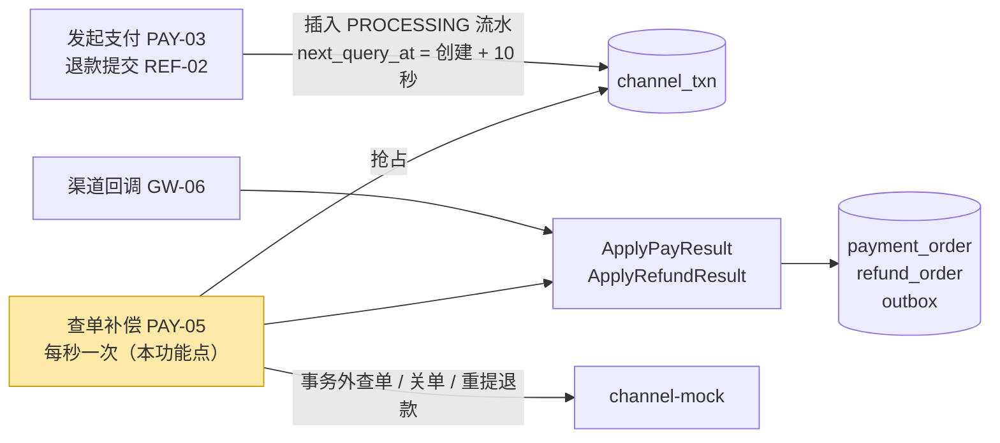
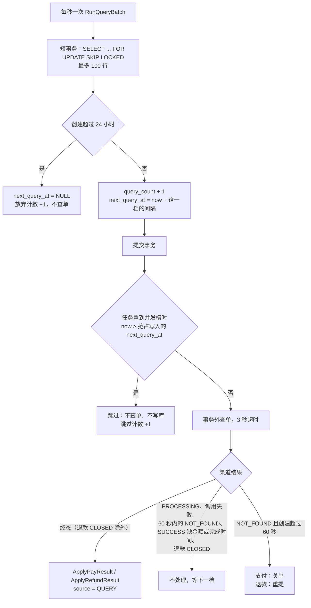

# PAY-05 查单补偿

| 项 | 内容 |
|---|---|
| 功能点 | PAY-05 查单补偿（优先级 P0，即必须完成；排在第 4 周的里程碑 M4） |
| 所属链路 | 支付（同时处理退款的渠道流水） |
| 代码提交 | `70319ba` `[PAY-05] add channel query compensation`；`df1b9c5` `[PAY-05] correct reclaim wording`（只改注释和文档措辞） |
| 分支 | `feat/PAY-05-query-compensate` |
| 日期 | 2026-11-06 |
| 状态 | DONE |

## 一句话结论

实现了查单补偿：payment 进程每秒用一个短事务抢占最多 100 条到期、仍在处理中的渠道流水，提交后在事务外以最多 10 个并发向渠道查询结果，再按结果推进支付单或退款单。渠道扣款成功却不发回调的一笔 10002 分（100.02 元）支付，在创建 10 秒后的第一次查单就变为 `SUCCESS`，消息表恰好 1 条 `payment.succeeded`。测试绕过定时循环，让两个 payment 实例每一档同时发起 4 次批次调用（每个实例 2 次），连续 3 档共 12 次，6 笔订单每一档都只被查询 1 次；渠道慢到一个批次超过退避间隔时，同一行同一档仍只查询 1 次。这两条“只查 1 次”的前提是各实例时钟同步，误差远小于 1 秒（见第 5 节）。

## 1. 背景

### 1.1 系统简介

pay-system 是一个用 Go 编写的小型支付后端，模拟商户收款、退款、商户间转账三条资金链路，重点在数据一致性和性能。系统由 5 个部分组成：gateway（对外 HTTP 入口，负责签名校验和限流）、payment（支付单、退款单、转账单的状态管理和流程推进）、account（账户余额与记账，数据按商户分到 2 个数据库分片）、channel-mock（模拟微信、支付宝这类外部支付渠道）、recon（对账，核对系统内外数据是否一致）。服务之间用 Kitex RPC（字节跳动开源的 Go RPC 框架）同步调用，或通过 Kafka 消息异步通知；数据存在 MySQL 8.4，Redis 用于防重放（记下请求里的一次性随机串 nonce，拒绝同一个签名请求被重复提交）。所有金额用整数“分”表示，所有记账只追加不修改。当前已完成：支付单的创建、发起（PAY-03 发起支付）、结果推进（PAY-04 支付结果推进）、商户关单（PAY-06 商户关单）和查询，渠道模拟与回调入口（GW-06 渠道回调入口），以及退款的额度占用、冻结、渠道提交和结果推进（REF-01 创建退款与额度占用、REF-02 退款冻结与渠道提交、REF-03 退款结果推进）。本功能点补上“渠道结果迟迟不来时，由系统主动去问”这一环。

### 1.2 本功能点在系统中的位置



上游是发起支付和退款提交：它们给渠道发请求之前，先在 `channel_txn` 表插入一行状态为 `PROCESSING` 的渠道流水，并把“下次查单时间” `next_query_at` 设为创建后 10 秒。正常情况下渠道会通过回调（GW-06）告诉系统结果。本功能点（黄色）定时扫描这些流水，回调没来的就主动查渠道。下游是已有的两个结果推进函数 `ApplyPayResult`（PAY-04）和 `ApplyRefundResult`（REF-03），回调和查单共用它们，所以同一个结果不论从哪条路到达，写库方式都一样。

### 1.3 为什么需要它

一笔支付或退款发给渠道之后，如果系统一直收不到结果，单据就会停在处理中，这叫“卡单”。下面三种情况都会卡单，没有查单补偿就永远卡着：

1. 回调丢失。用户付 10002 分（100.02 元），渠道扣款成功，但回调没发出来或在网络上丢了。订单一直是 `PAYING`（支付中），商户不发货，用户的钱却已经扣了。channel-mock 用金额末两位 `02` 模拟这种情况（场景名 `DROP_NOTIFY`）。
2. 进程崩溃。payment 发起支付时，先在第一个事务里把订单改成 `PAYING` 并插入渠道流水，提交后才调用渠道。如果进程恰好在提交之后、调用渠道之前退出，渠道根本不知道这笔单，也就不会回调。
3. 退款请求没到渠道。一笔 3000 分（30.00 元）的退款创建时，原支付单的已占用退款额度增加了 3000 分；冻结也成功了，流水是 `PROCESSING`，但请求没送到渠道。这 3000 分额度一直占着，商户冻结的 3000 分也没人解开。

## 2. 术语

| 术语 | 含义 |
|---|---|
| 渠道 | 真正处理扣款和退款的外部机构，如微信、支付宝。本项目用 channel-mock 模拟，它按金额末两位选择行为（见“mock 场景”）。 |
| 卡单 | 单据发给渠道后长时间收不到结果，停在处理中。 |
| 回调 | 渠道处理完后主动发 HTTP 请求通知系统结果。可能丢失、迟到或重复。渠道收到系统返回的 HTTP 200 `SUCCESS` 后就不再重发。 |
| 查单 | 系统主动调用渠道的查询接口 `POST /mockpay/v1/query`，按（交易类型，请求单号）问这笔交易现在的状态。 |
| 渠道流水 `channel_txn` | 支付库里记录“发给渠道的一次请求”的行。`txn_type` 是 `PAY`（支付）或 `REFUND`（退款），`biz_no` 是对应的支付单号或退款单号，同时作为发给渠道的请求单号 `req_no`。状态 `PROCESSING` 表示等结果，`SUCCESS` / `FAILED` / `CLOSED` 是终态。日志里的字段 `biz_type` 取的就是这一行的 `txn_type`，值相同。 |
| 渠道交易号 `channel_txn_no` | 渠道受理请求后给这笔交易的编号，存在渠道流水的 `channel_txn_no` 列。请求没到渠道时这一列为空。 |
| `notify_count` | 渠道流水上收到回调的次数。重复回调也加 1。 |
| 终态 | 不会再变化的状态：`SUCCESS`（成功）、`FAILED`（失败）、`CLOSED`（已关闭，只有支付有）。 |
| 单号 | 平台生成的编号，两位前缀加 19 位数字。支付单号前缀 `PA`，退款单号前缀 `RF`。 |
| 分 | 金额的最小单位，100 分等于 1.00 元。代码里是 `int64`，不用浮点数。 |
| 已占用退款额度 `refunded_amount` | 原支付单上的一列，单位是分，表示已经划给退款的金额。创建退款时加上退款金额；退款失败时减回，这叫“释放”；退款成功时不变。商户还能退的金额等于支付金额减去它。 |
| outbox | 消息表。业务数据和待投递消息在同一次数据库提交里写入，之后由投递器异步送到 Kafka，所以不会出现“数据改了但消息没写”。下游 account 收到消息后的动作见下一行。 |
| 消息与 account 动作 | `payment.succeeded`：给商户入账，商户余额增加 A − F，平台手续费收入增加 F。A 是支付金额；F 是手续费，下单时按商户当时的费率算好，存在支付单的 `fee_amount` 列（例如费率 0.60% 的商户下单 10000 分，F 是 60 分）。`refund.succeeded`：确认扣款（`ConfirmFreeze`），把退款时冻结的钱真正扣掉。`refund.failed`：解冻（`ReleaseFreeze`），把冻结的钱还给商户。这些消费逻辑属于以后的 MQ-04 account 事件消费，还没实现。 |
| CAS | 比较并交换：`UPDATE ... SET status = 新状态 WHERE ... AND status = '旧状态'`，影响 1 行算成功，影响 0 行说明别人已经改过。项目规定状态只能这样改。 |
| 幂等 | 同一个请求执行多次，效果和执行一次相同。 |
| 实例 | 一个运行中的 payment 进程。生产上会同时跑多个实例，它们都会执行查单补偿。 |
| 批次 | 一次 `RunQueryBatch` 调用：抢占一批行，再查完这批行。 |
| 抢占 | 一个实例在事务里锁住若干行流水、把它们的下次查单时间推后，从而认领这些行这一档的查单。别的实例在这之后就看不到这些行到期。 |
| `FOR UPDATE` / 行锁 | `SELECT ... FOR UPDATE` 会锁住读到的行，直到事务结束；别的事务想锁同一行要等待。 |
| `SKIP LOCKED` | MySQL 8 的选项，加在 `FOR UPDATE` 后面：遇到已被别的事务锁住的行就直接跳过，不等待。多个实例同时抢占时，各自拿到不同的行。 |
| 读已提交 | 数据库隔离级别 READ COMMITTED。项目的数据库连接统一用它：普通 `SELECT` 读最近一次提交的数据，不加锁。 |
| 退避 / 档 | 查不到结果时不立刻重查，而是一次比一次隔得久，这叫退避。每抢占一次进入下一“档”，每档对应一个间隔。 |
| `next_query_at` | 渠道流水上的“下次查单时间”。到点且仍是 `PROCESSING` 的行才会被抢占。终态或放弃后置为 `NULL`。 |
| `query_count` | 渠道流水上的抢占次数，决定当前在第几档。 |
| `last_query_at` | 渠道流水上最近一次抢占的时间。 |
| 并发槽 / 信号量 | 限制同时进行的任务个数的计数器。这里用容量为 10 的 Go channel 实现：放进一个值才能启动任务，任务结束取出一个值。放满时新任务等待。 |
| ctx 取消 | Go 的 `context.Context` 可以被取消，拿着它的代码据此停止工作。`context.WithoutCancel` 派生出一个不随父 ctx 取消的新 ctx。 |
| 关单 | 调用渠道关闭接口，让渠道不再接受这笔支付。复用 PAY-06 商户关单的代码。 |
| 防悬挂行 | 渠道收到对一笔它不认识的单号的关单请求时，会写一行状态 `CLOSED`、金额 0 的记录。之后如果原来那笔支付请求迟到了，渠道看到这一行就回答“订单已关闭”（`ORDER_CLOSED`），不会再扣款。没有这一行，迟到的请求会在订单已关闭后扣到用户的钱，这叫“悬挂”。 |
| `ALREADY_PAID` | 关单时渠道回答“这笔已经付了”，说明受理请求其实到了渠道，只是迟到了。 |
| 重提退款 | 渠道查不到退款记录时，把同一张退款单用同一个请求单号再提交一次。渠道按请求单号去重，提交两次也只有一笔退款。 |
| 来源 `source` | 写入结果时标明结果从哪里来：`NOTIFY`（回调）、`QUERY`（查单）、`CLOSE`（关单）、`JOB`（定时任务自己判定的结果，本功能点不用：查单补偿虽然是定时任务，结果却来自渠道，所以写 `QUERY`）、`ADMIN`（管理操作）、`SYNC`（渠道在受理请求时同步拒绝）。 |
| `fail_code` | 失败原因码。本报告涉及 `CHANNEL_FAILED`（渠道处理失败）和 `CHANNEL_REJECTED`（渠道拒绝受理）。 |
| 错误码 | `10003` 内部错误，`10004` 依赖暂时不可用，`50002` 渠道金额与本地不一致。 |
| 故障点 | 测试可以按名字让代码在这里退出的位置，用来模拟崩溃（BASE-15 故障注入点）。本功能点用到 `pay.after_tx1`：发起支付的第一个事务提交之后、调用渠道之前。 |
| mock 场景 | channel-mock 按金额末两位选行为（CH-06 确定性故障场景）。支付：`00` 正常（受理后自动完成为成功并回调），`02` 成功但不回调，`04` 慢（回调在完成 30 秒后才发），`05` 受理请求挂住 5 秒，`08` 永远不完成。退款：`01` 失败，`02` 成功但不回调，其他末两位（包括 `00`）正常，即受理后自动完成为成功并回调。本功能点的测试把自动完成的延迟固定为 3 秒。 |
| 假时钟 | 测试里可手动拨动的时钟。推进 10 秒只需一行代码，不用真的等待。本功能点的集成测试里，payment 和进程内的 channel-mock 共用同一个假时钟，channel-mock 的自动完成、受理挂起和回调也排在一个手动调度器上，测试拨钟后调用 `RunDue` 才执行。两处例外用真实时间：一是所有超时（如发起支付调用渠道的 3 秒）按真实时间计，受理超时测试 `TestQueryCompensateAcceptTimeoutSucceeds` 就用真实时钟量发起支付的耗时；二是查单后重复回调测试里的进程内 gateway 按真实时钟验签，所以假时钟以真实当前时间为起点，拨几十秒仍在验签允许的 ±300 秒内。 |
| 回调发送器 | channel-mock 里的一个组件，交易完成后向 payment 的回调地址发 HTTP 回调，没收到 200 `SUCCESS` 就重发。集成测试可以选择装或不装：只有回调丢失测试和查单后重复回调测试装了，其他测试的 channel-mock 不发回调。 |
| gate | 测试里的一个 Go channel。慢渠道 `slowQuerier` 每次查单前等它被关闭，测试关闭它之前查单一直卡住，用来精确控制“渠道慢”，不用 sleep。 |
| `version` | 核心表上的计数列，每次状态变更加 1，用于排查并发更新。 |
| 管理服务 | payment 进程里的管理 HTTP 服务（`pkg/server`），提供健康检查 `/healthz`、`/readyz`，并统一负责进程内组件的启动和停止。 |
| 生命周期组 | 注册到管理服务、随进程一起启动和停止的后台组件，要实现 `Serve`（运行）和 `Stop`（停止）两个方法。查单补偿的定时循环就是一个。 |
| 刷新缓冲 | 停机时调用已注册组件的 `Flush`，把还在内存里、没写出去的数据写出去。payment 目前没有注册这类组件。 |
| 编码代理 | 本报告作者，负责写代码、测试和本报告的 AI 代理。 |
| 主代理 | 本项目开发流程里负责编排任务、核验结果和执行 Git 提交的 AI 代理，不写代码。需要改变规则时由它决定或转给用户。 |
| 审查代理 | 独立的只读 AI 代理，审查代码改动并按严重度（高 / 中 / 低）列出问题。 |

## 3. 技术讲解

### 3.1 要解决的问题

1. 回调丢失、进程崩溃、退款请求丢失时，单据最终都要到达终态。原因：见 1.3，卡单会让用户的钱被扣而商户不发货，或让已占用退款额度和冻结资金长期占着。
2. 多个实例同时运行时，同一行流水在同一档只查一次。原因：重复查单本身只浪费请求，但查不到时会触发关单或重提退款，重复执行会多打渠道接口，也让查单次数统计失真。
3. 事务内不调用外部系统（项目资金规则）。原因：渠道一次调用最长 3 秒，持锁 3 秒会让回调、关单等更新同一行的请求一起排队。
4. 查单结果和回调可能同时到达或先后到达，结果只生效一次，消息只写一条。原因：account 按消息给商户入账或扣款（见术语“消息与 account 动作”），多一条 `payment.succeeded` 就多入账一次，多一条 `refund.succeeded` 就多扣一次。状态只用 CAS 更新（项目资金规则）。
5. 查单要有期限。原因：渠道一直不给结果的单不能无限查下去，24 小时后交给对账处理。
6. 不改表结构、不新增错误码、不改对外接口。原因：需求里本功能点只用已有的 `channel_txn` 列。

### 3.2 方案

整体思路：先在一个只做数据库操作的短事务里“认领”到期的行，并把它们的下次查单时间推后；事务提交后，再在事务外并发查渠道，按结果调用已有的推进函数。认领和推后在同一个事务里完成，所以别的实例看到的要么是“被锁住”，要么是“还没到期”，都不会再拿这一行。



图中 `NOT_FOUND` 指渠道回答“没有这笔交易”。下面按图的顺序讲每一步。

#### 3.2.1 抢占事务

抢占用下面两条语句（`service/payment/biz/query_compensate_sql.go`）。看第一条的 `WHERE` 和最后一行，再看第二条 `SET` 的四列：

```sql
-- claimQuerySQL：走索引 idx_status_next_query_at
SELECT id, biz_no, txn_type, query_count, created_at
FROM channel_txn
WHERE status = 'PROCESSING' AND next_query_at <= ?
ORDER BY next_query_at
LIMIT ?                    -- 100
FOR UPDATE SKIP LOCKED

-- bumpQuerySQL：同一档的行一条语句推后
UPDATE channel_txn
   SET query_count = query_count + 1, last_query_at = ?, next_query_at = ?, updated_at = ?
 WHERE id IN (?) AND status = 'PROCESSING'
```

举例：实例 A 和 B 在同一秒各开一个事务抢占，库里有 6 行到期。A 先执行 `SELECT`，锁住这 6 行；B 的 `SELECT` 遇到被锁的行直接跳过，拿到 0 行，立刻结束。A 把 6 行的 `query_count` 从 0 改成 1、`next_query_at` 推到 10 秒后，然后提交。之后 B 下一秒再抢占时，这 6 行还没到期，`WHERE next_query_at <= now` 不成立，B 也拿不到。

锁去掉一部分或全部时会怎样，做过两种检查：

| 改动 | 怎么检查的 | 结果 |
|---|---|---|
| 删掉整个 `FOR UPDATE SKIP LOCKED` | 变异检查：在本功能点代码上改掉这一行，跑 `TestQueryCompensateTwoInstancesQueryOncePerStep` | 测试失败，报第 1 档某行被查了 4 次（`step 1 ... queried 4 times`）。普通 `SELECT` 不加锁，在读已提交下读最近一次提交的数据，4 个并发批次都在别人提交前读到同样的 6 行，各查了一次 |
| 只删 `SKIP LOCKED`，保留 `FOR UPDATE` | 手工实验，不是项目测试，步骤和语句见表后 | 重复 5 次，结果都一样：B 被 A 的行锁挡住，等了约 2 秒，A 提交后才返回，拿到 0 行。加锁读读的是最新提交的版本，A 已把 `next_query_at` 推到范围外。所以不会重复查单，但实例之间要排队等锁 |
| 保留 `FOR UPDATE SKIP LOCKED`（提交的代码） | 同一个手工实验，只跑了 1 次 | B 不等待，立即拿到 0 行 |

手工实验在 2026-11-06 写报告时做，实验脚本没有保存，下面按当时执行的语句列出。步骤：

1. 用本机镜像 `mysql:8.4.11` 起一个临时容器，建一张简化的 `channel_txn` 表，只留抢占用到的列和同样的索引，插入 6 行到期的 `PROCESSING` 流水。`EXPLAIN` 显示 B 的查询走 `idx_status_next_query_at`。
2. 每次开始前把 6 行恢复成 `query_count = 0`、`next_query_at = '2026-01-01 00:00:10'`。
3. 在后台启动会话 A；1 秒后启动会话 B，记下 B 开始和返回的时刻、拿到的行数。
4. 实验做完删除容器。

```sql
CREATE TABLE channel_txn (
  id BIGINT PRIMARY KEY, status VARCHAR(16) NOT NULL,
  next_query_at DATETIME(3) NULL, query_count INT NOT NULL DEFAULT 0,
  KEY idx_status_next_query_at (status, next_query_at));

-- 会话 A：抢占 6 行并推后，持锁 3 秒再提交
SET SESSION transaction_isolation = 'READ-COMMITTED';
BEGIN;
SELECT COUNT(*) FROM (SELECT id FROM channel_txn
  WHERE status = 'PROCESSING' AND next_query_at <= '2026-01-01 00:00:10'
  ORDER BY next_query_at LIMIT 100 FOR UPDATE) t;            -- 返回 6
UPDATE channel_txn SET query_count = query_count + 1, next_query_at = '2026-01-01 00:00:12'
 WHERE id IN (1,2,3,4,5,6) AND status = 'PROCESSING';
SELECT SLEEP(3);
COMMIT;

-- 会话 B：只去掉 SKIP LOCKED 的抢占查询
SET SESSION transaction_isolation = 'READ-COMMITTED';
BEGIN;
SELECT id, query_count, next_query_at FROM channel_txn
 WHERE status = 'PROCESSING' AND next_query_at <= '2026-01-01 00:00:10'
 ORDER BY next_query_at LIMIT 100 FOR UPDATE;
COMMIT;
```

B 的选择列 5 次里有 3 次是 `id, query_count, next_query_at`，2 次只有 `id`，结果相同。“保留 `SKIP LOCKED`”那一次，B 的查询和 A 一样包在 `SELECT COUNT(*) FROM (...) t` 里，把 `FOR UPDATE` 换成 `FOR UPDATE SKIP LOCKED`。同样包一层的写法还各跑过 1 次不加锁和只加 `FOR UPDATE`：不加锁时 B 立即拿到 6 行，与上表第一行的推断一致；只加 `FOR UPDATE` 时 B 没有等待，立即拿到 0 行，和上面 5 次不包一层的结果不同。原因没有查，所以上表“只删 `SKIP LOCKED`”只采用不包一层的 5 次结果，这种写法和项目的抢占语句一样。

同一批行的新 `query_count` 可能不同（有的第 1 档，有的第 3 档），代码按新值分组，每组一条 `UPDATE ... WHERE id IN (...)`，组数等于档位种类数，不是行数。创建超过 24 小时的行在同一个事务里改成 `next_query_at = NULL`，不再查单（见 3.2.6）。

抢占不改 `version`，但显式写 `updated_at`。原因：`version` 记的是状态变更次数，抢占不改状态；推进终态的 CAS 比较的是 `status = 'PROCESSING'`，不看 `version`，所以抢占和推进互不干扰。

先推后、再查单的好处：如果进程在抢占事务提交后崩溃，这些行只是晚一档再被查，不会丢；也不会出现“查到一半锁还拿着”的情况。

#### 3.2.2 事务外并发查单

抢占事务提交后，任务在事务外执行，同时最多 10 个。下面是分发函数（`service/payment/biz/query_compensate.go`），看 `select` 的两个分支和拿到槽之后的再次检查：

```go
func (p *Payments) dispatchQueries(ctx context.Context, tasks []queryTask) {
	slots := make(chan struct{}, queryConcurrency) // 容量 10 的信号量
	var wg sync.WaitGroup
	defer wg.Wait()
	for _, task := range tasks {
		select {
		case <-ctx.Done(): // 停机：不再启动后面的任务
			return
		case slots <- struct{}{}: // 拿到一个并发槽
		}
		// 两个 case 同时就绪时 select 随机选，再看一次，取消后不启动新任务。
		if ctx.Err() != nil {
			<-slots
			return
		}
		wg.Add(1)
		go func() {
			defer wg.Done()
			defer func() { <-slots }()
			p.runQueryTask(ctx, task)
		}()
	}
}
```

`defer wg.Wait()` 让函数等本批所有任务结束才返回，所以 `RunQueryBatch` 也要等本批查完才返回。

每个任务有自己的 10 秒总超时，由 `context.WithoutCancel` 从批次 ctx 派生，所以停机取消批次 ctx 时，已经开始的任务不会被打断。不打断的原因：关单或重提退款的请求已经发到渠道，中途放弃就不知道渠道做了什么，等它返回再写库更清楚。

10 秒怎么来的：一个任务的渠道调用最长 6 秒，有两条路径。

| 路径 | 渠道调用和各自的超时 | 合计 |
|---|---|---|
| 支付查不到，关单 | 查单 `QueryTxn` 3 秒（常量 `QueryChannelTimeout`）；关单 1.5 秒（`CloseChannelTimeout`）；关单返回 `ALREADY_PAID` 时再查一次，用的是 PAY-06 的查单函数 `QueryPay`，它沿用关单的 `CloseChannelTimeout` 1.5 秒，不是 `QueryTxn` 的 3 秒 | 6 秒 |
| 退款查不到，重提 | 查单 `QueryTxn` 3 秒；重提退款走 REF-02 的提交函数，3 秒（`PayChannelTimeout`） | 6 秒 |

任务超时还要覆盖读库和写库：读退款单、`ApplyPayResult` 或 `ApplyRefundResult` 的事务。需求没有规定任务超时，10 秒是编码代理取的整数，比 6 秒多出约 4 秒留给这些数据库操作。

单个任务 panic 被恢复并计数，不影响同批其他任务。日志只记 `biz_type`（即流水的 `txn_type`）、`biz_no` 和错误码 `err_code`，不记错误文本，避免带出地址或密钥。

#### 3.2.3 任务启动前的跳过检查

每个任务的结构 `queryTask` 用字段 `NextQueryAt` 记住抢占时写入的 `next_query_at`。任务真正启动时，如果这个时间已经到了，就跳过这一行（`service/payment/biz/query_compensate.go`，看第一行条件）：

```go
func (p *Payments) runQueryTask(ctx context.Context, task queryTask) {
	if !p.clk.Now().Before(task.NextQueryAt) {
		queryClaimSkipped.Add(1)
		slog.WarnContext(ctx, "channel query claim expired",
			"biz_type", task.TxnType,
			"biz_no", task.BizNo,
		)
		return
	}
	taskCtx, cancel := context.WithTimeout(context.WithoutCancel(ctx), queryTaskTimeout)
	defer cancel()
	// ……恢复 panic，然后 p.compensate(taskCtx, task)
}
```

原因用测试里的时序说明（测试配置每档 2 秒）：实例 A 在第 10 秒抢占 11 行，`next_query_at` 都写成第 12 秒。渠道很慢，前 10 个任务占满并发槽卡住，第 11 个在等槽。到第 12 秒，这 11 行又到期了，实例 B 抢占它们（`query_count` 变成 2，下次第 14 秒）并查单。A 的槽空出来时已经过了第 12 秒，第 11 个任务如果照常查，就是同一行在第 1 档被 A 查、第 2 档被 B 查之后，A 又替第 1 档补查一次；查不到时还可能重复关单或重提。有了检查，A 的第 11 个任务发现已到期就跳过，这一档交给 B。跳过不写库、打一条 WARN、计数加 1。

接手的只会是另一个实例。同一个实例不会出现这种情况：定时循环一次只跑一个批次，`RunQueryBatch` 要等本批任务全部结束（3.2.2 的 `wg.Wait`）才返回，下一批在这之后才开始。测试里直接并发调用同一实例的 `RunQueryBatch` 时也会出现，生产不会这样调用。

这个检查要求退避间隔远大于“抢占事务加启动任务”的耗时，否则刚抢到的行在启动前就过期了，所有查单都会被跳过。所以配置 `QUERY_BACKOFF` 的每一项不得小于 1 秒，否则 payment 启动失败（项目约定 §8）。

#### 3.2.4 结果分发

查单得到的结果按下表处理。“等下一档”表示不写库，到下次查单时间再查。

| 渠道结果 | 支付流水（`PAY`） | 退款流水（`REFUND`） |
|---|---|---|
| `SUCCESS`，带金额和完成时间 | `ApplyPayResult(SUCCESS)`，`source = QUERY`，金额与本地比较，不一致返回 `50002` | `ApplyRefundResult(SUCCESS)`，`source = QUERY` |
| `SUCCESS`，缺金额或完成时间 | 等下一档 | 等下一档 |
| `FAILED` | `ApplyPayResult(FAILED, CHANNEL_FAILED)` | `ApplyRefundResult(FAILED)`，原因码补为 `CHANNEL_FAILED`，释放已占用退款额度 |
| `CLOSED` | `ApplyPayResult(CLOSED)`，不带金额 | 只记 WARN，等下一档 |
| `PROCESSING` | 等下一档 | 等下一档 |
| `NOT_FOUND`，创建不超过 60 秒 | 等下一档 | 等下一档 |
| `NOT_FOUND`，创建超过 60 秒 | 关单（3.2.5） | 重提退款（3.2.5） |
| 调用失败或超时 | 等下一档 | 等下一档 |

推进函数内部都是 CAS：流水从 `PROCESSING`、支付单从 `PAYING`、退款单从 `PROCESSING` 改到终态，改成功才写 outbox。所以查单和回调谁先到都行，后到的那个 CAS 影响 0 行，按重复处理，不会再写消息。

#### 3.2.5 查不到时：关单或重提退款

渠道查不到这笔交易、且创建已超过 60 秒，说明受理请求很可能根本没到渠道（1.3 的情况 2 和 3）。60 秒是需求规定的，远大于发起支付调用渠道的 3 秒超时和 channel-mock 受理挂起场景的 5 秒，受理请求还在路上的可能已经很小。

支付流水走 PAY-06 商户关单的同一段代码 `closeOnChannel`，只是来源写 `QUERY`：

| 关单结果 | 处理 |
|---|---|
| `CLOSED` | 订单和流水改为 `CLOSED`。渠道侧写下防悬挂行（`CLOSED`、金额 0），迟到的支付请求会被渠道拒绝 |
| `ALREADY_PAID` | 受理请求其实迟到落库了。立即再查一次，按查到的金额写 `SUCCESS` |
| `FAILED` | 写 `FAILED`，原因码 `CHANNEL_FAILED` |
| 调用失败（`10004`） | 订单保持 `PAYING`，等下一档 |

退款流水先读退款单，只有仍是 `PROCESSING` 才重提，复用 REF-02 的同一段提交代码。渠道按请求单号去重，所以即使第一次请求其实到了，重提也不会退两次。

| 重提结果 | 处理 |
|---|---|
| 受理成功 | 回填渠道交易号 `channel_txn_no`，等后续查单或回调给出结果 |
| 渠道拒绝（`REJECTED`） | `ApplyRefundResult(FAILED, CHANNEL_REJECTED)`，`source = SYNC`，`fail_msg` 写渠道给的原因，释放已占用退款额度并写 `refund.failed`。和 REF-02 遇到同步拒绝时的写法相同 |
| 结果未知 | 等下一档 |

#### 3.2.6 退避计划与 24 小时期限

每抢占一次进入下一档。生产配置 `QUERY_BACKOFF = 10s,10s,30s,1m,2m,5m,10m,30m`，下标从 0 开始。第 0 项对应插入流水时的 10 秒，但那 10 秒是 PAY-03、REF-02 代码里写死的 `payNextQueryDelay`，代码不读这一项（原因见 3.3.2）。第 n 次抢占时（抢占后 `query_count = n`，n 从 1 开始）写：

```
next_query_at = 抢占时间 + QUERY_BACKOFF[n]
```

n 超过最后一个下标（生产配置是 7）后每小时一次。

| 第几次查单 | 距上次 | 距创建（按准点推算） |
|---|---|---|
| 1 | 10 秒（插入时写死） | 10 秒 |
| 2 | 10 秒（`QUERY_BACKOFF[1]`） | 20 秒 |
| 3 | 30 秒（`[2]`） | 50 秒 |
| 4 | 1 分（`[3]`） | 1 分 50 秒 |
| 5 | 2 分（`[4]`） | 3 分 50 秒 |
| 6 | 5 分（`[5]`） | 8 分 50 秒 |
| 7 | 10 分（`[6]`） | 18 分 50 秒 |
| 8 | 30 分（`[7]`） | 48 分 50 秒 |
| 9 起 | 1 小时 | 1 小时 48 分 50 秒，之后每小时 |

表里的时间是按“批次准点执行”推算的，不是运行数据。定时任务每秒才跑一次，实际每次会晚一点，之后的档位都从实际抢占时间算起。按准点推算，最后一次查单在创建后 23 小时 48 分 50 秒左右，共约 31 次。

创建超过 24 小时的行被抢占时，在抢占事务里置 `next_query_at = NULL`，不再查单，每行一条 WARN 日志，放弃计数（以后的指标 `pay_channel_query_exhausted_total`）加 1，之后交给对账。创建后恰好 24 小时的行仍会查。

测试配置把每档设为 2 秒，但第一次查单仍在创建 10 秒后，因为那 10 秒不读配置。

#### 3.2.7 定时循环与停机

定时循环在 `service/payment/job`：`Loop` 每秒调用一次批次函数，同一时刻最多一个批次。job 包不引用业务包（代码检查工具 depguard 的规则），由入口 `cmd/payment` 把 `RunQueryBatch` 传进去，并把循环注册为管理服务的一个生命周期组，随 payment 进程启停。日志字段 `job` 的值是 `query_compensate`。批次 panic 被恢复并计数，循环继续。

停机顺序：收到退出信号后，管理服务给每个生命周期组 10 秒期限调用 `Stop`，然后刷新缓冲、关闭数据库连接。`Stop` 先让循环不再开新批次，并立即取消批次 ctx，这样等并发槽的任务不再启动；然后等在途批次结束返回，期限先到就直接返回超时错误。已经开始的任务不受取消影响，按自己的 10 秒超时跑完。期限先到时的后果见第 5 节。

### 3.3 为什么这样做

#### 3.3.1 方案比较

| 方案 | 做法 | 优点 | 缺点 | 结论 |
|---|---|---|---|---|
| 采用：`SKIP LOCKED` 抢占并推后，事务外查单 | 短事务锁住到期行、推后时间后提交，再并发查 | 多实例天然互斥，不需要额外组件；持锁时间只有几条 SQL；崩溃只推迟一档 | 抢占和查单分开，批次慢时要靠跳过检查避免同档重复 | 采用 |
| 备选：事务内查单 | `FOR UPDATE` 锁住行，在事务里调渠道，查完再提交 | 天然不会重复 | 每行持锁最长 3 秒，违反“事务内不调用外部系统”，回调会被阻塞 | 不采用 |
| 备选：选一个主实例查单 | 用 Redis 锁选出唯一执行者 | 只有一个实例查，不会重复 | 多一个依赖；主实例挂掉要等锁过期才有人接手；仍要处理单实例内的并发 | 不采用 |
| 采用：任务启动前跳过已到期的抢占 | 任务记住抢占时写入的 `next_query_at`，启动时已到期就跳过 | 不改表、不写库，批次再慢也不会同档重复查 | 被跳过的行 `query_count` 已加 1，退避提前进入后面的档 | 采用 |
| 备选：调小每批行数 | 例如每批 10 行，正好等于并发数 | 等槽的任务变少 | 只降低概率，渠道慢于间隔时仍会重复；改了需求里的“每批 100 行” | 不采用 |
| 采用：带取消检查的信号量 | 见 3.2.2 | 停机后不再启动新任务 | 代码比 `errgroup` 多几行 | 采用 |
| 备选：`errgroup.SetLimit(10)` | 标准库扩展的限并发 | 代码短 | 槽满时 `Go` 阻塞且看不到取消，槽一空就会再启动一个任务，停机时仍在开新查单 | 不采用（审查后改掉） |

#### 3.3.2 主代理的决定：首次查单固定 10 秒

需求 PAY-05 规则 5 写的是“测试配置下所有间隔为 2 秒”，但插入流水时的 10 秒是 PAY-03、REF-02 已提交代码里写死的，不读配置，所以测试配置下第一次查单仍在创建 10 秒后。这和规则 5 的字面不一致，属于规则偏差，编码代理停下来交给主代理决定，给了两个方案：

- 方案 A：保持现状，首次查单固定 10 秒，`QUERY_BACKOFF` 第 0 项不被代码读取，在文档里写明。
- 方案 B：改 PAY-03、REF-02 的插入代码，读 `QUERY_BACKOFF` 第 0 项。

主代理选了方案 A。理由：不改其他功能点已经提交的代码；验收 1 要求“测试配置下 30 秒内变为 SUCCESS”，10 秒时的第一次查单就满足。需求的实现说明和约定 §8 的 `QUERY_BACKOFF` 说明都已写明这一点。

#### 3.3.3 编码代理自定的 7 条细则

需求没写到的细节，编码代理按下面的规则实现，审查代理认为都安全，主代理同意保留：

1. 支付查得 `CLOSED` 时调用 `ApplyPayResult(CLOSED, source = QUERY)`，不带金额。理由：渠道关闭的支付不会再扣款，本地也应关闭；渠道的防悬挂行金额是 0，带上去会和本地金额比较失败。
2. 退款查得 `CLOSED` 时只记 WARN，等下一档。理由：渠道不会关闭退款，出现这个状态说明数据异常，不能猜一个资金结果写进去；24 小时后交给对账。
3. 查得 `SUCCESS` 但缺金额或完成时间时等下一档。理由：金额要和本地比较（不一致是 `50002`），完成时间写进 `paid_at` / `succeeded_at`，对账按它归日期；缺了就写成功会绕过金额校验。
4. 只在退款单仍是 `PROCESSING` 时重提。理由：从抢占到重提之间，回调可能已把退款推进到终态。如果退款已经 `FAILED` 且已占用退款额度已释放，再提交会让渠道真的退一笔本地已判失败的钱。
5. 重提被拒时写 `FAILED`、`CHANNEL_REJECTED`，`source = SYNC`，`fail_msg` 为渠道原因。理由：和 REF-02 遇到同步拒绝时调用同一段代码，行为完全一样；`SYNC` 在项目里专指渠道受理时的同步拒绝。
6. 创建后恰好 60 秒的 `NOT_FOUND` 不处理；恰好 24 小时的行仍查。理由：需求写“超过 60 秒”关单，关单是有副作用的操作，取严格大于更保守；需求写“直到创建后 24 小时”，查单只读不写，边界包含在内。
7. 抢占不改 `version`，显式写 `updated_at`。理由见 3.2.1。

### 3.4 正确性

下表最后一列是证明它的测试或依据。测试用假时钟，“第 N 秒”指距订单或退款创建的时间。

| 场景 | 系统行为 | 最终状态 | 证明 |
|---|---|---|---|
| 两个实例并发抢占同一批行 | `SKIP LOCKED` 让每行只被一个事务拿到，拿到后推后时间 | 6 行每档各查 1 次，`query_count` 等于档数，`next_query_at` 等于本档抢占时间加间隔 | `TestQueryCompensateTwoInstancesQueryOncePerStep`：绕过定时循环，每档同时放出 4 次 `RunQueryBatch` 调用（两个实例各 2 次），共 3 档 12 次。同一实例同时跑两个批次在生产里不会发生，所以比生产更严。删掉整个 `FOR UPDATE SKIP LOCKED` 后它失败（3.2.1） |
| 渠道慢，批次超过退避间隔，另一实例接手 | 等槽的任务启动时发现已到期，跳过 | 11 行中卡住的 10 行各查 2 次（两档各 1），等槽的 1 行只被接手实例查 1 次；跳过计数加 1；11 行 `query_count` 都是 2 | `TestQueryCompensateSlowBatchSkipsReclaimedRows`，用 gate 控制渠道快慢 |
| 回调丢失 | 第 10 秒的第一次查单得到 `SUCCESS` | 订单 `SUCCESS`，`paid_at` 等于渠道完成时间，outbox 1 条，查单 1 次；终态后再过 1 小时不再查 | `TestQueryCompensateDropNotifySucceeds` |
| 查单先完成，回调随后到达 | 回调的 CAS 影响 0 行，按重复处理 | HTTP 200 `SUCCESS`，`notify_count` 加 1，outbox 仍 1 条；channel-mock 收到 200 后不再重发（测试断言 mock 里没有待执行的重发任务） | `TestQueryCompensateSlowThenDuplicateCallback` |
| 发起支付在第一个事务提交后崩溃 | 第 10 秒查不到，未满 60 秒，不处理；第 61 秒查不到，关单 | 订单和流水 `CLOSED`；渠道防悬挂行 `CLOSED`、金额 0；不写 outbox；查单 2 次 | `TestQueryCompensateClosesWhenChannelHasNoRow`，拨钟步骤见下文 |
| 受理请求超时 | 发起支付在 3 到 5 秒之间返回 `PAYING`，之后查单得到 `SUCCESS` | 订单 `SUCCESS`，回填渠道交易号，outbox 1 条 | `TestQueryCompensateAcceptTimeoutSucceeds` |
| 退款请求没到渠道 | 第 61 秒重提，之后查单得到 `SUCCESS` | 退款 `SUCCESS`，outbox 1 条 `refund.succeeded`；已占用退款额度仍是 3000 分（30.00 元），因为退款成功不释放 | `TestQueryCompensateRefundNotFoundResubmits`，模拟方式见下文 |
| 重提时渠道拒绝 | 写 `FAILED`（`CHANNEL_REJECTED`），释放已占用退款额度 | 已占用退款额度从 3000 分回到 0，只释放一次；之后 3 个批次不再抢占；outbox 恰好 1 条 `refund.failed` | `TestQueryCompensateRefundResubmitRejected` |
| 查单调用失败、超时、本地配置错误 | 不写库，等下一档。本地配置错误指渠道密钥为空（`sign.ErrEmptyKey`）、签名字段不合法（`sign.ErrInvalidField`）、渠道地址或客户端配置不合法（`errChannelConfig`）、请求无法编码（`errChannelMarshal`），记 ERROR 日志、错误码 `10003`；其他失败记 WARN | 单据不变 | `TestQueryCompensatePayDispatch`、`TestQueryCompensateRefundDispatch` |
| 单个任务 panic | 恢复并计数 | 同批其他任务不受影响 | `TestQueryTaskRecoversPanic`、`TestLoopRecoversPanic` |
| 停机时有任务在跑、有任务在等槽 | 取消批次 ctx，等槽的不再启动，在跑的跑完 | 未启动的行已推后，下一档再查 | `TestDispatchQueriesStopsWaitingOnCancel`、`TestLoopStopWaitsForBatch`、`TestQueryTaskOutlivesBatchCancel` |
| 抢占事务提交后进程崩溃 | 这些行已推后，下一档被任一实例重新抢占 | 晚一档查单，不丢 | 没有专门测试，由抢占语句推出 |

崩溃后关单测试的拨钟步骤。订单在假时钟的起点创建；发起支付停在故障点 `pay.after_tx1`，订单已是 `PAYING`，渠道没有这笔记录。

1. 假时钟推进 10 秒，跑一个批次：第 1 次查单得到 `NOT_FOUND`，创建未满 60 秒，不处理；抢占已把 `next_query_at` 推到第 12 秒。
2. 假时钟直接拨到第 61 秒，跑一个批次：第 2 次查单得到 `NOT_FOUND`，已超过 60 秒，关单返回 `CLOSED`，订单和流水改为 `CLOSED`。

第 12 秒到第 61 秒之间测试没有跑批次，所以总共只查 2 次。关单本身走关单接口，不算查单；关单只有返回 `ALREADY_PAID` 时才会再查一次。

退款请求没到渠道的模拟方式。测试先建一笔 10000 分的支付并让它成功，再创建 3000 分的退款。创建退款时装的渠道退款客户端是测试替身 `fakeRefunder{}`：它不发请求，返回空结果，按“结果未知”处理。所以退款停在 `PROCESSING`，渠道交易号为空，channel-mock 里也没有这笔退款。然后换上真实的渠道客户端：

1. 第 10 秒跑一个批次：第 1 次查单 `NOT_FOUND`，未满 60 秒，不处理。
2. 拨到第 61 秒跑一个批次：第 2 次查单 `NOT_FOUND`，重提，渠道受理，回填渠道交易号。3000 分末两位是 `00`，属于正常场景，channel-mock 把“3 秒后自动完成为成功”排进手动调度器，按共用的假时钟计时。这个测试没有装回调发送器，所以不会回调。
3. 假时钟再推进 3 秒，调用调度器的 `RunDue` 让 channel-mock 完成退款，再跑一个批次：第 3 次查单得到 `SUCCESS`，退款改为 `SUCCESS`。

重提被拒的测试同样用 `fakeRefunder{}` 创建退款，然后把 channel-mock 里原支付的状态改成 `FAILED`，于是重提时渠道真实返回拒绝原因 `ORIG_NOT_SUCCESS`（原支付未成功）。

### 3.5 性能

不涉及。本功能点没有性能指标，测试耗时只用于说明测试运行情况，不作性能数据。

## 4. 已完成内容

### 4.1 改动清单

| 文件 | 新增 / 修改 | 作用 |
|---|---|---|
| `service/payment/biz/query_compensate.go` | 新增 | `RunQueryBatch`、信号量分发、跳过检查、结果分发、关单与重提、进程内计数；`UseQuery` 把查单客户端和退避计划装进 `Payments` |
| `service/payment/biz/query_compensate_sql.go` | 新增 | 抢占、推后、放弃三条 SQL 和抢占事务 |
| `service/payment/biz/query_compensate_test.go` | 新增 | 分发表、退避、并发、跳过、停机、panic 的单元测试 |
| `service/payment/biz/query_compensate_integration_test.go` | 新增 | 用 MySQL 和真实 channel-mock 的验收与规则测试 |
| `service/payment/biz/channel_http.go` | 修改 | 查单结果带回状态和“是否带金额”；新增 `QueryTxn`（按交易类型查，3 秒超时） |
| `service/payment/biz/close.go` | 修改 | 关单逻辑抽成 `closeOnChannel(payNo, source)`，商户关单传 `CLOSE`，查单补偿传 `QUERY` |
| `service/payment/biz/pay.go` | 修改 | 新增常量 `QueryChannelTimeout = 3 秒` |
| `service/payment/biz/payment.go` | 修改 | `Payments` 增加查单客户端和退避计划两个字段 |
| `service/payment/job/loop.go` | 新增 | 通用定时循环 `Loop`（启动、停止、panic 计数） |
| `service/payment/job/loop_test.go` | 新增 | 循环的单元测试 |
| `service/payment/job/query_compensate.go` | 新增 | `NewQueryCompensate`：名字 `query_compensate`，间隔 1 秒 |
| `cmd/payment/main.go` | 修改 | 调用 `UseQuery` 装配查单客户端和退避计划，注册定时循环 |
| `pkg/config/config.go` | 修改 | `QUERY_BACKOFF` 每项不小于 1 秒的校验 |
| `pkg/config/config_test.go` | 修改 | 合法值改为 `1s,2s`，新增 3 条拒绝用例 |
| `docs/02-requirements.md`、`docs/03-conventions.md`、`docs/06-flows.md`、`docs/database.md`、`docs/interview-notes.md` | 修改 | 见 4.5 |

合计 19 个文件，新增 2483 行、删除 44 行。

### 4.2 对外变化

| 类别 | 变化 |
|---|---|
| 接口 | 无。查单补偿是后台任务，不改 IDL 和 HTTP 接口 |
| 表结构 | 无 DDL。只用 `channel_txn` 已有的 `query_count`、`last_query_at`、`next_query_at` 和索引 `idx_status_next_query_at`。表结构文档补了抢占语义，并把 `query_count` 的说明改为“抢占次数，可能多于实际查单次数” |
| 配置项 | 不新增。已有的 `QUERY_BACKOFF` 增加下限：每项不小于 1 秒，否则启动失败，错误文本 `invalid QUERY_BACKOFF: each duration must be at least 1s` |
| 错误码 | 无 |
| 指标 / 故障点 | 新增 4 个进程内计数，尚未暴露为指标（见第 5 节）。不新增故障点，测试使用已有的 `pay.after_tx1` |
| 日志字段 | 登记新字段 `job`（定时任务名），与表示结果来源的 `source = JOB` 不是一回事 |

### 4.3 验收对照

| 验收条目 | 测试函数 | 类型 | 结果 |
|---|---|---|---|
| 回调丢失场景（10002 分，100.02 元）：测试配置下 30 秒内订单变为 `SUCCESS` | `TestQueryCompensateDropNotifySucceeds`：假时钟每次推进 1 秒并跑一个批次，第 10 秒的第一次查单变为 `SUCCESS`；outbox 1 条，查单 1 次 | 集成 | 通过 |
| 两个 payment 实例同时运行，同一条记录在同一档只被查询一次（统计渠道查单次数） | `TestQueryCompensateTwoInstancesQueryOncePerStep`：6 笔永不完成的订单（10008 分，100.08 元）。不经定时循环，每档同时放出 4 次 `RunQueryBatch` 调用（两个实例各 2 次），连续 3 档共 12 次，每行查单次数等于档数 | 集成 | 通过 |
| 订单 `PAYING` 而渠道无记录（崩溃点 `pay.after_tx1`），最终订单 `CLOSED`，渠道侧也为 `CLOSED` | `TestQueryCompensateClosesWhenChannelHasNoRow`：10000 分（100.00 元）订单，第 10 秒查 1 次不关，拨到第 61 秒查第 2 次后关单（步骤见 3.4）；渠道行 `CLOSED`、金额 0 | 集成 | 通过 |
| 慢场景下查单先于回调完成，随后经回调入口到达的回调按重复处理（返回 200 `SUCCESS`，`notify_count + 1`，outbox 仍只有 1 条） | `TestQueryCompensateSlowThenDuplicateCallback`：10004 分（100.04 元），回调在渠道完成 30 秒后经进程内 gateway 到达 | 端到端（进程内 gateway、channel-mock、MySQL） | 通过 |
| 受理超时场景：发起支付在 3 秒以上、5 秒以内返回 `PAYING`，订单最终 `SUCCESS` | `TestQueryCompensateAcceptTimeoutSucceeds`：10005 分（100.05 元），用真实时钟计时 | 集成 | 通过 |
| 退款流水查得 `SUCCESS` / `FAILED` 时调用 `ApplyRefundResult`，退款单进入相同终态 | `TestQueryCompensateRefundTerminal`：原支付 10000 分，退款 3002 分（30.02 元）成功、1001 分（10.01 元）失败。两笔创建后已占用退款额度是 4003 分，失败的 1001 分释放后是 3002 分；每笔查单 1 次 | 集成 | 通过 |
| 规则：批次慢于退避间隔时跳过已到期的抢占 | `TestQueryCompensateSlowBatchSkipsReclaimedRows`、`TestQueryTaskSkipsReclaimableClaim` | 集成、单元 | 通过 |
| 规则：退款查不到时重提；重提被拒时只释放一次已占用退款额度 | `TestQueryCompensateRefundNotFoundResubmits`、`TestQueryCompensateRefundResubmitRejected` | 集成 | 通过 |
| 规则：每批最多 100 行、推后不改 `version`、超过 24 小时放弃、恰好 24 小时仍查 | `TestQueryClaimBatchMySQL` | 集成 | 通过 |
| 规则：分发表每个出口、退避下标、10 个并发、停机、panic、未装配时返回 `10003`。未装配指 `Payments` 的时钟或查单客户端为空（没调用 `UseQuery`），或订单存储不是 MySQL。订单存储是 `Payments` 读写支付单和渠道流水的那一层：生产用 MySQL 实现；`NewPayments` 拿到的数据库为空时它也为空；单元测试用内存里的假实现 `memOrders`，只在不连库的单元测试里出现，生产不会用。这几种情况下 `RunQueryBatch` 不碰数据库，直接返回 `10003` | `TestQueryCompensatePayDispatch`、`TestQueryCompensateRefundDispatch`、`TestQueryCompensateUnknownType`、`TestQueryDelay`、`TestDispatchQueriesLimitsConcurrency`、`TestDispatchQueriesStopsWaitingOnCancel`、`TestDispatchQueriesSkipsAfterCancel`、`TestQueryTaskOutlivesBatchCancel`、`TestQueryTaskRecoversPanic`、`TestRunQueryBatchNotReady`、`TestChannelClientQueryTxn` | 单元 | 通过 |
| 规则：每秒一次的循环、停止语义、批次 panic | `TestLoopRunsBatchUntilStop`、`TestLoopRecoversPanic`、`TestLoopBatchErrorKeepsRunning`、`TestLoopStopWaitsForBatch`、`TestLoopStopDeadlineCancelsBatch`、`TestLoopStopBeforeServe`、`TestLoopMisconfigured`、`TestNewQueryCompensate` | 单元 | 通过 |
| 配置：`QUERY_BACKOFF` 每项不小于 1 秒 | `TestLoadPaymentRejectsInvalid`（`999ms`、`10s,1s,500ms`、`10s,0s` 被拒）、`TestLoadPaymentDefaultsAndShorterDurations`（`1s,2s` 合法） | 单元 | 通过 |

所有新测试都先确认过失败再实现。审查第 1 轮的退款测试改动例外：给重提成功的测试加了 1 条断言，新增了重提被拒的测试 1 条。被测行为原本就正确，这两处只是补证明，所以修改前就能通过。

### 4.4 验证记录

运行环境：macOS（darwin/arm64），Go 1.27.2，golangci-lint 2.14.0，集成测试用 Docker 起 MySQL。

| 命令 | 结果 |
|---|---|
| `gofmt -l .` | 无输出（审查第 2 轮修复后，2026-11-06 约 00:36） |
| `make lint` | `0 issues.`（同上） |
| `make test` | 退出码 0（同上） |
| `go test -race -count=1 -tags integration ./pkg/config/ ./service/payment/...` | 全部 ok：`pkg/config` 1.4s，`service/payment/biz` 73.3s，`service/payment/handler` 18.4s，`service/payment/job` 1.5s（同上） |
| `make test-integration` | 退出码 0（审查第 1 轮修复后，约 00:23） |
| `go test -race -count=1 -tags integration ./service/payment/... ./cmd/payment/` | 全部 ok，`service/payment/biz` 101.2s（审查第 1 轮修复后） |
| `make cover` | 退出码 0（2026-11-06 00:27 +0800，审查第 1 轮修复后） |
| 稳定性：两条新集成测试 `-race -count=5`，分发与循环的单元测试 `-count=20` | 全部 ok，没有出现时过时不过 |
| 表结构文档校验 `validate_database_doc.py` | `OK: validated docs/database.md` |

代码提交后，主代理在 `70319ba` 上复核：`gofmt -l .` 无输出，`make lint` 0 issues，`make test` 通过，`go test -race -count=1 -tags integration ./pkg/config/ ./service/payment/... ./cmd/payment/` 全部 ok。

覆盖率来自最近一次 `make cover`（00:27），它在审查第 2 轮之前跑；第 2 轮只改了 `pkg/config` 和文档，所以 `service/payment` 的数字仍对应提交的代码，`pkg/config` 的 85.3% 是第 2 轮之前的值。`service/payment/biz` 语句覆盖率 84.0%，达到 70% 门槛（非功能要求 NFR-TEST-05：`service/account`、`service/payment`、`pkg/dbx`、`pkg/outbox` 不低于 70%）；`service/payment/job` 100%；`service/payment/handler` 83.9%；`cmd/payment` 35.0%；全仓库 33.1%，含生成代码，不作门槛。其他核心包：`pkg/idgen` 88.1%，`pkg/money` 100%，`pkg/sign` 100%，`pkg/outbox` 95.0%，`pkg/dbx` 89.5%，`service/account/biz` 91.1%，`service/channel_mock/biz` 91.7%。

同一次的函数覆盖率：`RunQueryBatch` 87.5%，`dispatchQueries` 100%，`runQueryTask` 100%，`compensate` 100%，`applyPayQuery` 85.7%，`applyRefundQuery` 85.7%，`closeNotFound` 75.0%，`resubmitRefund` 58.3%，`claimQueryTasks` 86.7%，`selectQueryTasks` 78.6%，`UseQuery` 75.0%。`resubmitRefund` 没覆盖的是读退款单报错和退款单不存在两条日志分支。

那次 `make cover` 之前的第一次尝试失败过：失败的是根包的 `TestBASE02Stack`，Docker 报 `container is marked for removal and cannot be started`，原因是上一轮测试的容器还在删除中，和本次改动无关。容器清掉后单独重跑该包通过，再跑完整 `make cover` 通过。

最近一次 `-v` 运行中各集成测试耗时：回调丢失 7.04s，慢批次跳过 1.56s，两实例 1.53s，崩溃后关单 1.43s，查单后重复回调 4.71s，受理超时 5.95s，退款终态 2.42s，退款重提 2.59s，重提被拒 3.41s，抢占语句 2.39s。

回调丢失的 7.04s 里约 6 秒是启动 MySQL 测试容器：同一个测试进程只启动一次容器，由第一个用到数据库的测试承担，而按源码顺序第一个运行的是回调丢失测试。测试本身用假时钟，不会真的等 10 秒。2026-11-06 写报告时单独核实过：只跑两实例测试，它耗时 8.00s；先跑回调丢失再跑两实例，两者分别是 7.37s 和 1.48s。

没有用命令行客户端 `paycli` 对着启动好的整套服务手工验证。原因：本功能点是后台任务，没有改对外接口，`paycli` 能调的接口行为不变；而且本机没有启动 pay-system 的容器环境（`docker ps -a --filter name=pay-system` 为空）。对应的风险是没有经过 Kitex 网络调用和真实进程启停，这部分由 `cmd/payment` 的测试和集成测试里的进程内服务代替。本机没有 `mmdc`（把 Mermaid 图渲染成图片的命令行工具），流程文档的图没有渲染成 SVG。

### 4.5 同步的文档

- 需求 `docs/02-requirements.md`：PAY-05 增加实现说明（退避下标、期限边界、抢占不改 `version`、跳过检查及下限、分发补充、关单与重提、超时与停机、定时循环、计数），6 条验收勾上，状态改为 DONE；变更记录增加 2026-11-05 和 2026-11-06 两行。
- 约定 `docs/03-conventions.md`：v2.26 写明 `QUERY_BACKOFF` 第 0 项不被读取；v2.27 登记日志字段 `job`；v2.28 写明每项下限 1 秒及理由。
- 流程文档 `docs/06-flows.md`：v2.35。查单补偿流程图（编号 CF-07）补齐超过 24 小时、渠道 `CLOSED`、成功缺字段、重提前检查、跳过已到期抢占的出口，改写停止语义；回调丢失时序图（编号 SL-02）图下注明已实现。
- 表结构文档 `docs/database.md`：补充抢占语义；`query_count` 说明改为抢占次数；变更记录两行，均为仅文档、无 DDL。
- 面试笔记 `docs/interview-notes.md`：增加 PAY-05 一节。

周计划 `docs/04-dev-plan.md` 把 PAY-05 和 PAY-07 超时关单写在同一个复选框里，PAY-07 还没做，所以没有勾。

### 4.6 审查问题与处理

审查代理做了两轮审查，共提出 6 个问题：1 个中、5 个低，全部已修复并包含在 `70319ba` 里。

第 1 轮（1 中、3 低）：

1. 【中】批次耗时超过退避间隔时，排在后面的行已经到期，会被另一个实例再次抢占，同一档重复查单，查不到时还会重复关单或重提，`query_count` 也涨得比查单快。同一实例的下一批不会这样，原因见 3.2.3。处理：加上 3.2.3 的跳过检查，任务结构 `queryTask` 增加字段 `NextQueryAt`，新增计数 `queryClaimSkipped`，每批行数不变（理由见 3.3.1）。新增集成测试 `TestQueryCompensateSlowBatchSkipsReclaimedRows`，只加 `NextQueryAt` 字段、不加检查时它失败（`skipped = 0, want 1`）。
2. 【低】停机语义和文档不一致：原来 `Stop` 要等到期限才取消批次 ctx，限并发用的 `errgroup.SetLimit` 在取消后还会启动新任务。处理：`Stop` 一开始就取消批次 ctx；限并发改成带取消检查的信号量。改写两条循环测试，新增 `TestDispatchQueriesStopsWaitingOnCancel`，旧实现下它失败（会启动第 11 个任务）。
3. 【低】退款测试证明力不够。处理：改 1 条测试，重提成功的测试末尾断言已占用退款额度仍是 3000 分；新增 1 条重提被拒的测试，用真实 channel-mock（把渠道侧原支付改成 `FAILED`，重提时渠道真实返回拒绝原因 `ORIG_NOT_SUCCESS`），断言已占用退款额度只释放一次、outbox 恰好 1 条 `refund.failed`。
4. 【低】日志字段 `job` 没有在约定里登记。处理：已登记的字段里没有表示“哪个定时任务”的，`source = JOB` 表示结果来源，含义不同，所以选择登记新字段，并写明二者的区别。

第 2 轮（2 低）：

5. 【低】跳过检查要求退避间隔远大于抢占和启动任务的耗时，配置却允许 `1ms` 这样的值，那样所有查单都会被跳过。处理：`QUERY_BACKOFF` 每项不小于 1 秒，否则启动失败；测试里原来的 `1ms,2ms` 改为 `1s,2s`，新增 3 条拒绝用例。检查了 `deploy/.env.example`（`10s,10s,30s,...`）和默认值，都不小于 10 秒；集成测试的 2 秒计划在代码里直接构造，不经过配置加载。
6. 【低】表结构文档仍把 `query_count` 写成“查单次数”，有了跳过后它可能多于实际查单次数。处理：改为“抢占次数，决定退避档位；跳过时也加 1，可能多于实际查单次数”，校验脚本通过。

## 5. 未完成与风险

- 被跳过的行 `query_count` 已经加 1。渠道持续慢时，这些行的退避会提前进入后面、更长的档位，查单变得更稀。终态不受影响。
- 已经开始的任务若比退避间隔还长（任务最长 10 秒，生产最短间隔 10 秒，测试 2 秒），下一档的查单可能和它同时进行。两边写终态都经 CAS，只有一个生效；关单和重提退款在渠道按请求单号去重，不会重复推进。
- 跳过检查用的是抢占实例自己的时钟。如果别的实例时钟快，它会比预期早抢占同一行，此时本实例还没启动的任务不会因此跳过，可能同档查两次。要求各实例时钟同步误差远小于 1 秒。
- 停机期限（10 秒）先到时，`Stop` 返回超时错误，管理服务随后关闭数据库连接，而最长 10 秒的任务可能还在跑。它们之后的写库会失败，这一行保持 `PROCESSING`，`next_query_at` 已推后，重启后的下一档会再查。如果渠道那边已经关单成功，下一次查单会查到 `CLOSED` 并补写本地。
- “抢占事务提交后进程崩溃”没有专门测试，结论由 SQL 推出（3.4 最后一行）。
- `resubmitRefund` 的两条日志分支（读退款单报错、退款单不存在）没有测试覆盖。
- 已知隐患（已报告，本次未改）：已有的两条 SQL 按 `biz_no` 查流水时不带 `txn_type` 条件。`bumpNotifySQL` 是重复回调到达时给流水的 `notify_count` 加 1 的语句，`channelTxnByBizNoSQL` 是按单号读一行渠道流水的语句。目前无害，因为 `biz_no` 有唯一索引 `uk_biz_no`，支付和退款单号前缀也不同。
- 留给后续功能点：
  - OPS-03（业务与运行指标）：把进程内计数暴露为指标。`queryExhausted` 对应已登记的 `pay_channel_query_exhausted_total`；任务级 panic 计数 `queryTaskPanics`、批次级 panic 计数 `Loop.Panics()`、跳过计数 `queryClaimSkipped` 还没有登记指标名；查单总次数 `pay_channel_query_total` 也待暴露。
  - PAY-07（超时关单）：订单过期后的关单，本功能点不做。
  - MQ-04（account 事件消费）：消费查单写出的 `payment.succeeded`、`refund.succeeded`、`refund.failed`，执行术语表“消息与 account 动作”里的入账、确认扣款和解冻。
  - 对账（REC 系列）：接手超过 24 小时仍无结果、被放弃的流水。

## 6. 如何复现

需要本机 Docker 或已设置的 `TEST_MYSQL_DSN`，集成测试和覆盖率会起 MySQL。`deploy/.env` 里有密钥，不要把它读进 shell，测试也不需要它。

```bash
gofmt -l .
make lint
make test
make test-integration
make cover
```

预期：`gofmt -l .` 没有输出；`make lint` 打印 `0 issues.`；后三条退出码为 0；`make cover` 输出里 `service/payment/biz` 约 84%，`service/payment/job` 100%。如果根包 `TestBASE02Stack` 报 `container is marked for removal`，等上一轮容器删完再跑。

只跑本功能点的测试：

```bash
go test -race -count=1 ./service/payment/biz/ ./service/payment/job/ ./pkg/config/ -run 'TestQuery|TestDispatchQueries|TestRunQueryBatch|TestChannelClientQueryTxn|TestLoop|TestNewQueryCompensate|TestLoadPayment'
go test -race -count=1 -tags integration ./service/payment/biz/ -run 'TestQueryCompensate|TestQueryClaim' -v
```

第二条预期打印 10 条集成测试和 3 条分发单元测试的 `--- PASS`，最后一行 `ok`。

## 7. 讲解要点

1. 问：多个实例怎么保证同一行同一档只查一次？答：短事务里 `FOR UPDATE SKIP LOCKED` 锁住到期行并把 `next_query_at` 推后，别的实例要么跳过被锁的行，要么看到它还没到期。事务提交后才查渠道，所以不持锁调外部接口。批次慢到超过间隔时，任务启动前检查抢占是否已到期，到期就让给接手的另一个实例。前提是各实例时钟同步。
2. 问：渠道查不到这笔单为什么不直接判失败？答：查不到可能是请求还没到，也可能永远不会到。支付走关单：渠道写下防悬挂行，迟到的请求不会再扣款，然后本地才关闭；如果关单时发现已经付了，就按成功处理。退款按同一请求单号重提，渠道去重，不会退两次。
3. 问：停机时正在查单的任务怎么办？答：停机立即取消批次 ctx，等槽的任务不再启动；已开始的任务用 `WithoutCancel` 派生的 10 秒超时跑完，因为关单或重提可能已经发出，等结果再写库最清楚。没来得及查的行已经推后，重启后下一档再查。

## 延伸阅读

- `docs/02-requirements.md` 中 PAY-05 一节（规则、实现说明、验收），以及 PAY-03、PAY-04、PAY-06、REF-02、REF-03 的规则
- `docs/03-conventions.md` §7.5 日志字段、§8 `QUERY_BACKOFF`、§9 v2.26 到 v2.28
- `docs/06-flows.md` 版本 v2.35 的 CF-07、SL-02
- `docs/database.md` 的 `channel_txn`
- 上一功能点报告 `docs/reports/REF-03-refund-result.md`

## 修订记录

| 日期 | 提交 | 修订内容 |
|---|---|---|
| 2026-11-06 | 与本报告同一次提交 | 首版 |
| 2026-11-06 | 与本报告同一次提交 | 可读性第 1 轮 26 处已改 |
| 2026-11-06 | 与本报告同一次提交 | 可读性第 2 轮 4 处已改；表头补措辞修正提交 `df1b9c5` |
