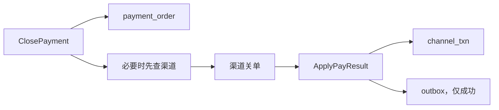
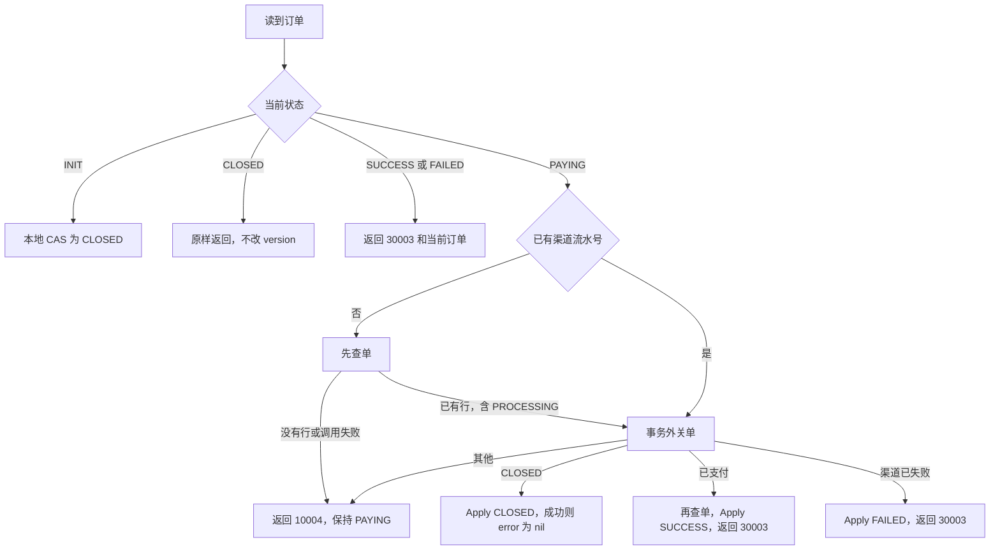

# PAY-06 商户关单

| 项 | 内容 |
|---|---|
| 功能点 | PAY-06（P0，第 3 周） |
| 所属链路 | 支付 |
| 代码提交 | `24b55db` `[PAY-06] add merchant close`（完整 `24b55db1258d72e25de2ee6b511c0cb4defaad86`，2026-11-01 18:32:31 +0800） |
| 分支 | `feat/PAY-06-close` |
| 日期 | 2026-11-01 |
| 状态 | DONE |

本报告写在上面这次代码提交之后，不在那 16 个文件里。第 3 周只完成到商户关单；支付查询还没做。`QueryPayment` 仍返回 `10003`。

## 一句话结论

`ClosePayment` 按支付单当前状态关闭。还没向渠道发起的单只在本地改成 `CLOSED`，不访问渠道。已经在支付中的单，必须先确认渠道，再交给已有的 `ApplyPayResult` 改状态。金额末两位是 08 的 10008 分（100.08 元）关单后，本地订单和渠道侧 `mock_txn` 都是 `CLOSED`（`TestCloseNeverFinishClosesChannelTxn`）。末两位是 09 的 10009 分（100.09 元）关单时渠道变成成功，接口返回 `30003`，订单是 `SUCCESS`，待发消息恰好 1 条 `payment.succeeded`（`TestCloseRaceReturnsConflictAndOneSucceededEvent`）。

## 1. 背景

### 1.1 系统简介

pay-system 是一个用 Go 编写的小型支付后端，模拟商户收款、退款、商户间转账三条资金链路，重点在数据一致性和性能。系统由 5 个部分组成：gateway（对外 HTTP 入口，负责签名校验和限流）、payment（支付单、退款单、转账单的状态管理和流程推进）、account（账户余额与记账，数据按商户分到 2 个数据库分片）、channel-mock（模拟微信、支付宝这类外部支付渠道）、recon（对账，核对系统内外数据是否一致）。服务之间用 Kitex RPC 同步调用，或通过 Kafka 消息异步通知；数据存在 MySQL 8.4，Redis 用于防重放。所有金额用整数“分”表示，所有记账只追加不修改。当前已完成：工程骨架、账户、模拟渠道的受理查单和关单、商户凭证与费率、故障注入、创建支付单、发起支付、outbox 写入、支付结果推进，以及本次商户关单。查单补偿、支付查询、超时关单、网关、投递器都还没做。

上面这段里还没展开的词：Kitex 是本项目的 Go RPC 框架，RPC 是一个进程同步调用另一个进程里的函数。签名校验用密钥确认报文没有被改过；限流限制单位时间内的调用次数。这两件事都在 gateway，本次不做网关。Kafka 是异步消息队列。分片是把账户数据按商户拆进 2 个库。1 元 = 100 分，金额全程用整数。记账只追加，是指账本只插入新行，不回头改旧行。本次关单不写分录，也不改账户余额。Redis 防重放是系统别处的能力，不拦这次关单。P0 是必须先做的优先级。

创建支付单已经能插入状态为 `INIT` 的支付单。发起支付已经能把 `INIT` 改成 `PAYING`，并留下一条状态为 `PROCESSING`、渠道流水号仍为空的渠道流水，然后才去调用渠道。支付结果推进 `ApplyPayResult` 已经能在一次事务里把流水和订单一起推进到终态；只有成功才在同一事务插入一条 `payment.succeeded`。模拟渠道对未知单号直接关单时，会插入一条金额为 0 分（0.00 元）的 `CLOSED` 记录。本次是商户调用关单时，payment 按自己的订单状态决定要不要找渠道，以及找到结果后怎么调用那个已有的推进函数。

### 1.2 本功能点在系统中的位置

本次只实现 `ClosePayment`。它是 payment 进程上的 RPC。商户 HTTP 入口在以后的网关里，本次没有。查单补偿是 PAY-05，超时扫描是 PAY-07，支付查询是 PAY-08，渠道回调入口是 GW-06，把 outbox 行发出去是 MQ-02。`QueryPayment` 仍直接返回 `10003`，不读库。



`payment_order` 是商户的支付单。`channel_txn` 是 payment 自己记下的渠道流水，和渠道库里的 `mock_txn` 不是同一张表。outbox 是和业务写在同一事务里、稍后才发送的消息表。只有关单发现渠道已经成功时才插入。account、gateway、recon 不参与。生产代码不引用 `service/channel_mock` 这个包。集成测试在本进程里启动渠道的 HTTP，再去读渠道库的 `mock_txn`。

### 1.3 为什么需要它

商户 `M100060` 有一笔 10008 分（100.08 元）的支付。金额末两位是 08，渠道把它认成 `NEVER_FINISH`：渠道受理后一直停在处理中，不会自己变成成功。顾客没付款，商户要关掉这张单。

如果不做关单，这张单会一直停在支付中。渠道侧那笔模拟交易也不会被关掉，以后仍可能被别的任务当成未完成。

如果关单做得不小心，会出三种错：

1. 本地还是 `INIT`，还没调用渠道，却先去渠道关单。渠道对没见过的单号插入 0 分（0.00 元）的关闭记录。这张单其实从未受理。
2. 本地已经是 `PAYING`，渠道流水号还是空的，渠道库里还没有行。这时直接关单，同样会插入 0 分的关闭记录。随后发起支付的受理得到“订单已关闭”，已有的支付逻辑会把本地订单写成 `FAILED`，失败码是 `CHANNEL_REJECTED`。`FAILED` 不能再改回 `CLOSED`。并发关单和支付的最终状态就不再只是支付中或已关闭。
3. 渠道其实已经扣款成功，本地却只写成关闭，不留下成功消息。商户收不到那 10009 分（100.09 元）可以入账的通知。入账是以后账户服务按消息写分录，本次不写分录。

所以未发起的单只改本地；支付中的单先确认渠道有没有这笔交易，再关；渠道已经成功则推进为成功并只留 1 条消息。

## 2. 术语

按正文第一次出现的顺序。

| 术语 | 含义 |
|---|---|
| 支付单 | 商户的一笔收款。表名 `payment_order`。创建时状态是 `INIT`。 |
| `INIT` | 已创建，还没向渠道发起。 |
| `PAYING` | 发起支付的本地变更已经提交。渠道结果可能还没回来。 |
| `SUCCESS` / `FAILED` / `CLOSED` | 支付成功、支付失败、已关闭。三者都是终态，终态不再改成别的状态。 |
| `ClosePayment` | 本次的商户关单。入参是 `merchant_id` 和 `pay_no`。 |
| `pay_no` | 平台支付单号。关单用它找订单，也把它当作渠道请求里的 `req_no`。 |
| `merchant_id` | 商户号。和库里的值逐字节比较，空串也算不一致。 |
| 分 | 金额最小单位。100 分 = 1.00 元。类型是 `int64`。10008 分是 100.08 元，10009 分是 100.09 元。 |
| `10001` | 已有错误码。参数不合法。请求是 nil，或 `pay_no` 为空，返回它，不写库。 |
| `30001` | 已有错误码。订单不存在，或商户号逐字节不一致。两种情况返回同一个码，不告诉调用方订单在不在。 |
| `30003` | 已有错误码。订单状态冲突。已经成功或失败，以及关单时渠道已经成功或渠道交易已失败，都用它。 |
| `10004` | 已有错误码。渠道调用没有确认，订单未改。查无此单、关单失败、查单失败都是它。 |
| `10003` | 已有错误码。内部错误。关单再读仍是 `INIT`，或签名、配置在发出 HTTP 之前就错了，返回它。`QueryPayment` 现在仍一律返回它。 |
| `50002` | 已有错误码。推进时渠道金额和本地流水金额不一致。关单原样把这个错误返回，不改订单。 |
| `biz_code` | RPC 响应里的业务码字段。`30003` 放在这里，RPC 的 error 为 nil，并带上订单。 |
| `BizStatusError` | RPC 框架用来带回业务错误的错误类型。`30001`、`10004`、`50002` 走它，响应里不带订单。 |
| 渠道流水 | payment 库里发给渠道的那条记录。表名 `channel_txn`。发起支付时状态是 `PROCESSING`，`channel_txn_no` 先是空。 |
| `channel_txn_no` | 渠道返回的流水号。空字符串表示渠道受理的 HTTP 还没把号码写回来。 |
| `PROCESSING` | 渠道流水或渠道侧交易还在处理中。 |
| `mock_txn` | 模拟渠道自己库里的交易行。和 payment 的 `channel_txn` 不是同一张表。 |
| `NEVER_FINISH` | 金额除以 100 的余数是 8 时的渠道场景，例如 10008 分。受理后一直处理中，可以被关单。 |
| `CLOSE_RACE` | 余数是 9 时的渠道场景，例如 10009 分。收到关单请求时，渠道把这笔写成成功。 |
| 占位 | 渠道对没见过的 `req_no` 关单时插入的行。状态 `CLOSED`，金额 0 分（0.00 元）。 |
| `ApplyPayResult` | 已有的推进函数。一次事务里更新流水和订单。来源 `CLOSE` 表示这次是关单推动的。 |
| outbox | 待发消息表。业务数据和这一行放在同一个数据库事务里。发送是以后的 MQ-02。 |
| `payment.succeeded` | 支付成功这条消息的类型。只有订单推进成 `SUCCESS` 时才有一行。 |
| CAS | 条件更新。`WHERE` 里带上期望状态，影响行数是 1 才算抢到。别人已经改过，影响行数就是 0。 |
| `version` | 行上的整数。每次成功的条件更新加 1。 |
| 注入时钟 | 业务代码不调用 `time.Now()`。时间来自构造时放进服务的时钟。测试用可拨动的假时钟。 |
| `closed_at` | 订单上的关闭时间。本地关闭，以及渠道确认关闭但没带完成时间时，用注入时钟截到毫秒。 |
| `updated_at` | 行的更新时间。本次显式写成注入时钟，不用数据库自己的当前时间。 |
| 幂等 | 同一张已关闭的单再关一次，不改行，也不再访问渠道。 |
| 事务 | 几条 SQL 一起成功或一起撤销。渠道 HTTP 在事务外面。`ApplyPayResult` 自己另开事务。 |
| 签名 | 用渠道密钥对报文算出校验值。实现是已有的 `pkg/sign`。密钥来自已有配置 `CHANNEL_MOCKPAY_KEY`。密钥不写入日志，也不写入错误文本。 |
| `pay.after_tx1` | 已有故障点。发起支付的本地事务提交之后、调用渠道之前执行。本次关单代码不调用它。测试用它把支付停住。 |
| `errgroup` | 一组 goroutine，等它们全部结束，并收集第一个非预期错误。 |
| 覆盖率 | 测试执行到的语句占该包语句的比例。核心包看 `make cover` 的数字，门槛 70%。 |
| `cached` | Go 复用了已有测试结果，没有重跑那个包。 |
| `integration` | 构建标签。带上它才编译连 MySQL 的测试文件。 |

## 3. 技术讲解

### 3.1 要解决的问题

1. 关单的结果必须和订单当前状态一致。未发起、已关闭、已成功、已失败、支付中，五条路不能混用。
2. 重复关一张已经关闭的单，不能再改 `version`，也不能再打渠道。
3. 支付中的单不能在渠道确认之前写成 `CLOSED`。否则本地已关、渠道仍可能扣款成功。
4. 本地还没有渠道流水号时，不能直接关单。渠道会为未知单号插入 0 分的占位，随后已有的支付拒绝逻辑会把订单写成 `FAILED`。
5. 渠道已经成功时，订单要变成 `SUCCESS`，并只留 1 条 `payment.succeeded`。接口仍返回 `30003`，因为调用方要的是关闭，实际结果是成功。
6. 渠道调用没有确认时，订单保持 `PAYING`，返回 `10004`。不能把未知结果当成已关闭。
7. 渠道 HTTP 在事务外面。事务里不调用 HTTP、RPC、Kafka，也不调用故障点。

金额是 `int64` 分。写状态只用 CAS。写操作靠条件更新和“再关一次读到已关闭就返回”实现幂等。

### 3.2 方案

先读订单。请求是 nil 或 `pay_no` 为空，返回 `10001`，不读库。订单不存在，或 `merchant_id` 和库里的字节不同，返回 `30001`。

`INIT` 只做本地 CAS，不调用渠道，不写 outbox。`closed_at` 和 `updated_at` 都是注入时钟截到毫秒，`version` 加 1。下面这条 SQL 在 `service/payment/biz/pay_sql.go`。`WHERE` 同时要求商户号和状态仍是 `INIT`。

```sql
UPDATE payment_order
   SET status = 'CLOSED', closed_at = ?, version = version + 1, updated_at = ?
 WHERE pay_no = ? AND merchant_id = ? AND status = 'INIT'
```

影响 0 行就再读。已是 `CLOSED` 则当幂等返回。已是 `PAYING` 则走支付中的分支。已是 `SUCCESS` 或 `FAILED` 则返回 `30003` 和当前订单。这条更新的 `WHERE` 已经要求状态仍是 `INIT`，测试没有造出“更新 0 行、再读仍是 `INIT`”这条时间线。代码在这个剩余分支返回 `10003`，避免把没更新成功说成已关闭。`make cover` 里再读函数 `afterInitMiss` 是 50.0%，就是因为这一支没有被执行。

已经是 `CLOSED`：不调渠道，不改行，`version` 不变，error 为 nil。

已经是 `SUCCESS` 或 `FAILED`：不调渠道，不改行。返回当前订单和 `errno.ErrOrderStatusConflict`，也就是 `30003`。

`PAYING` 的渠道调用都在事务外。拨号超时是 `PayChannelDialTimeout`，500 毫秒，和受理共用。每一次关单或查单的上限是 `CloseChannelTimeout`，1500 毫秒；父 context 剩余时间更短时提前停。`ClosePayment` 的服务端处理超时仍是 2 秒。`Pay` 仍是 5 秒。没有新增环境变量。

本地没有 `channel_txn` 这一行，或 `channel_txn_no` 仍是空字符串：先查单，不直接关单。这段在 `service/payment/biz/close.go`。查单说没有行，或查单调用失败，返回 `10004`，不调用关单，订单保持 `PAYING`。

```go
visible, err := p.channelTxnVisible(ctx, order.PayNo)
if err != nil {
    return PaymentOrder{}, err
}
if !visible {
    q, qerr := p.closer.QueryPay(ctx, order.PayNo)
    if qerr != nil {
        return PaymentOrder{}, p.channelCloseErr(ctx, order.PayNo, qerr)
    }
    if !q.hasRow() {
        return PaymentOrder{}, errno.ErrUnavailable
    }
}
res, err := p.closer.ClosePay(ctx, order.PayNo)
```

`hasRow` 在 `OK` 为 true，或查单种类是“已有行”时为真。`PROCESSING` 往往没有完成时间，`OK` 是 false，但种类仍是已有行，所以会继续关单，不会误返回 `10004`。`channel_txn_no` 已经非空则跳过这次查单，直接关单。

查单把三种结果分开，分类在 `service/payment/biz/channel_http.go`。`NOT_FOUND` 是没有行。`result` 为 `OK` 且状态是 `PROCESSING`、`SUCCESS`、`FAILED` 或 `CLOSED` 是已有行。其余，包括非 200、读失败、验签失败、坏 JSON、认不出的 result 或 status，是调用失败。调用失败的种类是零值，不当成已关闭。

```go
if out.Result == queryResultNotFound {
    return channelQueryResult{Kind: queryNotFound}, nil
}
if out.Result != acceptResultOK || !knownQueryStatus(out.Status) {
    return channelQueryResult{Kind: queryCallFailed}, nil
}
res := channelQueryResult{Kind: queryFound, ChannelTxnNo: out.ChannelTxnNo}
```

只有状态是 `SUCCESS`、带了金额、并且 `finished_at` 能按 `2006-01-02T15:04:05.000Z07:00` 解析时，`OK` 才为 true。金额用响应里的 `int64` 分，包括 0。缺金额和金额 0 不是一回事。

关单 HTTP 是 `POST /mockpay/v1/close`，body 只有 `req_no`，值是 `pay_no`。签名用已有的 `pkg/sign`。本地签名或配置错误走 `isLocalChannelErr`，返回 `10003`，不是 `10004`。`make cover` 里 `channelCloseErr` 是 0.0%，这条映射没有被测试执行到。

关单的三种业务结果：

- `OK` 且 `CLOSED`：调用 `ApplyPayResult`，结果 `CLOSED`，来源 `CLOSE`，不传金额，不传完成时间。因此 `closed_at` 用推进函数里的注入时钟。推进后的订单是 `CLOSED` 则返回该订单，error 为 nil。若订单已是别的终态，返回 `30003` 和那个订单。
- `ALREADY_PAID` 且 `SUCCESS`：再在事务外 `POST /mockpay/v1/query`，`txn_type` 为 `PAY`，`req_no` 为 `pay_no`。只有查单 `OK`、状态 `SUCCESS` 且有 `finished_at` 才推进为成功。金额用查单的分，`FinishedAt` 用查单时间，`ChannelTxnNo` 用查单流水号。然后返回 `30003` 和 `SUCCESS` 订单。outbox 由 `ApplyPayResult` 写，关单函数自己不插。查单失败、非 200、验签失败、`NOT_FOUND`、状态不是 `SUCCESS` 或没有 `finished_at`：不推进，订单保持 `PAYING`，返回 `10004`。
- `OK` 且 `FAILED`：推进为 `FAILED`，`fail_code` 为 `CHANNEL_FAILED`，来源 `CLOSE`，不传金额。返回 `30003` 和 `FAILED` 订单。

其他 HTTP 结果不改订单，返回 `10004`。

`ApplyPayResult` 返回 `50002` 时原样返回。其他推进错误，包括 `10003` 和 `10004`，也原样返回，不把已经失败的事务说成关单成功。

渠道已经成功时，`applyAlreadyPaid` 把查单金额交给推进函数。`PayResult.Amount` 是指针，空指针表示这次不比较金额。这里先把查单的分抄到局部变量再取地址，表示这次按查单金额比较。

```go
if !q.OK {
    return PaymentOrder{}, errno.ErrUnavailable
}
amount := q.Amount
return p.applyTerminal(ctx, PayResult{
    BizNo:        payNo,
    Result:       payResultSuccess,
    Source:       paySourceClose,
    Amount:       &amount,
    ChannelTxnNo: q.ChannelTxnNo,
    FinishedAt:   q.FinishedAt,
})
```

handler 只做协议转换。`30003` 放进 `ClosePaymentResponse.biz_code`，RPC error 为 nil，并携带订单。成功是 `biz_code` 0 加订单。`30001`、`10004`、`50002` 走 `BizStatusError`，不带订单。`service/payment/handler/handler.go` 里只有冲突这一支携带订单：

```go
if errors.Is(callErr, errno.ErrOrderStatusConflict) {
    code, rpcErr := errno.RPCExit(callErr, true)
    if rpcErr != nil {
        return nil, rpcErr
    }
    return &payment.ClosePaymentResponse{BizCode: code, PaymentOrder: toPaymentOrder(got)}, nil
}
```

`cmd/payment/main.go` 在原来的 `UsePay(...)` 下一行调用 `UseClose(channelClient)`。`UsePay` 那一行没有改。关单代码不调用 `fault.Point`，也不调用 `callback.after_commit`。



这张图是关单自己的分支。`INIT` 的 0 行再读、以及推进返回 `50002`，写在图下：再读到已关闭就幂等返回；再读到支付中就进入图里的 `PAYING`；推进金额不符则原样返回 `50002`，订单不动。

### 3.3 为什么这样做

| 方案 | 做法 | 优点 | 缺点 | 结论 |
|---|---|---|---|---|
| 采用：没有流水号先查单，确认有行再关，然后用已有推进函数写本地 | 未知单号不会被这次关单插进行；成功、失败、关闭都走同一套 CAS | 不会造出 0 分占位；成功消息仍只在推进事务里出现一行 | 流水号还空但渠道已有行时，查单和关单各用最多 1500 毫秒，可能顶满 2 秒服务端超时 | 采用 |
| 备选：支付中一律直接 `POST /mockpay/v1/close` | 少一次查单 | 渠道已有行时少一次 HTTP | 流水号还空、渠道还没有行时，渠道插入 0 分的 `CLOSED`。随后支付受理得到已关闭，已有逻辑把订单写成 `FAILED` | 不采用。终态不能再改回 `CLOSED`，并发结果会超出支付中或已关闭 |
| 备选：支付中也只改本地，不等渠道 | 没有 HTTP | 返回快 | 本地已关，渠道仍可能扣款成功 | 不采用。支付中必须等渠道确认 |

Pay 在假渠道 reason 为 `ORDER_CLOSED` 时仍把订单写成 `FAILED`，`fail_code` 仍是 `CHANNEL_REJECTED`。本功能点不改那条映射。避免占位的办法是关单侧先查，而不是改支付的拒绝结果。

### 3.4 正确性

集成测试在 `go test -race -tags integration` 下通过，包含在第 4.4 节的整包命令里，没有按测试名单独重跑。并发用 `errgroup`，没有 `time.Sleep`。

| 场景 | 系统行为 | 最终状态 | 证明 |
|---|---|---|---|
| 同一张已关闭的单再关一次 | 不调用渠道，不执行 CAS | `version` 与第一次相同，`closed_at` 不变 | `TestCloseClosedAgainKeepsVersion`，单元 |
| `INIT` 上同时发起支付和关单 | 两个 goroutine 用 `errgroup` 等两边都结束，不规定必须是哪一种。测试接受的返回包括成功、状态冲突 `30003`、`10004` 和渠道拒绝。（1）关单先抢到 `INIT`：`closeInit` 本地 CAS 成 `CLOSED`，不访问渠道。支付后到，它的更新条件也要求状态仍是 `INIT`，不能把已关闭改回支付中。最终是 `CLOSED`。渠道可以没有行。（2）支付先把 `INIT` 改成 `PAYING`，同一次关单的 CAS 落空，`afterInitMiss` 再读到 `PAYING`，进入 `closePaying`。这时渠道流水号往往还是空的，先查单。查无此单就返回 `10004`，不调用关单，订单留在 `PAYING`。两边都返回后，支付若已受理完，渠道行是处理中，金额不是 0。最终仍是 `PAYING`，是因为这次关单已经返回，不会再自动重试。第 3.2 节的「再读到 `PAYING` 就进入支付中分支」停在这次返回，不会把已经返回的关单再执行一遍。（3）同一条支付中分支里，如果查到渠道已有行，或本地流水号已经非空，这次关单会继续关。`NEVER_FINISH` 关成 `CLOSED` 时，渠道行金额是订单的 10008 分（100.08 元），不是 0 分。渠道关单只改状态，不改金额 | 库里的订单只能是 `PAYING` 或 `CLOSED`。例如 `FAILED` 会失败。金额是 10008 分（100.08 元），商户 `M100062`。`PAYING` 时渠道 `mock_txn` 是处理中、场景 `NEVER_FINISH`、金额不是 0，本地 `channel_txn` 是 `PROCESSING`。`CLOSED` 时渠道可以没有行；有行则状态是 `CLOSED` 且金额不是 0。本地流水有行时状态是 `CLOSED` | `TestCloseConcurrentWithPayStaysPayingOrClosed`，集成 |
| 支付的本地事务已提交，渠道受理还没插入 `mock_txn`。测试用已有故障点 `pay.after_tx1` 把支付停住，再放行关单 | 本地流水号仍空，关单先查。渠道没有行，返回 `10004`，不调用关单 | 停住的那一刻 `mock_txn` 是 0 行。放开支付后订单是 `PAYING`，不是 `FAILED`，也不是渠道拒绝。渠道金额是 10008 分（100.08 元），不是 0 分。商户 `M100063` | `TestCloseAtPayAfterTx1ReturnsUnavailableWithoutTombstone`，集成 |
| 进程停在 `pay.after_tx1`，渠道还没有行，这次关单已经返回 | 本次只返回 `10004`，订单保持 `PAYING`。不会插入 0 分占位 | 这种单以后怎么关完，属于查单补偿 PAY-05，不是本次 | 上一行的测试证明本次返回和不插占位。没有在本功能点里把这种单关成 `CLOSED` |
| 渠道关单 HTTP 失败，本地已有流水号 | 不调用推进函数 | 订单仍是 `PAYING`，返回 `10004` | `TestClosePayingHTTPFailureStaysPaying`，单元 |
| 没有流水号，查单是 `NOT_FOUND` 或调用失败 | 不调用 `ClosePay` | 订单仍是 `PAYING`，返回 `10004` | `TestClosePayingProbesWhenChannelTxnNoMissing`，单元 |
| 渠道超时发生在父 context 更短时 | `context.WithTimeout` 取父截止和 1500 毫秒里更早的那个 | 调用失败，不当成 `CLOSED` | `TestCloseChannelTimeoutUsesParentDeadline`，单元。它锁的是提前停，不是第 5 节那种两段 1500 毫秒加在一起的服务端超时 |
| `ApplyPayResult` 的事务在提交前失败 | 推进函数自己的事务回滚，关单把该错误原样返回 | 不能把这次说成关单成功。`50002` 时订单保持原状 | `TestClosePassesApplyAmountMismatch`，单元。它用假的推进函数返回 `50002` |
| 事务提交后进程崩溃 | 已经提交的 `CLOSED` 或 `SUCCESS` 还在。成功时那 1 条 outbox 也已经提交 | 发送留给 MQ-02。本次不发送 | 没有杀掉进程再拉起的测试 |

`INIT` 关单不访问渠道，由 `TestCloseInitDoesNotCallChannel` 证明。`SUCCESS` 和 `FAILED` 直接 `30003` 且不访问渠道，由 `TestCloseSuccessReturnsConflictWithoutChannel` 证明。nil 和空 `pay_no` 返回 `10001` 且不读库。商户号为空或与库中字节不同，返回 `30001`，行不变。

### 3.5 性能

不涉及。这次没有压测数据。第 5 节的超时是正确性限制，不是吞吐数字。

## 4. 已完成内容

### 4.1 改动清单

这些文件都在代码提交 `24b55db` 里。16 个文件，+1426 / −31。

| 文件 | 新增 / 修改 | 作用 |
|---|---|---|
| `service/payment/biz/close.go` | 新增 | `ClosePayment`：按状态关闭，支付中时先判断流水号再查单或关单 |
| `service/payment/biz/close_test.go` | 新增 | 不连 MySQL 的关单测试，含假 HTTP |
| `service/payment/biz/close_integration_test.go` | 新增 | 连 MySQL，并在进程内启动渠道 HTTP。构建标签 `integration` |
| `service/payment/biz/channel_http.go` | 修改 | 同一渠道客户端增加 `ClosePay`、`QueryPay`。查单区分没有行、已有行、调用失败 |
| `service/payment/biz/pay.go` | 修改 | 增加关单路径、查单路径、`CloseChannelTimeout`。`UsePay` 的函数体未改 |
| `service/payment/biz/pay_sql.go` | 修改 | `INIT` 到 `CLOSED` 的 CAS |
| `service/payment/biz/payment.go` | 修改 | 装上关单客户端；`App.ClosePayment` 转到 `*Payments` |
| `service/payment/biz/payment_test.go` | 修改 | 内存订单存储补上同样的本地 CAS |
| `service/payment/handler/handler.go` | 修改 | `30003` 放进 `biz_code` 并携带订单 |
| `service/payment/handler/handler_test.go` | 修改 | 冲突带订单；`30001`、`10004`、`50002` 不带订单 |
| `service/payment/handler/service.go` | 修改 | 业务接口增加 `ClosePayment` |
| `cmd/payment/main.go` | 修改 | 在原有 `UsePay` 下一行 `UseClose` |
| `docs/02-requirements.md` | 修改 | PAY-06 改为 DONE，三条验收勾上 |
| `docs/04-dev-plan.md` | 修改 | 只勾 PAY-06。PAY-08 仍未勾 |
| `docs/05-api.md` | 修改 | 版本到 3.1.7 |
| `docs/06-flows.md` | 修改 | 版本到 v2.25，CF-08 增加“无流水号则先查单” |

### 4.2 对外变化

| 类别 | 变化 |
|---|---|
| 接口 | 无新的商户 HTTP 字段。IDL 是 RPC 接口定义文件，本次没改。`ClosePayment` 已进入业务。成功时 `biz_code` 为 0 并带订单。只有 `30003` 放进 `ClosePaymentResponse.biz_code`，RPC error 为 nil，并带订单。请求是 nil 或 `pay_no` 为空时，handler 在调用业务前用 `ToBizStatus` 返回 `10001`。`ToBizStatus` 把已有错误码包成 Kitex 的 `BizStatusError`。这时响应是 nil，不带订单，也不经过 `statusErr`。handler 自己或业务服务是 nil 时，`ready` 同样在调用业务前返回 `10003` 的 `BizStatusError`，不带订单。函数中途 panic 时，`recoverBiz` 也把返回值改成 `10003` 的 `BizStatusError`，不带订单。业务返回的其他错误，包括业务里的 `10001`、`10003`、`30001`、`10004`、`50002`，都进 `statusErr`。`statusErr` 调用 `RPCExit(err, false)`：`false` 表示不把错误码放进正常响应。结果是 `BizStatusError`，handler 返回 nil，不带订单。上下文取消、截止时间或 Kitex 超时仍保持传输层超时，不改写成 `10003`。服务端处理超时仍是 2 秒。`Pay` 仍是 5 秒。`QueryPayment` 仍返回 `10003` |
| 表结构 | 无。沿用 `payment_order`、`channel_txn`、`outbox`，以及测试读取的渠道表 `mock_txn`。没有新列、新索引，也没有改已经应用的迁移 |
| 配置项 | 无。不新增环境变量。渠道密钥仍用已有的 `CHANNEL_MOCKPAY_KEY` |
| 错误码 | 无新增。使用已有的 `10001`、`10003`、`10004`、`30001`、`30003`、`50002`。`50002` 不是新码 |
| 指标 / 故障点 | 无新指标，无新故障点。关单不调用 `pay.after_tx1`，也不调用 `callback.after_commit`。测试只使用已有的 `pay.after_tx1` 把支付停住 |

### 4.3 验收对照

前三行是需求里的三条验收，内容写在表里。后面几行是同时被整包命令跑到的补充测试，不另立验收标准。结果都是通过。这些测试包含在第 4.4 节的整包命令里，没有按名字单独重跑。`NEVER_FINISH` 不会自己完成，本次关单也不发送商户回调。商户回调是 payment 把结果 POST 给商户。渠道回调是渠道事后把结果 POST 给 payment。`TestCloseNeverFinishClosesChannelTxn` 没有去数这两种 HTTP，“之后不再有回调”不是这个测试数出来的。

| 验收条目 | 测试函数 | 类型 | 结果 |
|---|---|---|---|
| `NEVER_FINISH`：关单成功。订单 `CLOSED`，金额 10008 分（100.08 元），`closed_at` 等于注入时钟。渠道 `mock_txn` 恰好 1 行，状态 `CLOSED`，场景 `NEVER_FINISH`，金额 10008 分，`notify_sent_count` 为 0。`notify_sent_count` 是渠道行上记下的回调发送次数。本地 `channel_txn` 为 `CLOSED`。测试放进渠道的完成钩子被调用 0 次。完成钩子是渠道在交易完成并提交后调用的函数，这次测试里它只给计数器加一。自动完成待执行任务为 0。outbox 为 0 行 | `TestCloseNeverFinishClosesChannelTxn` | 集成 | 通过。商户 `M100060`，金额 10008 分（100.08 元） |
| `CLOSE_RACE`：返回 `30003`，订单 `SUCCESS`，outbox 恰好 1 条 `payment.succeeded`。走真实关单和随后的查单 | `TestCloseRaceReturnsConflictAndOneSucceededEvent` | 集成 | 通过。商户 `M100061`，金额 10009 分（100.09 元） |
| `INIT` 上并发支付与关单，最终只能是 `PAYING` 或 `CLOSED`。用 `errgroup`，没有 `time.Sleep`。若 `CLOSED` 且渠道有行，金额是订单金额，不是 0 | `TestCloseConcurrentWithPayStaysPayingOrClosed` | 集成 | 通过。金额 10008 分（100.08 元） |
| 支付停在 `pay.after_tx1`、渠道还没有行时关单：返回 `10004`，当时 `mock_txn` 为 0 行。放开后订单 `PAYING`，渠道金额是订单金额，不是 `FAILED`，也不是渠道拒绝 | `TestCloseAtPayAfterTx1ReturnsUnavailableWithoutTombstone` | 集成 | 通过。金额 10008 分（100.08 元） |
| `INIT` 关单不访问渠道 | `TestCloseInitDoesNotCallChannel` | 单元 | 通过 |
| 已关闭再关一次，`version` 不变 | `TestCloseClosedAgainKeepsVersion` | 单元 | 通过 |
| `SUCCESS` 和 `FAILED` 直接 `30003`，不访问渠道 | `TestCloseSuccessReturnsConflictWithoutChannel` | 单元 | 通过 |
| 支付中但关单 HTTP 失败：订单仍是 `PAYING`，返回 `10004` | `TestClosePayingHTTPFailureStaysPaying` | 单元 | 通过 |
| 没有渠道流水号时先查单。`NOT_FOUND` 或调用失败不关单。已有行再关单。已有流水号则直接关单 | `TestClosePayingProbesWhenChannelTxnNoMissing` | 单元 | 通过 |

### 4.4 验证记录

日期都是 2026-11-01。环境：`go version go1.27.2 darwin/arm64`。当时工作区就是后来提交为 `24b55db` 的那棵树。本次 lint 未重印版本；同一天早些时候该二进制为 golangci-lint 2.14.0，built with go1.27.1，commit `114493f`，时间 2026-09-24T10:54:53Z。耗时是 `/usr/bin/time -p` 的 real。`make gen` 会按 IDL 生成代码；IDL 没改，所以没运行。`mmdc` 是把 Mermaid 源图渲染成 SVG 的命令，本次没运行，没有新的 SVG。

| 命令 | 结果 |
|---|---|
| `gofmt -l .` | 实际命令是 `/usr/bin/time -p gofmt -l .`。gofmt 无文件名输出，exit 0，real 0.05s，随后打印 `GOFMT:0` |
| `make lint` | 实际命令 `golangci-lint run --build-tags integration ./...`。`0 issues.`，exit 0，real 0.96s。这次没有重新打印 golangci-lint 版本 |
| `make test` | exit 0，real 6.50s。根包 `ok github.com/yym108/pay-system 4.273s`。`cmd/payment` 1.549s，未缓存。`service/payment/biz` 5.296s，未缓存。`service/payment/handler` 为 `(cached)` |
| `make test-integration` | exit 0，real 36.65s。根包 `ok github.com/yym108/pay-system 36.204s`。`service/payment/biz` 25.746s。`service/payment/handler` 19.207s。`cmd/payment` 1.526s。许多其他包是缓存 |
| `go test -race -count=1 -cover`，包为 biz、handler、`cmd/payment`，不带 `integration` | exit 0，real 11.25s。biz 5.565s，覆盖率 65.5%。这个数字没有集成测试，不是 70% 门禁。handler 10.143s，84.7%。`cmd/payment` 1.538s，55.3%，不在门禁内 |
| `go test -race -count=1 -tags integration -cover`，同上三包，在 `make cover` 之前 | exit 0，real 24.87s。biz 23.259s，86.0%。handler 17.469s，85.2%。`cmd/payment` 1.583s，55.3%。这组 biz 的 86.0% 略低于下面的 `make cover`，两组都有效。门禁用 `make cover` |
| `make cover` | exit 0，real 36.36s。`go tool cover -func` 的 total 27.3%，含生成代码 `kitex_gen`，不是门禁。根包 `ok github.com/yym108/pay-system 35.423s`，coverage `[no statements]`。`service/payment/biz` 26.677s，86.4%，不低于 70%。handler 17.570s，85.2%。`cmd/payment` 1.566s，55.3%。`pkg/outbox` 未被本功能点修改，该次显示缓存 95.0% |

`make cover` 那次按函数：`ClosePayment` 75.0%，`closeStatus` 83.3%，`closeInit` 90.9%，`afterInitMiss` 50.0%，`closePaying` 73.7%，`channelTxnVisible` 75.0%，`channelCloseErr` 0.0%，`applyClosed` 66.7%，`applyAlreadyPaid` 85.7%，`applyTerminal` 100%，`conflictIfTerminal` 66.7%，`UseClose` 66.7%，`ClosePay` 90.9%，`QueryPay` 85.0%，`exchange` 82.4%。handler 的 `ClosePayment` 78.6%。`App.ClosePayment` 0.0%，测试调用的是 `*Payments`。`casInitToClosed` 60.0%。`channelTxnByBizNo` 78.6%。

`make gen` 未运行。`mmdc` 未运行，没有新的 SVG。

### 4.5 同步的文档

这些文档都在代码提交 `24b55db` 里。约定没有改，仍是 v2.23。

- 需求：版本仍是 v3.0。PAY-06 改为 DONE，三条验收已勾选。变更记录有一行 2026-11-01，写明没有新错误码，支付中必须先等渠道，以及「本地还没有渠道流水号时先查单，查无此单返回 10004，不插入渠道占位」。更早的变更记录没有改。
- 开发计划：原来写在一起的「PAY-06 商户关单、PAY-08 查询」拆成两行。只勾了 PAY-06。PAY-08 仍未勾。
- 接口：现为 3.1.7，日期 2026-11-01。3.1.6 是关单进入业务。3.1.7 是没有流水号时先查单。`10004` 的说明补上查无此单不插入占位。不改 IDL，不新增错误码，不新增环境变量。服务端超时仍是 2 秒。
- 流程图：现为 v2.25。v2.24 是关单分支与实现对齐、当时未改节点。v2.25 给 CF-08 加上「无流水号则先查单」。`mmdc` 未运行，没有新的 SVG。

## 5. 未完成与风险

- 本地流水号还是空、但渠道已经有行时，查单和关单各最多 1500 毫秒，服务端超时仍是 2 秒。慢渠道可能在渠道已经关完、本地订单还是 `PAYING` 时，先在服务端超时。再关一次能补上。这次不会变成 0 分的占位，也不会变成 `FAILED`。本功能点不改这两段超时，也不改 Pay 对 `ORDER_CLOSED` 的拒绝映射。
- `channelCloseErr` 的覆盖率是 0.0%。签名或配置在发出之前就失败、因而返回 `10003` 的这条路径，没有单独测试。
- 自动完成定时器是渠道受理时排的：到点后，渠道把仍在处理中的交易改成终态。`NEVER_FINISH` 不排它。`CLOSE_RACE` 会排。这次测试把延迟的最小值和最大值都写成 600000 毫秒，也就是 600 秒，所以测试结束时定时器还没触发，任务仍挂在调度器里。`CLOSE_RACE` 的关单不靠这个定时器。关单路径自己把渠道交易写成 `SUCCESS`，提交后再调用一次完成钩子 `OnFinished`。这次测试里的钩子只把计数器加到 1，测试断言这个计数。它不是 payment 的 outbox，也不产生 `payment.succeeded`。那条待发消息是 `ApplyPayResult` 为成功订单插入的，测试另断言恰好 1 条。钩子这次没有 POST 报文。回调是渠道事后把结果 POST 给 payment，本次关单不实现那个入口。
- 进程停在 `pay.after_tx1`、渠道还没有行：本次关单返回 `10004`，订单保持 `PAYING`。那种单的最终关闭是 PAY-05 的查单补偿，不是 PAY-06。
- 超时扫描是 PAY-07，本次不做。支付查询是 PAY-08，`QueryPayment` 仍返回 `10003`。渠道回调入口是 GW-06。投递器是 MQ-02，本次不把 `payment.succeeded` 发出去。
- `afterInitMiss` 覆盖率 50.0%。再读仍是 `INIT` 时代码返回 `10003`，不能把这一支写成已被测试执行过。`App.ClosePayment` 是 0.0%，因为测试直接调用 `*Payments.ClosePayment`。包覆盖率 86.4% 仍高于 70%。
- 流程图只改了源文件。没有新的 SVG。

## 6. 如何复现

在仓库根目录、分支 `feat/PAY-06-close`、代码提交 `24b55db1258d72e25de2ee6b511c0cb4defaad86` 上执行。环境是 2026-11-01 的 `go version go1.27.2 darwin/arm64`。集成测试沿用已有基座：需要 Docker，或已经设置 `TEST_MYSQL_DSN`。本次记录没有另打印当时连的是哪台库。带渠道的验收在测试进程里启动渠道 HTTP，不需要单独起 channel-mock 进程。

```bash
/usr/bin/time -p gofmt -l .
make lint
make test
go test -race -count=1 -cover ./service/payment/biz/ ./service/payment/handler/ ./cmd/payment/
make test-integration
go test -race -count=1 -tags integration -cover ./service/payment/biz/ ./service/payment/handler/ ./cmd/payment/
make cover
```

预期与第 4.4 节的表一致。`gofmt -l .` 不打印文件名。`make lint` 打印 `0 issues.`。测试命令的退出码是 0。不含集成标签时，biz 覆盖率 65.5%，这个数字不作为 70% 门槛。`make cover` 的 total 是 27.3%，不作判据；`service/payment/biz` 是 86.4%。`make gen` 和 `mmdc` 这次没有运行。再跑时墙钟会随机器变化，第 4.4 节的 real 是这次实测。

## 7. 讲解要点

1. 为什么支付中不能先改本地？10008 分（100.08 元）是渠道受理后一直停在处理中、不会自己变成成功的例子。这种单必须等渠道确认关闭，再调用 `ApplyPayResult` 把本地写成 `CLOSED`。本地先改成关闭、渠道仍停在处理中，两边就不一致。
2. 为什么流水号还空时要先查单？渠道对未知单号会插入 0 分的 `CLOSED`。支付受理接着会得到已关闭，并按已有规则写成 `FAILED`。先查到没有行就返回 `10004`，不调用关单，占位不会出现。
3. 为什么 `CLOSE_RACE` 返回的是 `30003` 而不是成功码 0？调用方请求的是关闭。渠道在这次关单里变成成功，订单推进为 `SUCCESS`，outbox 恰好 1 条。业务码告诉调用方状态已冲突，订单体带上成功后的那张单。

## 延伸阅读

- `docs/02-requirements.md`：PAY-06 的规则和三条验收。版本 v3.0。
- `docs/05-api.md`：`ClosePayment` 的 `biz_code` 和 `10004`。版本 3.1.7。
- `docs/03-conventions.md`：错误码、CAS、事务和时间。版本仍是 v2.23，本次没改。
- `docs/06-flows.md`：CF-08。版本 v2.25，SVG 未渲染。
- `docs/04-dev-plan.md`：PAY-06 已勾选。PAY-08 未勾选。
- `service/payment/biz/close.go`：本节引用的关单实现。
- `service/payment/biz/channel_http.go`：`ClosePay` 和 `QueryPay`。
- `service/payment/biz/result.go`：`ApplyPayResult`。关单不重写它。

## 修订记录

| 日期 | 提交 | 修订内容 |
|---|---|---|
| 2026-11-01 | 报告尚未提交 | 首版。对应代码提交 `24b55db` `[PAY-06] add merchant close` |
| 2026-11-01 | 报告尚未提交 | 可读性第一轮 5 处已改；第二轮留下 1 处并发时间线，已按上面三条写完；没有第三轮检查。 |
