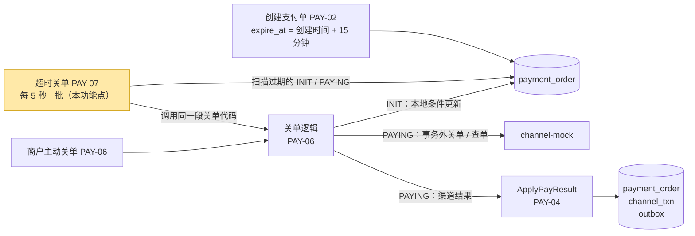
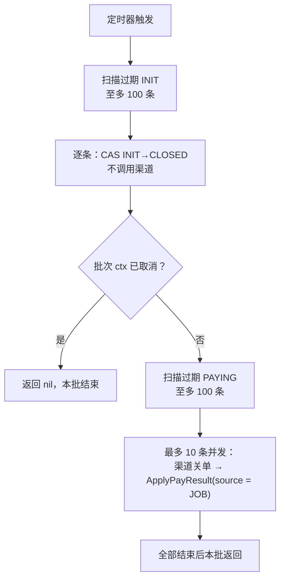
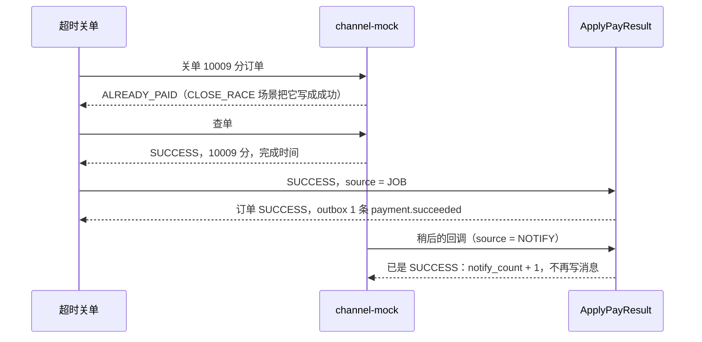

# PAY-07 超时关单

| 项 | 内容 |
|---|---|
| 功能点 | PAY-07 超时关单（优先级 P0，即必须完成；排在第 4 周的里程碑 M4） |
| 所属链路 | 支付 |
| 代码提交 | `ea9733e` `[PAY-07] add timeout close job` |
| 分支 | `feat/PAY-07-timeout-close` |
| 日期 | 2026-11-06 |
| 状态 | DONE。项目的完成定义还要求全量集成测试 `make test-integration` 通过，这一项尚未运行，由主代理在合并 main 前串行补跑，结果不写入本报告（原因见 4.4） |

## 一句话结论

payment 进程每 5 秒执行一批超时关单：先找出至多 100 条已过期、还没发起支付的订单，逐条在本地关闭；再找出至多 100 条已过期、正在支付中的订单，最多 10 条同时请渠道关单，渠道确认后才在本地关闭。两类订单都复用商户主动关单（PAY-06）的同一段代码。测试证明了四件事：假时钟拨到过期时刻后，订单最多两轮内（通常是下一轮）变成 `CLOSED`；一笔渠道永远不出结果的 10008 分（100.08 元）订单被关闭，渠道侧也是 `CLOSED`；关单时渠道恰好已扣款的 10009 分（100.09 元）订单推进为 `SUCCESS`，不会把成功丢掉；两个实例同时跑同一批 10 笔订单，每笔只被推进一次。

## 1. 背景

### 1.1 系统简介

pay-system 是一个用 Go 编写的小型支付后端，模拟商户收款、退款、商户间转账三条资金链路，重点在数据一致性和性能。系统由 5 个部分组成：gateway（对外 HTTP 入口，负责签名校验和限流）、payment（支付单、退款单、转账单的状态管理和流程推进）、account（账户余额与记账，数据按商户分到 2 个数据库分片）、channel-mock（模拟微信、支付宝这类外部支付渠道）、recon（对账，核对系统内外数据是否一致）。服务之间用 Kitex RPC（字节跳动开源的 Go RPC 框架）同步调用，或通过 Kafka 消息异步通知；数据存在 MySQL 8.4，Redis 用于防重放（记下请求里的一次性随机串，拒绝同一个签名请求被重复提交）。所有金额用整数“分”表示，所有记账只追加不修改。当前已完成：支付单的创建、发起、结果推进、商户关单、查询和查单补偿，渠道模拟与回调入口，退款的额度占用、冻结、渠道提交、结果推进和查询，以及创建转账单。本功能点补上“订单过期后由系统自动关闭”这一环。

### 1.2 本功能点在系统中的位置



上游是创建支付单：每张单创建时就写好过期时间 `expire_at`，商户不指定时是创建后 15 分钟（可指定 1 到 120 分钟）。本功能点（黄色）定时找出过期还没结束的订单，交给商户主动关单已经用的那段关单代码。PAYING 订单要先问渠道，渠道的结果交给已有的结果推进函数 `ApplyPayResult`，它在一个事务里改订单、改渠道流水、写待发消息。

### 1.3 为什么需要它

不做超时关单，过期的订单会一直停在中间状态。两种情况：

1. 用户下单后没付钱。商户创建了一笔 10000 分（100.00 元）的订单，状态 `INIT`（已创建、还没发起支付）。15 分钟后它已过期，发起支付会被拒绝，但订单永远停在 `INIT`，商户的订单列表里一直挂着一笔“待支付”。
2. 发给渠道后渠道一直不出结果。一笔 10008 分（100.08 元）的订单已经发给渠道，状态 `PAYING`（支付中）。channel-mock 用金额末两位 `08` 模拟“渠道受理后永远处理中”（场景名 `NEVER_FINISH`）。查单补偿（见术语表）只会一次次查到“处理中”，不会关它，这笔单永远是 `PAYING`。

第 2 种不能简单地在本地改成 `CLOSED`：渠道那边可能稍后扣款成功，结果就是本地显示已关闭、用户的钱却被扣了。所以 PAYING 必须先请渠道关单，渠道确认后本地才关闭。

## 2. 术语

按正文第一次出现的顺序。

| 术语 | 含义 |
|---|---|
| 支付单 `payment_order` | 商户的一笔收款。主键之外有平台单号 `pay_no`（前缀 `PA` 加 19 位数字）。 |
| `expire_at` | 支付单的过期时间，创建时写入，默认创建后 15 分钟。`expire_at` 恰好等于当前时间也算过期。 |
| `INIT` | 已创建，还没发起支付。离过期不足 30 秒的 `INIT` 订单，发起支付会被拒绝，返回错误码 `30004`（订单即将过期或已过期）。所以过期时仍是 `INIT` 的订单，正常情况下不会再变成支付中（例外见 3.2.3）。 |
| `PAYING` | 已发起支付，本地已提交，渠道结果可能还没回来。 |
| `SUCCESS` / `FAILED` / `CLOSED` | 支付成功、支付失败、已关闭。三者都是终态，终态不再改成别的状态。 |
| `paid_at` | 支付单上的支付成功时间，只有 `SUCCESS` 订单有值。`closed_at` 是关闭时间，只有 `CLOSED` 订单有值。 |
| 渠道 | 真正处理扣款的外部机构，如微信、支付宝。本项目用 channel-mock 模拟，它按金额末两位选择行为。 |
| `mock_txn` | channel-mock 自己数据库里的交易表，每笔交易一行：同一类型（支付或退款）的同一单号只有一行，由唯一键 `(txn_type, req_no)` 保证，代表“渠道侧的记录”。和 payment 库里的 `channel_txn` 不是同一张表。 |
| `NEVER_FINISH` | 金额末两位是 `08` 的渠道场景，例如 10008 分（100.08 元）。受理后一直处理中，可以被关单。 |
| `CLOSE_RACE` | 金额末两位是 `09` 的渠道场景，例如 10009 分（100.09 元）。渠道收到关单请求时，把这笔写成扣款成功，模拟“关单和扣款撞在一起”。 |
| 查单补偿（PAY-05） | 已有的后台任务，每秒一次，找出仍在处理中、到了查询时间的渠道流水，主动向渠道查询结果并写回本地。第一次查询在流水创建 10 秒后，之后间隔逐步拉长（10 秒、30 秒、1 分钟……）。查得“查无此单”且流水创建已超过 60 秒时，它按关单路径关闭订单。 |
| 发起支付（PAY-03） | 把 `INIT` 订单 CAS 成 `PAYING` 并插入渠道流水，提交后再在事务外把支付请求发给渠道。payment 调用渠道用的 HTTP 客户端是 `biz.ChannelClient`，它等渠道受理最多 3 秒（`PayChannelTimeout`）。 |
| 同步拒绝 | 渠道在受理请求的那次 HTTP 响应里就直接拒绝（例如原支付不存在），而不是先受理再异步给结果。发起支付（PAY-03）和退款提交（REF-02，退款冻结后把退款请求发给渠道）都会遇到。 |
| 重提退款 | 查单补偿查到某笔退款渠道“查无此单”时，用同一个退款单号再向渠道提交一次；渠道按单号去重，不会退两次。 |
| 渠道关单 | 系统调用渠道接口，请求关闭一笔交易。渠道返回三种结果之一：已关闭（`CLOSED`）、已经付了（`ALREADY_PAID`）、交易已失败。同一笔重复关单，渠道按这笔交易的当前状态返回同样的结果，这叫幂等。 |
| 渠道流水 `channel_txn` | payment 库里记录“发给渠道的一次请求”的行。`channel_txn_no` 是渠道给的流水号，渠道还没回写时为空。`notify_count` 是收到渠道回调的次数。 |
| 回调 | 渠道处理完后主动发 HTTP 请求通知系统结果，可能迟到或重复。payment 处理回调的函数返回 `APPLIED`（这次写入了结果）、`DUPLICATE`（本地已是同一结果，属于重复回调）或 `CONFLICT`（本地已是另一个终态）。三种情况都回复渠道“已收到”，渠道不再重发。 |
| `ApplyPayResult` | 已有的结果推进函数（PAY-04）。在一个事务里把渠道流水和订单改成同一个终态，成功时写 1 条待发消息。订单已是同一终态时不改订单、不写消息；只有来源是回调时把回调次数 `notify_count` 加 1。 |
| 事务 | 几条 SQL 一起成功或一起撤销。渠道 HTTP 调用一律放在事务外面，避免持有数据库锁等外部系统。 |
| CAS | 条件更新。`UPDATE ... WHERE pay_no = ? AND status = '期望状态'`，影响 1 行才算改成功；别人已经改过，影响行数是 0。 |
| `version` | 行上的整数，每次成功的条件更新加 1。 |
| outbox | 待发消息表。业务数据和消息在同一次提交里写入，之后异步投递到 Kafka，不会出现“数据改了但消息没写”。 |
| `payment.succeeded` | 支付成功消息，只在订单推进为 `SUCCESS` 时写 1 条。下游 account 收到后给商户入账，所以它多写一条就会多入账。 |
| `source` | 调用 `ApplyPayResult` 时附带的“来源”字段，表示哪个流程发起了这次写入（取值见 3.2.4）。它不存进任何表。 |
| 注入时钟 | 业务代码不调用 `time.Now()`，当前时间来自构造时传入的时钟对象。测试用可拨动的假时钟，想让订单过期就把时钟拨过去。 |
| 截到毫秒 | 时间列是 `DATETIME(3)`，只存到毫秒；Go 的时间精确到纳秒。先截到毫秒再比较和写入，写进去的值和读回来的值才相等，“恰好等于 `expire_at`”的判断也才准确。 |
| 批次 | 定时任务每次醒来执行的一轮工作，本功能点里是“扫两次、关一批”。 |
| ctx | Go 的 `context.Context`，携带取消信号和超时。批次 ctx 被取消表示进程要停了。 |
| `WithoutCancel` | Go 标准库函数，从一个 ctx 派生出不随父 ctx 取消的新 ctx。本功能点用它让已开始的单笔关单不因停机被打断。 |
| 信号量 | 一个容量为 10 的 channel，每启动一笔先往里放一个值，结束时取出；放不进去就等，这样同时在跑的最多 10 笔。 |
| panic | Go 的运行时崩溃。不恢复的话整个进程会退出。项目的非功能要求 NFR-REL-05 规定：任何 goroutine 的 panic 都要被恢复并记录，不能导致进程退出。 |
| filesort | MySQL 不能按索引顺序读出结果、需要另外排序时，执行计划里会出现 `using_filesort: true`。要排序的行多时它很慢。 |
| `idx_status_expire_at` | `payment_order` 上已有的联合索引，列序是 `(status, expire_at)`。 |
| 错误码 | 项目统一的数字码。本报告用到：`10003` 内部错误；`10004` 依赖暂时不可用（渠道调用失败、超时、查无此单时不敢下结论）；`30003` 订单状态冲突（例如关单时渠道已成功）；`30004` 订单即将过期；`50002` 渠道返回的金额与本地不符。 |
| 故障点 | 代码里预留的具名位置，测试可以在那里注入错误或让流程停住，用来模拟崩溃。本功能点没有新增。 |
| 文档版本号 | 需求、约定、流程图等文档各有版本号，每次修改在文档的变更记录里登记一行。几个功能分支并行开发时可能各自用了同一个号，合并到 main 时后合并的一方顺延。 |
| 主代理 | 本项目开发流程中负责编排、核验和提交代码的 AI 代理，不写代码。 |
| 编码代理 | 编写代码、测试、文档和本报告的 AI 代理。 |
| 审查代理 | 只读审查代码改动、提出问题的 AI 代理，问题按严重程度分为高、中、低。 |

## 3. 技术讲解

### 3.1 要解决的问题

需求对本功能点只有两条规则（需求 PAY-07）：

> 1. 每 5 秒扫描 `status IN ('INIT', 'PAYING') AND expire_at <= now`，每批最多 200 条（使用 `idx_status_expire_at`）。
> 2. 对每条执行 PAY-06 的同一逻辑；多实例同时执行时由 CAS 和渠道关单幂等保证正确。

展开成约束：

1. 过期的 `INIT` 和 `PAYING` 订单最终都要变成终态，而且要及时，每批不超过 200 条（规则 1）。
2. `PAYING` 订单不能在渠道确认之前写成 `CLOSED`，否则可能“本地已关、渠道扣款成功”，用户的钱被扣、商户却不发货。
3. 关单时渠道恰好扣款成功（`CLOSE_RACE`），订单必须推进为 `SUCCESS`，`payment.succeeded` 恰好 1 条，不能把成功丢掉，也不能写两条导致重复入账。
4. payment 会部署多个实例，每个实例都跑这个定时任务。同一笔订单可能被两个实例同时扫到，只能推进一次（规则 2）。
5. 渠道慢或挂起时，一批不能拖到几分钟，也不能挡住只需本地操作的 `INIT`。这一条是审查时提出的，规则原文没有写。本方案只部分做到：PAYING 并发后，渠道出问题时一批从约 150 秒缩短到约 15 秒（约 10 倍），但下一批的 `INIT` 仍要等这一批的 `PAYING` 段结束（3.2.6）。
6. 进程停机时，不能把已经发给渠道的关单打断在半途；任何一笔的 panic 不能让进程退出（NFR-REL-05）。
7. 资金规则：事务内不调用外部系统；状态只用 CAS 更新；写操作幂等（同一笔重复处理结果相同）。

下文的“INIT、PAYING 各 100 条”“PAYING 最多 10 个并发”是方案自己定的数字，不是规则原文。

### 3.2 方案

整体思路：定时任务只负责“找出过期订单、按状态分组、控制节奏”，真正的关单完全复用商户主动关单（PAY-06）的代码。多实例的正确性不靠锁，而靠关单路径上本来就有的两道保护：本地的 CAS，以及渠道关单的幂等。



一批分两段：先扫 `INIT` 并逐条关闭，再扫 `PAYING` 并发关闭。下面分别解释。

#### 3.2.1 扫描：INIT、PAYING 各一条查询，各 100 条

扫描语句只按一个状态读，这段 SQL 在 `service/payment/biz/timeout_close_sql.go`，看 `WHERE` 和 `ORDER BY`：

```sql
SELECT pay_no, merchant_id, ... , version, created_at, updated_at
FROM payment_order
WHERE status = ? AND expire_at <= ?
ORDER BY expire_at
LIMIT ?
```

每批执行两次：`status = 'INIT'`、`LIMIT 100` 一次，`status = 'PAYING'`、`LIMIT 100` 一次，合计不超过 200 条，满足规则 1 的“每批最多 200 条”。条件里的 `IN ('INIT', 'PAYING')` 拆成了两次等值查询，覆盖的行和规则原文相同。

索引 `idx_status_expire_at` 的列序是 `(status, expire_at)`，`status` 取一个固定值后，索引里的行就是按 `expire_at` 排好的，MySQL 顺着索引读够 100 条就停，不需要 filesort。集成测试对两个状态分别跑 `EXPLAIN FORMAT=JSON`，断言用到了这个索引且 `using_filesort` 为 false。扫描不加锁；`now` 是注入时钟截到毫秒；每次扫描读库超时 3 秒，读库失败时本批返回错误、下一轮重来。

为什么要拆成两条，见 3.3 第一张表。简单说：第一版是一条 `status IN ('INIT', 'PAYING') ... ORDER BY status, expire_at LIMIT 200`，`INIT` 永远排在 `PAYING` 前面，过期 `INIT` 一旦积压超过 200 条，`PAYING` 一条都扫不到。

两种配额不互借：`INIT` 只有 3 条时，剩下的 97 条名额不会让给 `PAYING`，反过来也一样。代价是每批最多关 100 条 `INIT`，吞吐上限比一条查询少一半，具体数字见 3.2.6。取舍理由见 3.3。

#### 3.2.2 执行：INIT 串行，PAYING 最多 10 个并发

`INIT` 订单只需要一条本地 CAS，按经验每条是毫秒级（推算，没有单独测量），串行跑完 100 条不会同时占用多个数据库连接。

`PAYING` 订单要调用渠道，每次调用超时 1.5 秒。步骤是：

1. 本地还没有渠道流水号时，先查单，确认渠道已经有这笔交易。原因：发起支付的请求可能还在路上。这时直接关单，渠道会为没见过的单号写一条 0 分的“已关闭”记录；随后那个在路上的支付请求到达，被渠道拒绝，本地会把订单写成 `FAILED`，而不是该有的 `CLOSED`。查单说“查无此单”就返回 `10004`、不关单，这类单留给查单补偿：它在渠道流水创建超过 60 秒后的第一次查询（约创建后 110 秒）才关单。为什么那时在路上的请求不会再到达渠道：payment 的 `biz.ChannelClient` 等受理最多 3 秒就放弃；channel-mock 收到受理请求后，处理时间上限是 8 秒（`payRequestTimeout`），之后不再写行。所以请求只要在发出后几秒内到达 channel-mock，60 秒时要么已经留下了行（查单能查到，不会被当成查无此单），要么不会再写。残余可能是请求在网络或 channel-mock 的接收队列里滞留超过约 50 秒才进入处理，代码没有排除这种情况，只是在本地部署里不现实。
2. 关单。
3. 渠道说“已经付了”时再查单，拿到金额和完成时间。

所以一条 `PAYING` 最多调用渠道 3 次。按超时配置推算（不是实测），100 条 `PAYING` 一段的耗时：

| 情况 | 每条耗时 | 100 条串行 | 10 个并发（10 轮） |
|---|---|---|---|
| 渠道完全不响应：第一次调用就超时，返回 `10004` | 约 1.5 秒 | 约 150 秒 | 约 15 秒 |
| 每一步都在超时前一刻返回 | 约 4.5 秒 | 约 450 秒 | 约 45 秒 |
| 单笔总超时封顶（理论上限） | 10 秒 | 1000 秒 | 100 秒 |

按 3 次渠道调用算，一条最多约 4.5 秒，再加读渠道流水和 `ApplyPayResult` 事务的写库时间。10 秒是给整笔设的理论上限，只有写库很慢（例如 `ApplyPayResult` 等另一个实例持有的行锁）时才会碰到，测试里没有出现过。

因此 `PAYING` 用信号量限制为最多 10 个并发，写法和查单补偿（PAY-05）的分发函数相同。这段代码在 `service/payment/biz/timeout_close.go`，看 `select` 和 `go func`：

```go
func (p *Payments) dispatchExpiredPaying(ctx context.Context, rows []PaymentOrder) {
	slots := make(chan struct{}, timeoutCloseConcurrency) // 容量 10
	var wg sync.WaitGroup
	defer wg.Wait() // 已启动的全部结束才返回
	for _, order := range rows {
		select {
		case <-ctx.Done(): // 停机：等槽的行不再启动
			return
		case slots <- struct{}{}:
		}
		// 两个 case 同时就绪时 select 随机选，再看一次，取消后不启动新任务。
		if ctx.Err() != nil {
			<-slots
			return
		}
		wg.Add(1)
		go func() {
			defer wg.Done()
			defer func() { <-slots }()
			p.closeExpiredOrder(ctx, order)
		}()
	}
}
```

几个名字相近的函数：

| 函数 | 作用 |
|---|---|
| `RunTimeoutCloseBatch` | 一个批次的入口：两次扫描，先交给 `closeExpiredOrders`，再交给 `dispatchExpiredPaying` |
| `scanExpired` | 扫描一个状态：给读库加 3 秒超时，调用 `expiredPayments`，读库失败时把错误交回批次 |
| `expiredPayments` | 执行 3.2.1 的 SQL 并把每一行读成订单 |
| `closeExpiredOrders`（复数） | 在批次自己的 goroutine 里逐条处理 `INIT`，每条调用一次 `closeExpiredOrder`；批次 ctx 取消后不再开始下一条 |
| `dispatchExpiredPaying` | 上面的代码，为每条 `PAYING` 开一个 goroutine 调用 `closeExpiredOrder`，最多 10 个同时在跑 |
| `closeExpiredOrder`（单数） | 处理一笔：用 `WithoutCancel` 派生不随批次取消的 ctx，加 10 秒超时；`defer recover()` 恢复 panic；然后调用 PAY-06 的关单代码并记日志 |

`INIT` 和 `PAYING` 都经过 `closeExpiredOrder`，所以两类都有 10 秒超时、不随批次取消、panic 恢复。区别在 panic 发生在哪个 goroutine：`INIT` 在批次自己的 goroutine 里，恢复后接着处理下一条；`PAYING` 在各自新开的 goroutine 里。panic 计数在变量 `timeoutCloseTaskPanics`，只记单号，不记 panic 内容（可能带业务数据）。

#### 3.2.3 关单：复用 PAY-06 的代码，只加一个参数

PAY-06 的关单函数原本把来源写死为 `CLOSE`（商户关单）。本次只给几个内部函数加了一个 `source` 参数，商户关单传 `CLOSE`，超时关单传 `JOB`，其余逻辑不变：

| 函数（`service/payment/biz/close.go`） | 作用 |
|---|---|
| `closeStatus` | 按订单状态分到下面三条路 |
| `closeInit` | `INIT` 的本地 CAS |
| `afterInitMiss` | `INIT` 的 CAS 影响 0 行后重读，按新状态再分 |
| `closePaying` | `PAYING` 的查单、关单、写结果 |

按订单状态：

- `INIT`：CAS `INIT → CLOSED`，`closed_at` 用注入时钟，`version + 1`，不调用渠道，返回 `CLOSED` 订单。CAS 影响 0 行（别人刚改过）时重读一次：已是 `CLOSED` 就返回它；已变成 `PAYING` 就转入下一种情况。
  - 对超时关单来说，“已变成 `PAYING`”几乎碰不到：发起支付在离过期不足 30 秒时就拒绝，而它的 CAS 紧跟在检查之后。只有某次发起支付在检查通过后卡了 30 秒以上才提交 CAS，或者两个实例的时钟相差 30 秒以上，才会出现“扫描读到 `INIT`、CAS 前已变成 `PAYING`”。这条分支是 PAY-06 原有的兜底逻辑，商户主动关单和发起支付并发时会用到，本次原样复用。
- `PAYING`：按 3.2.2 的步骤调用渠道，再调用 `ApplyPayResult`。三种渠道结果各自的返回：

  | 渠道关单结果 | 写入 | 关单代码返回 | 超时关单的日志 |
  |---|---|---|---|
  | `CLOSED` | `ApplyPayResult(CLOSED, source = JOB)` | `CLOSED` 订单，error 为 nil | 成功（`timeout close settled`） |
  | `ALREADY_PAID` | 再查单，`ApplyPayResult(SUCCESS, source = JOB)`，带金额和完成时间 | `SUCCESS` 订单和 `30003` | 成功 |
  | 交易已失败 | `ApplyPayResult(FAILED, source = JOB)` | `FAILED` 订单和 `30003` | 成功 |

  `ApplyPayResult` 本身返回订单和 nil；把成功和失败变成 `30003` 的是 `close.go` 里的 `applyTerminal`：商户关单时这个码告诉商户“你要关的单已经成了别的终态”。超时关单没有调用方要通知，`logTimeoutClose` 把 `30003` 和 nil 一样当作处理完毕，记成功日志，不计失败。渠道调用失败或超时返回 `10004`，不写库，订单保持 `PAYING`，记失败，下一轮再扫到时重试。
- 已是终态：`CLOSED` 直接返回；`SUCCESS`、`FAILED` 返回 `30003`，不写库。

`CLOSE_RACE` 为什么不丢成功：本地在渠道确认关闭之前从不写 `CLOSED`。渠道说“已经付了”，本地就按成功推进，`ApplyPayResult` 写 1 条 `payment.succeeded`。之后渠道的回调到达时，订单已是 `SUCCESS`，`ApplyPayResult` 识别为同一终态，不改订单、不写消息，只把回调次数加 1。



图下说明：超时关单拿到的返回是 `30003` 加 `SUCCESS` 订单，这是预期结果，日志记为成功处理而不是失败。

#### 3.2.4 source 口径统一

`ApplyPayResult` 只接受 6 个来源，传别的值返回参数错误。`source` 不存进任何表；它唯一影响处理逻辑的地方是 `NOTIFY`：来源是回调时要把 `notify_count` 加 1，其他 5 个来源的处理完全相同。超时关单自己的日志里带 `source = JOB`。

本次把 6 个来源的含义统一为“哪个流程发起了这次写入”，与结果是谁判定的无关：

| source | 发起流程 |
|---|---|
| `NOTIFY` | 渠道回调（GW-06） |
| `QUERY` | 查单补偿（PAY-05），包括它查不到订单时走的关单 |
| `CLOSE` | 商户主动关单（PAY-06） |
| `JOB` | 超时关单（PAY-07，本功能点），包括关单返回“已经付了”后查单写入的成功 |
| `ADMIN` | 管理操作 |
| `SYNC` | 同步拒绝：发起支付（PAY-03）、退款提交（REF-02），以及查单补偿重提退款时被渠道拒绝 |

PAY-05 的报告原本把 `JOB` 写成“定时任务自己判定的结果”。这和上面的口径不一致：按旧说法，超时关单的结果来自渠道，似乎不该叫 `JOB`。本次改了 `docs/reports/PAY-05-query-compensate.md` 术语表里的那一句，并在它的修订记录加了一行，注明由 PAY-07 统一口径。PAY-05 的结论不变，查单补偿仍写 `QUERY`。

#### 3.2.5 日志与计数

每笔的日志由 `logTimeoutClose` 写，只记单号 `pay_no`、`from_status`、`to_status` 或 `err_code`、`source`，不记错误文本，避免带出地址或密钥。

成功的日志是 `timeout close settled`，含义是“处理完后订单处于这个状态”，不表示本实例写入了这次变化。原因是两种情况拿到的返回完全相同：

- 实例 A、B 同时扫到同一笔 `INIT` 订单（`version = 0`）。B 的 CAS 先成功，订单变成 `CLOSED`、`version = 1`。A 的 CAS 影响 0 行，重读拿到 `CLOSED`、`version = 1`，返回成功。
- A 自己的 CAS 成功，返回的也是 `CLOSED`、`version = 1`。

`PAYING` 也一样：`ApplyPayResult` 对“我刚写入”和“已是同一终态”都返回当前订单、error 为 nil。要区分，就得改 PAY-04 的 `ApplyPayResult` 返回值和它的接口，超出本功能点范围。所以日志写成中性的。从数据库能确认的是只推进了一次（`version` 只加 1，成功时 outbox 只有 1 条），但无法确认是哪个实例推进的。

失败（`30003` 以外的错误）按错误码计入进程内计数 `pay_timeout_close_failures_total{err_code}`（代码里的变量是 `timeoutCloseFailures`）。`10003` 和 `50002` 记 ERROR，其余记 WARN。这些计数和 panic 计数 `timeoutCloseTaskPanics` 目前只在进程内累加，由后续的指标功能点（OPS-03）暴露。

#### 3.2.6 定时循环、吞吐与停机

定时循环复用查单补偿（PAY-05）写好的 `service/payment/job` 包里的 `Loop`，由 `cmd/payment/main.go` 注册，随 payment 进程启停，日志字段 `job = timeout_close`。

间隔怎么算：`Loop` 用 Go 的 `time.Ticker`，从循环启动起每 5 秒触发一次，按固定节拍，不是“上一批结束后再等 5 秒”。同一时刻最多一个批次在跑。批次超过 5 秒时，中间错过的触发只保留一次，上一批一结束下一批立即开始。所以实际一批接一批的间隔是“5 秒”和“批次耗时”中较大的那个。

`INIT` 吞吐由此而来，每批最多 100 条：

| 前提 | 一批耗时 | INIT 吞吐上限 |
|---|---|---|
| 一批在 5 秒内跑完（渠道正常） | 5 秒一批 | 每秒 20 条 |
| 渠道完全不响应，PAYING 段约 15 秒（3.2.2 推算） | 约 15 秒 | 约每秒 6.7 条 |
| 渠道每步都在超时前返回，PAYING 段约 45 秒 | 约 45 秒 | 约每秒 2.2 条 |

也就是说，渠道出问题时，下一批的 `INIT` 要等这一批的 `PAYING` 段结束才开始。和第一版的全部串行相比（渠道不响应时一批约 150 秒以上），这个等待缩短了约 10 倍，但没有消除，所以 3.1 的约束 5 只部分满足。

`Loop` 自己的日志规则：批次函数返回非 nil 错误时，`Loop` 记一条 WARN `job batch failed`，`err_code` 由错误换算成项目错误码，不是项目错误码的错误（例如 Go 的 `context.Canceled`）一律算 `10003`。这条是整批的日志，和 `logTimeoutClose` 记的单笔 ERROR 是两回事。批次 panic 由 `Loop` 恢复并计数。

停机时 `Loop.Stop` 先通知循环不再开新批次，再立即取消批次 ctx：

- `INIT` 不再开始下一条，也不再扫描 `PAYING`。
- `PAYING` 等并发槽的行不再启动；已开始的行用自己的 10 秒超时跑完，批次等它们结束才返回。
- 没处理的行下一轮（或重启后）仍会被扫到。
- 批次中途发现取消时返回 nil，所以正常停机不会出现 `job batch failed`。
- 批次开头若 ctx 已取消，则返回 `context.Canceled`，`Loop` 会记一条 `err_code = 10003` 的 WARN。这只在一个很窄的时间窗里发生：`Loop` 刚确认“没有停止”、准备调用批次函数，`Stop` 恰好在这时取消了 ctx。每次停机最多一条，和查单补偿（PAY-05）的行为一致，所以保留。

### 3.3 为什么这样做

扫描方式：

| 方案 | 做法 | 优点 | 缺点 | 结论 |
|---|---|---|---|---|
| 采用：两条查询，各 100 条 | `status = ? ... ORDER BY expire_at LIMIT 100`，INIT、PAYING 各一次 | 两条都按索引顺序读，无 filesort（有测试断言）；INIT 积压时 PAYING 每批仍能被扫到 | 每批多一次读库；INIT 吞吐上限减半 | 采用 |
| 备选：一条查询按状态排序 | `status IN (...) ORDER BY status, expire_at LIMIT 200` | 一次读库，无 filesort | INIT 永远排前面，过期 INIT 超过 200 条时 PAYING 一条都扫不到 | 第一版用过，审查后不采用 |
| 备选：一条查询按过期时间排序 | `status IN (...) ORDER BY expire_at LIMIT 200` | 最早过期的先处理 | `IN` 让索引变成两段范围，`EXPLAIN` 出现 `using_filesort: true`，要把所有过期行读出来排序。这个结果是写第一版时在测试 MySQL 上临时运行 `EXPLAIN` 得到的，没有留成测试，本次没有重跑 | 不采用 |
| 备选：配额互借 | 一个状态不满 100 条时，剩余名额给另一个 | INIT 积压时吞吐更高 | 要先数一类再决定另一类的 LIMIT，或多扫一次；逻辑更复杂 | 不采用，理由见下 |

配额不互借的取舍：过期 `INIT` 订单不涉及钱（还没发给渠道，发起支付也已被拒绝），晚一些关闭只是在商户列表里多挂一会。渠道正常时每秒 20 条，一次积压 1000 条约 50 秒关完。`PAYING` 的配额则保证渠道相关的订单每批都有机会推进。为了 `INIT` 的峰值吞吐增加互借逻辑，不值得。

执行方式：

| 方案 | 做法 | 优点 | 缺点 | 结论 |
|---|---|---|---|---|
| 采用：INIT 串行，PAYING 并发 10 | 见 3.2.2 | INIT 不占多个连接；渠道不响应时 PAYING 段约 15 秒（推算） | PAYING 同时占最多 10 个连接 | 采用 |
| 备选：全部串行 | 第一版做法 | 最简单 | 渠道不响应时 100 条 PAYING 约 150 秒（推算），5 秒一轮名存实亡 | 审查后不采用 |
| 备选：INIT 也并发 | 两类都走信号量 | INIT 稍快 | INIT 每条毫秒级，并发收益小，却会同时占 10 个连接 | 不采用 |

持续失败的订单：

| 方案 | 做法 | 优点 | 缺点 | 结论 |
|---|---|---|---|---|
| 采用：每轮重试，按错误码计数 | 失败不写库，下一轮再扫到；`50002` 记 ERROR | 不改表、不增加状态 | 不可重试的失败每 5 秒重试一次 | 采用，作为已知限制 |
| 备选：进程内按单号跳过一段时间 | 记一张“最近失败”的表 | 少打日志 | 跳过的行仍会被扫到、仍占 100 条配额，挡不住后面的行；每个实例各存一份状态；`50002` 本来就要人工核对 | 不采用 |
| 备选：持久化下次重试时间 | 在表上加列 | 真正的退避 | 改表结构，需要另行决策 | 本次不做 |

多实例互斥：不用 `SELECT ... FOR UPDATE` 锁住扫到的行。关单路径本来就靠 CAS 和渠道关单幂等保证只推进一次（3.4 有测试证明），加锁只会让持锁时间包住渠道调用，违反“事务内不调用外部系统”。

### 3.4 正确性

| 场景 | 系统行为 | 最终状态 | 证明 |
|---|---|---|---|
| 同一笔过期订单被连续两轮扫到 | 第一轮已关闭；第二轮扫描条件只要 `INIT`、`PAYING`，扫不到终态行 | 订单 `CLOSED`，`version` 只加 1，渠道只收到 1 次关单 | `TestTimeoutCloseNeverFinishClosesChannel` 末尾再跑一轮，`version` 不变 |
| 两个实例同时跑同一批（5 笔 INIT + 5 笔 10008 分的 PAYING） | 两边都扫到全部 10 笔。INIT 由 CAS 决定一个赢家，输家重读得到 `CLOSED`；PAYING 两边都可能请渠道关单，渠道幂等返回 `CLOSED`，`ApplyPayResult` 的 CAS 只生效一次 | 10 笔全部 `CLOSED`，每笔 `version` 只加 1；5 笔 PAYING 在 channel-mock 的 `mock_txn` 里各 1 行、状态 `CLOSED`，outbox 0 条；5 笔 INIT 在 `mock_txn` 里没有行 | `TestTimeoutCloseTwoInstances` |
| 关单时渠道已扣款（`CLOSE_RACE`，10009 分） | 渠道返回 `ALREADY_PAID`，再查单后推进为 `SUCCESS`；稍后的回调按重复处理 | 订单 `SUCCESS`、`paid_at` 有值、`closed_at` 为空；outbox 恰好 1 条 `payment.succeeded`；关单后 `notify_count = 0`，回调返回 `DUPLICATE` 后为 1，订单 `version` 不变，outbox 仍 1 条 | `TestTimeoutCloseRaceSucceedsOnce` |
| 渠道已返回 `ALREADY_PAID`、本地写入 `SUCCESS` 前进程崩溃 | 订单仍是 `PAYING`，没有消息。下一轮再请渠道关单：channel-mock 对已成功的交易不改行，再次返回 `ALREADY_PAID`（`service/channel_mock/biz/close.go`），于是再查单、写 `SUCCESS`。查单补偿也可能先查到成功并写入；两边写同一终态，CAS 只生效一次 | 订单 `SUCCESS`，outbox 1 条 | 没有专门测试，由 channel-mock 的关单规则和 `ApplyPayResult` 的同终态幂等推出 |
| 渠道已关闭、本地写库前进程崩溃 | 订单仍是 `PAYING`。下一轮再请渠道关单，渠道对已关闭的交易再次返回 `CLOSED`，再写本地；查单补偿查到 `CLOSED` 也会补写 | 订单 `CLOSED` | 没有专门测试，由渠道关单幂等推出 |
| INIT 的 CAS 执行时进程崩溃 | CAS 是一个只含一条 UPDATE 的事务，要么提交要么撤销 | 没提交的下一轮再关 | 由事务的原子性推出，没有专门测试 |
| 渠道调用超时或失败 | 视为结果未知，返回 `10004`，不写库，计数加 1、记 WARN | 订单保持 `PAYING`，下一轮重试 | `TestTimeoutCloseFailureDoesNotStopBatch`、`TestTimeoutCloseFailureCountsAndLevels` |
| 一批中某一笔 panic | 在 `closeExpiredOrder` 里恢复并计数：INIT 在批次的 goroutine 里，PAYING 在该笔自己的 goroutine 里 | 同批其余行照常关闭，进程不退出 | `TestTimeoutCloseRecoversRowPanic`（串行）、`TestDispatchExpiredPayingRecoversPanic`（并发） |
| 渠道挂起，PAYING 堆在渠道调用上 | 同时在途最多 10 笔，槽位空出后继续 | 25 笔全部处理，在途峰值恰好 10 | `TestDispatchExpiredPayingLimitsConcurrency` |
| 停机落在 PAYING 分发中途 | 15 笔 PAYING，前 10 笔已卡在渠道调用里时取消批次 ctx。等槽的行不启动；在途的 10 笔放行后跑完 | 渠道关单只被调用 10 次，10 笔都走到了 `ApplyPayResult`；断言了最后一笔仍是 `PAYING`；分发函数在 10 笔放行前没有返回；每笔的 ctx 带截止时间 | `TestDispatchExpiredPayingStopsWaitingOnCancel`（局限见第 5 节） |
| 停机落在 INIT 循环中途 | 已开始的一条照常关闭，后面的不开始，不再扫 PAYING，返回 nil | 第 1 笔 `CLOSED`，第 2 笔 `INIT`，PAYING 未被处理 | `TestTimeoutCloseCancelMidBatchReturnsNil` |

不涉及记账：本功能点不写分录。成功订单的入账由下游消费 `payment.succeeded` 时完成（后续功能点 MQ-04），本功能点只保证这条消息恰好 1 条。

### 3.5 性能

不涉及专门的性能测试。3.2.2、3.2.6、3.3 里的耗时和吞吐都是按超时配置推算的，不是实测。集成测试里 201 条 INIT 加 1 条 PAYING 分三批关完，整个测试耗时 2.01 秒（含建数据），仅供参考。

## 4. 已完成内容

### 4.1 改动清单

| 文件 | 新增 / 修改 | 作用 |
|---|---|---|
| `service/payment/biz/timeout_close.go` | 新增 | `RunTimeoutCloseBatch` 和 3.2.2 表里的几个函数；日志与失败计数 |
| `service/payment/biz/timeout_close_sql.go` | 新增 | 按单个状态扫描过期订单的 SQL |
| `service/payment/biz/timeout_close_test.go` | 新增 | 单元测试：source、失败隔离、panic、停机、并发上限、计数与日志级别 |
| `service/payment/biz/timeout_close_integration_test.go` | 新增 | 用 MySQL 和真实 channel-mock 的验收与规则测试 |
| `service/payment/biz/close.go` | 修改 | 关单内部函数加 `source` 参数，商户关单传 `CLOSE` |
| `service/payment/job/timeout_close.go` | 新增 | `NewTimeoutClose`：名字 `timeout_close`，间隔 5 秒 |
| `service/payment/job/timeout_close_test.go` | 新增 | 名字和间隔的单元测试 |
| `cmd/payment/main.go` | 修改 | 注册超时关单循环（两行） |
| `docs/02-requirements.md` 等 6 个文档 | 修改 | 见 4.5 |

合计 14 个文件，新增 1211 行、删除 20 行。

### 4.2 对外变化

| 类别 | 变化 |
|---|---|
| 接口 | 无。超时关单是后台任务，不改 IDL（Kitex 的接口定义文件）和 HTTP 接口 |
| 表结构 | 无 DDL（建表、改表语句）。只用 `payment_order` 已有的索引 `idx_status_expire_at` |
| 配置项 | 无。5 秒间隔、100 条配额、10 个并发、10 秒单笔超时都是代码常量 |
| 错误码 | 无新增 |
| 指标 / 故障点 | 在指标清单登记 `pay_timeout_close_failures_total{err_code}`，目前是进程内计数，尚未暴露；单笔 panic 计数同样在进程内。不新增故障点 |
| 日志字段 | 已有字段 `job` 增加取值 `timeout_close` |

### 4.3 验收对照

| 验收条目 | 测试函数 | 类型 | 结果 |
|---|---|---|---|
| 使用假时钟推进到过期后，INIT 订单在下一轮变为 `CLOSED` | `TestTimeoutCloseInitNextRoundAfterExpire`：真实的定时循环，间隔缩短为 10 毫秒。时钟停在过期前 1 毫秒时等满 3 轮（按轮次计数器等待，不用 `sleep`），订单不变。拨到恰好 `expire_at` 后，断言最多两轮内变为 `CLOSED`：拨时钟时可能恰好有一轮在跑且已读过旧时间，那一轮不算，下一轮必须关掉。`closed_at` 等于 `expire_at`；另一笔晚 1 分钟过期的订单不变；渠道未被访问 | 集成 | 通过 |
| 过期的 `NEVER_FINISH` 订单被关闭，渠道侧同为 `CLOSED` | `TestTimeoutCloseNeverFinishClosesChannel`：10008 分（100.08 元），过期前跑一轮不动；过期 1 秒后跑一轮，订单、本地渠道流水、`mock_txn` 都是 `CLOSED`，没有回调，outbox 0 条 | 集成 | 通过 |
| 规则 1：只扫过期的 INIT / PAYING，每批 INIT、PAYING 各至多 100 条，无 filesort | `TestTimeoutCloseBatchLimitAndFilter`：201 条过期 INIT，三批后累计关闭 100、200、201 条；一笔真实的过期 PAYING 在第一批就被关闭，不被 INIT 积压挡住；距过期还差 1 毫秒的 INIT、已是终态的行不动；两个状态的执行计划都用 `idx_status_expire_at`、`using_filesort` 为 false | 集成 | 通过 |
| 规则 2：每条走 PAY-06 同一逻辑，多实例只推进一次 | `TestTimeoutCloseTwoInstances`、`TestTimeoutCloseRaceSucceedsOnce`、`TestTimeoutCloseInitUsesLocalCAS`、`TestTimeoutClosePayingAppliesWithSourceJob`（渠道三种结果都以 `source = JOB` 写入） | 集成、单元 | 通过 |
| 失败隔离、panic、停机、并发上限、计数、依赖缺失 | `TestTimeoutCloseFailureDoesNotStopBatch`、`TestTimeoutCloseRecoversRowPanic`、`TestTimeoutCloseStopsOnCancel`、`TestDispatchExpiredPayingLimitsConcurrency`、`TestDispatchExpiredPayingStopsWaitingOnCancel`、`TestDispatchExpiredPayingRecoversPanic`、`TestTimeoutCloseFailureCountsAndLevels`、`TestTimeoutCloseCancelMidBatchReturnsNil`、`TestRunTimeoutCloseBatchNotReady`（`Payments` 没有设置渠道关单客户端、没有时钟，或没有连 MySQL 时返回 `10003`，不访问渠道） | 单元、集成 | 通过 |
| 循环名字与间隔 | `TestNewTimeoutClose` | 单元 | 通过 |

关于“先写测试、确认失败”：

- 第一版的验收测试是否先写、是否先确认过失败，编码代理写报告时没有可核对的运行记录，这里不作声明。
- 审查修复阶段，新增的两条关键测试确认过会失败：并发上限测试在把分发临时改回串行时失败（`peak=1`），改回后通过；中途取消测试在修复前失败（返回 `context canceled`）。
- 审查第 1 轮补的其余单元测试是在改完代码后写的，没有先确认失败。

### 4.4 验证记录

运行环境：macOS（darwin/arm64），Go 1.27.2，golangci-lint 2.14.0，集成测试用 Docker 起的 MySQL 测试容器。以下是编码代理在提交 `ea9733e` 上于 2026-11-06 12:15（+0800）起运行的结果：

| 命令 | 结果 |
|---|---|
| `gofmt -l .` | 无输出 |
| `make lint` | `0 issues.` |
| `make test` | 退出码 0，34 个包 ok |
| `go test -race -count=1 -tags integration -coverprofile=... ./service/payment/... ./cmd/payment/` | 全部 ok：`service/payment/biz` 81.0s，覆盖率 86.1%；`service/payment/handler` 19.1s，86.0%；`service/payment/job` 1.8s，100%；`cmd/payment` 1.8s，33.3% |
| `go test -race -count=1 -tags integration -v ./service/payment/biz/ ./service/payment/job/ -run 'TimeoutClose\|DispatchExpired'` | 17 个测试全部 `PASS` |
| `make test-integration` | 未跑 |
| `make cover` | 未跑 |

`make test-integration` 和 `make cover` 未跑。两者都对 `./...` 跑带集成标签的测试，都会运行根包测试 `TestBASE02Stack`。原因：并行开发时这个测试用固定的 compose 项目名 `pay-system`（Docker Compose 用它区分一组容器），并在开始前执行 `make down V=1`（停掉并删除这组容器和数据卷），几个功能分支同时跑会互相删掉对方的环境。这两项由主代理在合并 main 前串行补跑，结果不写入本报告。

项目的完成定义要求 `make test-integration` 通过，所以表头的 `DONE` 以合并前那次运行通过为前提。没覆盖的风险是 payment 以外的包与本次改动的集成；本次改动只在 `service/payment` 和 `cmd/payment` 内，上面的定向集成测试已覆盖 `service/payment`；`cmd/payment` 的注册代码没有被执行，见下文。

主代理在 `ea9733e` 上复核：`gofmt -l .` 无输出，`make lint` 0 issues，`make test` 通过，`go test -race -count=1 -tags integration ./service/payment/... ./cmd/payment/` 通过（`biz` 80.6s、`handler` 17.9s、`job` 1.7s、`cmd/payment` 1.6s）。

本功能点的函数覆盖率（上面那次运行）：`RunTimeoutCloseBatch` 90.0%，`scanExpired` 83.3%，`closeExpiredOrders` 100%，`dispatchExpiredPaying` 100%，`closeExpiredOrder` 100%，`logTimeoutClose` 100%，`expiredPayments` 78.6%，`NewTimeoutClose` 100%。没覆盖的都是扫描读库失败的分支：`scanExpired` 没覆盖的是读库出错时把错误交回批次的那一句；`expiredPayments` 没覆盖的是查询报错、某一行读取报错、遍历结束时报错这 3 个返回错误的分支。写报告时用 coverprofile 单独核对过这几处执行次数为 0。

`cmd/payment/main.go` 里注册超时关单循环的两行没有被任何测试执行：写报告时单独跑了 `go test -tags integration -coverprofile ./cmd/payment/`，`serve` 函数从装配渠道客户端之后到 `admin.Run` 的语句执行次数都是 0（`cmd/payment` 的测试只覆盖启动前的配置和密钥检查）。查单补偿循环的注册也是这样。风险是这两行被误删时没有测试会失败。

各集成测试耗时（`-v` 那次）：验收 1 是 6.40s，其中约 6 秒是启动 MySQL 测试容器，由第一个用到数据库的测试承担；其余在 0.41s 到 2.01s 之间。

PAY-06 商户关单的全部测试在同一次运行中通过，说明加 `source` 参数没有改变商户关单的行为。

没有用命令行客户端 `paycli` 对启动好的整套服务手工验证：本功能点没有改对外接口，本机也没有启动整套容器环境。对应的风险是没有经过真实进程的启停，上面已说明注册代码没有被测试执行。

### 4.5 同步的文档

- 需求 `docs/02-requirements.md`：PAY-07 增加实现说明（两段扫描与配额、INIT 串行与 PAYING 并发、source 口径、中性日志、失败计数、停机语义、已知限制），两条验收勾上，状态改为 DONE；指标清单增加 `pay_timeout_close_failures_total`；变更记录增加一行。
- 约定 `docs/03-conventions.md`：在版本 v2.29 内登记日志字段 `job` 的取值 `timeout_close`，并写明 `source` 按发起流程取值、逐个列出 6 个取值；没有升到 v2.30。v2.29 是本功能点在本分支上开的版本（分支起点是 v2.28），审查修复的那句改动在同一天、属于同一功能点、这个版本还没合并到 main，所以在 v2.29 的变更记录里注明“同版本内追加”。约定文档没有写明版本号何时必须递增，这是本次的做法；PAY-05 的两次审查修复则各开了一个版本（v2.27、v2.28），前后做法不一致。
- 流程文档 `docs/06-flows.md`：v2.38，关单控制流图（编号 CF-08）的入口节点改为“每批 INIT ≤ 100、PAYING ≤ 100，INIT 逐条，PAYING 并发 ≤ 10”，图下补超时关单说明；用 mermaid-cli 11.17.1（把 Mermaid 图渲染成图片的命令行工具）渲染通过，未保存图片。
- PAY-05 报告 `docs/reports/PAY-05-query-compensate.md`：改正术语表中 `source` 一条，修订记录加一行。
- 周计划 `docs/04-dev-plan.md`：勾上“PAY-05 查单补偿、PAY-07 超时关单”这一项。
- 面试笔记 `docs/interview-notes.md`：增加 PAY-07 一节。

上面的 v2.38、v2.29 是在本分支上取的号。其他分支并行修改同一文档时，合并 main 时可能顺延，以合并后的变更记录为准。

### 4.6 审查问题与处理

审查代理做了两轮，共提出 6 个问题：1 个中、5 个低，全部已修复并包含在 `ea9733e` 里。

第 1 轮（1 中、4 低）：

1. 【中】同批串行执行：渠道挂起或很慢时，一批 PAYING 要依次等每条超时，期间新过期的 INIT 也要等，5 秒一轮名存实亡。处理：PAYING 改为最多 10 个并发，INIT 仍串行并排在前面（3.2.2）。新增并发上限和停机测试。渠道出问题时等待缩短约 10 倍，但下一批 INIT 仍要等 PAYING 段结束，没有完全消除（3.2.6）。
2. 【低】一条查询按状态排序时，过期 INIT 超过 200 条会让 PAYING 永远扫不到。处理：拆成两条查询各 100 条（3.2.1），执行计划测试改为对两个状态分别检查。
3. 【低】持续失败的 PAYING（例如 `50002`）每 5 秒重试、没有退避，多实例时次数翻倍。处理：不做进程内跳过（理由见 3.3），增加按错误码的失败计数，`50002` 记 ERROR，写进已知限制。
4. 【低】`source` 口径与 PAY-05 报告的说法不一致。处理：统一口径（3.2.4），改 PAY-05 报告一句并加修订记录。
5. 【低】成功日志可能把别人写的结果记成本实例完成。处理：核实属实且无法用最小改动区分，日志改为中性（3.2.5）。另外核实验收 1 的测试按轮次计数等待、不依赖 `sleep`，并给 `CLOSE_RACE` 测试补了回调到达后的断言。

第 2 轮（1 低）：

6. 【低】批次中途因停机取消时返回取消错误，定时循环会把每次正常停机记成一条“批次失败、错误码 10003”的 WARN。处理：中途取消返回 nil，新增 `TestTimeoutCloseCancelMidBatchReturnsNil`。同时核实失败计数测试断言的是前后差值而不是绝对值，不受其他测试影响。

## 5. 未完成与风险

- 不可重试的失败没有退避。例如关单返回“已经付了”、查单金额却与订单不符（`50002`），订单保持 `PAYING`，每 5 秒重试一次，每次一条 ERROR 日志和一次计数，多实例时次数乘以实例数。需要人工核对（对账的差错人工处理，REC-07）。真正的退避要在表上记下次重试时间，需要另行决策。
- 超过 100 条 PAYING 持续失败（例如渠道长时间不可用）时会占满 PAYING 配额，排在后面的过期 PAYING 要等渠道恢复才轮到；INIT 有自己的配额，但渠道出问题时 INIT 的吞吐也会下降（3.2.6）。
- 请求没到渠道的 PAYING 订单（例如发起支付提交本地事务后、调用渠道前进程崩溃），查单得到“查无此单”。本任务按 3.2.2 第 1 步的理由不关它，每轮返回 `10004`，等查单补偿处理。下面的时间都从渠道流水创建（即发起支付）算起。查单补偿只在流水创建超过 60 秒后关这种单，它的查询时间点约是 10、20、50、110 秒，所以约 110 秒时关闭。超时关单只在订单先于此过期时才会碰到这种单，也就是发起支付发生在过期前不到 110 秒。发起支付最晚在过期前 30 秒，所以重叠时长在 0 到约 80 秒之间，超时关单在这段时间里每 5 秒返回一次 `10004`，最多约 16 次。例子：过期时间 1 分钟、订单一创建就发起支付，订单在 60 秒过期，60 到约 110 秒之间约 10 次；默认 15 分钟过期、在过期前 30 秒才发起支付，约 16 次。重叠只取决于发起支付离过期多近，和过期时长无关。
- INIT 吞吐上限：渠道正常时每秒 20 条，渠道出问题时更低（配额不互借，见 3.2.6 和 3.3）。
- 成功日志不区分是不是本实例写入（3.2.5）。
- 停机测试 `TestDispatchExpiredPayingStopsWaitingOnCancel` 的局限：
  - 它记录的“每笔 ctx 未被取消”是在渠道调用开始时取的，那时批次还没取消，所以只证明了 ctx 带截止时间。已开始的行不随批次取消，靠的是代码里的 `WithoutCancel`，测试没有直接断言取消之后的 ctx 状态。
  - 未处理的 5 笔里只断言了最后一笔仍是 `PAYING`，其余 4 笔由“渠道关单只被调用 10 次”间接说明。
- “渠道已返回结果、本地写库前崩溃”的两种情况，以及 INIT 的 CAS 中途崩溃，没有专门测试，结论由规则推出（3.4）。
- 扫描读库失败的分支没有测试覆盖；`cmd/payment` 注册循环的代码没有被测试执行（4.4）。
- 留给后续功能点：
  - OPS-03（业务与运行指标）：暴露 `pay_timeout_close_failures_total{err_code}` 和单笔 panic 计数。`err_code="50002"` 持续增长表示有订单需要人工核对。
  - MQ-04（account 事件消费）：消费 `CLOSE_RACE` 等情况写出的 `payment.succeeded` 并入账。

## 6. 如何复现

需要本机 Docker，或设置环境变量 `TEST_MYSQL_DSN`（一个可用 MySQL 的连接串），集成测试会用它。`deploy/.env` 里有密钥，测试不需要它。

```bash
gofmt -l .
make lint
make test
go test -race -count=1 -tags integration ./service/payment/... ./cmd/payment/
```

预期：`gofmt -l .` 没有输出；`make lint` 打印 `0 issues.`；后两条退出码为 0。

只跑本功能点的测试：

```bash
go test -race -count=1 -tags integration -v ./service/payment/biz/ ./service/payment/job/ -run 'TimeoutClose|DispatchExpired'
```

预期打印 17 条 `--- PASS`（`biz` 16 条、`job` 1 条），两个包各一行 `ok`。

## 7. 讲解要点

1. 问：多个实例同时关同一批订单，为什么不加锁？答：关单路径本来就只在 CAS 成功时改状态，渠道关单对同一笔重复请求返回同样结果，所以两个实例都去关，最终只推进一次，测试里 10 笔订单 `version` 都只加 1。加锁反而会让锁跨过渠道调用。
2. 问：为什么拆成 INIT、PAYING 两条查询？答：一条查询要么有 filesort，要么让 INIT 永远排前面、积压时 PAYING 扫不到。按单个状态查，索引顺序就是过期顺序，两条都读够 100 条就停。代价是 INIT 吞吐减半，而 INIT 不涉及钱。
3. 问：关单时用户恰好付了钱怎么办？答：本地在渠道确认关闭前不写 `CLOSED`。渠道说已付，就查单后推进为 `SUCCESS`，只写 1 条支付成功消息；之后的回调识别为重复，只加回调次数。

## 延伸阅读

- `docs/02-requirements.md` 中 PAY-07 一节（规则、实现说明、验收），以及 PAY-03、PAY-04、PAY-05、PAY-06 的规则和 OPS-03 的指标表
- `docs/03-conventions.md` §7.5 日志字段与 `source`，§9 v2.29
- `docs/06-flows.md` 版本 v2.38 的 CF-08
- `docs/database.md` 的 `payment_order` 与 `idx_status_expire_at`
- 相关报告：`docs/reports/PAY-06-close.md`、`docs/reports/PAY-05-query-compensate.md`

## 修订记录

| 日期 | 提交 | 修订内容 |
|---|---|---|
| 2026-11-06 | 与本报告同一次提交 | 首版；可读性自检两轮修改（第 1 轮 30 处、第 2 轮 11 处） |
