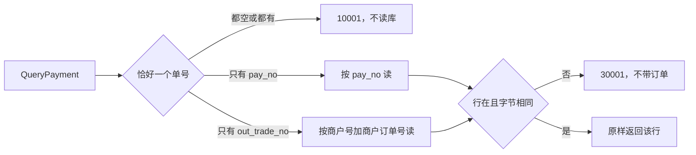

# PAY-08 支付单查询

| 项 | 内容 |
|---|---|
| 功能点 | PAY-08（P0，第 3 周） |
| 所属链路 | 支付 |
| 代码提交 | `ddfe22c` `[PAY-08] add payment query`（完整 `ddfe22c9d7ba763e54cd38296721c3c01e1460e3`，2026-11-01 19:24:52 +0800） |
| 分支 | `feat/PAY-08-query` |
| 日期 | 2026-11-01 |
| 状态 | DONE |

本报告写在上面这次代码提交之后，不在那 12 个文件里。商户关单已经完成。本次是 payment 进程上的 RPC `QueryPayment`。超时关单、查单补偿、网关、投递器都还没做。

## 一句话结论

`QueryPayment` 只读当前商户的支付单。商户 B `M100081` 拿商户 A `M100080` 的 `pay_no` 来查，得到已有错误 `30001`。业务函数在错误旁边返回零值订单，`PayNo` 是空串，金额是 0 分。handler 遇到这个错误走 `statusErr`，RPC 响应是 nil，不把该零值订单发给调用方。A 的那一行仍是 `INIT`，`version` 仍是 0，金额仍是 10000 分（100.00 元），`updated_at` 与查询前相同（`TestPAY08MerchantBCannotReadA` 断言的是业务函数返回值）。

## 1. 背景

### 1.1 系统简介

pay-system 是一个用 Go 编写的小型支付后端，模拟商户收款、退款、商户间转账三条资金链路，重点在数据一致性和性能。系统由 5 个部分组成：gateway（对外 HTTP 入口，负责签名校验和限流）、payment（支付单、退款单、转账单的状态管理和流程推进）、account（账户余额与记账，数据按商户分到 2 个数据库分片）、channel-mock（模拟微信、支付宝这类外部支付渠道）、recon（对账，核对系统内外数据是否一致）。服务之间用 Kitex RPC 同步调用，或通过 Kafka 消息异步通知；数据存在 MySQL 8.4，Redis 用于防重放。所有金额用整数“分”表示，所有记账只追加不修改。当前已完成：工程骨架、账户、模拟渠道的受理查单和关单、商户凭证与费率、故障注入、创建支付单、发起支付、outbox 写入、支付结果推进、商户关单，以及本次支付单查询。超时关单、查单补偿、网关、投递器都还没做。

上面这段里还没展开的词：Kitex 是本项目的 Go RPC 框架，RPC 是一个进程同步调用另一个进程里的函数。签名校验用密钥确认报文没有被改过；限流限制单位时间内的调用次数。这两件事都在 gateway，本次不做网关。Kafka 是异步消息队列。分片是把账户数据按商户拆进 2 个库。1 元 = 100 分，金额全程用整数。记账只追加，是指账本只插入新行，不回头改旧行。本次查询不写分录，也不改账户余额。Redis 防重放是系统别处的能力，不拦这次查询。P0 是必须先做的优先级。

创建支付单已经能插入状态为 `INIT` 的支付单。发起支付、支付结果推进、商户关单已经能把状态改成 `PAYING`、`SUCCESS`、`FAILED` 或 `CLOSED`。outbox 是和业务写在同一事务里、稍后才发送的消息表，发送是以后的投递器。本次查询只把已经写好的那一行读出来。

### 1.2 本功能点在系统中的位置

本次只实现 payment 的 RPC `QueryPayment`。商户用的 HTTP `GET` 在以后的网关 GW-02，本次没有。查单补偿是 PAY-05，超时关单是 PAY-07，把 outbox 行发出去是 MQ-02。



图里的读只打 `payment_order` 这一张表。没有 gateway，没有渠道，没有 account，没有 outbox 写入，也没有缓存。`pay_no` 是平台支付单号。`out_trade_no` 是商户自己的订单号。两个只能带一个。

### 1.3 为什么需要它

商户 A `M100080` 有一笔 10000 分（100.00 元）的支付，商户订单号是 `PAY08-A`，状态是 `INIT`。商户 B `M100081` 拿到了 A 的 `pay_no`，拿来查询。

如果不做查询，调用方无法读到自己的单。在这次提交之前，这个 RPC 固定返回 `10003`，表示内部错误，并且不读库。

如果查询做得不小心，会出三种错：

1. 把 A 的那一行返回给 B。B 就看到了 A 的 10000 分（100.00 元）订单。
2. 订单不存在用一个错误，订单属于别人用另一个错误。B 虽然拿不到正文，却能从错误码知道这个 `pay_no` 已经有人用了。
3. 查询顺手改了状态或 `version`。A 的单还是刚创建的 `INIT`，`version` 是 0。读一次之后这两项必须仍是原值。

所以：只读；没有行和商户号对不上都是同一个 `30001`；响应不带订单。

## 2. 术语

按正文第一次出现的顺序。

| 术语 | 含义 |
|---|---|
| 支付单 | 商户的一笔收款。表名 `payment_order`。创建时状态是 `INIT`。 |
| `INIT` | 已创建，还没向渠道发起。 |
| `PAYING` | 已经向渠道发起，结果可能还没回来。 |
| `SUCCESS` / `FAILED` / `CLOSED` | 支付成功、支付失败、已关闭。查询把库里的状态原样返回，这五种都可以。 |
| `QueryPayment` | 本次的支付单查询。入参是商户号，再加 `pay_no` 或 `out_trade_no` 里的一个。 |
| `pay_no` | 平台支付单号。只带它时，按这一列读。 |
| `out_trade_no` | 商户订单号。只带它时，和商户号一起读。 |
| `merchant_id` | 商户号。和库里的值逐字节比较。空串也参加比较。 |
| 分 | 金额最小单位。100 分 = 1.00 元。类型是 `int64`。10000 分是 100.00 元。 |
| `10001` | 已有错误码。参数不合法。文案是 `invalid parameter`。请求是 nil，或两个单号都空、都非空，返回它，不读库。 |
| `30001` | 已有错误码。文案是 `order not found`。没有行，或商户号逐字节不同，都返回它。响应不带订单。 |
| `10003` | 已有错误码。内部错误。文案是 `internal error`。服务没装好，或读库失败，返回它。 |
| `20004` | 已有错误码。商户不存在或已停用。本次查询不去查商户表，跨商户查询走的是 `30001`。 |
| `BizStatusError` | RPC 框架用来带回业务错误的错误类型。`30001` 走它，响应里不带订单。 |
| `biz_code` | 有的 RPC 把业务码放进正常响应的字段。本次响应类型是 `PaymentOrder`，没有这个包装字段。 |
| `version` | 行上的整数。创建后是 0。成功的状态更新会加 1。查询不加。 |
| `updated_at` | 行的更新时间。查询不改它。 |
| outbox | 待发消息表。查询不插入。发送是以后的 MQ-02。 |
| `channel_txn` | payment 库里的渠道流水。查询不插入。 |
| 唯一索引 | MySQL 不允许某几列出现第二行。`pay_no` 上已有 `uk_pay_no`。`(merchant_id, out_trade_no)` 上已有 `uk_merchant_out_trade_no`。本次不新建索引。 |
| 逐字节比较 | 用 Go 的 `!=` 比字符串。大小写不同、多一个空格，都算不同。数据库的排序规则有时会把字节不同的值当成同一行，读出来之后再用 Go 对一次。 |
| 空串算没提供 | `""` 表示这个单号没带。不调用 `TrimSpace`。只含一个空格的 `" "` 算已经提供。 |
| 注入时钟 | 业务代码不调用 `time.Now()`。测试用可拨动的假时钟。查询路径不读取这个时钟。 |
| 覆盖率 | 测试执行到的语句占该包语句的比例。核心包看 `make cover` 的数字，门槛 70%。 |
| `cached` | Go 复用了已有测试结果，没有重跑那个包。 |
| `integration` | 构建标签。带上它才编译连 MySQL 的测试文件。 |

## 3. 技术讲解

### 3.1 要解决的问题

1. 调用方要能读到自己的支付单，状态保持库里的原值。`INIT`、`PAYING`、`SUCCESS`、`FAILED`、`CLOSED` 都原样返回。
2. 别人的 `pay_no` 和根本没有的 `pay_no` 必须是同一个 `30001`。错误文案只有 `order not found`。响应不带订单。
3. 只带 `out_trade_no` 时按商户号一起查。别人的商户订单号也是 `30001`。
4. 两个单号都空，或两个都有值，返回 `10001`，这次不发 SQL。空串算没提供。空格不去掉。
5. 查询不写行，不改 `version`，不改状态，不写 outbox，不写渠道流水，不调用渠道，不进数据库事务。
6. 金额是 `int64` 分。本次不改金额，也不改手续费。

### 3.2 方案

先看两个单号是不是恰好一个。请求是 nil，或两个都是空串，或两个都不是空串，返回 `10001`。这一步在判断 `*Payments` 是不是 nil 之前，也在读库之前。因此 nil 的业务对象配上 nil 入参，仍是 `10001`，不会去碰存储。

`*Payments` 是 nil，但单号已经恰好一个：返回 `10003`。依赖没装齐，或 context 已经取消，也在读库之前返回。取消的 context 原样返回 `context.Canceled`。

下面这段在 `service/payment/biz/query.go`。它先卡住非法单号，再读。

```go
func (p *Payments) QueryPayment(ctx context.Context, in *QueryInput) (PaymentOrder, error) {
	if !exactlyOneQueryKey(in) {
		return PaymentOrder{}, errno.ErrInvalidParam
	}
	if p == nil {
		return PaymentOrder{}, errno.ErrInternal
	}
	if err := p.ready(ctx); err != nil {
		return PaymentOrder{}, err
	}
	if in.PayNo != "" {
		return p.queryByPayNo(ctx, in)
	}
	return p.queryByOutTradeNo(ctx, in)
}
```

`exactlyOneQueryKey` 先看指针。`in == nil` 时直接返回 false，不会去读 `PayNo` 或 `OutTradeNo`。`QueryPayment` 看到 false，返回 `10001`。入参不是 nil 之后，才做 `(in.PayNo != "") != (in.OutTradeNo != "")`。两边一真一假才通过。`" "` 的长度不是 0，算提供了。

```go
func exactlyOneQueryKey(in *QueryInput) bool {
	if in == nil {
		return false
	}
	return (in.PayNo != "") != (in.OutTradeNo != "")
}
```

只给 `pay_no` 时，用已经存在的查询：`WHERE pay_no = ?`。没有行，或读出的 `pay_no`、`merchant_id` 与入参逐字节不同，都返回 `30001`。空商户号同样比较，结果也是 `30001`，不是 `10001`。这段在同一个文件里。

```go
if !ok || order.PayNo != in.PayNo || order.MerchantID != in.MerchantID {
	return PaymentOrder{}, errno.ErrOrderNotFound
}
return order, nil
```

这里的 `PaymentOrder{}` 是业务函数的返回值，零值里 `PayNo` 是空串、`Amount` 是 0，并且同时带上错误。验收测试调用的就是这个函数，所以它断言的是该零值，不是 RPC 响应体。handler 在 `callErr != nil` 时执行 `return nil, statusErr(ctx, callErr)`，RPC 响应是 nil，这个零值订单不会发给调用方。

只给 `out_trade_no` 时，用已经存在的查询：`WHERE merchant_id = ? AND out_trade_no = ?`。读函数内部已经把商户号和商户订单号再比一次字节；查询再比一次。没有行就是 `30001`。存储返回的其他错误交给已有的 `callErr`：context 取消或截止原样返回，已登记的业务错误原样返回，其余收成 `10003`。

命中则把这一行原样返回。不改状态，不加 `version`。查询函数不调用 `time.Now()`，也不读注入时钟。

`App.QueryPayment` 在 `service/payment/biz/payment.go`。`App` 或里面的 `*Payments` 是 nil 时先返回 `10003`，再转给上面的函数。测试直接调用 `*Payments`，所以这个包装函数的覆盖率是 0.0%。

RPC 入口在 `service/payment/handler/handler.go`。响应类型仍是 `PaymentOrder`。handler 自己或内部服务是 nil 时，`ready` 先返回 `10003`，所以 nil handler 配上 nil 请求也是 `10003`。单号不合法时，handler 用 `ToBizStatus` 把 `10001` 包成 `BizStatusError`，不调用业务，RPC 响应是 nil。成功时业务函数的 error 是 nil，handler 把订单转成 RPC 的 `PaymentOrder`，RPC error 也是 nil。业务返回 `30001` 时，函数旁边的零值订单被丢掉，走已有的 `statusErr`：`RPCExit(err, false)` 得到 `BizStatusError`，RPC 响应是 nil。`false` 表示不把错误码放进正常响应。服务端处理超时仍是 `ServerTimeout`，2 秒。`Pay` 仍是 `PayServerTimeout`，5 秒。监听地址仍是 `:8881`。

其余还没实现的 RPC 方法仍走 `notImplemented()`，返回 `10003`。

### 3.3 为什么这样做

| 方案 | 做法 | 优点 | 缺点 | 结论 |
|---|---|---|---|---|
| 采用：直接读当前行 | 两个单号恰好一个才读。没有行和商户字节不同都是 `30001` | 读到的状态就是库里的状态。调用方看不出订单在不在 | 每次查询都读库 | 采用 |
| 备选：缓存查询结果 | 相同单号第二次不读库 | 少打数据库 | 中间如果支付成功或被关掉，缓存里仍是旧状态 | 不采用 |
| 备选：两种查不到用两个错误码 | 没有行一个码，商户不对另一个码 | 调用方能区分原因 | 商户 B 能从错误码知道 A 的单号已经存在 | 不采用 |
| 备选：先去掉首尾空格 | `TrimSpace` 之后再判断空和相等 | 纯空格不会被当成一个单号 | 空格是调用方传入的内容。去掉之后，只含空格会变成“没提供”，带空格的单号也会被改掉 | 不采用 |

### 3.4 正确性

查询没有更新语句，所以没有“抢同一行的 CAS”。CAS 是带期望状态的条件更新，本次用不上。下表只写测试实际走到的路径。

| 场景 | 系统行为 | 最终状态 | 证明 |
|---|---|---|---|
| 同一张单再查一次 | 再读一次。先按 `pay_no`，再按 `out_trade_no`。两次都返回这一行 | 集成：状态 `INIT`，`version` 0，金额 10000 分（100.00 元），`updated_at` 等于假时钟 `2026-10-17 15:00:00 +0800`。outbox 行数 0，`channel_txn` 行数 0。单元：内存存储的更新次数是 0 | `TestPAY08ReadOwnOrderAndMissingPayNo`；`TestQueryPaymentReadsOwnOrder` |
| 两个查询并发 | 没有两个查询同时打进来的测试。验收是一个查询接着创建之后执行 | 并发时两个人是否同时读到同一行，未验证。已有的顺序测试里，查询后 `status` 与 `version` 不变 | 无并发测试 |
| 读到一半进程崩溃 | 查询没有 `INSERT` 或 `UPDATE`，没有写到一半的行。没有杀掉进程再拉起的测试 | 进程崩溃后的库状态，未验证 | 无崩溃测试 |
| 下游调用超时 | 查询不调用渠道，也不调用别的 RPC | 没有下游超时可测 | 代码路径不调用渠道。测试没有构造下游超时 |
| 商户 B 查商户 A 的 `pay_no` | 返回 `30001`。返回值里的 `PayNo` 是空串，`Amount` 是 0 | A 仍是 `INIT`，`version` 0，金额 10000 分（100.00 元），`updated_at` 与查询前相等，`pay_no` 与创建时相等。outbox 与 `channel_txn` 的行数与查询前相等 | `TestPAY08MerchantBCannotReadA` |
| 单号非法 | nil、两个都空、两个都有、两个都是一个空格：返回 `10001` | 按 `pay_no` 和按商户订单号的读次数都不变。行仍是 `INIT`，金额 10000 分（100.00 元），`version` 与创建时相同 | `TestQueryPaymentRejectsBadKeysWithoutRead` |
| 没有行、空商户号、大小写不同、多一个空格 | 都是 `30001`，`Error()` 文本相同，返回的 `PayNo` 是空串 | 行仍是 `INIT`，金额 10000 分（100.00 元），`version` 不变 | `TestQueryPaymentMissingAndOtherMerchantAreSame` |
| context 已取消，或存储返回 `db down` | 取消发生在读之前，返回 `context.Canceled`，读次数不变。`db down` 在两种单号上都变成 `10003` | 行仍是 `INIT`，`version` 不变 | `TestQueryPaymentStoreErrorAndCanceledContext` |

单元里按 `pay_no` 读到的手续费是 60 分（0.60 元）。那一笔由测试辅助函数创建：商户 `M100002`，商户订单号 `T20261028001`，金额 10000 分（100.00 元），费率参数 60（万分之 60）。验收测试不断言手续费。验收的创建辅助函数调用是 `openPayments(..., 60, 60, ...)`，两个 60 分别是费率档和商户表上的费率列，不是验收断言的字段。

同一单元测试随后把内存行的状态依次改成 `INIT`、`PAYING`、`SUCCESS`、`FAILED`、`CLOSED`，每次读回的状态与改过的值相同，`version` 不变。

### 3.5 性能

不涉及。这次没有压测，没有吞吐或延迟的对比数字。

## 4. 已完成内容

### 4.1 改动清单

这些文件都在代码提交 `ddfe22c` 里。12 个文件，+460 / −19。`pay_sql.go` 和 `order_sql.go` 里的两条 SELECT 这次没改，查询直接调用它们。

| 文件 | 新增 / 修改 | 作用 |
|---|---|---|
| `service/payment/biz/query.go` | 新增 | `QueryPayment`：恰好一个单号才读，命中则原样返回 |
| `service/payment/biz/query_test.go` | 新增 | 不连 MySQL 的查询测试 |
| `service/payment/biz/query_integration_test.go` | 新增 | 连 MySQL。构建标签 `integration` |
| `service/payment/biz/payment.go` | 修改 | `App.QueryPayment` 在依赖缺失时返回 `10003`，否则转给 `*Payments` |
| `service/payment/biz/payment_test.go` | 修改 | 内存订单存储记下按 `pay_no`、按商户订单号的读次数，并能注入读错误 |
| `service/payment/handler/handler.go` | 修改 | `QueryPayment` 调用业务。成功返回 `PaymentOrder` |
| `service/payment/handler/handler_test.go` | 修改 | handler 的单号、成功、`30001`、nil 服务 |
| `service/payment/handler/service.go` | 修改 | 业务接口增加 `QueryPayment` |
| `docs/02-requirements.md` | 修改 | PAY-08 改为 DONE，验收勾上 |
| `docs/04-dev-plan.md` | 修改 | 只勾 PAY-08 |
| `docs/05-api.md` | 修改 | 版本到 3.1.8 |
| `docs/06-flows.md` | 修改 | 版本到 v2.26。CF-01 图下加一句，节点不改 |

### 4.2 对外变化

| 类别 | 变化 |
|---|---|
| 接口 | 无新的商户 HTTP。IDL 是 RPC 接口定义文件，本次没改，也没运行 `make gen`。`QueryPayment` 已进入业务。响应类型是 `PaymentOrder`，没有带 `biz_code` 的包装。成功时 RPC error 为 nil 并带订单。请求是 nil，或两个单号都空、都非空（空串算没提供，不 trim）时，handler 用 `ToBizStatus` 返回 `10001`，不进业务。`30001` 走 `statusErr`，是 `BizStatusError`，响应是 nil。nil handler 或 nil service 由 `ready` 返回 `10003`。服务端处理超时仍是 2 秒。`Pay` 仍是 5 秒。其余未实现方法仍返回 `10003`。网关的 `GET /v1/payments/{pay_no}` 和 `GET /v1/payments?out_trade_no=` 仍是以后的 GW-02 |
| 表结构 | 无。沿用 `payment_order`。没有新列、新索引，也没有新迁移。`docs/database.md` 没改 |
| 配置项 | 无。不新增环境变量 |
| 错误码 | 无新增。使用已有的 `10001`、`30001`、`10003`。`10001` 是通用参数错误，不放进 `QueryPayment` 的业务错误列。业务错误列仍只有 `30001` |
| 指标 / 故障点 | 无新指标，无新故障点 |

### 4.3 验收对照

第一行是需求里的那一条验收，内容写在表里。后面几行是同时被整包命令跑到的补充测试，不另立验收标准。结果都是通过。这些测试包含在第 4.4 节的整包命令里，没有按名字单独重跑。

验收测试的注释是：`// PAY-08 验收 1：用商户 B 查询商户 A 的 pay_no 返回 30001，A 的 status 与 version 不变。`

| 验收条目 | 测试函数 | 类型 | 结果 |
|---|---|---|---|
| 用商户 B 查询商户 A 的 `pay_no` 返回 `30001`。A 的 `status` 与 `version` 不变 | `TestPAY08MerchantBCannotReadA` | 集成 | 通过。见下面的字段 |
| 本商户按两个单号都能读到刚创建的 `INIT` 行；没有的 `pay_no` 与另一商户是同一个 `30001` | `TestPAY08ReadOwnOrderAndMissingPayNo` | 集成 | 通过。补充，不是第二条验收 |
| 非法单号不读库；本商户两种单号都能读到；五种状态原样返回 | `TestQueryPaymentRejectsBadKeysWithoutRead`、`TestQueryPaymentReadsOwnOrder` | 单元 | 通过。补充 |
| 没有行、空商户号、大小写、未去掉的空格，错误文本相同 | `TestQueryPaymentMissingAndOtherMerchantAreSame` | 单元 | 通过。补充 |
| 已取消的 context 不读库；存储错误变成 `10003` | `TestQueryPaymentStoreErrorAndCanceledContext` | 单元 | 通过。补充 |
| handler：非法单号不进业务；成功返回订单；`30001` 不带订单；nil 服务和 nil handler 是 `10003` | `TestQueryPaymentHandler` | 单元 | 通过。补充 |
| `QueryPayment` 的服务端超时仍是 2 秒 | `TestListenAddrAndTimeout` | 单元 | 通过。补充。它还断言监听地址 `:8881`，以及 `Pay` 仍是 5 秒 |

`TestPAY08MerchantBCannotReadA` 实际断言的内容：

- 商户 A 是 `M100080`，商户订单号 `PAY08-A`，金额 10000 分（100.00 元），商品名 `demo`。假时钟是 `feeAt(14, 0, 0, 0)`，也就是 `2026-10-17 14:00:00 +0800`。允许的通知主机名是 `merchant-demo`。创建辅助函数的两个费率参数都是 60。测试不断言手续费。商户 B 是 `M100081`，测试没有插入 B 的商户行。
- 错误是 `errno.ErrOrderNotFound`。断言函数同时要求 `errors.Is` 成立，并且 `Error()` 文本与这个哨兵相同，文本是 `order not found`。
- 这个测试调用的是业务函数 `*Payments.QueryPayment`，断言的是它的返回值，不是 RPC 响应体。错误旁边的订单是零值：`PayNo` 是空串，`Amount` 是 0。测试没有再查这个结构体的其他字段。同一错误经 handler 的 `statusErr` 出去时，RPC 响应是 nil，不携带该零值。`TestQueryPaymentHandler` 断言的是这个 nil。
- 再读出的行：`status` 与查询前相同，并且是 `INIT`；`version` 与查询前相同，并且是 0；金额是 10000 分（100.00 元）；`updated_at` 与查询前相等；`pay_no` 与创建时的单号相等。
- outbox 行数、`channel_txn` 行数与查询前相等。测试没有把这两张表断言成 0。

`TestPAY08ReadOwnOrderAndMissingPayNo` 实际断言的内容：

- 商户 A 是 `M100082`，商户订单号 `PAY08-OWN`，金额 `money.Amount(10000)`，即 10000 分（100.00 元）。假时钟是 `feeAt(15, 0, 0, 0)`，即 `2026-10-17 15:00:00 +0800`。
- 按 `pay_no`：`PayNo` 等于创建时的单号，`OutTradeNo` 是 `PAY08-OWN`，金额 10000 分，状态 `INIT`，`version` 0，`CreatedAt` 等于创建结果里的 `CreatedAt`。
- 按 `out_trade_no`：`PayNo` 等于创建时的单号，金额 10000 分，`version` 0，状态 `INIT`。这一次没有再断言 `OutTradeNo` 和 `CreatedAt`。
- 不存在的 `pay_no` `PA999`，以及商户 `M100083` 拿 A 的 `pay_no`，都是 `ErrOrderNotFound`，两者的 `Error()` 相同。
- 库里的行：状态 `INIT`，`version` 0，金额 10000 分，`updated_at` 等于上面的假时钟。outbox 行数是 0，`channel_txn` 行数是 0。

`TestQueryPaymentHandler` 实际断言的内容：请求是 nil、`pay_no` 指针指向空串、两个单号都有、两个单号都是一个空格，都是 `10001`，业务调用次数是 0。成功时返回的 `PayNo`、金额 10000 分、状态 `INIT`、`OutTradeNo` 与桩对象一致，传给业务的商户号是 `M100002`。前面带一个空格的 `pay_no` 原样进入业务。业务返回 `ErrOrderNotFound` 时响应是 nil，业务状态码是 30001。`New(nil)` 和 nil handler 都是 `10003`。

### 4.4 验证记录

日期都是 2026-11-01。环境：`go version go1.27.2 darwin/arm64`。当时工作区就是后来提交为 `ddfe22c` 的那棵树。本次 lint 未重印版本；同一天早些时候该二进制为 golangci-lint 2.14.0，built with go1.27.1，commit `114493f`，时间 2026-09-24T10:54:53Z。耗时是 `/usr/bin/time -p` 的 real。`make gen` 会按 IDL 生成代码；IDL 没改，所以没运行。`mmdc` 是把 Mermaid 源图渲染成 SVG 的命令，本次没运行，没有新的 SVG。

| 命令 | 结果 |
|---|---|
| `gofmt -l .` | 实际命令是 `/usr/bin/time -p gofmt -l .`。gofmt 无文件名输出，exit 0，real 0.06s，随后打印 `GOFMT:0` |
| `make lint` | 实际命令 `golangci-lint run --build-tags integration ./...`。`0 issues.`，exit 0，real 1.08s。这次没有重新打印 golangci-lint 版本 |
| `make test` | exit 0，real 11.46s。根包 `ok github.com/yym108/pay-system 4.532s`。`cmd/payment` 1.606s。`service/payment/biz` 5.588s。`service/payment/handler` 10.172s。许多其他包是缓存。这次 `make test` 不打印覆盖率 |
| `make test-integration` | exit 0，real 36.28s。根包 `ok github.com/yym108/pay-system 35.861s`。`cmd/payment` 1.543s。`service/payment/biz` 28.527s。`service/payment/handler` 18.990s。许多其他包是缓存 |
| `go test -cover`，不带 `integration` 标签 | 未运行 |
| `make cover` 之外，另跑带 `integration` 标签的 cover | 未运行 |
| `make cover` | exit 0，real 35.75s。`go tool cover -func` 的 total 27.5%，含生成代码 `kitex_gen`，不是门禁。根包 `ok github.com/yym108/pay-system 34.834s`，coverage `[no statements]`。`service/payment/biz` 27.574s，86.5%，不低于 70%。handler 18.615s，85.9%。`cmd/payment` 1.539s，55.3%，不在门禁内。`pkg/outbox` 未被本功能点修改，该次显示缓存 95.0%。门禁用这一行的 86.5% |

`make cover` 那次按函数：`query.go` 的 `QueryPayment` 88.9%，`exactlyOneQueryKey` 100%，`queryByPayNo` 100%，`queryByOutTradeNo` 100%。`payment.go` 的 `App.QueryPayment` 0.0%，因为测试调用的是 `*Payments`。handler 的 `QueryPayment` 100%。

`make gen` 未运行。`mmdc` 未运行，没有新的 SVG。

### 4.5 同步的文档

这些文档都在代码提交 `ddfe22c` 里。约定没有改，仍是 v2.23。`docs/03-conventions.md` 没改。`docs/database.md` 没改。

- 需求：版本仍是 v3.0。PAY-08 改为 DONE。规则改成直接读、两个单号二选一、不缓存、不写。验收「用商户 B 查询商户 A 的 pay_no 返回 `30001`」已勾选。变更记录有一行 2026-11-01，版本仍写 v3.0：直接读 `payment_order`，不缓存，不写；他人订单与不存在都是已有的 `30001`；二选一不合法是已有的 `10001`；不新增错误码。更早的变更记录没有改。§0.3 的通用完成定义勾选框仍是模板里的未勾选状态，本次没有去勾它们。
- 开发计划：只勾了 PAY-08。下一行仍是未勾选的 OPS-01 健康检查与优雅退出、OPS-05 管理端口。
- 接口：现为 3.1.8，最后修改 2026-11-01。变更记录一行写明影响 §1、§4.4、§10.2。§1 查询行的最后修改是 2026-11-01。§4.4 写明二选一、空串算没提供、不 trim、`10001` 是通用错误所以不进业务错误表、直接读、不缓存、不写、不推进状态、商户号逐字节比较、没有行和他人订单都是 `30001`、五种状态、网关仍是 GW-02 且本次不实现。业务错误仍只有 `30001`。§10.2 的 `QueryPayment` 业务错误格仍是 `30001`，没有把 `10001` 加进去。已实现方法的句子现在包含 `QueryPayment`。另有一段写明 handler 的 `ToBizStatus`、`BizStatusError`、不改 `version`、不调渠道、不写 outbox、不缓存、超时 2 秒、`Pay` 仍是 5 秒、nil handler 或 nil service 仍是 `10003`、不新增错误码、不改 IDL。
- 流程图：现为 v2.26，最后修改 2026-11-01。文件头对约定的引用仍是 v2.23。CF-01 的图节点没改。图下、限流说明之后有一句：`payment 的 QueryPayment 直接读 payment_order，pay_no 与 out_trade_no 二选一，不缓存，不写。本次不实现网关，上图节点不改。` 变更记录 v2.26 是同一句话，并写了没有 mmdc、没有新的 SVG。覆盖矩阵里 PAY-08 那一行仍是 `CF-01（网关管线后直接读库）`。

## 5. 未完成与风险

- 网关 HTTP 还没做，所以商户现在还不能用 GET 调到这个 RPC。HTTP 查询入口是以后的 GW-02。
- 本次不缓存，重复查询每次读库。
- 超时关单是 PAY-07，还没做。查单补偿是 PAY-05，还没做。把 outbox 行发出去的投递器是 MQ-02，还没做。

## 6. 如何复现

在仓库根目录、分支 `feat/PAY-08-query`、代码提交 `ddfe22c9d7ba763e54cd38296721c3c01e1460e3` 上执行。环境是 2026-11-01 的 `go version go1.27.2 darwin/arm64`。集成测试沿用已有基座：需要 Docker，或已经设置 `TEST_MYSQL_DSN`。本次记录没有另打印当时连的是哪台库。

```bash
/usr/bin/time -p gofmt -l .
make lint
make test
make test-integration
make cover
```

预期与第 4.4 节的表一致。`gofmt -l .` 不打印文件名。`make lint` 打印 `0 issues.`。测试命令的退出码是 0。`make test` 不打印覆盖率。`make cover` 的 total 是 27.5%，不作判据；`service/payment/biz` 是 86.5%。不带 `integration` 标签的 `go test -cover` 未运行。`make cover` 之外另跑带 `integration` 标签的 cover 也未运行。`make gen` 和 `mmdc` 这次没有运行。再跑时墙钟会随机器变化，第 4.4 节的 real 是这次实测。

## 7. 讲解要点

1. 为什么商户 B 和“没有这张单”是同一个码？B 的商户号是 `M100081`，A 的 10000 分（100.00 元）订单属于 `M100080`。两边的业务函数都返回 `30001`，文案都是 `order not found`，旁边的订单都是零值（`PayNo` 空串、金额 0 分）。handler 把这个零值丢掉，RPC 响应是 nil。B 不能从错误里看出这个 `pay_no` 已经存在。
2. 为什么两个单号不能同时带，也不能先去掉空格？两个都带时，不知道该按哪一个找。空串表示没带。一个空格是有内容的，两个都是空格仍算两个都带了，返回 `10001` 并且不读库。只给带前导空格的 `pay_no` 时，空格会原样拿去查，查不到就是 `30001`。
3. 为什么成功时 RPC error 是 nil，`30001` 的 RPC 响应却是 nil？找到行时，业务函数返回那一行且 error 为 nil，handler 把它转成 `PaymentOrder`，RPC error 也是 nil。没找到或商户对不上时，业务函数返回零值订单加上 `30001`；handler 丢掉零值，RPC 响应是 nil，错误是 `BizStatusError`。响应类型没有 `biz_code` 字段可以把 `30001` 和订单一并放回去。

## 延伸阅读

- `docs/02-requirements.md`：PAY-08 的规则和那一条验收。版本 v3.0。
- `docs/05-api.md`：§4.4 与 §10.2 的 `QueryPayment`。版本 3.1.8。
- `docs/03-conventions.md`：错误码、金额用分、事务内不调用外部系统。版本仍是 v2.23，本次没改。
- `docs/06-flows.md`：CF-01 图下的那一句。版本 v2.26，SVG 未渲染。
- `docs/04-dev-plan.md`：PAY-08 已勾选。OPS-01 未勾选。
- `service/payment/biz/query.go`：本节引用的查询实现。
- `service/payment/biz/pay_sql.go`：`WHERE pay_no = ?`。本次没改这个文件。
- `service/payment/biz/order_sql.go`：`WHERE merchant_id = ? AND out_trade_no = ?`。本次没改这个文件。

## 修订记录

| 日期 | 提交 | 修订内容 |
|---|---|---|
| 2026-11-01 | 报告尚未提交 | 首版。对应代码提交 `ddfe22c` `[PAY-08] add payment query` |
| 2026-11-01 | 报告尚未提交 | 可读性第一轮 2 处已改。 |
