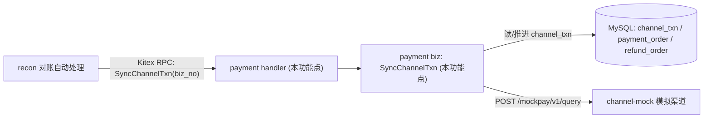
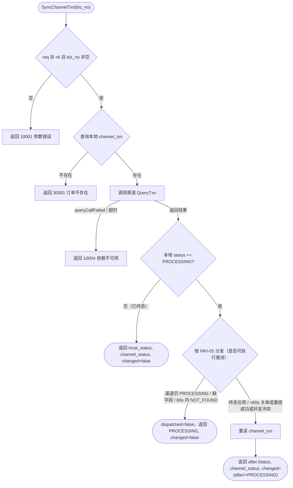

# PAY-09 立即同步渠道状态

| 项 | 内容 |
|---|---|
| 功能点 | PAY-09（P0，第 6 周） |
| 所属链路 | 支付 |
| 代码提交 | `2ce98f2` `[PAY-09] add immediate channel status sync` |
| 分支 | `feat/PAY-09-sync-channel` |
| 日期 | 2026-11-16 |
| 状态 | DONE |

## 一句话结论

实现了 `PaymentService.SyncChannelTxn(biz_no)` 内部 RPC：对账发现状态不符或渠道账单遗漏时，立即向模拟渠道发起一次查单，本地仍为 `PROCESSING` 时按查单补偿规则推进并重读本地状态，本地已是终态时只返回双方状态而不改库；单元、真实 MySQL 集成和 Kitex RPC 集成测试全部通过。

## 1. 背景

### 1.1 系统简介

> pay-system 是一个用 Go 编写的小型支付后端，模拟商户收款、退款、商户间转账三条资金链路，重点在数据一致性和性能。系统由 5 个部分组成：gateway（对外 HTTP 入口，负责签名校验和限流）、payment（支付单、退款单、转账单的状态管理和流程推进）、account（账户余额与记账，数据按商户分到 2 个数据库分片）、channel-mock（模拟微信、支付宝这类外部支付渠道）、recon（对账，核对系统内外数据是否一致）。服务之间用 Kitex RPC 同步调用，或通过 Kafka 消息异步通知；数据存在 MySQL 8.4，Redis 用于防重放。所有金额用整数“分”表示，所有记账只追加不修改。当前已完成：基础骨架、账户与记账、支付/退款/转账主链路与补偿、Kafka 异步投递与消费、商户通知、可观测性埋点与对账批次比对。

### 1.2 本功能点在系统中的位置



上游是 `recon`（对账服务）的差错自动处理逻辑：当对账发现“状态不符（`STATUS_MISMATCH`，本地还在处理中但渠道已出终态）”或“渠道账单缺失（`CHANNEL_MISSING`，本地成功但渠道账单里没有该笔记录）”时，同步调用本接口；下游是 `payment` 的本地渠道流水表 `channel_txn`、订单表以及外部模拟渠道 `channel-mock`。

### 1.3 为什么需要它

对账任务在次日比对前一天的渠道账单与本地流水。假设有一笔 10000 分（100.00 元）的支付单，渠道侧其实已经扣款成功（`SUCCESS`），但因为网络丢包或回调丢失，本地 `payment_order` 仍停留在 `PAYING`、对应的渠道流水 `channel_txn` 仍停留在 `PROCESSING`。

如果没有 `SyncChannelTxn`：
1. 对账虽然在次日发现了这笔差异，但只能把差错记录成“等待人工处理”，无法自动向渠道核实并把订单推进到 `SUCCESS` 给商户入账。
2. 另一类情况是本地订单已经关闭（`CLOSED`），渠道侧却扣款成功（`SUCCESS`）。对账需要同时拿到本地状态和渠道状态来判断是“严重不一致”还是“账单遗漏”，但又绝对不能去篡改已经处于终态的本地订单。

## 2. 术语

| 术语 | 含义 |
|---|---|
| `channel_txn` | 渠道交互流水表。每一笔支付单（`pay_no`）或退款单（`refund_no`）向渠道发起请求时，都在这张表里建一条记录，以 `biz_no` 唯一标识。 |
| `PROCESSING` | `channel_txn` 的处理中状态，表示平台已受理但尚未拿到渠道最终结果；对应支付单的 `PAYING` 或退款单的 `PROCESSING`。 |
| 终态 | 状态机不再流转的最终状态。渠道流水与订单的终态包括 `SUCCESS`（成功）、`FAILED`（失败）和 `CLOSED`（已关闭）。 |
| CAS（Compare-And-Swap） | 条件更新。更新数据库时在 `WHERE` 条件里带上原状态（例如 `WHERE biz_no = ? AND status = 'PROCESSING'`），只有影响 1 行才算本次推进成功，防止并发写覆盖。 |
| 60 秒保护期 | 平台创建 `channel_txn` 后的前 60 秒内，如果渠道查单返回 `NOT_FOUND`（查无此单），不立即关单或重提，因为受理请求可能还在网络传输中。 |
| `PAY-05` | 系统中原有的后台定时查单补偿任务，每秒扫描到期的 `PROCESSING` 流水向渠道查单并推进状态；本功能点复用了它的结果分发规则。 |
| `source = "QUERY"` | 标记本次状态推进的来源是“主动查单”（区别于渠道回调 `NOTIFY` 或商户关单 `CLOSE`），写入状态推进流水用于审计追踪。 |
| `refunded_amount` | 原支付单上已占用的累计退款金额；当退款单推进为 `FAILED` 时，会在同一数据库事务里扣减该字段以释放可退额度。 |
| `STATUS_MISMATCH` / `CHANNEL_MISSING` | 对账发现的两类差错：`STATUS_MISMATCH` 指本地与渠道账单状态不一致；`CHANNEL_MISSING` 指本地成功但渠道账单里找不到对应记录。 |
| `QueryTxn` / `queryCallFailed` | 渠道客户端的查单方法及其失败枚举：`QueryTxn` 发起 HTTP 查单；网络超时、非 200 响应或验签失败时返回 `queryCallFailed`。 |
| `50002` / `IDL` | `50002` 是平台业务错误码，表示渠道返回的金额与本地订单金额不一致；`IDL` 是 Thrift 接口定义语言文件（如 `idl/payment.thrift`），用于声明 RPC 请求与响应结构。 |
| outbox（本地消息表） | 在推进订单为终态的同一个数据库事务里写入待发送事件表，再由后台投递器异步发往 Kafka，保证“改订单”与“发记账消息”原子生效。 |

## 3. 技术讲解

### 3.1 要解决的问题

1. **只针对单笔流水立即核实与推进**：调用方只传入业务单号 `biz_no`（可能是支付单号 `PA...` 或退款单号 `RF...`），接口需要一次实时查单，不能等到后台定时补偿任务（每小时/退避）再处理。
2. **保护本地终态不被覆盖**：如果本地 `channel_txn` 已经是 `SUCCESS`、`FAILED` 或 `CLOSED`，即使查单发现渠道侧状态不同（如本地 `CLOSED` 而渠道 `SUCCESS`），也绝不修改本地数据，只把双方状态原样返回给对账决定后续动作。
3. **复用现有资金状态机与幂等保障**：本地仍为 `PROCESSING` 时，推进逻辑必须走现有的 `ApplyPayResult` / `ApplyRefundResult`（带 CAS、金额校验、`refunded_amount` 释放和 outbox 事务），不能另写一套绕过状态机和入账事件的 SQL。
4. **并发竞争时返回真实同步结果**：如果查单期间恰好有渠道异步回调或后台补偿先把本地改成了终态，不能报错或返回过时的 `PROCESSING`，要重新读取并返回同步后的真实状态。

### 3.2 方案

整体流程分为四步：校验参数与本地流水存在性 → 向渠道发起一次同步查单（`QueryTxn`） → 若本地已是终态则直接返回双方状态 → 若本地为 `PROCESSING` 则复用后台查单补偿（PAY-05）的分发规则推进并在需要时重读本地状态。



图说明：`SyncChannelTxn` 先读本地流水确认存在（不存在返回 `30001`），再发一次渠道查单（失败返回 `10004`）；本地已终态直接返回 `changed = false`；本地为 `PROCESSING` 时若渠道也还在 `PROCESSING` 等不可推进状态则 `dispatched = false` 直接返回 `changed = false`，否则分发推进并重读确认最终 `local_status` 与 `changed`。

核心实现位于 `service/payment/biz/sync_channel.go` 的 `SyncChannelTxn` 与 `dispatchSyncQuery`。下面这段代码在读取本地流水、向渠道查单一次后，按本地状态决定是直接返回还是进入分发推进：

```go
// service/payment/biz/sync_channel.go
	if txn.Status != txnStatusProcessing {
		return SyncChannelTxnResult{
			LocalStatus:   txn.Status,
			ChannelStatus: channelStatus,
			Changed:       false,
		}, nil
	}

	dispatched, err := p.dispatchSyncQuery(ctx, txn, res)
	if err != nil {
		return SyncChannelTxnResult{}, err
	}
	if !dispatched {
		return SyncChannelTxnResult{
			LocalStatus:   txn.Status,
			ChannelStatus: channelStatus,
			Changed:       false,
		}, nil
	}

	after, ok, err := p.orders.channelTxnByBizNo(ctx, txn.BizNo)
	if err != nil {
		return SyncChannelTxnResult{}, callErr(err)
	}
	if !ok || after.BizNo != txn.BizNo {
		return SyncChannelTxnResult{}, errno.ErrInternal
	}
	return SyncChannelTxnResult{
		LocalStatus:   after.Status,
		ChannelStatus: channelStatus,
		Changed:       after.Status != txn.Status,
	}, nil
```

当 `txn.Status == "PROCESSING"` 时，`dispatchSyncQuery` 复用与定时查单补偿（PAY-05）相同的分发逻辑：
- **渠道返回终态**：若渠道返回 `SUCCESS`（且金额与完成时间齐全）、`FAILED` 或支付单 `CLOSED`，分别构造 `PayResult` / `RefundResult`（`source = "QUERY"`）交给 `ApplyPayResult` / `ApplyRefundResult` 推进；若金额与本地不一致则直接返回 `50002`。
- **渠道返回非终态或信息不全**：若渠道仍返回 `PROCESSING`、返回 `SUCCESS` 但缺金额/完成时间、退款遇到 `CLOSED`、或 `NOT_FOUND` 尚在 60 秒保护期内，`dispatchSyncQuery` 不做修改并返回 `dispatched = false`，`SyncChannelTxn` 直接返回 `local_status = "PROCESSING"`、`changed = false`。
- **渠道返回 `NOT_FOUND` 且已超过 60 秒保护期**：支付单调用渠道关单（`closeOnChannel`），因为支付受理请求可能未到达渠道，必须向渠道发起关单写入墓碑，防止后续渠道收到迟到请求扣款成功造成“本地失败、渠道成功”（若渠道侧其实已支付返回 `ALREADY_PAID`，`closeOnChannel` 会再查单并落成 `SUCCESS`）；退款单则按原 `refund_no` 向渠道幂等重提（`resubmitRefundErr`），因为退款的业务意图是将资金退回给用户，只要渠道按请求号幂等就不会重复退款。
- **并发终态冲突与拒单处理**：若写入过程中发生并发终态冲突（`ErrOrderStatusConflict`，`30003`）或退款重提被渠道拒绝（`ErrChannelRejected`，内部 `callRefundChannel` 已调用 `ApplyRefundResult` 将退款单与渠道流水推进为 `FAILED`），`dispatchSyncQuery` 都不将其视为同步接口自身的失败，而是返回 `dispatched = true` 继续执行“重读 `channel_txn`”，把真实终态返回给调用方。

### 3.3 为什么这样做

| 方案 | 做法 | 优点 | 缺点 | 结论 |
|---|---|---|---|---|
| 采用：复用 PAY-05 分发辅助函数 + 推进后重读 `channel_txn` | 提取 `buildPayQueryResult`、`buildRefundQueryResult`、`resubmitRefundErr` 与 PAY-05 共享；推进后重读 `channel_txn` 计算 `local_status` 与 `changed` | 状态机与幂等逻辑只有一份，并发终态竞争时不丢真实状态，不改表结构 | 本地已是终态时仍需查一次渠道（1 次 HTTP） | 采用 |
| 备选 1：本地终态时跳过渠道查单 | 本地非 `PROCESSING` 直接返回 | 少 1 次渠道 HTTP 调用 | 对账的 `CHANNEL_MISSING` 场景本地是 `SUCCESS`，需要渠道真实状态来判定是否“严重不一致”，跳过会导致 `channel_status` 缺失 | 不采用 |
| 备选 2：在 `SyncChannelTxn` 里直接写 SQL 更新 `channel_txn` 和订单 | 单独写事务更新状态 | 少一次重读查询 | 重复实现 CAS、金额校验、`refunded_amount` 释放和 `outbox` 写入，容易与回调和定时补偿分叉 | 不采用 |

### 3.4 正确性

| 场景 | 系统行为 | 最终状态 | 证明 |
|---|---|---|---|
| 同一请求重复到达 | 第一次推进为终态后，第二次进入时本地已非 `PROCESSING`，只查单并返回 `changed = false`，不调用 `ApplyPayResult` / `ApplyRefundResult` | `channel_txn`、订单表及 `outbox` 保持第一次写入的结果，无重复记账 | `TestSyncChannelTxn`、`TestRPCSyncChannelTxn` |
| 两个冲突请求并发（如查单得 `SUCCESS` 同时商户关单成功） | 先完成的一方 CAS 命中；后完成的一方 CAS 影响 0 行并触发 `ErrOrderStatusConflict`（`30003`），`SyncChannelTxn` 捕获后重读 `channel_txn` | 本地停在先完成一方的终态（`CLOSED`），`SyncChannelTxn` 返回 `local_status = CLOSED`、`changed = true` | `TestSyncChannelTxn`、`ApplyPayResult` CAS 机制 |
| 在渠道查单返回后、写库前进程崩溃 | 代码通过“查单只读 + 事务外 HTTP”保证可恢复：崩溃前未写库，本地 `channel_txn` 仍停留在 `PROCESSING` | 重启或下一次对账重试 `SyncChannelTxn` / 后台定时补偿任务可继续推进（注：本次集成测试未单独注入进程崩溃，恢复路径由查单补偿与 `NOT_FOUND` 关单测试间接覆盖） | `TestSyncChannelTxnIntegration`（间接覆盖） |
| 下游渠道查单/关单超时或失败 | `QueryTxn` 返回 `queryCallFailed` 或 `closeOnChannel` 返回 `10004`；不修改本地任何表 | 本地保持 `PROCESSING`，接口返回 `10004`（`ErrUnavailable`），对账差错保持 `PENDING` 等待下批次重试 | `TestSyncChannelTxn/channel_query_failed_returns_10004`、`not_found_after_60s_close_error_returns_10004` |

### 3.5 性能

不涉及（PAY-09 为单笔对账差错同步接口，非高并发链路或优化类功能点）。

## 4. 已完成内容

### 4.1 改动清单

| 文件 | 新增 / 修改 | 作用 |
|---|---|---|
| `service/payment/biz/sync_channel.go` | 新增 | 实现 `SyncChannelTxnResult`、`(*Payments).SyncChannelTxn` 与 `dispatchSyncQuery` |
| `service/payment/biz/sync_channel_test.go` | 新增 | `SyncChannelTxn` 单元测试（参数/ctx 校验、`30001`/`10004`/`10003`/`50002`、终态只读、PAY/REFUND 全分发分支） |
| `service/payment/biz/sync_channel_integration_test.go` | 新增 | 真实 MySQL + channel-mock 集成测试（PAY 验收 1/2、`30001`、`NOT_FOUND` 超 60s 关单、退款同步） |
| `service/payment/biz/query_compensate.go` | 修改 | 抽取共享函数 `buildPayQueryResult`、`buildRefundQueryResult`、`resubmitRefundErr` |
| `service/payment/biz/payment.go` | 修改 | `(*App).SyncChannelTxn` 转发 |
| `service/payment/handler/service.go` | 修改 | `Service` 接口新增 `SyncChannelTxn` |
| `service/payment/handler/handler.go` | 修改 | 实现 `(*Handler).SyncChannelTxn`（nil 或空 `biz_no` 返回 `10001`），移除 `notImplemented()` |
| `service/payment/handler/handler_test.go` | 修改 | 将 `SyncChannelTxn` 移出未实现列表并新增 `TestKitexSyncChannelTxn` |
| `service/payment/handler/rpc_integration_test.go` | 修改 | 新增 `TestRPCSyncChannelTxn`（真实 Kitex 客户端 + MySQL + 签名渠道 HTTP） |
| `docs/02-requirements.md` | 修改 | §3 状态改 `DONE`、§4 验收打勾与实现说明、§8.2 变更记录 |
| `docs/05-api.md` | 修改 | 升版本为 `3.6.3`、更新 §0.2/§1/§10.2 说明 |
| `docs/04-dev-plan.md` | 修改 | 勾选 `PAY-09 立即同步渠道状态` |

### 4.2 对外变化

| 类别 | 变化 |
|---|---|
| 接口 | `PaymentService.SyncChannelTxn(biz_no)` 由未实现占位（`10003`）变为正式实现；入参、出参及业务错误码 `30001` 与既有 IDL/接口文档一致，服务端超时 2 秒 |
| 表结构 | 无 |
| 配置项 | 无 |
| 错误码 | 无（复用既有 `10001`、`10003`、`10004`、`30001`、`50002`） |
| 指标 / 故障点 | 无 |

### 4.3 验收对照

| 验收条目 | 测试函数 | 类型 | 结果 |
|---|---|---|---|
| 本地 PAYING、渠道 SUCCESS，调用后订单 SUCCESS，`changed = true` | `TestSyncChannelTxn`（`channel success`）、`TestSyncChannelTxnIntegration/local_paying_channel_success`、`TestRPCSyncChannelTxn` | 单元 / 集成 / RPC 集成 | 通过 |
| 本地 CLOSED、渠道 SUCCESS，调用后订单仍为 CLOSED，返回双方状态 | `TestSyncChannelTxn`（`local closed channel success`）、`TestSyncChannelTxnIntegration/local_closed_channel_success`、`TestRPCSyncChannelTxn` | 单元 / 集成 / RPC 集成 | 通过 |

### 4.4 验证记录

运行环境：Linux + Docker Desktop（testcontainers 启动 MySQL 8.4），Go race detector 开启。

| 命令 | 结果 |
|---|---|
| `gofmt -l .` | 无输出，通过 |
| `PATH="$PATH:$(go env GOPATH)/bin" make lint` | `0 issues`，通过 |
| `make test` | 全仓单元测试通过 |
| `go test -race -tags integration -cover ./service/payment/... ./cmd/payment/...` | 全部通过：`service/payment/biz` 85.1%、`service/payment/handler` 88.5%、`service/payment/job` 100.0%、`service/payment/notify` 79.4%、`cmd/payment` 27.9% |
| 审查修复后复跑 `gofmt -l .`、`make lint`、`go test -race ./service/payment/...` | 全部通过，`0 issues` |

### 4.5 同步的文档

- `docs/02-requirements.md`：§3 `PAY-09` 状态更新为 `DONE`，§4 勾选验收项并补充 10001/30001/10004/2s 超时说明，§8.2 登记变更。
- `docs/05-api.md`：文档版本升至 `3.6.3`，更新 `最后修改` 为 `2026-11-16`，在 §0.2、§1 和 §10.2 补充 `SyncChannelTxn` 实现说明及 `PaymentService` 12 个方法全部已实现说明。
- `docs/04-dev-plan.md`：将第 6 周 `PAY-09 立即同步渠道状态` 拆出并勾选 `[x]`。

## 5. 未完成与风险

- **已知限制**：`SyncChannelTxn` 在 Kitex 服务端的默认处理超时为 `ServerTimeout`（2 秒，定义于 `service/payment/handler/server.go`，与 `Pay`/`CreateRefund` 使用的 5 秒 `PayServerTimeout` 区分），而单次渠道查单客户端超时上限为 `QueryChannelTimeout`（3 秒，定义于 `service/payment/biz/pay.go`）；当渠道响应慢于 2 秒时，服务端会因父 ctx 先到期而返回 `10004`，由上层对账自动处理（REC-06）在下一批次重试。
- **留给后续功能点的工作**：`REC-06`（差错自动处理）在 `recon` 服务中调用 `PaymentService.SyncChannelTxn` 处理 `STATUS_MISMATCH` 与 `CHANNEL_MISSING`。

## 6. 如何复现

前置条件：本机已启动 Docker（用于 testcontainers 拉起 MySQL 8.4）且 `golangci-lint` 已安装于 `$(go env GOPATH)/bin`。

```bash
# 1. 代码格式与静态检查
gofmt -l .
PATH="$PATH:$(go env GOPATH)/bin" make lint

# 2. 全仓单元测试（含竞态检测）
make test

# 3. payment 服务集成测试与覆盖率（含真实 MySQL 与 Kitex RPC）
go test -race -tags integration -cover ./service/payment/... ./cmd/payment/...
```

预期输出：`gofmt -l .` 无输出，`make lint` 输出 `0 issues`，`make test` 与集成测试全部 `ok`/`PASS`，`service/payment/biz` 覆盖率不低于 70%（本次实测 85.1%）。

## 7. 讲解要点

1. **为什么本地已经是终态时还要调一次渠道查单？**
   - 对账的 `CHANNEL_MISSING`（本地 `SUCCESS` 但账单里没有）需要知道渠道侧当前到底是 `SUCCESS`（账单遗漏）还是 `FAILED`/`NOT_FOUND`（严重不一致），因此必须查单返回 `channel_status`，同时严格禁止修改本地终态。
2. **如果查单期间恰好有回调把本地推进成终态怎么办？**
   - `ApplyPayResult`/`ApplyRefundResult` 通过数据库 CAS 保证不重复推进；若遇到并发终态冲突（`30003`），`SyncChannelTxn` 会重读 `channel_txn` 并返回真实的 `local_status` 与 `changed = true`，避免误报失败。

## 延伸阅读

- `docs/02-requirements.md` §4.4（PAY-05、PAY-09）、§4.10（REC-06）
- `docs/05-api.md` §10.2（`PaymentService.SyncChannelTxn`）
- `docs/06-flows.md` §4.2（CF-09 立即同步渠道状态）
- `idl/payment.thrift`（`SyncChannelTxnRequest`、`SyncChannelTxnResponse`）

## 修订记录

| 日期 | 提交 | 修订内容 |
|---|---|---|
| 2026-11-16 | `2ce98f2` | 初版，记录 PAY-09 实现与验证结果 |
