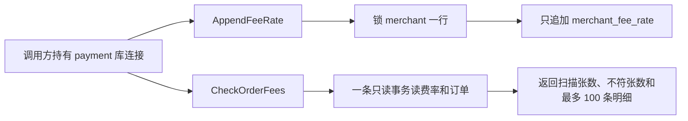
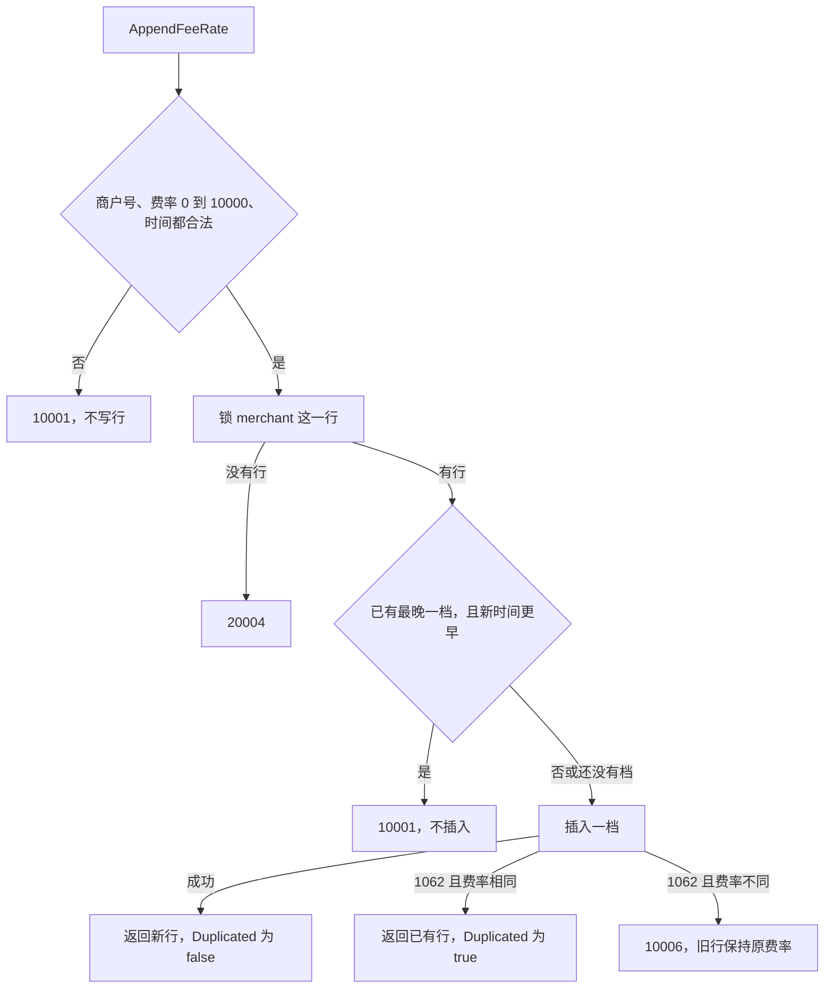

# PAY-10 商户费率变更与订单手续费核对

| 项 | 内容 |
|---|---|
| 功能点 | PAY-10（P0，第 3 周） |
| 所属链路 | 支付 |
| 代码提交 | `9587a08` `[PAY-10] add fee rate history` |
| 分支 | `feat/PAY-10-fee-rate` |
| 日期 | 2026-10-19 |
| 状态 | DONE |

完整 hash：`9587a08f481697d71122f4547825284d4ea3abbc`。作者时间 `2026-10-19 08:29:16 +0800`。这次代码提交 16 个文件，2495 行新增，15 行删除。本报告在该提交之后写，不包含在这 16 个文件里。

## 一句话结论

商户生效费率改成只追加的历史表 `merchant_fee_rate`。新的一档必须严格晚于该商户已有的最晚生效时间；同一时间再提交同一费率会返回已有行。订单核对在一条只读事务里，用下单时刻已经生效的那一档算出应收手续费，和订单上的 `fee_amount` 比较，只出报告。集成测试里，10000 分（100.00 元）的订单在 60 个基点生效之后若仍写成 0 分，会被报出，库里的 `fee_amount` 仍是 0。

## 1. 背景

### 1.1 系统简介

pay-system 是一个用 Go 编写的小型支付后端，模拟商户收款、退款、商户间转账三条资金链路，重点在数据一致性和性能。系统由 5 个部分组成：gateway（对外 HTTP 入口，负责签名校验和限流）、payment（支付单、退款单、转账单的状态管理和流程推进）、account（账户余额与记账，数据按商户分到 2 个数据库分片）、channel-mock（模拟微信、支付宝这类外部支付渠道）、recon（对账，核对系统内外数据是否一致）。服务之间用 Kitex RPC 同步调用，或通过 Kafka 消息异步通知；数据存在 MySQL 8.4，Redis 用于防重放。所有金额用整数“分”表示，所有记账只追加不修改。当前已完成：工程骨架到 IDL、账户分片路由、开户、账户查询、通用记账，以及本次的商户费率历史和订单手续费核对。支付下单、退款、转账、冻结和对外 HTTP 还没做。

Kitex 是本项目的 Go RPC 框架。RPC 是进程之间的同步调用。Kafka 是消息队列。Redis 防重放是把已经见过的请求记在 Redis 里，避免同一请求被再处理一次。分片是账户数据所在的那一个库，这里只有 0 和 1。IDL 是接口定义文件。本次费率变更和核对都不进入 IDL，也没有进程在监听端口。100 分 = 1.00 元。

### 1.2 本功能点在系统中的位置

这次做的是 payment 库里的两件事：给商户追加一档以后才生效的费率，以及按订单创建时间核对每张单上已经写下的手续费。调用方把已经打开的 `*sqlx.DB` 交进来。payment 进程现在只加载配置就退出，`cmd/payment/main.go` 没有改，核对函数可以被调用，进程以后常驻时再按每 1 分钟跑一次。没有管理端口，所以没有 HTTP。

下单时把手续费算好并固化进订单，仍是以后的 PAY-02。这次只把那条规则的文字改成：按下单时刻已生效的费率计算。流水（按分录顺序重算余额）仍是以后的余额核对，这次不做。分录是 account 库里记账表 `ledger_entry` 的一行，只追加不修改。这次没有改这张表。



图的左边是调用方，右边两张表都在 payment 这个库。追加费率写历史表，核对只读 `merchant_fee_rate` 和 `payment_order`。account 的余额和分录不在这条路径上。

### 1.3 为什么需要它

商户 `M100002` 由种子写下的费率是 60 个基点。种子是演示数据写入程序：它插入演示商户，并在同一个 payment 事务里补第一档历史。1 个基点是万分之一，60 个基点等于 0.60%。一笔 10000 分（100.00 元）的订单，按这个费率应收 60 分（0.60 元）。如果以后把“当前费率”直接改掉商户表上的那一列，昨天已经按 0 个基点收下的订单，今天再拿新费率去算，就会被说成少收了手续费。反过来，今天改成 60 个基点之后新来的订单，如果仍按 0 分入账，也要对得出来。

所以生效费率要留历史：某一刻开始用哪一档，以后只追加更晚的一档，不回头改旧档。核对只报告“这张单上的手续费和当时那一档不一致”，不把订单改掉，也不去改账。

## 2. 术语

| 术语 | 含义 |
|---|---|
| `ledger_entry` | account 库里的记账表。 |
| 分录 | `ledger_entry` 里的一行。只追加，不修改。 |
| 流水 | 按分录顺序重算余额。这次不做。 |
| 分 | 金额最小单位。100 分 = 1.00 元。10000 分是 100.00 元，60 分是 0.60 元。金额是整数，手续费不用小数运算。 |
| 基点 | 费率单位，记在 `fee_rate_bp`。1 个基点 = 1/10000 = 0.01%。0 是不收费，10000 个基点是 100%。60 个基点是 0.60%。 |
| 手续费 | 平台从订单金额里收取的部分，单位分。应收手续费是 `(金额 × 费率 + 5000) / 10000`，除法是整数除法，5000 用来四舍五入到分。 |
| 种子 | 演示数据写入程序。它插入演示商户，并在同一个 payment 事务里补第一档历史。`M100002` 走的是这条路。集成测试里用 SQL 插入的商户不叫种子。 |
| `merchant` | 商户表。`fee_rate_bp` 是种子写下的初始费率。更改费率不改这一列。`status` 为 `ACTIVE` 或 `DISABLED`。`DISABLED` 是停用，这次仍允许给它登记费率。 |
| `app_secret_cipher` | 商户表里的签名密钥密文。种子写入这一列。重复播种不覆盖它，所以再执行一次种子这一列不变。 |
| `merchant_fee_rate` | 商户费率历史表。一行是一个商户、一个费率、一个生效起始时间。只追加，没有 `updated_at`。 |
| `effective_from` | 这一档开始生效的时间，精度到毫秒。比较前先把调用方传入的时间截断到毫秒，时区保持调用方传入的值。`DATETIME(3)` 只存钟面时间，不存时区。截断只去掉不足 1 毫秒的部分，不把一个时区换算成另一个。返回值里的 `time.Time` 仍带着调用方传入的 `Location`。这次没有做时区对照测试。 |
| `payment_order` | 支付订单表。`amount` 是订单金额，`fee_amount` 是订单列里已经写下的手续费，单位分。这次的订单可以由测试插入，不表示已经向商户收过这笔钱。`created_at` 是创建时间。`pay_no` 是支付单号。 |
| `Duplicated` | 返回值里的布尔字段。为 true 时，这次没有插入新行，返回的是同一生效时间上已经存在的那一档。 |
| 行锁 | `SELECT ... FOR UPDATE` 占住的锁。别的事务要锁同一商户行就必须等这次事务结束。 |
| 幂等 | 同一商户、同一生效时间、同一费率再提交，得到已有行，不插入第二行。键是商户号加生效时间。键相同但费率不同不是成功的重复，返回 `10006`，旧行不变。时间必须相等。相等不算更早，所以不会在 `Before` 那里返回 `10001`，而是去插入，再撞上唯一键。已经有更晚的一档之后，再提交一个更早的时间，即使费率和某一旧档相同，也是 `10001`，不会把更早那一档当成幂等成功。 |
| `1062` | MySQL 报告“唯一索引冲突”的错误号。它只让这一条 `INSERT` 失败，不会把整个 InnoDB 事务作废。 |
| InnoDB | MySQL 使用的事务引擎。未提交的修改可以整笔撤销。 |
| `10001` | 已有错误码，英文固定为 `invalid parameter`。参数不合法，或新的生效时间早于该商户已有的最晚一档。 |
| `10003` | 已有错误码，英文固定为 `internal error`。服务、上下文或库为空，以及数据库失败，都用它。已取消的上下文不改写成这个码。 |
| `10006` | 已有错误码，英文固定为 `idempotent conflict`。同一商户、同一生效时间，已经有一档，但这次的费率不同。 |
| `20004` | 已有错误码，英文固定为 `invalid merchant`。这里只表示商户行不存在。停用商户不返回这个码。 |
| `1052` | MySQL 报告“列名有歧义”的错误号。`INSERT … SELECT` 两边都有 `merchant_id` 时，写 `merchant_id = merchant_id` 会撞上它。 |
| REPEATABLE READ | MySQL 隔离级别。事务开始后，重复读取看到的是这一轮开始时已经提交的快照。这次核对用它，并且把事务标成只读。 |
| READ COMMITTED | 另一个隔离级别。读到的是其他事务已经提交的最新行。项目里的通用写事务助手 `dbx.WithTx` 用的是这一级，并且单次事务最长 3 秒。 |
| 基点历史的“最近一档” | 在 `effective_from` 不晚于订单 `created_at` 的各档里，生效时间最晚的那一档。等于创建时间的那一档已经生效。 |

## 3. 技术讲解

### 3.1 要解决的问题

1. 费率要能按时间变，旧订单仍按当时的档计算。直接改 `merchant.fee_rate_bp` 会把历史抹掉。
2. 新的一档必须严格晚于该商户已有的最晚 `effective_from`。更早的时间如果也能插进去，已经按当时那一档算过的订单，会在事后被一条补进去的旧档改口。
3. 同一生效时间再提交同一费率，必须得到已有行，不能出现第二行。同一时间换成另一个费率，必须拒绝，旧行保持原费率。
4. 两个请求同时追加时要看是不是同一个生效时间。两档时间不同、并且都比当时最晚一档更晚：靠商户行锁在插入前重新比较，后到的仍必须严格晚于当时最晚一档。当时是拿到商户行锁之后重新读到的最晚一档，不是请求刚到达时看见的那一档。先提交的那一档会变成新的最晚；后到的时间若不再严格更晚，返回 `10001`，两档不会都留下。这种两个时间不同、并且一开始都更晚的并发，没有单独测试，是从行锁和 `Before` 判断推出来的。同一生效时间的并发不靠这条比较通过，而是撞上唯一键走幂等。
5. 商户不存在不能写出一档没有主人的费率。停用只是以后拒绝交易，不阻止把费率登记下来。
6. 核对只报告差异。发现少收或多收时，不改 `fee_amount`，不改账户余额，不重写分录。
7. 一轮核对里，BEGIN 之后才提交的费率和订单都不会出现在这一轮。费率在事务里只读一次，读完之后新提交的档本来就不会进内存，这一点不靠隔离级别。REPEATABLE READ 多稳住的是事务在 BEGIN 时定下的快照。若用 READ COMMITTED，BEGIN 之后、读取之前提交的费率会进入这一轮，后面的分页也可能看见扫描期间新提交的订单。这次没有用对照实验证明后一点。

### 3.2 方案

整体分成三块。迁移建一张只追加的历史表，并给已有商户补上第一档。`AppendFeeRate` 在一个写事务里锁住商户行，再决定插入、幂等返回，还是拒绝。`CheckOrderFees` 另开一条只读事务，把费率装进内存，再按订单主键分页核对。



图里商户号不合法只指空字符串。费率不在 0 到 10000，或时间是零值，也返回 `10001`，不写行。商户号非空但库里没有这行，是后面的 `20004`。

写入前把 `effectiveFrom` 截断到毫秒。锁住商户行之后，再读该商户 `effective_from` 最晚的一档。读到了则 `has` 为 true，`latest` 是那一档；还没有历史行则 `has` 为 false。下面从这次读取开始。`latestRate` 的错误返回按原文省略了。更早的时间直接返回，插入成功就返回新行，唯一索引冲突后再读同一档。

```go
// service/payment/biz/fee_rate.go：先读最晚一档；更早则拒绝；1062 后再读同一档。
latest, has, err := db.latestRate(ctx, merchantID)
// err != nil 时返回 10003，这一返回在摘录里略去。下面 if err := 里的 err 是插入的错误，不是这次读取的错误。
if has && effectiveFrom.Before(latest.EffectiveFrom) {
	return FeeRate{}, errno.ErrInvalidParam
}
row := FeeRate{MerchantID: merchantID, RateBP: rateBP, EffectiveFrom: effectiveFrom}
if err := db.insertRate(ctx, row); err != nil {
	if !dbx.IsDuplicate(err) {
		return FeeRate{}, callErr(err)
	}
	existing, ok, readErr := db.rateAt(ctx, merchantID, effectiveFrom)
	if readErr != nil {
		return FeeRate{}, callErr(readErr)
	}
	if !ok {
		return FeeRate{}, errno.ErrInternal
	}
	if existing.RateBP != rateBP {
		return FeeRate{}, errno.ErrIdempotentConflict
	}
	existing.Duplicated = true
	return existing, nil
}
return row, nil
```

`FeeRate` 只有商户号、费率、生效时间和 `Duplicated`。新插入返回这四项，`Duplicated` 为 false，不回读自增 `id` 和 `created_at`。1062 且费率相同的返回值也是这四项，来自再读那一档，`Duplicated` 为 true。两次成功返回的字段相同，差别只是 `Duplicated`。

`dbx.IsDuplicate` 只认 MySQL 错误号 1062，不看错误文本里有没有 “1062” 这几个字符。1062 不会把 InnoDB 事务作废，所以能在同一个事务里再读 `(merchant_id, effective_from)`。文本里夹着 1062、但错误号不是 1062 的失败，会变成 `10003`。

历史表由新迁移创建。唯一键是商户号加生效时间，费率被限制在 0 到 10000。没有 `updated_at`。追加路径没有 UPDATE。种子在唯一键冲突时有一条 `ON DUPLICATE KEY UPDATE merchant_id = merchant_fee_rate.merchant_id`。费率和 `effective_from` 不在赋值列表里，所以这两列不变。

```sql
-- migrations/payment/000002_merchant_fee_rate.up.sql
CREATE TABLE merchant_fee_rate (
  id             BIGINT UNSIGNED NOT NULL AUTO_INCREMENT,
  merchant_id    VARCHAR(32)     NOT NULL,
  fee_rate_bp    INT             NOT NULL,
  effective_from DATETIME(3)     NOT NULL,
  created_at     DATETIME(3)     NOT NULL DEFAULT CURRENT_TIMESTAMP(3),
  PRIMARY KEY (id),
  UNIQUE KEY uk_merchant_effective_from (merchant_id, effective_from),
  CONSTRAINT ck_mfr_fee_rate CHECK (fee_rate_bp BETWEEN 0 AND 10000)
);
```

同一条迁移用 `INSERT … SELECT` 给当时已经存在的商户补第一档：费率取 `merchant.fee_rate_bp`，生效时间取 `merchant.created_at`。商户表是空的时候，这条插入写入 0 行。另外给 `payment_order` 加了索引 `idx_pay_merchant_created (merchant_id, created_at)`，留给以后按商户和时间扫描。这次核对本身按 `payment_order.id` 分页，不靠这个索引。回滚迁移先删这个索引，再删历史表，不删 `payment_order`。

种子在商户插入成功或商户已经存在之后，用同一个 payment 事务补第一档。值来自库里的商户行，不用这次调用传入的参数覆盖已有商户。MySQL 8.4 对未加表名的 `merchant_id = merchant_id` 报 1052，所以冲突时把商户号写成这张表自己的商户号，费率和生效时间都不出现在赋值列表里。

```sql
-- internal/seed/seed.go
INSERT INTO merchant_fee_rate (merchant_id, fee_rate_bp, effective_from)
SELECT merchant.merchant_id, merchant.fee_rate_bp, merchant.created_at
FROM merchant
WHERE merchant.merchant_id = ?
ON DUPLICATE KEY UPDATE merchant_id = merchant_fee_rate.merchant_id
```

核对不走 `dbx.WithTx`。那个助手是 READ COMMITTED，而且整次事务最长 3 秒。核对需要一轮稳定快照，订单多时也不该被这 3 秒掐断，所以自己打开一条 REPEATABLE READ 的只读事务，读完就回滚。这条事务外面不再另开事务，也不更新任何行。费率在这条事务里只读一次。读完之后新提交的档本来就不会进已经装好的内存，这一点不靠隔离级别。REPEATABLE READ 多稳住的是 BEGIN 时的快照：BEGIN 之后才提交的费率和订单都不会出现在这一轮。若用 READ COMMITTED，BEGIN 之后、读取之前提交的费率会进入这一轮，后面的分页也可能看见扫描期间新提交的订单。这次没有用对照实验证明后一点。

```go
// service/payment/biz/fee_check.go
// 打开只读快照。扫描开始后新提交的费率，要等下一轮。
tx, err := s.db.BeginTxx(ctx, &sql.TxOptions{
    Isolation: sql.LevelRepeatableRead,
    ReadOnly:  true,
})
defer func() { _ = tx.Rollback() }()
```

`from` 含在窗口里，`to` 不含。比较的是 `payment_order.created_at`。`from` 或 `to` 是零值时，那一侧没有界。先把全部费率读进内存，按商户、生效时间升序排好。再按 `payment_order.id` 每次读 200 张，列只有单号、商户号、金额、订单上的手续费和创建时间，不读商品标题。

对一张单，取 `effective_from` 不晚于 `created_at` 的最近一档。没有这一档：计入不符，费率记 -1，应收手续费记 0。有这一档：用 `money.Fee` 计算。费率是 0 时直接返回 0，不走下面这式。否则 `q = 金额 / 10000`，`r = 金额 % 10000`，`rate` 是基点数，结果是 `q*rate + (r*rate + 5000) / 10000`。`rate` 不超过 10000 时这几步都在 int64 里，并且等于 `(金额 × rate + 5000) / 10000`。10000 分、60 个基点：`q = 1`，`r = 0`，结果是 60。算出的应收和 `fee_amount` 不同就计入不符。`money.Fee` 自己返回错误时，整次核对失败为 `10003` 并停止，不把这张单当成不符，也不返回已经扫过的部分结果。金额为负会走这条失败路径。单元测试 `TestScanFeesFeeErrorStops` 在不连 MySQL 的假数据上放一张金额 -1 分、费率 60 的订单，`money.Fee` 返回错误，整次核对失败为 `10003`，扫描张数和不符张数都是 0，后面那张单不再判断。这个测试包含在 `1.609s` 那次单元测试里，不是 `13.150s` 的 MySQL 集成测试。

返回值里的扫描张数和不符张数都是全量。订单按 `payment_order.id` 升序读，先扫到的不符先进入明细，满 100 条后不再放入，后面的不符仍计入不符张数。金额类型是 `money.Amount`，底层是 int64 分。

例子：T0 起 0 个基点，T1 起 60 个基点。订单金额都是 10000 分（100.00 元）。

| 创建时间 | 订单上的手续费 | 最近一档 | 结果 |
|---|---|---|---|
| T0 之前 | 0 分 | 没有 | 不符。费率 -1，应收 0 |
| `[T0, T1)` | 0 分 | 0 个基点 | 通过。应收 0 分 |
| T1 以及 T1 之后 | 60 分（0.60 元） | 60 个基点 | 通过。`(10000 × 60 + 5000) / 10000 = 60` |
| T1 之后 | 0 分 | 60 个基点 | 不符。应收 60 分，库里的 `fee_amount` 仍是 0 |

`TestPAY10CheckOrderFees` 实际插入 6 张，全部是商户 `M100016`、金额 10000 分、状态 `INIT`。按 `id` 升序是：T0 前 1 毫秒、手续费 0，不符，没有档；T0、手续费 0，通过；T1 前 1 毫秒、手续费 0，通过；T1、手续费 60，通过；T1 后 1 毫秒、手续费 60，通过；T1 后 1 毫秒、手续费 0，不符，应收 60。明细按 `id` 升序，就是第 1 张和第 6 张。`[T0, T1)` 扫到第 2、第 3 张，都通过。`from` 和 `to` 都是 T1 时扫到 0 张。

### 3.3 为什么这样做

| 方案 | 做法 | 优点 | 缺点 | 结论 |
|---|---|---|---|---|
| 采用：只追加历史表，核对只报告 | 新时间必须更晚；同一时间靠唯一键区分“同一费率”和“另一费率”；核对用只读快照 | 旧订单仍对得上当时的档；重复提交不会造出第二行；发现差异时订单和账保持原样 | 下单还没把手续费写进订单，核对要用测试自己插入的订单；新费率要等下一轮核对 | 采用 |
| 备选：改 `merchant.fee_rate_bp` 这一列 | 商户表只留一个当前费率 | 读起来只有一列 | 改完之后，改费率之前的订单会被按新费率重算 | 不采用。历史费率会丢 |
| 备选：核对时直接把 `fee_amount` 改成应收 | 扫到不符就更新订单，必要时重写分录 | 库里的数字会变成“对的” | 会改已经存在的订单和账；分录只允许追加。流水重算是以后的余额核对 | 不采用。这次只报告 |

费率不放进 Redis。生效档以 MySQL 里的历史表为准，避免缓存和表各说一个数。

### 3.4 正确性

| 场景 | 系统行为 | 最终状态 | 证明 |
|---|---|---|---|
| 同一生效时间再提交同一费率 | 商户是 `M100011`。测试用 SQL 写入的 `fee_rate_bp` 是 60，追加的也是 60。插入撞上 1062，再读到同一档且费率相同，`Duplicated` 为 true | 仍是 1 行。`merchant.fee_rate_bp` 仍是 60 | `TestPAY10SameEffectiveTimeIdempotent` |
| 16 个调用同时提交同一时间、同一费率 | 商户是 `M100012`。`insertMerchant` 是测试里的辅助函数，只插入商户行，不写历史表。它写入的 `fee_rate_bp` 是 45，16 个调用追加的也是 45。商户行锁把它们排开。先到的插入一行，后到的并不更晚，撞上唯一键后走幂等 | 恰好 1 行。16 个结果里只有 1 个 `Duplicated` 为 false，其余为 true。这一列保持 45 | 同一个集成测试 |
| 同一时间换成另一个费率 | 商户是 `M100013`。先写入 60，同一时间再写 80。1062 之后读到旧档，费率不同，返回 `10006` | 历史行仍是 60，行数仍是 1。这不是 `M100010` 更晚追加 80 那一次 | `TestPAY10SameTimeDifferentRate` |
| 新时间早于已有最晚一档 | `TestPAY10EarlierTimeRejected` 的商户是 `M100014`。先追加 T1 的 60，再提交 T0 的 60。锁住商户后比较时间，返回 `10001`，不执行插入 | 行数仍是 1 | `TestPAY10EarlierTimeRejected` |
| 已有一档之后，用更晚的时间追加 | 商户是 `M100010`。测试用 SQL 写入的 `fee_rate_bp` 是 60，第一档也是 60，更晚追加的是 80。比较通过，插入新行 | 行数加 1。商户表的 `fee_rate_bp` 仍是 60 | `TestPAY10AppendLaterKeepsMerchantRate` |
| 商户不存在 | 锁商户时没有行，返回 `20004` | 历史表没有这个商户的档 | `TestPAY10UnknownMerchant` |
| 商户已停用 | 停用只表示以后拒绝交易。锁得到行就允许登记 | 新增 1 档，商户表费率不变 | `TestPAY10DisabledMerchantCanAppend` |
| 在插入之后、提交之前进程崩溃 | `AppendFeeRate` 用 `dbx.WithTx`。事务没提交就结束时，InnoDB 撤销未提交的插入 | 新行不会留下。这一点由事务边界推出来，没有另做杀进程实验 | 见第 5 节 |
| 核对发现 T1 之后的 10000 分订单仍是 0 分手续费 | 商户是 `M100016`。测试用 SQL 写入的 `fee_rate_bp` 是 15。测试接着用 `AppendFeeRate` 写入两档历史：T0 起 0 个基点，T1 起 60 个基点。这 0 个基点不是商户表上的 15，也不会自动变成 T0 之前的一档。T1 之后最近一档是 60 个基点，应收 60 分（0.60 元），计入不符 | `fee_amount` 仍是 0。商户表仍是 15 | `TestPAY10CheckOrderFees` |
| 没有落在任何档里的订单 | 仍是 `M100016`。创建时间在 T0 之前，没有 `effective_from` 不晚于订单创建时间的历史行，计入不符，费率 -1，应收 0 | 订单行不被更新 | 同一个集成测试 |
| 扫描开始后另一连接提交了新费率 | 本轮事务是 REPEATABLE READ 只读快照，读到的是开始时已提交的费率 | 新档要等下一轮。集成测试没有在扫描中途另开连接提交新档来对照，所以这是隔离级别的结论 | 见第 5 节 |
| 下游调用超时 | 追加和核对在进入库之前都先看上下文。已取消则原样返回，不写成 `10003`。事务里只访问 payment 这一个库，没有渠道、RPC 或消息。核对这条路径不走 `dbx.WithTx` | 不涉及外部超时。`dbx.WithTx` 的 3 秒上限是写事务助手既有的限制，这次没有把事务拖到 3 秒来测 | 追加：`TestAppendFeeRateNilAndCanceled`，包含在 `1.609s` 里，用的是已取消的上下文和空库，没有测到事务中途取消。核对：`TestPAY10CheckOrderFeesCanceled`，包含在 `13.150s` 里 |

种子侧：`M100002` 是演示种子，有且只有一档，60 个基点，生效时间等于该商户的 `created_at`。再执行一次种子，这一档还在，费率仍是 60，`app_secret_cipher` 不变。它和上面的 `M100010`、`M100011`、`M100012`、`M100013`、`M100016` 不是同一个商户。迁移回填只覆盖迁移执行时已经存在的商户。这些集成测试商户是迁移之后用 SQL 插入的，插入语句不写历史表，历史行只来自后面的 `AppendFeeRate`。演示种子才会在商户事务里补第一档。演示种子一共三个商户，历史表一共 3 行。证明是 `TestPAY10SeedFeeRateIdempotent`。

### 3.5 性能

不涉及。这次没有性能开关，也没有压测数据。分页大小 200、明细上限 100 是功能界限，不是吞吐测量。

## 4. 已完成内容

### 4.1 改动清单

| 文件 | 新增 / 修改 | 作用 |
|---|---|---|
| `migrations/payment/000002_merchant_fee_rate.up.sql` | 新增 | 建历史表，给已有商户补第一档，给订单加 `(merchant_id, created_at)` 索引 |
| `migrations/payment/000002_merchant_fee_rate.down.sql` | 新增 | 删该索引，再删历史表。不删 `payment_order` |
| `service/payment/biz/fee_rate.go` | 新增 | `AppendFeeRate`：校验、锁商户、只追加、1062 后区分幂等和 `10006` |
| `service/payment/biz/fee_check.go` | 新增 | `CheckOrderFees`：只读快照、按主键分页、只报告不符 |
| `service/payment/biz/fee_rate_test.go` | 新增 | 参数、幂等、冲突、缺商户的单元测试 |
| `service/payment/biz/fee_check_test.go` | 新增 | 最近一档、无费率、手续费不符、明细上限的单元测试 |
| `service/payment/biz/fee_mem_test.go` | 新增 | 内存里的 SQL 驱动，让单元测试走到真实的 SQL 适配代码。它不是 MySQL。幂等测试让它返回 MySQL 错误号 1062，所以 `dbx.IsDuplicate` 走同一段判断。错误文本里夹着 1062、但错误号不是 1062 的失败，会变成 `10003` |
| `service/payment/biz/fee_integration_test.go` | 新增 | 对 MySQL 8.4 做追加、并发、核对和迁移 up/down |
| `internal/seed/seed.go` | 修改 | 商户事务里幂等补第一档 |
| `internal/seed/seed_test.go` | 修改 | 检查种子 SQL 复制的是库里的费率和 `created_at`，冲突更新不给费率赋值 |
| `internal/seed/fee_integration_test.go` | 新增 | `M100002` 只有一档 60 个基点，再播种不新增、不改费率、不改 `app_secret_cipher` |
| `internal/dbmigrate/acceptance_integration_test.go` | 修改 | 原有种子验收里加上 `M100002` 的一档断言 |
| `docs/02-requirements.md` | 修改 | PAY-10 规则、验收和状态；PAY-02 那一条费率文字 |
| `docs/04-dev-plan.md` | 修改 | 第 3 周只勾 PAY-10 |
| `docs/database.md` | 修改 | 增加历史表说明，并写明商户表那一列不是生效费率 |
| `docs/interview-notes.md` | 修改 | 行锁、毫秒截断、1052 要加表名、流水核对仍在以后 |

以上 16 个文件就是 `9587a08` 的范围。本报告不在其中。

### 4.2 对外变化

| 类别 | 变化 |
|---|---|
| 接口 | 无。没有新的 HTTP，也没有新的 RPC。`AppendFeeRate` 和 `CheckOrderFees` 是进程内方法，调用方传入 `*sqlx.DB` |
| 表结构 | 新增 `merchant_fee_rate`：商户号、0 到 10000 的费率、生效起始时间、创建时间。唯一键 `(merchant_id, effective_from)`。只追加。`payment_order` 新增索引 `idx_pay_merchant_created (merchant_id, created_at)`。不改已有列，不改 `ledger_entry` |
| 配置项 | 无 |
| 错误码 | 无新码。使用已有的 `10001`、`10003`、`10006`、`20004` |
| 单号前缀 | 无 |
| 指标 / 故障点 | 无 |

### 4.3 验收对照

订单是测试用 SQL 插入的，因为 PAY-02 还没有下单接口。插入的行满足金额大于 0、手续费在 0 和金额之间、币种为 `CNY`。这条测试插入的状态是 `INIT`。支付订单允许的状态是 `INIT`、`PAYING`、`SUCCESS`、`FAILED`、`CLOSED`。核对按创建时间读，不按状态过滤。

| 验收条目 | 测试函数 | 类型 | 结果 |
|---|---|---|---|
| 已有一档之后，更晚的时间追加成功，行数加 1，`merchant.fee_rate_bp` 不变 | `TestPAY10AppendLaterKeepsMerchantRate` | 集成，`-race` | 通过。包含在 `service/payment/biz` 的 `13.150s` 那次里，没有单独耗时 |
| 同一生效时间再提交同一费率，返回已有行且 `Duplicated` 为 true，行数仍是 1。并发提交同一时间同一费率也只留 1 行 | `TestPAY10SameEffectiveTimeIdempotent` | 集成，`-race` | 通过。并发是 16 个调用 |
| 同一时间不同费率返回 `10006`，旧费率还在 | `TestPAY10SameTimeDifferentRate` | 集成，`-race` | 通过 |
| 更早的时间返回 `10001`，不新增行 | `TestPAY10EarlierTimeRejected` | 集成，`-race` | 通过 |
| 不存在的商户返回 `20004` | `TestPAY10UnknownMerchant` | 集成，`-race` | 通过 |
| 0 个基点从 T0、60 个基点从 T1。10000 分的订单，创建时间在 [T0, T1) 且手续费 0 分才通过；T0 之前没有档，手续费即使是 0 分也报不符；T1 以及 T1 之后且手续费 60 分通过；T1 之后仍是 0 分被报出，库里的 `fee_amount` 仍是 0 | `TestPAY10CheckOrderFees` | 集成，`-race` | 通过。全窗口 6 张里 2 张不符；`[T0, T1)` 是 2 张且都通过 |
| 种子：`M100002` 有且只有一档 60 个基点，生效时间等于该商户 `created_at`。再执行一次种子，档数仍是 1，费率仍是 60 | `TestPAY10SeedFeeRateIdempotent` | 集成，`-race` | 通过。包含在 `internal/seed` 的 `11.167s` 那次里 |

单元测试另外覆盖了费率越界、零时间、最近一档、没有费率、手续费不符。这些断言在不带 integration 标签的 `service/payment/biz` 测试里，覆盖率见下节。真实 MySQL 不在那一次覆盖率里。

### 4.4 验证记录

环境：`go version go1.27.2 darwin/arm64`。`1.609s`、`13.150s`、`11.167s` 是 2026-10-19 那次实测的秒数。再跑一次，秒数可以不同。成功标志是对应行以 `ok` 开头；覆盖率命令还要打出 `coverage: 100.0% of statements`。不要把某一次的秒数写成必须逐字相同。

| 命令 | 结果 |
|---|---|
| `gofmt -l`（改过的 Go 文件） | 无输出 |
| `make lint` | `0 issues.` |
| `go test -race -count=1 -cover ./service/payment/biz/`（没有 integration 标签） | `ok github.com/yym108/pay-system/service/payment/biz 1.609s coverage: 100.0% of statements`。100.0% 只属于这个包的单元测试，里面含内存驱动。真实 MySQL 不在这 100.0% 里 |
| `go test -race -count=1 -tags integration -timeout 15m ./service/payment/biz/` | `ok github.com/yym108/pay-system/service/payment/biz 13.150s`。没有覆盖率。这是单独一次调用 |
| `go test -race -count=1 -tags integration -timeout 15m ./internal/seed/` | `ok github.com/yym108/pay-system/internal/seed 11.167s`。没有覆盖率。这是另一次调用，不和上一行写在同一条命令里 |
| `make test` | 未运行。没有全库测试结果 |
| `make test-integration` | 未运行。没有全库集成测试结果 |
| `make cover` | 未运行。没有全库覆盖率。不能把 100.0% 写成整个仓库或含集成测试的覆盖率 |
| `internal/dbmigrate` 里扩展的种子断言 | 未运行。只编译过 |

迁移的 up/down 在 `TestPAY10MigrationBackfillDownUp` 里，属于上面 `13.150s` 那次 payment 集成测试，没有单独一条命令输出。顺序是：库先是空的，回填 0 行；执行 down 后历史表和索引消失，`payment_order` 仍在；然后插入商户 `M100017`，`fee_rate_bp` 是 60；再执行 up，这个商户得到一档，费率 60，生效时间等于它的 `created_at`。这次测试没有在 down 之前追加更晚的档。down 会删掉整张历史表；再 up 只按当时商户表的费率和 `created_at` 补一档。若 down 之前追加过更晚的档，那些行会随表消失，不能从商户表恢复，因为追加不改 `merchant.fee_rate_bp`。这一点没有另做测试。

### 4.5 同步的文档

- 需求增加 PAY-10：历史表只追加；新时间必须严格晚于该商户已有的最晚生效时间；同一时间同一费率幂等成功，同一时间不同费率是 `10006`；不改 `merchant.fee_rate_bp`；核对只报告。状态改为 DONE，七条验收已勾上。定时任务表增加“订单手续费核对，payment，默认 1 分钟，只读，多实例可同时跑”，并写明这次不在进程入口启动。PAY-02 第 3 条改为按下单时刻已生效费率计算并固化到 `fee_amount`，PAY-02 仍是 TODO。变更记录记下种子冲突更新必须写成 `merchant_id = merchant_fee_rate.merchant_id`，否则 MySQL 8.4 报 1052。
- 开发计划第 3 周只勾了 PAY-10。
- 表结构文档在商户一节后增加历史表，写明只追加，并写明 `merchant.fee_rate_bp` 是种子初始值，不是生效费率。后面各表的原有编号没有重排。
- 面试笔记记下：生效费率在历史表、追加前锁商户行、核对不扫分录、时间截断到毫秒、1052 需要加表名。

接口文档和全局约定没有改：没有新的 HTTP，没有新的错误码、单号前缀或环境变量。两个进程同时核对都是只读，不写订单、不写费率，所以不会互相改数据。两份结果可能都报出同一张不符的单。这次没有两个进程同时跑的测试。

## 5. 未完成与风险

- 全库 `make test`、`make test-integration`、`make cover` 都未运行。100.0% 不是整个仓库的覆盖率，也不包含真实 MySQL 上的语句覆盖。
- `internal/dbmigrate` 里扩展的 `M100002` 费率断言未运行，只编译过。种子行为的已运行证明是 `internal/seed` 那次 `11.167s`。
- 没有进程崩溃注入。未提交的费率插入会随写事务撤销，这是从一个库、一个事务推出来的。
- “扫描开始后新提交的费率要等下一轮”来自 REPEATABLE READ 只读快照。集成测试没有在扫描中途另开连接提交新档再对照两轮结果，也没有中途提交新订单。这两点都没有对照实验。
- `DATETIME(3)` 只存钟面时间，不存时区。截断只去掉不足 1 毫秒的部分，不把一个时区换算成另一个。返回值里的 `time.Time` 仍带着调用方传入的 `Location`。这次没有做时区对照测试。
- payment 进程加载配置后就退出。核对函数可以调用，还没有每 1 分钟的循环，`cmd/payment/main.go` 没有改。
- 没有管理端口，不能通过 HTTP 改费率或查看核对结果。
- 下单时把手续费固化进 `fee_amount` 仍是 PAY-02。这次的订单是测试用 SQL 插入的。
- 按分录重算流水仍是以后的余额核对。这次不改 `ledger_entry`，也不自动改账。
- `idx_pay_merchant_created` 留给以后按商户和创建时间扫描。这次核对的查询按 `payment_order.id` 分页，条件里没有商户号，所以不使用这个索引。没有跑执行计划。这不是核对用错了索引。

## 6. 如何复现

前置：本机 Go 为 `go version go1.27.2 darwin/arm64`。集成测试会自己准备 MySQL 8.4，并使用临时 schema。不要把连接串或口令写进日志、错误或报告。

```bash
gofmt -l \
  service/payment/biz/fee_rate.go \
  service/payment/biz/fee_check.go \
  service/payment/biz/fee_rate_test.go \
  service/payment/biz/fee_check_test.go \
  service/payment/biz/fee_mem_test.go \
  service/payment/biz/fee_integration_test.go \
  internal/seed/seed.go \
  internal/seed/seed_test.go \
  internal/seed/fee_integration_test.go \
  internal/dbmigrate/acceptance_integration_test.go
make lint
go test -race -count=1 -cover ./service/payment/biz/
go test -race -count=1 -tags integration -timeout 15m ./service/payment/biz/
go test -race -count=1 -tags integration -timeout 15m ./internal/seed/
```

`gofmt -l` 预期无输出。`make lint` 预期 `0 issues.`。覆盖率命令预期以 `ok` 开头，并打出 `coverage: 100.0% of statements`。2026-10-19 那次是 `ok github.com/yym108/pay-system/service/payment/biz 1.609s coverage: 100.0% of statements`。这 100.0% 只含该包单元测试和内存驱动。payment 集成和 seed 集成是两条分开的命令。2026-10-19 那次分别是 `ok github.com/yym108/pay-system/service/payment/biz 13.150s` 和 `ok github.com/yym108/pay-system/internal/seed 11.167s`，都没有覆盖率。再跑一次，秒数可以不同。成功标志是对应行以 `ok` 开头。

`make test`、`make test-integration`、`make cover` 这次没有跑。复现时不要把全库覆盖率写成已经测过。`internal/dbmigrate` 的扩展断言这次未运行。

## 7. 讲解要点

1. 问：为什么不直接改商户表上的 `fee_rate_bp`？答：那一列只保留种子写下的初始值。生效档在 `merchant_fee_rate`，一行一个起始时间。10000 分（100.00 元）在 T0 用 0 个基点，应收 0 分；从 T1 起用 60 个基点（0.60%），应收 60 分（0.60 元）。改商户表会让这两段订单共用一个数。
2. 问：同一时间来两次，为什么不会有两行，也不会把 60 个基点改成 80？答：唯一键是商户号加生效时间。同一费率撞上 1062 后读回旧行，`Duplicated` 为 true。`M100013` 先写入 60 个基点，同一时间再写 80，返回 `10006`，历史行仍是 60。这和 `M100010` 更晚追加 80 不是同一次：更晚的时间会新插一行。16 个并发是另一个商户 `M100012`，`fee_rate_bp` 是 45，调用追加的也是 45，最终只留 1 行，这一列保持 45。商户行锁把它们排开；先到的插入这一行；后到的并不更晚，撞上 `(merchant_id, effective_from)` 唯一键后走幂等，读回同一档，`Duplicated` 为 true。相等时间不会因为“严格晚于最晚一档”而通过。更早的时间返回 `10001`。
3. 问：核对发现少收 60 分，为什么不把订单改掉？答：核对是一条只读事务，读完回滚。不符只进入报告，明细最多 100 条，不符张数是全量。`fee_amount` 仍是 0。改订单和重算流水分别留给 PAY-02 和以后的余额核对。

## 延伸阅读

- `docs/02-requirements.md` 里 PAY-10 的规则、七条验收，以及 2026-10-17 关于历史表、幂等和核对只报告的记录
- `docs/04-dev-plan.md` 第 3 周里 PAY-10 的勾选位置
- `docs/database.md` 里 `merchant_fee_rate` 一节
- `docs/interview-notes.md` 的 PAY-10 一节
- `service/payment/biz/fee_rate.go`、`service/payment/biz/fee_check.go`
- `docs/reports/BASE-04-money.md`：手续费为什么用整数分，以及四舍五入到分的除法
- `docs/reports/BASE-08-dbx.md`：`dbx.WithTx` 为什么是 READ COMMITTED 且最长 3 秒

## 修订记录

| 日期 | 提交 | 修订内容 |
|---|---|---|
| 2026-10-19 | `9587a08` | 初稿。对应代码提交 `[PAY-10] add fee rate history`，报告本身不在该提交内 |
