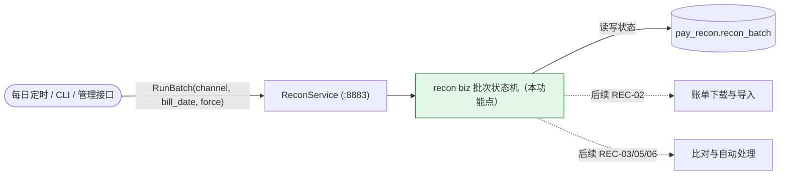
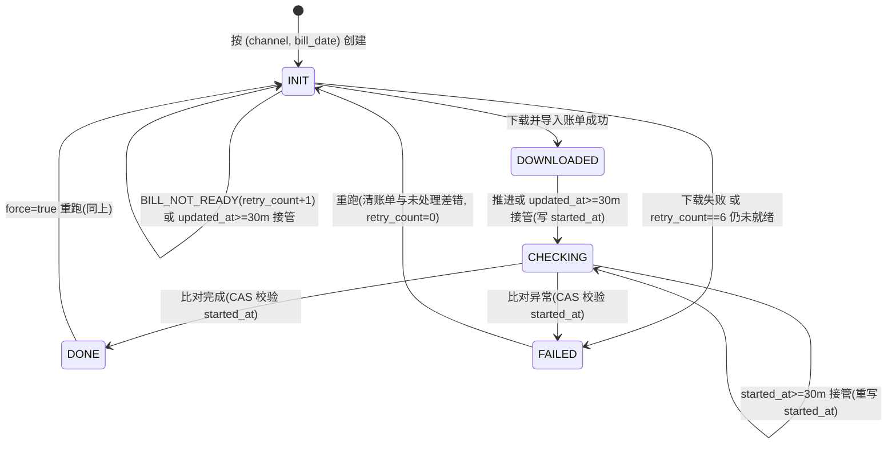

# REC-01 对账批次与调度

| 项 | 内容 |
|---|---|
| 功能点 | REC-01（P0，第 6 周） |
| 所属链路 | 对账 |
| 代码提交 | `5b71f72` `[REC-01] add recon batch and scheduler` |
| 分支 | `feat/REC-01-recon-batch` |
| 日期 | 2026-11-16 |
| 状态 | DONE |

## 一句话结论

实现了对账批次的状态机、并发防重、30 分钟卡死接管、`BILL_NOT_READY` 持久化重试以及每日定时调度：`recon_batch` 表通过 `(channel, bill_date)` 唯一约束防止同一账期并发重复对账，通过带原状态和原时间戳的 CAS（比较并交换）确保同一时刻只有一个接管者推进批次并防止旧运行覆盖新结果，13 条验收集成测试全部通过，`service/recon/biz` 语句覆盖率 70.2%。

## 1. 背景

### 1.1 系统简介

> pay-system 是一个用 Go 编写的小型支付后端，模拟商户收款、退款、商户间转账三条资金链路，重点在数据一致性和性能。系统由 5 个部分组成：gateway（对外 HTTP 入口，负责签名校验和限流）、payment（支付单、退款单、转账单的状态管理和流程推进）、account（账户余额与记账，数据按商户分到 2 个数据库分片）、channel-mock（模拟微信、支付宝这类外部支付渠道）、recon（对账，核对系统内外数据是否一致）。服务之间用 Kitex RPC 同步调用，或通过 Kafka 消息异步通知；数据存在 MySQL 8.4，Redis 用于防重放。所有金额用整数“分”表示，所有记账只追加不修改。当前已完成：工程基座、支付/退款/转账三条资金链路、Kafka 异步记账与商户通知、网关安全与限流、链路追踪与指标埋点、模拟渠道账单下载，正在进入第 6 周对账模块。

### 1.2 本功能点在系统中的位置



上游调用方包括进程内每日定时调度器、CLI 命令 `recon run` 以及网关管理接口（后续由 `GW-07` 接入）；下游为账单下载（`REC-02`）与比对自动处理（`REC-03`/`05`/`06`）预留了 `Downloader` 和 `Checker` 接口。

### 1.3 为什么需要它

对账是把前一天的渠道账单拉回本地并与系统内部流水核对的过程。如果没有严格的批次并发控制和断点接管机制，会出现三类问题：
1. 管理员点击重跑或定时任务重叠触发时，两个进程同时对 `2026-10-26` 账期跑对账，会重复插入账单行和差错记录。
2. 进程在比对到一半时崩溃，批次永远停在 `CHECKING`，但若新进程接管时直接清空全部差错重来，已经通过自动重放或人工标记为 `IGNORED`、`RESOLVED` 的差错就会丢失；反之若不拦截旧进程，慢了一步的旧进程把失败或旧统计写回数据库，就会覆盖新运行的结果。
3. 渠道早上 10:00 还未生成前一天账单（返回 `BILL_NOT_READY`）时，如果重试计数只放在进程内存里，进程重启后计数归零，批次可能无限重试或一直卡在 `INIT`。

## 2. 术语

| 术语 | 含义 |
|---|---|
| 账期（`bill_date`） | 东八区自然日，格式 `YYYY-MM-DD`，每天上午通常对前一天（`D-1`）的交易发起对账。 |
| CAS（Compare-And-Swap） | 比较并交换：数据库更新语句在 `WHERE` 子句中同时校验主键、期望旧状态和期望旧时间戳，只有影响行数为 1 时才算抢占成功。 |
| `BILL_NOT_READY` | 渠道接口表示账单文件尚未准备好的错误码，需要间隔 30 分钟后重试，最多重试 6 次。 |
| 接管（Takeover） | 当处于 `INIT`、`DOWNLOADED` 或 `CHECKING` 的批次距计时列满 30 分钟仍未结束时，由新的 `RunBatch` 调用通过 CAS 接手继续执行。 |
| 差错自动处理（`handle_action`） | 后续 `REC-06` 对部分差错执行 `REQUERY`（向渠道查单）或 `REPLAY`（重放 MQ 事件）后写入的动作标识；重跑和接管时必须保留已有动作的差错。 |

## 3. 技术讲解

### 3.1 要解决的问题

1. **同一账期防重**：同一 `(channel, bill_date)` 只能存在一个批次，并发触发 `RunBatch` 时只有一个执行，另一个直接返回当前批次状态。
2. **进行中不打断**：处于 `INIT`、`DOWNLOADED`、`CHECKING` 且未满 30 分钟的批次，即使指定 `force = true` 也不打断、不并发重跑。
3. **重跑保留已处理差错**：只有 `FAILED` 批次或指定了 `force = true` 的 `DONE` 批次才重跑；重跑只删除 `recon_channel_bill` 与尚未自动处理的差错（`status = 'PENDING' AND handle_action IS NULL`），保留已自动处理、已解决（`RESOLVED`）和已忽略（`IGNORED`）的差错，并把 `retry_count` 归零后从 `INIT` 重新下载。
4. **超时接管与防覆盖**：不设独立后台扫描；仅在 `RunBatch` 被调用时判断 `now - 时间戳 >= 30 分钟`（`INIT`、`DOWNLOADED` 看 `updated_at`，`CHECKING` 看 `started_at`）。接管后从对应阶段继续（`DOWNLOADED` 不重新下载直接比对，`CHECKING` 改写 `started_at` 后只删未自动处理的差错并重比），且 `DONE`/`FAILED` 的收尾 CAS 校验本次运行的 `started_at`，使旧运行被接管后自动放弃。
5. **`BILL_NOT_READY` 持久化重试**：计数持久化在 `recon_batch.retry_count`，首次下载后最多每 30 分钟重试 1 次、最多 6 次（共 7 次请求），第 6 次重试仍未就绪则置为 `FAILED`（`error_msg = BILL_NOT_READY`）。
6. **每日定时顺带清理窗口**：每天 `RECON_RUN_AT`（默认 `10:00`）除对 `D-1` 发起对账外，还查询前 7 个账期（`D-8` 到 `D-2`）中处于 `INIT`、`DOWNLOADED`、`CHECKING` 的已有批次逐个调用 `RunBatch`，不为缺失账期补建。

### 3.2 方案

整体状态流转与接管路径如下图所示：



关键实现机制：

1. **注入时钟与毫秒截断**：所有时间戳均来自注入的 `clock.Clock`，在东八区截断到毫秒（`Truncate(time.Millisecond)`）。每条改写 `recon_batch` 的 `UPDATE` 都显式写入 `updated_at = now`，不依赖数据库 `ON UPDATE CURRENT_TIMESTAMP`，从而确保 Go 内存中的时间戳与 MySQL `DATETIME(3)` 列完全一致，CAS 条件可以精确匹配。

以下代码摘自 `service/recon/dal/batch.go`，展示 `CHECKING` 阶段的接管 CAS（同一事务内更新 `started_at` 并只删除未自动处理的差错）：

```go
// TakeoverCheckingCAS 接管超时的 CHECKING 批次：改写 started_at = now 并删除尚未自动处理的 PENDING 差错。
func TakeoverCheckingCAS(ctx context.Context, db *sqlx.DB, id uint64, batchNo string, oldStartedAt, now time.Time) (bool, error) {
	var won bool
	err := dbx.WithTx(ctx, db, func(tx *sqlx.Tx) error {
		res, err := tx.ExecContext(ctx,
			`UPDATE recon_batch SET started_at = ?, updated_at = ? WHERE id = ? AND status = ? AND started_at = ?`,
			now, now, id, StatusChecking, oldStartedAt)
		if err != nil {
			return fmt.Errorf("takeover checking CAS: %w", err)
		}
		ok, err := affectedOne(res)
		if err != nil || !ok {
			won = false
			return err
		}
		if err := deleteUnprocessedDiffs(ctx, tx, batchNo); err != nil {
			return err
		}
		won = true
		return nil
	})
	return won, err
}
```

2. **依赖倒置解耦下游阶段**：`Recon` 通过 `Downloader` 和 `Checker` 接口触发下载与比对，`REC-01` 只负责批次创建、状态推进、CAS 接管与调度；测试时注入 Fake 实现即可完整验证各种超时、中断、`BILL_NOT_READY` 和并发竞争场景，后续 `REC-02`、`REC-03`、`REC-05`、`REC-06` 实现后只需装配注入即可。

3. **基于注入时钟的调度器**：`service/recon/job/scheduler.go` 中的 `Scheduler` 实现了 `server.Group` 和 `biz.RetryScheduler`。它不直接扫描数据库里的 `DOWNLOADED` 或 `CHECKING` 批次，只在两个时机触发 `RunBatch`：每日到达 `RECON_RUN_AT`（对 `D-1` 发起对账并查询 `D-8 ~ D-2` 未终态批次）和 `BILL_NOT_READY` 注册的 30 分钟单批次延迟重试队列。`Step(ctx)` 方法允许测试用 `clock.Fake` 确定性推进时间。

### 3.3 为什么这样做

| 方案 | 做法 | 优点 | 缺点 | 结论 |
|---|---|---|---|---|
| 采用：CAS 状态机 + `RunBatch` 触发时判超时 | `uk_channel_bill_date` 防重，CAS 校验原状态与原时间戳，超时只在 `RunBatch` 被调用时判定 | 无后台扫表开销；多个实例并发接管天然只有一个成功；旧运行凭 `started_at` CAS 自动失效 | 若无人调用，卡死批次需等到次日定时触发前 7 天窗口才会被接管 | 采用 |
| 备选 1：独立后台轮询扫描表接管超时 | 启一个定时任务每分钟全表扫描超时的 `INIT/DOWNLOADED/CHECKING` | 超时后最快 1 分钟内即可恢复 | 额外增加数据库扫描压力与多实例锁竞争，且不符合需求“无独立后台扫描”的约束 | 不采用 |
| 备选 2：进程内保存 `BILL_NOT_READY` 重试次数 | 在调度器内存 map 中记录已重试次数 | 不需要新增表列和数据库迁移 | 进程重启后计数清零，无法保证“最多重试 6 次后置 FAILED” | 不采用 |

### 3.4 正确性

本功能点不直接修改账户余额表，但涉及对账批次与差错生命周期的数据一致性，关键并发与故障场景如下：

| 场景 | 系统行为 | 最终状态 | 证明 |
|---|---|---|---|
| 同一账期并发触发两次 | 第一个插入 `uk_channel_bill_date` 成功并进入执行；第二个遇 1062 重读，见状态为未超时的 `INIT`，直接返回当前批次 | 只有一次下载与比对执行，批次正常到达 `DONE` | `TestRunBatchConcurrentSameDateOnlyOnce` |
| 进行中批次带 `force=true` | 距计时列 < 30 分钟时忽略 `force`，直接返回当前批次；≥ 30 分钟时走接管路径而非重跑 | 未满 30 分钟状态不变；满 30 分钟按对应阶段接管（`retry_count` 不清零） | `TestRunBatchForceDoesNotInterruptInProgress` |
| 批次中断后接管，旧运行延迟完成 | 接管者 CAS 改写 `started_at = T1`；旧运行完成时用原 `started_at = T0` 执行 `MarkDoneCAS` 或 `MarkFailedFromCheckingCAS`，影响行数为 0 | 旧运行放弃，数据库中保留新运行写入的 `DONE` 结果 | `TestRunBatchTakeoverOldRunDoesNotOverwrite` / `TestTakeoverInitAndClockRollback` |
| 进程在 `BILL_NOT_READY` 第 3 次重试后重启 | 重试计数已持久化在 `recon_batch.retry_count = 3`；重启后内存调度丢失，次日定时触发前 7 日窗口接管该批次 | 再次 `BILL_NOT_READY` 时 `retry_count` 变为 4，不从 0 重计 | `TestBillNotReadyRestartPreservesRetryCount` |

### 3.5 性能

不涉及（本功能点为每日低频调度与批次控制逻辑，无性能开关与压测目标）。

## 4. 已完成内容

### 4.1 改动清单

| 文件 | 新增 / 修改 | 作用 |
|---|---|---|
| `migrations/recon/000002_batch_retry_count.up.sql` | 新增 | `recon_batch` 增加 `retry_count INT NOT NULL DEFAULT 0` |
| `migrations/recon/000002_batch_retry_count.down.sql` | 新增 | 回滚删除 `retry_count` 列 |
| `service/recon/dal/batch.go` | 新增 | 批次/差错查询、重跑事务清理、各阶段 CAS 更新 |
| `service/recon/biz/batch.go` | 新增 | `RunBatch` 与 `RunDaily` 核心业务与状态机 |
| `service/recon/biz/batch_test.go` | 新增 | 参数校验与默认值单元测试 |
| `service/recon/biz/batch_integration_test.go` | 新增 | 13 条验收标准的集成测试（基于 testcontainers MySQL 8.4.11） |
| `service/recon/job/scheduler.go` | 新增 | 基于注入时钟的每日定时与单批次重试调度器 |
| `service/recon/job/scheduler_test.go` | 新增 | 调度器单元测试 |
| `service/recon/handler/convert.go`、`handler.go`、`middleware.go`、`server.go` | 新增 | Kitex `ReconService.RunBatch`（`:8883`） |
| `service/recon/handler/handler_test.go` | 新增 | RPC handler 单元测试 |
| `cmd/recon/main.go` | 修改 | 装配 `recon` 进程与 `recon run` CLI 子命令 |
| `cmd/recon/main_test.go` | 修改 | 适配启动测试并新增 CLI 参数解析测试 |
| `docs/02-requirements.md`、`docs/04-dev-plan.md`、`docs/database.md` | 修改 | 同步状态、开发计划勾选与表结构迁移记录 |

### 4.2 对外变化

| 类别 | 变化 |
|---|---|
| 接口 | 实现 `ReconService.RunBatch`（`:8883`）及 CLI `recon run --channel <ch> --date <YYYY-MM-DD> [--force]`（IDL 无改动） |
| 表结构 | `recon_batch` 新增 `retry_count INT NOT NULL DEFAULT 0`（`migrations/recon/000002_batch_retry_count.up.sql`），不对外输出 |
| 配置项 | 使用已有配置 `RECON_RUN_AT`（默认 `10:00`）、`MYSQL_RECON_PASSWORD`、`ACCOUNT_DB_DSN_0/1`、`WORKER_ID`，无新增环境变量 |
| 错误码 | 复用已有 `10001`（参数错误/未来账期）、`10004`（时钟回拨）、`10003`（内部错误），无新增错误码 |
| 指标 / 故障点 | 无新增（对账差错指标由后续 `REC-03`/`08` 接入） |

### 4.3 验收对照

| 验收条目 | 测试函数 | 类型 | 结果 |
|---|---|---|---|
| 同一账期并发触发两次，只有一次执行 | `TestRunBatchConcurrentSameDateOnlyOnce` | 集成 | 通过 |
| force 不打断执行中的批次；满 30 分钟按第 5 条接管而非重跑 | `TestRunBatchForceDoesNotInterruptInProgress` | 集成 | 通过 |
| 重跑后差错结果与首次一致，已处理的差错不丢失 | `TestRunBatchRerunNo1062AndKeepsAutoHandled` | 集成 | 通过 |
| 重跑不触发 1062、已自动处理的差错保留 | `TestRunBatchRerunNo1062AndKeepsAutoHandled` | 集成 | 通过 |
| 中断后接管与一次性运行一致 | `TestRunBatchTakeoverMatchesFreshRun` | 集成 | 通过 |
| 接管后旧运行不覆盖结果 | `TestRunBatchTakeoverOldRunDoesNotOverwrite` / `TestTakeoverInitAndClockRollback` | 集成 | 通过 |
| INIT/DOWNLOADED/CHECKING 超时接管（29m 不接管、31m 接管、并发只有一个） | `TestRunBatchTimeoutTakeover` / `TestTakeoverInitAndClockRollback` | 集成 | 通过 |
| 没有后台扫描（推进 2 小时无调用状态不变） | `TestSchedulerNoBackgroundScan` | 集成 | 通过 |
| 假渠道一直返回 `BILL_NOT_READY`（重试 6 次后置 FAILED） | `TestBillNotReadyRetryUntilFailed` | 集成 | 通过 |
| recon 重启后计数不丢 | `TestBillNotReadyRestartPreservesRetryCount` | 集成 | 通过 |
| 旧账期由定时触发接管（D-3/D-5 接管，D-9/D-4 不变） | `TestDailyRunTakesOverOldPendingBatches` | 集成 | 通过 |
| 重跑把 `retry_count` 重置为 0 | `TestRerunResetsRetryCountToZero` | 集成 | 通过 |
| 假渠道前 3 次 `BILL_NOT_READY`、第 4 次成功 | `TestBillNotReadySucceedsOnFourthAttempt` | 集成 | 通过 |

### 4.4 验证记录

运行环境：Linux + Docker Desktop（testcontainers `mysql:8.4.11`）。

| 命令 | 结果 |
|---|---|
| `gofmt -l .` | 无输出，格式全部符合规范 |
| `PATH="$PATH:$(go env GOPATH)/bin" make lint` | `golangci-lint run --build-tags integration ./...` 输出 `0 issues` |
| `make test` | `go test -race ./...` 全仓单元测试全部 PASS |
| `go test -race -tags integration -cover ./service/recon/... ./cmd/recon/... ./internal/dbmigrate/...` | 全部 PASS；`service/recon/biz` 语句覆盖率 **70.2%**，`internal/dbmigrate` 76.9%（验证 `000002_batch_retry_count` up/down），`service/recon/job` 47.8%，`cmd/recon` 24.4%，`service/recon/handler` 22.0% |

### 4.5 同步的文档

- `docs/02-requirements.md` §3：将 `REC-01` 状态更新为 `DONE`。
- `docs/04-dev-plan.md`：第 6 周计划拆行勾选 `REC-01 批次与调度`。
- `docs/database.md` §4.13、§5、§6：更新 `recon_batch.retry_count` 迁移路径为 `migrations/recon/000002_batch_retry_count.up.sql`，登记变更并关闭对应 Open Question。

## 5. 未完成与风险

- 当前 `Downloader` 与 `Checker` 为接口占位（默认 noop 实现），账单真实下载校验与导入留给 `REC-02`，外部/内部对账比对留给 `REC-03`/`REC-05`，差错自动处理留给 `REC-06`，完整报告指标留给 `REC-08`，网关管理接口 `/admin/recon/run` 留给 `GW-07`。

## 6. 如何复现

前置条件：已安装 Go 工具链，且本地 Docker 已启动（用于 testcontainers 自动拉起 `mysql:8.4.11`）。

```bash
# 1. 代码格式与静态检查
gofmt -l .
PATH="$PATH:$(go env GOPATH)/bin" make lint

# 2. 全量单元测试（带竞态检测）
make test

# 3. 运行 recon 集成测试与迁移验证（含覆盖率）
go test -race -tags integration -cover ./service/recon/... ./cmd/recon/... ./internal/dbmigrate/...
```

预期输出：`gofmt -l .` 无输出，`make lint` 输出 `0 issues.`，所有测试包输出 `ok` 且 `service/recon/biz` 覆盖率 ≥ 70%。

## 延伸阅读

- `docs/02-requirements.md` §4.10（REC-01 需求与验收规则）
- `docs/database.md` §4.13（`recon_batch` 表结构与生命周期）
- `docs/06-flows.md`（SM-07、CF-26、CF-39、CF-40 状态与流程图）

## 修订记录

| 日期 | 提交 | 修订内容 |
|---|---|---|
| 2026-11-16 | `5b71f72` | 初始版本 |
