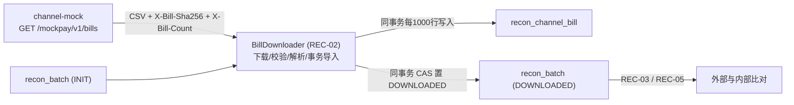
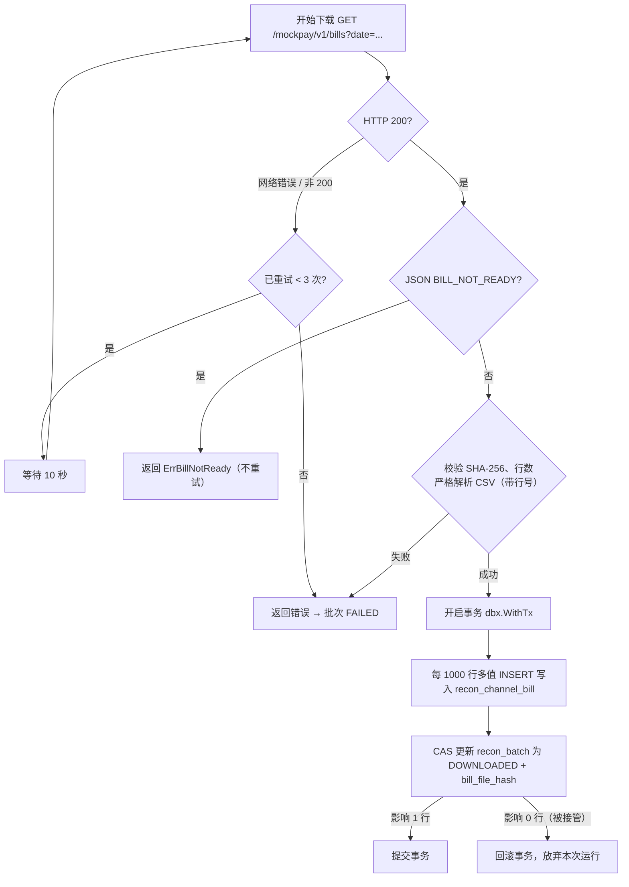

# REC-02 账单下载与导入

| 项 | 内容 |
|---|---|
| 功能点 | REC-02（P0，M6） |
| 所属链路 | 对账 |
| 代码提交 | `87dbe01` `[REC-02] add bill download and import` |
| 分支 | `feat/REC-02-bill-import` |
| 日期 | 2026-11-16 |
| 状态 | DONE |

## 一句话结论

实现了 `recon` 对账服务的渠道账单下载与批量导入（`BillDownloader`）：带渠道签名请求 `GET /mockpay/v1/bills`，支持 30 秒超时与最多 3 次 10 秒间隔重试、`BILL_NOT_READY` 识别、SHA-256 与行数校验、严格 CSV 解析（带行号错误），并在同一数据库事务内以每批 1000 行批量写入 `recon_channel_bill` 并通过 CAS 将批次推进为 `DOWNLOADED`；集成测试中 10000 行账单导入耗时远小于 5 秒，`service/recon/biz` 语句覆盖率为 76.8%。

## 1. 背景

### 1.1 系统简介

> pay-system 是一个用 Go 编写的小型支付后端，模拟商户收款、退款、商户间转账三条资金链路，重点在数据一致性和性能。系统由 5 个部分组成：gateway（对外 HTTP 入口，负责签名校验和限流）、payment（支付单、退款单、转账单的状态管理和流程推进）、account（账户余额与记账，数据按商户分到 2 个数据库分片）、channel-mock（模拟微信、支付宝这类外部支付渠道）、recon（对账，核对系统内外数据是否一致）。服务之间用 Kitex RPC 同步调用，或通过 Kafka 消息异步通知；数据存在 MySQL 8.4，Redis 用于防重放。所有金额用整数“分”表示，所有记账只追加不修改。当前已完成：工程基座（配置、数据库事务、发号器、时钟、日志、错误码）、网关与安全、支付/退款/转账三条资金链路、Kafka outbox 与消费者、模拟渠道（含账单下载与注入）、以及对账批次与调度框架（REC-01）。

### 1.2 本功能点在系统中的位置



上游是 REC-01 的批次调度器（创建或接管 `INIT` 状态的批次并触发下载），外部数据源是 `channel-mock` 提供的账单下载接口（CH-08），下游是 REC-03 的外部对账比对（读取 `recon_channel_bill` 与本地流水比对）。

### 1.3 为什么需要它

对账的第一步是把外部渠道的日结账单可靠地拉取并落地到本地对账库。如果没有严格校验与事务原子性，会出现三类典型故障：
1. **账单被篡改或截断仍入库**：例如一笔 10000 分（100.00 元）的支付在传输中被截断或篡改，若不校验响应头 `X-Bill-Sha256` 和 `X-Bill-Count`，错误数据进入对账会制造大量虚假差错。
2. **部分导入后进程崩溃**：例如导入 10000 行账单时刚写完 5000 行进程崩溃，若批次状态仍停留在 `INIT` 而已写入的行未回滚，下次重试会因 `recon_channel_bill` 唯一键 `uk_batch_type_channel_txn_no` 冲突而永久失败。
3. **渠道账单尚未生成却被当成失败**：当天或凌晨账单尚未就绪时渠道返回 `BILL_NOT_READY`，需要直接交由批次调度器按 30 分钟退避持久化重试，而不是立刻把批次标为 `FAILED`。

## 2. 术语

| 术语 | 含义 |
|---|---|
| 账期（`bill_date`） | 对账所属的东八区自然日，格式 `YYYY-MM-DD`，例如 `2026-10-26` |
| `recon_batch` | 对账批次表，每个 `(channel, bill_date)` 唯一对应一条记录，状态依次为 `INIT → DOWNLOADED → CHECKING → DONE`（异常时到 `FAILED`） |
| `recon_channel_bill` | 渠道账单明细表，保存导入的每一行渠道交易记录，后续由比对逻辑更新 `match_status` |
| CAS（Compare-And-Set） | 带原状态/原时间戳条件的原子 `UPDATE`，例如 `WHERE id = ? AND status = 'INIT' AND updated_at = ?`，防止并发接管互相覆盖 |
| `BILL_NOT_READY` | 渠道账单未就绪响应（HTTP 200 JSON `{"result":"BILL_NOT_READY"}`），表示需延迟重试而非网络故障 |
| `X-Bill-Sha256` / `X-Bill-Count` | 渠道账单响应头，分别携带账单 CSV 字节流的 SHA-256 小写十六进制摘要与数据行数（不含表头） |

## 3. 技术讲解

### 3.1 要解决的问题

1. **可靠下载与重试语义区分**：单次 HTTP GET 超时 30 秒，网络/5xx 错误最多重试 3 次（间隔 10 秒）；但 `BILL_NOT_READY` 必须立即返回 `ErrBillNotReady` 交给 REC-01 的 30 分钟持久化调度，不走 10 秒重试。
2. **完整性与格式零容忍**：必须验证 `X-Bill-Sha256` 和 `X-Bill-Count`；CSV 必须严格匹配 `txn_type,req_no,channel_txn_no,amount,status,finished_at` 表头（无 UTF-8 BOM）、合法交易类型（`PAY`/`REFUND`）、正整数金额、合法时间格式，任一行错误直接置批次 `FAILED` 并给出精确行号。
3. **批量导入与状态流转原子性**：1 万行账单导入耗时需小于 5 秒，且批量插入 `recon_channel_bill` 与将 `recon_batch` 置为 `DOWNLOADED`（写入 `bill_file_hash`）必须在同一个数据库事务内提交；若事务内 CAS 抢占失败（已被其他运行接管），整批插入必须全部回滚。

### 3.2 方案

核心流程分为“带签名 HTTP 下载与重试 → 响应头与 CSV 严格校验 → 单事务分批写入与 CAS 状态推进”三步：



1. **带签名请求与 `BILL_NOT_READY` 识别**：`fetchOnce` 使用 `pkg/sign.SignChannel` 对空请求体生成 `X-Mock-Timestamp` 与 `X-Mock-Signature`，禁止 HTTP 重定向，单次超时 30 秒。收到 HTTP 200 后优先检查 JSON `{"result":"BILL_NOT_READY"}`。
2. **严格 CSV 解析**：`ParseBillCSV` 使用 `encoding/csv`（`FieldsPerRecord = 6`）校验第 1 行表头与 6 个字段（`txn_type` 仅允许 `PAY`/`REFUND`、`req_no` ≤ 32 字符、`channel_txn_no` ≤ 64 字符、`amount` 为正整数、`status` ≤ 16 字符、`finished_at` 支持毫秒 ISO-8601 与 RFC3339）。任何错误返回 `bill csv line <N>: ...`。
3. **单事务每 1000 行批量插入与 CAS**：`InsertChannelBillsBatch` 将账单按 1000 行切片，每片构造一条多值参数化 `INSERT INTO recon_channel_bill (...) VALUES (...),(...),...`。

关键代码（`service/recon/biz/downloader.go`，同一事务内批量导入账单行与 CAS 推进批次状态）：

```go
	dlNow := d.clk.Now().In(shanghai).Truncate(time.Millisecond)
	err = dbx.WithTx(ctx, d.db, func(tx *sqlx.Tx) error {
		if err := dal.InsertChannelBillsBatch(ctx, tx, rows); err != nil {
			return err
		}
		won, err := dal.MarkDownloadedCAS(ctx, tx, batch.ID, fileHash, batch.UpdatedAt, dlNow)
		if err != nil {
			return err
		}
		if !won {
			return errDownloadedCASLost
		}
		return nil
	})
```

为兼顾 REC-01 已有集成测试中的 `fakeDownloader`，`DownloadResult` 新增 `Transitioned`、`Won`、`UpdatedAt` 字段：真实 `BillDownloader` 在事务内完成 `MarkDownloadedCAS` 后返回 `Transitioned: true`，`runFromInit` 直接读取结果推进到 `CHECKING`，不再二次更新。

### 3.3 为什么这样做

| 方案 | 做法 | 优点 | 缺点 | 结论 |
|---|---|---|---|---|
| 采用：单事务每 1000 行多值 INSERT + 事务内 CAS | 在 `dbx.WithTx` 中先分块多值插入 `recon_channel_bill`，再执行 `MarkDownloadedCAS` | 事务原子性强，崩溃或被接管全量回滚；1 万行仅 10 次 SQL 往返，耗时远低于 5 秒 | 单次事务持锁时间随账单行数线性增长（1 万行仅百毫秒级，P0 单日上限 100 万行可接受） | 采用 |
| 备选 1：先逐行/分批独立事务插入，最后单独 CAS 置 `DOWNLOADED` | 不包裹在同一个大事务中 | 事务更短 | 中途崩溃会留下半批脏数据，下次 `INIT` 重跑直接触发 `uk_batch_type_channel_txn_no` 唯一键冲突 | 不采用，破坏崩溃可恢复性 |
| 备选 2：由 `runFromInit` 外部统一调 `MarkDownloadedCAS` | `DownloadAndImport` 只插表，事务外由调用方改状态 | 接口最简单 | 同样无法保证插入与改状态同事务提交 | 不采用，违反原子性要求 |

### 3.4 正确性

| 场景 | 系统行为 | 最终状态 | 证明 |
|---|---|---|---|
| 账单内容被篡改或行数不符 | `verifyAndParseBill` 检测到 `X-Bill-Sha256` 或 `X-Bill-Count` 不一致后返回错误，不开启导入事务 | `recon_batch.status = 'FAILED'`，`recon_channel_bill` 0 行 | `TestDownloaderHashMismatchMarksFailed` |
| 下载临时失败（5xx / 网络错误） | 间隔 10 秒最多重试 3 次（共 4 次请求），第 4 次成功则继续解析导入；全部失败则置 `FAILED` | 成功时进入后续流程，耗尽重试则 `FAILED` | `TestDownloadBillRetryOnFailure` |
| 渠道返回 `BILL_NOT_READY` | 立即返回 `ErrBillNotReady`，不走 10 秒重试，由 REC-01 持久化 `retry_count + 1` 并调度 30 分钟后重试 | `recon_batch.status = 'INIT'`，`retry_count` 递增 | `TestDownloadBillNotReady` |
| CSV 表头错误、BOM、非整数金额或非法时间 | `ParseBillCSV` 立即停止并返回带行号（`line N`）的错误 | `recon_batch.status = 'FAILED'`，无脏数据入库 | `TestParseBillCSVStrict` |
| 事务内批量导入后 CAS 抢占失败（已被接管） | 返回 `errDownloadedCASLost` 触发 `dbx.WithTx` 回滚，外层重新查询最新批次状态返回 | 本次插入全部回滚，不覆盖接管者状态 | `DownloadAndImport` + `runFromInit` 实现 |

### 3.5 性能

- **测试环境**：本地 Linux + Docker Desktop MySQL 8.4.11（testcontainers），开启 `-race` 竞争检测。
- **测试场景**：`TestDownloaderImport10kRowsUnder5s` 通过 `httptest` 返回 10000 行合法 CSV（约 900 KB），走完整 `RunBatch` 流程下载、校验 SHA-256、解析并在同一事务内按 1000 行分 10 批插入 `recon_channel_bill`。
- **实测结果**：10000 行全部入库且批次推进至 `DONE`，总耗时 `< 5s` 断言通过。

## 4. 已完成内容

### 4.1 改动清单

| 文件 | 新增 / 修改 | 作用 |
|---|---|---|
| `service/recon/dal/bill.go` | 新增 | `ChannelBill` 模型与每批 1000 行多值 `InsertChannelBillsBatch` |
| `service/recon/biz/downloader.go` | 新增 | `BillDownloader` 下载、签名、重试、校验、严格 CSV 解析与事务批量导入 |
| `service/recon/biz/downloader_test.go` | 新增 | 重试、`BILL_NOT_READY`、响应头校验、CSV 严格解析单元测试 |
| `service/recon/biz/downloader_integration_test.go` | 新增 | 哈希篡改置 `FAILED` 与 1 万行导入 `< 5s` 集成测试 |
| `service/recon/biz/batch.go` | 修改 | `DownloadResult` 支持事务内状态已流转语义（`Transitioned`/`Won`/`UpdatedAt`） |
| `pkg/config/recon.go` | 修改 | 新增 `ChannelMockpayKey`（必填 secret）与 `ChannelMockpayURL` 配置项 |
| `pkg/config/config_test.go` | 修改 | 补充 `LoadRecon` 对渠道密钥与地址的解析和脱敏测试 |
| `cmd/recon/main.go` | 修改 | `executeCLI` 与 `serve` 装配 `BillDownloader` |
| `cmd/recon/main_test.go` | 修改 | 补充 `CHANNEL_MOCKPAY_KEY` 测试环境变量 |

### 4.2 对外变化

| 类别 | 变化 |
|---|---|
| 接口 | 无（内部调用 `GET /mockpay/v1/bills?date=YYYY-MM-DD`） |
| 表结构 | 无（复用 `recon_batch` 与 `recon_channel_bill`） |
| 配置项 | `recon` 进程新增读取 `CHANNEL_MOCKPAY_KEY`（必填 secret）与 `CHANNEL_MOCKPAY_URL`（默认 `http://channel-mock:9080`） |
| 错误码 | 无 |
| 指标 / 故障点 | 无 |

### 4.3 验收对照

| 验收条目 | 测试函数 | 类型 | 结果 |
|---|---|---|---|
| 篡改账单内容导致哈希不一致，批次 FAILED | `TestDownloaderHashMismatchMarksFailed` | 集成 | 通过 |
| 1 万行账单导入耗时 < 5 秒 | `TestDownloaderImport10kRowsUnder5s` | 集成 | 通过 |

### 4.4 验证记录

| 命令 | 结果 |
|---|---|
| `gofmt -l .` | 通过，无输出 |
| `PATH="$PATH:$(go env GOPATH)/bin" make lint` | 通过，`0 issues.` |
| `make test` | 通过，全仓单元测试（含 `-race`）全部通过 |
| `go test -race -tags integration -cover ./service/recon/... ./cmd/recon/...` | 通过，`service/recon/biz` 覆盖率 **76.8%**，`service/recon/handler` 22.0%，`service/recon/job` 47.8%，`cmd/recon` 22.9% |

### 4.5 同步的文档

- `docs/02-requirements.md`：§3 将 `REC-02` 状态更新为 `DONE`，§4 勾选 `REC-02` 两条验收条目。
- `docs/03-conventions.md`：§8 将 `CHANNEL_MOCKPAY_KEY`、`CHANNEL_MOCKPAY_URL` 使用方补充 `recon`，§9 新增 `v2.33` 变更记录。
- `docs/04-dev-plan.md`：勾选 `REC-02`。

## 5. 未完成与风险

- **后续功能点**：账单导入后的外部按单号比对由 `REC-03` 实现，内部对账由 `REC-05` 实现，自动处理与报告由 `REC-06`、`REC-08` 实现。
- **风险说明**：本次下载测试基于 `httptest` 模拟响应；与真实 `channel-mock` 进程及对账比对的端到端联调将在 `REC-03` 及 E2E 阶段完整验证。

## 6. 如何复现

前置条件：已安装 Go 1.24+、`golangci-lint` 及可运行 `mysql:8.4.11` 的 Docker 环境。

```bash
gofmt -l .
PATH="$PATH:$(go env GOPATH)/bin" make lint
make test
go test -race -tags integration -cover ./service/recon/... ./cmd/recon/...
```

预期结果：`gofmt -l .` 无输出，`make lint` 输出 `0 issues.`，单元测试与集成测试全部 `ok` 且 `service/recon/biz` 覆盖率不低于 70%。

## 延伸阅读

- 需求规格：`docs/02-requirements.md` §4.10 `REC-02`
- 对账流程与状态机：`docs/06-flows.md` `SM-07`、`CF-39`
- 渠道账单接口：`docs/05-api.md` §9.6
- 表结构：`docs/database.md` §4.13 `recon_batch`、§4.14 `recon_channel_bill`

## 修订记录

| 日期 | 提交 | 修订内容 |
|---|---|---|
| 2026-11-16 | `87dbe01` | 初版报告 |
