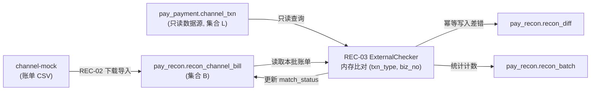
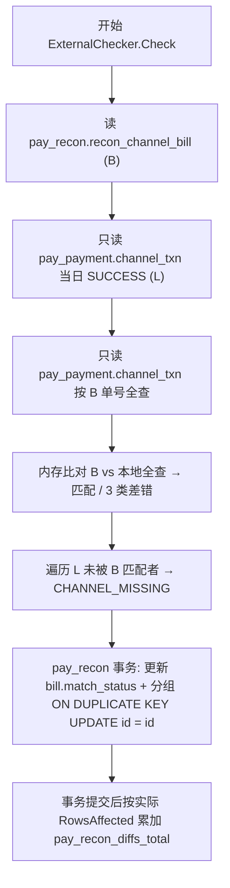

# REC-03 外部对账比对（按单号）

| 项 | 内容 |
|---|---|
| 功能点 | REC-03（P0，第 6 周） |
| 所属链路 | 对账 |
| 代码提交 | `9c0d738` `[REC-03] add external reconcile` |
| 分支 | `feat/REC-03-external-reconcile` |
| 日期 | 2026-11-16 |
| 状态 | DONE |

## 一句话结论

实现了外部对账比对器 `ExternalChecker` 并接入 `recon` 服务：以 `(txn_type, biz_no)` 为匹配键在内存中比对批次账单行（B）与 `pay_payment.channel_txn`（L 及按单号查询结果），精准识别长款、短款、金额不符、状态不符四类差错，并将 `recon_diff` 唯一键扩展至包含 `diff_type` 配合 `INSERT … ON DUPLICATE KEY UPDATE id = id` 实现同键跳过与外部/内部差错并存，单元测试与 MySQL 8.4.11 集成测试全部通过（`service/recon/biz` 覆盖率 79.4%）。

## 1. 背景

### 1.1 系统简介

> pay-system 是一个用 Go 编写的小型支付后端，模拟商户收款、退款、商户间转账三条资金链路，重点在数据一致性和性能。系统由 5 个部分组成：gateway（对外 HTTP 入口，负责签名校验和限流）、payment（支付单、退款单、转账单的状态管理和流程推进）、account（账户余额与记账，数据按商户分到 2 个数据库分片）、channel-mock（模拟微信、支付宝这类外部支付渠道）、recon（对账，核对系统内外数据是否一致）。服务之间用 Kitex RPC 同步调用，或通过 Kafka 消息异步通知；数据存在 MySQL 8.4，Redis 用于防重放。所有金额用整数“分”表示，所有记账只追加不修改。当前已完成：工程基础、账户与记账、支付/退款/转账三条资金链路、消息与通知、网关与可观测基线，以及模拟渠道与对账批次调度（REC-01）、账单下载导入（REC-02）。

### 1.2 本功能点在系统中的位置



上游由 REC-01 批次调度将状态推进到 `CHECKING`，并由 REC-02 完成账单导入；REC-03 在 `CHECKING` 阶段执行外部比对，为下游 REC-05（内部对账）、REC-06（自动处理）与 REC-08（对账报告）提供外部差错明细与双方统计数据。

### 1.3 为什么需要它

支付回调可能丢失、渠道可能漏记账单或篡改金额。例如：2026-10-26 某笔支付平台本地记录为 `10000` 分（100.00 元）且状态 `SUCCESS`，但渠道账单里该单金额为 `10001` 分（100.01 元）；另一笔平台未落库的交易出现在渠道账单上 `2000` 分（20.00 元）。如果不做外部对账比对，这些长款、短款、金额不符和状态不符会长期静默累积，无法触发后续自动查单补偿或人工核销。

## 2. 术语

| 术语 | 含义 |
|---|---|
| 外部对账 | 将平台记录的渠道交互流水（`channel_txn`）与渠道侧提供的日终账单（`recon_channel_bill`）逐笔核对的过程。 |
| 匹配键 `(txn_type, biz_no)` | 交易类型（`PAY` / `REFUND`）与平台业务单号（`pay_no` / `refund_no`）的组合，用来唯一关联同一笔渠道交易。 |
| 长款（`LOCAL_MISSING`） | 渠道账单有成功记录，但平台本地 `channel_txn` 没有对应记录。 |
| 短款（`CHANNEL_MISSING`） | 平台本地当日 `channel_txn` 状态为 `SUCCESS`，但渠道账单中没有这笔记录。 |
| 金额不符（`AMOUNT_MISMATCH`） | 双方都有记录且本地为 `SUCCESS`，但金额不一致。 |
| 状态不符（`STATUS_MISMATCH`） | 渠道账单有记录，但平台本地 `channel_txn` 状态不是 `SUCCESS`（如 `PROCESSING`）。 |
| 同键跳过 | 批次重跑或超时接管时，若 `recon_diff` 已保留同键差错（如已自动处理的记录），再次插入时不报错（1062）也不覆盖原行。 |

## 3. 技术讲解

### 3.1 要解决的问题

1. **四类外部差错完整识别**：对账单集合 B 的每一行按 `(txn_type, biz_no)` 查询本地 `channel_txn`（不限日期和状态），识别 `LOCAL_MISSING`、`STATUS_MISMATCH`、`AMOUNT_MISMATCH` 或匹配；对本地当日（东八区 `[D 00:00, D+1 00:00)`）`SUCCESS` 集合 L 中未在 B 出现的记录识别为 `CHANNEL_MISSING`。
2. **外部差错与内部差错并存**：同一笔支付（如 `PA_COEXIST_01`）可能同时存在金额不符（`AMOUNT_MISMATCH`）和缺少记账凭证（`LEDGER_MISSING`，REC-05）。原唯一键 `(batch_no, txn_type, biz_no)` 会导致第二条差错触发 1062 冲突，必须把 `diff_type` 纳入唯一键。
3. **重跑/接管幂等且不污染指标**：重跑或接管时已自动处理的差错会保留在 `recon_diff` 中；重新比对再次产生同键差错时不能报 1062，不能修改已有行的 `status`、`handle_action`、`handle_note`、`updated_at`，且 `pay_recon_diffs_total{diff_type}` 只能按实际新插入行数递增。
4. **服务边界隔离**：`recon` 不得 `import` `service/payment/...` 包，只能通过只读 DSN（`DSNPayPayment`）查询 `pay_payment.channel_txn`。

### 3.2 方案

核心流程分为三步：只读拉取双方数据 → 内存按 `(txn_type, biz_no)` 建索引比对 → 单事务更新 `recon_channel_bill.match_status` 并按 `diff_type` 分组幂等插入 `recon_diff`。



关键表结构变更（`migrations/recon/000003_diff_unique_key.up.sql`）将 `recon_diff` 唯一键替换为包含 `diff_type` 的四列组合键：

```sql
ALTER TABLE recon_diff
  DROP INDEX uk_batch_type_biz_no,
  ADD UNIQUE KEY uk_batch_type_biz_no_diff_type (batch_no, txn_type, biz_no, diff_type);
```

为让多行批量插入仍能按 `diff_type` 精确统计新插入行数以更新 Prometheus 指标，`service/recon/dal/diff.go` 按 `diff_type` 分组执行 `INSERT ... ON DUPLICATE KEY UPDATE id = id`：MySQL 对新插入行计 `RowsAffected = 1`，对命中唯一键且无列变更的空更新计 `0`：

```go
// service/recon/dal/diff.go
sb.WriteString(` ON DUPLICATE KEY UPDATE id = id`)
res, err := exec.ExecContext(ctx, sb.String(), args...)
if err != nil {
	return 0, fmt.Errorf("insert recon_diff (%d rows): %w", len(chunk), err)
}
n, err := res.RowsAffected()
```

### 3.3 为什么这样做

| 方案 | 做法 | 优点 | 缺点 | 结论 |
|---|---|---|---|---|
| 采用：`INSERT … ON DUPLICATE KEY UPDATE id = id` + 按 `diff_type` 分组 | 命中 `uk_batch_type_biz_no_diff_type` 时原地无操作更新 `id` | CHECK 约束等真实错误仍会报错；`RowsAffected` 精确返回每种 `diff_type` 的新增行数 | 需要按 `diff_type` 分组发 SQL（最多 4 组） | 采用 |
| 备选：`INSERT IGNORE` | 忽略插入时的唯一键冲突 | 写法简单 | 会把 `CHECK` 约束失败、非空列缺失等错误一并降级为警告，掩盖数据问题 | 不采用 |
| 备选：跨 schema `JOIN` | 在一条 SQL 中 `JOIN pay_recon.recon_channel_bill` 与 `pay_payment.channel_txn` | 减少一次网络往返 | 强耦合两个服务库实例，违背只读数据源隔离约束，也不利于后续扩展 | 不采用 |

### 3.4 正确性

| 场景 | 系统行为 | 最终状态 | 证明 |
|---|---|---|---|
| 同一批次重跑命中已有差错 | `ON DUPLICATE KEY UPDATE id = id` 跳过，返回 `RowsAffected = 0`，不累加 `pay_recon_diffs_total` | 原有行的 `status`、`handle_action`、`handle_note`、`updated_at` 保持不变，`diff_count` 为实际行数 | `TestExternalReconIntegrationSkipDuplicateDiff` |
| 同一交易同时存在外部与内部差错 | 唯一键包含 `diff_type`，`AMOUNT_MISMATCH` 与 `LEDGER_MISSING` 分别成行 | 两行共存，无 1062，`diff_count = 2` | `TestExternalReconIntegrationCoexistExternalAndInternalDiff` |
| 事务外只读失败或事务内写失败 | 只读查询在事务外完成；写入事务失败自动回滚，不触发指标累加，`runFromChecking` 按 `started_at` CAS 置批次 `FAILED` | 无半成品差错或错误指标 | 事务边界与 `runFromChecking` 既有机理 |
| 并发接管后旧运行延迟完成 | `runFromChecking` 提交 `DONE` 时 CAS 带原 `started_at`，影响 0 行并放弃 | 不覆盖接管者结果 | `TestRunBatchTakeoverOldRunDoesNotOverwrite`（REC-01） |

### 3.5 性能

不涉及（P0 按单渠道单日 ≤ 100 万笔假设在内存中建索引，无性能开关）。

## 4. 已完成内容

### 4.1 改动清单

| 文件 | 新增 / 修改 | 作用 |
|---|---|---|
| `migrations/recon/000003_diff_unique_key.up.sql` | 新增 | 将 `recon_diff` 唯一键替换为 `uk_batch_type_biz_no_diff_type` |
| `migrations/recon/000003_diff_unique_key.down.sql` | 新增 | 回滚唯一键为 `uk_batch_type_biz_no` |
| `service/recon/dal/diff.go` | 新增 | `ChannelTxn` 只读视图、账单状态批量更新与 `recon_diff` 同键跳过批量插入 |
| `service/recon/biz/external_recon.go` | 新增 | `ExternalChecker` 外部比对核心逻辑与指标累加 |
| `service/recon/biz/external_recon_test.go` | 新增 | 外部比对单元测试 |
| `service/recon/biz/external_recon_integration_test.go` | 新增 | 外部比对 MySQL 8.4.11 集成测试 |
| `pkg/obs/metrics.go` | 修改 | 导出 `AddReconDiff` 累加 `pay_recon_diffs_total` |
| `cmd/recon/main.go` | 修改 | 打开只读 `DSNPayPayment` 并将 `ExternalChecker` 接入 CLI 与服务 |
| `docs/02-requirements.md` | 修改 | 将 `REC-03` 置为 `DONE` 并勾选 4 条验收 |
| `docs/database.md` | 修改 | 更新 `recon_diff` 唯一键与变更记录 |

### 4.2 对外变化

| 类别 | 变化 |
|---|---|
| 接口 | 无 |
| 表结构 | `recon_diff` 唯一键由 `uk_batch_type_biz_no (batch_no, txn_type, biz_no)` 改为 `uk_batch_type_biz_no_diff_type (batch_no, txn_type, biz_no, diff_type)` |
| 配置项 | 无（复用已有 `DSNPayPayment` 只读装配） |
| 错误码 | 无 |
| 指标 / 故障点 | `pay_recon_diffs_total{diff_type}` 开始按实际新插入差错行数累加；无新故障点 |

### 4.3 验收对照

| 验收条目 | 测试函数 | 类型 | 结果 |
|---|---|---|---|
| 构造账单：四类外部差错（`LOCAL_MISSING`、`CHANNEL_MISSING`、`AMOUNT_MISMATCH`、`STATUS_MISMATCH`）各识别 1 条，其余全部匹配 | `TestExternalReconFourDiffTypes` / `TestExternalReconIntegrationFourDiffTypes` | 单元 / 集成 | 通过 |
| 全部正常的账单差错数为 0 | `TestExternalReconAllMatched` / `TestExternalReconIntegrationAllMatched` | 单元 / 集成 | 通过 |
| 外部差错与内部差错并存：同笔支付同时得到 `AMOUNT_MISMATCH` 与 `LEDGER_MISSING`，无 1062，`diff_count = 2` | `TestExternalReconIntegrationCoexistExternalAndInternalDiff` | 集成 | 通过 |
| 同键跳过：已有 IGNORED 的 `CHANNEL_MISSING` 重跑不报 1062，原有字段与 `updated_at` 不变，`pay_recon_diffs_total` 不增加，`diff_count` 等于实际行数 | `TestExternalReconIntegrationSkipDuplicateDiff` | 集成 | 通过 |

### 4.4 验证记录

| 命令 | 结果 |
|---|---|
| `gofmt -l .` | 通过（无输出） |
| `PATH="$PATH:$(go env GOPATH)/bin" make lint` | 通过（`0 issues.`） |
| `make test` | 通过（全部包 `-race` 通过） |
| `go test -race -tags integration -cover ./service/recon/... ./cmd/recon/... ./internal/dbmigrate/...` | 通过：`service/recon/biz` 79.4%、`service/recon/handler` 22.0%、`service/recon/job` 47.8%、`cmd/recon` 20.6%、`internal/dbmigrate` 76.9%（含 MySQL 8.4.11 上 `000003` 迁移 up/down） |

### 4.5 同步的文档

- `docs/02-requirements.md`：§3 `REC-03` 状态改为 `DONE`，§4 勾选 4 条验收并补充实现说明。
- `docs/database.md`：§4.15 删除旧键 `uk_batch_type_biz_no` 行并登记 `000003_diff_unique_key.up.sql`，§5 新增变更记录，§6 关闭对应计划变更。

## 5. 未完成与风险

- 本功能点无未完成项。后续 REC-05（内部对账）与 REC-06（自动处理）实现时，需在 `cmd/recon/main.go` 中将 `ExternalChecker` 与内部对账、自动处理组合为统一的 `Checker`（当前 `ExternalChecker` 已独立打通 CLI 与服务主流程）。

## 6. 如何复现

前置条件：Go 工具链、已启动的 Docker Desktop（用于拉起 MySQL 8.4.11 testcontainers）。

```bash
gofmt -l .
PATH="$PATH:$(go env GOPATH)/bin" make lint
make test
go test -race -tags integration -cover ./service/recon/... ./cmd/recon/... ./internal/dbmigrate/...
```

## 延伸阅读

- 需求规格：`docs/02-requirements.md` §4.10 `REC-03`
- 表结构文档：`docs/database.md` §4.15 `recon_diff`
- 流程图：`docs/06-flows.md` CF-27、CF-40

## 修订记录

| 日期 | 提交 | 修订内容 |
|---|---|---|
| 2026-11-16 | `9c0d738` | 初版报告 |
