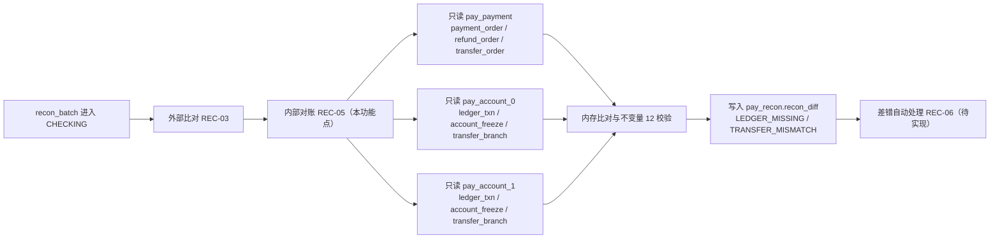

# REC-05 内部对账（支付、退款、转账）

| 项 | 内容 |
|---|---|
| 功能点 | REC-05（P0，第 6 周） |
| 所属链路 | 对账 |
| 代码提交 | `2b1c0e5` `[REC-05] add internal reconcile` |
| 分支 | `feat/REC-05-internal-reconcile` |
| 日期 | 2026-11-16 |
| 状态 | DONE |

## 一句话结论

实现了 `recon` 服务的内部对账能力：每日按账期分别从支付库（`pay_payment`）与两个账户分片库（`pay_account_0`、`pay_account_1`）只读拉取数据并在内存中比对，识别支付/退款掉单漏记账（`LEDGER_MISSING`）与转账分片状态/凭证不一致（`TRANSFER_MISMATCH`）；单测与基于真实 MySQL 8.4 的集成测试（`service/recon/biz` 覆盖率 81.6%）验证了两类差错的准确识别、正常交易 0 差错以及重跑同键跳过行为。

## 1. 背景

### 1.1 系统简介

> pay-system 是一个用 Go 编写的小型支付后端，模拟商户收款、退款、商户间转账三条资金链路，重点在数据一致性和性能。系统由 5 个部分组成：gateway（对外 HTTP 入口，负责签名校验和限流）、payment（支付单、退款单、转账单的状态管理和流程推进）、account（账户余额与记账，数据按商户分到 2 个数据库分片）、channel-mock（模拟微信、支付宝这类外部支付渠道）、recon（对账，核对系统内外数据是否一致）。服务之间用 Kitex RPC 同步调用，或通过 Kafka 消息异步通知；数据存在 MySQL 8.4，Redis 用于防重放。所有金额用整数“分”表示，所有记账只追加不修改。当前已完成：工程骨架、账户服务（含分片与余额核对）、模拟渠道（含故障注入与账单下载）、支付/退款/转账三条核心链路、Kafka 事件消费与死信重放、商户通知、网关路由与限流、链路追踪与指标、分阶段耗时埋点，以及对账批次调度（REC-01）、账单下载导入（REC-02）与外部对账比对（REC-03）。

### 1.2 本功能点在系统中的位置



上游由对账批次调度（REC-01）与外部比对（REC-03）推进批次进入 `CHECKING` 后触发；下游由差错自动处理（REC-06）消费 `LEDGER_MISSING` 进行事件重放，或由对账报告（REC-08）汇总展示 `TRANSFER_MISMATCH`。

### 1.3 为什么需要它

外部对账（REC-03）只核对“渠道账单”与“支付库渠道流水 `channel_txn`”，无法发现系统内部的记账漏洞。例如：一笔 10000 分（100.00 元）的支付单在 `payment_order` 中已是 `SUCCESS`，但因为本地消息表（`outbox`）事件丢失或消费者故障，商户所属账户分片里根本没有对应的 `PAY` 记账凭证（`ledger_txn`）——渠道侧和支付单看起来都“成功”了，商户账户却少了 100.00 元；或者一笔 5000 分（50.00 元）的跨分片转账单已是 `SUCCESS`，付款方分片扣了款（`TRANSFER_OUT`），收款方分片却缺失 `TRANSFER_IN` 凭证，导致 50.00 元卡在在途账户。内部对账每天兜底核对订单表与两个账户分片，把这类内部不一致暴露为 `LEDGER_MISSING` 或 `TRANSFER_MISMATCH` 差错。

## 2. 术语

| 术语 | 含义 |
|---|---|
| 内部对账 | 不看外部渠道账单，直接核对支付库业务单据（支付单、退款单、转账单）与账户分片记账凭证/冻结单/分支是否一致的过程。 |
| 记账凭证（`ledger_txn`） | 账户分片中一次复式记账的头记录，按 `(biz_type, biz_no)` 唯一约束，证明某笔业务已入账及入账金额。 |
| 账户分片（shard 0 / 1） | 账户库按商户号（`M` + 6 位数字）对 2 取模拆分的两个独立 MySQL 库（`pay_account_0`、`pay_account_1`）。 |
| 同分片 / 跨分片转账（LOCAL / TCC） | 付款方与收款方在同一分片时走本地单分片事务（`LOCAL`）；在不同分片时走两阶段冻结+分支确认（`TCC`）。 |
| 冻结单（`account_freeze`） | 跨分片转账时在付款方分片创建的资金冻结记录，终态为 `CONFIRMED`（确认扣款）或 `RELEASED`（释放/空回滚墓碑）。 |
| 转账分支（`transfer_branch`） | 跨分片转账时在收款方分片创建的 `PAYEE` 分支记录，终态为 `CONFIRMED`（确认入账）或 `CANCELLED`（取消/空回滚墓碑）。 |
| `LEDGER_MISSING` | 支付单或退款单为 `SUCCESS`，但对应账户分片缺失凭证或凭证金额不等于订单金额的差错类型。 |
| `TRANSFER_MISMATCH` | 终态转账单（`SUCCESS` 或 `FAILED`）违反不变量 12（凭证/冻结/分支状态与数量不符）的差错类型。 |
| `ON DUPLICATE KEY UPDATE id = id` | MySQL 幂等插入写法：唯一键冲突时执行无副作用赋值，使影响行数为 0 而不覆盖已有行，也不忽略其他约束错误。 |

## 3. 技术讲解

### 3.1 要解决的问题

1. **禁止跨库 JOIN**：`pay_payment`、`pay_account_0`、`pay_account_1` 模拟独立数据源，必须分别只读查询并在内存中完成比对（需求 REC-05 第 5 条）。
2. **覆盖三条资金链路**：
   - 支付单：D 日（东八区）`paid_at` 的 `SUCCESS` 支付单，商户分片必须有 `ledger_txn(PAY, pay_no)` 且金额相等。
   - 退款单：D 日 `succeeded_at` 的 `SUCCESS` 退款单，商户分片必须有 `ledger_txn(REFUND, refund_no)` 且金额相等。
   - 转账单：D 日 `finished_at` 的 `SUCCESS` / `FAILED` 转账单（挂在 `mockpay` 批次执行），满足不变量 12：
     - `SUCCESS + LOCAL`：付款方分片恰好 1 张 `TRANSFER` 凭证且金额相等，另一分片无转账凭证。
     - `SUCCESS + TCC`：付款方分片 `TRANSFER_OUT`、收款方分片 `TRANSFER_IN` 各 1 张且金额相等；付款方冻结单 `CONFIRMED`；收款方分支 `CONFIRMED`。
     - `FAILED`：两个分片均无该 `transfer_no` 的转账凭证；冻结单不存在或 `RELEASED`；收款方分支不存在或 `CANCELLED`。
3. **重跑幂等与差错并存**：同一笔交易可同时存在外部差错（如 `AMOUNT_MISMATCH`）与内部差错（如 `LEDGER_MISSING`）；批次重跑或超时接管时，已处理/保留的差错不能重复插入或被覆盖。

### 3.2 方案

核心思路是：`InternalChecker` 实现统一的 `Checker` 接口，通过 `CompositeChecker` 与 `ExternalChecker` 串联挂载到 `Recon` 批次执行器中。对账时先从 `pay_payment` 拉取 D 日终态单据，按商户分片分组后批量查询 `pay_account_0` 与 `pay_account_1`（`IN` 查询按 1000 条分片），在内存比对生成 `LEDGER_MISSING` 与 `TRANSFER_MISMATCH` 差错，最后通过 `InsertDiffsSkipDuplicate`（含 `handle_note`）幂等写入 `pay_recon.recon_diff`。

关键数据流与判定逻辑（`service/recon/biz/internal_recon.go`）：

```go
// checkPaymentsAndRefunds 按商户分片归组 biz_no，分别查询两个分片并在内存核对金额。
for _, it := range items {
	s, _ := shard.Of(it.merchantID)
	lt, ok := shardLedgers[s][ledgerKey{bizType: it.txnType, bizNo: it.bizNo}]
	if ok && lt.Amount == it.amount {
		continue
	}
	// 缺失或金额不等均生成 LEDGER_MISSING，金额不等时在 handle_note 注明双方金额。
}
```

`InsertDiffsSkipDuplicate`（`service/recon/dal/diff.go`）在唯一键 `(batch_no, txn_type, biz_no, diff_type)` 冲突时执行 `ON DUPLICATE KEY UPDATE id = id`，只有实际新增行（`RowsAffected == 1`）才计入 `pay_recon_diffs_total` 指标。

### 3.3 为什么这样做

| 方案 | 做法 | 优点 | 缺点 | 结论 |
|---|---|---|---|---|
| 采用：分库只读 + 内存索引比对 + `CompositeChecker` | 分别查询 3 个数据源，内存按 `(biz_type, biz_no)` 建索引比对，通过 `CompositeChecker` 组合外部与内部对账 | 严格遵守服务与数据源边界，不跨 schema JOIN；单测可用内存假实现覆盖全部分支 | 依赖单渠道单日订单量在内存可承受范围 | 采用 |
| 备选：跨 schema SQL JOIN | 在一条 SQL 中 `JOIN pay_payment.payment_order` 与 `pay_account_0/1.ledger_txn` | 少写内存映射代码 | 违反分库隔离原则（需求 REC-05 第 5 条），分库部署在独立实例时直接不可用 | 不采用 |

### 3.4 正确性

| 场景 | 系统行为 | 最终状态 | 证明 |
|---|---|---|---|
| 同一批次重跑（`force = true`）或接管 | `InsertDiffsSkipDuplicate` 按 `uk_batch_type_biz_no_diff_type` 执行 `ON DUPLICATE KEY UPDATE id = id` | 已有 `IGNORED`/`RESOLVED`/已处理 `PENDING` 差错保持原样，不报 1062，不重复累加 `pay_recon_diffs_total` | `TestInternalReconIntegrationMissingTransferIn` |
| 外部差错与内部差错并存 | 唯一键包含 `diff_type`，同一 `pay_no` 分别写入外部差错与 `LEDGER_MISSING` | 两条差错共存，`diff_count` 计 2 | `TestExternalReconIntegrationCoexistExternalAndInternalDiff` |
| 两个协程并发触发同一账期 | `Recon` 批次状态机 CAS 保证只有一个运行推进 `CHECKING → DONE`（REC-01）；差错写入受唯一键保护 | 差错无重复行 | REC-01 并发测试 + 唯一键约束 |
| 进程在内部对账写入前崩溃 | 批次停留在 `CHECKING`，30 分钟后由接管流程重跑 `ExternalChecker` + `InternalChecker` | 可完整恢复并生成内部差错 | REC-01 接管机制 |

### 3.5 性能

不涉及（REC-05 为 P0 基准实现，无性能开关与压测目标）。

## 4. 已完成内容

### 4.1 改动清单

| 文件 | 新增 / 修改 | 作用 |
|---|---|---|
| `service/recon/dal/internal.go` | 新增 | 只读查询 `pay_payment`（支付/退款/转账单）与 `pay_account_{0,1}`（凭证/冻结单/分支） |
| `service/recon/biz/internal_recon.go` | 新增 | 实现 `InternalChecker`（`LEDGER_MISSING`、`TRANSFER_MISMATCH`）与 `CompositeChecker` |
| `service/recon/biz/internal_recon_test.go` | 新增 | 单元测试：支付/退款凭证缺失与金额不等、转账不变量 12、非 `mockpay` 跳过转账 |
| `service/recon/biz/internal_recon_integration_test.go` | 新增 | MySQL 集成测试：模拟 outbox 丢失漏记账、缺 `TRANSFER_IN`、重跑同键跳过 |
| `service/recon/dal/diff.go` | 修改 | `InsertDiffsSkipDuplicate` 补充写入 `handle_note` 列 |
| `cmd/recon/main.go` | 修改 | 接入 `DSNPayAccount0`、`DSNPayAccount1` 与 `CompositeChecker(extChecker, intChecker)` |
| `docs/02-requirements.md` | 修改 | §3 将 `REC-05` 置为 `DONE`，§4 勾选验收并补充实现说明 |
| `docs/04-dev-plan.md` | 修改 | 勾选 `REC-05 内部对账（支付、退款、转账）` |

### 4.2 对外变化

| 类别 | 变化 |
|---|---|
| 接口 | 无 |
| 表结构 | 无（复用已有 `recon_diff` 表及 `uk_batch_type_biz_no_diff_type`） |
| 配置项 | 无（复用 BASE-09 已装配的 `DSNPayAccount0`、`DSNPayAccount1`） |
| 错误码 | 无 |
| 指标 / 故障点 | 复用 `pay_recon_diffs_total{diff_type}`（新增 `LEDGER_MISSING`、`TRANSFER_MISMATCH` 计数） |

### 4.3 验收对照

| 验收条目 | 测试函数 | 类型 | 结果 |
|---|---|---|---|
| 删除某笔支付对应的 outbox 事件并阻止入账后，对账识别为 `LEDGER_MISSING` | `TestInternalReconPaymentAndRefundLedgerMissing`、`TestInternalReconIntegrationPaymentOutboxDropped` | 单元 + 集成 | 通过 |
| 测试中删除一张 `TRANSFER_IN` 凭证（构造数据），对账识别为 `TRANSFER_MISMATCH`；正常转账差错数为 0 | `TestInternalReconTransferMismatch`、`TestInternalReconNonMockpaySkipsTransfer`、`TestInternalReconIntegrationMissingTransferIn` | 单元 + 集成 | 通过 |

### 4.4 验证记录

| 命令 | 结果 |
|---|---|
| `gofmt -l .` | 通过（无输出） |
| `PATH="$PATH:$(go env GOPATH)/bin" make lint` | 通过（`0 issues.`） |
| `make test` | 通过（全仓库单元测试 `go test -race ./...` 全部通过） |
| `go test -race -tags integration -cover ./service/recon/... ./cmd/recon/...` | 通过：`service/recon/biz` 21.683s 覆盖率 **81.6%**，`service/recon/handler` 22.0%，`service/recon/job` 47.8%，`cmd/recon` 17.1% |

### 4.5 同步的文档

- `docs/02-requirements.md`：§3 将 `REC-05` 状态由 `TODO` 更新为 `DONE`，§4 勾选两条验收条目并补充实现说明。
- `docs/04-dev-plan.md`：勾选 `- [x] REC-05 内部对账（支付、退款、转账）`。

## 5. 未完成与风险

- 内部差错 `LEDGER_MISSING` 的自动事件重放与复核（`REPLAY`）留待后续功能点 **REC-06** 实现；`TRANSFER_MISMATCH` 无自动处理，将在 **REC-08** 对账报告中输出。
- `cmd/recon/main.go` 接入 `DSNPayAccount0` / `DSNPayAccount1` 的真实进程启动依赖生产/compose 中 `svc_recon` 对 `pay_account_0`、`pay_account_1` 的只读授权（`InternalChecker` 已通过独立 MySQL schema 集成测试验证）。

## 6. 如何复现

前置条件：本机已安装 Go、Docker（用于 testcontainers 自动拉起 MySQL 8.4）以及 `golangci-lint`。

```bash
# 1. 代码格式与静态检查
gofmt -l .
PATH="$PATH:$(go env GOPATH)/bin" make lint

# 2. 单元测试
make test

# 3. 集成测试与覆盖率（含 REC-05 真实 MySQL 双分片验证）
go test -race -tags integration -cover ./service/recon/... ./cmd/recon/...
```

## 延伸阅读

- 需求基线：`docs/02-requirements.md` §4 `REC-05`、§2.5.3 不变量 12
- 数据库表结构：`docs/database.md` §4.2、§4.4、§4.5、§4.7–§4.9、§4.15
- 业务流程：`docs/06-flows.md` CF-28、CF-40

## 修订记录

| 日期 | 提交 | 修订内容 |
|---|---|---|
| 2026-11-16 | `2b1c0e5` | 初版报告 |
