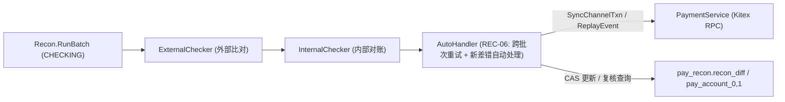
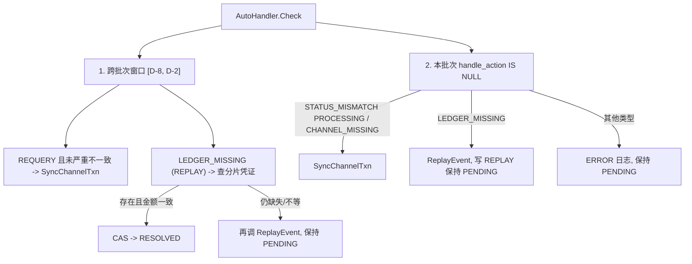

# REC-06 差错自动处理

| 项 | 内容 |
|---|---|
| 功能点 | REC-06（P0，第 6 周） |
| 所属链路 | 对账 |
| 代码提交 | `9bb68ab` `[REC-06] add recon diff auto handler` |
| 分支 | `feat/REC-06-auto-handle` |
| 日期 | 2026-11-16 |
| 状态 | DONE |

## 一句话结论

实现了对账差错自动处理与跨批次重试复核：对外部/内部比对新生成的差错及 `[D-8, D-2]` 窗口内的历史待处理差错，按差错类型分别调用 `PaymentService.SyncChannelTxn`（查单同步）或 `PaymentService.ReplayEvent`（事件重放），所有状态与处理动作均通过 `WHERE id = ? AND status = 'PENDING'` 原子更新（CAS），单元测试与 testcontainers MySQL 集成测试全部通过，`service/recon/biz` 覆盖率 78.4%。

## 1. 背景

### 1.1 系统简介

> pay-system 是一个用 Go 编写的小型支付后端，模拟商户收款、退款、商户间转账三条资金链路，重点在数据一致性和性能。系统由 5 个部分组成：gateway（对外 HTTP 入口，负责签名校验和限流）、payment（支付单、退款单、转账单的状态管理和流程推进）、account（账户余额与记账，数据按商户分到 2 个数据库分片）、channel-mock（模拟微信、支付宝这类外部支付渠道）、recon（对账，核对系统内外数据是否一致）。服务之间用 Kitex RPC 同步调用，或通过 Kafka 消息异步通知；数据存在 MySQL 8.4，Redis 用于防重放。所有金额用整数“分”表示，所有记账只追加不修改。当前已完成：工程基座、账户分片与账务操作、渠道模拟、支付/退款/转账全链路、outbox 与异步记账、外部与内部对账及支付状态同步接口。

### 1.2 本功能点在系统中的位置



上游是外部对账（`ExternalChecker`）与内部对账（`InternalChecker`），它们把本批次发现的差错写入 `pay_recon.recon_diff` 表；`AutoHandler` 在批次 `CHECKING` 收尾前运行，既处理本次新生成的差错，也对窗口内历史待处理差错进行重试或复核，完成后再由 `Recon` 将批次推进至 `DONE`。

### 1.3 为什么需要它

对账比对只是发现不一致，如果不自动推进修复，运维人员必须手工排查每条差错：
- 一笔 10000 分（100.00 元）的支付，渠道实际已成功，但回调丢失导致本地 `channel_txn` 仍为 `PROCESSING`，外部对账记为 `STATUS_MISMATCH`；若不自动调用同步接口，商户永远收不到入账。
- 一笔 5000 分（50.00 元）的支付订单已成功，但异步记账事件丢失或进了死信，内部对账记为 `LEDGER_MISSING`；若不重放事件并在下批次复核凭证，商户账户余额会少记 50.00 元。
- 如果渠道账单漏了一笔本地 `SUCCESS` 的交易（`CHANNEL_MISSING`），实际查单发现渠道侧为 `FAILED`，这就是严重资金不一致，必须立即告警并锁定不再盲目重试。

## 2. 术语

| 术语 | 含义 |
|---|---|
| `recon_diff` | 对账差错表，记录每笔不一致交易的 `diff_type`、`status`（`PENDING`/`RESOLVED`/`IGNORED`）与处理记录。 |
| CAS（Compare-And-Set） | 带前置条件的原子更新，如 `WHERE id = ? AND status = 'PENDING'`；影响行数为 0 说明已被其他并发任务修改或删除。 |
| `REQUERY` / `REPLAY` | 自动处理动作：`REQUERY` 表示调用 `SyncChannelTxn` 查单同步状态；`REPLAY` 表示调用 `ReplayEvent` 重放异步记账事件。 |
| 自动重试窗口 `[D-8, D-2]` | 以运行时注入时钟的东八区日期 `D` 为基准，跨批次自动重试和复核只处理 `bill_date` 落在 `D-8` 到 `D-2` 之间的历史差错。 |
| 严重不一致 | `CHANNEL_MISSING`（本地成功但渠道账单缺失）经查单后，渠道返回的不是 `SUCCESS`（如 `FAILED`），写入 `channel_status` 后停止自动重试，等待人工排查。 |

## 3. 技术讲解

### 3.1 要解决的问题

1. **分类自动处置**：可自动修复的差错（本地 `PROCESSING` 的 `STATUS_MISMATCH`、`CHANNEL_MISSING`、`LEDGER_MISSING`）自动调用 `PaymentService` 推进；不可自动修复的（`LOCAL_MISSING`、`AMOUNT_MISMATCH`、本地已终态的 `STATUS_MISMATCH`、`TRANSFER_MISMATCH`）保持 `PENDING` 并输出 `ERROR` 日志。
2. **失败可追踪、重跑不丢失**：RPC 调用失败或超时时，也必须写入 `handle_action`（`REQUERY` 或 `REPLAY`）和失败原因 `handle_note`，确保批次重跑或接管时不会被当作“未处理差错”删掉。
3. **跨批次有限窗口重试与复核**：历史未解决的 `REQUERY` 和 `REPLAY` 差错仅在 `[D-8, D-2]` 内由任意账期的对账批次顺带重试/复核；超出窗口停止重试，留待人工。
4. **并发与删除安全**：多实例并发触发或旧批次在接管后继续执行时，状态更新必须通过 CAS 保证幂等、不互相覆盖、不重建已删记录。
5. **服务边界隔离**：`recon` 禁止直接 import `service/payment`，只能通过 `kitex_gen/payment/paymentservice` RPC 与只读 DSN 交互。

### 3.2 方案

`AutoHandler` 实现 `Checker` 接口并作为 `CompositeChecker` 的最后一步执行。为避免同一批次新失败的差错在同一次运行里被立刻重复重试，`Check` **先执行跨批次窗口重试与复核（CF-41），再处理本批次新插入且 `handle_action IS NULL` 的差错（CF-29）**。



*图注：`AutoHandler` 先处理历史窗口差错，再处理本批次新差错，避免新失败记录在同一次运行中被重复触发外部 RPC。*

关键点说明：
1. **CAS 更新与零行重读**：`ResolveDiffCAS` 和 `UpdateDiffPendingCAS` 均以 `WHERE id = ? AND status = 'PENDING'` 为条件，且 `UpdateDiffPendingCAS` 使用 `channel_status = COALESCE(?, channel_status)`，避免覆盖 `STATUS_MISMATCH` 原有的渠道状态。若影响 0 行，调用 `GetDiffByID` 重读：读到说明已被其他运行处理，直接返回不覆盖；返回 `ErrNotFound` 说明行已被删除，记录 `WARN` 日志（含 `diff_no`、`batch_no`）后安全返回。
2. **严重不一致锁定**：`CHANNEL_MISSING` 插入时 `channel_status` 为空。查单成功且 `ChannelStatus != "SUCCESS"` 时，在 `UpdateDiffPendingCAS` 中同时写入 `handle_action = 'REQUERY'` 与 `channel_status = resp.ChannelStatus`，仅当 CAS 影响 1 行时输出 `ERROR` 日志并使指标 `pay_recon_channel_inconsistent_total{channel}` 加 1。后续窗口查询条件 `(diff_type <> 'CHANNEL_MISSING' OR channel_status IS NULL)` 会自动跳过该行。
3. **跨分片凭证复核**：`recheckLedgerMissingDiffs` 先按单号从 `pay_payment.payment_order` / `refund_order` 批量查出 `merchant_id` 和订单金额，再用 `shard.Of(merchantID)` 路由到 `pay_account_0` 或 `pay_account_1` 核对 `ledger_txn` 是否存在且金额相等。

下面是核心 CAS 零行处理逻辑（`service/recon/biz/auto_handle.go`）：

```go
func (h *AutoHandler) resolveWithCAS(ctx context.Context, d dal.Diff, status, action, note string) (bool, error) {
	now := h.now()
	won, err := h.store.ResolveDiffCAS(ctx, d.ID, status, action, handlerSystem, note, now, now)
	if err != nil {
		return false, err
	}
	if won {
		return true, nil
	}
	return false, h.handleCASMiss(ctx, d)
}
```

### 3.3 为什么这样做

| 方案 | 做法 | 优点 | 缺点 | 结论 |
|---|---|---|---|---|
| 采用：在 `CompositeChecker` 末尾先跑 CF-41 再跑 CF-29 | 复用 `Checker` 编排，按 `handle_action IS NULL` 区分本批次新差错 | 不改 `Recon` 主状态机，不引入独立后台轮询协程，新失败差错不在同次运行中重复打渠道 | 依赖批次运行驱动跨批次重试 | 采用 |
| 备选：先跑 CF-29 再跑 CF-41 | 先处理本批次新差错，再查窗口 `[D-8, D-2]` 重试 | 直观按时间先后 | 若当前批次在窗口内且刚调用失败/刚重放，CF-41 会在同一毫秒内再次调用 RPC | 不采用 |

### 3.4 正确性

| 场景 | 系统行为 | 最终状态 | 证明 |
|---|---|---|---|
| 同一请求重复/批次重跑 | `handle_action` 非空的差错在重跑时保留，CF-29 只查 `handle_action IS NULL`，不重复触发 | 原 `id` 不变，不重复记账或重放 | `TestAutoHandleIntegration_StatusMismatchAndForceRerun` |
| 两个运行并发置同一差错为终态 | 只有先提交的 CAS `WHERE id = ? AND status = 'PENDING'` 影响 1 行；另一方影响 0 行重读直接返回 | 保持先完成一方写入的 `RESOLVED` 与 `handle_note` | `TestAutoHandleConcurrentCAS`、`TestAutoHandleIntegration_ConcurrentCASAndDeletedRow` |
| 处理中差错被接管删除后旧运行到达 | CAS 影响 0 行，重读返回 `ErrNotFound`，记录 `WARN` 日志，不重试也不重插 | 表中无该已删记录，系统不报错 | `TestAutoHandleCASRowDeleted` |
| 下游 RPC 超时或失败 | `SyncChannelTxn` / `ReplayEvent` 超时（3s）后写 `handle_action` 与失败原因到 `handle_note`，不写 `channel_status` | 差错保持 `PENDING`，下一次窗口内运行自动重试 | `TestAutoHandleFailureWritesActionAndRecovers`、`TestAutoHandleLedgerMissingReplayFailureAndRetry` |

### 3.5 性能

不涉及（本功能点为业务一致性与自动补偿逻辑，非性能优化项）。

## 4. 已完成内容

### 4.1 改动清单

| 文件 | 新增 / 修改 | 作用 |
|---|---|---|
| `service/recon/biz/auto_handle.go` | 新增 | 实现 `AutoHandler` 与 `PaymentRPCClient` 适配器 |
| `service/recon/biz/auto_handle_test.go` | 新增 | 单元测试覆盖全部自动处理分支与边界 |
| `service/recon/biz/auto_handle_integration_test.go` | 新增 | MySQL 8.4.11 集成测试覆盖真实 SQL CAS 与跨批次窗口 |
| `pkg/obs/metrics.go` | 修改 | 导出 `AddReconChannelInconsistent(channel string)` |
| `service/recon/dal/diff.go` | 修改 | 新增差错查询与 CAS 更新函数 |
| `service/recon/dal/internal.go` | 修改 | 新增按单号批量查询支付/退款订单只读函数 |
| `cmd/recon/main.go` | 修改 | 接入 `paymentservice.Client`（`payment:8881`）与 `AutoHandler` |
| `docs/02-requirements.md` | 修改 | 更新 `REC-06` 状态为 `DONE`，勾选验收并补实现说明 |
| `docs/04-dev-plan.md` | 修改 | 勾选 `REC-06 自动处理` |

### 4.2 对外变化

| 类别 | 变化 |
|---|---|
| 接口 | 无（仅在内部调用已有的 `PaymentService.SyncChannelTxn` 与 `ReplayEvent`） |
| 表结构 | 无 |
| 配置项 | 无（沿用服务名固定端口 `payment:8881`） |
| 错误码 | 无 |
| 指标 / 故障点 | 导出已有注册指标 `pay_recon_channel_inconsistent_total{channel}` 的递增函数 |

### 4.3 验收对照

| 验收条目 | 测试函数 | 类型 | 结果 |
|---|---|---|---|
| 状态不符（本地 PAYING/PROCESSING）自动修复后，订单 SUCCESS 且商户入账 | `TestAutoHandleStatusMismatchProcessingResolved` / `TestAutoHandleIntegration_StatusMismatchAndForceRerun` | 单元 + 集成 | 通过 |
| `LEDGER_MISSING` 经重放后，下一次任意账期的对账运行（在窗口内）置为 RESOLVED | `TestAutoHandleLedgerMissingReplayFailureAndRetry` / `TestAutoHandleIntegration_LedgerMissingReplayAndRecheck` | 单元 + 集成 | 通过 |
| 自动处理失败也写 `handle_action`；force 重跑保留（`id` 不变）；恢复后下次运行置 RESOLVED | `TestAutoHandleFailureWritesActionAndRecovers` / `TestAutoHandleIntegration_StatusMismatchAndForceRerun` | 单元 + 集成 | 通过 |
| `ReplayEvent` 调用失败的 `LEDGER_MISSING` 写 `REPLAY` 保持 PENDING；复核仍缺失再重放；入账后置 RESOLVED | `TestAutoHandleLedgerMissingReplayFailureAndRetry` / `TestAutoHandleIntegration_LedgerMissingReplayAndRecheck` | 单元 + 集成 | 通过 |
| 自动重试窗口 `[D-8, D-2]`：仅 D-2、D-8 调用 `SyncChannelTxn`，D-1、D-9 不变；D-9 的 `LEDGER_MISSING` 不重放 | `TestAutoHandleRetryWindow` / `TestAutoHandleIntegration_RetryWindow` | 单元 + 集成 | 通过 |
| 严重不一致：`CHANNEL_MISSING` 查单返回 FAILED 写 `channel_status=FAILED`、ERROR 日志、指标 +1、不再重试；出错时仍为空且重试 | `TestAutoHandleChannelMissingInconsistentAndError` / `TestAutoHandleIntegration_ChannelMissingSevereInconsistent` | 单元 + 集成 | 通过 |
| CAS 读不到行：删除正在处理的 PENDING 差错后，CAS 影响 0 行，重读查不到，返回“已不存在”，WARN 日志 | `TestAutoHandleCASRowDeleted` / `TestAutoHandleIntegration_ConcurrentCASAndDeletedRow` | 单元 + 集成 | 通过 |
| 并发置为终态：两次并发仅一次影响 1 行，另一方重读返回终态且不覆盖 `handle_note` | `TestAutoHandleConcurrentCAS` / `TestAutoHandleIntegration_ConcurrentCASAndDeletedRow` | 单元 + 集成 | 通过 |

### 4.4 验证记录

运行环境：Linux + Docker Desktop（testcontainers `mysql:8.4.11`）。

| 命令 | 结果 |
|---|---|
| `gofmt -l .` | 通过（无输出） |
| `PATH="$PATH:$(go env GOPATH)/bin" make lint` | 通过（`0 issues.`） |
| `make test` | 通过（全仓库单元测试 `-race` 通过） |
| `go test -race -tags integration -cover ./service/recon/... ./cmd/recon/...` | 通过（`service/recon/biz` 78.4%，`handler` 22.0%，`job` 47.8%，`cmd/recon` 17.1%） |

### 4.5 同步的文档

- `docs/02-requirements.md`：§3 `REC-06` 状态更新为 `DONE`，§4 勾选全部 8 条验收并补充实现说明。
- `docs/04-dev-plan.md`：将 `REC-06 自动处理` 单独拆出并勾选 `[x]`。

## 5. 未完成与风险

- `cmd/recon/main.go` 中跨进程调用 `PaymentService`（`payment:8881`）的真实容器间联调将在 `QA-04` 验收运行覆盖；本次集成测试通过 fake `PaymentClient` 注入验证业务与 SQL 状态流转。

## 6. 如何复现

前置条件：本地安装 Go 1.24+，并启动 Docker（用于 testcontainers 拉起 MySQL 8.4.11）。

```bash
# 1. 运行格式与静态检查
gofmt -l .
PATH="$PATH:$(go env GOPATH)/bin" make lint

# 2. 运行全部单元测试（含竞态检测）
make test

# 3. 运行 recon 集成测试并查看覆盖率
go test -race -tags integration -cover ./service/recon/... ./cmd/recon/...
```

## 延伸阅读

- `docs/02-requirements.md` §4 `REC-06`
- `docs/06-flows.md` `SM-08`、`CF-29`、`CF-41`
- `docs/database.md` §4.15 `recon_diff`

## 修订记录

| 日期 | 提交 | 修订内容 |
|---|---|---|
| 2026-11-16 | `9bb68ab` | 初版报告 |
