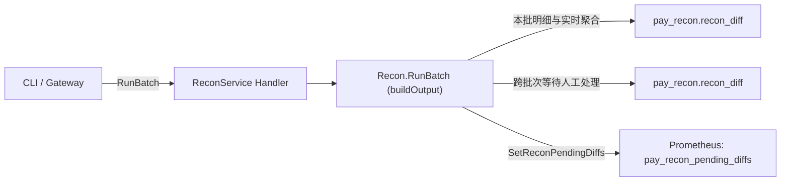
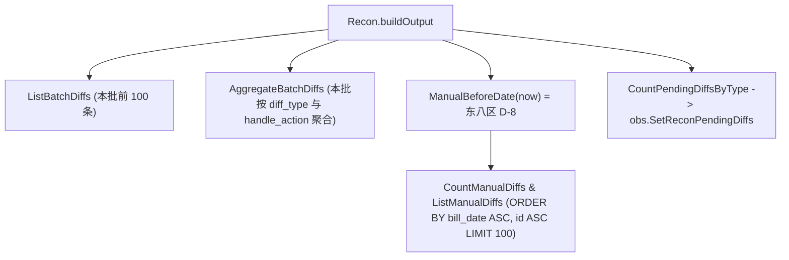

# REC-08 对账报告

| 项 | 内容 |
|---|---|
| 功能点 | REC-08（P0，第 6 周） |
| 所属链路 | 对账 |
| 代码提交 | `8565580` `[REC-08] add recon report and manual diffs` |
| 分支 | `feat/REC-08-recon-report` |
| 日期 | 2026-11-16 |
| 状态 | DONE |

## 一句话结论

实现了对账报告输出与“等待人工处理”列表查询：批次完成后实时返回 `recon_batch` 统计、按 `recon_diff` 实时聚合的各类差错数与自动处理数、本批前 100 条差错，以及跨批次筛选出的“等待人工处理”总数（`manual_total`）和按 `(bill_date ASC, id ASC)` 排序的前 100 条明细（`manual_diffs`），并按 `diff_type` 刷新 `pay_recon_pending_diffs` 指标；单元测试与 testcontainers MySQL 8.4 集成测试全部通过，`service/recon/biz` 覆盖率 **78.4%**。

## 1. 背景

### 1.1 系统简介

> pay-system 是一个用 Go 编写的小型支付后端，模拟商户收款、退款、商户间转账三条资金链路，重点在数据一致性和性能。系统由 5 个部分组成：gateway（对外 HTTP 入口，负责签名校验和限流）、payment（支付单、退款单、转账单的状态管理和流程推进）、account（账户余额与记账，数据按商户分到 2 个数据库分片）、channel-mock（模拟微信、支付宝这类外部支付渠道）、recon（对账，核对系统内外数据是否一致）。服务之间用 Kitex RPC 同步调用，或通过 Kafka 消息异步通知；数据存在 MySQL 8.4，Redis 用于防重放。所有金额用整数“分”表示，所有记账只追加不修改。当前已完成：工程基座、账户分片与账务操作、渠道模拟、支付/退款/转账全链路、outbox 与异步记账、对账批次调度、账单导入、外部与内部对账及差错自动处理。

### 1.2 本功能点在系统中的位置



*图注：`Recon.RunBatch` 在批次检查完成后（或查询已有批次时）通过 `buildOutput` 汇总本批次对账报告、实时聚合差错与跨批次“等待人工处理”列表，既输出给 CLI JSON，也通过 `ReconService.RunBatch` RPC 响应返回给上游。*

### 1.3 为什么需要它

- 对账比对和自动处理完成后，运营与运维需要一份完整、实时一致的汇总视图：例如某日账单共 3 笔合计 7500 分（75.00 元），本地系统共 3 笔合计 6000 分（60.00 元），匹配 1 笔、差错 3 条，其中 1 条已自动发起查单重试、2 条未处理；仅看 `recon_batch` 的总差错数无法分辨差错分布与自动处理进展。
- 历史批次中超过 `[D-8, D-2]` 自动重试窗口仍未解决的差错，以及被判定为严重不一致的漏单，自动处理已不再触碰它们；如果不单独把它们跨批次捞出来，这些差错会静默沉底、永远无人跟进。
- 本项目不单独提供差错列表查询接口与人工挂账接口，因此所有需要人工关注的信息必须在对账执行响应和 Prometheus 指标中一次性暴露清楚。

## 2. 术语

| 术语 | 含义 |
|---|---|
| `recon_batch` | 对账批次表，记录渠道、账期（`bill_date`）、状态与双方笔数/金额/匹配数/差错数。 |
| `recon_diff` | 对账差错表，记录每笔不一致交易的 `diff_type`、`status`（`PENDING`/`RESOLVED`/`IGNORED`）与处理记录。 |
| 自动重试窗口 `[D-8, D-2]` | 以运行时注入时钟的东八区日期 `D` 为基准，跨批次自动重试仅处理 `bill_date` 落在 `D-8` 到 `D-2` 之间的历史差错。 |
| 等待人工处理（`manual_diffs`） | 自动处理已停止、只能由人工排查的跨批次 `PENDING` 差错：包括 `bill_date < D-8` 且 `handle_action IS NOT NULL` 的差错，以及 `channel_status` 非空的 `CHANNEL_MISSING`。 |
| 严重不一致 | 本地成功但渠道账单缺失（`CHANNEL_MISSING`），经查单确认渠道返回非 `SUCCESS`（如 `FAILED`），写入 `channel_status` 后停止自动重试。 |
| Gauge 指标 | 可增可减的瞬时值指标；`pay_recon_pending_diffs{diff_type}` 反映当前库中各类型 `PENDING` 差错的实际数量。 |

## 3. 技术讲解

### 3.1 要解决的问题

1. **汇总数据实时一致**：`RunBatchOutput` 除返回 `recon_batch` 统计与本批前 100 条 `diffs` 外，还需按 `recon_diff` 实时聚合本批次各 `diff_type` 数量及 `handle_action IS NOT NULL` 的自动处理数（不按支付/退款分列）。
2. **精确筛选“等待人工处理”**：必须跨批次实时查询 `status = 'PENDING'` 的记录，满足 `(handle_action IS NOT NULL AND bill_date < D-8) OR (diff_type = 'CHANNEL_MISSING' AND channel_status IS NOT NULL)`；`handle_action` 为空（如从未自动处理的 `LOCAL_MISSING`）或仍在 `[D-8, D-2]` 重试窗口内且无 `channel_status` 的差错不得混入。
3. **确定性排序与截断**：`manual_total` 返回符合条件的总条数，`manual_diffs` 按 `bill_date` 升序、同一 `bill_date` 内按自增主键 `id` 升序排列后取前 100 条，保证最老的差错优先暴露。
4. **向后兼容 IDL 演进**：在 `idl/recon.thrift` 的 `RunBatchResponse` 上追加 `optional` 字段 `manual_total` 与 `manual_diffs`，不破坏已有调用方。
5. **Prometheus Gauge 准确归零**：当某类 `PENDING` 差错全部被解决后，`GROUP BY diff_type` 查询不再返回该类型行，必须将该类型的 `pay_recon_pending_diffs` 显式置 `0`。

### 3.2 方案

在 `Recon.buildOutput` 中统一完成报告组装：先查询本批次前 100 条差错并实时聚合本批次各类型与自动处理数，再以注入时钟的东八区日期计算 `D-8` 边界并查询 `manual_total` 与 `manual_diffs`，最后查询全表 `PENDING` 分布并刷新 `pay_recon_pending_diffs`。



*图注：`buildOutput` 的四步只读聚合与指标刷新逻辑，既服务于新完成批次，也服务于重复查询已 `DONE` 批次。*

在 `service/recon/dal/diff.go` 中，“等待人工处理”的筛选条件封装为共享常量 `manualDiffWhereClause`，同时用于 `CountManualDiffs` 与 `ListManualDiffs`，确保总数与列表口径一致：

```go
// service/recon/dal/diff.go：CountManualDiffs 与 ListManualDiffs 共用的跨批次筛选条件与排序截断
const manualDiffWhereClause = `status = 'PENDING'
  AND ((handle_action IS NOT NULL AND bill_date < ?)
       OR (diff_type = 'CHANNEL_MISSING' AND channel_status IS NOT NULL))`
```

在 `pkg/obs/metrics.go` 中，`SetReconPendingDiffs` 先遍历已知的 6 种 `diff_type` 常量写入实际值或 `0`，再处理其他标签，保证已清零的差错类型不会残留在旧数值上：

```go
// pkg/obs/metrics.go：按全部已知 diff_type 刷新 gauge，缺失项显式置 0
func SetReconPendingDiffs(counts map[string]int64) {
	seen := make(map[string]struct{}, len(knownReconDiffTypes)+len(counts))
	for _, dt := range knownReconDiffTypes {
		seen[dt] = struct{}{}
		reconPending.WithLabelValues(dt).Set(float64(counts[dt]))
	}
	for dt, c := range counts {
		if _, ok := seen[dt]; !ok {
			reconPending.WithLabelValues(label(dt)).Set(float64(c))
		}
	}
}
```

### 3.3 为什么这样做

| 方案 | 做法 | 优点 | 缺点 | 结论 |
|---|---|---|---|---|
| 采用：在 `buildOutput` 中实时聚合与查询 | 每次生成报告时对 `recon_diff` 执行只读聚合和 `ORDER BY bill_date ASC, id ASC LIMIT 100` | 口径与跨批次自动处理状态始终实时一致，无需维护冗余汇总字段；`idx_status_bill_date` 索引可直接服务 `status = 'PENDING'` 过滤 | 每次调用 `RunBatch` 多 4 条轻量只读查询 | 采用 |
| 备选：在 `recon_batch` 冗余各类型计数与人工列表 | 每次写入或自动解决差错时同步更新 `recon_batch` 冗余列 | 读取时少一次聚合查询 | 跨批次重试会修改旧批次差错状态，极易导致冗余计数与明细漂移 | 不采用，数据一致性风险高 |

### 3.4 正确性

本功能点属于只读聚合与报告输出，不直接发起资金变更或状态流转；其并发与边界正确性如下：

| 场景 | 系统行为 | 最终状态 | 证明 |
|---|---|---|---|
| 同一账期已完成且未带 `force` 重复请求 | 直接走 `buildOutput`，实时重新聚合与刷新 gauge（`Set` 幂等） | 数据库无写入，返回最新统计与人工列表 | `TestReconReportCountsAndAmounts` |
| 窗口内外与 `channel_status` 混合存在 | 按 `manualDiffWhereClause` 精准命中 `D-9 REQUERY` 与 `D-3 CHANNEL_MISSING(channel_status=FAILED)`，排除窗口内无 `channel_status` 及无 `handle_action` 的差错 | `manual_total = 2`，依次返回 D-9、D-3 | `TestReconReportManualDiffsFilterAndOrder` |
| 超过 100 条且存在同 `bill_date` | 总数返回 `101`，列表按 `(bill_date ASC, id ASC)` 取前 100 条并截掉最后一条 | `manual_total = 101`，`len(manual_diffs) = 100` | `TestReconReportManualDiffsSortAndTruncate` |
| `PENDING` 差错被解决后刷新指标 | `SetReconPendingDiffs` 将未出现在查询结果中的 `diff_type` 置为 `0` | `pay_recon_pending_diffs` 与库中实际分布一致 | `TestSetReconPendingDiffsResetsZero` |

### 3.5 性能

不涉及（REC-08 为管理查询与报告输出，无性能开关与压测基线对比要求）。

## 4. 已完成内容

### 4.1 改动清单

| 文件 | 新增 / 修改 | 作用 |
|---|---|---|
| `idl/recon.thrift` | 修改 | `RunBatchResponse` 追加 `optional i32 manual_total` 与 `optional list<ReconDiff> manual_diffs` |
| `kitex_gen/recon/recon.go`, `kitex_gen/recon/k-recon.go` | 修改 | `make gen` 重新生成的 Thrift 编解码代码 |
| `pkg/obs/metrics.go` | 修改 | 新增 `SetReconPendingDiffs` 刷新 `pay_recon_pending_diffs` gauge |
| `service/recon/dal/diff.go` | 修改 | 新增 `AggregateBatchDiffs`、`CountManualDiffs`、`ListManualDiffs`、`CountPendingDiffsByType` |
| `service/recon/biz/batch.go` | 修改 | 扩展 `RunBatchOutput`，导出 `ManualBeforeDate`，在 `buildOutput` 中组装报告与刷新指标 |
| `service/recon/handler/handler.go` | 修改 | `RunBatch` RPC 响应填充 `ManualTotal`、`ManualDiffs` |
| `service/recon/biz/report_test.go` | 新增 | 单元测试：`ManualBeforeDate` 与 `SetReconPendingDiffs` 归零行为 |
| `service/recon/biz/report_integration_test.go` | 新增 | 集成测试：覆盖 REC-08 全部 3 条验收标准 |
| `service/recon/handler/handler_test.go` | 修改 | 补充 `ManualTotal`、`ManualDiffs` 的 RPC 响应映射断言 |
| `docs/02-requirements.md`, `docs/04-dev-plan.md`, `docs/05-api.md` | 修改 | 同步 `REC-08` 状态为 `DONE`、勾选验收条目与开发计划、更新 IDL 字段说明 |

### 4.2 对外变化

| 类别 | 变化 |
|---|---|
| 接口 | `ReconService.RunBatch` 的 `RunBatchResponse` 新增可选字段 `3: optional i32 manual_total`、`4: optional list<ReconDiff> manual_diffs`（向后兼容） |
| 表结构 | 无 |
| 配置项 | 无 |
| 错误码 | 无 |
| 指标 / 故障点 | `pay_recon_pending_diffs{diff_type}` gauge 开始按 `recon_diff` 实际 `PENDING` 数量实时刷新；无新故障点 |

### 4.3 验收对照

| 验收条目 | 测试函数 | 类型 | 结果 |
|---|---|---|---|
| 报告中的笔数和金额与账单、本地数据的手工统计一致 | `TestReconReportCountsAndAmounts`、`TestManualBeforeDate`、`TestSetReconPendingDiffsResetsZero`、`TestHandlerRunBatchValidationAndConversion` | 集成 + 单元 | 通过 |
| “等待人工处理”：构造 `bill_date` 为 D−9、`handle_action = REQUERY` 的 PENDING 差错，D−3、`channel_status = FAILED` 的 `CHANNEL_MISSING`，D−3 窗口内 `handle_action = REQUERY`、`channel_status` 为空的差错，以及 D−9、`handle_action` 为空的 `LOCAL_MISSING`，恰好列出前两条且 `manual_total = 2` | `TestReconReportManualDiffsFilterAndOrder` | 集成 | 通过 |
| “等待人工处理”的排序与截断：构造 101 条符合条件的差错（其中 3 条 `bill_date` 相同），`manual_total = 101`、`manual_diffs` 有 100 条，按 `bill_date` 升序、同一 `bill_date` 内按 `id` 升序，被截掉的是最后一条 | `TestReconReportManualDiffsSortAndTruncate` | 集成 | 通过 |

### 4.4 验证记录

运行环境：本地 Linux + Docker Desktop testcontainers（MySQL 8.4）。

| 命令 | 结果 |
|---|---|
| `gofmt -l .` | 通过（无输出） |
| `PATH="$PATH:$(go env GOPATH)/bin" make lint` | 通过（`0 issues.`） |
| `make test`（`go test -race ./...`） | 通过（全量单元测试通过） |
| `go test -race -tags integration -cover ./service/recon/... ./cmd/recon/...` | 通过（`service/recon/biz` 耗时 `28.963s`，覆盖率 **78.4%**，≥ 70%） |
| `make gen` | 通过（`Code Generation is Done!`） |

## 5. 延伸阅读

- 需求规格：`docs/02-requirements.md`（§4.10 `REC-08`）
- 接口契约：`docs/05-api.md`（§8.2、§10.3）
- 流程控制图：`docs/06-flows.md`（`CF-40`）
- 数据表结构：`docs/database.md`（§4.13 `recon_batch`、§4.15 `recon_diff`）
