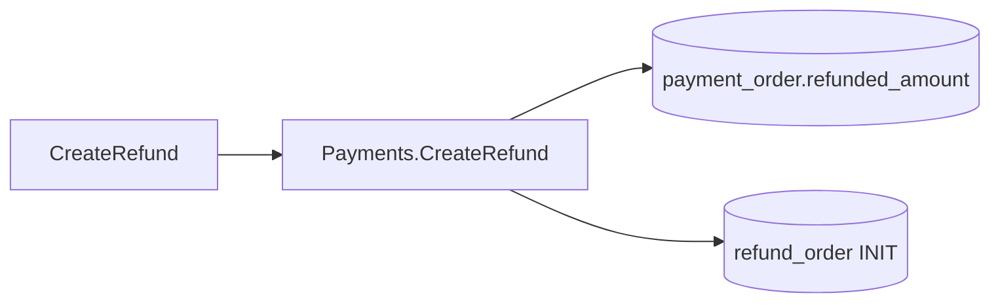
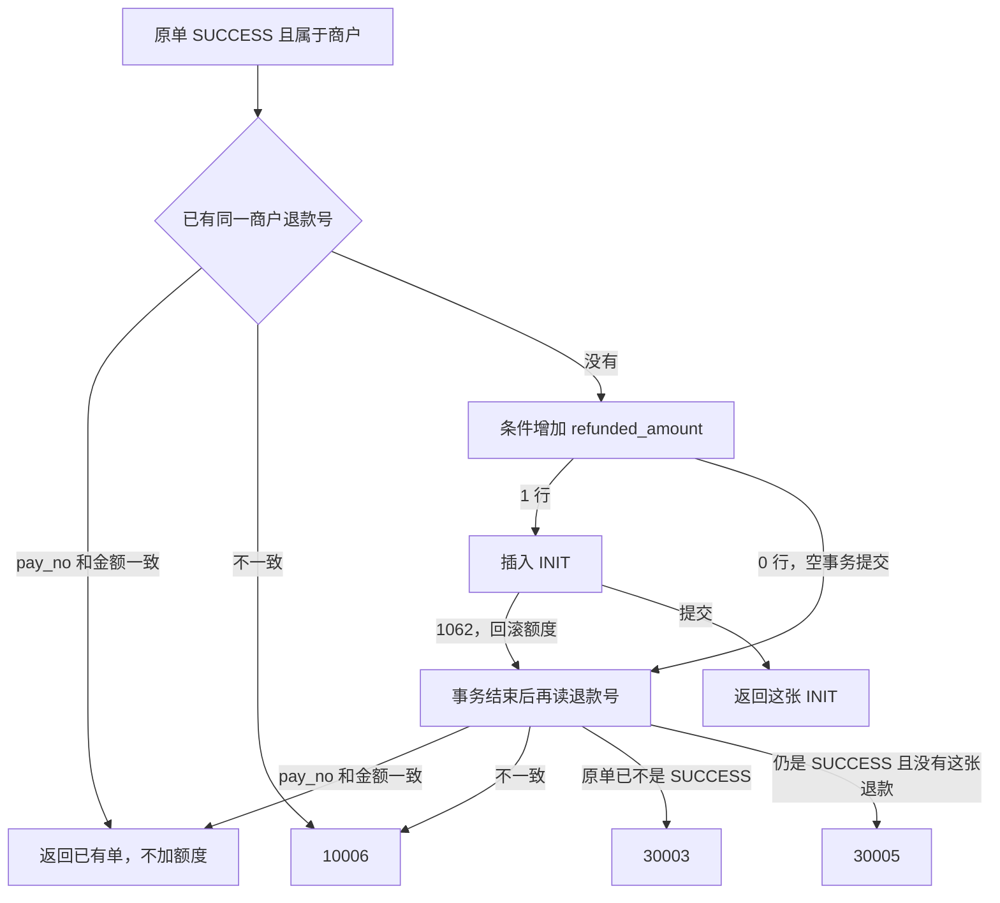

# REF-01 创建退款与额度占用

| 项 | 内容 |
|---|---|
| 功能点 | REF-01（P0，第 4 周） |
| 所属链路 | 退款 |
| 代码提交 | `e920750` `[REF-01] add create refund`（完整 `e92075078cab7505876a46ed6f99f4fb5990993d`，2026-11-03 16:07:53 +0800） |
| 分支 | `feat/REF-01-create-refund` |
| 日期 | 2026-11-03 |
| 状态 | DONE |

这次代码提交 15 个文件，983 行新增，18 行删除。本报告不在这 15 个文件里。

## 一句话结论

`CreateRefund` 在一个 MySQL 事务里给原支付单加上本次退款金额，并插入一条状态为 `INIT` 的退款单。订单 10000 分（100.00 元）时，10 个并发请求各退 3000 分（30.00 元），恰好 3 笔成功，其余返回已有错误码 30005，`refunded_amount` 停在 9000 分（90.00 元）。同一商户退款号再请求返回同一个 `refund_no`，额度不加。本切片不冻结余额，也不把退款交给渠道。

## 1. 背景

这次只占用退款额度并留下一张尚未冻结的退款单。商户余额、渠道受理和网关路由都还没接上。

### 1.1 系统简介

pay-system 是一个用 Go 编写的小型支付后端，模拟商户收款、退款、商户间转账三条资金链路，重点在数据一致性和性能。系统由 5 个部分组成：gateway（对外 HTTP 入口，负责签名校验和限流）、payment（支付单、退款单、转账单的状态管理和流程推进）、account（账户余额与记账，数据按商户分到 2 个数据库分片）、channel-mock（模拟微信、支付宝这类外部支付渠道）、recon（对账，核对系统内外数据是否一致）。服务之间用 Kitex RPC 同步调用，或通过 Kafka 消息异步通知；数据存在 MySQL 8.4，Redis 用于防重放。所有金额用整数“分”表示，所有记账只追加不修改。

这里的“记账”只指账户分录：写下之后不改。本切片不写分录，只把支付单上的累计数字 `refunded_amount` 加大。Redis 防重放也不参与这一步；同一个商户退款号靠 `refund_order` 上的唯一索引挡住。

下文里，REF 是平台退款，PAY 是支付单，CH 是模拟渠道，ACC 是账户，GW 是网关。10001 是参数不合法，10003 是内部错误，10004 是暂时不可用，10006 是同一个幂等键但关键字段不一致，30001 是订单不存在或不属于当前商户，30003 是订单状态不允许这次操作，30005 是累计退款超过订单金额。这些都是已有错误码，这次没有新码。`INIT` 表示退款单已写下，资金还没冻结，渠道也还没收到。

当前已完成：工程骨架、本地环境、迁移与种子、金额、ID、错误码、时钟、配置、日志、数据库访问、集成测试基座、IDL、签名、密钥加密、故障注入点；账户分片、开户、查询、记账、冻结、解冻、确认扣款、同分片转账、收款方分支、余额核对、account RPC；商户费率；payment 的创建支付单、发起支付、结果推进、关单、查询；outbox 写入；模拟渠道的支付受理、查单、关单、异步回调、渠道侧退款受理，以及已实现的渠道场景；网关骨架、商户验签、支付与余额路由、渠道回调入口；健康检查、pprof、paycli。本次是平台侧创建退款单并占用额度。

仍未做：同一请求里的冻结和渠道提交（REF-02）、退款结果推进（REF-03）、卡单恢复（REF-04）、退款查询（REF-05，`QueryRefund` 仍返回 10003）、转账主链路、网关的退款与转账路由（GW-09）、查单补偿（PAY-05）、超时关单（PAY-07）。第 4 周交付段落（A4、退款与转账主链路、TRF-03 并发、payment 覆盖率门槛的那次交付演示）这次没有跑。paycli 这次没有用来调退款。

### 1.2 本功能点在系统中的位置

请求停在 payment 的 `payment_order` 和 `refund_order`。它不写账户余额，也不写 channel-mock 的 `mock_txn`。



上游是以后的网关 `POST /v1/refunds`（GW-09，这次没有路由）。下游是 REF-02：拿这张 `INIT` 单去冻结商户余额，再交给渠道。

### 1.3 为什么需要它

一笔 10000 分（100.00 元）的成功支付，如果每个退款请求都先读出“已退 0”，再各自加上 3000 分，10 个请求都会通过，累计变成 30000 分（300.00 元）。额度必须在写行时用条件挡住。同一商户退款号重试也不能再占一次额度，否则商户超时重试会把同一笔退款算两次。

## 2. 术语

| 术语 | 含义 |
|---|---|
| 分 | 金额的整数单位。100 分是 1.00 元。代码里是 `int64`，不用浮点数。 |
| `payment_order` | 支付单。`amount` 是订单金额，`refunded_amount` 是已经占用的退款额，`status` 为 `SUCCESS` 才允许退。 |
| `pay_no` | 平台支付单号。创建退款时用来指定要退哪一张支付单。 |
| `out_trade_no` | 商户自己的支付单号。和 `pay_no` 只能填一个：两个都填，或两个都不填，都是参数错误。 |
| `refund_order` | 平台退款单。这次只插入 `INIT`。 |
| `refund_no` | 平台退款单号，前缀 `RF`。 |
| `out_refund_no` | 商户自己的退款号。和商户号一起作为幂等键。 |
| 幂等键 | 重复请求用来找到上一次结果的键。这里是 `(merchant_id, out_refund_no)`。 |
| 条件更新 | `UPDATE ... WHERE 剩余额度还够`。不够则影响 0 行，不靠先查再改。 |
| `version` | 支付单上的计数。每次成功改这张单就加 1，以后别的更新可以凭它发现“行已经变过”。本切片挡住超额的是金额条件，所以 `version` 只写在 `SET` 里，不写进 `WHERE`。 |
| CAS | 用“当前状态必须是某个值”做更新条件。本切片不改支付单状态，退款单是新插入的 `INIT`。 |
| 1062 | MySQL 唯一键冲突的错误号。`refund_order` 上 `uk_merchant_out_refund_no` 的列是 `(merchant_id, out_refund_no)`，`uk_refund_no` 的列是 `refund_no`。两个请求插入同一个商户退款号时，撞上的是前一个。 |
| READ COMMITTED | 本仓库事务的隔离级别。每一条语句只看见自己开始时已经提交的数据。`dbx.WithTx` 用这个级别开事务。 |
| 空事务 | 更新影响 0 行时，事务里没有插入，提交后数据库和开始前一样。 |
| outbox | 和业务写在同一事务里、提交后再发出的消息。这次不写。 |
| biz_code | RPC 成功响应里的业务码。成功是 0，并带上退款单。失败走另一条错误，不带退款单。 |

## 3. 技术讲解

### 3.1 要解决的问题

- 累计退款不能超过原订单金额。来源是一笔支付只能退到它收到的钱。
- 同一个 `(merchant_id, out_refund_no)` 再请求不能再占额度。来源是商户超时重试。
- 同一键但金额或原支付单不同，必须拒绝，不能返回别人的退款单。
- 原支付不是 `SUCCESS`，或者不属于当前商户，不能写出退款单。
- 进程在事务中途崩溃，额度不能留下一半。
- 本切片不冻结、不调渠道。冻结失败或渠道超时留给 REF-02，避免在额度事务里调用外部系统。

### 3.2 方案

先确认原支付属于当前商户且状态是 `SUCCESS`。再按 `(merchant_id, out_refund_no)` 读已有退款：`pay_no` 和金额都一致就直接返回，额度不动；任一不同就返回 10006。

没有已有行时才发 `RF` 单号，把原支付的渠道和币种抄到新行上。然后开一个只访问 payment 库的事务：

```sql
UPDATE payment_order
   SET refunded_amount = refunded_amount + ?, version = version + 1, updated_at = ?
 WHERE pay_no = ? AND merchant_id = ? AND status = 'SUCCESS'
   AND refunded_amount + ? <= amount
```

`updated_at` 写成注入的时钟，避免 MySQL 用自己的当前时间改这一列。`WHERE` 不含 `version`，因为超额与否已经由 `refunded_amount + ? <= amount` 决定。影响 0 行就不插入。影响 1 行才插入 `refund_order`，状态固定 `INIT`，不写失败原因和成功时间。

事务由 `dbx.WithTx` 打开，隔离级别是 READ COMMITTED。影响 0 行时，事务函数返回 nil，空事务马上提交，这个事务里没有再查退款单。插入若得到 1062，事务函数把这个错误交回去。1062 不会自己把 InnoDB 事务停掉；只有函数返回错误，`WithTx` 才会回滚，刚才加的额度才一起撤销。

这两种结局都在事务结束之后，用一条新的查询读 `(merchant_id, out_refund_no)`。事务已经结束，这条查询能看见另一笔刚提交的相同商户退款号。读到且 `pay_no`、金额一致，返回那张已有单；不一致返回 10006；还是没有，再读支付单：不是 `SUCCESS` 返回 30003，仍是 `SUCCESS` 返回 30005。

发号时时钟回拨超过 5 毫秒，返回 10004，不进入这个事务。抄过来的 `channel` 是空字符串，或内部依赖缺失，返回 10003，不插入。成功时 RPC 的 `biz_code` 为 0，响应里是这张 `INIT` 单。30001、30003、30005、10006、10001 走错误返回，不带退款单。



### 3.3 为什么这样做

| 方案 | 做法 | 优点 | 缺点 | 结论 |
|---|---|---|---|---|
| 采用：条件更新和插入放在同一事务 | 额度不够则 0 行，不插入；唯一键冲突则整笔回滚。事务结束后再读商户退款号 | 崩溃时额度和退款单一起在或一起不在 | 0 行和 1062 都要在事务结束之后再读一次 | 采用 |
| 备选：先读剩余额度再更新 | 应用里算 `已退 + 本次 <= 总额` | 代码直观 | 两个请求都读到旧值，都会通过，一笔 100.00 元可以被退多次 | 不采用 |
| 备选：先锁支付单再在程序里比较 | `SELECT ... FOR UPDATE` 锁住支付单，读出 `refunded_amount` 后再决定插不插入 | 锁一直握到提交，判断也对 | 判断和写入分成两条语句，漏掉锁就会超退；本切片用一条 `UPDATE` 的 `WHERE` 同时完成加锁和额度判断 | 不采用 |

### 3.4 正确性

| 场景 | 系统行为 | 最终状态 | 证明 |
|---|---|---|---|
| 同一请求重复到达 | 第二次读到已有行，`pay_no` 和金额一致，不再更新 | 一行 `INIT`，`refunded_amount` 只加一次 | `TestCreateRefundIdempotent`、`TestCreateRefundIdempotentMySQL` |
| 同一键但金额或原支付单不同 | 返回 10006，不更新 | 原额度不变，不新增行 | 同上两个测试 |
| 10 个不同退款号各退 3000 分，订单 10000 分 | 条件更新只让 3 笔通过，其余 30005 | `refunded_amount` = 9000，3 行 `INIT` | `TestCreateRefundConcurrentQuota`、`TestCreateRefundConcurrentMySQL` |
| 先退 6000 再退 5000 | 第二笔 30005 | 额度仍是 6000 | `TestCreateRefundQuota`、`TestCreateRefundQuotaMySQL` |
| 另一张金额也是 10000 分的成功支付，先退 6000 分再退 4000 分 | 两笔都成功 | 该单 `refunded_amount` = 10000 | 同上 |
| 原单是 `PAYING` 或其他非 `SUCCESS` | 写之前返回 30003 | 没有退款行，额度不变 | `TestCreateRefundRejectsPaying`、`TestCreateRefundPayingMySQL` |
| 他人商户或不存在 | 30001 | 不写 | `TestCreateRefundOtherMerchant` |
| `pay_no` 与 `out_trade_no` 都填或都不填；金额为 0（小于最小 1 分）；`out_refund_no` 为空、长于 64，或含字母、数字、下划线、连字符以外的字符；原因不是合法 UTF-8，或超过 255 个 Unicode 码点 | 10001 | 不写 | `TestCreateRefundKeyChoice` |
| 原支付的 `channel` 是空字符串 | 发号之后返回 10003 | 不插入，额度不变 | `TestCreateRefundEmptyChannel` |
| 发号时时钟回拨 | 返回 10004 | 不进入事务 | `TestCreateRefundClockRollback` |
| 事务提交前进程崩溃 | 更新和插入在同一事务，回滚后两者都不留 | 可以原样重试 | 由 `dbx.WithTx` 的回滚保证。没有单独的杀进程测试 |
| 事务提交后调用方没拿到响应 | 同一 `out_refund_no` 再请求走幂等读 | 仍是一行，额度不加 | 顺序重放测试。没有单独的“两个相同退款号并发”测试 |
| 下游超时 | 本切片不调用账户和渠道 | 没有外部结果要记成未知 | 不涉及。冻结超时是 REF-02 |

两个相同 `out_refund_no` 并发时，后到的那笔要么在插入时得到 1062 并回滚额度，要么条件更新得到 0 行；然后都在事务外读到先提交的那一行并返回同一个 `refund_no`。这条路径写在代码里。验收用的 10 并发用的是不同退款号，没有另写同号并发测试。

审查子代理没有交回书面问题清单。核对条件更新、1062 回滚和事务外再读时，没有看到会把额度留下又没有退款行的路径。

### 3.5 性能

不涉及。这次没有性能开关，也没有压测数字。

## 4. 已完成内容

### 4.1 改动清单

| 文件 | 新增 / 修改 | 作用 |
|---|---|---|
| `service/payment/biz/refund.go` | 新增 | 校验、幂等读取、发号、调用额度事务 |
| `service/payment/biz/refund_sql.go` | 新增 | 条件更新、插入、按商户退款号读取 |
| `service/payment/biz/refund_test.go` | 新增 | 内存假库上的验收 |
| `service/payment/biz/refund_integration_test.go` | 新增 | MySQL 上的验收 |
| `service/payment/biz/payment.go` | 修改 | 存储接口增加 `refundByMerchantOut`（按商户退款号读取）和 `occupyRefund`（同一事务里条件更新并插入） |
| `service/payment/biz/payment_test.go` | 修改 | 假库在一把锁里完成更新和插入 |
| `service/payment/handler/service.go` | 修改 | 服务接口增加 `CreateRefund` |
| `service/payment/handler/handler.go` | 修改 | nil 请求 10001；成功 `biz_code` 0 |
| `service/payment/handler/convert.go` | 修改 | 退款单转成 RPC 结构 |
| `service/payment/handler/handler_test.go` | 修改 | 成功返回 `INIT`；nil 请求不进业务 |
| `docs/02-requirements.md` | 修改 | REF-01 标为 DONE，三条验收勾上，写明本切片只返回 `INIT` |
| `docs/05-api.md` | 修改 | 文档版本 3.3.6，说明现在返回 `INIT` 而不是 10003 |
| `docs/database.md` | 修改 | 写明同一事务里的条件更新和插入，无表结构变化 |
| `docs/06-flows.md` | 修改 | 版本 v2.31，图下注明冻结是下一步 |
| `docs/interview-notes.md` | 修改 | 说明 0 行更新后为什么要在事务外再读 |

### 4.2 对外变化

| 类别 | 变化 |
|---|---|
| 接口 | `CreateRefund` 成功时返回 `biz_code` 0 和一张 `INIT` 退款单。以前这个方法返回 10003。没有新字段。网关 HTTP 路由仍未接上。 |
| 表结构 | 无。不新增迁移。`fail_code`、`fail_msg`、`succeeded_at` 保持空。 |
| 配置项 | 无。 |
| 错误码 | 无新码。10001：参数不合法。10003：内部依赖缺失，或抄到的渠道名为空。10004：发号时时钟回拨超过 5 毫秒。10006：同一个商户退款号，但原支付单或金额不同。30001：支付单不存在或不属于该商户。30003：支付单不是 `SUCCESS`。30005：再退就会超过订单金额。 |
| 指标 / 故障点 | 无。 |

### 4.3 验收对照

| 验收条目 | 测试函数 | 类型 | 结果 |
|---|---|---|---|
| 订单 10000 分，10 个并发各退 3000 分且退款号不同，恰好 3 笔成功，其余 30005，额度 9000 分 | `TestCreateRefundConcurrentQuota` | 单元 | 通过 |
| 同上，落在 MySQL | `TestCreateRefundConcurrentMySQL` | 集成 | 通过 |
| 相同 `out_refund_no` 返回同一 `refund_no`；金额不同或原支付单不同返回 10006 | `TestCreateRefundIdempotent` | 单元 | 通过 |
| 同上，落在 MySQL | `TestCreateRefundIdempotentMySQL` | 集成 | 通过 |
| 对 `PAYING` 等非成功订单退款返回 30003 | `TestCreateRefundRejectsPaying`、`TestCreateRefundPayingMySQL` | 单元、集成 | 通过 |
| 先退 6000 分再退 5000 分得到 30005，额度仍是 6000；另一张单 6000+4000 都成功 | `TestCreateRefundQuota`、`TestCreateRefundQuotaMySQL` | 单元、集成 | 通过 |

### 4.4 验证记录

环境：go1.27.2 darwin/arm64。golangci-lint 2.14.0，用 go1.27.1 构建，来源 114493f，构建时间 2026-09-24T10:54:53Z。日志 `/tmp/ref01-verify.log`，2026-11-03 16:05:12 +0800 到 16:07:23 +0800。下面每条退出码都是 0。

| 命令 | 结果 |
|---|---|
| `gofmt -l .` | 无输出。real 0.08s，user 0.31s，sys 0.06s |
| `make lint` | `0 issues.`。real 3.14s，user 5.40s，sys 8.41s |
| `make test` | 通过。real 8.75s，user 6.99s，sys 7.84s。根包 7.981s。`service/payment/biz` 5.868s。handler 为 cached |
| `make test-integration` | 通过。real 57.18s，user 12.04s，sys 11.64s。根包 54.164s。`service/payment/biz` 54.593s。handler 为 cached |
| `make cover` | 通过。real 61.13s，user 15.94s，sys 17.80s。全仓库语句 31.5%（含生成代码，不是门槛）。`service/payment/biz` 54.908s / 85.0%。handler cached 79.6%（不在 70% 门槛）。`pkg/money` cached 100%。`pkg/sign` cached 100%。`pkg/idgen` cached 88.1%。`pkg/outbox` cached 95.0% |

同一次 cover 里：`Payments.CreateRefund` 82.8%，`validateRefundInput` 90.9%，`loadRefundPayment` 86.7%，`sameRefund` 100%，`refundByMerchantOut` 75.0%，`occupyRefund` 72.0%，`scanRefund` 78.6%，`afterRefundMiss` 63.6%，`refundReady` 60.0%。handler 的 `CreateRefund` 75.0%，`toRefundOrder` 45.5%。`App.CreateRefund` 是 0.0%，因为测试调用的是 `Payments.CreateRefund`，不是包在外面的 `App`。本包其他 `App` 方法也是这样。

`make gen` 未运行。`mmdc` 未运行，没有新的 SVG。

### 4.5 同步的文档

- 需求：REF-01 改为 DONE，三条验收勾上，并写明本切片提交后返回 `INIT`，冻结和渠道是下一步。
- 接口：文档版本 3.3.5 改为 3.3.6，最后修改仍是 2026-11-03。`POST /v1/refunds` 的最后修改改为 2026-11-03。写明现在返回刚插入的 `INIT` 单。
- 表结构：补了同一事务里的条件更新和插入。变更记录写“无（仅文档）”“未执行迁移”。
- 流程图：版本 v2.30 改为 v2.31。创建退款那张图下面加了一句：本切片返回 `INIT`，冻结是下一步。图的节点没改。
- 面试笔记：说明影响 0 行时为什么必须在事务外再读退款号。

## 5. 未完成与风险

- 不冻结商户余额，不调用渠道，不写 outbox。这些是 REF-02 及之后。
- `QueryRefund` 仍返回 10003。查询是 REF-05。
- 网关还没有 `POST /v1/refunds`。那是 GW-09。
- 没有“两个相同 `out_refund_no` 并发”的测试。同号重放只测了先后两次。
- 没有在事务中途杀进程的测试。恢复靠事务回滚，以及提交后的幂等读取。
- 原支付的 `channel` 为空时不插入，返回 10003。成功支付在现有数据里应已有渠道；测试种子写的是 `mockpay`。
- 第 4 周后面的退款推进、转账和交付段落都没做。

## 6. 如何复现

需要本机 Go、golangci-lint，以及集成测试用的 Docker 或已有的 `TEST_MYSQL_DSN`。在仓库根目录：

```bash
gofmt -l .
make lint
make test
make test-integration
make cover
```

预期：`gofmt` 无输出；`make lint` 打印 `0 issues.`；另外三条退出码为 0。`make cover` 里 `service/payment/biz` 的语句覆盖率是 85.0%。全仓库 31.5% 含生成代码，不用它做门槛。

只看退款测试：

```bash
go test -count=1 -race ./service/payment/biz/ -run 'TestCreateRefund'
go test -count=1 -race -tags integration ./service/payment/biz/ -run 'TestCreateRefund'
```

## 7. 讲解要点

1. 问：为什么不能先读剩余额度再加？答：10 个请求会读到同一个旧值。条件更新让“加上去仍不超过订单金额”成为写成功的条件，超额的请求影响 0 行。
2. 问：1062 为什么必须回滚？答：唯一键冲突说明这张退款单已经存在。如果只忽略插入错误、却留下刚才加的额度，同一笔退款会占两次。
3. 问：为什么 0 行或 1062 之后还要再读一次？答：0 行时事务函数返回 nil，空事务已经提交，事务里面没有再查询。1062 时必须先把错误交回去，额度才会跟着回滚。事务结束之后再按商户退款号读：已经有人插入且内容一致，就返回那张单，而不是报成超额。

## 延伸阅读

- `docs/02-requirements.md` 的 REF-01
- `docs/05-api.md` 的 §4.5
- `docs/database.md` 的 `refund_order` 与 `payment_order.refunded_amount`
- `docs/06-flows.md` 的 CF-10

## 修订记录

| 日期 | 提交 | 修订内容 |
|---|---|---|
| 2026-11-03 | 本报告提交 | 初稿。可读性检查后补上隔离级别、唯一索引列、10003 与 10004 的出现时机，以及事务结束后的 10006、30003 分支。 |
