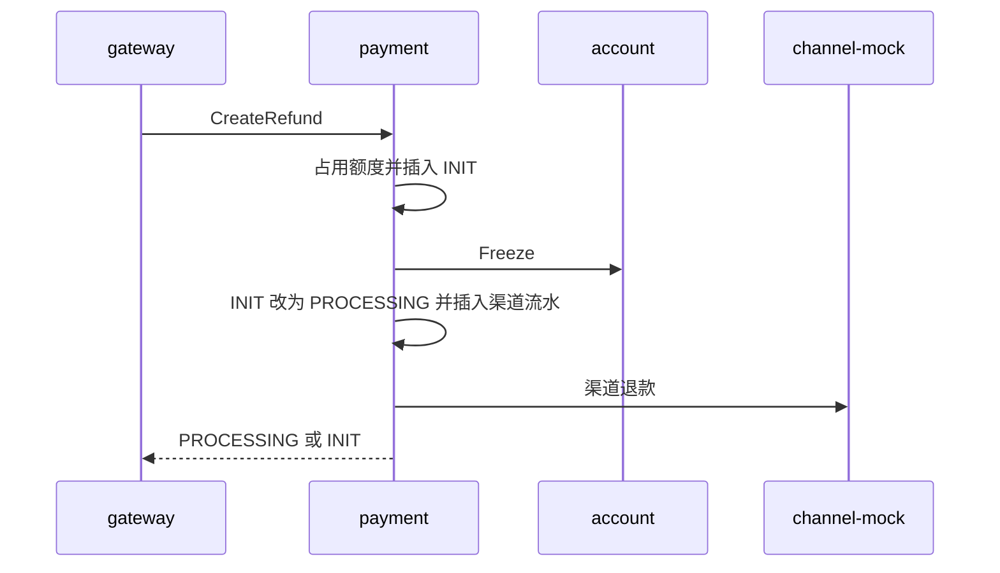
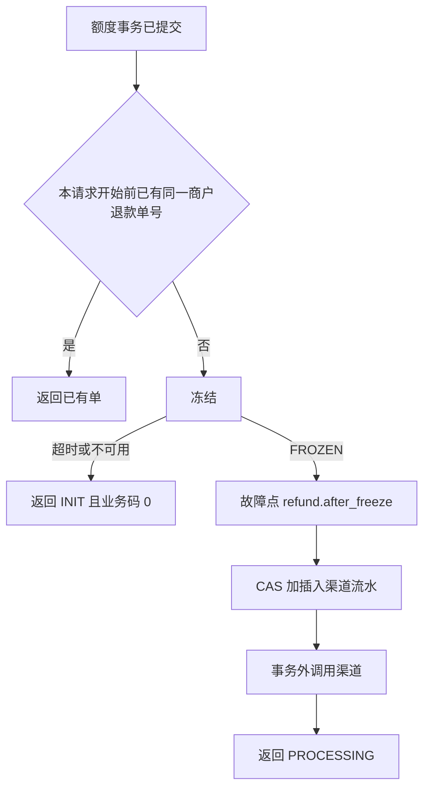

# REF-02 退款冻结与渠道提交

| 项 | 内容 |
|---|---|
| 功能点 | REF-02（P0，第 4 周） |
| 所属链路 | 退款 |
| 代码提交 | `d9c6b6f` `[REF-02] add refund freeze and submit` |
| 分支 | `feat/REF-02-freeze-submit` |
| 日期 | 2026-11-04 |
| 状态 | DONE |

## 一句话结论

新插入的退款单在额度占用提交之后，同一请求里冻结商户结算余额，再把退款交给模拟渠道。一笔 1000 分（10.00 元）的退款在冻结成功且渠道受理成功时返回 `PROCESSING`：账户侧有 1 张金额相同的 `FROZEN` 冻结单，支付库有 1 条 `channel_txn` 且类型为 `REFUND`、状态为 `PROCESSING`，渠道只被调用 1 次。冻结超时或账户处理超时被包成远程传输错误时，接口返回刚插入的 `INIT`，业务码为 0，不写渠道流水。

## 1. 背景

### 1.1 系统简介

pay-system 是一个用 Go 编写的小型支付后端，模拟商户收款、退款、商户间转账三条资金链路，重点在数据一致性和性能。系统由 5 个部分组成：gateway（对外 HTTP 入口，负责签名校验和限流）、payment（支付单、退款单、转账单的状态管理和流程推进）、account（账户余额与记账，数据按商户分到 2 个数据库分片）、channel-mock（模拟微信、支付宝这类外部支付渠道）、recon（对账，核对系统内外数据是否一致）。服务之间用 Kitex RPC 同步调用，或通过 Kafka 消息异步通知；数据存在 MySQL 8.4，Redis 用于防重放。所有金额用整数“分”表示，所有记账只追加不修改。当前已完成到：支付单创建、发起、结果推进、关单和查询，渠道模拟与回调入口，以及退款的额度占用。本功能点接在额度占用之后，做冻结和渠道提交。把退款改成成功或失败、减少已占用额度、解开冻结，并往 outbox 写一行待投递消息，留在后面的结果推进。outbox 就是消息表：业务数据和待投递消息写在同一次数据库提交里，之后再异步送到账户服务。

### 1.2 本功能点在系统中的位置



商户请求先到 gateway。gateway 调用 payment 的 `CreateRefund`，客户端等待上限是 5 秒。payment 先完成上一功能点的额度占用，再调用 account 的 `Freeze`，最后用 HTTP 调用 channel-mock 的退款地址。account 按商户号把冻结写到该商户所在的分片。channel-mock 不改 payment 的表。查询退款的接口这次仍返回内部错误 `10003`。

### 1.3 为什么需要它

商户结算账户是账户服务里该商户用来收付款的余额账户。可用余额是账户余额减去已经冻结、还不能再花的金额。支付成功后，商户余额不是当场加上的：payment 先把支付单标成成功，账户入账要等后面的异步消息。入账完成前，这个结算账户的可用余额仍可能是 0。

一笔已成功且已经入账的支付金额是 10000 分（100.00 元）。如果创建退款只占用“还能退多少”，却不冻结可用余额，商户可以在渠道把 1000 分（10.00 元）退给付款人之前，先把同一笔钱转走。渠道退款完成时，平台账上已经没有这 1000 分。反过来，如果在占用额度的那次数据库事务里面调用 account 或渠道，事务会一直占着支付库的锁。外部调用超时后，无法判断额度减少和冻结是否都已经生效。

## 2. 术语

| 术语 | 含义 |
|---|---|
| 分 | 金额的最小单位。100 分等于 1.00 元。代码里是 `int64`，不用浮点数。 |
| 额度 `refunded_amount` | 支付单上已经划给退款的金额，单位是分。创建退款时增加。减少它是把这块占用还回去，本功能点不减少。 |
| 冻结 | 在商户结算账户上划出一笔钱，使可用余额变小。冻结单状态 `FROZEN` 表示划出成功，钱还在账户里，只是不能再花。解开冻结才会把这笔钱还回可用余额，本功能点不解开。 |
| 商户退款单号 `out_refund_no` | 商户自己生成的退款编号。和商户号一起做幂等键。 |
| 退款单号 `refund_no` | 平台生成的退款编号，前缀是 `RF`。冻结和渠道都用这个号，不用商户退款单号。 |
| 分片 | 账户按商户号分到 2 个 MySQL 库。商户 `M100002` 落在分片 0。 |
| `INIT` | 退款单刚插入、还没有渠道流水的状态。 |
| `PROCESSING` | 退款已冻结，并且本地已经有一条渠道流水，正在等渠道的明确结果。 |
| CAS | 比较并交换。更新语句带上“当前必须仍是 `INIT`”，影响行数不是 1 就认为没抢到，不继续插流水。 |
| 幂等键 | 同一次业务的重复请求共用的键。退款创建用商户号加商户退款单号。冻结用业务类型 `REFUND` 加平台退款单号。这两个号不是同一个字段。account 对同一个冻结键再调用一次时，若已经是金额相同的 `FROZEN`，就返回这张已有冻结单，不再把冻结金额加一笔。 |
| `channel_txn` | 支付库里的渠道流水。退款这一行的 `txn_type` 是 `REFUND`，`biz_no` 是退款单号。 |
| `channel_txn_no` | 渠道返回的流水号。提交前是空。渠道明确受理后才填上。 |
| `biz_code` | 响应里的业务码。0 表示这次调用按成功返回对象。`10003` 是平台内部错误。 |
| outbox | 与业务写在同一个数据库提交里的待投递消息，也就是消息表里的一行。本功能点不写它。 |
| 注入时钟 | 业务代码不读机器当前时间，时间由调用方传进来。测试可以把这个时间固定住。写进数据库前截到毫秒，是为了和表上的时间精度一致，避免进位到下一毫秒。 |
| 故障点 | 测试可以按名字把进程杀掉的位置。本功能点的名字是 `refund.after_freeze`。 |
| `ACTIVE` | 账户可以正常收付款的状态。不是这个状态时，本功能点不冻结。 |
| 假订单表 | 单元测试放在进程内存里的订单和流水，用来代替 MySQL。它不是账户库，也不是渠道库。 |
| `30005` | 已有错误码：这笔退款金额超过原支付还剩的可退额度。 |
| Kitex | 服务之间使用的 RPC 框架。 |
| `TransError` | Kitex 把对端的传输层错误交给调用方的类型。account 处理超时被包成这种错误时，消息文本仍是 rpc timeout，不是业务码。 |

## 3. 技术讲解

### 3.1 要解决的问题

1. 退款金额必须先从商户可用余额里划出来，渠道才能受理。划出的金额等于退款金额，单位是分。
2. 同一个商户退款单号的第二次请求只返回已有退款单，不再冻结，也不再调用渠道。
3. 冻结、改状态、调渠道三步之间进程消失时，停在可以再查或再试的状态，不能出现“渠道已受理但本地没有流水”。
4. 冻结超时或结果说不清时，不能把退款改成失败，也不能调用渠道。
5. 渠道在约定的等待时间内没有明确结果时，退款保持 `PROCESSING`，不当成拒绝。
6. 不新增错误码，不改表结构，不改接口字段。

### 3.2 方案

整体顺序是：额度事务先提交；只有本请求新插入的那张退款单才继续。本请求开始前，这个商户退款单号已经有一行时，直接返回那一行，不冻结，不调用渠道。新插入的单在事务外冻结；冻结结果是 `FROZEN` 之后，在另一个只访问支付库的事务里把退款从 `INIT` 改成 `PROCESSING` 并插入渠道流水；这个事务提交之后才调用渠道。流程图里的“已有”指的是本请求开始前就存在，不是指刚刚插入的那一行。



冻结成功之后、支付库事务之前的故障点叫 `refund.after_freeze`。进程若死在这里，退款单仍是 `INIT`，冻结单已经存在。商户用同一个商户退款单号再请求一次时，payment 看到行已经存在，直接返回这张 `INIT`，不会再次调用冻结，也不会把渠道提交流程接上。这张 `INIT` 要等后面的定时任务再捡起来，继续冻结和提交。那个任务不在本功能点里。冻结金额不会被这次重复请求再加一遍，是因为这次根本不再调用冻结。

支付库事务里的两条语句是：

```sql
UPDATE refund_order
   SET status = 'PROCESSING', version = version + 1, updated_at = ?
 WHERE refund_no = ? AND merchant_id = ? AND status = 'INIT'

INSERT INTO channel_txn (
  channel, txn_type, biz_no, channel_txn_no, amount, status,
  notify_count, query_count, next_query_at, version, created_at, updated_at
) VALUES (?, 'REFUND', ?, NULL, ?, 'PROCESSING', 0, 0, ?, 0, ?, ?)
```

更新条件只看退款单号、商户号和状态仍是 `INIT`。`version` 是这行被成功改写的次数，成功时加 1，条件里不比较它。抢失败由“状态已经不是 `INIT`”看出来：更新影响行数不是 1，就结束事务，不插入流水，再按平台退款单号读出当前行返回。插入碰到重复键（MySQL 错误 1062）时，把错误交回事务，前面的状态更新一起回滚，调用方同样改去读当前行，这次不调用渠道。流水里的 `channel` 用退款单上已经抄下来的原支付渠道，本功能点不另选渠道。`next_query_at` 是注入时钟截到毫秒之后再加 10 秒，与支付发起的下次查询间隔相同。两行的时间都来自注入时钟，不用数据库的当前时间。

渠道请求在事务外发出。请求体里的 `req_no` 是平台退款单号，`orig_req_no` 是原支付单号，金额是这笔退款的分。回调地址与支付发起共用，环境变量仍是 `CHANNEL_NOTIFY_URL`。渠道总超时是 3 秒，从调用上下文派生，父上下文更短时先到期的生效。`CreateRefund` 在 payment 进程里的服务端处理上限是 5 秒，与 gateway 调用这个方法的 5 秒一致，使 3 秒的渠道超时先到期。`ClosePayment` 和其他方法仍是 2 秒。

渠道返回 `OK` 且带有非空 `channel_txn_no` 时，回填这条流水。回填语句只改仍然对得上的那一行；影响 0 行时，按平台退款单号再读出当前流水，接口仍返回 `PROCESSING`。这次没有单独测试“回填影响 0 行”。网络失败、非 200、签名不对、`OK` 但流水号为空，都留在 `PROCESSING`，不回填，接口业务码为 0。本地配置错误（例如密钥为空）返回 `10003`，此时状态已经是 `PROCESSING`。

account 客户端地址写死为 `account:8882`。连接超时 100 毫秒，调用超时 500 毫秒。`Freeze` 只在超时时重试 1 次。这次重试用的是同一个平台退款单号。若第一次调用已经在 account 写成 `FROZEN`、响应却没回到 payment，重试拿到的是这张已有冻结单，可用余额不会被再划一笔。account 若把处理超时包成 `TransError`，且消息仍是 rpc timeout，payment 把它看成不可用：返回刚插入的 `INIT`，error 为 nil，不写 `channel_txn`。调用方上下文已经取消时，只要冻结错误属于这类不可用，仍返回这张 `INIT`。超时的结果可能是“account 已经冻结成功，只是响应没回到 payment”，所以接口把这张 `INIT` 按业务码 0 交回去，不把它当成失败。连接被拒绝或域名解析失败时，调用在超时之前就失败了，按已有规则不重试，接口返回 `10003`，退款停在 `INIT`，没有冻结单，也没有渠道流水。

余额不足是已有的 `40002`。冻结单已经处于解开状态是已有的 `40004`。本功能点自己不解开冻结；只有 account 对这个平台退款单号回答“这张冻结单已经解开”时才走到 `40004`。渠道明确拒绝是已有的 `30006`。这三支都会调用 `ApplyRefundResult`。该函数把退款写成失败、减少 `refunded_amount`、写 outbox 的实现留在下一功能点。本切片的生产方法直接返回 `10003`，不把退款改成 `FAILED`，不减少额度。因此生产路径上，余额不足时退款仍是 `INIT` 且额度仍被占用；渠道已经明确拒绝时，退款已经是 `PROCESSING`（状态事务已提交），接口仍是 `10003`。

测试里换上一个会把内存订单标成 `FAILED` 的替身，只为看清参数和返回码，不代表生产行为。替身成功之后：`40002` 把余额不足错误交回调用方，handler 把它放进 `biz_code` 并带上退款单；`40004` 的约定是业务码 0 再带上已经失败的退款单，所以这一支 error 为 nil；渠道拒绝把 `30006` 交回调用方，handler 同样放进 `biz_code` 并带上退款单，失败说明是渠道返回的原因。`40004` 和另外两支不同，是因为余额不足和渠道拒绝要对商户暴露具体业务码，冻结单已经解开则对商户表现为一次得到失败退款单的成功调用。生产占位在写出 `FAILED` 之前就返回 `10003`，所以上面三种 handler 形态在生产进程里还不会出现。

账户不存在是 `40001`，账户不是 `ACTIVE` 是 `40005`。这两支保持 `INIT`，接口返回 `10003`。错误日志的 `err_code` 写成对外的 `10003`，与调用方看到的码相同，不另记账户返回的 40001 或 40005。因此这行日志不能区分是账户不存在还是账户状态不对。日志里有 `refund_no` 和 `merchant_id`，没有密钥或余额。这是这次留下的边界。

没有装上冻结客户端时，`CreateRefund` 仍只返回刚插入的 `INIT`。上一功能点的测试因此不用改。生产进程在启动时装上 account 客户端、渠道客户端和 payment 自己。

### 3.3 为什么这样做

| 方案 | 做法 | 优点 | 缺点 | 结论 |
|---|---|---|---|---|
| 采用：额度提交后，事务外冻结，再在支付库事务里改状态并插流水，最后调渠道 | 外部调用不进事务 | 锁时间短；渠道还没被调用时本地已经有流水；超时可以停在 `INIT` 或 `PROCESSING` | 冻结成功后、改状态前崩溃时，会留下一张冻结单和一张 `INIT` 退款 | 采用 |
| 备选：在额度事务里同时冻结并调用渠道 | 一个事务包住全部步骤 | 看起来要么全成功要么全没有 | 事务持有支付库锁等待 RPC 和 HTTP；超时后无法判断外部是否已经生效 | 不采用 |

`CreateRefund` 的服务端上限若保持 2 秒，渠道的 3 秒总超时永远等不到。渠道若在第 2 秒到第 3 秒之间返回受理成功或明确拒绝，payment 会在父截止时间先到时把它收成“结果未知”：流水号不回填，明确拒绝也不会进入 `ApplyRefundResult`。所以这个方法改成 5 秒。

### 3.4 正确性

| 场景 | 系统行为 | 最终状态 | 证明 |
|---|---|---|---|
| 同一商户退款单号再次到达 | 读到已有行后直接返回，冻结调用次数仍是 1 | 退款仍是第一次提交后的状态；额度不第二次增加 | `TestCreateRefundSubmitProcessing` 的第二次调用 |
| 冻结超时 | 不进入改状态事务，不调用渠道 | 退款 `INIT`，没有 `channel_txn`，额度仍是这次占用的值，error 为 nil | `TestCreateRefundFreezeUnavailable`、`TestCreateRefundFreezeTimeoutMySQL` |
| account 把处理超时包成 `TransError` | 识别为不可用 | 与上一行相同，返回 `INIT` | `TestFreezeTimedOutRecognizesServerTransError`、`TestSubmitRefundUnavailableReturnsInitWhenCallerCancelled` |
| 调用方上下文已取消，且冻结结果是不可用 | 仍返回刚插入的 `INIT`，不调用渠道 | 不把取消误报成内部错误 | `TestSubmitRefundUnavailableReturnsInitWhenCallerCancelled` |
| 渠道结果未知 | 流水号保持空，不当成拒绝 | 退款 `PROCESSING`，业务码 0 | `TestCreateRefundChannelUnknown` |
| 渠道流水的业务号已经存在 | 进程内的假订单表拒绝这次状态变更，不调用渠道。这覆盖的是插入冲突，不是两个更新同时抢同一行 | 退款保持 `INIT` | `TestCreateRefundChannelTxnConflictStaysInit` |
| 冻结已经是 `FROZEN` 且渠道返回 `OK` | 一条支付库事务提交 `PROCESSING` 和一条 `REFUND` 流水，事务外回填渠道流水号 | MySQL 中退款 `PROCESSING`，流水 1 条，`next_query_at` 等于更新时间加 10 秒 | `TestCreateRefundSubmitMySQL` |
| 真实账户冻结 | 测试直接调用 account 的进程内冻结，不启 Kitex | 分片 0 上 1 张 `FROZEN` 冻结单，金额 1000 分 | `TestCreateRefundFreezeAccountMySQL` |
| 余额不足走生产占位 | `ApplyRefundResult` 返回 `10003` | 退款保持 `INIT`，额度不减少，没有渠道流水 | `TestCreateRefundProductionApplyStaysInit` |
| 替身把失败结果写成 `FAILED` | `40002` 返回余额不足；`40004` 返回对象且 error 为 nil；渠道拒绝返回 `30006`，失败说明是渠道原因 | 额度数字不被这个替身减少 | `TestCreateRefundApplyDelegates` |

两个请求同时把同一条 `INIT` 改成 `PROCESSING` 时，更新条件要求状态仍是 `INIT`。按这条 SQL，只有一个更新的影响行数会是 1，另一个不插入流水。这次没有在 MySQL 上并发跑这个场景，所以上面的测试不能当作这次并发的证据。另一件事是额度：上一功能点用 10 个不同的商户退款单号证明，原支付 10000 分时，每笔 3000 分的并发创建恰好成功 3 笔。那次抢的是同一张支付单上还剩多少可退，不是两个请求改同一条退款单的状态。

### 3.5 性能

不涉及。这次没有压测，也没有性能开关。

## 4. 已完成内容

### 4.1 改动清单

| 文件 | 新增 / 修改 | 作用 |
|---|---|---|
| `service/payment/biz/refund_submit.go` | 新增 | 冻结之后的提交、失败分支的参数、渠道调用 |
| `service/payment/biz/refund_submit_sql.go` | 新增 | `INIT` 到 `PROCESSING` 的 CAS，以及 `REFUND` 流水插入 |
| `service/payment/biz/refund_account.go` | 新增 | 通过已有 account 客户端冻结，并识别超时 |
| `service/payment/biz/refund.go` | 修改 | 新插入的退款在同一请求里进入提交；已有单不进入 |
| `service/payment/biz/channel_http.go` | 修改 | 渠道客户端增加退款方法 |
| `service/payment/biz/payment.go` | 修改 | 保存冻结、渠道退款和结果推进三个依赖 |
| `service/payment/handler/handler.go` | 修改 | `40002` 与 `30006` 在响应里带上退款单 |
| `service/payment/handler/middleware.go` | 修改 | `CreateRefund` 的服务端上限改为 5 秒 |
| `service/payment/handler/server.go` | 修改 | 注明 5 秒同时用于 `Pay` 和 `CreateRefund` |
| `cmd/payment/main.go` | 修改 | 启动时连接 `account:8882` 并装上退款依赖 |
| `.golangci.yml` | 修改 | 只把账户集成测试文件排除出“payment 不能引用其他服务”的规则 |
| `service/payment/biz/*_test.go` 与 `handler/handler_test.go` | 新增或修改 | 单元测试、MySQL 测试、账户冻结测试、渠道 HTTP 测试 |
| `docs/02-requirements.md`、`docs/05-api.md`、`docs/06-flows.md`、`docs/database.md`、`docs/interview-notes.md` | 修改 | 与这次行为对齐的说明 |

### 4.2 对外变化

| 类别 | 变化 |
|---|---|
| 接口 | `CreateRefund` 在冻结成功且渠道返回 `OK` 或结果未知时返回 `PROCESSING`，业务码 0。冻结超时或不可用返回 `INIT`，业务码 0。不新增字段，不改接口定义。查询退款仍是 `10003`。 |
| 表结构 | 无。不新增迁移。`channel_txn` 的退款行使用已有列：`txn_type=REFUND`，`biz_no` 为退款单号，提交时 `channel_txn_no` 为空。 |
| 配置项 | 无。不新增环境变量。回调地址仍是 `CHANNEL_NOTIFY_URL`。account 地址写死 `account:8882`。 |
| 错误码 | 无新码。生产路径上 `40002`、`40004`、渠道拒绝目前仍以 `10003` 返回，因为结果落库还没做。handler 已经能在业务层返回 `40002` 或 `30006` 时把码放进 `biz_code` 并带上退款单。 |
| 指标 / 故障点 | 不新增指标。故障点 `refund.after_freeze` 原来已登记，这次开始调用。 |

### 4.3 验收对照

| 验收条目 | 测试函数 | 类型 | 结果 |
|---|---|---|---|
| 正常退款：接口返回 `PROCESSING`；商户有 1 张金额等于退款金额的 `FROZEN` 冻结单；`channel_txn(REFUND)` 1 条且为 `PROCESSING`；渠道受理 1 次 | `TestCreateRefundSubmitProcessing` 证明返回状态、冻结次数、渠道次数和 1 条流水。`TestCreateRefundSubmitMySQL` 在 MySQL 上证明流水状态和 `next_query_at`。`TestCreateRefundFreezeAccountMySQL` 在账户库证明 1 张 `FROZEN` 冻结单，金额 1000 分 | 单元与集成 | 通过，包含在下面的 `make test` 与 `make test-integration` 里 |
| account 不可用（Freeze 超时）：接口返回 `INIT`，退款单保持 `INIT`，没有 `channel_txn`，渠道未收到请求 | `TestCreateRefundFreezeUnavailable`、`TestCreateRefundFreezeTimeoutMySQL` | 单元与集成 | 通过，包含在同一次命令里 |

### 4.4 验证记录

环境：2026-11-04，go1.27.2 darwin/arm64，golangci-lint 2.14.0（用 go1.27.1 构建，版本标识 114493f，构建时间 2026-09-24T10:54:53Z）。命令从 17:15:05 +0800 到 17:16:52 +0800，日志 `/tmp/ref02-verify-r2.log`，五步退出码都是 0。时间是 `/usr/bin/time -p` 的 real。

| 命令 | 结果 |
|---|---|
| `gofmt -l .` | 无输出。real 0.05s，user 0.22s，sys 0.04s |
| `make lint` | `golangci-lint run --build-tags integration ./...`，`0 issues.`。real 1.85s，user 4.05s，sys 4.57s |
| `make test` | `go test -race ./...` 退出码 0。real 10.93s，user 4.83s，sys 5.32s。根包 5.105s，`service/payment/biz` 5.403s，`service/payment/handler` 9.905s，`cmd/payment` 1.578s |
| `make test-integration` | `go test -race -tags integration ./...` 退出码 0。real 47.97s，user 9.56s，sys 8.03s。根包 37.643s，`service/payment/biz` 46.278s，`service/payment/handler` 18.683s，`cmd/payment` 1.567s |
| `make cover` | 退出码 0。real 46.51s，user 11.73s，sys 10.46s。全仓库语句 31.8%（含生成代码，不作门槛）。`service/payment/biz` 44.042s，语句 82.3%，达到 70% 门槛。handler 19.423s，语句 80.4%，不在门槛内。`cmd/payment` 1.641s，语句 36.8% |

同一次覆盖率清单里：`Payments.CreateRefund` 82.8%，`App.CreateRefund` 0.0%（测试调用的是 `Payments`），`FreezeRefund` 0.0%（测试用假冻结或直接调用 account 的进程内方法，不经过 Kitex 适配器），`freezeTimedOut` 75.0%，`UseRefund` 88.9%，`ApplyRefundResult` 100.0%，`submitRefund` 88.9%，`finishRefund` 87.5%，`callRefundChannel` 59.1%，`casRefundProcessing` 71.4%，`refundByNo` 0.0%，`ChannelClient.Refund` 66.7%，handler 的 `CreateRefund` 76.5%，`timeoutFor` 100.0%。`pkg/money`、`pkg/sign` 为缓存的 100.0%，`pkg/idgen` 为缓存的 88.1%，`pkg/outbox` 为缓存的 95.0%。

没有改接口定义，所以没有重新生成 RPC 代码。流程文档里的图没有改节点，所以没有重新渲染成图片。没有用命令行客户端对着已经启动的整套服务走一遍退款。

资金审查先列出 2 项中严重度：服务端 2 秒截止会吃掉渠道 3 秒超时，以及 account 的 `TransError` 超时被收成 `10003`。这两项已改入 `d9c6b6f`。第二次只读核对的第一句是「未发现高或中严重度问题」。连接拒绝仍返回 `10003`，`40001` / `40005` 的日志仍只记对外的 `10003`，这两条按已确认的边界留下。

### 4.5 同步的文档

- 需求：REF-02 状态改为 DONE，两条验收勾上。写明 5 秒服务端上限、`TransError` 走 `INIT`、连接拒绝仍是 `10003`，以及生产用的 `ApplyRefundResult` 仍返回 `10003`。变更记录有 2026-11-04 这一行。
- 接口文档：版本 3.3.7，`POST /v1/refunds` 的最后修改日期改为 2026-11-04，写明这次实际返回的状态。
- 流程文档：版本 v2.32。图的节点不改，图下说明改为额度提交后再冻结和提交渠道。
- 表结构文档：补充退款状态更新和 `REFUND` 流水的操作说明。变更记为仅文档，未执行迁移。
- 面试笔记：记下故障点位置、1062 回滚、`TransError` 和 5 秒上限。

周计划里把 REF-02 到 REF-05 写在同一行的复选框没有勾。第 4 周交付段落没有改成已完成。

## 5. 未完成与风险

- 生产用的 `ApplyRefundResult` 返回 `10003`。余额不足时退款停在 `INIT`，`refunded_amount` 不减少。商户若换一个新的商户退款单号，原支付上还能退的金额可能已经不够，创建会返回已有的 `30005`（退款金额超过剩余额度）。把退款写成 `FAILED`、减少额度、写 outbox，是下一功能点 REF-03。
- 渠道明确拒绝时，状态事务已经提交，退款是 `PROCESSING`，接口仍是 `10003`。REF-03 才会把它写成 `FAILED`，并在之后解开冻结。
- 支付成功后，商户结算余额要等异步消息入账才增加。入账前可用余额仍可能是 0，这时冻结会走余额不足，生产接口是上面的 `10003`。
- 连接被拒绝或 DNS 失败返回 `10003`，退款停在 `INIT`，额度仍占用，没有冻结单，也没有渠道流水。这和“超时返回 `INIT` 且业务码 0”不是同一条路径。
- `FreezeRefund` 在这次覆盖率清单里是 0.0%。账户侧的真实冻结由集成测试直接调用 account 的进程内方法证明，不经过 Kitex 适配器。适配器里的超时识别由 `freezeTimedOut` 的单元测试覆盖，该函数是 75.0%。
- MySQL 上“流水插入重复键后回读当前退款”没有单独测试。`refundByNo` 在这次清单里是 0.0%。`TestCreateRefundChannelTxnConflictStaysInit` 用进程内的假订单表覆盖了“冲突则保持 `INIT` 且不调用渠道”。
- 渠道模拟进程启动时，只会把库里还在处理中的支付流水重新放进它的完成队列。一条已经提交、还没有进入这个队列的退款流水，重启后不会被扫到。这次没有改这个扫描范围。渠道已经受理、本地流水号仍为空时，要等以后的查单或回调再填上结果；查单和回调都不在本功能点里。
- 查询退款、定时捡起停住的退款、回调把退款推进到成功，都不在这次里。

## 6. 如何复现

需要本机 Docker 或已设置的 `TEST_MYSQL_DSN`，因为集成测试和覆盖率会起 MySQL。不要把 `deploy/.env` 读进 shell。

```bash
gofmt -l .
make lint
make test
make test-integration
make cover
```

`gofmt -l .` 没有输出。`make lint` 打印 `0 issues.`。后三条退出码为 0。覆盖率门槛看 `service/payment/biz` 的语句比例，这次是 82.3%。全仓库的 31.8% 含生成代码，不用它判断是否通过。

只重跑本功能点的测试可以用：

```bash
go test -count=1 -race ./service/payment/biz/ ./service/payment/handler/ -run 'TestCreateRefund|TestFreezeTimedOut|TestSubmitRefund|TestListenAddrAndTimeout|TestChannelClientRefundOK'
go test -count=1 -race -tags integration ./service/payment/biz/ -run 'TestCreateRefundSubmit|TestCreateRefundFreeze'
```

## 7. 讲解要点

1. 问：为什么冻结不放进额度事务？答：额度事务只碰支付库。冻结是另一个服务的另一次提交。放进同一个事务会在持有行锁时等待 RPC，超时后两边是否生效说不清。
2. 问：渠道超时为什么退款变成 `PROCESSING` 而不是失败？答：本地流水已经提交，渠道可能已经受理。失败要等明确拒绝或以后的结果推进。接口返回这张 `PROCESSING`，业务码为 0。
3. 问：余额不足为什么现在仍是 `10003`？答：失败落库、减少额度和写 outbox 留在 REF-03。本切片只把失败参数交给 `ApplyRefundResult`，生产方法返回已有的内部错误，不改退款状态。

## 延伸阅读

- `docs/02-requirements.md` 中 REF-02 一节
- `docs/05-api.md` 的 `POST /v1/refunds` 与服务端超时说明
- `docs/database.md` 的 `refund_order` 与 `channel_txn`
- `docs/06-flows.md` 版本 v2.32 的退款图说明
- 上一功能点报告 `docs/reports/REF-01-create-refund.md`

## 修订记录

| 日期 | 提交 | 修订内容 |
|---|---|---|
| 2026-11-04 | 与本报告同一次提交 | 首版。可读性检查两轮之后，改过同一退款单号重试、冻结超时重试和并发证据的表述 |
