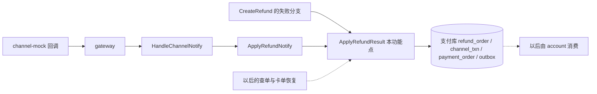
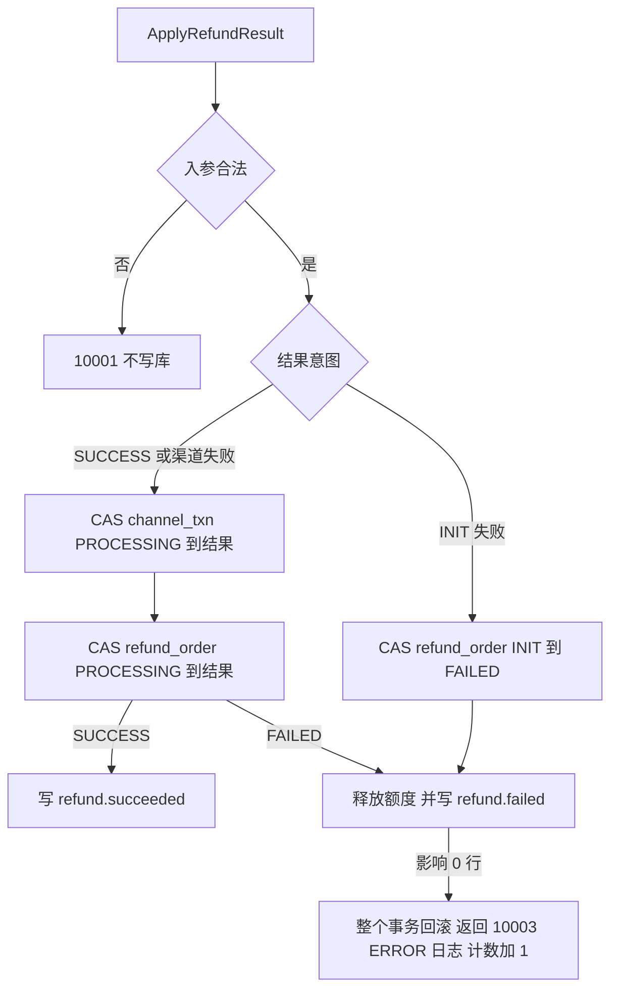

# REF-03 退款结果推进

| 项 | 内容 |
|---|---|
| 功能点 | REF-03（优先级 P0，即必须完成；排在第 4 周的里程碑 M4） |
| 所属链路 | 退款 |
| 代码提交 | `cb5f6e7` `[REF-03] apply refund result` |
| 分支 | `feat/REF-03-refund-result` |
| 日期 | 2026-11-05 |
| 状态 | DONE |

## 一句话结论

实现了 `ApplyRefundResult`：在一个只访问支付库的事务里，把退款单推进到 `SUCCESS` 或 `FAILED`，失败时把占用的可退额度还回原支付单，并写一行待投递消息。原支付 10000 分（100.00 元）、退款 3000 分（30.00 元）的端到端用例里，channel-mock 通过 HTTP 发来的回调把退款推进为 `SUCCESS`，消息表恰好 1 行 `refund.succeeded`。同一个成功回调到达 10 次（其中 5 次并发）时，退款只推进 1 次，消息只有 1 行。如果发现已占用额度小于这笔退款的金额（数据已不一致），整个事务回滚并返回 `10003`，同时记 1 条 ERROR 日志、计数加 1，退款单、渠道流水和额度都不变。

## 1. 背景

### 1.1 系统简介

pay-system 是一个用 Go 编写的小型支付后端，模拟商户收款、退款、商户间转账三条资金链路，重点在数据一致性和性能。系统由 5 个部分组成：gateway（对外 HTTP 入口，负责签名校验和限流）、payment（支付单、退款单、转账单的状态管理和流程推进）、account（账户余额与记账，数据按商户分到 2 个数据库分片）、channel-mock（模拟微信、支付宝这类外部支付渠道）、recon（对账，核对系统内外数据是否一致）。服务之间用 Kitex RPC 同步调用，或通过 Kafka 消息异步通知；数据存在 MySQL 8.4，Redis 用于防重放。所有金额用整数“分”表示，所有记账只追加不修改。当前已完成：支付单的创建、发起、结果推进、关单和查询，渠道模拟与回调入口，以及退款的额度占用（REF-01 创建退款与额度占用）、冻结和渠道提交（REF-02 退款冻结与渠道提交）。本功能点接在渠道提交之后，把退款推进到最终结果。账户侧按结果扣款或解冻，要等后面的消息消费功能点。

### 1.2 本功能点在系统中的位置



`ApplyRefundResult` 有三类调用方。第一类是渠道回调：channel-mock 用 HTTP 把结果发到 gateway，gateway 经 Kitex RPC 调用 payment 的 `HandleChannelNotify`，再进 `ApplyRefundNotify`。第二类是创建退款 `CreateRefund`：余额不足、冻结单已解开、渠道受理拒绝这三种失败，在同一个请求里调用它。第三类是以后的 PAY-05（查单补偿）和 REF-04（退款卡单恢复），它们还没有实现，图里用虚线表示。本函数只写支付库，不调用 account 和渠道。

### 1.3 为什么需要它

REF-02 做完后，一笔退款会停在 `INIT` 或 `PROCESSING`。`INIT` 表示额度已占、退款单已插入，但状态还没改成 `PROCESSING`：可能还没冻结，可能冻结失败了还没落库，也可能冻结成功后进程停住了。`PROCESSING` 表示冻结已成功，并且已经在同一个事务里插入了渠道流水，正在调用渠道或等渠道结果。原支付单上记着“已经划给退款的金额” `refunded_amount`。

举例：原支付 10000 分，商户退款 3000 分，`refunded_amount` 变成 3000，商户最多还能再退 7000 分。如果渠道说这笔退款失败而系统不处理，这 3000 分永远占着，商户只能再退 7000 分，账户里冻结的 3000 分也没有人去解开。如果渠道把同一个成功结果发了两次，系统处理了两次，就会写出两条“退款成功”消息，账户侧以后会扣两次 3000 分。

还有一种并发情况，来自以后的 REF-04。REF-04 有两条规则：第 1 条每 10 秒扫描停在 `INIT` 超过 30 秒的退款，从冻结那一步重新执行；第 2 条把停在 `INIT` 超过 1 小时的退款判为超时失败。退款会在 `INIT` 停满 1 小时，是因为每次重新冻结都没有得到明确结果：account 超时或暂时不可用（`10004`）时退款保持 `INIT`，等下一轮再试；account 返回账户不存在（`40001`）或账户不是正常状态（`40005`）时也保持 `INIT`，这两种属于内部数据错误（REF-02 第 1 条）。假设两个 payment 实例同时在跑：实例 A 按第 1 条重新冻结成功，把退款改成 `PROCESSING` 并发给了渠道；实例 B 在 A 改状态之前已经读到这笔退款是 `INIT` 且超过 1 小时，于是按第 2 条调用超时失败。如果失败处理按“库里现在是什么状态”走，B 会读到 `PROCESSING`，把一笔渠道可能已经退成功的退款写成失败，并把 3000 分额度还回去。商户可以再退一次 3000 分，平台就多付了 3000 分。

## 2. 术语

| 术语 | 含义 |
|---|---|
| 分 | 金额的最小单位。100 分等于 1.00 元。代码里是 `int64`，项目里的命名类型是 `money.Amount`，不用浮点数。 |
| 退款单 `refund_order` | 支付库里的退款记录。状态 `INIT`、`PROCESSING` 的含义见 1.3。`SUCCESS` / `FAILED` 是最终结果，之后不再改。 |
| 终态 | `SUCCESS` 或 `FAILED`。到了终态就不再变化。 |
| 额度 `refunded_amount` | 原支付单上已经划给退款的金额，单位是分。数据一致时，它等于这张支付单下 `INIT`、`PROCESSING`、`SUCCESS` 三种状态退款的金额之和。REF-01 插入 `INIT` 退款时增加，本功能点在退款失败时减少，叫“释放额度”。表上有约束 `ck_pay_refunded`，要求它在 0 到支付金额之间。 |
| R | 这笔退款的金额，单位是分。 |
| 冻结 / 冻结单 | 冻结是在商户账户上划出一笔钱，使它不能再被花掉。account 为每次冻结写一行冻结单，状态 `FROZEN`（已冻结）、`CONFIRMED`（已确认扣款）或 `RELEASED`（已解开）。冻结和解冻都在 account 服务里，本功能点不做。 |
| 空回滚 / 防悬挂 | 解冻请求先于冻结到达时，account 直接写一张 `RELEASED` 冻结单（空回滚）。之后迟到的冻结请求看到这张单就拒绝，返回 `40004`，避免钱被永久冻住（防悬挂，ACC-05 解冻）。 |
| 渠道流水 `channel_txn` | 支付库里记录“发给渠道的一次请求”的行。`txn_type` 是 `PAY`（支付）或 `REFUND`（退款），`biz_no` 是对应的支付单号或退款单号。 |
| 单号 | 平台生成的编号，两位前缀加 19 位数字。退款单号前缀 `RF`，支付单号前缀 `PA`，例如 `PA0000000000000000301`。 |
| `version` | 可变的核心表都有的计数列，用于排查并发更新（约定 §6.2 状态更新）。本功能点涉及的语句里，状态 CAS 和额度增减（`refunded_amount` 加或减）每执行一次加 1；只加 `notify_count` 的计数语句不动它，REF-02 回填渠道流水号的语句也不动它。 |
| 商户退款单号 `out_refund_no` | 商户自己给这笔退款起的编号。平台按（商户号，商户退款单号）去重：同号重复提交时，原支付单和金额一致就返回已有退款单，不一致返回 `10006`（REF-01）。 |
| CAS | 比较并交换。`UPDATE ... SET status = 新状态, version = version + 1 WHERE ... AND status = '旧状态'`，影响 1 行算抢到，影响 0 行算没抢到。两个请求同时改同一行时，MySQL 的行锁让它们排队，只有第一个能匹配到旧状态。 |
| 幂等 | 同一个请求执行多次，效果和执行一次相同。 |
| outbox | 消息表。业务数据和待投递消息写在同一次数据库提交里，之后由投递器异步送到 Kafka。这样不会出现“数据改了但消息没写”或反过来。 |
| `refund.succeeded` / `refund.failed` | 本功能点写进 outbox 的两种消息。以后 account 收到前者确认扣款，收到后者解开冻结。 |
| 结果意图 | 调用方这次想表达的结果：是“渠道给出的结果”，还是“这笔退款在提交渠道之前就失败了”。由结果和失败原因 `fail_code` 决定，不看库里的状态。 |
| `fail_code` | 失败原因码字符串。`CHANNEL_FAILED`：渠道处理失败。`CHANNEL_REJECTED`：渠道拒绝受理。`INSUFFICIENT_BALANCE`：冻结时余额不足。`FREEZE_CONFLICT`：冻结单已经被解开（account 返回 `40004`）。`REFUND_TIMEOUT`：`INIT` 停留超过 1 小时。 |
| 来源 `source` | 结果从哪里来：`NOTIFY`（渠道回调）、`QUERY`（查单）、`JOB`（定时任务）、`ADMIN`（人工）、`SYNC`（创建退款的同步流程）。支付那边还有 `CLOSE`（支付关单），退款没有关单，不接受它。 |
| `notify_count` | 渠道流水上记的回调次数。首次生效的回调和重复的回调各加 1；冲突的回调不加；不是回调来源（例如 `SYNC`）的调用也不加。 |
| 冲突计数 | 进程内计数 `payCallbackConflicts`，按渠道分开记，以后暴露为指标 `pay_callback_conflicts_total{channel}`。支付和退款共用。 |
| 错误码 | `10001` 参数不合法；`10003` 内部错误；`10004` 依赖暂时不可用；`30001` 单据不存在；`30006` 渠道拒绝；`40002` 余额不足；`40004` 冻结单状态不允许该操作（只在服务之间的 RPC 里出现，不直接给商户）；`50002` 渠道金额与本地不一致。业务码 0 表示调用成功。 |
| `dbx.WithTx` | 项目的事务封装。执行事务函数，函数返回错误就回滚。只有错误是 MySQL 死锁（1213）或锁等待超时（1205）时，才回滚后重新执行整个事务函数，最多重试 3 次；其他错误直接返回，不重试。 |
| 发号器与时钟回拨 | 单号和消息 ID 由发号器生成，发号器按当前时间编号。如果机器时钟比上次发号时倒退超过 5 毫秒，它拒绝发号（`ErrClockRollback`），调用方返回 `10004`。 |
| 故障点 | 测试可以按名字让进程在这里退出的位置，用来验证崩溃恢复（BASE-15 故障注入点）。本功能点用到 `callback.after_commit`。 |
| 日志遮盖（功能点 BASE-10 日志与脱敏） | 项目日志库的兜底规则：日志字符串里 13 到 19 位的连续数字按银行卡号处理，只保留前 6 位和后 4 位，中间换成 `*`。 |

## 3. 技术讲解

### 3.1 要解决的问题

1. 退款成功时，退款单和渠道流水同时变成 `SUCCESS`，并恰好写 1 条 `refund.succeeded`。原因：账户侧按消息扣款，多一条就多扣一次。
2. 退款失败时，退款单变成 `FAILED`，`refunded_amount` 减少 R，并恰好写 1 条 `refund.failed`。三件事在一个事务里，要么都生效，要么都不生效。
3. 同一结果重复到达，只生效一次。两个相反的结果先后到达（先失败后成功），保持先到的结果，并记一次冲突。
4. 在提交渠道之前失败的退款（`INIT` 失败），不能因为并发把一笔已提交渠道的退款判为失败。原因见 1.3 的并发例子。
5. 释放额度不能把 `refunded_amount` 减成负数或减错。发现数据已不一致时不提交任何改动，要让人能发现。
6. 事务里不调用外部系统，状态只用 CAS 更新，金额只用 `int64` 分（项目资金规则）。
7. 不改表结构，不新增错误码，不改对外接口字段。

### 3.2 方案

整体思路：先按结果意图选两个分支之一，每个分支是一个只访问支付库的事务。事务里每一步都是条件更新（状态 CAS，或带条件的额度扣减）或插入（outbox 一行）。任何一条条件更新影响 0 行，事务函数就返回错误，整个事务回滚，然后在事务外再读一次当前数据，决定返回什么。

调用参数是结构体 `RefundResult`：退款单号 `RefundNo`、结果 `Result`（`SUCCESS` / `FAILED`）、`FailCode`、`FailMsg`、来源 `Source`、金额 `Amount`（指针，为空表示这次结果没带金额，不参与比较）、渠道流水号 `ChannelTxnNo`、渠道原始状态 `ChannelStatusRaw`、渠道完成时间 `FinishedAt`。目前只有回调（`NOTIFY`）带金额；创建退款（`SYNC`）不带；以后的卡单恢复（`JOB`）用 `{FAILED, REFUND_TIMEOUT, JOB}` 调用，也不带；以后的查单（`QUERY`）带不带由 PAY-05 决定。



“INIT 失败”指结果是 `FAILED` 且 `fail_code` 是 `INSUFFICIENT_BALANCE`、`FREEZE_CONFLICT`、`REFUND_TIMEOUT` 之一。这三种都发生在退款改成 `PROCESSING` 之前，渠道一定没收到请求。其余结果都是渠道给出的：`SUCCESS`，或 `FAILED` 且 `fail_code` 为空、`CHANNEL_FAILED`、`CHANNEL_REJECTED`。

`CHANNEL_REJECTED` 走渠道分支，是因为渠道拒绝发生在退款已经改成 `PROCESSING` 之后。创建退款时依次发生：

1. 事务一（REF-01）：`payment_order.refunded_amount` 加 R；插入 `refund_order`，状态 `INIT`，`version = 0`。
2. 事务外调用 account 冻结，得到 `FROZEN`。
3. 事务二（REF-02）：`refund_order` 从 `INIT` CAS 成 `PROCESSING`（`version = 1`）；插入一行 `channel_txn`，`txn_type = REFUND`，状态 `PROCESSING`。
4. 事务外调用渠道退款，渠道回答拒绝。
5. 用 `{FAILED, CHANNEL_REJECTED, SYNC}` 调用本函数。这时退款单和渠道流水都是 `PROCESSING`，所以走渠道分支：两行都改成 `FAILED`，退款单 `version = 2`，释放额度，写 `refund.failed`。

余额不足和冻结单已解开发生在第 2 步，这时还没有第 3 步的状态变更和渠道流水，所以走 INIT 分支。

#### 渠道分支

渠道分支先改渠道流水，再改退款单。下面是渠道流水的 CAS（`service/payment/biz/refund_result_sql.go`，代码里由几个常量拼成四个变体，两行 `--` 注释是报告加的，说明变体之间的差别），看 `WHERE` 的三个条件：

```sql
UPDATE channel_txn
   SET status = ?,
       channel_txn_no = COALESCE(channel_txn_no, ?),
       channel_status_raw = ?,
       channel_finished_at = ?,
       next_query_at = NULL,
       -- source = NOTIFY 时多一行：notify_count = notify_count + 1,
       version = version + 1,
       updated_at = ?
 WHERE biz_no = ? AND txn_type = 'REFUND' AND status = 'PROCESSING'
 -- 带金额时另加：AND amount = ?
```

`txn_type = 'REFUND'` 保证按退款单号只会改到退款流水，不会改到同号的支付流水。生产里两种单号前缀不同，这个条件是防御。`COALESCE` 表示渠道流水号已经有值就保留原值。`next_query_at = NULL` 表示到了终态就不用再查单。

渠道流水改成功后，退款单用 `WHERE refund_no = ? AND status = 'PROCESSING'` 改成结果。成功时写 `succeeded_at`，取渠道给的完成时间，消息里的 `succeeded_at` 也用这个时间，因为对账按它把退款归到哪一天。失败时 `fail_code` 用调用方传入的值，没传就写 `CHANNEL_FAILED`。

#### INIT 分支

INIT 分支只改退款单：`WHERE refund_no = ? AND status = 'INIT'` 改成 `FAILED`，不碰渠道流水，因为这时还没有渠道流水。然后和渠道失败一样释放额度、写 `refund.failed`。

#### 释放额度

释放额度是一条条件更新，不先查后改（`service/payment/biz/refund_result_sql.go`）：

```sql
UPDATE payment_order
   SET refunded_amount = refunded_amount - ?, version = version + 1, updated_at = ?
 WHERE pay_no = ? AND refunded_amount >= ?
```

第一个和最后一个 `?` 都是 R。正常情况下 `refunded_amount` 至少包含这笔退款自己的 R，条件一定成立。影响 0 行说明 `refunded_amount < R`，数据已经不一致（例如被人工改过）。这时不能把额度减成负数，也不能悄悄跳过。处理规则由项目负责人在 2026-10-27 确定（需求 REF-03 第 5 条）：

1. 整个事务回滚：渠道流水、退款单的 CAS 和 outbox 都不提交，退款保持原状态。
2. 返回 `10003`。之后会不会再报，见下文“额度不一致之后会再报几次”。
3. 输出 1 条 ERROR 日志，消息 `refund quota inconsistent`，字段 `refund_no`、`pay_no`、`amount`（R）、`err_code`（`10003`）；计数器 `refundQuotaInconsistent` 加 1。以后由 OPS-03（业务与运行指标）把它暴露成指标 `pay_refund_quota_inconsistent_total`。

日志和计数在 `dbx.WithTx` 返回之后才记，不放在事务函数里。执行顺序是：释放语句影响 0 行，`releaseAndFail` 返回 `errRefundQuota`；事务函数把这个错误原样返回；`WithTx` 回滚事务；`errRefundQuota` 不是 MySQL 错误号，`WithTx` 不重试，直接把它返回；调用方这时才记日志和计数。所以按现在的代码，即使把日志写进事务函数，也只会记 1 次，不存在重复计数的问题。放在回滚之后的理由只有一条：记日志和计数时回滚已经完成，这次调用确实没有留下任何改动，日志和返回的 `10003` 描述的是最终结果；如果在事务函数里记，记录时事务还没回滚。

下面这段在事务函数里只记下出错的那一行，回滚后由 `refundTxErr` 统一输出（`service/payment/biz/refund_result.go`，有删节，“返回错误”那行注释是报告加的）。`row.Amount` 是 `money.Amount`，日志里转成 `int64`；`gen` 是发号器，`p.clk` 是注入的时钟，两者都交给 outbox 生成消息 ID 和时间。

```go
err := dbx.WithTx(ctx, db, func(tx *sqlx.Tx) error {
	row, txErr := applyRefundChannelTx(ctx, tx, in, now, finished, gen, p.clk)
	if txErr != nil {
		if errors.Is(txErr, errRefundQuota) {
			miss = quotaMiss{refundNo: row.RefundNo, payNo: row.PayNo, amount: int64(row.Amount)}
		}
		return txErr // 返回错误，WithTx 回滚
	}
	stored = row
	return nil
})
// ...
func refundTxErr(ctx context.Context, err error, miss quotaMiss) error {
	switch {
	case errors.Is(err, errRefundQuota):
		refundQuotaInconsistent.Add(1)
		slog.ErrorContext(ctx, "refund quota inconsistent",
			"refund_no", miss.refundNo, "pay_no", miss.payNo, "amount", miss.amount,
			"err_code", strconv.Itoa(int(errno.ErrInternal.Code)))
		return errno.ErrInternal
```

#### 额度不一致之后会再报几次

数据修好之前，每次有人对这笔退款再调用本函数，都会再回滚一次、再记 1 条日志、计数再加 1。本次代码上线时的实际情况：

| 发现时的路径 | 现在（PAY-05、REF-04 都还没做） | PAY-05、REF-04 上线后 |
|---|---|---|
| 渠道回调（退款 `PROCESSING`） | gateway 对 `10003` 回 HTTP 500。channel-mock 收到非成功响应会重发，连第一次最多发 5 次，间隔 5 秒、15 秒、30 秒、60 秒，所以最多报 5 次，大约 110 秒后停止。之后退款一直停在 `PROCESSING`，没有人再调用 | PAY-05 按退避计划（10 秒起，逐步拉长到每小时一次，直到创建后 24 小时）查单，每次查到终态都会再报 |
| 创建退款的失败分支（退款 `INIT`） | 接口返回 `10003`，报 1 次。商户用同一个商户退款单号重试，只会拿到已有的 `INIT` 单，不会再调用本函数 | REF-04 每 10 秒扫描一次停在 `INIT` 超过 30 秒的退款，重新冻结；冻结再次失败就再调用本函数，每轮都报 |
| 创建退款时渠道拒绝（退款 `PROCESSING`） | 接口返回 `10003`，报 1 次。渠道已经拒绝，不会有回调 | PAY-05 查单看到渠道没有这笔（`NOT_FOUND`）且流水创建超过 60 秒时会重新提交，渠道再拒绝就再调用本函数 |

#### CAS 没抢到之后

任何一条 CAS 影响 0 行，事务都回滚，然后在事务外再读一次，按读到的数据返回。规则沿用支付结果推进（PAY-04 支付结果推进）的同一套：先比金额，再看是不是终态。

| 分支和读到的数据 | 返回 |
|---|---|
| 渠道分支，读不到流水，或读到的是 `PAY` 流水 | `30001` |
| 渠道分支，带了金额且与流水金额不同 | `50002`，ERROR 日志 |
| 渠道分支，流水已是同一个终态（重复结果） | 当前退款单。来源是 `NOTIFY` 时另执行一条语句把 `notify_count` 加 1，见下文 |
| 渠道分支，流水已是另一个终态（冲突结果） | 当前退款单，不改状态。冲突计数 `payCallbackConflicts` 在这条流水的渠道下加 1，ERROR 日志 |
| 渠道分支，流水仍是 `PROCESSING` | `10003`，ERROR 日志。CAS 条件就是“仍是 `PROCESSING` 且金额对得上”，金额不符已在上一行处理，所以这一行只在数据异常时出现，是兜底 |
| 渠道分支，流水改成功了但退款单不是 `PROCESSING` | 整个事务回滚，流水回到 `PROCESSING`，ERROR 日志，`10003`。正常流程里退款单和渠道流水在同一个事务里变成 `PROCESSING`，又在同一个事务里变成终态，两者不会对不上；只在数据被人改过时出现，测试用 SQL 把退款单改回 `INIT` 来模拟 |
| INIT 分支，退款单不存在 | `30001` |
| INIT 分支，退款单已是 `FAILED` | 这张退款单（重复调用） |
| INIT 分支，退款单已是 `SUCCESS` | 这张退款单，error 为 nil，WARN 日志，不计冲突 |
| INIT 分支，退款单是 `INIT` 或 `PROCESSING` | `10003`，WARN 日志，不碰渠道流水 |

重复结果给 `notify_count` 加 1 的语句是：

```sql
UPDATE channel_txn SET notify_count = notify_count + 1, updated_at = ?
 WHERE biz_no = ? AND status = ?   -- status 是刚才读到的那个终态
```

它在原事务回滚之后单独执行，一条语句自动提交，不在任何事务里。它只加计数、不改状态，所以不动 `version`。流水到了终态就不再变化，所以这条语句正常总是影响 1 行。影响 0 行只在数据被人工改过时出现，是兜底：代码再读一次流水：读不到返回 `30001`；状态和刚才读到的不同（不论变成什么）就按冲突处理；状态没变就照常返回当前退款单。

INIT 分支读到 `SUCCESS` 是 1.3 那种两路处理的并发竞争：一路判超时的同时，另一路把这笔退款冻结、提交并收到了成功。渠道没有给出矛盾的结果，所以不算冲突。退款已经到了终态，返回这张单，调用方按返回的状态判断，不必重试。

#### 回调入口

处理一个退款回调的完整顺序：

1. channel-mock 按退款金额（分）的末两位决定结果（CH-04 渠道退款）：末两位 `01` 是失败，`02` 是不发回调，其余都是成功。受理后 200 到 1999 毫秒之间自动完成，再用 HTTP 发回调。
2. gateway 验签后调用 payment 的 `HandleChannelNotify`。`txn_type` 是 `PAY` 时走支付；是 `REFUND` 时交给 `App.ApplyRefundNotify`，它再转给 `Payments.ApplyRefundNotify`。`App` 是 payment 对 handler 暴露的门面，`Payments` 是实际的业务对象。`txn_type` 是其他值，或状态不是 `SUCCESS` / `FAILED`、单号为空、完成时间格式不对，返回 `10001`，不进业务层。未知 `txn_type` 原来返回占位的 `10003`，现在改成 `10001`。
3. `ApplyRefundNotify` 先校验：来源必须是 `NOTIFY`，`fail_code` 不能是 INIT 失败的三种，否则 `10001`。
4. 按退款单号读一次渠道流水，记下“回调前的状态”。这次读不在事务里，也不加锁。
5. 以回调里的金额、渠道流水号和完成时间调用 `ApplyRefundResult`。返回错误就把错误交回 gateway。
6. 成功返回后调用故障点 `callback.after_commit`。
7. 按第 4 步读到的状态给出结果：回调前已是另一个终态，返回 `CONFLICT`；回调前已是同一个终态，返回 `DUPLICATE`；其余（回调前是 `PROCESSING` 或读不到）返回 `APPLIED`。

结果放在 RPC 响应字段 `result` 里返回给 gateway。gateway 对 `APPLIED`、`DUPLICATE`、`CONFLICT` 都回渠道 HTTP 200 和 `SUCCESS`，渠道不再重发。`30001` 和 `50002` 也回 200 和 `SUCCESS`，因为重发不会改变结果，交给对账处理。其他错误码（包括 `10001`、`10003`）回 HTTP 500 和 `FAIL`，渠道会重发。所以未知 `txn_type` 从 `10003` 改成 `10001`，渠道看到的仍是 500。

第 4 步不加锁，几个并发的相同回调可能都读到 `PROCESSING`，于是都返回 `APPLIED`。这只影响返回的标签，数据库里仍然只推进一次。

#### 创建退款的三种失败

创建退款的三种失败现在真正落库：

| 冻结或渠道的结果 | 退款单 | 接口返回 |
|---|---|---|
| 余额不足 | `FAILED`，`INSUFFICIENT_BALANCE` | `40002`，并带上这张 `FAILED` 退款单 |
| 冻结单已解开 | `FAILED`，`FREEZE_CONFLICT` | 业务码 0，并带上这张 `FAILED` 退款单 |
| 渠道拒绝受理 | `FAILED`，`CHANNEL_REJECTED`，`fail_msg` 是渠道给的原因 | `30006`，并带上这张 `FAILED` 退款单 |
| 以上任一种，但释放额度时发现数据不一致 | 保持原状态 | `10003` |
| 以上任一种，但 INIT 分支再读到 `SUCCESS`（并发竞争） | 保持 `SUCCESS` | 业务码 0，带上这张 `SUCCESS` 退款单 |

冻结单已解开时业务码是 0，原因是：`40004` 是服务之间才用的码，不对商户暴露（约定 §5.2 错误码表）；这种情况是 account 的防悬挂拦下了一次迟到的冻结，商户没有做错什么，也没有可以让商户改正的错误码。对商户来说，这次调用成功了，拿到的是一张已经失败的退款单，用新的商户退款单号重新退即可。余额不足和渠道拒绝则有对商户有意义的码（`40002`、`30006`），所以返回码并带上退款单。这一规则来自需求 REF-02 第 1 条，本功能点没有改它。

#### 入参校验

入参不合法返回 `10001`，不写库：退款单号为空；结果不是 `SUCCESS` / `FAILED`；来源不是 `NOTIFY` / `QUERY` / `JOB` / `ADMIN` / `SYNC`；`SUCCESS` 没带完成时间或带了 `fail_code`；`fail_code` 不是空串，也不是术语表 `fail_code` 一行列出的五个值之一（例如支付用的 `ACCOUNT_INVALID` 会被拒绝）。

### 3.3 为什么这样做

| 方案 | 做法 | 优点 | 缺点 | 结论 |
|---|---|---|---|---|
| 采用：按结果意图选分支 | 失败原因是 INIT 类就只 CAS `INIT → FAILED` | 1.3 的并发场景下，INIT 分支的 CAS 抢不到，返回 `10003` 或当前单，不会误判失败 | 调用方必须传对 `fail_code`，传错会走错分支。入参校验只允许列出的值 | 采用 |
| 备选：按库里读到的状态选分支 | 读到 `INIT` 走 INIT 分支，读到 `PROCESSING` 走渠道分支 | 调用方不用区分失败原因 | 1.3 的并发场景下读到 `PROCESSING`，把超时失败写进渠道分支，可能已退成功的 3000 分被判失败并释放额度，造成资损 | 不采用 |
| 采用：条件更新 `refunded_amount >= R` | 一条 `UPDATE` 同时检查和扣减 | 一条语句完成，不会被并发插进来；影响 0 行就能明确识别“数据不一致” | 影响 0 行时要自己判断原因 | 采用 |
| 备选：不带条件直接减 | `SET refunded_amount = refunded_amount - R` | 写法最简单 | 结果为负时被表约束 `ck_pay_refunded` 拒绝（MySQL 3819），只能当普通内部错误处理，没有专门的日志和计数 | 不采用 |
| 备选：先 `SELECT ... FOR UPDATE` 再减 | 读出额度，在 Go 里比较后再写 | 能拿到具体差多少 | 多一次往返，持锁更久，差额信息对处理没有用 | 不采用 |
| 采用：日志和计数在 `WithTx` 返回之后 | 事务函数里只记下出错的行 | 记录时回滚已完成，日志描述的就是最终结果 | 要多一个变量把数据带出事务 | 采用 |
| 备选：在事务函数里直接打日志 | 发现 0 行就记 | 代码少，也只记 1 次 | 记录时事务还没回滚 | 不采用 |

### 3.4 正确性

| 场景 | 系统行为 | 最终状态 | 证明 |
|---|---|---|---|
| 同一个成功回调到达 10 次：先 5 次并发，再 5 次顺序 | 第一个抢到渠道流水 CAS 的事务提交（`notify_count` 随 CAS 加 1），其余 9 次 CAS 影响 0 行，再读到同一终态，各执行一次计数语句 | 退款 `SUCCESS`，退款单 `version` 只加 1；流水 `notify_count = 10`、`version = 1`；outbox 1 行 `refund.succeeded`；额度仍是 3000 分。返回结果里 `APPLIED` 至少 1 次、`CONFLICT` 0 次、`APPLIED` 和 `DUPLICATE` 合计 10 次 | `TestApplyRefundNotifyDuplicateMySQL` |
| 先到失败，再到成功，再到失败 | 第一次生效，`notify_count = 1`。第二次是冲突：不改状态，冲突计数加 1，不加 `notify_count`。第三次是重复，`notify_count` 加 1 | 退款保持 `FAILED`，额度只释放一次（2000 分退款，额度从 2000 回到 0），outbox 1 行 `refund.failed`，`notify_count = 2` | `TestApplyRefundConflictMySQL` |
| 卡单恢复判超时的同时，退款已被推进为 `PROCESSING` | INIT 分支 CAS 抢不到，再读到 `PROCESSING`，WARN 日志，返回 `10003` | 退款仍是 `PROCESSING`，渠道流水不变，额度仍是 1500 分，冲突计数不变 | `TestApplyRefundInitFailureMySQL` 后半段。测试是先推进为 `PROCESSING` 再调用，模拟的是竞争的结果，没有真正并发执行 |
| 同一个超时失败调用 2 次 | 第一次生效，第二次 CAS 抢不到，读到 `FAILED`，返回这张单 | 退款 `FAILED`（`REFUND_TIMEOUT`），`version = 1`，额度从 1500 回到 0，outbox 1 行，没有渠道流水 | `TestApplyRefundInitFailureMySQL` 前半段 |
| 退款已 `SUCCESS` 后到达超时失败 | 读到 `SUCCESS`，返回这张单，WARN 日志 1 条，没有 ERROR | 保持 `SUCCESS`，额度 2000 分不变，outbox 仍只有 1 行 `refund.succeeded` | `TestApplyRefundInitFailureAfterTerminalMySQL` |
| 额度被改成小于 R，然后渠道失败到达 | 释放影响 0 行，整个事务回滚 | 退款和流水与调用前逐字段相同，额度保持 999 分（R 是 1000 分），outbox 0 行，计数加 1，ERROR 日志 1 条 | `TestApplyRefundQuotaInconsistentMySQL/PROCESSING` |
| 额度被改成小于 R，然后冻结返回余额不足 | INIT 分支释放影响 0 行，整个事务回滚 | 退款保持 `INIT`、`version = 0`，额度 0，outbox 0 行，没有渠道流水，渠道没被调用，计数加 1，ERROR 日志 1 条 | `TestApplyRefundQuotaInconsistentMySQL/INIT` |
| 流水改成功了但退款单不是 `PROCESSING` | 整个事务回滚 | 流水与调用前相同，outbox 0 行，返回 `10003` | `TestApplyRefundOrderCASMissMySQL` |
| 用支付单号冒充退款单号，且这条 `PAY` 流水是 `PROCESSING` | CAS 因 `txn_type = 'REFUND'` 不命中，再读到 `PAY` 流水，返回 `30001` | `PAY` 流水的状态、`notify_count`、`version` 都不变。把 `txn_type` 条件从 SQL 删掉后这个测试失败，报 `internal error, want order not found`（审查修复时做过这项检查） | `TestApplyRefundRejectMySQL` |
| 回调金额与流水金额不同 | CAS 因 `amount = ?` 不命中，返回 `50002` | 退款、流水不变，outbox 0 行 | `TestApplyRefundRejectMySQL` |
| 回调处理的事务提交后、gateway 给渠道回响应前进程崩溃 | 数据已提交。渠道没收到成功响应会重发，下一次走“重复结果”，返回 `DUPLICATE` | 和只处理一次相同 | 故障点 `callback.after_commit` 已经接上，但本次没有测试让进程在这里退出。结论来自上面的重复回调测试 |
| 创建退款时冻结已返回失败、调用本函数之前进程崩溃 | 退款停在 `INIT`，额度仍占用，没有冻结单（余额不足）或冻结单是 `RELEASED`（已解开）。现在没有任务会捡起它 | REF-04 上线后，30 秒后的扫描会重新冻结；冻结再次失败就调用本函数，退款变成 `FAILED`；停满 1 小时则按超时失败 | 本功能点范围外，由 REF-04 兜底并验收 |
| 创建退款时渠道已拒绝、调用本函数之前进程崩溃 | 退款和渠道流水都停在 `PROCESSING`。渠道已拒绝，不会有回调 | 按 PAY-05 的规则，查单看到渠道没有这笔（`NOT_FOUND`）且流水创建超过 60 秒时会重新提交，渠道再拒绝就以 `CHANNEL_REJECTED` 调用本函数。channel-mock 对被拒绝的请求查单返回什么，本次没有核实 | 本功能点范围外，由 PAY-05 兜底并验收 |
| 事务中途进程崩溃 | MySQL 回滚未提交的事务 | 和没调用过相同，渠道重发后重新处理 | 由 MySQL 事务保证，本次没有单独测试 |

### 3.5 性能

不涉及。本次没有压测，也没有性能开关。

## 4. 已完成内容

### 4.1 改动清单

| 文件 | 新增 / 修改 | 作用 |
|---|---|---|
| `service/payment/biz/refund_result.go` | 新增 | `ApplyRefundResult` 两个分支、释放额度、CAS 没抢到之后的处理、`Payments.ApplyRefundNotify` |
| `service/payment/biz/refund_result_sql.go` | 新增 | 渠道流水、退款单、释放额度的 SQL |
| `service/payment/biz/refund_submit.go` | 修改 | `RefundResult` 增加金额、渠道流水号、完成时间等字段；删去 REF-02 留下的、固定返回 `10003` 的占位实现 |
| `service/payment/biz/payment.go` | 修改 | `App.ApplyRefundNotify` 转给 `Payments.ApplyRefundNotify` |
| `service/payment/handler/handler.go` | 修改 | `HandleChannelNotify` 的 `REFUND` 分支；未知 `txn_type` 改为 `10001` |
| `service/payment/handler/service.go` | 修改 | handler 依赖的接口增加 `ApplyRefundNotify` |
| `service/payment/biz/refund_result_test.go` | 新增 | 入参校验、依赖缺失的单元测试 |
| `service/payment/biz/refund_result_integration_test.go` | 新增 | MySQL 集成测试和端到端测试 |
| `service/payment/biz/refund_account_integration_test.go` | 修改 | 用真实 account 代码测余额不足。lint 规则 depguard 禁止 payment 引用其他服务的代码（服务之间只能走 RPC 或消息），只有这一个测试文件被单独豁免，用来证明冻结确实落在账户库 |
| `service/payment/biz/callback_integration_test.go` | 修改 | 测试用的进程内 gateway 接上 `REFUND` 分支 |
| `service/payment/biz/refund_submit_test.go` | 修改 | 删去占位实现的测试，改名一个用例 |
| `service/payment/handler/handler_test.go` | 修改 | `REFUND` 回调的转换和错误码 |
| `docs/02-requirements.md` 等 5 份文档 | 修改 | 见 4.5 |

### 4.2 对外变化

| 类别 | 变化 |
|---|---|
| 接口 | 不改字段。`POST /v1/refunds` 在余额不足、冻结单已解开、渠道拒绝时，分别返回 `40002`、业务码 0、`30006`，并带上 `FAILED` 退款单（原来三种都是 `10003`，不带退款单）。`POST /callback/mockpay` 开始处理退款回调。 |
| 表结构 | 无 DDL，没有迁移。使用已有列。 |
| 配置项 | 无。 |
| 错误码 | 不新增。回调入口的未知 `txn_type` 从 `10003` 改为 `10001`，gateway 对两者都回 HTTP 500。 |
| 指标 / 故障点 | 新增进程内计数 `refundQuotaInconsistent`，以后暴露为 `pay_refund_quota_inconsistent_total`。退款冲突沿用已有的 `payCallbackConflicts`（`pay_callback_conflicts_total{channel}`）。故障点 `callback.after_commit` 原来已登记，现在退款回调也调用。 |

### 4.3 验收对照

| 验收条目 | 测试函数 | 类型 | 结果 |
|---|---|---|---|
| 正常退款经渠道回调推进为 `SUCCESS`，写 `succeeded_at`，outbox 恰好 1 条 `refund.succeeded` | `TestRefundCallbackEndToEnd`：启动 channel-mock、进程内 gateway 和 MySQL，支付 10000 分成功后退款 3000 分（末两位 `00`，渠道判成功），`succeeded_at` 等于渠道完成时间，`notify_count = 1`，额度 3000 分 | 端到端 | 通过 |
| 渠道失败（退款金额末两位是 `01`，channel-mock 据此判失败）：退款 `FAILED`，`fail_code = CHANNEL_FAILED`，额度恢复，outbox 恰好 1 条 `refund.failed` | `TestApplyRefundChannelFailedMySQL`（1001 分，直接以渠道失败结果调用，额度从 1001 回到 0，消息字段逐个核对）；`TestRefundCallbackEndToEnd` 后半段（1001 分经 channel-mock 的真实回调变成 `FAILED`，额度保持成功那笔的 3000 分） | 集成、端到端 | 通过 |
| 商户余额不足：接口返回 `40002`，退款 `FAILED`（`INSUFFICIENT_BALANCE`），额度恢复，没有冻结单，outbox 1 条 `refund.failed` | `TestCreateRefundInsufficientBalanceMySQL`：用真实 account 代码和两个账户分片，最后账户平衡检查 `CheckBalance` 通过 | 集成 | 通过 |
| 渠道受理拒绝：接口返回 `30006`，退款 `FAILED`（`CHANNEL_REJECTED`），额度恢复，outbox 1 条 `refund.failed` | `TestCreateRefundChannelRejectedMySQL`：假渠道返回拒绝，原因 `REFUND_EXCEEDED`，渠道只被调用 1 次，退款单 `version = 2`，流水 `notify_count = 0` | 集成 | 通过 |
| 重复回调只推进一次、只产生 1 条消息 | `TestApplyRefundNotifyDuplicateMySQL` | 集成 | 通过 |
| 把额度改成小于 R：对 `PROCESSING` 退款给渠道失败、对 `INIT` 退款走冻结失败，都返回 `10003`；退款和流水不变，额度不变，没有 `refund.failed`，计数各加 1，各 1 条 ERROR 日志 | `TestApplyRefundQuotaInconsistentMySQL/PROCESSING`、`/INIT` | 集成 | 通过 |

补充规则的测试：`TestApplyRefundConflictMySQL`、`TestApplyRefundRejectMySQL`、`TestApplyRefundOrderCASMissMySQL`、`TestApplyRefundInitFailureMySQL`、`TestApplyRefundInitFailureAfterTerminalMySQL`（集成）；`TestApplyRefundResultRejectsParams`、`TestApplyRefundResultDependencies`、`TestApplyRefundNotifyRejects`、`TestHandleChannelNotifyRefund`（单元）。全部通过。

### 4.4 验证记录

环境：2026-11-05，go1.27.2 darwin/arm64，golangci-lint 2.14.0（用 go1.27.1 构建，版本标识 114493f，构建时间 2026-09-24T10:54:53Z），测试用 Docker 起的 MySQL。本次没有用 `/usr/bin/time` 计时，下表的秒数是 `go test` 给出的包耗时，`(cached)` 表示该包输入没变、沿用了上一次通过的结果。

审查修复之后（20:58 +0800）重跑了前四项：

| 命令 | 结果 |
|---|---|
| `gofmt -l .` | 无输出 |
| `make lint` | `0 issues.` |
| `make test` | 退出码 0。根包 7.509s，`service/payment/biz` 5.581s，`service/payment/handler` (cached)，`cmd/payment` 1.596s |
| `make test-integration` | 退出码 0，没有 DATA RACE。根包 38.957s，`service/payment/biz` 54.073s，`service/payment/handler` 19.664s，`cmd/payment` 1.588s |
| `make cover` | 审查修复后没有重跑。下面的数字来自首轮（20:43 +0800，退出码 0），当时还没做 4.6 的修复 |

首轮 `make cover`：`service/payment/biz` 语句覆盖率 83.5%（49.544s），达到 70% 门槛（需求的非功能要求 NFR-TEST-05 和验收项 A10：`service/account`、`service/payment`、`pkg/dbx`、`pkg/outbox` 覆盖率不低于 70%）；`service/payment/handler` 83.9%；`cmd/payment` 36.8%；全仓库 32.4%，含生成代码，不作门槛。其他核心包：`pkg/idgen` 88.1%，`pkg/money` 100%，`pkg/sign` 100%，`pkg/outbox` 95.0%，`service/account/biz` 91.1%，`service/channel_mock/biz` 91.7%。

同一次的函数覆盖率：`ApplyRefundResult` 93.8%，`validateRefundResult` 100%，`applyRefundChannel` 100%，`applyRefundChannelTx` 83.3%，`applyRefundInit` 90.0%，`releaseAndFail` 73.3%，`execOne` 72.7%，`refundTxErr` 66.7%，`afterRefundChannelMiss` 75.0%，`afterRefundInitMiss` 91.7%，`currentRefund` 66.7%，`Payments.ApplyRefundNotify` 85.0%，`App.ApplyRefundNotify` 66.7%，handler 的 `HandleChannelNotify` 87.5%。按测试代码看，没有测试的分支是数据库报错、更新影响多于 1 行、发号时钟回拨（返回 `10004`），以及渠道流水 CAS 没抢到后再读仍是 `PROCESSING`。

没有用命令行客户端 `paycli` 对着启动好的整套服务手工走一遍退款：本机没有启动 pay-system 的容器环境（Docker 里只有别的项目的容器）。对外行为由进程内端到端测试 `TestRefundCallbackEndToEnd` 覆盖，它起了 channel-mock、gateway 回调入口和 MySQL，但没有经过 Kitex 网络调用和 Kafka。本机没有 `mmdc`，流程文档里的图没有渲染成 SVG。

第 5 节的定位 SQL 在一个临时 MySQL 8.4.11 容器里执行过：建好支付库的表，插入 3 张支付单和 4 张退款单，其中有遮盖后单号相同、但金额或状态不符的退款，也有遮盖后单号相同、但额度正常的支付单。两条查询都只返回预期的那一行。可读性检查第 2 轮改过第一条查询后又执行了一次，容器用完已删除。

首轮实现时改过三处测试本身，都不是放宽断言：冲突用例的 `notify_count` 期望从 3 改为 2，因为已有规则是冲突不加计数；ERROR 日志按遮盖后的单号断言（见第 5 节）；余额不足的测试移到 depguard 豁免的那个文件里。

### 4.5 同步的文档

- 需求 `docs/02-requirements.md`：REF-03 增加实现说明（按意图选分支、`txn_type` 条件、两种 CAS 没抢到的处理、入参校验、日志字段与单号遮盖），6 条验收勾上，状态改为 DONE；REF-02 一节改为失败分支已接通，GW-06（渠道回调入口）一节注明 `REFUND` 分支已接通；文档末尾的变更记录表增加 2026-11-05 一行。
- 接口文档 `docs/05-api.md`：版本 3.3.8。写明创建退款三种失败的返回、回调入口的 `REFUND` 分支和未知 `txn_type` 的 `10001`。
- 流程文档 `docs/06-flows.md`：版本 v2.33。退款结果流程图（编号 CF-11）改成按结果意图分支，补上两种 CAS 没抢到的出口；回调入口流程图（编号 CF-02）的 `REFUND` 分支改为 `ApplyRefundNotify`。
- 表结构文档 `docs/database.md`：补充退款终态 CAS、释放额度的条件和 `REFUND` 流水的 CAS 条件，记为仅文档，无 DDL。
- 面试笔记 `docs/interview-notes.md`：增加 REF-03 一节。

周计划 `docs/04-dev-plan.md` 把 REF-01 到 REF-05 写在同一个复选框里，要 5 个都完成才能勾，REF-04、REF-05 还没做，所以这次没有勾。

### 4.6 审查问题与处理

代码审查（由独立的只读审查代理完成）提出 4 个问题，都是低严重度，都已修复并包含在 `cb5f6e7` 里。

1. INIT 分支 CAS 没抢到、再读到 `SUCCESS` 时，原来返回 `10003` 并记冲突。改为 WARN 日志、不计冲突、返回当前退款单且 error 为 nil，理由见 3.2“CAS 没抢到之后”末尾。负责本项目编排和提交的主代理已认可这个处理。
2. “不会改到 `PAY` 流水”的测试原来证明力不够。改为插入一条 `PROCESSING` 的 `PAY` 流水，断言返回 `30001` 且这一行不变。删掉 SQL 里的 `txn_type` 条件后测试失败，证明它确实在检查这个条件。
3. 需求的实现说明原来只提到一种单号会被遮盖。改为写明 `refund_no` 和 `pay_no` 都会被遮盖，修复靠指标加 SQL 定位。测试用的支付单号改成生产格式 `PA0000000000000000301`，新增 `maskedNo` 按遮盖后的形态断言。
4. `knownRefundFailCode` 的注释说明退款失败原因码的出处，原来写的章节号与失败原因码表所在章节不符，改为“约定 §5.4”，即项目约定文档里登记所有 `fail_code` 的那张表。

## 5. 未完成与风险

- 日志里看不到完整单号。退款单号和支付单号都是两位前缀加 19 位数字，日志遮盖会把 19 位数字当成卡号，只留前 6 位和后 4 位，例如 `RF010488*********8672`。额度不一致的 ERROR 日志因此不能直接定位是哪一笔。人工修复时先看 `pay_refund_quota_inconsistent_total` 是否在涨，再拿日志里遮盖后的单号到支付库查。`_` 在 `LIKE` 里匹配任意一个字符，9 个 `_` 对应被遮住的 9 位：

  ```sql
  -- 由日志里的 refund_no（例如 RF010488*********0001）和 amount（R，例如 1000）找候选退款。
  -- 事务已回滚，退款仍停在出错前的状态：INIT 分支是 INIT，渠道分支是 PROCESSING
  SELECT refund_no, pay_no, amount, status
    FROM refund_order
   WHERE refund_no LIKE 'RF010488_________0001'
     AND amount = 1000
     AND status IN ('INIT', 'PROCESSING');

  -- 由日志里的 pay_no（例如 PA010488*********8672）找额度与退款合计对不上的支付单
  SELECT p.pay_no, p.refunded_amount,
         COALESCE(SUM(CASE WHEN r.status <> 'FAILED' THEN r.amount END), 0) AS open_refund
    FROM payment_order p
    LEFT JOIN refund_order r ON r.pay_no = p.pay_no
   WHERE p.pay_no LIKE 'PA010488_________8672'
   GROUP BY p.pay_no, p.refunded_amount
  HAVING p.refunded_amount <> open_refund;
  ```

  第二条返回的就是数据不一致的支付单：`refunded_amount` 应等于 `open_refund`（`INIT`、`PROCESSING`、`SUCCESS` 退款金额之和）。遮盖后形态相同的支付单可能不止一张，`HAVING` 只留下两者不等的那些，额度正常的会被筛掉。不要用退款单的 `updated_at` 对照日志时间：事务已经回滚，它不是出错的时间。本次没有改日志库。
- 冻结单已解开（`FREEZE_CONFLICT`）经过真实 `ApplyRefundResult` 落库的路径没有 MySQL 测试。它和余额不足走同一个 INIT 分支，余额不足有 MySQL 测试；创建退款里返回业务码 0 的那段由 REF-02 的替身测试覆盖。
- 卡单恢复和渠道提交的竞争是按先后顺序模拟的，没有在 MySQL 上真正并发执行。
- 3.4 里“回调处理的事务提交后崩溃”一行没有测试进程退出，结论是由重复回调测试推出来的。
- 覆盖率数字来自审查修复之前，修复后没有重跑 `make cover`。
- 留给后续功能点：
  - OPS-03（业务与运行指标）：把 `refundQuotaInconsistent` 暴露为指标 `pay_refund_quota_inconsistent_total`。
  - REF-04（退款卡单恢复）：用 `{结果 FAILED, fail_code REFUND_TIMEOUT, 来源 JOB}` 调用。和 `PROCESSING` 竞争时会得到 `10003`，遇到 `SUCCESS` 会拿到当前退款单，要按返回的状态判断，不要只看 error。还要兜底 3.4 里“冻结已失败、调用本函数之前崩溃”的退款。
  - PAY-05（查单补偿）：退款查单结果用 `source = QUERY` 调用；兜底 3.4 里“渠道已拒绝、调用本函数之前崩溃”的退款。
  - MQ-04（account 事件消费）：收到 `refund.succeeded` 确认扣款，收到 `refund.failed` 解开冻结。在那之前，退款失败后冻结的钱还没还给商户可用余额。

## 6. 如何复现

需要本机 Docker 或已设置的 `TEST_MYSQL_DSN`，因为集成测试和覆盖率会起 MySQL。`deploy/.env` 里有密钥，不要把它读进 shell，测试也不需要它。

```bash
gofmt -l .
make lint
make test
make test-integration
make cover
```

`gofmt -l .` 没有输出。`make lint` 打印 `0 issues.`。后三条退出码为 0。覆盖率门槛看 `service/payment/biz` 的语句比例，首轮是 83.5%。

只重跑本功能点的测试：

```bash
go test -count=1 -race ./service/payment/biz/ ./service/payment/handler/ -run 'TestApplyRefund|TestHandleChannelNotifyRefund'
go test -count=1 -race -tags integration ./service/payment/biz/ -run 'TestApplyRefund|TestRefundCallbackEndToEnd|TestCreateRefundInsufficientBalanceMySQL|TestCreateRefundChannelRejectedMySQL'
```

## 7. 讲解要点

1. 问：为什么不按退款单当前状态选分支？答：卡单恢复判超时和另一路重新提交渠道可能并发。按状态选，超时失败会读到 `PROCESSING` 走渠道分支，把可能已退成功的钱判失败并释放额度。按意图选，超时失败只能 CAS `INIT`，抢不到就返回。
2. 问：额度不一致为什么回滚而不是跳过释放？答：跳过会让退款变成 `FAILED` 而额度没还；直接减会被表约束拒绝，只剩一个笼统的内部错误。回滚后退款保持原状态，并留下专门的日志和计数。现在回调路径最多报 5 次，创建退款路径报 1 次；PAY-05 和 REF-04 上线后，每轮重试都会再报。
3. 问：日志为什么在事务外记？答：记录时回滚已经完成，这次调用确实没有留下改动。释放额度影响 0 行返回的错误不是 MySQL 错误号，`WithTx` 不重试，所以放在事务函数里也只记一次，选在外面只是为了让日志描述最终结果。

## 延伸阅读

- `docs/02-requirements.md` 中 REF-03 一节（规则、实现说明、验收），REF-02 第 1 条，PAY-04 第 3 条，REF-04、PAY-05 的规则，CH-04 与 CH-05 的渠道行为
- `docs/03-conventions.md` §5.2 错误码、§5.4 失败原因码、§6.2 状态更新、§7.5 日志遮盖
- `docs/05-api.md` 版本 3.3.8 的 `POST /v1/refunds` 与 `POST /callback/mockpay`
- `docs/06-flows.md` 版本 v2.33 的 CF-11、CF-02
- `docs/database.md` 的 `refund_order`、`payment_order.refunded_amount`、`channel_txn`
- 上一功能点报告 `docs/reports/REF-02-freeze-submit.md`

## 修订记录

| 日期 | 提交 | 修订内容 |
|---|---|---|
| 2026-11-05 | 与本报告同一次提交 | 首版。可读性检查第 1 轮后：改正日志放在回滚之后的理由；补 `INIT` 定义、渠道拒绝的前后步骤、冻结单已解开返回 0 的原因、`notify_count` 规则与计数语句、回调入口的完整顺序和 HTTP 响应、额度不一致之后会再报几次、崩溃在调用本函数之前的结果、定位 SQL 和术语。第 2 轮后：`version` 定义按代码改为含额度增减；日志放在回滚之后只保留成立的那条理由；定位 SQL 改用金额和状态筛选并重新执行；补商户退款单号、`INIT` 停满 1 小时的原因、计数语句影响 0 行只在数据被改过时出现 |
