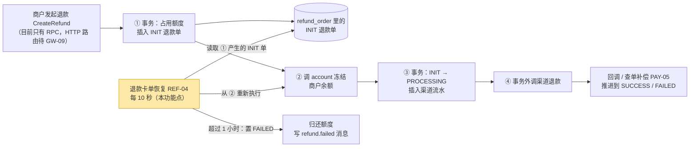
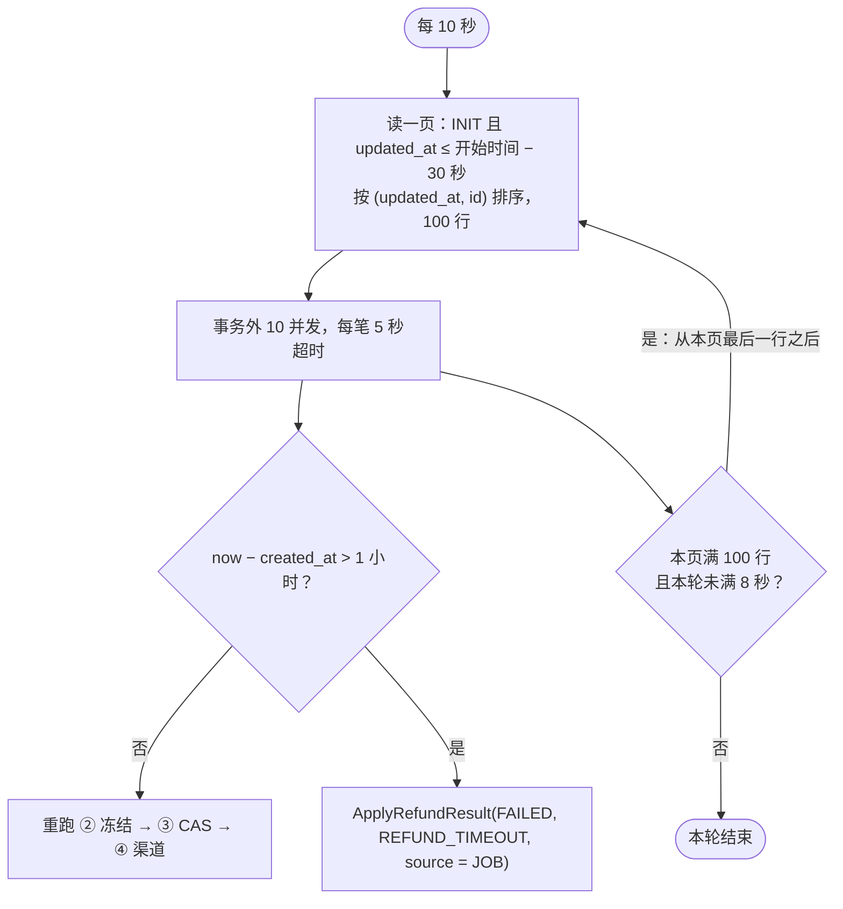
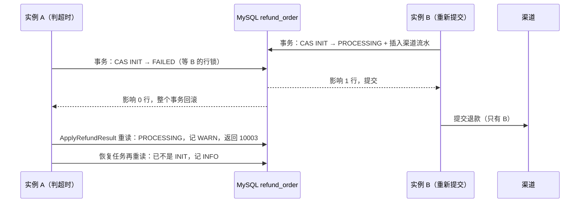
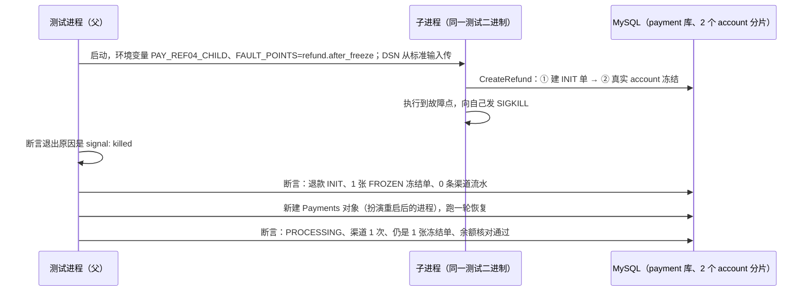

# REF-04 退款卡单恢复

| 项 | 内容 |
|---|---|
| 功能点 | REF-04 退款卡单恢复（优先级 P0，即必须完成；排在第 4 周的里程碑 M4） |
| 所属链路 | 退款 |
| 代码提交 | `48289b7` `[REF-04] add refund recover job`；`5e08679` `[REF-04] correct freeze timeout wording`（只改需求文字和一行代码注释） |
| 分支 | `feat/REF-04-refund-recover` |
| 日期 | 2026-11-06 |
| 状态 | DONE：本功能点的 3 条验收和按包运行的验证已通过；全量集成测试由主代理在合并 main 前串行补跑，结果不写入本报告 |

## 一句话结论

实现了退款卡单恢复：payment 进程每 10 秒找出停在初始状态 `INIT` 超过 30 秒的退款，创建不超过 1 小时的重新冻结并提交渠道，超过 1 小时的判为失败（`REFUND_TIMEOUT`）并归还退款额度。测试在“冻结成功、还没提交渠道”这一步用真实的 `SIGKILL`（等同 `kill -9`）杀掉一个执行 payment 逻辑的子进程，再新建一个 `Payments` 对象扮演重启后的进程；它的第一轮恢复就把这笔 1000 分（10.00 元）的退款推进为 `PROCESSING`，渠道只收到 1 次请求，账户里只有 1 张冻结单。判超时和重新提交同时发生时，两边都只能把状态从 `INIT` 改走，数据库保证只有一边成功，所以不会出现“渠道已经在退款、系统却把退款判成失败”的资损。

## 1. 背景

### 1.1 系统简介

pay-system 是一个用 Go 编写的小型支付后端，模拟商户收款、退款、商户间转账三条资金链路，重点在数据一致性和性能。系统由 5 个部分组成：gateway（对外 HTTP 入口，负责签名校验和限流）、payment（支付单、退款单、转账单的状态管理和流程推进）、account（账户余额与记账，数据按商户分到 2 个数据库分片）、channel-mock（模拟微信、支付宝这类外部支付渠道）、recon（对账，核对系统内外数据是否一致）。服务之间用 Kitex RPC（字节跳动开源的 Go RPC 框架）同步调用，或通过 Kafka 消息异步通知；数据存在 MySQL 8.4，Redis 用于防重放（记下请求里的一次性随机串，拒绝同一个签名请求被重复提交）。所有金额用整数“分”表示，所有记账只追加不修改。

当前已完成：支付单的创建、发起、结果推进、关单、查询和查单补偿（PAY-05，见术语表），退款的创建与额度占用（REF-01）、冻结与渠道提交（REF-02）、结果推进（REF-03）和查询（REF-05），以及创建转账单（TRF-01）。退款目前只能经 payment 的 Kitex RPC 方法 `CreateRefund` 发起（测试里直接调用对应的业务函数）；商户使用的 HTTP 接口 `POST /v1/refunds` 属于 GW-09，还没有实现。本功能点补上“退款卡在冻结前后时由系统自己接着做”这一环。

### 1.2 本功能点在系统中的位置

一笔退款在 payment 里按下面 4 步走（REF-01、REF-02），本功能点（黄色）负责把停在第 1 步之后、第 3 步之前的退款接着往下推。



上游是 `CreateRefund`：它在同一个请求里依次做 ①–④。②之后还没到③就中断，退款单会停在 `INIT`。下游有两条：重新执行时复用②③④的同一段代码；判超时时调用已有的结果推进函数 `ApplyRefundResult`（REF-03）。退款到了 `PROCESSING` 之后，由渠道回调和查单补偿（PAY-05）推进：PAY-05 每秒领取到了下次查单时间（`next_query_at <= now`）的 `PROCESSING` 渠道流水（支付和退款都处理）向渠道查单，查到 `SUCCESS` 或 `FAILED` 就调 `ApplyRefundResult`；渠道说没收到这笔、且流水创建已超过 60 秒，就重新提交渠道退款。所以 `PROCESSING` 的退款不归本功能点管。

### 1.3 为什么需要它

没有本功能点时，下面两种情况会让退款永远停在 `INIT`：

- **account 超时。** 商户对一笔 10000 分（100.00 元）的支付退 1000 分（10.00 元）。①已经把支付单的已退金额 `refunded_amount` 从 0 改成 1000，②调 account 冻结时超时。payment 不知道冻结成功了没有。REF-02 规则 1 规定：冻结超时或不可用时保持 `INIT`，接口返回 `INIT` 状态，由 REF-04 继续；所以 payment 不能继续提交渠道，只能把 `INIT` 返回。
- **进程崩溃。** ②冻结成功，商户结算账户里 1000 分被冻结，payment 在执行③之前被 `kill -9`。

两种情况下，这 1000 分的退款额度都被占着，同一笔支付最多只能再退 9000 分。如果冻结已成功，冻结的 1000 分商户也用不了。而渠道从来没收到退款请求，钱也没退给用户。必须有一个后台任务把这些单子要么推进下去，要么判失败并把额度还回去。

## 2. 术语

| 术语 | 含义 |
|---|---|
| 退款单 `refund_order` | payment 库里一笔退款的记录，状态有 `INIT`（已建单，还没提交渠道）、`PROCESSING`（已提交渠道，等结果）、`SUCCESS`、`FAILED`。后两种是终态，到了就不再变。 |
| 平台退款单号 `refund_no` | payment 生成的退款编号，`RF` 加 19 位数字。冻结单、渠道流水、日志都用它。 |
| 商户退款单号 `out_refund_no` | 商户自己给这笔退款起的编号。平台按（商户号，商户退款单号）去重：同号再次提交只返回已有的退款单，不会再冻结。商户想重新退一次，必须换一个新的商户退款单号，平台会生成新的平台退款单号。 |
| 卡单 | 停在中间状态、没有任何流程会再推进它的单据。本报告专指停在 `INIT` 的退款单。 |
| 退款额度、`refunded_amount` | 支付单 `payment_order` 上的已退金额。建退款单时先加上本次金额 R，退款失败时减回去，保证一笔支付累计退款不超过支付金额。 |
| 冻结、冻结单 | account 把商户结算账户的一部分余额标记为“暂不可用”，并在 `account_freeze` 表记一张冻结单。冻结单按（业务类型，业务单号）唯一，退款用（`REFUND`，平台退款单号）。冻结单有 3 种状态：`FROZEN`（已冻结）、`CONFIRMED`（退款成功，冻结的钱已扣走）、`RELEASED`（退款失败，已解冻还给商户）。 |
| 幂等 | 同一个操作执行多次，结果和执行一次相同。冻结是幂等的：对同一个平台退款单号再冻结，account 返回已有的那张冻结单，不会再冻一次。 |
| CAS | Compare-And-Swap，比较后交换。这里指 `UPDATE ... SET status = '新状态' WHERE status = '旧状态'`：只有当前状态仍是旧状态时才改，影响 0 行说明别人已经改过。两条这样的 UPDATE 同时改一行时，MySQL 的行锁让它们排队执行，后执行的那条看到的已经是新状态，影响 0 行。 |
| 租约 | 多个实例抢同一批任务时的一种做法：实例领取一行时写下“这行归我到某个时间为止”，期间其他实例不再领它，到期没处理完别人可以接手。需要表里有一列记这个时间。PAY-05 就是这样领取渠道流水的。 |
| 渠道、渠道流水 `channel_txn` | 渠道指外部支付机构（本项目用 channel-mock 模拟）。payment 每次向渠道提交支付或退款前，先在 `channel_txn` 插入一行流水，`uk_biz_no` 唯一索引保证同一个平台退款单号只有 1 行。 |
| outbox、`refund.failed` | outbox 是 payment 库里的消息表，和业务数据在同一个事务里写入。事务提交后由投递器（MQ-02，尚未实现）发到 Kafka，所以目前消息只写进表，还没有发出去。`refund.failed` 是“退款失败”消息，将来由 account 消费（MQ-04）把冻结的钱解冻。 |
| 墓碑 | account 收到解冻请求时如果根本没有冻结单（冻结从未成功），就写一张状态为 `RELEASED` 的空冻结单，叫墓碑，也叫空回滚。之后才迟到的冻结请求撞上它会被拒绝（`40004`），这叫防悬挂。 |
| 故障点、`refund.after_freeze` | 代码里预先放好的“自杀点”（BASE-15 提供的 `pkg/fault`）。启动时用环境变量 `FAULT_POINTS` 打开某个点，程序执行到这里就向自己发 `SIGKILL`。`refund.after_freeze` 在冻结成功之后、③之前。 |
| `:once` | 故障点名后加 `:once` 表示只触发一次：触发前先写一个标记文件，重启后的进程看到文件就不再自杀。 |
| `SIGKILL`、`kill -9` | 强制结束进程的信号，进程来不及做任何清理。 |
| Fake 时钟 | 测试用的假时钟，时间只在测试代码调用 `Set` 或 `Advance` 时才变，用来在毫秒内模拟“过了 1 小时”。 |
| 来源 `source` | 调用 `ApplyRefundResult` 时传入的参数，说明结果从哪里来：`JOB`（后台定时任务，本功能点用它）、`NOTIFY`（渠道回调）、`QUERY`（查单）、`SYNC`（创建退款的同步流程）、`ADMIN`（人工）。退款单表没有来源列，判超时这条路径只用它做参数校验，不写进数据库，也不写进消息。 |
| 种子数据 | 项目初始化脚本（BASE-03）创建的固定数据：演示商户 `M100001`、`M100002`、`M100003`（以及压测用的 `M200000`–`M200099`）和它们的商户结算账户。项目没有商户自助入驻，也没有停用账户的接口，所以能发起退款的商户一定有账户，而且账户一定是正常状态。 |
| 错误码 | 项目统一的数字错误码。本报告用到：`10003` 内部错误；`10004` 依赖暂时不可用；`30001` 单据不存在；`40001` 账户不存在；`40002` 余额不足；`40004` 冻结单状态冲突（冻结单已是 `RELEASED`）；`40005` 账户不是正常状态。 |
| 游标翻页 | 每次查询带上“上一页最后一行的位置”，下一页从它之后开始读。本功能点的位置是（`updated_at`，`id`）。 |
| 时间预算 | 一轮扫描允许花的时间上限（8 秒）。用完就不再取下一页，剩下的留给下一轮。 |
| 并发槽 | 一个容量为 10 的信号量。每处理一笔先占一个槽，处理完归还，所以同时最多处理 10 笔。 |
| panic | Go 里的运行时异常，不处理会让整个进程退出。 |
| 流程图编号 | 流程文档 `docs/06-flows.md` 里图的编号。CF 开头是控制流图，SL 开头是时序图。本报告提到 CF-10（创建退款、冻结与渠道提交）、CF-11（退款结果推进）、CF-12（退款卡单恢复）、SL-06（退款失败与卡单恢复的时序）。 |
| PAY-05 | 已完成的功能点“查单补偿”，处理支付和退款的 `PROCESSING` 渠道流水，见 1.2。 |
| BASE-15 | 已完成的功能点“故障注入点”，提供 `pkg/fault` 和 `FAULT_POINTS`。 |
| MQ-02 | 后续功能点“outbox 投递器”，把 outbox 里的消息发到 Kafka，尚未实现。 |
| MQ-04 | 后续功能点“account 事件消费”，负责消费 `refund.failed` 并解冻，尚未实现。 |
| OPS-03 | 后续功能点“业务与运行指标”，负责把进程内计数暴露成监控指标，尚未实现。 |
| GW-09 | 后续功能点“商户 API 路由（退款与转账）”，提供商户调用的退款 HTTP 接口，尚未实现。 |
| QA-01 | 后续功能点“故障演练”，在整套容器环境里打开故障点、杀进程、重启，验证恢复，尚未实现。 |
| 变异检查 | 故意把被测代码改错一处，确认对应测试会失败，用来证明测试真的在检查这件事。 |
| 主代理 | 本项目开发流程里负责编排任务、核验结果和执行 Git 提交的 AI 代理，不写代码。需要改变规则时由它决定或转给用户。 |
| 编码代理 | 本报告作者，负责写代码、测试和本报告的 AI 代理。 |
| 审查代理 | 独立的只读 AI 代理，审查代码改动并按严重度（高 / 中 / 低）列出问题。 |

## 3. 技术讲解

### 3.1 要解决的问题

结论：恢复任务要在不重复冻结、不重复提交渠道、不误判失败的前提下，把 `INIT` 退款推进下去或判失败。具体约束：

1. **不能打断正在进行的请求。** REF-04 规则 1：每 10 秒扫描 `status = 'INIT' AND updated_at <= now − 30s` 的退款，从 REF-02 第 1 步（冻结）重新执行。`CreateRefund` 的服务端处理超时是 5 秒。需求没有写明为什么取 30 秒，以下是编码代理按代码的理解：5 秒超时是 Go 的 ctx 截止时间，到期后原请求再发起的数据库和 RPC 调用会立刻失败，但 Go 不能强行终止正在执行的代码，正在进行的那次调用要等它察觉 ctx 到期后才返回。30 秒比 5 秒多出的 25 秒，用来容纳这段收尾和多个实例之间的时钟差。即使原请求还在跑，冻结幂等和 CAS 也保证重复执行安全（见 3.2.5），所以 30 秒是为了少做重复工作，不是正确性的前提。
2. **重复执行必须安全。** 两个 payment 实例可能同时扫到同一笔，同一笔也可能在多轮里反复重试。每笔退款最终只能有 1 张冻结单、1 条渠道流水，渠道只受理 1 次（资金规则：写操作必须幂等）。
3. **判失败不能造成资损。** REF-04 规则 2：`INIT` 超过 1 小时仍未能推进，按 REF-03 第 2 条（同一事务里 CAS `INIT → FAILED`、归还额度、写 `refund.failed`）置为 `FAILED`，`fail_code = REFUND_TIMEOUT`；此时渠道一定没收到请求，因为提交渠道前退款单已经是 `PROCESSING`。判 `FAILED` 会把额度还回去、将来还会让 account 解冻。如果这时渠道其实已经收到了退款请求并把钱退给了用户，商户就多退了一次钱。所以必须保证判失败的只能是渠道没收到请求的退款。
4. **事务里不调外部系统。** 冻结和渠道调用都在数据库事务之外（资金规则）。
5. **单笔出错不影响其他笔。** 一笔 panic 或超时，同一批的其他退款照常处理。

### 3.2 方案

整体思路：每 10 秒扫一次 `INIT` 退款，按创建时间分两路处理。创建不超过 1 小时的，原样重跑 `CreateRefund` 的②③④；超过 1 小时的，直接判失败。正确性靠已有的三道防线：冻结幂等、状态 CAS、渠道流水唯一索引，恢复任务自己不加锁。

#### 3.2.1 一轮的流程



一页里的任务全部结束后才判断要不要取下一页。截止时间在一轮开始时固定，本轮里新卡住的退款留到下一轮。处理过的行要么已不是 `INIT`，要么排在游标之前，所以同一轮内每行最多处理一次。

扫描用只读查询，不加锁，走已有的 `(status, updated_at)` 索引 `idx_status_updated_at`。MySQL 的二级索引里隐含主键 `id`，所以按 `(updated_at, id)` 排序直接沿索引读，不用额外排序。扫描有两条 SQL（`service/payment/biz/refund_recover_sql.go`），一轮的第一页用第一条，之后每页用第二条。编码代理用 `EXPLAIN` 看过两条，执行计划都是 `Index range scan on refund_order using idx_status_updated_at`。

```sql
-- 第一页
SELECT id, refund_no, merchant_id, out_refund_no, pay_no, amount, currency, reason,
       status, channel, fail_code, fail_msg, succeeded_at, version, created_at, updated_at
FROM refund_order
WHERE status = 'INIT' AND updated_at <= ?
ORDER BY updated_at, id
LIMIT ?

-- 之后每页：参数依次是截止时间、上一页最后一行的 updated_at（两次）和 id、每页行数
SELECT id, refund_no, merchant_id, out_refund_no, pay_no, amount, currency, reason,
       status, channel, fail_code, fail_msg, succeeded_at, version, created_at, updated_at
FROM refund_order
WHERE status = 'INIT' AND updated_at <= ?
  AND (updated_at > ? OR (updated_at = ? AND id > ?))
ORDER BY updated_at, id
LIMIT ?
```

第二条看 `WHERE` 的后半段：要么 `updated_at` 更大，要么相同但 `id` 更大。只按 `updated_at` 翻页的话，同一毫秒的多行会被跳过或重复，所以要带上 `id`。

#### 3.2.2 每笔怎么处理

下面这段（`service/payment/biz/refund_recover.go`）决定一笔退款走哪一路。看第一个 `if`：严格大于 1 小时才判超时；否则调用 `submitRefund`，它就是 `CreateRefund` 里②③④那段代码，恢复任务没有另写一份。

```go
func (p *Payments) recoverRefund(ctx context.Context, row RefundOrder) {
	if p.clk.Now().Sub(row.CreatedAt) > refundRecoverGiveUpAfter {
		p.timeoutRefund(ctx, row)
		return
	}
	// 与 CreateRefund 同一段代码：冻结（幂等）→ 故障点 → CAS INIT → PROCESSING 并插入流水 → 事务外提交渠道。
	// 冻结仍超时或不可用时返回 INIT 且没有错误，下一轮再试。
	_, err := p.submitRefund(ctx, row)
	if err == nil || errors.Is(err, errno.ErrInsufficientBalance) || errors.Is(err, errno.ErrChannelRejected) {
		// 40002 与渠道拒绝已由 ApplyRefundResult 写成 FAILED，不是这一轮的错误。
		return
	}
	logRecoverErr(ctx, row.RefundNo, "refund recover submit", err)
}
```

`40002`、`40004` 和渠道拒绝三种情况，`submitRefund` 都调 `ApplyRefundResult` 把退款置为 `FAILED`，区别只在返回给调用方的错误。REF-02 规则 1 原文规定：`40002` 时“接口返回 `40002` 和退款单”，渠道拒绝时“接口返回 `30006` 和 FAILED 退款单”，`40004` 时“接口返回 code 0 和 FAILED 退款单”。所以前两种返回带业务码的错误，`40004` 返回的错误是 nil，落在上面 `err == nil` 的分支里，不需要单独列出。需求没写为什么这样分；REF-02 报告的解释是：余额不足和渠道拒绝要把具体原因告诉商户，冻结单已解开则对商户表现为一次拿到失败退款单的正常调用。三种情况在恢复任务里都已置 `FAILED`，都不记日志。

`submitRefund` 自己只在两处记 ERROR：冻结返回 `40001` 或 `40005` 时（消息 `refund freeze account`），以及本地渠道配置错误时（消息 `channel refund config`），两处都返回 `10003`。恢复任务收到错误后由 `logRecoverErr` 再记一条：错误码是 `10003` 记 ERROR，其他记 WARN。所以 `40001`、`40005` 每轮 2 条 ERROR（`submitRefund` 一条、恢复任务一条）；连接被拒绝时 `submitRefund` 不记日志，直接返回 `10003`，只有恢复任务的 1 条 ERROR。

重跑时各种结果的去向和 `CreateRefund` 完全一样：

| 冻结结果 | 退款单 | 恢复任务的日志 |
|---|---|---|
| 成功（新冻结，或返回已有的冻结单） | ③ CAS 为 `PROCESSING`，插入渠道流水，④ 提交渠道 | 无 |
| 不可用：`10004`。account 客户端调用超时（500 毫秒，超时重试 1 次后仍超时）、ctx 到期、网络超时，或 account 服务端处理超时 | 保持 `INIT`，下一轮再试 | 无 |
| 连接被拒绝（例如 account 进程已退出，端口没人监听）。这不算超时，返回 `10003` | 保持 `INIT`，下一轮再试，超过 1 小时后判超时 | 每轮 1 条 ERROR（恢复任务这一路未单独测试，见 4.3） |
| `40002` 余额不足、渠道拒绝 | 经 `ApplyRefundResult` 置 `FAILED` | 无 |
| `40004`：已有冻结单是 `RELEASED`（墓碑或已解冻） | 调 `ApplyRefundResult(FAILED, FREEZE_CONFLICT)`。冻结单只在退款失败后才会被解开，所以恢复时遇到它，正常只有一种情形：别的实例已把这笔判为超时失败、account 也已处理完 `refund.failed`，而本实例还拿着扫描时读到的 `INIT`。这时 CAS `INIT → FAILED` 影响 0 行，`ApplyRefundResult` 原样返回已是 `FAILED` 的退款单，`fail_code` 保持 `REFUND_TIMEOUT`。`FREEZE_CONFLICT` 只在 CAS 命中时写入，即退款单仍是 `INIT`、冻结单却已是 `RELEASED`；按现有流程这只在数据被人工改过时出现。MQ-04 上线前，恢复任务不会遇到 `40004` | 无 |
| `40001`、`40005`（种子数据保证不会发生的数据错误，见术语表） | 保持 `INIT`，超过 1 小时后判超时 | 每轮 2 条 ERROR（`submitRefund` 一条、恢复任务一条，见表上方的说明） |

扫描读到的是当时的快照。处理时这笔退款可能已被别的实例推进为 `PROCESSING`：重跑这一路的冻结会返回已有的冻结单，③的 CAS 影响 0 行，`submitRefund` 重读后返回当前退款单，不调渠道，也不记日志。判超时这一路遇到同样情况的结果见 3.2.4 的表。

年龄按 `created_at` 算，扫描按 `updated_at` 筛。`INIT` 退款插入时两列写同一个时间，`INIT` 期间没有任何写操作会改这一行，所以两者相等。

#### 3.2.3 “超过 1 小时”还是“满 1 小时”

结论：取严格大于。创建后恰好 3600.000 秒仍重新冻结，3600.001 秒才判失败。

需求 REF-04 规则 2 原文是“INIT 超过 1 小时仍未能推进”，但 REF-02 规则 1 里写的是“REF-04 满 1 小时后按 `REFUND_TIMEOUT` 失败”，3 张流程图（SL-06、CF-10、CF-12）也写“满 1 小时”。“满”可以理解成“达到”，即大于等于，和“超过”在恰好 1 小时这一刻不一致。编码代理按规则原文取严格大于，理由是和 PAY-05 的期限口径一致：PAY-05 对渠道流水查单到创建后 24 小时为止，创建后恰好 24 小时的流水仍会查单，超过 24 小时才停止查单、交给对账。编码代理把 REF-02 规则 1 和 3 张流程图里的“满 1 小时”统一改成“超过 1 小时”。经主代理确认，这属于文字澄清，不改业务规则：两种写法最多差一轮（10 秒）。`TestRecoverRefundTimeoutBoundary` 测了恰好 1 小时、1 小时零 1 毫秒、2 小时三个点；把 `>` 改成 `>=` 做变异检查时，恰好 1 小时的用例失败。

#### 3.2.4 判超时与重新提交并发时，为什么不会资损

结论：③和判超时都只能把状态从 `INIT` 改走，MySQL 保证两者只有一个成功；而只有③成功后才会调渠道，所以“渠道收到请求”和“退款被判失败”不可能同时发生。

判超时调用的是 `ApplyRefundResult(FAILED, REFUND_TIMEOUT, source = JOB)`，不调冻结，也不调渠道。两边的 SQL 如下。上面是③（`refund_submit_sql.go`），和插入渠道流水在同一个事务；下面是判超时（`refund_result_sql.go`），和归还额度、写 `refund.failed` 在同一个事务。两条都带 `WHERE status = 'INIT'`。

```sql
-- ③ 推进为 PROCESSING
UPDATE refund_order SET status = 'PROCESSING', version = version + 1, updated_at = ?
 WHERE refund_no = ? AND merchant_id = ? AND status = 'INIT'
-- 判超时
UPDATE refund_order SET status = 'FAILED', fail_code = ?, fail_msg = ?, version = version + 1, updated_at = ?
 WHERE refund_no = ? AND status = 'INIT'
```

什么时候会撞上：两个 payment 实例的时钟差几毫秒，实例 A 认为这笔已经 3600.001 秒，去判超时；实例 B 认为才 3599.999 秒，去重新冻结。



- **B 先提交（图中情况）：** A 的 UPDATE 影响 0 行，额度不归还、`refund.failed` 不写，整个事务回滚。`ApplyRefundResult` 重读退款单，读到 `PROCESSING`，按 REF-03 已有的行为记一条 WARN（消息 `refund result not init`），返回 `10003`。恢复任务收到 `10003` 后自己再重读一次，看到已不是 `INIT`，说明是正常竞争，只记一条 INFO（`refund recover timeout lost race`）。所以一次正常竞争留下 1 条 WARN 和 1 条 INFO，没有 ERROR。退款按 B 的结果继续，由回调或查单推进到终态。
- **A 先提交：** B 的 UPDATE 影响 0 行，渠道流水不插入，B 不调渠道，直接返回已是 `FAILED` 的退款单。B 刚才那次冻结（或已有的冻结单）留在 account，等 `refund.failed` 被消费后解冻（见第 5 节）。

`ApplyRefundResult` 在判超时时的全部情况：

| 判超时时遇到的情况 | `ApplyRefundResult` 返回 | `ApplyRefundResult` 自己的日志 | 恢复任务的日志 | 证明 |
|---|---|---|---|---|
| CAS 命中，额度归还成功 | `FAILED`（`REFUND_TIMEOUT`），无错误 | 无 | WARN `refund recover timed out` | `TestRefundRecoverTimesOutAfterOneHour` |
| CAS 命中，但额度数据已不一致（见下） | 整个事务回滚，`10003` | ERROR，额度不一致计数加 1 | 重读仍是 `INIT`，ERROR | `TestRefundRecoverTimeoutQuotaMismatchMySQL` |
| CAS 未命中，重读是 `PROCESSING` | `10003` | WARN `refund result not init` | 再重读，已不是 `INIT`，INFO | `TestRefundRecoverTimeoutLostRaceMySQL` |
| CAS 未命中，重读是 `SUCCESS` | 这张退款单，无错误 | WARN `refund result not init` | INFO `refund recover timeout superseded`，不算超时 | `TestRecoverRefundTimeoutLogs`（单元） |
| CAS 未命中，重读是 `FAILED` 且原因是 `REFUND_TIMEOUT`（另一个实例先判了超时） | 这张退款单，无错误 | 无 | WARN `refund recover timed out`（两个实例各记一条） | `TestRecoverRefundTimeoutLogs`（单元） |
| CAS 未命中，重读是其他原因的 `FAILED` | 这张退款单，无错误 | 无 | INFO `refund recover timeout superseded` | `TestRecoverRefundTimeoutLogs`（单元） |
| 退款单不存在 | `30001` | 无 | WARN | `TestRecoverRefundTimeoutLogs`（单元） |
| 写库失败等其他错误 | `10003` | 视错误而定 | 重读仍是 `INIT` 或重读失败，ERROR | `TestRecoverRefundTimeoutLogs`（单元） |

“额度数据已不一致”指支付单的已退金额小于这笔退款的金额 R，通常是被人工改过。REF-03 第 5 条规定：归还额度的 `UPDATE ... SET refunded_amount = refunded_amount - R WHERE pay_no = ? AND refunded_amount >= R` 影响 0 行时，整个事务回滚（退款单的 CAS 和 outbox 都不提交），返回 `10003`，记 ERROR 日志并把计数 `pay_refund_quota_inconsistent_total` 加 1，退款保持原状态，直到人工修复数据。

判超时这一路从不调冻结，也不调渠道。这个保证的另一半在 REF-03：`REFUND_TIMEOUT` 这类“还没提交渠道”的失败原因只会去 CAS `INIT`，即使读到的是 `PROCESSING` 也不会改它。

`TestRefundRecoverTimeoutLostRaceMySQL` 在真实 MySQL 上复现“B 先提交”之后 A 才执行的情形，不是两个 goroutine 真正并发。它复用 REF-03 测试的辅助函数，先按正常流程建一笔 2000 分、已是 `PROCESSING` 的退款（已退金额 2000 分），再拿这笔退款在 `INIT` 时的旧数据调用判超时。断言退款保持 `PROCESSING`，已退金额保持 2000 分，日志里有 1 条 WARN、1 条 INFO，没有 ERROR。

#### 3.2.5 多实例与幂等

结论：恢复任务不抢占、不加锁，多个实例同时处理同一笔也只会有一次生效。

两个实例同时重跑同一笔时：

1. 两边都调冻结。account 按（`REFUND`，平台退款单号）唯一，只有 1 张冻结单，后到的拿到已有的那张。
2. 两边都执行③。CAS 和插入流水在同一个事务里，CAS 只有一边影响 1 行；另一边影响 0 行，直接回滚，不插流水、不调渠道。
3. `channel_txn.uk_biz_no` 唯一索引是兜底：正常流程里输掉 CAS 的一方走不到插入流水。只有数据被人改过（例如退款单被改回 `INIT`，而它的渠道流水还在）时插入才会撞上唯一索引，这时事务同样回滚，不调渠道。

`TestRefundRecoverTwoInstances` 让两个实例同时对 5 笔卡单各跑一轮，5 笔都只有 1 张冻结单、1 条渠道流水，渠道一共收到 5 次请求。

#### 3.2.6 超时、停止和 panic

- **每笔超时。** 每笔任务的超时是 5 秒，和 `CreateRefund` 相同：冻结最长约 1 秒（account 客户端调用超时 500 毫秒，超时重试 1 次），渠道退款 3 秒，剩下的给写库。
- **进程停止。** payment 进程收到退出信号后，定时循环 `job.Loop.Stop` 立即取消批次的 ctx。正在等并发槽的退款不再启动，仍是 `INIT`，下一轮或重启后再处理。已开始的任务用 `context.WithoutCancel` 派生的 ctx，不被打断，继续跑完：冻结请求发出后被打断，结果就变成未知了。批次等本页已开始的任务结束才返回，每笔最多 5 秒，所以停止时一般最多等 5 秒左右。payment 进程停止时，对 RPC 服务和所有后台任务（PAY-05、REF-04 的定时循环）一起最多等 10 秒（`server.DefaultDrainTimeout`），到时间仍没结束就关闭数据库连接退出；没跑完的任务效果等同进程崩溃，下一次恢复会接着处理。
- **panic。** 单笔 panic 被 `recover` 接住，进程内计数加 1（将来由 OPS-03 暴露），同一批其他笔不受影响。
- **定时循环。** 复用 PAY-05 的 `job.Loop`，任务名 `refund_recover`，每 10 秒一次，同一时刻最多一轮在跑，随 payment 进程启停。

#### 3.2.7 崩溃恢复测试的做法

结论：测试真的用 `SIGKILL` 杀掉一个执行 payment 逻辑的子进程，再新建一个 `Payments` 对象扮演重启后的进程，不是用函数调用模拟崩溃。

故障点会向**自己所在的进程**发 `SIGKILL`，在测试进程里直接触发会把测试本身杀掉。所以测试把自己的测试二进制作为子进程再启动一次：



- `TestMain` 看到环境变量 `PAY_REF04_CHILD` 时不跑测试，只执行“被杀的那个进程”的逻辑。如果故障点没生效，子进程会打印 `not killed` 并以退出码 3 结束，父进程据此判失败。
- 数据库连接串含密码，从标准输入传给子进程，不放进环境变量。最初放在环境变量里时，静态检查工具 gosec 的 SSRF 污点分析（G704）从 `os.Getenv` 一路追踪，误报到渠道 HTTP 客户端，改成标准输入后告警消失。
- 父进程扮演的“重启后的进程”没有打开故障点，所以测试不需要 `:once`。QA-01 故障演练会用同一个 `FAULT_POINTS` 重启容器，那时要写 `refund.after_freeze:once`，否则恢复任务每次重跑都会在同一个故障点再次自杀。

### 3.3 为什么这样做

| 方案 | 做法 | 优点 | 缺点 | 结论 |
|---|---|---|---|---|
| 采用：只读扫描，靠幂等和 CAS 互斥 | 不加锁读出卡单，重跑已有代码 | 不用改表；复用②③④的代码，行为和同步请求一致；冻结、CAS、唯一索引三道防线已经各自测过 | 两个实例可能对同一笔各调一次冻结（第二次返回已有冻结单） | 采用 |
| 备选：像 PAY-05 一样先抢占 | `FOR UPDATE SKIP LOCKED` 领取并写租约 | 同一笔同时只有一个实例处理 | `refund_order` 没有租约列，要改表结构；重复冻结本来就是幂等的，抢占换来的只是少一次 RPC | 不采用 |
| 采用：按 `(updated_at, id)` 游标翻页，8 秒预算 | 一轮内连续翻页 | 同一轮内每行最多处理一次，长期卡住的行不会反复占满第一页；改动只在扫描函数 | 一轮更长。account 卡住时每页约 10 秒，已超过 8 秒预算，一轮只处理一页，此时效果与“每轮只取一页”相同（第 5 节） | 采用 |
| 备选：每轮固定取最老 100 行 | 只读一页 | 最简单 | 如果最老的 100 行都是每轮返回 `10003` 的坏数据，后面的行永远轮不到 | 不采用（审查问题 L3） |
| 备选：先取超过 1 小时的行 | `ORDER BY` 把超时行排前面 | 判超时很快 | 额度不一致的行超过 1 小时后每轮仍返回 `10003`，排在前面反而挡得更死 | 不采用 |
| 采用：恢复时重跑 `submitRefund` | 和 `CreateRefund` 共用一段代码 | 任何对②③④的修正自动同时生效 | 故障点也在这段代码里，演练要用 `:once` | 采用 |

### 3.4 正确性

| 场景 | 系统行为 | 最终状态 | 证明 |
|---|---|---|---|
| 冻结成功后、③之前进程被 `kill -9` | 重启后的第一轮从②重跑，冻结返回已有冻结单，③④照常执行；再跑一轮不重复提交 | `PROCESSING`；1 张冻结单；1 条渠道流水；渠道 1 次 | `TestRefundRecoverAfterFreezeKill` |
| account 不可用期间 | 每轮重试冻结都失败，不写流水、不调渠道。这条测试同时检查 30 秒边界：退款更新后 29.999 秒时还不扫，恰好 30 秒时扫到 | 一直是 `INIT`，0 张冻结单 | `TestRefundRecoverAfterAccountRecovers` |
| account 恢复后的下一轮 | 冻结成功，③④执行 | `PROCESSING`，1 张冻结单，渠道 1 次 | 同上 |
| account 持续不可用 1 小时 | 恰好 1 小时仍重试；1 小时零 1 毫秒时判超时，不再冻结 | `FAILED`（`REFUND_TIMEOUT`）；已退金额由 1000 分回到 0；1 条 `refund.failed`；渠道 0 次 | `TestRefundRecoverTimesOutAfterOneHour` |
| 冻结在 account 已成功但响应丢失，且此后 1 小时内每次重试冻结也都没拿到结果（account 一直超时），或一直没轮到。只要有一次重试拿到结果，就会返回已有冻结单并推进为 `PROCESSING` | 1 小时零 1 毫秒时判超时 | `FAILED`；已退金额回到 0；1 条 `refund.failed`；冻结单仍是 `FROZEN`，等 MQ-04 解冻 | `TestRefundRecoverTimesOutAfterFreeze` |
| 判超时与另一路推进并发 | 判超时的 CAS 影响 0 行并回滚，重读后记 INFO | `PROCESSING`；已退金额不变 | `TestRefundRecoverTimeoutLostRaceMySQL`（按先后顺序模拟，见 3.2.4） |
| 判超时时额度数据已不一致 | 整个事务回滚，记 ERROR | `INIT`；没有 `refund.failed` | `TestRefundRecoverTimeoutQuotaMismatchMySQL` |
| 两个实例同时恢复同一批 | 冻结幂等、CAS 只一边成功 | 5 笔各 1 张冻结单、1 条流水，渠道共 5 次 | `TestRefundRecoverTwoInstances` |
| 同一行被同一实例重跑 | 冻结返回已有冻结单，CAS 影响 0 行，不调渠道 | 不变 | `TestRecoverRefundResubmitsFromFreeze` |
| 卡单超过一页（105 笔同一毫秒） | 第二页靠 `id` 续上 | 每笔恰好冻结 1 次 | `TestRefundRecoverPagesPastFullPage` |
| 一轮用满 8 秒 | 不再翻页 | 只处理第一页 100 笔，其余 5 笔留到下一轮 | `TestRefundRecoverStopsPagingAfterBudget` |
| 单笔 panic | panic 被接住并计数 | 其他笔不受影响 | `TestRecoverRefundTaskRecoversPanic` |
| 进程停止 | 取消后不再等并发槽、不再启动新任务，已开始的跑完 | 没启动的仍是 `INIT` | `TestDispatchRefundRecoverStopsWaitingOnCancel`：名字的意思是“取消后不再等并发槽”。测试放 15 笔、并发 10，前 10 笔卡在冻结里时取消，断言后 5 笔没有启动，而且分发函数等前 10 笔结束后才返回 |

所有动到账户的集成测试结束时都调用 account 的余额核对 `CheckBalance`：先全量核对两个分片（每个账户的余额等于流水合计、冻结金额等于冻结单合计），再核对这个商户，全部通过。测试里商户的初始余额 100000 分（1000.00 元）通过正常记账入账，不是直接改余额字段。

### 3.5 性能

不涉及：本功能点没有压测，也没有性能开关。吞吐上限是按超时参数算出来的，写在第 5 节。

## 4. 已完成内容

### 4.1 改动清单

| 文件 | 新增 / 修改 | 作用 |
|---|---|---|
| `service/payment/biz/refund_recover.go` | 新增 | `RunRefundRecoverBatch` 翻页和时间预算；10 并发分发；单笔超时与 panic 恢复；按年龄分两路；判超时的日志分级 |
| `service/payment/biz/refund_recover_sql.go` | 新增 | 第一页和之后每页两条扫描 SQL，游标 `(updated_at, id)` |
| `service/payment/job/refund_recover.go` | 新增 | 定时循环 `refund_recover`，每 10 秒 |
| `cmd/payment/main.go` | 修改 | 把恢复循环注册到 payment 进程的生命周期（2 行） |
| `service/payment/biz/refund_recover_test.go` | 新增 | 11 个单元测试 |
| `service/payment/biz/refund_recover_integration_test.go` | 新增 | 11 个 MySQL 集成测试，含 `kill -9` 子进程 |
| `service/payment/biz/fee_integration_test.go` | 修改 | `TestMain` 里加子进程入口 |
| `service/payment/job/loop_test.go` | 修改 | `TestNewRefundRecover`：名字和间隔 |
| `.golangci.yml` | 修改 | 允许新集成测试文件直接引用 account 的业务包（生产代码仍禁止），做法与已有的退款冻结测试相同 |
| `docs/02-requirements.md` 等 5 份文档 | 修改 | 见 4.5 |

### 4.2 对外变化

| 类别 | 变化 |
|---|---|
| 接口 | 无 |
| 表结构 | 无。使用已有索引 `idx_status_updated_at` |
| 配置项 | 无。间隔、批量、并发、超时、预算都是代码常量 |
| 错误码 | 无 |
| 指标 / 故障点 | 无新增指标，panic 次数先在进程内计数，将来由 OPS-03 暴露；无新增故障点，复用 `refund.after_freeze` |
| 后台任务 | 新增 payment 进程内定时任务 `refund_recover`，每 10 秒一轮 |

### 4.3 验收对照

| 验收条目 | 测试函数 | 类型 | 结果 |
|---|---|---|---|
| 在故障点 `refund.after_freeze` 处 kill 进程，重启后退款被推进为 PROCESSING 并提交渠道（渠道受理 1 次），冻结单只有 1 张 | `TestRefundRecoverAfterFreezeKill` | 集成（真实子进程 `SIGKILL`） | 通过 |
| account 不可用期间退款保持 INIT；account 恢复后的下一轮扫描把它推进为 PROCESSING 并提交渠道 | `TestRefundRecoverAfterAccountRecovers` | 集成 | 通过 |
| account 持续不可用 1 小时（Fake 时钟），退款 FAILED（`REFUND_TIMEOUT`），`refunded_amount` 恢复 | `TestRefundRecoverTimesOutAfterOneHour` | 集成 | 通过 |
| 补充：扫描条件、30 秒边界、排序、翻页游标 | `TestRefundRecoverScanSelectsStuckInit` | 集成 | 通过 |
| 补充：两实例并发恢复 | `TestRefundRecoverTwoInstances` | 集成 | 通过 |
| 补充：翻页与 8 秒预算 | `TestRefundRecoverPagesPastFullPage`、`TestRefundRecoverStopsPagingAfterBudget` | 集成 | 通过 |
| 补充：已冻结后超时 | `TestRefundRecoverTimesOutAfterFreeze` | 集成 | 通过 |
| 补充：判超时竞争与额度不一致 | `TestRefundRecoverTimeoutLostRaceMySQL`、`TestRefundRecoverTimeoutQuotaMismatchMySQL` | 集成 | 通过 |
| 补充：未装配冻结或渠道、ctx 已取消 | `TestRunRefundRecoverBatchNotWiredMySQL`、`TestRunRefundRecoverBatchNotReady` | 集成、单元 | 通过 |
| 补充：1 小时边界、冻结各结果、日志分级、panic、并发上限、停止 | `TestRecoverRefund*`、`TestDispatchRefundRecover*`、`TestNewRefundRecover` | 单元 | 通过 |

单元测试覆盖的冻结结果是 `10004`、`40001`、`40002`、`40004`。`40005` 和 `40001` 在代码里是同一个分支，没有单独的用例。连接被拒绝 → `10003`、每轮 1 条 ERROR 这一路未单独测试：只有 REF-02 的单元测试 `TestFreezeTimedOutRecognizesServerTransError` 断言连接被拒绝不算超时（因此不会变成 `10004`）；之后返回 `10003` 时恢复任务记 ERROR，用的是和 `40001` 相同的 `logRecoverErr`，但这一步的日志级别没有测试断言。

### 4.4 验证记录

结论：除全量集成测试和全量覆盖率外，全部实际运行并通过。环境：macOS 27.0.1，Apple 芯片（arm64），Go 1.27.2，Docker 29.8.2（OrbStack）；`TEST_MYSQL_DSN` 未设置，集成测试由 testcontainers 启动 MySQL 8.4.11 容器。

| 命令 | 结果 |
|---|---|
| `gofmt -l .` | 无输出 |
| `make lint` | `0 issues.` |
| `make test` | 通过 |
| `go test -race -count=1 -tags integration ./service/payment/... ./cmd/payment/` | 4 个包全部 `ok`。编码代理运行时 `service/payment/biz` 79.6s；主代理在 `48289b7` 上复核：biz 77.9s、handler 18.8s、job 1.4s、cmd/payment 1.4s |
| `go test -race -count=1 -tags integration -run 'RefundRecover\|RecoverRefund\|DispatchRefundRecover' -v ./service/payment/biz/ ./service/payment/job/` | 23 个测试全部 `--- PASS`（biz 22 个，job 1 个），其中 `kill -9` 测试 8.8s |
| `go test -count=1 -tags integration -coverprofile=… ./service/payment/biz/` | `service/payment/biz` 85.8%；新函数中 `RunRefundRecoverBatch` 95.2%，`stuckRefunds` 84.2%，其余 100%。`service/payment/job` 97.6%（审查修复前的一次运行，之后 job 包没有改动） |
| 变异检查 | 7 处：1 小时判断 `>` 改 `>=`；判超时总记 WARN；去掉 `10003` 后的重读；只取一页；去掉 8 秒预算；去掉冻结未装配检查；去掉渠道未装配检查。每处都有对应测试失败，代码已还原 |
| `validate_database_doc.py docs/database.md --sql migrations/payment/000001_init.up.sql` | `OK: validated docs/database.md` |
| Mermaid 渲染（`npx @mermaid-js/mermaid-cli@11.17.1`） | 流程文档里的 CF-12、SL-06、CF-10 渲染通过；本报告的 4 张图在可读性修改后渲染通过。未保存图片 |
| `make test-integration` | 未跑，原因：并行开发时根包测试 TestBASE02Stack 用固定 compose 项目名 pay-system 并在开始前 make down V=1，会互相删环境；由主代理在合并 main 前串行运行 |
| `make cover` | 未跑，原因同上 |

上表最后两行的原因换个说法：根包测试 TestBASE02Stack 开始前会执行 `make down V=1`，删除 Docker Compose 项目 `pay-system` 的全部容器和数据卷。这个项目名是写死的，两个分支同时跑这个测试，会删掉对方正在用的环境。

未运行这两项带来的风险：本次改动只在 `service/payment`、`cmd/payment` 和 lint 配置里，lint 配置已由全量 `make lint` 检查；其他服务的集成测试没在本分支上跑过，合并前由主代理串行补跑。

### 4.5 同步的文档

- `docs/02-requirements.md`：REF-04 增加实现说明（翻页与预算、并发与超时、年龄边界、两路的去向、日志分级、多实例、已知风险），3 条验收打勾，功能点总表改为 DONE；REF-02 规则 1 里“满 1 小时后”改为“超过 1 小时后”；变更记录加行。这些在 `48289b7` 提交。之后有一处文字更正，在 `5e08679` 单独提交：实现说明里每笔冻结的最长耗时原写 0.5 秒，更正为约 1 秒，`refund_recover.go` 里对应的一行注释同步修改，规则和行为不变。
- `docs/06-flows.md`：版本 v2.37 → v2.39，两次修改都在 `48289b7` 提交。v2.38 是本功能点首版：重画 CF-12，SL-06、CF-10 的“满 1 小时”改为“超过 1 小时”。v2.39 是审查修复：CF-12 改为翻页加 8 秒预算、判超时按结果分出口。合并到 main 时，如果别的分支先改过这份文档，版本号可能顺延，以合并后为准。
- `docs/database.md`：`refund_order` 的生命周期补上恢复任务的只读扫描和 `INIT → FAILED（REFUND_TIMEOUT）`；兼容说明写明按 `updated_at` 扫描、按 `created_at` 判 1 小时；变更记录加一行（无表结构变化）。
- `docs/04-dev-plan.md`：勾选退款一行（REF-01 至 REF-05）。
- `docs/interview-notes.md`：记录子进程 `kill -9` 测试和 gosec 误报。

### 4.6 审查问题与处理

审查代理没有提出高、中严重度问题，5 条低严重度问题全部修复：

| 编号 | 问题 | 处理 |
|---|---|---|
| L1 | 判超时不看返回结果就记“timed out”，退款其实已被另一路推进成功时也这么记 | 只有返回 `FAILED` 且原因是 `REFUND_TIMEOUT` 才记 WARN，其余按 3.2.4 的表分级 |
| L2 | 判超时与推进的正常竞争返回 `10003` 后记 ERROR，会误报警 | 收到 `10003` 先重读，已不是 `INIT` 记 INFO，仍是 `INIT` 或重读失败才记 ERROR |
| L3 | 每轮固定取最老 100 行，长期卡住的行会挡住后面的行 | 改为游标翻页加 8 秒预算；剩余上限写入需求的已知风险 |
| L4 | 表结构文档和流程图描述不全 | 补表结构文档的生命周期和兼容说明；流程图写明 `40001`、`40005` 每轮两条 ERROR |
| L5 | “未装配冻结或渠道”的单元测试即使删掉检查也会通过 | 改在 MySQL 上测，删掉检查后测试会失败（变异检查已验证） |

审查代理另提出一项不需要改代码的残余风险（MQ-04 上线前冻结不释放），已写进需求的已知风险和本报告第 5 节，并补了 `TestRefundRecoverTimesOutAfterFreeze`。

## 5. 未完成与风险

- **MQ-04 上线前，判超时的退款冻结不会释放，商户可能被冻结两次。** 前提是冻结在 account 已成功、payment 没收到响应，而且此后 1 小时内每次重试冻结也都没拿到结果，或一直没轮到；只要有一次重试拿到结果，退款就会正常推进。例：商户结算账户有 100000 分，一笔 1000 分退款满足上述前提，1 小时后被判超时。payment 这边已退金额从 1000 分回到 0，`refund.failed` 消息也写进了 outbox。但投递器（MQ-02）和 account 消费者（MQ-04）都还没做，冻结单仍是 `FROZEN`，商户可用余额仍少 1000 分。商户换一个商户退款单号重新退这 1000 分，会再冻结 1000 分，可用余额变成 98000 分，而实际只在退一次。钱没有丢，只是多锁住 1000 分，直到 MQ-04 消费 `refund.failed` 后解冻；在此之前只能人工处理。
- **吞吐有上限。** 一轮最多 8 秒（最后一页可能超出），每页 100 笔、10 并发。account 卡住时每笔冻结约 1 秒，一页约 10 秒，已超过预算，一轮只处理一页，约每 10 到 20 秒 100 笔。account 长时间卡住后积压的退款可能等不到重试就超过 1 小时，被判 `REFUND_TIMEOUT`。这些退款渠道都没收到请求，不造成资损，但商户要重新发起。长期卡住的坏数据如果超过一轮能处理的量，仍会挡住后面的行。本功能点没有新增指标，“`INIT` 退款数量”和“最老一笔的年龄”列为运维观测项，由 OPS-03 定指标名和告警。以上数字是按超时参数算的，没有压测。
- **数据错误和 account 停机时日志较多。** `40001`、`40005` 每轮 2 条 ERROR，到 1 小时判超时为止，一笔约 720 条。REF-02 规则 1 要求这类内部数据错误记错误日志并告警（种子数据保证账户存在且没有停用入口，出现即说明数据坏了）。account 进程退出、连接被拒绝时每笔每轮 1 条 ERROR，一笔 1 小时约 360 条。
- **正常竞争仍有一条 WARN。** 判超时与另一路推进竞争时，`ApplyRefundResult` 自己记一条 WARN（REF-03 已有的行为，见 3.2.4），恢复任务只记 INFO。
- **留给后续功能点：** MQ-02、MQ-04 投递并消费 `refund.failed` 后解冻；OPS-03 暴露 panic 计数和卡单观测项；QA-01 演练时故障点写成 `refund.after_freeze:once`；GW-09 提供商户调用的退款 HTTP 路由。

## 6. 如何复现

需要本机 Docker 或已设置的 `TEST_MYSQL_DSN`，集成测试会起 MySQL。`deploy/.env` 里有密钥，不要把它读进 shell，测试也不需要它。

```bash
gofmt -l .
make lint
make test
go test -race -count=1 -tags integration ./service/payment/... ./cmd/payment/
```

预期：`gofmt -l .` 没有输出；`make lint` 打印 `0 issues.`；后两条退出码为 0，最后一条打印 4 行 `ok`。

只跑本功能点的测试：

```bash
go test -race -count=1 -tags integration -v ./service/payment/biz/ ./service/payment/job/ \
  -run 'RefundRecover|RecoverRefund|DispatchRefundRecover'
```

预期打印 23 行 `--- PASS`，两个包各一行 `ok`。`TestRefundRecoverAfterFreezeKill` 会启动一个子进程并把它杀掉，耗时约 8 秒。

全量 `make test-integration` 和 `make cover` 会运行根包的 TestBASE02Stack。它开始前会删除 Docker Compose 项目 `pay-system` 的全部容器和数据卷，不要和别的分支同时跑。

## 7. 讲解要点

1. **判超时会不会把渠道已经在处理的退款判失败？** 不会。提交渠道之前必须先把 `INIT` CAS 成 `PROCESSING`，判超时也只能 CAS `INIT`。两条 UPDATE 在 MySQL 行锁下排队，只有一条影响 1 行；输的一方整个事务回滚，不归还额度、不写消息。
2. **为什么恢复任务不加锁也能多实例跑？** 冻结按平台退款单号幂等，CAS 只有一边成功，渠道流水有唯一索引兜底。三道防线各自保证“只发生一次”，加锁只能省掉一次幂等的冻结 RPC，却要改表加租约列。
3. **崩溃测试为什么要起子进程？** 故障点向自己的进程发 `SIGKILL`，在测试进程里触发会杀掉测试本身。重新执行测试二进制作为子进程，子进程被真正杀掉后，父进程检查数据库，再新建 `Payments` 对象扮演重启后的进程。

## 延伸阅读

- `docs/02-requirements.md`：REF-02、REF-03、REF-04 的规则与实现说明。
- `docs/06-flows.md`：CF-10、CF-11、CF-12、SL-06（内容见术语表“流程图编号”）。
- `docs/database.md`：`refund_order` 一节。
- `docs/reports/REF-02-freeze-submit.md`、`docs/reports/REF-03-refund-result.md`、`docs/reports/PAY-05-query-compensate.md`。

## 修订记录

| 日期 | 提交 | 修订内容 |
|---|---|---|
| 2026-11-06 | `48289b7` | 初版：退款卡单恢复，含审查问题 L1–L5 的修复 |
| 2026-11-06 | `5e08679` | 需求文字与代码注释更正：每笔冻结最长耗时由 0.5 秒改为约 1 秒（需求实现说明的文字和 `refund_recover.go` 的一行注释），规则和行为不变 |
| 2026-11-06 | 与本报告同一次提交 | 报告表头和 4.5 补提交号 `5e08679`。可读性第 1 轮 35 处已改：补 `40004` 的实际路径、“不可用”对应的错误码和连接被拒绝的情形、判超时时 `ApplyRefundResult` 各情况的返回和日志、2000 分测试数据的来由、30 秒余量的说明、停止流程最多等多久、引用规则的原文、术语（租约、种子数据、冻结单状态、两种退款单号、来源、相关功能点及完成状态、流程图编号）；`source` 改为“传入参数，不落库”；第 1.2 节流程图箭头改为指向 INIT 退款单 |
| 2026-11-06 | 与本报告同一次提交 | 可读性第 2 轮 9 处已改：说明 `40002`、渠道拒绝与 `40004` 返回值不同的原因和 `submitRefund` 自己记 ERROR 的位置；`40004` 在恢复时 `fail_code` 保持 `REFUND_TIMEOUT`、`FREEZE_CONFLICT` 何时写入；注明连接被拒绝未单独测试；表头、停止流程、PAY-05 领取条件和审查问题 L1 的措辞；`5e08679` 一行只写该提交的内容 |
