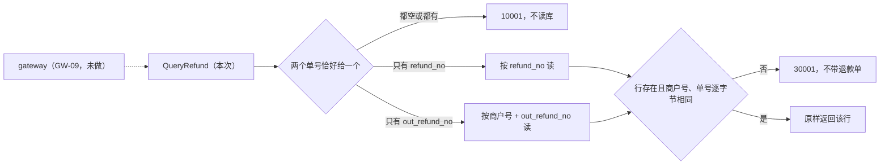

# REF-05 退款查询

| 项 | 内容 |
|---|---|
| 功能点 | REF-05 退款查询（优先级 P0，最高，必须完成；开发计划第 4 周） |
| 所属链路 | 退款 |
| 代码提交 | `83b08fe` `[REF-05] add refund query`（完整 `83b08fe9357f1f1670c4a29fb13c90d942ac1e51`，2026-11-06 00:26:40 +0800） |
| 分支 | `feat/REF-05-query-refund` |
| 日期 | 2026-11-06 |
| 状态 | DONE |

本报告写在上面这次代码提交之后，不属于该提交改动的 10 个文件（清单见 4.1）。本次只做 payment 进程里的 RPC 方法 `PaymentService.QueryRefund`。商户用的 HTTP 路由 `GET /v1/refunds...` 属于 GW-09（商户 API 路由：退款与转账），本次没做。

## 一句话结论

`QueryRefund` 只读当前商户自己的退款单。商户 B（`M100091`）拿商户 A（`M100090`）的平台退款单号或商户退款单号来查，都得到已有错误码 `30001`。这个错误和“单号根本不存在”完全相同，B 由此看不出这张退款单是否存在（前提是 B 自己没有同号的退款单，否则 B 读到的是自己的单）。查询前后，A 的退款单状态、`version`、`updated_at` 都没变，原支付单上已占用的退款额度 `refunded_amount` 仍是 3000 分（30.00 元），待发消息表 outbox 和渠道流水表 `channel_txn` 都没有新增行。证据是 MySQL 集成测试 `TestREF05MerchantBCannotReadA`。

## 1. 背景

### 1.1 系统简介

pay-system 是一个用 Go 编写的小型支付后端，模拟商户收款、退款、商户间转账三条资金链路，重点在数据一致性和性能。系统由 5 个部分组成：gateway（对外 HTTP 入口，负责签名校验和限流）、payment（支付单、退款单、转账单的状态管理和流程推进）、account（账户余额与记账，数据按商户分到 2 个数据库分片）、channel-mock（模拟微信、支付宝这类外部支付渠道）、recon（对账，核对系统内外数据是否一致）。服务之间用 Kitex RPC 同步调用，或通过 Kafka 消息异步通知；数据存在 MySQL 8.4，Redis 用于防重放。所有金额用整数“分”表示，所有记账只追加不修改。当前已完成：支付单的创建、发起、结果推进、关单和查询（PAY-08 支付单查询），渠道模拟与回调入口，退款的创建与额度占用（REF-01）、冻结与渠道提交（REF-02）、结果推进（REF-03），以及本次的退款查询。退款卡单恢复（REF-04）和网关上的退款路由（GW-09）还没做。

上面这段里的几个词：Kitex 是本项目用的 Go RPC 框架，RPC 指一个进程同步调用另一个进程里的函数。签名校验和限流都在 gateway，本次不涉及。防重放是拒绝被截获后原样再发一次的请求，靠 Redis 记住用过的随机串实现，本次不涉及。Kafka 是异步消息队列。分片是把账户数据按商户拆进 2 个库。1 元 = 100 分。本次查询不碰账户，不写任何账。

### 1.2 本功能点在系统中的位置

退款单在前几个功能点里已经能被写入和推进。创建退款 `CreateRefund` 先插入一张状态为 `INIT` 的退款单（REF-01），然后在同一个请求里调用 account 冻结商户资金：冻结成功就把退款单改成 `PROCESSING` 并提交给渠道；余额不足时冻结被拒，退款单直接改为 `FAILED`（`fail_code = INSUFFICIENT_BALANCE`），创建接口返回 `40002` 并附上这张退款单；冻结超时或 account 不可用，退款单就停在 `INIT`（REF-02）。之后 REF-03 按渠道结果把 `PROCESSING` 的退款单改成 `SUCCESS` 或 `FAILED`。本次只负责把已经写好的那一行按商户读出来。



图里的读只访问 payment 库的 `refund_order` 一张表。虚线表示上游的网关路由还没实现，现在只能在内部直接调用 RPC。查询不调用 account，不调用渠道，不写 outbox，不缓存。

### 1.3 为什么需要它

商户 A 有一笔 10000 分（100.00 元）的成功支付，对它发起了 3000 分（30.00 元）的退款，商户退款单号 `REF05-A`，平台退款单号形如 `RF` 加 19 位数字。商户 B 不知从哪里拿到了这两个单号，拿来查询。

在这次提交之前，`QueryRefund` 固定返回 `10003`（内部错误），商户无法知道自己的退款进行到哪一步。如果实现得不小心，会出三种问题：

1. 把 A 的退款单返回给 B，B 就看到了 A 的退款金额、原支付单号和失败原因。
2. 不存在用一个错误码，属于别人用另一个错误码。B 虽然拿不到内容，却能从错误码试探出某个单号已被使用。
3. 查询顺手改了行。改 `updated_at` 会干扰卡单扫描：REF-04 计划每 10 秒找出 `status = 'INIT' AND updated_at <= 当前时间 − 30 秒` 的退款单重新推进（10 秒和 30 秒出自需求 REF-04 退款卡单恢复的规则 1），如果每次查询都刷新 `updated_at`，一张被商户反复查询的卡单就永远扫不到。改 `version` 会让它不再等于状态变更次数，测试和排查都靠它判断一行有没有被改过。

所以规则是：只读；“没有这行”和“行属于别人”返回同一个 `30001`；响应不带退款单。需求原文只写了“同 PAY-08（支付单查询），只能查本商户退款单”，本次把 PAY-08 的每条规则套到退款单上并写进文档。

## 2. 术语

| 术语 | 含义 |
|---|---|
| 退款单 | 商户对一笔成功支付发起的退款。表名 `refund_order`，一行一笔退款。 |
| `refund_no` | 平台退款单号，`RF` 前缀，由平台生成。表上有唯一索引 `uk_refund_no`。 |
| `out_refund_no` | 商户退款单号，由商户自己定，在同一商户内唯一，不同商户可以重复。表上有唯一索引 `uk_merchant_out_refund_no (merchant_id, out_refund_no)`。它同时是创建退款的幂等键。 |
| 幂等键 | 用来识别“同一个请求”的值。同一商户重复用同一个 `out_refund_no` 创建退款，只会得到同一张退款单。本次只读，不涉及创建。 |
| `pay_no` | 平台支付单号，退款单上记录它对应的原支付单。 |
| `merchant_id` | 商户号。设计上由网关从签名校验结果填入，商户无法自己指定。网关路由（GW-09）还没接入，目前这个 RPC 只在系统内部和测试里调用，`merchant_id` 是否可信取决于调用方；本次的越权保护以它可信为前提。 |
| `INIT` / `PROCESSING` / `SUCCESS` / `FAILED` | 退款单的四个状态：已受理、尚未冻结资金；已冻结资金并已提交渠道；渠道退款成功；退款失败。查询把库里的状态原样返回。 |
| 冻结 | account 把商户的一部分可用余额锁住，留给这笔退款使用，其他交易不能再用。 |
| 回调 | 渠道处理完退款后主动通知 payment 结果的 HTTP 请求。 |
| 查单 | payment 主动向渠道询问某笔交易的结果，用于回调丢失时补偿。 |
| 卡单 | 因进程中断、下游超时等原因长时间停在中间状态（如 `INIT`）、没有继续推进的单据。 |
| 卡单扫描 | 后台任务定期按 `status` 和 `updated_at` 找出卡单并重新推进。退款的卡单扫描是 REF-04，还没做。 |
| `succeeded_at` | 渠道完成退款的时间，只有 `SUCCESS` 时有值。 |
| `fail_code` / `fail_msg` | 失败原因代码和说明，只有 `FAILED` 时有值，例如 `CHANNEL_FAILED`（渠道返回失败）。 |
| `refunded_amount` | 原支付单上“已占用的退款额度”，单位分。创建退款时加上退款金额（即使退款还在 `INIT`），退款失败时再减回去，用来防止累计退款超过支付金额。本次查询不改它。 |
| `updated_at` | 行的最后修改时间。业务写入时由注入时钟给值，卡单扫描按它判断一行停了多久。查询不改它。 |
| `version` | 行上的整数版本号，每次成功的状态更新加 1。查询不改它。 |
| CAS | Compare-And-Set，带期望旧值的条件更新，例如 `UPDATE ... WHERE status = 'INIT'`，影响 0 行说明别人先改了。本次没有更新语句，所以不用 CAS。 |
| outbox | 待发消息表：和业务数据写在同一个数据库事务里，稍后由投递器发到 Kafka。查询不写它。 |
| `channel_txn` | 渠道流水表：payment 库里记录每笔渠道交易的表。查询不写它。 |
| `10001` | 已有错误码，参数不合法，文案 `invalid parameter`。 |
| `30001` | 已有错误码，文案 `order not found`，表示单据不存在或不属于当前商户。支付单和退款单共用。 |
| `10003` | 已有错误码，内部错误，文案 `internal error`。读库失败或服务没装好时返回。 |
| `40002` | 已有错误码，商户可用余额不足。本次不返回它，只在下面解释 `biz_code` 时作例子。 |
| `BizStatusError` | Kitex 用来在 RPC 错误里带回业务错误码的类型。本次的 `10001`、`30001`、`10003` 都走它，响应体为空。 |
| `biz_code` | 有些 RPC 把业务码放进正常响应里，和单据一起返回。例如创建退款遇到余额不足时，返回 `biz_code = 40002` 并附上已置为 `FAILED` 的退款单。`QueryRefund` 的响应类型是 `RefundOrder`，没有这个字段。 |
| IDL | 接口定义文件（本项目用 Thrift，位于 `idl/`），描述 RPC 的方法和字段。本次没改。 |
| `make gen` / `kitex_gen` | `make gen` 按 IDL 生成 Go 代码，生成结果放在 `kitex_gen/` 目录，不手改。IDL 没改，所以没运行。 |
| 排序规则（collation） | MySQL 比较字符串的规则。有的规则不区分大小写，有的会忽略尾部空格，于是 SQL 可能匹配到和入参字节不同的行。 |
| 逐字节比较 | 在 Go 里用 `!=` 比较字符串，大小写不同、多一个空格都算不同。 |
| 空串算没提供 | `""` 表示没带这个单号。不调用 `TrimSpace`，只含一个空格的 `" "` 算已经提供。 |
| 注入时钟 / 假时钟 | 业务代码不直接调用 `time.Now()`，而是用注入的时钟；测试用可拨动的假时钟 `clock.Fake`。查询路径不读时钟。 |
| 故障点 | 代码里预先埋好的位置，测试可以在那里注入崩溃或延迟，验证中断后能否恢复。本次没有新增。 |
| `integration` 构建标签 | 带上它才编译连 MySQL 的测试文件。集成测试用 testcontainers 在 Docker 里临时起 MySQL。 |
| 覆盖率 | 测试执行到的语句占比。核心包（如 `service/payment/biz`）门槛是 70%。 |
| paycli | 本项目的命令行客户端，替商户签名后向网关发 HTTP 请求。 |
| mmdc | Mermaid 命令行工具，把 Mermaid 源码渲染成图片；本项目用它检查流程图文档里的图能否正常渲染。 |

## 3. 技术讲解

### 3.1 要解决的问题

1. 商户要能读到自己的退款单，状态和字段保持库里的原值，四种状态都原样返回。来源：需求 REF-05 的接口定义。
2. 别人的退款单和不存在的退款单必须是同一个 `30001`，响应不带退款单。来源：需求的安全要求“越权访问返回 `30001`，不泄露信息”（NFR-SEC-09）。
3. 只给 `out_refund_no` 时必须连同当前商户号一起查。不同商户可以用相同的 `out_refund_no`，不带商户号就会查到别人的单。
4. 两个单号都空或都给了，返回 `10001`，不读库。两个都给时不知道该以哪个为准，干脆拒绝。
5. 查询不写任何行，不调用 account 和渠道。改行的危害见 1.3 第 3 条。查询也不开数据库事务：它只执行一条单行 SELECT，没有需要放在一起保证一致的多条语句，开事务只会多占一个连接。
6. 数据库排序规则可能放宽匹配，读回来的行要在 Go 里再比一次。

### 3.2 方案

整体思路是照搬 PAY-08（支付单查询）：先校验“恰好一个单号”，再用已有的两条 SELECT 之一读一行，读回后逐字节比较商户号和单号，任何一项不符都返回同一个 `30001`。两条 SELECT（按 `refund_no`、按 `(merchant_id, out_refund_no)`）是 REF-01、REF-02 已经写好的，本次没有新增 SQL。

调用链是 handler → `App` → `Payments`。`Payments` 是 payment 业务层里管理支付单和退款单的对象，查询逻辑写在它上面。`App` 是 handler 持有的业务服务，把商户相关对象和 `Payments` 组合在一起；`App.QueryRefund` 只检查自己和 `Payments` 是否为 nil（是则 `10003`），然后原样转给 `Payments.QueryRefund`。

下面这段在 `service/payment/biz/refund_query.go`，是业务函数主体。看三处：第一行的单号校验在读库之前；中间按单号选读法；最后的组合条件把“没有行”和“字节不同”收成同一个错误。

```go
func (p *Payments) QueryRefund(ctx context.Context, in *RefundQueryInput) (RefundOrder, error) {
	if !exactlyOneRefundKey(in) {
		return RefundOrder{}, errno.ErrInvalidParam
	}
	if p == nil || p.orders == nil || ctx == nil {
		return RefundOrder{}, errno.ErrInternal
	}
	if err := ctx.Err(); err != nil {
		return RefundOrder{}, err
	}
	// ……声明 row、ok、err
	if in.RefundNo != "" {
		row, ok, err = p.orders.refundByNo(ctx, in.RefundNo)
	} else {
		row, ok, err = p.orders.refundByMerchantOut(ctx, in.MerchantID, in.OutRefundNo)
	}
	if err != nil {
		return RefundOrder{}, callErr(err)
	}
	if !ok || row.MerchantID != in.MerchantID ||
		(in.RefundNo != "" && row.RefundNo != in.RefundNo) ||
		(in.OutRefundNo != "" && row.OutRefundNo != in.OutRefundNo) {
		return RefundOrder{}, errno.ErrOrderNotFound
	}
	return row, nil
}
```

逐步说明：

- **单号校验。** `exactlyOneRefundKey` 在入参为 nil 时返回 false，否则计算 `(RefundNo != "") != (OutRefundNo != "")`，一真一假才通过。这一步排在判断 `p` 是否为 nil 之前，所以非法入参无论服务是否装好都是 `10001`，且一定不读库。
- **依赖与 context。** 存储没装上或 ctx 为 nil 返回 `10003`。ctx 已取消则原样返回 `context.Canceled`，不发 SQL。
- **按 `refund_no` 读。** SQL 是 `WHERE refund_no = ?`，不带商户号，所以必须在 Go 里比较 `merchant_id`。B 用 A 的 `refund_no` 会读到 A 的行，比较失败，返回 `30001`。
- **按 `out_refund_no` 读。** SQL 是 `WHERE merchant_id = ? AND out_refund_no = ?`。B 用 A 的 `out_refund_no` 查，如果 B 自己没有同号的退款单，读不到行，返回 `30001`；如果 B 恰好也有一张同号的退款单，读到的是 B 自己的单，这是正确结果，不是越权。
- **读回再比一次。** 第一层在两个存储函数里，读到行后与入参逐字节比较，不同就当没有行：`refundByNo` 只比 `refund_no`；`refundByMerchantOut` 比 `merchant_id` 和 `out_refund_no`。第二层在业务函数里，再比一次商户号和所用单号。按 `refund_no` 读时商户号只在第二层比较。
- **为什么要比。** 原因是排序规则。部署环境的建库语句（`internal/bootstrap/bootstrap.go`，本地 Docker Compose 环境初始化时执行）把 `pay_payment` 库设为 `utf8mb4_bin`。它区分大小写，但属于 PAD SPACE 规则，比较前忽略尾部空格，`'M100090 '` 等于 `'M100090'`。这一点在 PAY-01（商户与密钥）时已在 compose 本地环境手测过，测的是 `merchant` 表的 `app_id`，记录在该功能点报告的 §3.2.3；`refund_order` 的列同为 `utf8mb4_bin`，本次没有再测。集成测试的临时库由 `internal/testkit/mysql.go` 显式建成 `utf8mb4_0900_ai_ci`，不区分大小写，代码里没有注释说明为什么和部署环境不同。两种规则下 SQL 都可能返回字节不同的行。
- **读库失败。** 交给已有的 `callErr`：context 错误原样返回，其他错误收成 `10003`，原因只进日志。

RPC 入口在 `service/payment/handler/handler.go`。它先检查 handler 和内部服务是否为 nil（是则 `10003`），再在请求为 nil 或单号不是恰好一个时直接返回 `10001`，不进业务层。业务返回 `30001` 或 `10003` 时走已有的 `statusErr`，得到 `BizStatusError`，RPC 响应体为 nil，所以业务函数在错误旁边返回的零值退款单不会发给调用方。业务返回的是 context 取消或超时时，`statusErr` 内部的 `errno.RPCExit` 把它转成 Kitex 的超时错误 `kerrors.ErrRPCTimeout`，调用方收到的是 RPC 超时，不是业务码，访问日志的错误码记为 `timeout`。成功时把退款单转成 IDL 里的 `RefundOrder`：`succeeded_at`、`fail_code`、`fail_msg` 只在有值时才设置。

服务端处理超时沿用默认的 2 秒，由 handler 的中间件给每次调用的 ctx 设截止时间。发起支付 `Pay` 和创建退款 `CreateRefund` 是 5 秒，因为它们要等渠道最多 3 秒；查询不调用渠道。超过 2 秒时，正在执行的 SQL 随 ctx 取消，调用方同样收到 RPC 超时。这条超时路径对 `QueryRefund` 没有专门测试；同一机制在 `Pay` 上由 `TestPayServerTimeoutFiveSeconds` 验证过（调用方收到超时，不是 `BizStatusError`）。

### 3.3 为什么这样做

| 方案 | 做法 | 优点 | 缺点 | 结论 |
|---|---|---|---|---|
| 采用：直接读当前行，未命中统一 `30001` | 恰好一个单号才读；没有行和字节不符都是 `30001` | 读到的就是库里的最新状态；调用方无法试探单号是否存在；规则与支付单查询完全一致，商户只需理解一套 | 每次查询都打一次数据库 | 采用 |
| 备选：缓存查询结果 | 同一单号短时间内不再读库 | 少打数据库 | 退款状态会被回调、查单、卡单扫描随时推进，缓存里可能是旧的 `PROCESSING`，商户误以为还没结果 | 不采用 |
| 备选：两种未命中用两个错误码 | 不存在一个码，属于别人另一个码 | 调用方能区分原因 | 商户 B 能从错误码试探出 A 的单号已被使用，违反“越权不泄露信息” | 不采用 |
| 备选：查询前 `TrimSpace` | 去掉首尾空格再判断 | 纯空格不会被当作单号 | 改写了调用方的输入；与支付单查询的规则不一致 | 不采用 |
| 备选：只信 SQL 匹配，不在 Go 里再比 | 读到行就返回 | 少几行代码 | 按 `refund_no` 读时 SQL 不带商户号，必然越权；排序规则放宽时字节不同的值也会命中 | 不采用 |

### 3.4 正确性

查询没有写语句，不存在“重复写”或“并发写冲突”。下表列出测试覆盖的路径，以及没测到的场景（标为未验证）。

| 场景 | 系统行为 | 最终状态 | 证明 |
|---|---|---|---|
| 商户 B 用 A 的 `refund_no` 或 `out_refund_no` 查询 | 都返回 `30001`，`Error()` 文本与查询不存在的单号 `RF9999999999999999999` 完全相同；返回值里 `RefundNo` 为空、`Amount` 为 0 | A 的退款单仍是 `INIT`、`version` 0、`updated_at` 不变；原支付单 `refunded_amount` 仍是 3000 分（30.00 元）；outbox、`channel_txn` 行数不变 | `TestREF05MerchantBCannotReadA`（MySQL） |
| 商户号大小写不同（`m100090`）或商户退款单号大小写不同（`ref05-a`），在不区分大小写的测试库上 | 测试实际断言的只有结果：都返回 `30001`，A 的行不变。测试没有断言 SQL 是否命中了 A 的行，也没有断言是哪一层拒绝的。按代码推断：`m100090` 配 `refund_no` 时，SQL 只按 `refund_no` 过滤，必然读到 A 的行，由业务函数比较商户号拒绝；配 `out_refund_no` 或用 `ref05-a` 时，排序规则不区分大小写，SQL 会读到 A 的行，由存储函数 `refundByMerchantOut` 逐字节比较后当作没有行 | 同上，不变 | `TestREF05MerchantBCannotReadA`（MySQL）；`TestQueryRefundRechecksStoredKeys`（单元：用一个不论入参都返回 A 的行的模拟存储，确认业务函数自己也会拒绝小写 `refund_no`、小写商户号、小写 `out_refund_no`） |
| 空商户号；尾部多一个空格（分别加在商户号、`refund_no`、`out_refund_no` 上）；未知单号 | 都是同一个 `30001` | 内存存储里那一行与查询前完全相等 | `TestQueryRefundOtherMerchantSameAsMissing` |
| 本商户按两种单号查询 | 两次返回完全相同的一行；SUCCESS 时带 `succeeded_at`，FAILED 时带 `fail_code = CHANNEL_FAILED` 和 `fail_msg` | 行的状态和 `version` 是测试用 SQL 设定的值，查询没有再改；outbox、`channel_txn` 都是 0 行 | `TestREF05ReadOwnRefundMySQL`；`TestQueryRefundReadsOwnRefund`（单元，四种状态各查一次） |
| 单号非法：nil、都空、都给、都是一个空格 | 返回 `10001` | 存储读次数为 0 | `TestQueryRefundRejectsBadKeysWithoutRead`；handler 层 `TestQueryRefundHandler`（业务调用次数为 0） |
| ctx 已取消；读库返回错误；存储、`Payments`、ctx 为 nil | 取消时业务函数返回 `context.Canceled` 且读次数为 0；读库错误在两种单号上都变成 `10003`；nil 依赖返回 `10003` | 不变 | `TestQueryRefundStoreErrorAndCanceledContext`（只测业务函数，没有经 RPC 测取消） |
| `App` 转发 | `App` 正常时结果与 `Payments` 相同；`App` 或其中的 `Payments` 为 nil 时返回 `10003` | — | `TestAppQueryRefund` |
| 经 Kitex 真实 RPC 越权查询 | 客户端收到业务码 30001，访问日志记录方法名 `QueryRefund` 与码 30001 | — | `TestQueryRefundRPCOtherMerchant` |
| 服务端处理超时取值 | `QueryRefund` 取 2 秒，与支付单查询 `QueryPayment`（PAY-08）相同 | — | `TestListenAddrAndTimeout`（只断言取值，没有让查询真的跑满 2 秒） |
| 两个查询并发 | 只读，没有锁和写入 | 未验证，没有并发测试 | 无 |
| 查询过程中进程崩溃 | 没有写操作，不会留下写到一半的数据 | 未验证，没有杀进程测试 | 无 |
| 下游超时 | 查询不调用 account 和渠道，没有下游 | — | 代码路径里没有这类调用；测试没有直接统计 account、渠道假实现的调用次数 |

空商户号返回 `30001` 而不是 `10001`：`10001` 只用来拒绝“单号不是恰好一个”这种请求形状错误；`merchant_id` 按设计由网关从签名结果填入，业务层不把它当参数校验，空值和其他不匹配的商户号一样，读不到属于它的行，于是是 `30001`。这与 PAY-08 的规定相同（“含空商户号，都返回 `30001`”）。

`TestREF05MerchantBCannotReadA` 的数据准备：商户 A `M100090`、B `M100091`；假时钟 2026-10-17 16:00:00 +0800；用 SQL 直接给 A 插入一张 SUCCESS 支付单，平台支付单号 `pay_no` 为 `PA_REF05_A`（测试自定的值，不是平台真实生成的格式；真实格式形如 `PA` 加 19 位数字，共 21 位），金额 10000 分（100.00 元）；再调用 `CreateRefund` 创建退款 `REF05-A`，金额 3000 分（30.00 元），原因 `demo`。测试没有装调用 account 冻结资金的客户端，所以 `CreateRefund` 插入 `INIT` 后不冻结，退款单停在 `INIT`，`refunded_amount` 变为 3000。之后先由 B 查一个不存在的单号 `RF9999999999999999999` 作基准，再执行 6 次查询：B 用 A 的 `refund_no`、B 用 A 的 `out_refund_no`、小写商户号 `m100090` 分别配两种单号、A 用小写的 `ref05-a`、B 查不存在的 `NO-SUCH`。6 次全部断言为 `30001`，且错误文本与基准相同。

### 3.5 性能

不涉及。本次没有压测，没有吞吐或延迟数据。

## 4. 已完成内容

### 4.1 改动清单

都在代码提交 `83b08fe` 里，10 个文件，+549 / −17。文档改动的细节见 4.5。

| 文件 | 新增 / 修改 | 作用 |
|---|---|---|
| `service/payment/biz/refund_query.go` | 新增 | `RefundQueryInput`、`Payments.QueryRefund`、`App.QueryRefund` |
| `service/payment/biz/refund_query_test.go` | 新增 | 不连库的单元测试 |
| `service/payment/biz/refund_query_integration_test.go` | 新增 | 连 MySQL 的集成测试，构建标签 `integration` |
| `service/payment/biz/payment_test.go` | 修改 | 内存存储增加退款读次数计数 `refundReads`，用来断言非法入参不读库 |
| `service/payment/handler/handler.go` | 修改 | `QueryRefund` 由固定返回 `10003` 改为调用业务层 |
| `service/payment/handler/service.go` | 修改 | handler 依赖的业务接口增加 `QueryRefund` |
| `service/payment/handler/handler_test.go` | 修改 | 从“未实现方法”列表移除 QueryRefund；新增 handler 与 RPC 测试；超时测试覆盖 QueryRefund |
| `docs/02-requirements.md` | 修改 | 文件头最后修改日期；§3 状态改为 DONE；REF-05 小节补实现说明并勾选验收；§8.2 变更记录 |
| `docs/05-api.md` | 修改 | 版本 3.3.9；§0.2 变更记录；§1、§4.6、§10.2 |
| `docs/06-flows.md` | 修改 | 版本 v2.34；CF-01（商户请求管线，即网关处理商户请求的流程图）下加说明；文件头与 §6 变更记录 |

### 4.2 对外变化

| 类别 | 变化 |
|---|---|
| 接口 | RPC `PaymentService.QueryRefund` 从固定返回 `10003` 变为可用。入参 `merchant_id` 加 `refund_no` 或 `out_refund_no` 二选一；响应 `RefundOrder`；错误 `10001`（单号非法）、`30001`（不存在或不属于本商户）、`10003`（内部错误），都走 `BizStatusError`。ctx 取消或超过 2 秒时，调用方收到 Kitex RPC 超时错误，不带业务码。IDL 没改，没有运行 `make gen`。商户 HTTP 路由未提供（GW-09） |
| 表结构 | 无。沿用 `refund_order` 及已有的唯一索引 `uk_refund_no`、`uk_merchant_out_refund_no` |
| 配置项 | 无 |
| 错误码 | 无新增，只用已有的 `10001`、`30001`、`10003` |
| 指标 / 故障点 | 无 |

### 4.3 验收对照

需求里 REF-05 只有一条验收。其余行是补充测试，不另立验收标准，都包含在 4.4 的整包命令里。

| 验收条目 | 测试函数 | 类型 | 结果 |
|---|---|---|---|
| 越权查询返回 `30001` | `TestREF05MerchantBCannotReadA` | 集成（MySQL） | 通过 |
| 同上（未命中与越权同一错误；存储返回字节不同的行仍是 `30001`） | `TestQueryRefundOtherMerchantSameAsMissing`、`TestQueryRefundRechecksStoredKeys` | 单元 | 通过 |
| 同上（经 Kitex 收到 30001，响应不带退款单） | `TestQueryRefundRPCOtherMerchant` | 单元（本机 RPC） | 通过 |
| 补充：本商户两种单号都能查到，SUCCESS / FAILED 字段正确，查询不写行 | `TestREF05ReadOwnRefundMySQL`、`TestQueryRefundReadsOwnRefund` | 集成 / 单元 | 通过 |
| 补充：单号非法返回 `10001` 且不读库、不进业务层；单号不 trim | `TestQueryRefundRejectsBadKeysWithoutRead`、`TestQueryRefundHandler` | 单元 | 通过 |
| 补充：ctx 取消、读库失败、依赖为 nil；`App` 转发 | `TestQueryRefundStoreErrorAndCanceledContext`、`TestAppQueryRefund` | 单元 | 通过 |
| 补充：`QueryRefund` 服务端超时取值为 2 秒 | `TestListenAddrAndTimeout` | 单元 | 通过 |

先写测试后实现：实现前对 biz 和 handler 两个包运行 `go vet`，都因 `QueryRefund`、`biz.RefundQueryInput` 未定义而编译失败。

### 4.4 验证记录

运行时间 2026-11-06 凌晨（+0800；`make test-integration` 的输出日志写于 00:17，`make cover` 的写于 00:19），环境 `go version go1.27.2 darwin/arm64`，golangci-lint 2.14.0（built with go1.27.1），Docker 29.8.2，集成测试用 testcontainers 起 MySQL。运行时工作区与 `83b08fe` 只差 `docs/02-requirements.md` 中一处状态字段（§3 的 DOING→DONE，在 `make cover` 之后才改），不影响代码。

| 命令 | 结果 |
|---|---|
| `gofmt -l .` | 无输出 |
| `make lint` | `0 issues.`（命令为 `golangci-lint run --build-tags integration ./...`，包含集成测试文件） |
| `make test` | 全部包 `ok`。payment 两个包另用 `go test -race -count=1 ./service/payment/...` 强制重跑：`biz` 5.434s、`handler` 10.141s |
| `make test-integration` | 退出码 0，全部包 `ok`。`service/payment/biz` 60.360s，`service/payment/handler` 21.177s |
| `make cover` | 退出码 0。`service/payment/biz` 84.1%（门槛 70%），`service/payment/handler` 85.2%。其余核心包：`service/account/biz` 91.1%、`service/channel_mock/biz` 91.7%、`pkg/money` 100%、`pkg/sign` 100%、`pkg/idgen` 88.1%、`pkg/outbox` 95.0%。total 32.6% 含生成代码 `kitex_gen`，不作判据。本次新增函数：`refund_query.go` 中两个 `QueryRefund` 与 `exactlyOneRefundKey` 都是 100%，handler 的 `QueryRefund` 100% |
| `make gen` | 未运行，IDL 没改 |
| `paycli` 手工调用 | 未运行。网关还没有 `GET /v1/refunds` 路由（GW-09），走不通 |
| `mmdc` 渲染 | 未运行。环境里没有 mmdc；本次只在 `docs/06-flows.md` 的 CF-01 图下加了文字，图本身的节点没改 |

主代理（负责编排和核验）另行复核：gofmt、lint 0 issues、`make test`、payment 全量集成 `-race -count=1` 均通过。审查代理只读审查未发现需要修改的问题。

### 4.5 同步的文档

- 需求 `docs/02-requirements.md`：文件头最后修改改为 2026-11-06；§3 中 REF-05 改为 DONE；REF-05 小节加“实现说明”，写明直接读、二选一、空串算没提供、未命中与越权同为 `30001`、读回逐字节比较、超时 2 秒、网关属 GW-09；验收勾选；§8.2 变更记录加一行。
- 接口 `docs/05-api.md`：版本 3.3.9，版本号末位加 1（补丁级，表示文字和行为补充、不改字段），与 PAY-08 落地时的升级幅度相同；§0.2 加一行；§1 查询退款的“最后修改”改为 2026-11-06；§4.6 补查询规则并写明网关路由尚未提供；§10.2 已实现方法列表加 `QueryRefund`，并加一段 RPC 行为说明。
- 流程图 `docs/06-flows.md`：版本 v2.34。CF-01 的标题是“商户请求管线”，即网关处理商户请求的流程图，画请求从网关验签到调用 payment 的步骤，图里已有一个“查询接口直接读库，非本商户单据返回 30001”的注释节点，退款查询正是走这条管线，所以在该图下加一段 QueryRefund 说明，节点不改；文件头和 §6 变更记录各记一条。
- 没改：`docs/03-conventions.md`（无新错误码、前缀、配置）、`docs/database.md`（表没变）、`docs/04-dev-plan.md`（REF-05 与 REF-01~04 同在一行，REF-04 未完成，整行保持未勾）。

## 5. 未完成与风险

- 商户还不能通过 HTTP 查询退款。`GET /v1/refunds/{refund_no}` 与 `GET /v1/refunds?out_refund_no=` 由 GW-09（商户 API 路由：退款与转账）接到这个 RPC，并用 paycli 跑通。在此之前 `merchant_id` 的可信性取决于内部调用方。
- 已知不足（审查代理提出，不影响结论，本次不修）：
  - 单元测试里用常量 `payStatusSuccess`（值为 `"SUCCESS"`）表示退款的 SUCCESS 状态，值相同但名字属于支付单，读测试时容易误会。
  - 集成测试没有把小写的 `refund_no` 发到 MySQL，原因是写测试时只覆盖了商户号大小写和 `out_refund_no` 大小写两种组合，漏了这一种。
  - 这一漏项的剩余风险只在“商户相同、`refund_no` 大小写不同”时。在测试库（不区分大小写）上，SQL 会读到行，靠存储函数 `refundByNo` 和业务函数两层逐字节比较拦下。业务函数这一层由单元测试 `TestQueryRefundRechecksStoredKeys` 覆盖。`refundByNo` 的逐字节比较没有任何测试覆盖：本次 `make cover` 生成的 `coverage.out` 里，它“不同就当没有行”那一支执行次数为 0（`refundByMerchantOut` 的同一支为 2 次）。
  - 只读断言通过 outbox、`channel_txn` 行数和退款行不变来证明，没有直接统计 account、渠道假实现的调用次数。
- 没有并发查询和进程崩溃的测试；查询没有写操作，这两类场景不会留下中间数据，但未经测试验证。
- 经 RPC 的 ctx 取消和 2 秒超时没有专门测试，结论来自代码和 `Pay` 上的同类测试。
- 每次查询都读库，没有缓存。
- 退款卡单恢复 REF-04 还没做。冻结超时或请求中断而卡在 `INIT` 的退款，要等 REF-04 完成后才会被自动推进；在此之前查询只会如实返回 `INIT`。

## 6. 如何复现

在仓库根目录、分支 `feat/REF-05-query-refund`、提交 `83b08fe` 上执行。需要本机 Docker 可用（testcontainers 会临时起 MySQL），或已设置 `TEST_MYSQL_DSN`。

```bash
gofmt -l .                       # 预期：无输出
make lint                        # 预期：0 issues.
make test                        # 预期：全部 ok
make test-integration            # 预期：退出码 0，全部 ok
make cover                       # 预期：service/payment/biz 覆盖率约 84%
# 只跑本功能点相关测试：
go test -race -tags integration -run 'REF05|QueryRefund' -v ./service/payment/...
```

耗时随机器变化，4.4 的数字是本次实测。

## 7. 讲解要点

1. 为什么按 `refund_no` 查也要比商户号？因为 SQL 只按 `refund_no` 过滤，B 拿 A 的单号一定能读到 A 的行；越权拦截完全靠读回后在 Go 里比较 `merchant_id`。
2. 为什么“不存在”和“属于别人”是同一个错误？用两个码，B 就能逐个试单号，从错误码判断哪些单号已被使用。统一成 `30001` 且文案相同，B 只知道“查不到”。
3. 为什么数据库已经按条件查了，还要在 Go 里再比一次？两种环境的排序规则各有一种放宽：测试库 `utf8mb4_0900_ai_ci` 不区分大小写，`m100090` 能匹配 `M100090`；部署环境 `utf8mb4_bin` 忽略尾部空格，`'M100090 '` 能匹配 `'M100090'`。集成测试在测试库上验证了大小写这一种的结果是 `30001`；尾部空格只有单元测试。

## 延伸阅读

- `docs/02-requirements.md`：REF-05 小节与实现说明；PAY-08 支付单查询；REF-04 退款卡单恢复；NFR-SEC-09。
- `docs/05-api.md`：§4.6 查询退款、§5.2 RefundOrder 字段、§10.2 PaymentService。
- `docs/database.md`：`refund_order` 表的字段与索引。
- `docs/06-flows.md`：CF-01 图下的说明。
- `docs/reports/PAY-08-query.md`：同一套规则在支付单上的实现报告。
- `docs/reports/PAY-01-merchant-credential.md`：§3.2.3 排序规则手测记录。
- `service/payment/biz/refund_query.go`、`service/payment/biz/refund_sql.go`、`service/payment/biz/refund_submit_sql.go`、`service/payment/handler/handler.go`、`pkg/errno/errno.go`（`RPCExit`）。

## 修订记录

| 日期 | 提交 | 修订内容 |
|---|---|---|
| 2026-11-06 | 报告尚未提交 | 首版，对应代码提交 `83b08fe` `[REF-05] add refund query` |
| 2026-11-06 | 报告尚未提交 | 可读性第 1 轮 28 处已改 |
| 2026-11-06 | 报告尚未提交 | 可读性第 2 轮 9 处已改 |
