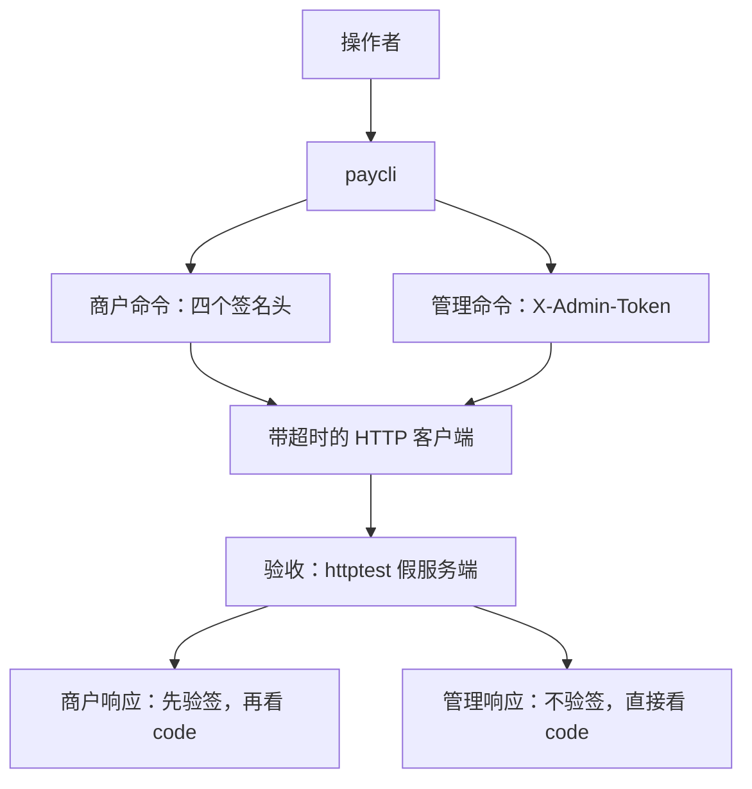
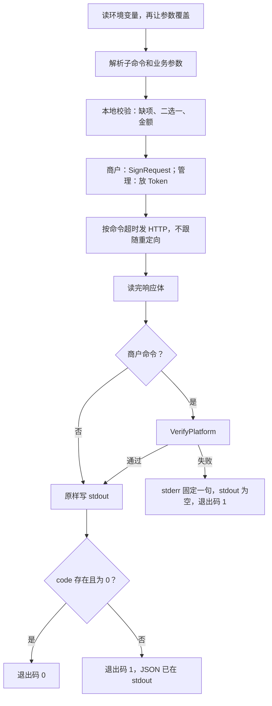

# TL-01 paycli

| 项 | 内容 |
|---|---|
| 功能点 | TL-01（P0，第 3 周） |
| 所属链路 | 基础设施 |
| 代码提交 | `0f18bd6` `[TL-01] add paycli`（完整 `0f18bd6675ef5991184253677d94a6106c98b1ba`，2026-11-01 21:32:25 +0800） |
| 分支 | `feat/TL-01-paycli` |
| 日期 | 2026-11-01 |
| 状态 | DONE |

本报告写在上面这次代码提交之后，不在那次提交的文件里。报告撰写时尚未提交。网关进程还没有。paycli 按环境变量或参数去调将来的 HTTP 接口，自己签名、自己验商户响应。验收用测试进程里的 httptest 假服务端。经真网关把下单做到转账，仍是以后的 GW-09。

## 一句话结论

paycli 是给商户和管理员用的命令行客户端。商户命令用 `pkg/sign.SignRequest` 签实际发出的路径和 body，再用 `VerifyPlatform` 验响应；管理命令只带 `X-Admin-Token`，响应不签名。签名与公布的三条向量一致，12 个子命令的方法、路径、body 和头都被假服务端验过，篡改响应签名时退出码是 1 且 stdout 为空。证据是 `TestTL01SignVectors`、`TestTL01EachCommand`、`TestTL01NonceDiffers`、`TestTL01Response`。

## 1. 背景

### 1.1 系统简介

pay-system 是一个用 Go 编写的小型支付后端，模拟商户收款、退款、商户间转账三条资金链路，重点在数据一致性和性能。系统由 5 个部分组成：gateway（对外 HTTP 入口，负责签名校验和限流）、payment（支付单、退款单、转账单的状态管理和流程推进）、account（账户余额与记账，数据按商户分到 2 个数据库分片）、channel-mock（模拟微信、支付宝这类外部支付渠道）、recon（对账，核对系统内外数据是否一致）。服务之间用 Kitex RPC 同步调用，或通过 Kafka 消息异步通知；数据存在 MySQL 8.4，Redis 用于防重放。所有金额用整数“分”表示，所有记账只追加不修改。当前已完成：工程骨架、账户记账与转账、模拟渠道、支付单创建与发起、支付结果推进、商户关单、支付查询、outbox 写入、健康检查、管理端口 pprof，以及本功能点的命令行客户端。网关 HTTP 入口还没有。金额用整数分，分录只追加。

上面这段里还没展开的词：Kitex 是本项目的 Go RPC 框架，RPC 是一个进程同步调用另一个进程里的函数。签名校验用密钥确认报文没有被改过。限流限制单位时间内的调用次数。这两件事属于 gateway，本次没有网关进程。Kafka 是异步消息队列。分片是把账户数据按商户拆进 2 个库。1 元 = 100 分，例如 10000 分是 100.00 元。分录是账本上追加的一行，旧行不改。outbox 是和业务写在同一事务里、稍后才发送的消息表。Redis 防重放是别处用 nonce 认“这条请求已经来过”的能力，paycli 本次不连接 Redis。P0 是必须先做的优先级。

支付单的创建、发起、结果推进、关单、查询已经能在 payment 进程里工作。paycli 不调用这些进程的包，也不写它们的库。它只发 HTTP。

### 1.2 本功能点在系统中的位置

paycli 站在调用方这一侧。验收时对面是测试自己拉起的 httptest，不是本机 8080 上的网关。商户命令带四个签名头。管理命令带管理 Token。商户响应先验签，再看 JSON 里的 `code`。管理响应不签名，直接看 `code`。



图下：假服务端按商户请求的拼接规则验签，通过后回一段带平台签名的 JSON。管理接口的响应没有 `X-Signature`，paycli 不因此失败。真网关的 HTTP 入口还没有，这张图里没有一条到 8080 的边。

### 1.3 为什么需要它

没有这个客户端，操作者只能手写 HMAC，签出来的字节很容易和真正要发的 body 不一致。网关以后会按实际收到的字节验签，对不上就拒绝。

具体一笔：商户要收 10000 分（100.00 元），商户单号 `T20261009001`。请求 body 是 `{"out_trade_no":"T20261009001","amount":10000,"subject":"demo"}`。如果签名时用的 body 多了一个空格，或者把 `<` 转成了 `\u003c`，发出去的字节和签名覆盖的字节就不同。假服务端（以后是网关）会判定签名错误，这 100.00 元的下单不会被接受。

另一面是响应。假服务端可以回 `{"code":0,...}`，但把签名改掉。如果客户端仍把这段 JSON 打印成成功，操作者会以为 100.00 元已经下单成功。本客户端在验签失败时 stdout 为空，退出码为 1。

两次调用还要使用不同的 nonce。nonce 是 16 到 32 位的字母数字，用来让接收方认出“同一条报文又来了一次”。如果两次余额查询共用一个 nonce，后一次会被当成重放丢掉。生产用 `crypto/rand` 生成，测试注入一串固定 nonce，才能同时断言“两次不同”和“假服务端验签通过”。

## 2. 术语

按正文第一次出现的顺序。

| 术语 | 含义 |
|---|---|
| gateway | 对外 HTTP 入口。本次还没有这个进程。本机 8080 不是验收对象。 |
| payment | 支付单、退款单、转账单所在的进程。paycli 不 import 它。 |
| account | 账户进程。余额按商户分在 2 个库。paycli 不直接连库。 |
| channel-mock | 模拟外部支付渠道的进程。 |
| recon | 对账进程。`admin recon-run` 以后会调它的跑批接口，本次对面仍是假服务端。 |
| Kitex | 本项目的 Go RPC 框架。 |
| RPC | 一个进程同步调用另一个进程里的函数。 |
| Kafka | 异步消息队列。本次不连接。 |
| 分片 | 账户数据按商户拆进 2 个库。 |
| 分 | 金额最小单位。100 分 = 1.00 元。10000 分 = 100.00 元。类型是整数，不用浮点。 |
| 分录 | 账本上追加的一行。paycli 不插入。 |
| outbox | 和业务写在同一事务里、稍后才发送的消息表。`admin replay` 请求重放其中一条事件。 |
| Redis | 内存库。系统别处用它按 nonce 防重放。paycli 不连接。 |
| 重放 | 把一条已经发过的合法报文原样再发一次。签名仍然正确，要靠 nonce 和时间戳认出来。 |
| nonce | 一次性随机串。本客户端生产值是 16 位 `[A-Za-z0-9]`。 |
| HMAC-SHA256 | 带密钥的哈希。只有持有 `app_secret` 的人能算出同样的 32 字节。 |
| SHA-256 | 把任意字节压成 32 字节摘要。没有密钥，谁都能算。空 body 的摘要是对空字节串做 SHA-256。 |
| hex | 小写十六进制。32 字节摘要写成 64 个字符。 |
| base64 | 标准编码，带 `=` 填充。32 字节签名写成 44 个字符。 |
| RequestURI | 实际发送的路径加原始查询串。查询时带 `?`，例如 `/v1/payments?out_trade_no=T20261009001`。 |
| `app_id` / `app_secret` | 商户身份和商户密钥。密钥参与 HMAC。生效配置里打印成 `***`。 |
| 管理 Token | 管理命令放在 `X-Admin-Token` 里的口令。同样是 secret，打印成 `***`。 |
| `X-Admin-Operator` | 管理写操作要带的操作者名字，1 到 64 个 Unicode 码点，不含回车换行。 |
| `code` | 响应 JSON 里的业务码。0 表示成功。不是 0 时客户端仍打印 JSON，退出码为 1。缺这个字段不当成 0。 |
| `10001` | 参数不合法时服务端返回的业务码。客户端不自己卡金额上下限，超范围由服务端回这个码。 |
| httptest | Go 标准库里的假 HTTP 服务端，只活在测试进程里。 |
| CAS | 用“旧状态”作为条件去更新一行。paycli 不更新数据库，不使用它。 |
| 退出码 | 进程结束时给操作系统的整数。0 是成功，1 是失败。 |
| stdout / stderr | 标准输出和标准错误。成功的 JSON 只写 stdout。验签失败的那句固定错误只写 stderr。 |
| `clock.Clock` | 注入的时钟。测试用固定时刻，生产的 `main` 传入真实时钟。 |
| P0 | 必须先做的优先级。 |
| GW-09 | 以后的功能点：用 paycli 经真网关跑通下单到转账。 |
| TL-02 | 以后的功能点：模拟商户接收平台通知。 |
| TL-03 | 以后的功能点：一键演示脚本。 |
| TL-04 | 以后的功能点：OpenAPI 文档。 |
| 覆盖率 | 测试执行到的语句占该包语句的比例。70% 门槛只覆盖指定的几个包。 |
| `cached` | Go 复用了已有测试结果，没有重跑那个包。 |
| `kitex_gen` | 按 IDL 生成的 RPC 代码。全仓覆盖率把它算进去，这个合计不是 70% 门槛。 |
| IDL | RPC 的接口定义文件。本次没改。 |
| `make gen` | 按 IDL 生成代码的命令。本次没运行。 |
| `mmdc` | 把 Mermaid 源图渲染成 SVG 的命令。本次没运行。 |

## 3. 技术讲解

### 3.1 要解决的问题

1. 配置来自环境变量或参数，参数覆盖同名环境变量。四个字段在加载时都可以为空。商户命令才要 `app_id` 和 `app_secret`，管理命令才要 Token，任何命令都要网关地址。缺了就退出码 1，错误文本里没有密钥。
2. 子命令固定为 9 个商户命令和 3 个管理命令。没有子命令时退出码 1，stderr 打印用法。
3. 商户请求的签名只调用已有的 `pkg/sign`。签名覆盖的 URI 和 body 就是实际发送的那一份。响应用同一密钥验平台签名。失败则 stdout 为空。
4. 验签通过后，把响应体原始字节写到 stdout。`code` 不是 0，或 JSON 里没有 `code`，退出码为 1，已经写出的 JSON 留在 stdout。
5. 两次调用的 nonce 不同。生产用 `crypto/rand`，丢弃大于等于 248 的随机字节，避免 62 个字符取模时后面的字符更少。
6. 时间来自注入的时钟。测试把时钟钉在 Unix 秒 `1791500000`，不读运行测试的那一天。
7. 查询类参数必须恰好一个。两个都有或都没有，退出码 1，请求不发出去。
8. 金额是整数分。`1.5` 这种小数字符串在本地就被拒绝。合法的大整数仍会发出去，上下限由服务端用 `10001` 拒绝。
9. HTTP 有超时，超时后不重试。超时值用网关调用下游时已经写明的那些秒数。
10. 密钥和 Token 不出现在 stdout、stderr 和错误文本里。生效配置若被打印，这两项是 `***`。
11. 不新增错误码，不改表，不改服务端契约，不调用故障注入的初始化。

### 3.2 方案

整体是一条直线：读配置，解析子命令，在本地检查必填项，组好方法和路径，商户命令签名或管理命令放 Token，按该命令的超时发出去，读完全部响应体，商户命令先验签，再把原始字节写到 stdout，最后看 `code`。



图下：本地校验失败时停在第三步，假服务端收不到请求。验签失败停在写出之前。`code` 非 0 发生在写出之后，所以操作者看得到服务端的 JSON。

配置四个字段都可选。未知变量被忽略，例如 `WORKER_ID` 和 `MYSQL_DSN`。paycli 不读 `WORKER_ID`。

| 环境变量 | 参数 | 谁必填 | 打印 |
|---|---|---|---|
| `PAYCLI_GATEWAY_URL` | `--gateway` | 每个会发请求的命令 | 原样 |
| `PAYCLI_APP_ID` | `--app-id` | 商户命令 | 原样 |
| `PAYCLI_APP_SECRET` | `--app-secret` | 商户命令 | `***` |
| `PAYCLI_ADMIN_TOKEN` | `--admin-token` | 管理命令 | `***` |

全局参数写在子命令前面，可以是 `--gateway URL` 或 `--gateway=URL`。显式写出的参数覆盖环境变量。缺网关时错误文本含 `gateway address is required`。商户命令缺身份或密钥时含 `app_id is required` 或 `app_secret is required`。管理命令缺 Token 时含 `admin token is required`。这些句子里没有密钥本身。

商户命令的 nonce、时间戳和四个头由下面这段加上。`RequestURI` 来自已经组好的请求 URL，body 是同一份即将发送的字节。

```go
func signMerchant(req *http.Request, cfg config.PayCLI, clk clock.Clock, nextNonce func() (string, error), body []byte) error {
	nonce, err := nextNonce()
	if err != nil || !nonceOK(nonce) {
		return errUsage
	}
	ts := sign.FormatTimestamp(clk.Now())
	sig, err := sign.SignRequest([]byte(cfg.AppSecret), sign.Request{
		Method:     req.Method,
		RequestURI: req.URL.RequestURI(),
		Timestamp:  ts,
		Nonce:      nonce,
		Body:       body,
	})
	if err != nil {
		return err
	}
	req.Header.Set(sign.HeaderAppID, cfg.AppID)
	req.Header.Set(sign.HeaderTimestamp, ts)
	req.Header.Set(sign.HeaderNonce, nonce)
	req.Header.Set(sign.HeaderSignature, sig)
	return nil
}
```

这段在 `cmd/paycli/call.go`。四个头的名字是 `X-App-Id`、`X-Timestamp`、`X-Nonce`、`X-Signature`。时间戳是时钟的 Unix 秒，十进制，不补零。

拼接串不在 paycli 里再写一遍。`SignRequest` 的五行是：方法、RequestURI、时间戳、nonce、body 的 SHA-256 小写 hex，每段后面有一个换行。然后用 `app_secret` 做 HMAC-SHA256，输出标准 base64。空 body 参与摘要的输入是空字节串。平台响应由 `VerifyPlatform` 检查三行：响应的时间戳、响应的 nonce、响应 body 的 SHA-256 hex，密钥仍是这个 `app_secret`。比较用常量时间，避免靠“比较花了多久”逐字节猜签名。

公布的向量用演示密钥 `demo_secret_M100001_0123456789ab`。这是文档里的测试值，不是生产密钥。

| 向量 | 输入 | 签名 |
|---|---|---|
| V1 请求 | `POST /v1/payments`，时间 `1791500000`，nonce `AbCdEf0123456789`，body `{"out_trade_no":"T20261009001","amount":10000,"subject":"demo"}`（10000 分，即 100.00 元） | `hFYKid0+k7q9vCvqh/i6YnvoaAJYzf2niNuvSkMCwoQ=` |
| V2 请求 | `GET /v1/payments?out_trade_no=T20261009001`，同一时间和 nonce，body 为空 | `D1t81263+AFhLO6+FPSoVQqNFANBAKpi0akuyE9gVu4=` |
| V3 响应 | 时间 `1791500001`，nonce `ZyXwVu9876543210`，body `{"code":0,"msg":"ok","data":{"pay_no":"PA0000000000000000001"}}` | `TuLVqqAxs3SyvTtDXp1cpv+Rpv2D5URAFywIHBNjAh4=` |

`TestTL01SignVectors` 用 paycli 会调用的那组函数算这三行，字节与表一致。为了凑这三行，没有改 `pkg/sign`。

生产 nonce 在 `cmd/paycli/nonce.go`。字母表 62 个字符。一次取一个随机字节，大于等于 248 的丢掉。248 是 62 的 4 倍，剩下的字节对 62 取模，每个字符的概率相同。结果固定 16 位，落在 16–32 的规则里。

```go
func (randNonce) next() (string, error) {
	var out [nonceLen]byte
	filled := 0
	var buf [32]byte
	for filled < nonceLen {
		if _, err := rand.Read(buf[:]); err != nil {
			return "", err
		}
		for _, b := range buf {
			if b >= nonceBiasLimit {
				continue
			}
			out[filled] = nonceAlphabet[int(b)%len(nonceAlphabet)]
			filled++
			if filled == nonceLen {
				break
			}
		}
	}
	return string(out[:]), nil
}
```

`main` 把 `clock.Real` 和这个 `next` 传给 `run`。测试传 `clock.Fake` 和一段写好的 nonce 序列。`biz` 和 `job` 仍然不能调用 `time.Now`。paycli 不在这两个包里。

JSON 用 `encoding/json` 的编码器，`SetEscapeHTML(false)`，再去掉末尾多出来的一个换行。这样 `<` 保持原样，签名的字节和网上的字节相同。金额字段的类型是 `int64`，解析用 `strconv.ParseInt`，拒绝 `1.5`。客户端不检查 1 到 10000000 分这个服务端范围。100 分是 1.00 元；更大的整数也会放进 body。路径里的单号用 `PathEscape`，查询串用 `url.Values.Encode`。

查询必须恰好一个键。下面是支付查询。退款查询是 `refund_no` 与 `out_refund_no`，转账查询是 `transfer_no` 与 `out_transfer_no`，创建退款的原单是 `pay_no` 与 `out_trade_no`，规则相同：两个都有或都没有就返回错误，不发请求。空字符串算没提供。

```go
hasPay := fs.text("pay-no", *payNo)
hasOut := fs.text("out-trade-no", *outNo)
if hasPay == hasOut {
	return prepared{}, errors.New(errPayNoXOR)
}
path := "/v1/payments/" + url.PathEscape(*payNo)
if hasOut {
	q := url.Values{}
	q.Set("out_trade_no", *outNo)
	path = "/v1/payments?" + q.Encode()
}
```

这段在 `cmd/paycli/command.go`。错误文本是 `paycli: provide exactly one of pay_no or out_trade_no`。

管理重放是另一种二选一：只给 `event_id`，或者同时给 `biz_no` 和 `event_type`。只给其中一个、三个都给、或一个都不给，错误文本是 `paycli: provide event_id or both biz_no and event_type`，请求不发出。

路径与方法：

| 命令 | 方法与路径 | body |
|---|---|---|
| `create` | `POST /v1/payments` | `out_trade_no`、`amount`、`subject` 必填。金额是分 |
| `pay` | `POST /v1/payments/{pay_no}/pay` | `{"channel":"..."}` |
| `query` | `GET /v1/payments/{pay_no}` 或 `GET /v1/payments?out_trade_no=` | 无 |
| `close` | `POST /v1/payments/{pay_no}/close` | 无，也不加 `Content-Type` |
| `refund` | `POST /v1/refunds` | 原单二选一，另有 `out_refund_no` 和 `amount` |
| `query-refund` | `GET /v1/refunds/{refund_no}` 或 `?out_refund_no=` | 无 |
| `transfer` | `POST /v1/transfers` | `out_transfer_no`、`payee_merchant_id`、`amount` |
| `query-transfer` | `GET /v1/transfers/{transfer_no}` 或 `?out_transfer_no=` | 无 |
| `balance` | `GET /v1/balance` | 无 |
| `admin recon-run` | `POST /admin/recon/run` | `channel`、`bill_date`，以及操作者 |
| `admin replay` | `POST /admin/outbox/replay` | `event_id`，或 `biz_no` 加 `event_type`，以及操作者 |
| `admin check` | `POST /admin/accounts/check` | 可选 `merchant_id`、`expect_quiescent`。只读，不要求操作者 |

有 body 时 `Content-Type` 是 `application/json; charset=utf-8`。管理写操作的操作者放在 `X-Admin-Operator`，长度按码点计 1 到 64，拒绝含回车或换行的值。`admin check` 不设置这个头。`force` 只有在参数出现且为真时才写进对账 body。

超时写在 `cmd/paycli/command.go`。数字来自网关调用下游时已经列明的等待时间：普通调用 1 秒；会打到渠道的支付、关单、退款 5 秒；转账 3 秒；对账跑批和余额核对 120 秒。paycli 按命令套用，不另造一个秒数。`admin replay` 走默认的 1 秒。

```go
const (
	gatewayCallTimeout         = time.Second
	gatewayChannelCallTimeout  = 5 * time.Second
	gatewayTransferCallTimeout = 3 * time.Second
	gatewayBatchCallTimeout    = 120 * time.Second
)

func commandTimeout(name string) time.Duration {
	switch name {
	case "pay", "close", "refund":
		return gatewayChannelCallTimeout
	case "transfer":
		return gatewayTransferCallTimeout
	case "recon-run", "check":
		return gatewayBatchCallTimeout
	default:
		return gatewayCallTimeout
	}
}
```

客户端把这个时长同时交给 `http.Client.Timeout` 和请求的 context。到点就失败，不重试。失败文本是固定的 `paycli: request failed`，不把底层错误原样打出来，避免把网关地址和查询串带出去。

重定向不跟随。`CheckRedirect` 返回 `http.ErrUseLastResponse`，已签名的请求和管理 Token 不会被带到 `Location` 指向的下一跳。

响应处理在 `cmd/paycli/call.go`。商户命令先验签。失败时只写这一句，函数立刻返回，前面的 `stdout.Write` 还没执行。

```go
if !p.admin {
	if err = sign.VerifyPlatform([]byte(cfg.AppSecret), sign.PlatformMessage{
		Timestamp: resp.Header.Get(sign.HeaderTimestamp),
		Nonce:     resp.Header.Get(sign.HeaderNonce),
		Body:      respBody,
	}, resp.Header.Get(sign.HeaderSignature)); err != nil {
		writeLine(stderr, "paycli: response signature invalid")
		return 1
	}
}
if _, err = stdout.Write(respBody); err != nil {
	writeLine(stderr, "paycli: write failed")
	return 1
}
code, ok := responseCode(respBody)
if !ok || code != 0 {
	return 1
}
```

`code` 用指针。JSON 里没有这个字段，或正文不是对象，`ok` 为假，退出码为 1。不能把缺省值 0 当成成功。管理命令跳过 `VerifyPlatform`，没有 `X-Signature` 也继续看 `code`。

```go
func responseCode(body []byte) (int64, bool) {
	var env struct {
		Code *int64 `json:"code"`
	}
	if err := json.Unmarshal(body, &env); err != nil || env.Code == nil {
		return 0, false
	}
	return *env.Code, true
}
```

假服务端先把收到的方法、路径、body 和头记下来，再用 `VerifyRequest` 验签。这样“不该发出的请求”即使签名是坏的，也会被测试数到。验签通过后，它回一段 JSON，并用 `SignPlatform` 填上响应签名。

### 3.3 为什么这样做

| 方案 | 做法 | 优点 | 缺点 | 结论 |
|---|---|---|---|---|
| 采用：只调用 `pkg/sign`，验收用 httptest | 签名和验签都进已有函数。测试自己起假服务端，注入时钟和 nonce | 拼接规则只有一份。向量对不上时改的是调用方，不是算法。不依赖还没写的网关 | 假服务端不证明 8080 上已有路由 | 采用 |
| 备选：paycli 再写一套 HMAC | 在命令里自己拼字符串、自己算 SHA-256 | 少一次函数调用 | 两套字节规则会分开漂移。V1 能过、线上 URI 多一个字符就过不了 | 不采用 |
| 备选：验收去连本机 8080 | 测试直接请求真网关 | 更接近以后的 GW-09 | 网关进程还不存在，测试会因为连不上而失败，失败原因不是签名 | 不采用 |
| 备选：加载时四个字段都必须有 | `LoadPayCLI` 看到空 Token 或空密钥就返回错误 | 配置错误发现得早 | 只跑 `balance` 的人没有管理 Token 也会起不来。另一个命令用不到的空字段不该挡住这一条 | 不采用 |
| 备选：所有命令都等 120 秒，或都等 1 秒 | 客户端超时取一个数 | 实现短 | 查询失败要等满 2 分钟。反过来，余额核对在服务端允许的 120 秒内会被 1 秒的客户端提前掐断 | 不采用 |
| 备选：缺 `code` 当成 0 | 解析失败就退出码 0 | 少一个分支 | 一段验签通过但不是业务 JSON 的正文会被当成收款成功 | 不采用 |

### 3.4 正确性

paycli 不写账户、不写支付单、不插入分录。同一账户上的并发扣款、重复记账、崩溃后的账本，这里不涉及。下面是这个进程自己的失败方式。最终状态一列都是“不改库”，因为本进程没有数据库。

| 场景 | 系统行为 | 最终状态 | 证明 |
|---|---|---|---|
| 连续两次余额查询 | 注入的 nonce 先是 `AbCdEf0123456789`，再是 `BcDeFg0123456789`。两次请求头不同。生产路径另用 `crypto/rand` 抽两次，结果都是 16 位字母数字且彼此不同 | 不改库 | `TestTL01NonceDiffers`、`TestTL01RandNonce` |
| 两个 paycli 进程同时跑 | 彼此不共享余额，也不锁同一行。各发各的 HTTP | 不改库 | 无共享状态，没有并发扣款测试 |
| 请求发出后进程退出 | 本进程没有写到一半的账。服务端有没有落单，要等真网关和 payment，那是 GW-09 | 不改库 | 无崩溃后查账的测试 |
| 下游超时或连接失败 | 等到该命令的超时后退出码 1，stderr 是 `paycli: request failed`。不重试，也不把超时写成订单失败 | 不改库 | 超时值由 `commandTimeout` 选择；测试不真的等满 120 秒 |
| 响应签名被改成另一条向量的签名 | stdout 为空，stderr 恰好是 `paycli: response signature invalid` 加换行，退出码 1。输出里没有密钥，也没有那两段签名 | 不改库 | `TestTL01Response` |
| 响应签名正确但 `code` 为 40002 | stdout 是那段 JSON，stderr 为空，退出码 1。40002 表示余额不足这一类业务失败，客户端只看它不是 0 | 不改库 | `TestTL01Response` |
| 管理接口回 `code` 10001 且没有签名头 | 不验签。stdout 是那段 JSON，退出码 1。Token 不出现在输出里 | 不改库 | `TestTL01Response` |
| 查询参数两个都给，或一个都不给 | 退出码 1，stdout 为空，假服务端收到的请求数是 0 | 不改库 | `TestTL01DoesNotSendInvalid` |
| 假服务端回 302 | 客户端停在这一跳，下一跳的服务端收到 0 次请求 | 不改库 | `TestTL01DoesNotFollowRedirect` |

### 3.5 性能

不涉及。没有优化开关，也没有优化前后的对比数字。1 秒、3 秒、5 秒、120 秒是调用超时，不是吞吐指标。

## 4. 已完成内容

### 4.1 改动清单

这些文件都在代码提交 `0f18bd6` 里。

| 文件 | 新增 / 修改 | 作用 |
|---|---|---|
| `cmd/paycli/main.go` | 修改 | 入口把真实时钟和 `crypto/rand` nonce 传进去。无子命令时用法写到 stderr，退出码 1 |
| `cmd/paycli/command.go` | 新增 | 子命令、路径、必填项、金额、二选一、超时 |
| `cmd/paycli/call.go` | 新增 | 签名、发 HTTP、验商户响应、按 `code` 决定退出码 |
| `cmd/paycli/nonce.go` | 新增 | 16 位字母数字 nonce，丢掉大于等于 248 的随机字节 |
| `cmd/paycli/main_test.go` | 修改 | 假服务端验收和三条向量 |
| `pkg/config/paycli.go` | 修改 | 四个可选字段，密钥和 Token 标成 secret |
| `pkg/config/config_test.go` | 修改 | 空配置可加载，未知变量被忽略，脱敏后是 `***` |
| `deploy/.env.example` | 修改 | 四个变量的占位符，没有真实密钥 |
| `docs/02-requirements.md` | 修改 | TL-01 改为 DONE，三条验收勾上，变更记录加一行 |
| `docs/03-conventions.md` | 修改 | 版本到 v2.24，登记四个配置 |
| `docs/04-dev-plan.md` | 修改 | 只勾 TL-01 |
| `docs/interview-notes.md` | 修改 | 记下假服务端和超时的来源 |

### 4.2 对外变化

| 类别 | 变化 |
|---|---|
| 接口 | 无服务端契约变化。商户 API 文档仍是 3.3.0。新增的是命令行客户端，没有新的 HTTP 路径，也没有新的 IDL |
| 表结构 | 无。没有新列、新索引，也没有新迁移 |
| 配置项 | 新增四个，加载时允许为空。`PAYCLI_GATEWAY_URL`、`PAYCLI_APP_ID`、`PAYCLI_APP_SECRET`、`PAYCLI_ADMIN_TOKEN`。后两项是 secret。约定从 v2.23 到 v2.24。参数名为 `--gateway`、`--app-id`、`--app-secret`、`--admin-token` |
| 错误码 | 无新增。客户端看到的 `10001`、`40002` 都是服务端已有的码。签名失败用固定英文句子，不用新的数字码 |
| 指标 / 故障点 | 无。不调用 `fault.Init`，不新增指标 |

### 4.3 验收对照

| 验收条目 | 测试函数 | 类型 | 结果 |
|---|---|---|---|
| 签名与接口 §3.7 的 V1/V2/V3 一致 | `TestTL01SignVectors` | 单元 | 通过 |
| 每个子命令的方法、路径、body 和四个签名头正确，假服务端验签通过；两次 nonce 不同 | `TestTL01EachCommand`、`TestTL01NonceDiffers` | 单元 | 通过 |
| 正确签名的响应打印 JSON 且退出码 0；篡改签名退出码 1 且 stdout 为空；code 不等于 0 退出码 1 | `TestTL01Response` | 单元 | 通过 |

辅助测试也在同一次 `go test` 里通过。它们不替代上面三行。

| 场景 | 测试函数 | 类型 | 结果 |
|---|---|---|---|
| 没有子命令时退出码 1，stderr 有用法，输出不含密钥 | `TestPayCLIRunEmpty` | 单元 | 通过 |
| `crypto/rand` 的两次 nonce 不同，且都是 16 位字母数字 | `TestTL01RandNonce` | 单元 | 通过 |
| 二选一不合法、金额是 `1.5`、管理重放参数不齐：退出码 1，请求数是 0 | `TestTL01DoesNotSendInvalid` | 单元 | 通过 |
| 缺网关、缺 `app_id`、缺 `app_secret`、缺 Token | `TestTL01MissingConfig` | 单元 | 通过 |
| 参数覆盖环境变量；未知变量 `WORKER_ID`、`MYSQL_DSN` 不影响这条命令 | `TestTL01FlagOverridesEnv` | 单元 | 通过 |
| 302 不跟随，下一跳收到 0 次请求 | `TestTL01DoesNotFollowRedirect` | 单元 | 通过 |
| 四个字段可空，脱敏为 `***`，未知变量被忽略 | `TestLoadPayCLI` | 单元 | 通过。在 `pkg/config` |

`TestTL01EachCommand` 覆盖的商户命令是 `create`、`pay`、按 `pay_no` 查询、按 `out_trade_no` 查询、`close`、`refund`、按退款单号查询、按商户退款号查询、`transfer`、按转账单号查询、按商户转账号查询、`balance`。管理命令是 `admin recon-run`、按 `event_id` 的 `admin replay`、按 `biz_no` 加 `event_type` 的 `admin replay`、`admin check`。商户侧检查方法、路径、body、`X-App-Id`、时间戳 `1791500000`、nonce 和 `X-Signature`。`create` 的 body 就是 V1 那 10000 分（100.00 元），签名字节等于 V1。按商户订单号查询的签名字节等于 V2。管理侧检查没有四个商户签名头，Token 在 `X-Admin-Token`，`admin check` 的操作者头为空。客户端超时分别是 1 秒、5 秒、3 秒或 120 秒，和命令对应。

`TestTL01Response` 的成功响应使用公布的 V3 签名常量，退出码 0，stdout 就是那一段 JSON。篡改时签名被换成 V1 的那一串，退出码 1，stdout 为空。

### 4.4 验证记录

日期是 2026-11-01。环境：go1.27.2 darwin/arm64。golangci-lint 2.14.0，用 go1.27.1 从 `114493f` 在 2026-09-24T10:54:53Z 构建。耗时是 real。

| 命令 | 结果 |
|---|---|
| `gofmt -l .` | 无文件名，real 0.06s，退出码 0 |
| `make lint` | `0 issues.`，real 1.00s，退出码 0 |
| `make test` | real 5.35s，退出码 0。根包 `ok github.com/yym108/pay-system 4.753s`。`cmd/paycli` 1.457s。`pkg/config` 1.414s。`cmd/account` 1.565s，`cmd/channel-mock` 1.486s，`cmd/payment` 1.555s。`pkg/server` 为 cached |
| `make test-integration` | real 38.33s，退出码 0。根包 `ok github.com/yym108/pay-system 37.912s`。`cmd/paycli` 1.471s。`pkg/config` 1.435s。`service/payment/biz` 26.410s，`service/payment/handler` 19.239s。`cmd/account` 1.560s，`cmd/channel-mock` 1.478s，`cmd/payment` 1.545s |
| `make cover` | real 37.00s，退出码 0。total 29.2%（含 `kitex_gen`，不是 70% 门槛）。根包 36.035s，coverage `[no statements]`。`cmd/paycli` 1.475s / 79.5%（不在门槛里）。`pkg/config` 1.408s / 85.3%（不在门槛里）。门槛内：account biz cached 91.1%，payment biz 26.247s / 86.1%，`pkg/money` cached 100.0%，`pkg/sign` cached 100.0%，`pkg/idgen` cached 88.1%，`pkg/outbox` cached 95.0%。`pkg/server` cached 84.4%，不在门槛里。`cmd/account` 1.586s / 27.3%，`cmd/channel-mock` 1.489s / 16.4%，`cmd/payment` 1.593s / 39.6%，`cmd/gateway` cached 87.5%，`cmd/recon` cached 87.5%，`cmd/merchant-demo` cached 87.5% |
| `make gen` | 未运行。没有改 IDL |
| `mmdc` | 未运行。没有改流程图 |

70% 门槛只覆盖 `service/*/biz`、`pkg/money`、`pkg/sign`、`pkg/idgen`、`pkg/outbox`。这次落在门槛里的数字都不低于 70%。paycli 没有改这些包。`cmd/paycli` 的 79.5% 和 `pkg/config` 的 85.3% 只是信息。全仓 29.2% 把生成代码算进去，不用它判断本功能点。

同一次 `make cover` 里，`cmd/paycli` 按函数：`newHTTPClient` 100%，`execute` 73.9%，`signMerchant` 83.3%，`requestURL` 75.0%，`responseCode` 75.0%，`commandTimeout` 100%，`main` 0.0%（测试调用 `run`，不经过 `main`），`run` 100%，`runClient` 57.6%，`randNonce.next` 92.9%，`nonceOK` 66.7%。

### 4.5 同步的文档

- 需求仍是 v3.0。§3 里 TL-01 的状态是 DONE，三条验收已勾。§8.2 追加了 2026-11-01 一行，说明假服务端验收、四个可选配置，以及经网关的完整流程仍是 GW-09。
- 约定从 v2.23 升到 v2.24，日期 2026-11-01。§8 只登记这四个配置，`PAYCLI_APP_SECRET` 和 `PAYCLI_ADMIN_TOKEN` 标成 secret。
- 开发计划只勾了 TL-01。
- 接口文档没有改，版本仍是 3.3.0。流程图没有改，没有新的 SVG。
- `docs/interview-notes.md` 写了：验收用假服务端；经网关的完整流程仍是 GW-09；超时来自网关调用下游已经写明的 1 秒、5 秒、3 秒和 120 秒。
- `deploy/.env.example` 增加四个占位符。文件里没有真实密钥。

## 5. 未完成与风险

- 不连真网关。假服务端通过，只说明客户端会组请求、会签名、会验签。它不代表本机 8080 上已经有这些路由。完整的 `paycli create`，然后 `pay`，然后 `query`，经网关跑通，仍是 GW-09。
- TL-02 的商户通知接收、TL-03 的演示脚本、TL-04 的 OpenAPI 文档，都不是本功能点。
- 响应体用 `io.ReadAll` 一次读完，没有字节上限。对面若回一个非常大的 body，这个进程会一直读到超时或内存耗尽。
- 客户端不看 HTTP 状态码本身。商户响应先做 `VerifyPlatform`，通过后再看 JSON 的 `code`。一段带正确签名的正文，即使 HTTP 状态不是 200，也会按 `code` 决定退出码。
- 不重试。超时就是 `paycli: request failed` 和退出码 1。这个进程不写库，不会把这次超时改成订单失败或支付成功。

## 6. 如何复现

不需要启动网关，也不要给 paycli 配一个正在监听的 8080。`cmd/paycli` 的测试在进程里起 httptest。整仓的 `make test-integration` 和 `make cover` 会连到其他包的数据库测试，那些包需要 Docker 或 `TEST_MYSQL_DSN`。2026-11-01 那次记录的退出码是 0，数字见第 4.4 节。

```bash
gofmt -l .
make lint
make test
make test-integration
make cover
```

`gofmt -l .` 没有文件名，退出码 0。`make lint` 打印 `0 issues.`。`make test` 里能看到 `cmd/paycli` 和 `pkg/config` 为 `ok`。只想看本功能点的测试时，可以在同一环境下执行：

```bash
go test -race -count=1 ./cmd/paycli/ ./pkg/config/ ./pkg/sign/
```

预期三个包都是 `ok`。`TestTL01SignVectors` 不访问网络。`TestTL01EachCommand` 的假服务端对每个子命令调用 `VerifyRequest`。不要把 `--gateway` 指到本机 8080 来复现这三条验收。

## 7. 讲解要点

1. 问：为什么验收不打本机 8080？答：网关 HTTP 还没有。打 8080 失败只能说明没有进程，不能说明签名覆盖了实际发出的 URI 和 body。httptest 先记账再 `VerifyRequest`，12 个子命令的方法、路径、body 和头都对上了。
2. 问：响应 `code` 不是 0 时，JSON 还打不打？答：先验签。验签失败则 stdout 为空，句子是 `paycli: response signature invalid`。验签通过后原样写出，再看 `code`。不是 0 就退出码 1，JSON 已经在 stdout。缺 `code` 不当成 0。
3. 问：120 秒的超时会不会让普通查询等两分钟？答：不会。查询、下单、余额、重放是 1 秒。`pay`、`close`、`refund` 是 5 秒。`transfer` 是 3 秒。只有 `admin recon-run` 和 `admin check` 是 120 秒，因为对账跑批和余额核对的等待本来就是 120 秒。

## 延伸阅读

- `docs/02-requirements.md`：TL-01 的规则和验收。版本仍是 v3.0。
- `docs/05-api.md`：商户路径、签名拼接、V1/V2/V3 向量、管理路径。版本仍是 3.3.0，本次没改。
- `docs/03-conventions.md`：§8 的四个 `PAYCLI_*` 配置。版本 v2.24。
- `docs/04-dev-plan.md`：TL-01 已勾选。
- `docs/interview-notes.md`：假服务端和超时来源。
- `cmd/paycli/call.go`：`signMerchant`、`execute`、`responseCode`。
- `cmd/paycli/command.go`：路径、二选一、`commandTimeout`。
- `cmd/paycli/nonce.go`：拒绝采样。
- `pkg/sign/sign.go`：`SignRequest`、`VerifyPlatform`。本次没改这个包。
- `pkg/config/paycli.go`：四个可选字段。

## 修订记录

| 日期 | 提交 | 修订内容 |
|---|---|---|
| 2026-11-01 | 报告撰写时尚未提交 | 首版。对应代码提交 `0f18bd6` `[TL-01] add paycli` |
