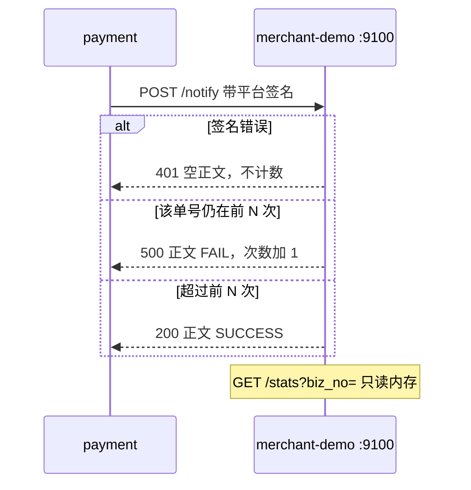

# TL-02 merchant-demo

| 项 | 内容 |
|---|---|
| 功能点 | TL-02（P0，第 5 周） |
| 所属链路 | 基础设施 |
| 代码提交 | `4e0e481` `[TL-02] add merchant demo` |
| 分支 | `feat/TL-02-merchant-demo` |
| 日期 | 2026-11-11 |
| 状态 | DONE |

## 一句话结论

商户演示进程在 `:9100` 上接收平台发来的支付、退款、转账通知：用通知正文里的商户号算出密钥并校验平台签名，签名不对就返回 HTTP 401 且不计数；同一个业务单号前 N 次正确通知返回 HTTP 500，第 N+1 次返回正文恰好是 `SUCCESS`。证据是 `TestTL02FailFirstN`、`TestTL02BadSignatureOtherBizNo`、`TestTL02StatsAfterFour`，以及 `/tmp/tl02-verify.log`（2026-11-11 10:04:49 开始，10:09:05 写完，退出码 0）。

## 1. 背景

### 1.1 系统简介

pay-system 是一个用 Go 编写的小型支付后端，模拟商户收款、退款、商户间转账三条资金链路，重点在数据一致性和性能。系统由 5 个部分组成：gateway（对外 HTTP 入口，负责签名校验和限流）、payment（支付单、退款单、转账单的状态管理和流程推进）、account（账户余额与记账，数据按商户分到 2 个数据库分片）、channel-mock（模拟微信、支付宝这类外部支付渠道）、recon（对账，核对系统内外数据是否一致）。服务之间用 Kitex（字节内部的 RPC 框架，这里就是进程之间的函数调用）同步调用，或通过 Kafka 消息异步通知；数据存在 MySQL 8.4。Redis 只给网关记住“这个随机串已经用过”，避免商户把同一笔 API 请求再放一次。merchant-demo 不用 Redis。所有金额用整数“分”表示，所有记账只追加不修改。当前已完成：工程骨架、账户与三条链路的订单和入账、Kafka 投递与消费、通知记录的生成，以及本功能点的商户演示接收端。平台把通知真正 POST 出去仍是下一步，所以现在还观察不到平台重试。

### 1.2 本功能点在系统中的位置



payment 以后会把通知 POST 到商户地址。merchant-demo 扮演这个商户。它不写数据库，也不改账户余额。统计接口给测试看“这个单号收到了几次、最后一次原文是什么”。

### 1.3 为什么需要它

平台约定：商户必须先验签，再按支付单号、退款单号或转账单号处理；HTTP 200 且正文去掉首尾空白后恰好是 `SUCCESS` 才算收到。演示还要能让同一个单号的前几次通知失败，用来观察平台会不会按固定间隔再发。

如果没有这个进程，下一步的发送测试只能对接一个永远返回成功的地址。那样看不出“前 3 次失败、第 4 次成功”时，商户侧计数是不是 4，也看不出签名被改过时商户会不会把这次失败记进次数、把真正的成功提前用掉。本功能点自己不发送通知，也不按 30 秒重试。

## 2. 术语

| 术语 | 含义 |
|---|---|
| 平台签名 | 平台发给商户的 HMAC-SHA256。拼接顺序是：时间戳、换行、随机串、换行、正文的 SHA-256（64 位小写十六进制）。结果用标准 Base64（带 `=` 填充）放在 `X-Signature`。时间戳或随机串里如果再有换行，字段边界就分不清，验签直接拒绝。 |
| 商户号 | 形如 `M100001` 的收款或付款商户标识。通知 JSON 的 `merchant_id` 字段。 |
| 业务单号 | 一笔业务的平台单号。支付是 `pay_no`，退款是 `refund_no`，转账是 `transfer_no`。统计按这个字符串分开计数。 |
| `FAIL_FIRST_N` | 原有环境变量，不是这次新加的。merchant-demo 启动时读取。每个业务单号前 N 次“验签通过并且取到单号”的通知返回 HTTP 500。默认 0，表示第一次就成功。小于 0 时进程启动失败。 |
| `DEMO_APP_SECRET_FORMAT` | 已有环境变量，默认 `demo_secret_%s_0123456789ab`。`%s` 换成商户号就是该商户的密钥。种子数据用它写入商户表，merchant-demo 用它验签。不另造一个密钥变量。 |
| HMAC | 带密钥的哈希。密钥不同，或正文差一个字节，签名就对不上。 |

## 3. 技术讲解

### 3.1 要解决的问题

1. 只有用该商户密钥签过的正文才能被当成一次通知。换一个商户号、或签名是用另一份正文算的，都必须拒绝。
2. 拒绝的请求不能占用 `FAIL_FIRST_N` 的次数。否则攻击者用错误签名就能把失败窗口耗尽。
3. 同一个单号的前 N 次正确通知返回 500，正文是 `FAIL`；第 N+1 次返回 200，正文是 `SUCCESS`。这 N 次失败也要出现在统计里。
4. 密钥算出来是空串时，这是演示进程自己的配置问题，返回 HTTP 500，不能假装成商户签名错误的 401。
5. 统计只放内存。演示进程重启后次数归零是可以接受的，因为它不是账本。

### 3.2 方案

进程启动时加载配置，把脱敏后的配置打到标准输出（密钥格式显示为 `***`），再在 `:9100` 上用 Hertz（本仓库选用的 HTTP 框架）提供两个路径。生产入口会阻塞到收到中断信号。已有的启动测试把“真正监听”换成一个立即返回的函数，所以它们仍然只检查配置打印，不会卡在端口上。

`POST /notify` 按下面的顺序处理：

1. 正文超过 65536 字节：HTTP 413，空正文。恰好 65536 字节继续。
2. 正文必须是一个 JSON 对象，且 `merchant_id` 是 JSON 字符串。不是的话 HTTP 401，空正文。解析用 `json.Decoder` 的 `UseNumber`，金额不会先变成浮点数。
3. 密钥 = 把商户号代入 `DEMO_APP_SECRET_FORMAT`。格式在加载时必须恰好有一个 `%s`，不能再有别的 `%`。未设置或空串用默认值。算出的密钥若是空串，打一条 ERROR 日志（不含密钥、不含签名）并返回 HTTP 500、空正文。
4. 用原始正文、`X-Timestamp`、`X-Nonce`、`X-Signature` 做平台验签。签名不是 44 字符的标准 Base64、算出来对不上、或时间戳/随机串里有换行：HTTP 401。merchant-demo 不做“时间戳必须在 5 分钟内”，也不把随机串记到 Redis。那是网关对商户调用平台 API 的防重放。这里是平台调用商户，同一份通知按设计可以再投递一次，所以相同正文再来一次会再计数。
5. 验签通过后看 JSON 的 `event_type`。`payment.succeeded` 只用 `data.pay_no`，这个字段缺失或是空串就 HTTP 400，不会改去找退款单号。`refund.succeeded` 和 `refund.failed` 只用 `data.refund_no`。`transfer.succeeded` 和 `transfer.failed` 只用 `data.transfer_no`。其他 `event_type` 才按 pay_no、refund_no、transfer_no 的顺序找第一个非空字符串。找不到：HTTP 400，不计数。
6. 函数 `record` 在一把互斥锁里把该单号次数加 1，并保存这次的原始正文，然后释放锁，返回加完后的次数。次数仍小于等于 N：HTTP 500，正文 `FAIL`。否则 HTTP 200，正文 `SUCCESS`。和 N 比较发生在锁外面，用的是已经返回的那个整数，所以两次并发各自拿到不同的次数。

`GET /stats?biz_no=` 不验签。返回 `{"count":次数,"last_body":"最后一次原始正文"}`。没见过的单号次数是 0，`last_body` 是空串。查询参数缺失或为空：HTTP 400。

计数用一把互斥锁保护。保存正文时复制一份字节，避免 HTTP 库稍后改掉缓冲区。

举一个验收里的数字。`FAIL_FIRST_N=3`，商户 `M100002`，支付单号 `PA0000000123456789012`。四次正文只有 `notify_id` 不同，签名都用 `demo_secret_M100002_0123456789ab` 计算。前 3 次 HTTP 500、正文 `FAIL`，第 4 次 HTTP 200、正文 `SUCCESS`。再查统计，次数是 4，`last_body` 等于第 4 次的原始 JSON，而不是第 1 次。

公开测试向量 V3 可以在本文里直接核对。密钥是 `demo_secret_M100001_0123456789ab`（默认格式代入 `M100001`）。时间戳 `1791500001`，随机串 `ZyXwVu9876543210`，正文是 `{"code":0,"msg":"ok","data":{"pay_no":"PA0000000000000000001"}}`，签名是 `TuLVqqAxs3SyvTtDXp1cpv+Rpv2D5URAFywIHBNjAh4=`。`TestTL02PlatformVectorV3` 用这四项验签，结果是通过。这组正文不是一张支付通知，它只证明默认格式和公开向量用的是同一把密钥。

### 3.3 为什么这样做

| 方案 | 做法 | 优点 | 缺点 | 结论 |
|---|---|---|---|---|
| 采用：商户号代入已有格式 | 正文里的 `merchant_id` 只用来选择密钥，签名仍覆盖整段原始正文 | 不新增环境变量；种子商户和演示进程用同一把密钥。用商户 A 的密钥签的正文，改成商户 B 之后对不上 | 格式写在环境文件里，知道格式的人可以自己重签。这不是生产用的随机密钥 | 采用。这是本地演示 |
| 备选：单独配置一个 `APP_SECRET` | 所有通知共用一把密钥 | 实现短 | 多商户对不上种子数据；还要再登记一个秘密配置 | 不采用 |
| 备选：不验签，只看 JSON | 有 `pay_no` 就计数 | 测试好写 | 错误签名也会占用失败次数，演示商户不再符合“先验签” | 不采用 |

### 3.4 正确性

本功能点不移动资金，不写数据库。下面只说明演示进程自己的计数。

| 场景 | 系统行为 | 最终状态 | 证明 |
|---|---|---|---|
| 同一单号连续 4 次正确签名，N=3 | 前 3 次 500，第 4 次 200 | 内存次数 4，最后正文是第 4 次原文 | `TestTL02FailFirstN`、`TestTL02StatsAfterFour` |
| 另一单号的签名是用别的正文计算的 | HTTP 401 | 该单号次数仍是 0；已成功记下的单号次数不变 | `TestTL02BadSignatureOtherBizNo` |
| 密钥格式是 `%s` 且商户号是空串 | HTTP 500，空正文 | 不计数 | `TestTL02EmptySecretIs500AndNotCounted` |
| 进程重启 | 内存映射丢掉 | 次数回到 0 | 没有持久化，这是设计。没有单独的自动化测试去杀进程 |
| 两个请求同时改同一个单号 | `record` 在锁里加一，锁外再用返回的次数决定 500 还是 200 | 两次会拿到相邻的次数 | 没有并发测试去打同一个单号。`-race` 只说明现有单线程测试没有报数据竞争，不能代替并发证明 |

### 3.5 性能

不涉及。这是本地演示进程，没有吞吐指标。

## 4. 已完成内容

### 4.1 改动清单

| 文件 | 新增 / 修改 | 作用 |
|---|---|---|
| `cmd/merchant-demo/notify.go` | 新增 | 验签、失败窗口、内存统计 |
| `cmd/merchant-demo/notify_test.go` | 新增 | 验收和边界 |
| `cmd/merchant-demo/main.go` | 修改 | 打印配置后在 `:9100` 监听；测试可换掉监听函数 |
| `cmd/merchant-demo/main_test.go` | 修改 | 成功路径不再真的监听；拒绝非法密钥格式 |
| `pkg/config/merchantdemo.go` | 修改 | 读取已有的 `DEMO_APP_SECRET_FORMAT` 并检查格式 |
| `pkg/config/config_test.go` | 修改 | 默认值与非法格式 |
| `deploy/.env.example` | 修改 | 注明 merchant-demo 也读这个变量。变量值没改 |
| `docs/02-requirements.md` | 修改 | 状态改为 DONE，补规则 |
| `docs/03-conventions.md` | 修改 | 版本 v2.30，使用方加上 merchant-demo |
| `docs/05-api.md` | 修改 | 版本 3.4.0，写明两个路径 |
| `docs/06-flows.md` | 修改 | 版本 v2.51，只在图下加一句。未改图。本机没有 mmdc（把图渲染成 SVG 的命令），所以没有新的 SVG 文件 |
| `docs/interview-notes.md` | 修改 | 记下密钥复用和 401 不计数 |

### 4.2 对外变化

| 类别 | 变化 |
|---|---|
| 接口 | 新增 merchant-demo `POST /notify`、`GET /stats`。平台通知字段没有变 |
| 表结构 | 无 |
| 配置项 | 不新增变量名。`FAIL_FIRST_N` 本来就属于 merchant-demo，默认 0，小于 0 启动失败。`DEMO_APP_SECRET_FORMAT` 增加使用方 merchant-demo。空串仍用默认值。格式不是恰好一个 `%s` 时启动失败，错误文本不含格式原文 |
| 错误码 | 无。演示进程用 HTTP 状态和纯文本，不用平台那套数字错误码 |
| 指标 / 故障点 | 无新指标。`FAULT_POINTS` 是测试用的失败开关，名字必须是事先登记过的。启动时仍会拒绝不认识的名字。处理 `/notify` 时不打开任何开关 |

`docs/04-dev-plan.md` 第 5 周第 2 行仍未勾选。这一行还要等通知发送做完。

### 4.3 验收对照

| 验收条目 | 测试函数 | 类型 | 结果 |
|---|---|---|---|
| `FAIL_FIRST_N=3`：同一单号前 3 次正确签名返回 500，第 4 次返回 200、正文 `SUCCESS` | `TestTL02FailFirstN` | 单元 | 通过 |
| 签名错误的通知（另一单号）返回 401 | `TestTL02BadSignatureOtherBizNo` | 单元 | 通过 |
| 上述 4 次之后，`GET /stats?biz_no=` 返回次数 4 和第 4 次正文 | `TestTL02StatsAfterFour` | 单元 | 通过 |

另外：`TestTL02PlatformVectorV3` 覆盖公开签名向量；`TestTL02RefundAndTransferBizNo` 确认退款和转账用各自的单号；`TestTL02ServeOnCancel` 在 `127.0.0.1` 的临时端口上真正听过一次，然后取消返回。验收不要求占用 9100，正式监听地址仍是 `:9100`。

### 4.4 验证记录

环境：macOS 27.0.1（Build 26A434），Darwin arm64，Go 1.27.2，golangci-lint 2.14.0（用 go1.27.1 编译），Docker 29.8.2，OrbStack。日志只认 `/tmp/tl02-verify.log`。开始时间 2026-11-11 10:04:49 CST，文件修改时间 10:09:05，脚本退出码 0。日志写完之后只改了 `handleNotify` 里的一句注释，没有改行为，没有重跑这整份日志。

| 命令 | 结果 |
|---|---|
| `gofmt -l .` | 无输出（日志里是 `gofmt_clean`） |
| `make lint` | `0 issues.` |
| `make test` | 通过。根包 5.762 秒，`cmd/merchant-demo` 1.530 秒，`pkg/config` 1.856 秒 |
| `make test-integration` | 通过。根包 42.675 秒，`service/payment/biz` 122.767 秒，`cmd/merchant-demo` 1.547 秒。本功能点不访问 MySQL |
| `make cover` | 通过。全仓库 38.7%，含生成代码，不作门槛。`cmd/merchant-demo` 78.4%（不在门槛里）。门槛包：`service/payment/biz` 84.6%（本次 cover 119.194 秒），`service/account/biz` 90.8%，`service/channel_mock/biz` 91.7%，`pkg/money` 100%，`pkg/sign` 100%，`pkg/idgen` 88.1%，`pkg/outbox` 88.9%，`pkg/config` 85.6%。结束后删除 `coverage.out`，日志末尾是 `no_coverage_out` |

### 4.5 同步的文档

需求状态改为完成，并写明 401 不计数、空密钥返回 500、超过 65536 字节返回 413。约定版本记到 v2.30。接口版本记到 3.4.0，因为新增了两个演示路径。流程图只加图下说明，版本 v2.51。

## 5. 未完成与风险

平台还不会把库里的通知 POST 到这个进程。发送、30 秒重试、地址白名单仍是下一步。`deploy/docker-compose.yml` 里的 merchant-demo 仍是占位命令，`make up` 不会启动这个二进制。

统计在进程内存里。两个演示进程各自计数，重启就丢。演示不需要持久化。

日志不写请求正文，也不写签名。密钥为空时只有一句固定的 ERROR：`merchant demo app secret empty`。

## 6. 如何复现

```bash
cd /Users/yym/GolandProjects/pay-system
go test -count=1 -timeout 60s ./cmd/merchant-demo/ -run 'TestTL02|TestMerchantDemo'
go test -count=1 -timeout 60s ./pkg/config/ -run TestLoadMerchantDemo
```

预期：两条都打印 `ok`。`TestTL02FailFirstN` 失败时会打印实际 HTTP 状态和正文。

整份验证日志已经在 `/tmp/tl02-verify.log`。不要把新的输出重定向到这个路径，否则会覆盖 2026-11-11 10:09:05 那次结果。

## 7. 讲解要点

1. 问：为什么不配置一把单独的演示密钥？答：种子商户的密钥本来就是 `demo_secret_<商户号>_0123456789ab`。演示进程用通知里的商户号代入同一格式。只改商户号、不按新商户重签，验签失败。知道这串格式的人可以自己重签，所以它只适合本地演示。
2. 问：错误签名为什么不能返回 500？答：500 且正文是 `FAIL` 表示“我收到了，但按配置这次要失败”，并且次数加 1。401 表示“这不是一次有效通知”，次数不动。
3. 问：统计存在哪里？答：进程内存，按业务单号。没有表，重启清空。

## 延伸阅读

- `docs/02-requirements.md` 里 TL-02 一节
- `docs/05-api.md` §3.4、§3.7、§6、§6.1
- `docs/03-conventions.md` §8 的 `DEMO_APP_SECRET_FORMAT`
- `docs/06-flows.md` 的 SL-08

## 修订记录

| 日期 | 提交 | 修订内容 |
|---|---|---|
| 2026-11-11 | 待提交 | 初稿 |
