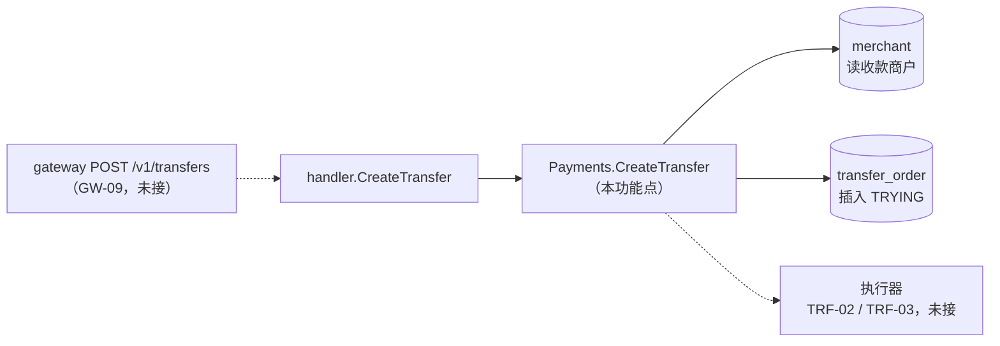
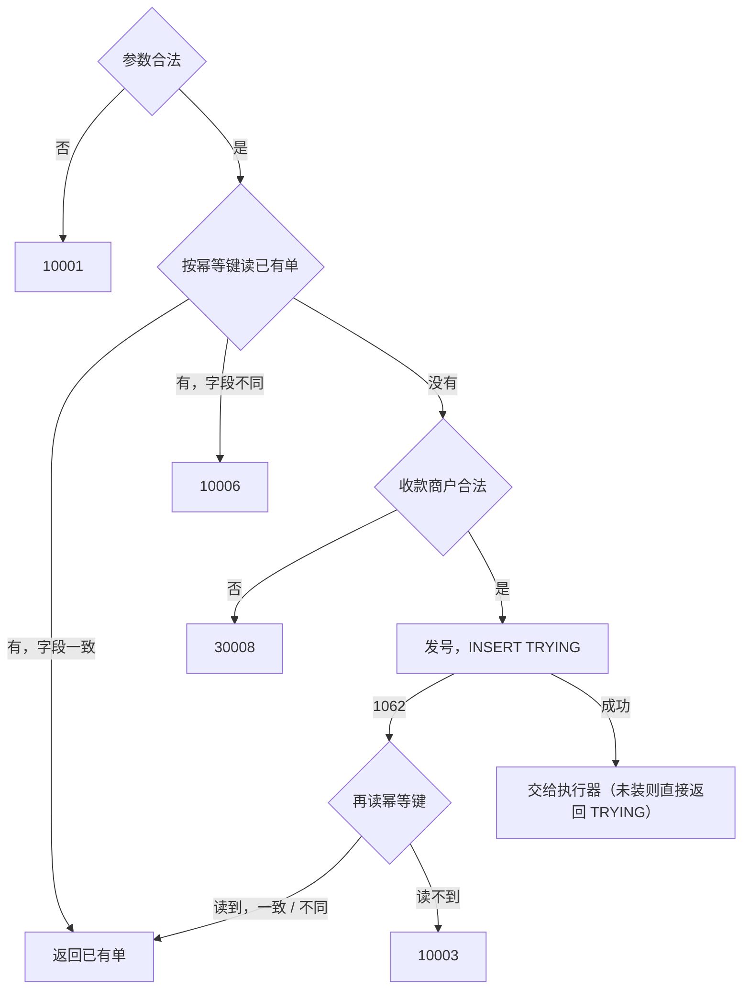

# TRF-01 创建转账单

| 项 | 内容 |
|---|---|
| 功能点 | TRF-01 创建转账单（优先级 P0，即必须完成；排在第 4 周的里程碑 M4） |
| 所属链路 | 转账 |
| 代码提交 | `9f69152` `[TRF-01] add create transfer`（完整 `9f69152fb753bdb45ecb45eacea906e5c2a815f5`，2026-11-06 08:36:58 +0800） |
| 分支 | `feat/TRF-01-create-transfer` |
| 日期 | 2026-11-06 |
| 状态 | DONE |

这次代码提交改了 15 个文件，新增 1603 行，删除 40 行。本报告不在这 15 个文件里。

## 一句话结论

payment 的 `CreateTransfer` 现在会校验参数，再按“付款商户号 + 商户转账单号”查有没有已有的单：有就直接返回，没有才校验收款商户并插入一张 `TRYING`（处理中）状态的转账单。`mode` 由双方所在的分片决定，同分片是 `LOCAL`，跨分片是 `TCC`。100 个相同请求并发到达时，MySQL 里只有 1 张单，100 个请求拿到同一个 `transfer_no`。建单后收款商户被停用，商户用相同参数重试仍拿到原来那张单。本功能点不移动资金：真正执行转账的“执行器”还没接上，所以建单成功时返回的是刚插入的 `TRYING` 单。

## 1. 背景

这次只完成转账链路的第一步：把转账单可靠地写下来。扣付款方、加收款方的执行步骤（TRF-02 同分片转账执行、TRF-03 跨分片转账 TCC 协调），以及把停住的转账单接着推进的卡单恢复（TRF-04 转账恢复任务），都在后续功能点。

### 1.1 系统简介

pay-system 是一个用 Go 编写的小型支付后端，模拟商户收款、退款、商户间转账三条资金链路，重点在数据一致性和性能。系统由 5 个部分组成：gateway（对外 HTTP 入口，负责签名校验和限流）、payment（支付单、退款单、转账单的状态管理和流程推进）、account（账户余额与记账，数据按商户分到 2 个数据库分片）、channel-mock（模拟微信、支付宝这类外部支付渠道）、recon（对账，核对系统内外数据是否一致）。服务之间用 Kitex RPC 同步调用，或通过 Kafka 消息异步通知；数据存在 MySQL 8.4，Redis 用于防重放。所有金额用整数“分”表示，所有记账只追加不修改。

当前已完成：支付单的创建、发起、结果推进、关单和查询；渠道模拟与回调入口；退款的额度占用（创建退款时把退款金额加到原支付单的已退金额 `refunded_amount` 上，累计不能超过支付金额）、冻结与渠道提交、结果推进；account 一侧转账要用到的操作，包括同分片转账（ACC-07 同分片转账）和跨分片时收款方的分支（ACC-14 收款方转账分支）。本次是 payment 一侧创建转账单。

仍未做：TRF-02 同分片转账执行、TRF-03 跨分片转账 TCC 协调、TRF-04 转账恢复任务、TRF-05 转账查询、GW-09 商户 API 路由（网关上退款与转账的 HTTP 路由）。

### 1.2 本功能点在系统中的位置

请求停在 payment 的 `transfer_order` 表。本功能点不调用 account，不写 Kafka 消息。



上游是网关的 `POST /v1/transfers`，这条路由属于 GW-09 商户 API 路由，还没接上，所以目前只有直接调 payment 的 RPC 能走到这里。payment 的 RPC 端口（8881）只供内部服务调用：本地 docker compose 只把它映射到本机 `127.0.0.1`，而且 payment 容器现在是占位，`make up` 不启动它。下游是执行器：同分片时走 TRF-02，调 account 在一个本地事务里完成转账；跨分片时走 TRF-03，由 payment 协调两个分片。虚线表示还没接通。`merchant`（商户表）和 `transfer_order`（转账单表）都属于 payment 服务，在同一个库 `pay_payment` 里。

### 1.3 为什么需要它

转账单是整笔转账唯一的“账本”，必须先于任何资金操作落库。例如商户 M100001 要给 M100002 转 500 分（5.00 元），请求超时后商户用同一个商户转账单号重试。如果系统不认这个单号，就会建出第二张单，再执行一次，M100001 被扣 1000 分（10.00 元）。如果 100 个相同请求同时到达，各自都先查到“没有这张单”，再各自插入，也会出现多张单。转账单还要在创建时记下双方的分片和执行方式，后续的执行和恢复任务都按它来推进。

## 2. 术语

| 术语 | 含义 |
|---|---|
| 用户、主代理、审查代理 | 本项目由用户（项目负责人）决定业务规则；主代理是负责安排开发、核验结果和提交代码的 AI 代理，用户可以授权它对具体问题作决定；审查代理是只读代码、找缺陷的 AI 代理，不改代码。 |
| 付款商户 / 收款商户 | 转账从付款商户的余额划到收款商户的余额。经过网关时，付款商户号只取自网关的签名校验结果，请求体里不能冒充。直接调 RPC 时由调用方传入，见 1.2 和第 5 节。 |
| 商户号 | `M` 加 6 位数字，如 `M100001`。 |
| `out_transfer_no` | 商户自己的转账单号，1–64 位，只能是字母、数字、`_`、`-`。 |
| `transfer_no` | 平台转账单号，`TF` 前缀加 19 位数字，共 21 位，如 `TF0112113745920008192`（2026-11-06 09:00:00 由 worker 2 发出的第一个号）。单元测试用固定的假发号器，单号是 `TF0000000000000000001`，只示意长度。 |
| 发号器 | 生成平台单号的组件 `pkg/idgen`。19 位数字是一个 64 位的雪花 ID：高位是毫秒时间戳，中间是本进程的 worker 编号（环境变量 `WORKER_ID`），低位是同一毫秒内的序号。不同进程 worker 编号不同、同一进程按时间递增，所以正常情况下不会重号。 |
| 时钟回拨 | 机器时间往回跳（例如校时）。雪花 ID 依赖时间递增，回拨后可能发出重复的号。回拨不超过 5 毫秒时发号器等时间追上；超过 5 毫秒时拒绝发号，接口返回 `10004`。 |
| 幂等 | 同一个请求执行一次和执行多次，结果相同。这里的意思是：商户重试不会多建单、多转钱。 |
| 幂等键 | 用来判断“是不是同一个请求”的字段组合。转账是 `(merchant_id, out_transfer_no)`，即付款商户号加商户转账单号。 |
| 唯一索引 | MySQL 保证某几列的组合在表里不重复。`transfer_order` 有两个：`uk_merchant_out_transfer_no`（幂等键）和 `uk_transfer_no`（平台单号）。 |
| 1062 | MySQL 的错误号，表示插入的行和唯一索引上已有的行重复。 |
| 自动提交 | 不显式开事务时，MySQL 每条语句执行完就立即提交。本功能点的插入就是一条自动提交的语句。 |
| 分片 | account 的数据分在 2 个数据库里。商户落在哪个分片由 `shard.Of` 计算：商户号数字部分除以 2 的余数。M100001、M100003 在分片 1，M100002 在分片 0。 |
| 业务号 | account 记账、冻结时用来标识“这是哪笔业务”的编号（字段 `biz_no`），account 按它去重。转账用平台转账单号 `transfer_no` 作业务号。 |
| 冻结 | 在付款方账户上把一笔钱标记为不可用：account 的 `frozen_amount`（冻结金额）增加，`balance`（余额）暂时不变，可用余额 = `balance - frozen_amount` 因此减少。之后要么确认扣走（`balance` 与 `frozen_amount` 同减），要么解除（`frozen_amount` 减回）。 |
| `LOCAL` | 付款方和收款方在同一个分片。转账可以在那个分片的一个数据库事务里完成（TRF-02）。 |
| `TCC` | Try-Confirm-Cancel，跨分片时用的两阶段做法，由 payment 协调（TRF-03）。每个分片上的那一部分操作叫一个“分支”：付款方分支在 Try 时冻结金额，收款方分支在 Try 时只在 account 里登记一条分支记录、不动余额。两个 Try 都成功再 Confirm（付款方扣走冻结金额，收款方入账），否则 Cancel（解除冻结、撤销登记）。 |
| `TRYING` | 转账单的初始状态，表示“处理中，结果未定”。`LOCAL` 和 `TCC` 的新单都从 `TRYING` 开始。其他状态：`CONFIRMING`、`CANCELLING`（跨分片的确认中、撤销中），`SUCCESS`、`FAILED`（终态，不会再变）。“处理中”指 `TRYING`、`CONFIRMING`、`CANCELLING` 三个状态。 |
| 转账单的其他列 | `version`：版本号，每次状态更新加 1；`retry_count`：恢复任务接管过几次；`fail_code`：失败原因，如 `INSUFFICIENT_BALANCE`（余额不足）；`txn_no`：`LOCAL` 转账成功时 account 生成的记账凭证号；`finished_at`：进入终态 `SUCCESS` 或 `FAILED` 的时间。新单这五列分别是 0、0、NULL、NULL、NULL。 |
| 执行器 | 本次定义的 Go 接口 `TransferExecutor`，负责把一张刚插入的 `TRYING` 单推进下去。TRF-02、TRF-03 会实现它，现在没有实现，所以没装。 |
| `next_retry_at` | 转账单上的时间字段。恢复任务（TRF-04）会扫描到期仍未结束的单并接着推进。新单写成创建时间加 `TRANSFER_RECOVER_DELAY`（配置项，默认 10 秒）。 |
| 通知、白名单 | 转账结束后，payment 向付款商户的 `notify_url` 发 HTTP 回调告诉它结果（通知功能点 NTF，尚未接入转账）。白名单是部署方用配置项 `NOTIFY_URL_ALLOW_HOSTS`（默认 `merchant-demo`）列出的允许主机名，`notify_url` 的主机不在名单里就拒绝，避免平台被利用去请求任意地址。 |
| CAS | Compare-And-Set，用 `UPDATE ... WHERE status = 旧状态` 改状态，只有当前仍是旧状态才改得动。本功能点只插入，不改状态；后续功能点推进状态时只能用 CAS（项目资金规则）。 |
| outbox | 和业务数据在同一个事务里写一条待发消息，再由后台投递到 Kafka。本功能点不写。 |
| 排序规则 | MySQL 比较字符串的规则。`utf8mb4_bin` 按字节比较，区分大小写，但比较时忽略末尾空格；`utf8mb4_0900_ai_ci` 不区分大小写和重音，`TR_X` 和 `tr_x` 被当成相同。 |
| `biz_code` | RPC 响应里的业务码字段。有些错误需要连同对象一起返回（例如“余额不足”要带上已失败的转账单），就把码放在这里，RPC 本身算成功。 |
| `BizStatusError` | Kitex 传递业务错误的方式，只有错误码，不带对象。 |
| Kitex 超时 | RPC 在截止时间内没完成时，调用方收到的是 Kitex 的超时错误，不是任何业务码。网关把这类非业务错误统一转成 `10004`（现有支付路由就是这样做的，转账路由要等 GW-09）。商户收到超时或 `10004` 应该用相同参数重试。 |
| 错误码 | 本报告用到的都是已有的码，这次没有新增：`10001` 参数不合法；`10003` 内部错误；`10004` 暂时不可用；`10006` 同一个幂等键但关键字段不同；`30008` 收款商户不合法；`40002` 余额不足。 |
| testcontainers | 测试时用 Docker 临时启动一个 MySQL 8.4.11 容器，测完删除。 |

## 3. 技术讲解

### 3.1 要解决的问题

1. 同一个幂等键只能有一张转账单。重复请求和并发请求都必须拿到同一个 `transfer_no`。原因：转账单号会用作 account 侧冻结和记账的业务号，两张单就意味着可能转两次钱。
2. 同一个幂等键带了不同的收款方、金额或通知地址，返回 `10006`，不覆盖原单。原因：商户可能误用了单号，静默返回原单或改写原单都会让商户以为转的是新内容。
3. 新建单时，收款商户必须存在、状态是 `ACTIVE`，且不是付款商户本身，否则 `30008`。需求 TRF-01 第 2 条原文：“收款商户必须存在、ACTIVE，且不是付款商户本身，否则 `30008`。只对没有已有单的请求校验”。
4. 已经建好的单，重试时总能拿回来，即使收款商户后来被停用。这是主代理按用户授权作出的决定，见 3.3。
5. 创建时就确定 `mode`、双方分片、`next_retry_at`，让后续执行和恢复任务有据可依。需求 TRF-01 第 4 条原文：“`payer_shard`、`payee_shard` 由 `shard.Of` 计算；两者相同 `mode = LOCAL`，否则 `TCC`；`status = TRYING`；`next_retry_at = now + TRANSFER_RECOVER_DELAY`”。
6. 执行只能发生一次。并发请求里只有真正插入成功的那个去执行，其余只返回已有单。需求 TRF-01 第 3 条原文：一致时“返回已有转账单（不论当前状态，不在本次请求中重新执行，不再校验收款方）；否则 `10006`”。
7. 事务里不调外部系统（项目资金规则）。插入和执行分开：插入提交之后才交给执行器。原因是外部调用可能很慢或超时，放在事务里会长时间占着锁。

### 3.2 方案

整体思路：先做不读库的参数校验；再按幂等键读一次，有单就比较并返回；没有单才校验收款方、发号、插入；插入遇到 1062 说明有人抢先插入了，就再读一次拿赢者的单；插入成功的请求才交给执行器。



图里“再读幂等键”读到之后与第一次读的处理相同：一致返回已有单，不同返回 `10006`。读不到时，在部署环境的 `utf8mb4_bin` 排序规则下，冲突的只能是另一个唯一索引 `uk_transfer_no`，也就是平台单号撞了，例如两个进程误配了相同的 `WORKER_ID`，在同一毫秒发出同一个号。这是发号器或部署配置出了问题，不能当作同一个请求，所以返回 `10003`。测试库的排序规则不同，读不到还有另一种原因，见第 5 节“测试库的大小写问题”。

**参数校验**（`normalizeTransfer`）不读库。金额必须在 1 到 10,000,000 分（0.01 元到 100,000.00 元）之间。付款和收款商户号都要能被 `shard.Of` 解析，否则 `10001`。经过网关时付款商户号来自验签结果，格式不对说明调用方传错了，同样算参数错误。付款商户的状态（是否停用）这里不读库，按设计由网关在验签时校验；网关路由接上之前，直接调 RPC 的请求没有人检查付款商户状态，见第 5 节。`remark` 最多 128 个字符，未传或传空串都存 NULL，不参与幂等比较。`notify_url` 未传时存空串，通知时取商户默认地址；显式传空串或主机不在白名单内返回 `10001`，与创建支付单的规则一致。

**主流程**在 `service/payment/biz/transfer.go`。下面这段是参数校验之后的顺序，看前 11 行：先读幂等键，没有已有单才调用 `checkPayee`。

```go
// 幂等读在收款方校验之前：建单后收款方被停用，相同参数重试仍应拿到已有单。
existing, ok, err := p.transfers.transferByMerchantOut(ctx, req.merchantID, req.outTransferNo)
if err != nil {
	return TransferOrder{}, callErr(err)
}
if ok {
	return sameTransfer(existing, req) // 一致返回已有单，不一致 10006
}
if err := p.checkPayee(ctx, req.merchantID, req.payee); err != nil {
	return TransferOrder{}, err // 30008，或读商户失败时的依赖错误
}
transferNo, err := p.ids.NewNo(ctx, transferNoPrefix)
// ……计算 mode、next_retry_at，组装 row ……
if err := p.transfers.insertTransfer(ctx, row); err != nil {
	return p.onTransferInsertErr(ctx, req, err)
}
return p.executeTransfer(ctx, row)
```

`callErr` 统一处理依赖（数据库、执行器）返回的错误：上下文超时或取消原样返回，到 RPC 层变成 Kitex 超时；已经是项目错误码的原样返回；其他错误（例如 SQL 报错）包成 `10003`。

`sameTransfer` 比较收款商户号、金额、通知地址三个字段，不比较 `remark`。已有单不论处于什么状态都原样返回，不再执行。

**收款方校验**（`checkPayee`）：转给自己直接 `30008`，不读库。否则读收款商户的配置。部署环境里配置可以来自进程内缓存，有效期是配置项 `MERCHANT_CONFIG_CACHE_TTL`（默认 60 秒），停用的商户配置也会被缓存，所以商户被停用后最多 60 秒内仍可能被当成 `ACTIVE`，见第 5 节。商户不存在或状态不是 `ACTIVE` 返回 `30008`。读库失败不是收款方的问题，按 `callErr` 返回：超时原样返回，其他错误是 `10003`。

**插入与 1062**：插入是一条自动提交的 `INSERT`。新单的 `status = TRYING`，`version`、`retry_count` 为 0，`fail_code`、`txn_no`、`finished_at` 为 NULL（表上的约束要求 `TRYING` 时这三列为空），`created_at` 和 `updated_at` 由程序的时钟写入并截到毫秒，`next_retry_at = created_at + TRANSFER_RECOVER_DELAY`（默认 10 秒）。遇到 1062 时的处理在 `onTransferInsertErr`：

```go
if !dbx.IsDuplicate(err) {
	return TransferOrder{}, callErr(err)
}
existing, ok, readErr := p.transfers.transferByMerchantOut(ctx, req.merchantID, req.outTransferNo)
if readErr != nil {
	return TransferOrder{}, callErr(readErr)
}
if !ok {
	// 冲突的是 uk_transfer_no 而不是幂等键，说明发号撞号，不能当作幂等命中。
	return TransferOrder{}, errno.ErrInternal
}
return sameTransfer(existing, req)
```

这次再读同样不校验收款方。赢者已经提交，这里只返回它当前的样子，不执行。

**读行时的字节比较**：`transferByMerchantOut` 用 SQL 按幂等键读出一行后，还要在 Go 里逐字节比较商户号和商户转账单号，不一样就当作没读到。原因是 MySQL 的排序规则可能把字节不同的字符串判为相等，例如不区分大小写时 `TR_X` 等于 `tr_x`。

**执行器**：

```go
type TransferExecutor interface {
	ExecuteTransfer(ctx context.Context, row TransferOrder) (TransferOrder, error)
}
```

`(*Payments).UseTransfer(recoverDelay, exec)` 装上恢复延迟和执行器。`cmd/payment/main.go` 启动时恢复延迟传配置值 `TRANSFER_RECOVER_DELAY`，只有执行器参数传 `nil`。没装执行器时，`CreateTransfer` 返回刚插入的 `TRYING` 单。装上之后，执行器返回执行结束时的单：本次执行到 `FAILED` 且失败原因是 `INSUFFICIENT_BALANCE` 时，返回这张单和 `40002`；其他结果（`SUCCESS`、三个处理中状态、其他原因的 `FAILED`）返回这张单，没有错误。执行器返回错误时，转账单已经提交，接口按 `callErr` 返回错误，商户用相同参数重试会拿到这张单。幂等命中一张因余额不足失败的旧单时返回业务码 0，因为“余额不足”是那次请求的结果，不是这次的。需求 TRF-01 第 6 条原文：“本次请求执行到 FAILED 且 `fail_code = INSUFFICIENT_BALANCE` 时返回 `40002` 并在 `data` 中携带转账单；其他情况（……以及第 3 条的幂等命中）一律返回 code 0 和转账单”。

**RPC 适配**（`service/payment/handler/handler.go`）：请求为 nil 返回 `10001`，不进业务层。`40002` 放进 `biz_code` 并带上转账单，RPC 本身算成功；其他业务错误走 `BizStatusError`，不带转账单；成功时 `biz_code = 0` 并带上转账单。服务端处理超时是默认的 2 秒，超时后调用方收到 Kitex 超时错误。

### 3.3 为什么这样做

| 方案 | 做法 | 优点 | 缺点 | 结论 |
|---|---|---|---|---|
| 采用：先读幂等键，再校验收款方 | 有已有单就只比较字段；没有才校验收款方 | 建单后收款商户被停用，商户重试仍能拿到那张可能已经成功的单 | 已有单号换成不合法的收款方（例如转给自己）返回 `10006` 而不是 `30008` | 采用。用户授权主代理决定，2026-11-06 |
| 备选：先校验收款方，再读幂等键 | 需求条目原来的书写顺序 | 不合法的收款方总是报 `30008` | 收款商户停用后，重试得到 `30008`，商户看不到已有转账单，不知道钱转没转，违背接口文档对重试的承诺：“商户在超时、`10003`、`10004` 时可以重试”，参数一致时“返回已有转账单” | 不采用。最初按此实现，之后改掉 |
| 采用：插入前先读一次 | 大多数重试在这一步就返回 | 重试不消耗平台单号，也不做收款方校验 | 多一次读 | 采用 |
| 采用：1062 之后在插入之外再读 | 插入是自动提交的单条语句，失败后另起一次读 | 两个请求同时插入同一幂等键时，InnoDB 让后到的 `INSERT` 在唯一索引的这条记录上等锁：先到者提交后，后到者才得到 1062；先到者回滚，后到者就插入成功。所以输家拿到 1062 时，赢者的行已经提交，另起的读一定能看到它 | 多一次读；读不到时要自己判断冲突的是哪个唯一索引（部署环境下只可能是平台单号撞号，见 3.2） | 采用 |
| 备选：把插入和再读放进一个事务 | 1062 后在同一事务里再读 | 读和写放在一起 | 只有一条写，开事务没有必要。用 MySQL 默认的可重复读（REPEATABLE READ）时，事务里第一次普通读建立快照，之后再读看不到别人后来提交的行，本该返回已有单却会报错；项目的 `dbx.WithTx` 用读已提交（READ COMMITTED），每条语句取新快照，不会有这个问题，但仍是多余的事务。退款创建（REF-01 创建退款与额度占用）必须用事务，因为占用额度（用条件更新把退款金额加到原支付单的已退金额 `refunded_amount` 上，额度不够时影响 0 行）和插入退款单要一起成败；它也在事务结束后再读商户退款号。代码注释（`service/payment/biz/refund.go` 的 `afterRefundMiss`）和面试笔记给的理由是“事务内快照看不到另一笔已提交的退款”，这与读已提交的语义对不上，REF-01 的报告也没有记录实际出过错，真实原因未确认 | 不采用 |
| 采用：执行器做成接口，未装时返回 `TRYING` | 本功能点只负责落单 | 本功能点可以独立测试和提交；TRF-02、TRF-03 只需实现接口并装上 | 接口暂时不会移动资金 | 采用，与退款创建先返回 `INIT`（退款单的初始状态：已写下，资金还没冻结）的做法一致 |
| 备选：执行器未完成前返回 `10003` | 接口整体视为未实现 | — | 落了单却报错，商户会重试，单据已经存在 | 不采用 |
| 采用：服务端处理超时暂时保持 2 秒 | payment 其他方法的默认值 | 本功能点目前只读写数据库，远到不了 2 秒，暂不触发 | 接上 account 调用后才需要满足“不早于网关 3 秒”，2 秒可能不够，见下文 | 采用，用户决定留给 TRF-02、TRF-03 评估 |

**超时的考虑。** 各层超时的出处是需求 §5.4.1 的超时表和 GW-01 网关接入第 5 条：网关调 payment 的 `CreateTransfer` 超时 3 秒，表里写的理由是“因含最多两轮分支调用”；payment 调 account 连接 100 毫秒、调用 500 毫秒，幂等方法超时重试 1 次，所以一次分支调用最长约 1.2 秒。期望的顺序是：account 调用的超时先到期，payment 按 TRF-02 第 4 条“超时……保持 TRYING，接口返回 TRYING”正常返回 `TRYING`；payment 服务端的截止时间不早于网关的 3 秒，不在中途切断请求。`Pay` 和 `CreateRefund` 就是这样处理的：它们要等最多 3 秒的渠道调用，服务端超时设为 5 秒，让渠道超时先到期并返回处理中，而不是被服务端截止打断（需求 PAY-03 发起支付第 8 条）。本功能点目前只读写数据库，远到不了 2 秒，这个问题暂不触发；接上 account 调用后才需要满足“不早于网关 3 秒”。跨分片时按需求 TRF-03 第 1、5、6 条，默认（配置 `TRANSFER_PARALLEL_BRANCH = true`）同一轮的付款方、收款方两个分支并行调用，一轮最长约 1.2 秒；两轮（Try，再 Confirm 或 Cancel）串行，约 2.4 秒，再加上几次数据库读写，会超过 2 秒。配置为串行时同一轮的两个分支也先后调用，最多 4 次调用，约 4.8 秒，连网关的 3 秒也会超过。被 2 秒的服务端截止打断时，调用方收到 Kitex 超时而不是 `TRYING`。转账单已经落库，不会丢，重试能拿回它；但如果打断发生在付款方 Try 之后，付款方的金额已经冻结，要等 TRF-03 的原请求或 TRF-04 转账恢复任务推进到 Confirm（扣走）或 Cancel（解除）才解除。TRF-04 第 2 条规定，停在 `TRYING` 的 `TCC` 单到期后改为 `CANCELLING` 并解除冻结；在这之前，至少要等 `next_retry_at` 的 10 秒，这段时间付款方的这笔钱不能用。

### 3.4 正确性

本功能点不移动资金，所以没有调用 `CheckBalance`（account 的全量余额核对，检查借贷平衡、余额与分录一致等不变量）；正确性看的是“单据只有一张、返回一致”。

| 场景 | 系统行为 | 最终状态 | 证明 |
|---|---|---|---|
| 同一请求重复到达：M100001 → M100002，500 分（5.00 元），再发一次 | 第二次读到已有单，三个字段一致，原样返回 | 1 行，`amount = 500`，`version = 0`；两次返回同一个 `transfer_no` | `TestCreateTransferIdempotentMySQL`、`TestCreateTransferIdempotent` |
| 同一单号换金额：第二次 501 分 | 读到已有单，金额不同 | 返回 `10006`，原行不变 | 同上；单元测试还覆盖了换收款方、换通知地址、去掉通知地址 |
| 100 个相同请求并发：M100001 → M100002，700 分 | 单元测试让 100 个请求都越过第一次读、同时去插入：1 个成功，99 个得到 1062，再读到赢者 | 1 行；100 个请求同一个 `transfer_no`；100 次插入尝试，执行器只被调用 1 次 | `TestCreateTransferConcurrentSame`（单元，`-race`）；`TestCreateTransferConcurrentMySQL`（MySQL 上 100 个 goroutine，表里 1 行，全部同号） |
| 建单后收款商户被停用：M100001 → M100003，800 分，建单后执行 `UPDATE merchant SET status = 'DISABLED'` | 相同参数重试读到已有单，不读商户配置 | 返回原单；改成 801 分返回 `10006`；用新单号转给它返回 `30008`；表里只有原来 1 行，`TRYING`、`version = 0` | `TestCreateTransferPayeeDisabledAfterCreateMySQL`、`TestCreateTransferPayeeDisabledAfterCreate`。两个测试都没有商户配置缓存（集成测试把缓存有效期设为 0，单元测试的假商户不缓存），所以停用立即可见；部署环境的缓存见第 5 节 |
| 赢者提交后、输家遇到 1062 之前，收款商户被停用 | 输家再读命中，不校验收款方 | 输家返回赢者的单；商户配置只在插入前读过 1 次 | `TestCreateTransferDuplicateSkipsPayeeCheck` |
| 平台单号撞号（例如两个进程配置了相同的 `WORKER_ID`） | 1062 后再读不到 | 返回 `10003`，不插入 | `TestCreateTransferStoreErrors` |
| 插入提交后、执行前进程崩溃 | 单停在 `TRYING`，`next_retry_at` 是 10 秒后 | 商户重试拿到这张单；TRF-04 上线后由恢复任务接着推进 | 重试拿回已有单由幂等测试证明；恢复任务属于 TRF-04，本次没有测试 |
| 插入前进程崩溃 | 什么都没写 | 重试时正常创建 | 无需单独测试 |
| 读收款商户超时 | 超时原样返回，调用方收到 Kitex 超时，不当作 `30008` | 不插入 | `TestCreateTransferPayeeLookupError` |
| 执行器返回错误或超时 | 转账单已提交，接口按 `callErr` 返回错误（超时原样返回，未知错误为 `10003`） | 表里 1 行 `TRYING`，重试拿到它 | `TestCreateTransferExecuteResponse` 末段 |
| 发号器检测到超过 5 毫秒的时钟回拨 | 返回 `10004` | 不插入 | `TestCreateTransferStoreErrors` |

### 3.5 性能

不涉及。本次没有压测，也没有性能开关。

## 4. 已完成内容

### 4.1 改动清单

| 文件 | 新增 / 修改 | 作用 |
|---|---|---|
| `service/payment/biz/transfer.go` | 新增 | `CreateTransfer` 主流程、参数与收款方校验、1062 后再读、`TransferExecutor` 接口、`UseTransfer` |
| `service/payment/biz/transfer_sql.go` | 新增 | `transfer_order` 的插入和按幂等键读取；`remark` 为空时写 NULL；读出后逐字节比较幂等键 |
| `service/payment/biz/payment.go` | 修改 | `Payments` 增加转账存储、执行器、恢复延迟三个字段；连接了数据库时装上 SQL 存储 |
| `service/payment/handler/handler.go` | 修改 | `CreateTransfer` 从固定返回 `10003` 改为真正实现 |
| `service/payment/handler/convert.go` | 修改 | 新增 `toTransfer`，把业务对象转成 RPC 的 `Transfer` |
| `service/payment/handler/service.go` | 修改 | handler 依赖的接口增加 `CreateTransfer` |
| `cmd/payment/main.go` | 修改 | 启动时调用 `UseTransfer(cfg.TransferRecoverDelay, nil)` |
| `service/payment/biz/transfer_test.go` | 新增 | 单元测试，用内存假存储、假商户、假执行器 |
| `service/payment/biz/transfer_integration_test.go` | 新增 | MySQL 集成测试，覆盖 4 条验收和停用后重试 |
| `service/payment/handler/handler_test.go` | 修改 | handler 转换、错误码、Kitex 网络调用 |
| `docs/` 下 5 份文档 | 修改 | 见 4.5 |

### 4.2 对外变化

| 类别 | 变化 |
|---|---|
| 接口 | `PaymentService.CreateTransfer` 原来一律返回 `10003`，现在插入并返回 `TRYING` 转账单，`biz_code = 0`。不新增字段，不改 IDL。执行器接上之前不会返回 `SUCCESS`、`FAILED` 或 `40002`。HTTP 的 `POST /v1/transfers` 要等 GW-09 商户 API 路由才能调到。 |
| 表结构 | 无 DDL，没有迁移。使用已有的 `transfer_order`。 |
| 配置项 | 无新增。开始使用已登记的 `TRANSFER_RECOVER_DELAY`（默认 10 秒）。 |
| 错误码 | 无新增。`TF` 单号前缀、`30008` 都是已登记的。 |
| 指标 / 故障点 | 无。故障点是代码里预设的命名位置，配置项 `FAULT_POINTS` 列出它的名字时，进程执行到那里会给自己发 SIGKILL，用来演练崩溃；本功能点没有新增。 |

### 4.3 验收对照

| 验收条目 | 测试函数 | 类型 | 结果 |
|---|---|---|---|
| 100 个并发相同请求只生成 1 张转账单，全部返回同一 `transfer_no` | `TestCreateTransferConcurrentSame`、`TestCreateTransferConcurrentMySQL` | 单元、集成 | 通过 |
| 相同 `out_transfer_no`、不同金额返回 `10006` | `TestCreateTransferIdempotent`、`TestCreateTransferIdempotentMySQL` | 单元、集成 | 通过 |
| 转给自己、转给不存在或停用的商户返回 `30008` | `TestCreateTransferPayeeInvalid`、`TestCreateTransferPayeeInvalidMySQL`（M100001 转给 M100001、不存在的 M100099、停用的 M100004，表里 0 行） | 单元、集成 | 通过 |
| `M100001 → M100003` 为 `LOCAL`，`M100001 → M100002` 为 `TCC` | `TestCreateTransferMode`、`TestCreateTransferModeMySQL`（同时核对双方分片 1/1 与 1/0、`TRYING`、`next_retry_at = created_at + 10 秒`、`remark` 与通知地址、单号 21 位且以 `TF` 开头） | 单元、集成 | 通过 |

补充规则的测试，全部通过：
- 停用后重试与 1062 再读：`TestCreateTransferPayeeDisabledAfterCreate`、`TestCreateTransferPayeeDisabledAfterCreateMySQL`、`TestCreateTransferDuplicateSkipsPayeeCheck`、`TestCreateTransferDuplicateOnInsert`。
- 参数与依赖：`TestCreateTransferParams`、`TestCreateTransferRecoverDelay`、`TestCreateTransferPayeeLookupError`、`TestCreateTransferStoreErrors`；`TestCreateTransferNotReady`（`Payments` 或 `App` 为 nil、没有装转账存储时返回 `10003`）；`TestUseTransferNil`（对 nil 的 `Payments` 调 `UseTransfer` 不崩溃）；`TestAppCreateTransfer`（业务层门面 `App` 把调用转给 `Payments`）。
- 执行结果与响应码：`TestCreateTransferExecuteResponse`，用假执行器覆盖 `SUCCESS`、余额不足、其他原因的 `FAILED`、`TRYING` / `CONFIRMING` / `CANCELLING` 三个处理中状态和执行器报错。
- RPC：`TestCreateTransferHandler`、`TestCreateTransferHandlerErrors`、`TestKitexCreateTransfer`。

### 4.4 验证记录

环境：2026-11-06，go1.27.2 darwin/arm64，集成测试用 testcontainers 起的 `mysql:8.4.11`。秒数是 `go test` 给出的包耗时。

第一轮在调整校验顺序之前运行：

| 命令 | 结果 |
|---|---|
| `gofmt -l .` | 无输出 |
| `make lint` | `0 issues.` |
| `make test` | 退出码 0 |
| `make test-integration` | 退出码 0，37 个包 `ok`，包括根包的 `TestBASE02Stack` |
| `make cover` | 退出码 2。唯一失败的是根包的 `TestBASE02Stack`，其余包全部通过 |

`make cover` 这次失败，没有证据表明与本功能点有关：TRF-01 的提交没有改根包、docker compose 配置和 Kafka 配置，同一测试在同一轮的 `make test-integration` 里通过。`TestBASE02Stack` 会用 docker compose 启动整套本地环境，容器名是固定的 `pay-system-*`。当时另外两个功能点在别的 git 工作目录里并行开发，也在启动同一套容器，`make cover` 的输出里有容器名已被占用的冲突，以及 `Can't connect to local MySQL server`。等那些容器退出后单独重跑这个测试：前两次失败，第三次通过。前两次的日志写的是环境启动正常（`make up 到全部 healthy 用时 28s`），随后查询 Kafka topic 的命令以退出码 137 结束，并伴有连不上 `localhost:9092` 的警告。137 表示进程收到了 SIGKILL。谁发的信号原因未确认，日志里没有更多信息；可能是别的工作目录在清理同名容器时停掉了 Kafka，也可能是机器资源不足。

同一次 `make cover` 的核心包覆盖率：`service/payment/biz` 84.6%，达到项目要求的 70%；`service/account/biz` 91.1%，`service/channel_mock/biz` 91.7%，`pkg/money` 100%，`pkg/sign` 100%，`pkg/idgen` 88.1%，`pkg/outbox` 95.0%。函数覆盖率：`transfer.go` 里每个函数 100%，`transferByMerchantOut` 75.0%，`scanTransfer` 92.9%，`toTransfer` 100%，handler 的 `CreateTransfer` 92.9%。这些函数覆盖率是调整顺序之前的数字。

第二轮在调整校验顺序之后运行。并行开发时根包测试会冲突，所以按主代理的安排没有跑 `make cover` 和根包测试：

| 命令 | 结果 |
|---|---|
| `gofmt -l .` | 无输出 |
| `make lint` | `0 issues.` |
| `make test` | 退出码 0 |
| `go test -race -count=1 -tags integration ./service/payment/...` | `service/payment/biz` 50.321s、`service/payment/handler` 17.885s，均 `ok` |
| `go test -tags integration -cover ./service/payment/biz/` | `ok`，49.204s，覆盖率 84.6% |
| `validate_database_doc.py docs/database.md --sql migrations/payment/000001_init.up.sql` | `OK: validated docs/database.md`。这个脚本检查表结构文档里的表、列、索引与迁移 SQL 是否一致 |
| `npx @mermaid-js/mermaid-cli@11`（11.17.1）渲染流程文档里的 CF-34、SL-11 两张图（图的含义见 4.5） | 两张都渲染成功，SVG 没有保存 |

第二轮新增了三个测试：`TestCreateTransferPayeeDisabledAfterCreate`、`TestCreateTransferDuplicateSkipsPayeeCheck`、`TestCreateTransferPayeeDisabledAfterCreateMySQL`。它们是第一轮之后、为调整校验顺序加的，所以第一轮的结果不含它们。调整顺序之前先运行过，确认失败（重试返回 `30008`），调整之后通过。

提交之后，主代理复核：`gofmt -l .` 无输出，`make lint` 0 issues，`make test` 通过，`service/payment` 全部集成测试带 `-race -count=1` 通过。

没有用命令行客户端 `paycli` 手工走一遍转账：`paycli` 的转账命令要经过网关的 `POST /v1/transfers`，这条路由属于 GW-09 商户 API 路由，还没接上。对外行为由 `TestKitexCreateTransfer` 覆盖，它经过真实的 Kitex 网络调用，但没有经过网关。

### 4.5 同步的文档

- 需求 `docs/02-requirements.md`：TRF-01 第 2、3 条写明新的校验顺序和理由；增加实现说明（执行器可注入、付款商户号格式、`remark` 为空存 NULL、1062 处理、`40002` 的条件）；4 条验收勾上，状态改为 DONE；变更记录增加 2026-11-06 一行。
- 接口文档 `docs/05-api.md`：版本 3.3.10。创建转账一节写明当前只返回 `TRYING`、已有单号时不再校验收款方、`30008` 只在没有已有单时出现；RPC 一节写明 nil 请求、付款商户号、`10003`、`10004` 和 2 秒超时。
- 流程文档 `docs/06-flows.md`：版本 v2.37。CF-34（控制流图编号，图名“创建转账单与同分片执行”）把幂等判断挪到收款方校验之前，1062 改为指向新的再读节点；SL-11（泳道时序图编号，图名“同分片转账”）调整图中说明的顺序。
- 表结构文档 `docs/database.md`：`transfer_order` 补插入时各列的取值和 1062 后的再读，`remark` 列说明空串存 NULL；记为仅文档，无 DDL。校验脚本通过。
- 面试笔记 `docs/interview-notes.md`：增加 TRF-01 一节。

周计划 `docs/04-dev-plan.md` 把 TRF-01 到 TRF-05 写在同一个复选框里，要全部完成才能勾，所以这次没有勾。

### 4.6 审查结论

代码审查由独立的审查代理完成，没有发现需要修改的问题，提出 3 条遗留风险，写在第 5 节前三条。

## 5. 未完成与风险

- **执行器报错时，响应里不带转账单。** `executeTransfer` 在执行器返回错误时，返回空的转账单和这个错误，项目错误码会原样传出去。如果将来 TRF-02、TRF-03 的执行器在余额不足时直接返回 `40002` 错误，而不是返回一张 `FAILED` 单和空错误，handler 会把 `40002` 和一张空转账单发给商户。约定是：余额不足时执行器返回 `FAILED`、`fail_code = INSUFFICIENT_BALANCE` 的单，错误为空。TRF-02、TRF-03 审查时要核对这一点。转账单本身已经落库，不会丢。
- **超时测试没列 `CreateTransfer`。** handler 里有一个检查各方法服务端超时的单元测试，它列了 `Pay`、`CreateRefund`（5 秒）和 `CreatePayment`、`QueryPayment`、`ClosePayment`（2 秒），没有列 `CreateTransfer`。现在 `CreateTransfer` 走默认的 2 秒，但以后误改了不会被测试发现。TRF-02、TRF-03 决定超时时一并补上。
- **测试库的大小写问题。** 部署环境的排序规则在库级设定：初始化程序 `internal/bootstrap/bootstrap.go` 用 `CREATE DATABASE ... DEFAULT CHARACTER SET utf8mb4 COLLATE utf8mb4_bin` 建库，迁移 SQL 不另写排序规则，表和列跟随库默认值。集成测试的临时库由 `internal/testkit/mysql.go` 用 `COLLATE utf8mb4_0900_ai_ci` 创建，不区分大小写；代码里没有说明为什么和部署环境不同。在测试库里，同一个商户先建 `TR_X`、再建 `tr_x` 时：第一次读按 SQL 能读到 `TR_X`，但逐字节比较不同，当作没有；插入时唯一索引认为两者相同，报 1062；再读仍然字节不同，读不到，于是返回 `10003`。部署环境的 `utf8mb4_bin` 区分大小写，两个单号是不同的键，不会 1062。`utf8mb4_bin` 会忽略末尾空格，但商户转账单号不允许空格，所以也不受影响。这条路径没有测试。
- **部署环境的商户配置缓存。** 部署环境的 `cmd/payment/main.go` 用 `MERCHANT_CONFIG_CACHE_TTL`（默认 60 秒）缓存商户配置，缓存里也存停用状态。收款商户被停用后，最多 60 秒内新建单仍可能读到旧的 `ACTIVE` 配置而建单成功；反过来，重新启用后最多 60 秒内仍可能返回 `30008`。测试都关掉了缓存，没有覆盖这个窗口。需求实现说明里写明了“收款商户配置可以来自 `MERCHANT_CONFIG_CACHE_TTL` 内的缓存”，这是已接受的取舍，但停用不是立即生效。
- **直接调 RPC 时不检查付款商户。** 付款商户号和它的状态按设计都由网关保证：网关从签名里取出商户号，并拒绝停用的商户。网关路由（GW-09）接上之前，`CreateTransfer` 只能由直接调 payment RPC 的程序调用，商户号由调用方直接传入，payment 不校验付款商户是否存在或停用，RPC 中间件也不校验调用方身份。这依赖“payment 的 RPC 端口只对内部服务开放”这个前提：本地 compose 只映射到 `127.0.0.1`。部署时如果把 8881 端口暴露给外部，任何人都能以任意商户的名义建转账单。执行器接上后，这会变成真实的资金风险。
- 转账单停在 `TRYING`：恢复任务 TRF-04 完成之前，没有程序会推进它。现在不移动资金，所以没有资金风险。
- 本功能点不移动资金，没有调用 `CheckBalance`。
- 第二轮没有跑 `make cover`，4.4 里的函数覆盖率是调整顺序之前的数字；包覆盖率在调整后用单独的命令重测过，仍是 84.6%。
- 留给后续功能点：
  - TRF-02 同分片转账执行、TRF-03 跨分片转账 TCC 协调：实现 `TransferExecutor`，在 `cmd/payment/main.go` 里传给 `UseTransfer`；按 3.3 的超时考虑决定服务端超时。服务端截止若早于两轮分支调用完成，付款方冻结会滞留到 TRF-04 接管（至少 10 秒）；配置为串行分支时，两轮调用最长约 4.8 秒，超过网关的 3 秒，也要一并评估。
  - TRF-04 转账恢复任务：按 `next_retry_at` 接管停在 `TRYING` 的单。
  - TRF-05 转账查询。
  - GW-09 商户 API 路由：把 `POST /v1/transfers` 接到 `CreateTransfer`，之后可以用 `paycli` 手工验证。

## 6. 如何复现

需要本机 Docker（集成测试会用 testcontainers 起 MySQL）。`deploy/.env` 里有密钥，测试不需要它，不要读进 shell。本机同时有别的工作目录在跑 compose 环境时，不要跑 `make cover` 和根包测试，原因见 4.4。

```bash
gofmt -l .
make lint
make test
go test -race -count=1 -tags integration ./service/payment/...
go test -tags integration -cover ./service/payment/biz/
```

`gofmt -l .` 没有输出，`make lint` 打印 `0 issues.`，其余命令退出码为 0，最后一条打印 `coverage: 84.6% of statements`。

只重跑本功能点的测试：

```bash
go test -race -count=1 ./service/payment/biz/ ./service/payment/handler/ -run 'Transfer'
go test -race -count=1 -tags integration ./service/payment/biz/ -run 'TestCreateTransfer.*MySQL'
```

没有并行环境时，可以再跑完整的 `make test-integration` 和 `make cover`。

## 7. 讲解要点

1. 问：为什么先查已有单，再校验收款方？答：转账单一旦建好，商户重试就应该拿回它。如果先校验收款方，收款商户在建单后被停用，重试会报 `30008`，商户不知道那笔钱转没转。先查已有单，只有新单才需要校验收款方。
2. 问：100 个相同请求并发，怎么保证只执行一次？答：唯一索引保证只有 1 个插入成功。后到的插入在唯一索引上等先到者提交，然后得到 1062，在插入之外再读，拿到赢者的单直接返回，不执行。只有插入成功的那个请求交给执行器。
3. 问：1062 之后为什么不在事务里再读？答：这里只有一条写，开事务没有必要。插入用自动提交的单条语句，输家拿到 1062 时赢者已经提交，另起一次读就能看到。如果放进事务：在 MySQL 默认的可重复读隔离级别下，再读可能沿用事务里早先建立的快照，看不到赢者；项目的 `dbx.WithTx` 用读已提交，每条语句取新快照，不会看不到，但仍是多余的事务。

## 延伸阅读

以下路径都相对仓库根目录。

- 需求：`docs/02-requirements.md` 的 §4.6 转账、§5.4.1 超时与重试、TRF-01 一节（规则、实现说明、验收），TRF-02 到 TRF-04 的规则，GW-01 第 5 条，PAY-03 第 8 条
- 约定：`docs/03-conventions.md` 的错误码、单号格式与前缀（§2.1、§2.2）、配置项 `TRANSFER_RECOVER_DELAY`、`MERCHANT_CONFIG_CACHE_TTL`、`NOTIFY_URL_ALLOW_HOSTS`
- 接口：`docs/05-api.md`（版本 3.3.10）的 §2.5 幂等与重试、§4.8 创建转账、§5.3 `Transfer`、§10.2 `CreateTransfer`
- 流程图：`docs/06-flows.md`（版本 v2.37）的 CF-34、SL-11
- 表结构：`docs/database.md` 的 `transfer_order`、`merchant`
- 代码：`service/payment/biz/transfer.go`、`service/payment/biz/transfer_sql.go`、`service/payment/biz/merchant.go`（商户配置缓存）、`service/payment/handler/handler.go`、`service/payment/handler/middleware.go`（服务端超时）、`pkg/idgen/idgen.go`、`internal/bootstrap/bootstrap.go`、`internal/testkit/mysql.go`
- 退款创建的同类做法：`docs/reports/REF-01-create-refund.md`

## 修订记录

| 日期 | 提交 | 修订内容 |
|---|---|---|
| 2026-11-06 | 与本报告同一次提交 | 首版 |
| 2026-11-06 | 与本报告同一次提交 | 可读性第 1 轮 29 处已改；另改正 3.3 和第 7 节对事务隔离级别的说法（项目事务用读已提交） |
| 2026-11-06 | 与本报告同一次提交 | 可读性第 2 轮 11 处已改 |
| 2026-11-06 | 合入 main 的那次提交 | 合入 main 后文档版本号顺延：接口文档 3.3.9 改为 3.3.10，流程文档 v2.34 改为 v2.37（main 上 REF-05、PAY-05 已占用 3.3.9 与 v2.34–v2.36） |
