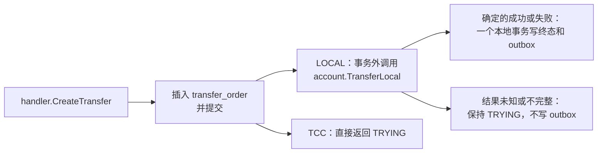

# TRF-02 同分片转账执行

| 项 | 内容 |
|---|---|
| 功能点 | TRF-02 同分片转账执行（优先级 P0，即必须完成；排在第 4 周的里程碑 M4） |
| 所属链路 | 转账 |
| 代码提交 | `e09ee63` `[TRF-02] execute same-shard transfer outside the insert transaction`（完整 `e09ee639ee621d7ec552704107827ba5a6f1144b`，2026-11-06 17:59:48 +0800） |
| 分支 | `feat/TRF-02-transfer-local` |
| 日期 | 2026-11-06 |
| 状态 | DONE |

这次代码提交改了 15 个文件，新增 932 行，删除 30 行。本报告不在这 15 个文件里。

## 一句话结论

付款方和收款方在同一个账户分片上时，payment 会在转账单插入并提交之后，调用 account 的同分片转账。account 返回确定的成功或失败后，payment 再用一个本地事务把转账单从 `TRYING`（处理中）改成 `SUCCESS` 或 `FAILED`，并在同一次提交里写一条待发消息。验收用 1000 分（10.00 元）的余额、100 个并发请求、每笔 20 分（0.20 元）：恰好 50 笔成功、50 笔余额不足，两个商户余额合计仍是 1000 分，账本核对通过。account 不可用时转账单保持 `TRYING`，不产生转账凭证。跨分片的单仍停在 `TRYING`，不调用 account。

## 1. 背景

TRF-01 已经能插入转账单，但插入之后直接把刚写下的 `TRYING` 单返回给调用方，钱不动。本功能点接上“双方在同一分片”这一条执行路径。跨分片的两阶段协调（TRF-03）和停住之后的恢复任务（TRF-04）还没有做。

### 1.1 系统简介

pay-system 是一个用 Go 编写的小型支付后端，模拟商户收款、退款、商户间转账三条资金链路，重点在数据一致性和性能。系统由 5 个部分组成：gateway（对外 HTTP 入口，负责签名校验和限流）、payment（支付单、退款单、转账单的状态管理和流程推进）、account（账户余额与记账，数据按商户分到 2 个数据库分片）、channel-mock（模拟微信、支付宝这类外部支付渠道）、recon（对账，核对系统内外数据是否一致）。服务之间用 Kitex RPC 同步调用，或通过 Kafka 消息异步通知；数据存在 MySQL 8.4，Redis 用于防重放。所有金额用整数“分”表示，所有记账只追加不修改。

当前已完成：支付单的创建、发起、结果推进、关单、查询和超时关单；渠道模拟与回调入口；退款的创建、冻结提交、结果推进、卡单恢复和查询；转账单的创建和查询；account 一侧的同分片转账。本次是 payment 把“同一分片”的转账单真正执行完。

仍未做：TRF-03 跨分片转账的两阶段协调、TRF-04 转账恢复任务、GW-09 商户 API 上的退款与转账路由。

### 1.2 本功能点在系统中的位置



上游仍是 payment 的 `CreateTransfer`。网关的 `POST /v1/transfers` 属于 GW-09，还没接上，所以目前只有直接调 payment RPC 能走到这里。下游是 account：生产进程拨号 `account:8882`。转账单存在 payment 库的 `transfer_order`。余额和记账凭证存在 account 分片库。待发消息写在 payment 库的 `outbox` 表，本功能点不把消息发到 Kafka。

图上“结果未知或不完整”包括：超时、account 返回的 `10003` 和 `10004`、account 返回的 `10001` 和 `10006`，以及成功但没有凭证号、失败但没有失败原因、其他状态。这些都保持 `TRYING`，不写 outbox。`10001` 是参数不合法，不是 `10003` 那种内部错误，但处理方式相同：不能把单写成失败。

### 1.3 为什么需要它

商户 M100001（下面也叫 A）余额 1000 分（10.00 元），M100003（下面也叫 C）余额 0 分。A 同时向 C 发起 100 笔转账，每笔 20 分（0.20 元）。如果每笔都先查余额再扣款，100 笔都会认为余额够，M100001 会被扣成负数。如果把“调用 account”放进 payment 自己的数据库事务里，事务要一直占着锁等网络返回，而且进程在等待中崩溃时，payment 的事务回滚了，account 那边却可能已经入账。本功能点要让并发扣款不会超扣，并且网络结果未知时不把转账单判成失败。

## 2. 术语

| 术语 | 含义 |
|---|---|
| 分 | 金额单位。1 元 = 100 分。代码里用 `money.Amount`，底层是 `int64`，不用浮点数。 |
| 分片 | account 把账户分在 2 个数据库里。商户号 `M` 后面的 6 位数字除以 2 的余数就是分片号。M100001 和 M100003 都是分片 1，所以它们之间的转账是同分片。M100002 是分片 0。 |
| `LOCAL` | 付款方和收款方在同一分片。这笔转账可以在那个分片的一个数据库事务里做完。 |
| `TCC` | Try-Confirm-Cancel。付款方和收款方不在同一分片时，payment 要分两阶段协调两边。本功能点不实现它。 |
| `TRYING` | 转账单的初始状态，表示处理中、结果还没定。 |
| `SUCCESS` / `FAILED` | 转账单的两种终态。终态不再改。 |
| `transfer_no` | 平台转账单号，前缀 `TF`。account 用它做记账的业务号，同一号码再调一次不会再扣一次钱。 |
| `out_transfer_no` | 商户自己的转账单号。和付款商户号一起组成幂等键。 |
| 通知地址 | 转账单上的 `notify_url`。商户可选，用来在转账结束后接收 HTTP 回调。回调本身还没接到转账。幂等比较会看它：同一商户单号如果通知地址不同，就不是同一个请求。 |
| 幂等 | 同一个请求做一次和做多次，结果相同，不会多扣钱。 |
| CAS | Compare-And-Set。更新语句带上 `WHERE status = 'TRYING'`，只有当前仍是 `TRYING` 才改得动。影响 1 行表示这次把状态改成了终态。影响 0 行表示这一行已经不是 `TRYING`（已经是终态，或被另一次收尾改过），于是再读当前行，不写消息。下文“收成成功 / 收成失败”指影响 1 行的那种更新，不是“更新失败”。 |
| `version` | 转账单上的版本号。插入时是 0。这次 CAS 成功时加 1，所以终态行的 `version` 是 1。 |
| outbox | 和业务更新放在同一个数据库事务里的一张“待发消息”表。事务提交后，消息和转账单状态一起可见；事务回滚则消息也不在。本功能点只插入这行，不发送。 |
| `txn_no` | account 记账成功后给出的凭证号。成功的转账单记下它。失败的转账单这一列保持空。 |
| `fail_code` | 失败原因。余额不足是 `INSUFFICIENT_BALANCE`。账户不存在或已停用是 `ACCOUNT_INVALID`。 |
| 凭证 | account 里的 `ledger_txn` 行。同分片转账成功时，业务类型是 `TRANSFER`，业务号是 `transfer_no`。 |
| 分录 | 凭证下面的一行金额。借或贷，只追加，不修改。成功的转账是付款方减、收款方加，两行金额相等。 |
| Redis 防重放 | 网关用来挡住短时间内重复的 HTTP 签名，本功能点不用 Redis。转账的“同一请求不执行两次”靠数据库里的商户单号，不靠 Redis。 |
| 余额不足 | account 不报错，而是返回状态 `FAILED`、`fail_code = INSUFFICIENT_BALANCE`、凭证号为空，并在自己的库里留下一条失败记录，不再改余额。payment 对“这次新建并执行”的请求再映射成已有错误码 `40002`。 |
| `40001` / `40005` | 已有错误码。`40001` 是账户不存在，`40005` 是账户不是可用状态。本功能点把它们写成转账单失败，`fail_code = ACCOUNT_INVALID`，接口业务码是 0，不是 `40002`。 |
| `10003` / `10004` | 已有错误码。`10003` 是内部错误，`10004` 是依赖不可用或结果未知。这两种在 account 调用阶段都不把转账单改成失败。 |
| 注入时钟 | 业务代码不调用 `time.Now()`。当前时间来自构造 `Payments` 时传入的时钟。测试用一个固定时钟。写入数据库前截断到毫秒。 |
| 业务码 | RPC 响应里的 `biz_code`。0 只表示“这张转账单对象就是本次要看的结果”，不表示转账成功。成功、处理中、账户无效的失败，业务码都是 0，要看单上的 `status`。余额不足是例外：业务码是 `40002`，同时仍带上那张已失败的单。 |
| 执行器 | TRF-01 留下的 Go 接口。测试可以塞进一个假对象，让 `CreateTransfer` 在插入后调用它，而不走本功能点。生产进程把它设成空。它非空时优先，本功能点的账户客户端不会被调用。 |
| 发号器 | 生成单号的组件。转账单号在插入时生成。outbox 每一行也要一个新的事件号，在写终态的那个事务里生成。它自己看时间：时间往回跳超过 5 毫秒就拒绝发号。这和上面的“注入时钟”不是同一个对象。注入时钟决定 `finished_at`；发号器的时钟决定事件号。 |
| `10001` / `10006` | 已有错误码。`10001` 是参数不合法。`10006` 是同一业务号对上了已有数据，但关键字段不一致。account 返回这两种，说明 payment 和 account 对这笔单的看法不一致。不能写成 `FAILED`：`10006` 时 account 可能已经有成功记录。单留在 `TRYING`，并打 ERROR 日志。 |
| 在途账户 | 平台用来临时放跨分片资金的账户。本功能点是同分片，不使用它。账本核对要求它的余额合计是 0，用来确认没有钱卡在中间。 |
| 失败分支 | account 在余额不足时写下的一条记录。列 `role`（角色）的值是 `LOCAL`，这里的 `LOCAL` 是这条记录的角色名，不是转账单的 `mode`。状态是 `FAILED`，原因是 `INSUFFICIENT_BALANCE`。它不是记账凭证，余额不变。 |

## 3. 技术讲解

### 3.1 要解决的问题

1. 同分片转账必须真的扣付款方、加收款方，并且并发时不能把余额扣成负数。account 已经用“余额够才更新”保证这一点，payment 不能再自己改余额。
2. 重复的商户单号不能再执行一次。TRF-01 已经保证第二次请求直接返回已有行。本功能点不能在幂等命中时再调 account。
3. account 超时、内部错误、不可用时，结果可能是“已经扣了”或“还没扣”。转账单必须留在 `TRYING`，不能写成 `FAILED`。写成失败会让调用方以为钱没动，而 account 可能已经入账。
4. 成功或失败一旦确定，转账单终态和那条待发消息必须一起提交。不能出现“单已成功、消息没写”或“消息写了、单还是处理中”。
5. 跨分片的单不能误走这条路径。

### 3.2 方案

生产进程在拨通 account 之后做两件事：把执行器设成空，再装上本功能点的账户客户端。执行器是 TRF-01 留下的接口，测试用它替换真实执行。它非空时，`CreateTransfer` 调用那个对象，不走下面的账户客户端。它为空时，只有 `mode = LOCAL` 且装了客户端才会执行。`TCC` 返回刚插入的 `TRYING`。

执行分两段，中间没有包住这两段的大事务：

1. 事务外调用 `TransferLocal`，参数是 `transfer_no`、付款商户、收款商户、金额。客户端连接超时 100 毫秒，单次调用超时 500 毫秒，两者是分开的上限，不是每次都会花满。这个方法在客户端的可重试名单里：只有调用方的上下文还没取消、而且错误是超时时，才自动再调一次。第二次用的仍是同一个 `transfer_no`。account 按这个号码认账，已经入账的再调一次不会再扣一次。
2. 拿到确定结果后，payment 自己开一个事务（代码里的 `dbx.WithTx`：隔离级别是读已提交，回调返回错误就整段回滚）。读已提交的意思是：每一条语句都看到已经提交的最新行，不会停在本事务开始时的旧快照。成功时执行：

```sql
UPDATE transfer_order
SET status = 'SUCCESS', txn_no = ?, finished_at = ?, version = version + 1, updated_at = ?
WHERE transfer_no = ? AND status = 'TRYING'
```

失败时同样要求当前是 `TRYING`，把 `status` 写成 `FAILED`，写入 `fail_code` 和 `finished_at`，`version` 加 1，不写 `txn_no`。影响 1 行后，在同一个事务里 `outbox.Add`。成功事件类型是 `transfer.succeeded`，失败事件类型是 `transfer.failed`。消息键和业务号都是 `transfer_no`。事件号由发号器在这个事务里生成。影响 0 行则在这个事务里再读当前行，不写 outbox。因为隔离级别是读已提交，这次再读看到的是已经提交的最新行，不是插入时的 `TRYING`。

现在正常路径上，只有插入成功的那一次请求会执行。商户重试不会再执行，所以不会和这次收尾抢同一行。影响 0 行是为恢复任务准备的：TRF-04 以后可能和这次收尾同时改同一行。测试用内存存储模拟“更新没有改到行”。

`finished_at` 和 `updated_at` 用同一次读到的注入时钟，并截断到毫秒。新插入的 `TRYING` 行上 `fail_code` 和 `txn_no` 都是空，所以成功的更新不必再把 `fail_code` 写成空，失败的更新也不必再把 `txn_no` 写成空。

结果怎么归类：

| account 的返回 | payment 怎么做 | 接口 |
|---|---|---|
| `SUCCESS` 且凭证号非空 | 把状态收成 `SUCCESS`，写 `transfer.succeeded`。余额已从付款方划到收款方 | 业务码 0，单的状态是 `SUCCESS` |
| `FAILED` 且 `fail_code = INSUFFICIENT_BALANCE` | 把状态收成 `FAILED`，写 `transfer.failed`。余额不变，account 留下一条失败分支，没有转账凭证。这是商户余额不够，属于预期结果，不打 ERROR | 这次执行的业务码是 `40002`，并带上这张失败单 |
| `40001` 或 `40005` | 把状态收成 `FAILED`，`fail_code = ACCOUNT_INVALID`，写 `transfer.failed`，打 ERROR。余额不变。这是内部数据错误：建单时已经查过收款商户，正常路径不应出现 | 业务码 0，单的状态是 `FAILED`。不用 `40002`，避免调用方把它当成余额不足 |
| 超时，或 account 返回 `10003`、`10004` | 不更新，不写 outbox | 业务码 0，单仍是 `TRYING` |
| `10001`、`10006` | 同样保持 `TRYING`，ERROR 日志只有 `transfer_no` 和 `err_code` | 业务码 0，单仍是 `TRYING` |
| `SUCCESS` 但凭证号为空，或 `FAILED` 但失败原因为空，或其他状态 | 保持 `TRYING`，ERROR 日志，不更新 | 业务码 0，单仍是 `TRYING` |

同一商户单号再次到来时，在执行之前就返回已有行，不再调 account。比较的是收款方、金额和通知地址。三者都相同就返回已有行：即使那一行已经是余额不足的 `FAILED`，重放的业务码也是 0，不是又一个 `40002`。`40002` 只出现在“这次插入并执行、而且执行结果是余额不足”的那一次。三者有一个不同时，payment 自己返回 `10006`，不带旧单，也不执行。这和上面表格里“account 返回 `10006`”不是一回事：表格那一行是 account 在执行中返回的，单留在 `TRYING`，接口业务码是 0。这里的 `10006` 发生在执行之前，调用方只看到错误码，看不到转账单。

发号器如果不是生产用的实现，在调用 account 之前就返回 `10003`，转账单留在刚插入的 `TRYING`。这样不会出现“钱已经划走，本地却发不出 outbox 的事件号”。生产进程使用的就是这个实现。这件事和“account 返回 `10003`”不同：后者走上面表格的第 4 行，接口业务码是 0。

### 3.3 为什么这样做

| 方案 | 做法 | 优点 | 缺点 | 结论 |
|---|---|---|---|---|
| 采用：先提交转账单，事务外调 account，再单独提交终态和 outbox | 见 3.2 | 事务里没有网络调用；超时不会被当成失败；终态和消息同时可见 | account 已入账而本地终态还没写上时，单会停在 `TRYING`，要靠以后的恢复任务用同一个 `transfer_no` 再问一次 | 采用 |
| 备选：把 account 调用放进 payment 的事务 | 锁住转账单再等 RPC | 看起来状态和余额一起提交 | 项目规则不允许事务里调用 RPC，原因就是下面两件：等网络时占着锁；payment 回滚时 account 可能已经提交 | 不采用 |
| 备选：超时就写成 `FAILED` | 调用方立刻知道失败 | 接口简单 | account 可能已经入账。单写成失败后，同一商户单号的重试不会再执行，钱和单据对不上 | 不采用 |

### 3.4 正确性

| 场景 | 系统行为 | 最终状态 | 证明 |
|---|---|---|---|
| 同一请求重复到达 | 第二次按商户号和商户单号读到已有行，不再调用 account | 仍是第一次那一行。余额不足的那次重放业务码是 0 | `TestLocalTransferInsufficientThenReplay` |
| 100 个不同商户单号并发，每笔 20 分，付款方只有 1000 分 | 每笔各自插入再执行。account 用条件更新扣余额，只有 50 笔扣得动 | 50 张 `SUCCESS`（各 1 张 `TRANSFER` 凭证、1 条 `transfer.succeeded`、`version = 1`），50 张 `FAILED`（没有转账凭证、有 1 条失败分支、1 条 `transfer.failed`、`version = 1`）。付款方余额 0 分，收款方 1000 分。两个分片一起核对，以及两个商户各自核对，都通过 | `TestTransferLocalConcurrentBalanceMySQL` |
| account 调用超时或返回 `10003`、`10004` | 不更新转账单，不写 outbox | 仍是 `TRYING`，`version` 仍是 0，接口业务码 0 | `TestLocalTransferUnknownStaysTrying`、`TestTransferLocalAccountUnavailableMySQL` |
| account 返回 `10001` 或 `10006` | 打 ERROR 日志，不更新 | 仍是 `TRYING` | `TestLocalTransferInconsistentStaysTrying` |
| account 返回 `40001` 或 `40005` | 一个事务里写成 `FAILED`，`fail_code = ACCOUNT_INVALID` | 失败单，接口业务码 0 | `TestLocalTransferAccountInvalid` |
| 终态字段不完整 | 不更新 | 仍是 `TRYING` | `TestLocalTransferRejectsEmptyTerminalFields` |
| 跨分片 | 不调用 account | `mode = TCC`，`TRYING` | `TestLocalTransferSkipsTCC`、`TestTransferLocalTCCDoesNotCallAccountMySQL` |
| CAS 没有改到行 | 再读当前行，不写第二条 outbox | 返回再读到的那一行 | `TestLocalTransferCASMissRereads` |
| 终态事务里发号时钟回拨 | 事务回滚，这次请求返回 `10004` | 行仍是 `TRYING` | `TestLocalTransferClockRollback` |
| 调用 account 之前上下文已取消 | 不调用 account，返回取消错误 | 行仍是刚插入的 `TRYING` | `TestLocalTransferCanceledBeforeCall` |

上面这张表没有“进程崩溃”这一行。account 已经入账、payment 还没提交终态时进程消失，没有用杀进程来测。`TestLocalTransferClockRollback` 测的是另一件事：账户风格的成功结果已经返回之后，结束步骤里的发号器报告时钟回拨。内存里的行保持 `TRYING`，这次请求返回 `10004`，不是业务码 0。MySQL 上“回调报错就回滚”由事务助手保证，这次没有单独做“真实入账之后让 outbox 写入失败”的集成测试。崩溃之后的单会停在 `TRYING`，商户用同一单号重试也不会再执行。见第 5 节。

### 3.5 性能

不涉及开关对比。本次没有做压测。验收里的 100 并发只证明笔数和余额，不作为性能数据。

## 4. 已完成内容

### 4.1 改动清单

| 文件 | 新增 / 修改 | 作用 |
|---|---|---|
| `service/payment/biz/transfer_local.go` | 新增 | 按返回结果决定保持 `TRYING` 还是收成终态 |
| `service/payment/biz/transfer_account.go` | 新增 | 用已有的 account 客户端调用 `TransferLocal`，把 RPC 结果收成业务结果 |
| `service/payment/biz/transfer.go` | 修改 | `UseLocalTransfer`；执行器优先，否则只执行 `LOCAL` |
| `service/payment/biz/transfer_sql.go` | 修改 | `TRYING` 到终态的 CAS，以及同事务写 outbox |
| `service/payment/biz/payment.go` | 修改 | 增加 local 执行字段 |
| `service/payment/biz/transfer_test.go` | 修改 | 内存存储补上结束转账，供单测使用 |
| `service/payment/biz/transfer_local_test.go` | 新增 | 单测 |
| `service/payment/biz/transfer_local_integration_test.go` | 新增 | MySQL 上的并发余额、不可用、跨分片 |
| `cmd/payment/main.go` | 修改 | 生产进程装上 account 客户端，执行器保持空 |
| `.golangci.yml` | 修改 | 生产代码不能引用另一个服务的包，只能用 `pkg/accountclient` 这个客户端。集成测试要直接看余额和凭证，所以只放行这一个测试文件去引用 account 的业务包 |
| `docs/02-requirements.md`、`docs/05-api.md`、`docs/06-flows.md`、`docs/database.md`、`docs/interview-notes.md` | 修改 | 与代码一起同步，见 4.5 |

### 4.2 对外变化

| 类别 | 变化 |
|---|---|
| 接口 | 不新增字段，不改 IDL。`CreateTransfer` 在 `LOCAL` 时会返回执行后的转账单。服务端处理超时仍是 2 秒：处理函数里 `Pay` 和 `CreateRefund` 是 5 秒，其余方法包括 `CreateTransfer` 用默认的 2 秒。接口文档版本 3.3.12 |
| 表结构 | 无 DDL。不改列、不改约束。只在文档里写明 `LOCAL` 会 CAS 更新行 |
| 配置项 | 无。账户地址仍是代码里的 `account:8882` |
| 错误码 | 无新错误码。余额不足仍是 `40002`，账户无效仍用已有的 `40001` / `40005` 在内部归类，对外业务码是 0 |
| 指标 / 故障点 | 无。`pay_transfer_stuck` 留给 TRF-04，在重试次数达到 10 时再暴露 |

### 4.3 验收对照

| 验收条目 | 测试函数 | 类型 | 结果 |
|---|---|---|---|
| M100001（A）余额 1000 分，M100003（C）余额 0 分。100 个并发请求各转 20 分，商户单号各不相同。恰好 50 个成功、50 个失败（`40002`）。A 与 C 的余额合计仍是 1000 分。账本核对通过 | `TestTransferLocalConcurrentBalanceMySQL` | 集成 | 通过。结束后 A 是 0 分，C 是 1000 分。核对做了三次：不填商户号时查两个分片，并要求在途账户合计为 0；再分别只查 M100001 和 M100003。分片 0 上这次没有转账，那次全量核对仍然通过 |
| account 不可用：接口返回 `TRYING`，转账单保持 `TRYING`，没有转账凭证 | `TestTransferLocalAccountUnavailableMySQL` | 集成 | 通过。`version` 仍是 0，outbox 0 行，转账凭证 0 张 |

补充测试，同一次强制重跑里通过：成功路径、余额不足后的重放、超时与 `10003`、`10001` 与 `10006`、账户无效、终态字段为空、跨分片不调用、执行器优先、CAS 未命中再读、时钟回拨、调用前取消、RPC 结果映射、连不上 `127.0.0.1:1` 时客户端返回 `10003`。函数名见 3.4，外加 `TestLocalTransferNotInstalledStaysTrying`、`TestLocalTransferRejectsStubIDsBeforeAccount`、`TestLocalTransferSuccess`、`TestLocalResultFromRPC`、`TestAccountLocalTransferConnectionRefused`。

### 4.4 验证记录

环境：2026-11-06，go1.27.2 darwin/arm64，golangci-lint 2.14.0（用 go1.27.1 构建，来源 114493f，2026-09-24T10:54:53Z）。日志 `/tmp/trf02-verify.log`，17:36:06 到 17:37:28 +0800。集成测试用 testcontainers 起 MySQL。`/usr/bin/time -p` 的 real 是墙钟秒数。

| 命令 | 结果 |
|---|---|
| `gofmt -l .` | 无输出。real 0.07s，user 0.24s，sys 0.06s |
| `make lint` | `0 issues.`。real 1.38s，user 1.12s，sys 5.87s |
| `make test` | 退出码 0。real 5.80s，user 3.31s，sys 5.17s。根包 5.195s。`service/payment/biz` 为缓存命中 |
| `make test-integration` | 退出码 0。real 36.60s，user 5.05s，sys 6.53s。根包 36.165s。`service/payment/biz` 为缓存命中 |
| `make cover` | 退出码 0。real 37.43s，user 6.34s，sys 8.95s。全库语句覆盖率 34.6%（含生成代码，不作判据） |

核心包语句覆盖率，来自同一次 `make cover`：`service/payment/biz` 86.3%（缓存命中），`service/account/biz` 91.1%，`service/channel_mock/biz` 91.7%，`pkg/money` 100%，`pkg/sign` 100%，`pkg/idgen` 88.1%，`pkg/outbox` 95.0%。都达到 70%。`service/payment/handler` 86.4%，不在这道门槛里。

同一次覆盖率文件里，本功能点函数：`executeTransfer` 100%，`applyLocalResult` 100%，`logTransferLocal` 100%，`NewAccountLocalTransfer` 100%，`finishLocal` 85.7%，`localResultFromRPC` 83.3%，`executeLocal` 76.9%，`TransferLocal` 75.0%，`classifyLocalErr` 69.2%，`finishTransfer` 68.6%，`UseLocalTransfer` 66.7%。包覆盖率按包计算，不要求每个函数都到 70%。

因为 `make test` 和 `make test-integration` 对 `service/payment/biz` 显示缓存命中，又用 `-count=1` 强制跑了本功能点的测试，缓存不会复用：

| 命令 | 结果 |
|---|---|
| `go test -race -count=1 -timeout 90s -run 'TestLocal\|TestAccountLocal\|TestCreateTransfer$' ./service/payment/biz/` | `ok`，包 1.865s。real 3.39s，user 0.56s，sys 0.74s |
| `go test -race -count=1 -tags integration -timeout 8m -run 'TestTransferLocal' ./service/payment/biz/` | `ok`，包 10.798s。real 11.88s，user 1.38s，sys 2.02s |

`make gen` 未运行，这次没改 IDL。`mmdc` 未运行，流程图的节点没有改，没有新增 SVG。没有用 `paycli` 走 HTTP：转账路由还没接。

覆盖率文件 `coverage.out` 在取出数字后已删除，没有进提交。

### 4.5 同步的文档

- 需求仍是 v3.0。TRF-02 状态改为 DONE，两条验收勾上，并写了实现说明。TRF-01 的实现说明补了一句：生产进程对 `LOCAL` 装上账户客户端，`TCC` 仍返回 `TRYING`。
- 接口文档 3.3.11 改为 3.3.12。变更记录、创建转账的“当前实现”、RPC 一节写明 `LOCAL` 会执行，超时仍是 2 秒。
- 流程文档 v2.41 改为 v2.42。控制流图 CF-34 在设计时就已经画了执行步骤。TRF-01 的图注写的是执行还没接上。这次只改图注：`LOCAL` 已执行，`TCC` 仍返回 `TRYING`。没有重画节点，也没有跑渲染工具，没有新增 SVG。
- 表结构文档的 `transfer_order` 生命周期改成：TRF-01 的插入不更新已有行；TRF-02 对 `LOCAL` 做 CAS 并写 outbox。变更记录写“无（仅文档）”“未执行迁移”。
- 面试笔记在 TRF-01 那一节前面加了 TRF-02 一节。TRF-01 原文没有改。
- 周计划里 TRF-01 到 TRF-05 写在同一个复选框，这次只完成 TRF-02，所以没有勾。

### 4.6 审查结论

代码审查安排了两轮，两轮都没有交付书面问题清单。这不是“审查后确认没有问题”。没有按审查意见改代码。提交前核对过三条资金路径：account 调用在转账单事务之外；终态更新和 outbox 在同一个本地事务里，条件是当前状态仍为 `TRYING`；超时以及 account 返回的 `10003`、`10004` 不把单写成 `FAILED`。

## 5. 未完成与风险

- **account 已经入账，payment 的终态事务还没提交。** 进程在这两步之间崩溃，或者终态事务自己失败时，转账单仍是 `TRYING`，outbox 没有行，account 里可能已经有凭证。终态事务失败和“account 返回错误”不是同一种接口：数据库错误时这次请求返回 `10003`；发号器在这个事务里报告时钟回拨时返回 `10004`。这两种都不是业务码 0。商户用同一个 `out_transfer_no` 重试不会再执行，因为收款方、金额和通知地址都相同就会直接返回已有行。要把单补到终态，只能靠 TRF-04 用同一个 `transfer_no` 再调 `TransferLocal`。account 对这个号码会返回第一次的结果，不会再扣一次。TRF-04 还没做，所以这张单会一直停在 `TRYING`。
- **调用方的截止时间和“调用前就取消”不是同一种返回。** 调用 account 之前上下文已经取消：不调用 account，把取消错误返回给调用方，单仍是 `TRYING`。调用进行中如果先被认成超时，则按未知结果处理，业务码 0，单仍是 `TRYING`。取消错误到了 RPC 边界会变成调用超时，不是 `10003`。
- **超时返回给调用方的也是 `TRYING`。** 调用方如果马上用同一商户单号再请求，拿到的仍是这张 `TRYING`，不会当场再调 account。同样要等 TRF-04。
- **跨分片不执行。** `M100001` 转到 `M100002` 会插入 `TCC` 的 `TRYING` 并直接返回。钱不动。TRF-03 负责。
- **没有 `pay_transfer_stuck` 指标。** `10001` 和 `10006` 只打日志。重试次数达到 10 时的指标属于 TRF-04。
- **服务端处理超时仍是 2 秒。** 这是处理函数里除 `Pay`、`CreateRefund` 以外的默认值，不是新加的配置。account 连接上限 100 毫秒、单次调用上限 500 毫秒，超时最多再试 1 次。四个上限加在一起是 1.2 秒，这是上限相加，不是测出来的耗时，连接失败也会更快返回。数据库再慢、或调用方的截止时间更早被认成超时时，会按未知结果保持 `TRYING`。没有单独的测试锁定“`CreateTransfer` 的超时就是 2 秒”。
- **网关路由未接。** 不能用 `paycli` 从 HTTP 走通转账。
- **集成测试直接调用 account 的业务包，不经过 Kitex。** 它证明的是：payment 的收尾和 account 的余额、凭证、失败分支在同一个进程里对得上。它不证明 RPC 的线上格式。生产代码只通过 `pkg/accountclient` 调用。客户端把 RPC 结果收成业务结果，由 `TestLocalResultFromRPC` 覆盖。连不上 `127.0.0.1:1` 时，这个客户端方法本身返回 `10003`，那是 `TestAccountLocalTransferConnectionRefused`，没有走进 `CreateTransfer`。如果这个 `10003` 发生在执行过程中，会按“account 返回 `10003`”处理：业务码 0，单留在 `TRYING`。调用 account 之前就返回 `10003` 的，只有发号器类型不对那一种。

## 6. 如何复现

需要本机 Docker。不要把 `deploy/.env` 读进 shell。

```bash
gofmt -l .
make lint
make test
make test-integration
make cover
go test -race -count=1 -tags integration -timeout 8m -run 'TestTransferLocal' ./service/payment/biz/
```

预期：`gofmt` 无输出，`make lint` 打印 `0 issues.`，三条 `make` 退出码都是 0。最后一条应打印 `ok`，并跑过 3 个 `TestTransferLocal` 测试。`make cover` 里 `service/payment/biz` 的语句覆盖率应不低于 70%。全库 total 含生成代码，不要拿它做门槛。跑完删除 `coverage.out`，不要提交它。

## 7. 讲解要点

1. 为什么 account 调用不能放进 payment 的事务？事务里等网络会占锁，而且一边回滚、另一边可能已经入账。所以先提交 `TRYING`，事务外调用，再单独提交终态和 outbox。
2. 为什么超时不写成失败？超时表示结果未知。写成失败后，同一商户单号不会再执行，钱可能已经划走。保持 `TRYING`，以后用同一个 `transfer_no` 再问 account。
3. 100 笔各 20 分、余额只有 1000 分，为什么恰好 50 笔成功？50 × 20 = 1000。第 51 笔开始，account 的条件更新发现余额不够，提交一条失败记录并返回余额不足，不再减余额。

## 延伸阅读

- `docs/02-requirements.md` 的 TRF-02 小节
- `docs/05-api.md` 3.3.12 的创建转账
- `docs/06-flows.md` v2.42 的 CF-34
- `docs/database.md` 的 `transfer_order` 生命周期
- `docs/reports/TRF-01-create-transfer.md`：插入和幂等
- `docs/reports/ACC-07-transfer-local.md`：account 侧同分片转账

## 修订记录

| 日期 | 提交 | 修订内容 |
|---|---|---|
| 2026-11-06 | `e09ee63` | 初稿。这一列是代码提交。报告正文在后一个提交里 |
| 2026-11-06 | 报告提交 | 可读性检查第一轮 22 处已改。第二轮还剩通知地址、两种 `10006`、图上未知结果的范围，写入报告前已改，没有第三轮 |
