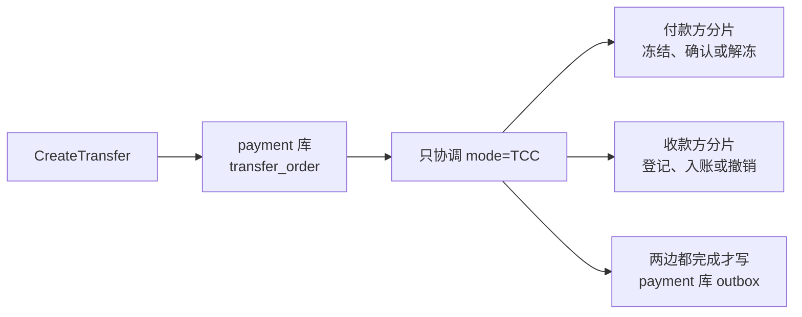
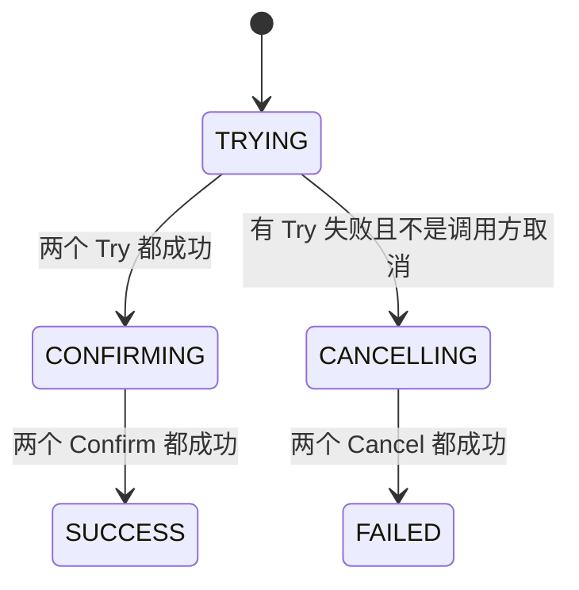

# TRF-03 跨分片转账 TCC 协调

| 项 | 内容 |
|---|---|
| 功能点 | TRF-03（P0，第 4 周） |
| 所属链路 | 转账 |
| 代码提交 | `4ab4300` `[TRF-03] coordinate cross-shard transfer with TCC` |
| 分支 | `feat/TRF-03-transfer-tcc` |
| 日期 | 2026-11-08 |
| 状态 | DONE |

功能点小节头部原文是 `P0 · M4`。P0 表示必须完成。M1 到 M8 对应第 1 周到第 8 周，所以 M4 是第 4 周。第 4 周还有别的工作没做，这次只做跨分片协调这一段。

## 一句话结论

付款方和收款方不在同一个账户数据库时，payment 先做准备（Try），再确认或取消；中间还有一次决策 CAS 和一次终态 CAS，不是只调两个函数。两个 Try 都成功才确认。没有都成功也不一定取消。例外：调用账户之前父 ctx 已结束，或两个 Try 返回后任一边是 `context.Canceled`，都不 CAS，行留在 `TRYING`。前一种返回 `ctx.Err()`（主动取消是 `context.Canceled`，调用前截止时间已到是 `context.DeadlineExceeded`）。后一种返回 `context.Canceled`。截止时间到了且错误是 `context.DeadlineExceeded`、并且这是 Try 已经返回的错误时，不是这条。`M100001` 向 `M100002` 转 500 分（5.00 元）后，转账单是 `SUCCESS`，`version` 为 2（插入后又成功改过两次），`txn_no`（凭证号那一列）仍为空；付款方分片有 1 张 `TRANSFER_OUT`，收款方分片有 1 张 `TRANSFER_IN`（凭证是只追加的记账记录），两个分片的在途余额加总为 0（在途是临时存放跨分片资金的平台账户）。两个方向各从 10000 分出发、对向各 200 笔、每笔 1 分且全部成功时，按金额规则两边应仍各是 10000 分，合计 20000 分；测试只断言合计和在途为 0，没有断言每一边仍是 10000，这不是测出两边不相等。

## 1. 背景

### 1.1 系统简介

> pay-system 是一个用 Go 编写的小型支付后端，模拟商户收款、退款、商户间转账三条资金链路，重点在数据一致性和性能。系统由 5 个部分组成：gateway（对外 HTTP 入口，负责签名校验和限流）、payment（支付单、退款单、转账单的状态管理和流程推进）、account（账户余额与记账，数据按商户分到 2 个数据库分片）、channel-mock（模拟微信、支付宝这类外部支付渠道）、recon（对账，核对系统内外数据是否一致）。服务之间用 Kitex RPC 同步调用，或通过 Kafka 消息异步通知；数据存在 MySQL 8.4，Redis 用于防重放。所有金额用整数“分”表示，所有记账只追加不修改。当前已完成：支付、退款、转账单创建和查询、同分片转账执行都已完成；本次把跨分片转账在本请求内协调到终态或中间态。

这次转账的幂等不用 Redis。Redis 在系统里用来挡住短时间重复的 HTTP 请求，转账靠付款商户号加 `out_transfer_no` 的唯一索引挡住重复插入。上文“记账只追加不修改”指凭证和分录不改；冻结单会从已冻结改成已确认或已释放。

1 元 = 100 分。代码里的金额类型是 `money.Amount`，底层是 `int64`，不使用浮点数。分录是记账时追加的一行金额，只插入，不改旧行。

`TRYING` 是转账单刚写下、还没决定确认还是取消。`CONFIRMING` 是已经决定确认。`CANCELLING` 是已经决定取消。这三种停住的状态这次不恢复。outbox 是和业务更新写在同一个事务里的待发消息，这次只插入，不发到 Kafka。网关上的转账 HTTP 路由也不是这次的事。

### 1.2 本功能点在系统中的位置



上游是 payment 的 `CreateTransfer`。网关的 `POST /v1/transfers` 还没接上，现在要直接调 payment 的 RPC。RPC 是服务之间的远程调用。下游是 account 的两个分片库：付款方一套，收款方一套。转账单和 outbox 在 payment 自己的库里。

生产进程先 `Dial("account:8882")`，这是连上 account 的 RPC 地址，再装上同分片客户端，然后装上 `AccountTCCTransfer`，也就是这次的跨分片客户端。集成测试不走这条 RPC，在同一进程里直接调 account 的业务方法。图里的 `mode = TCC` 表示付款方和收款方不在同一分片。协调是先准备（Try），再确认或取消，中间还有一次决策 CAS 和一次终态 CAS，不是只调两个函数。冻结是先占用付款方的可用余额，还没真正扣走。

### 1.3 为什么需要它

`M100001` 的商户号数字部分是 100001，除以 2 余 1，账户在分片 1。`M100002` 余数是 0，账户在分片 0。两边不在同一个 MySQL 里，没有一个事务能同时提交。

假设 `M100001` 有 500 分（5.00 元），要转给 `M100002`。如果先在分片 1 扣掉 500 分并提交，进程接着崩溃，分片 0 还没给收款方加钱，这 500 分就消失了。如果先给收款方加钱再扣付款方，崩溃会多出 500 分。如果发现付款方只有 100 分（1.00 元）时收款方已经入账，还得再做一笔反向扣款。

这次的做法是先在两边做可撤销的准备，准备都成功再真正记账，否则两边都撤销。准备和记账之间有一次决策 CAS，把方向写成 `CONFIRMING` 或 `CANCELLING`。只有这次 CAS 已经写上之后，行上才能看出该继续确认还是继续取消。决策之前进程被杀掉，行仍是 `TRYING`，方向还没写下。继续推进本身留给后面的恢复任务，这次没有那个任务。

## 2. 术语

| 术语 | 含义 |
|---|---|
| 分 | 金额单位。1 元 = 100 分。转账金额是正整数分。 |
| 分片 | account 有 2 个数据库。商户号必须是 `M` 加 6 位数字，分片号是这 6 位对 2 取余。`M100001` 在分片 1，`M100002` 在分片 0。 |
| `LOCAL` | 付款方和收款方在同一分片。一个分片里的一个事务就能转完。这次不走那条路径。 |
| `TCC` | Try-Confirm-Cancel。Try 是准备，Confirm 是正式记账，Cancel 是撤销准备。转账单的 `mode` 取值也叫 `TCC`，表示这笔要跨分片协调。 |
| 分支 | 一个分片上的那一半操作。付款方分支是冻结单，收款方分支是 `transfer_branch` 里 `role = PAYEE` 的一行。 |
| `TRYING` | 转账单刚插入的状态。决定还没写下。 |
| `CONFIRMING` | 两个 Try 都成功之后的中间态。表示已经决定确认，确认还没都成功。 |
| `CANCELLING` | 已经决定取消、取消还没都成功的中间态。调用账户之前父 ctx 已结束，或两个 Try 返回后任一边是 `context.Canceled`，都不会写成这一态，行留在 `TRYING`。 |
| `SUCCESS` / `FAILED` | 两种终态。写下之后这次的协调不再把它们改回中间态。 |
| `transfer_no` | 平台转账单号，前缀 `TF`。两个分片都用它认同一笔转账。 |
| `out_transfer_no` | 商户自己的转账单号。和付款商户号合在一起，用来认出“这是不是同一次请求”。 |
| 幂等 | 同一请求做一次和做多次，效果相同，不会多冻、多扣。账户靠 `transfer_no` 认账；payment 靠商户号加商户单号认转账单。 |
| CAS | Compare-And-Set。更新带 `WHERE transfer_no = ? AND status = 期望状态`，同时 `version = version + 1`。影响 1 行表示这次改成了。影响 0 行表示行已经不是期望状态，于是再读当前行，不把它当成失败去循环。 |
| `version` | 转账单版本。插入时是 0。每次 CAS 命中加 1。走到 `SUCCESS` 或 `FAILED` 时是 2：一次决策，一次终态。 |
| `fail_code` | 失败原因，写在决定取消的那一次。`INSUFFICIENT_BALANCE` 是余额不足，`ACCOUNT_INVALID` 是账户不存在或不可用，`TRY_TIMEOUT` 是准备阶段没得到成功。 |
| `txn_no` | 记账凭证号。同分片成功时转账单记下那一张凭证的号。跨分片有两张凭证、两个库，这列成功后仍是空。 |
| 凭证 | `ledger_txn` 的一行。付款方确认产生 `TRANSFER_OUT`，收款方确认产生 `TRANSFER_IN`。只追加。 |
| 分录 | 凭证下面的金额行。借方合计等于贷方合计。 |
| 在途账户 | 每个分片上的平台账户，类型 `TRANSIT`。付款方确认把钱记进付款方分片的在途；收款方确认从收款方分片的在途记给商户。两边都完成后，两个分片的在途余额加总为 0。在途透支是余额可以变成负数。收款方在途允许透支，所以可以先于付款方入账，那时在途合计不是 0。 |
| 冻结 | 把付款方的可用余额划进 `frozen_amount`，余额数字先不变。可用余额是余额减去冻结。冻结单状态 `FROZEN`。 |
| `TRANSFER` | 冻结用的业务类型字符串。跨分片付款方的 `Freeze`、`ConfirmFreeze`、`ReleaseFreeze` 都传这个值。 |
| 借 / 贷 | 借是账户余额减少的那一方，贷是增加的那一方。付款方确认时借商户、贷在途。 |
| 渠道应收 | 渠道该收的钱，记在平台的渠道应收账户上。转账确认不记这里。 |
| 确认扣款 | 冻结单改成已确认，余额和冻结一起减少，并写 `TRANSFER_OUT`：借付款商户，贷本分片在途。 |
| 通知地址 | 商户传来的回调 URL，列名 `notify_url`。幂等比较时和收款方、金额一起比。空串也参与比较，和没传不是同一条。 |
| 解冻 | 把冻结还回可用余额。没有冻结行时插入一条 `RELEASED` 记录，这叫墓碑。 |
| 墓碑 | 分支还不存在时，取消先插入一条已经结束的行。以后迟到的 Try 看到它，返回 `40004`，不会再冻钱或占住分支。 |
| 空回滚 | 取消到达时 Try 还没留下行，仍然写入墓碑，而不是报“找不到”。 |
| 防悬挂 | 取消已经写过墓碑之后，迟到的 Try 不能再把钱冻住。靠墓碑返回 `40004` 挡住。 |
| outbox | payment 库里的待发消息表。终态 CAS 命中时在同一个事务里插一行。事务回滚则这行也不在。这次不把行发到 Kafka。 |
| `40002` | 已有错误码，余额不足。 |
| `40001` / `40005` | 已有错误码。`40001` 是账户不存在，`40005` 是账户不是可用状态。 |
| `40004` | 已有错误码，冻结单或收款分支的状态和这次操作冲突。例如去确认一条已经取消的冻结，或去取消一条已经确认的分支。 |
| `10001` / `10006` | 已有错误码。`10001` 是参数不合法。`10006` 是同一个业务号对上了已有数据，但金额或商户不一致。 |
| `10003` / `10004` | 已有错误码。`10003` 是内部错误。`10004` 是依赖不可用，也包括发号时时钟回拨。 |
| 业务码 | RPC 响应里的 `biz_code`。0 表示“看转账单上的状态”，不表示转账成功。余额不足是例外：`biz_code` 为 `40002`，响应里仍带着那张已失败的单。 |
| 注入时钟 | 业务代码不调用 `time.Now()`。时间来自构造时传入的时钟，写入前截断到毫秒。 |
| 发号器 | 生成单号的组件，类型是 `*idgen.Generator`。终态事务里用它生成 outbox 的事件号。它自己看时间，回拨超过 5 毫秒就拒绝发号。 |
| CAS 的再读隔离级别 | payment 事务用读已提交：语句能看见别的事务已经提交的行。决策更新影响 0 行时，同一次事务里再读到的是最新已提交状态。 |
| `errgroup.Group` | 用来等待一组 goroutine。这里不用 `WithContext`。`WithContext` 会在一组失败时取消派生上下文，另一边的结果会变成未知。 |
| 父 ctx | 这次 `CreateTransfer` 的 `context.Context`。服务端处理截止时间是 2 秒，它就是这次 RPC 的父 ctx。调用方取消时它的错误是 `context.Canceled`。截止时间到了是 `context.DeadlineExceeded`。这两条不是同一条处理路径。账户事务默认 3 秒从它再派生，父 ctx 先到 2 秒就先结束，结束后不再重试。 |
| `CheckBalance` | account 的只读核对。第一个参数空字符串表示核对两个分片。第二个参数 `expectQuiescent` 为 true 时，还要求两个分片在途余额加总为 0。为 false 时不查这一条，仍核对各账户余额和分录是否配平。 |
| 故障点 | 代码里一个有名字的钩子。测试或演练打开后，进程执行到这里会收到 `SIGKILL`。没打开时立刻返回。这次放了三个名字，但没有做杀掉进程的测试。 |
| Kitex | 服务之间使用的 RPC 框架。生产通过它调 account。集成测试绕过它。 |
| 协调者 | 这次的 payment 代码。它自己不改账户余额，只按转账单状态去调用两个分片上的分支。 |
| 执行器 | 插入转账单之后可以换上的 Go 接口。非空时优先，既不走同分片，也不走这次的协调。生产进程把它设成空。 |
| TRF-04 | 还没做的转账恢复任务。它只把停住的 `TRYING`、`CONFIRMING`、`CANCELLING` 向前推进，不会把状态改回 `TRYING`。这次没有这个任务。 |

## 3. 技术讲解

### 3.1 要解决的问题

1. 跨分片转账不能在一个数据库事务里做完。一个事务只打开一个账户分片。payment 自己的事务也不能带着账户分片一起提交。
2. 两个 Try 必须都等到结果。一边失败不能把另一边取消掉，否则另一边可能已经冻住或登记，协调者却不知道。
3. 只有两个 Try 都成功才进入确认。没有都成功也不一定取消。例外：调用账户之前父 ctx 已结束，或两个 Try 返回后任一边是 `context.Canceled`，都不 CAS，行留在 `TRYING`。前一种返回 `ctx.Err()`（主动取消是 `context.Canceled`，调用前截止时间已到是 `context.DeadlineExceeded`，这一支也不进入取消）。后一种返回 `context.Canceled`。截止时间到了且错误是 `context.DeadlineExceeded`、并且这是 Try 已经返回的错误时，不是这条。其余失败才进入取消并写 `fail_code`。Try 的结果如果不是明确的业务失败，也不是调用方取消，就当成准备没完成，走取消，`fail_code` 用 `TRY_TIMEOUT`。不新造失败码。所以 `10001`、`10003`、`10004`、`10006`、`40004` 和其他非取消错误都写成 `TRY_TIMEOUT`。`40001` 和 `40005` 才是 `ACCOUNT_INVALID`。这套 `fail_code` 只在 Try 之后、决定取消时书写：付款方错误非空就只映射付款方，付款方没有错误才映射收款方。因此付款方是截止超时、收款方是 `40002` 时，不重试，`fail_code` 是 `TRY_TIMEOUT`，不是 `INSUFFICIENT_BALANCE`。付款方自己是 `40002` 时，`fail_code` 才是 `INSUFFICIENT_BALANCE`。Confirm 和 Cancel 不写这套 `fail_code`。
4. 确认或取消只要有一边普通失败，就停在中间态。不能把已经成功的那一边再取消，否则已经入账的钱会被撤回，而决定已经是要确认。Confirm 和 Cancel 不写 Try 那套 `fail_code`。确认阶段出现 `40002` 这种普通业务错误，行停在 `CONFIRMING`，`fail_code` 保持空，接口 error 为 nil。取消阶段的普通错误停在 `CANCELLING`，保留 Try 时已经写上的 `fail_code`。纯业务错误（例如 `ErrInternal`，链上没有截止超时、`sql.ErrTxDone`、`sql: Rows are closed`、MySQL 1213/1205）不重试，各确认一次。带那些原因且父 ctx 仍有效时，Confirm 整组最多 6 轮（含第一次），用尽后才停在 `CONFIRMING`。
5. 同一个商户单号的下一次请求不能再执行一遍。同一商户单号并发插入时，唯一索引保证只有一行。后到的请求读到已有行，参数相同就返回它，不再执行。这次没有单独的 TCC 并发插入测试。
6. 父 ctx 仍有效时，Try 先整组重试（含第一次最多 6 轮）。只有两边都是 nil，或者每个非 nil 的错误都可重试，才进入下一轮。一边已经成功（nil）、另一边可重试时，下一轮仍调用两边。任一边是不可重试错误，整组就不重试。`fail_code` 只在 Try 之后、决定取消时书写：付款方错误非空就只映射付款方，付款方没有错误才映射收款方。因此付款方是截止超时、收款方是 `40002` 时，不重试，`fail_code` 是 `TRY_TIMEOUT`，不是 `INSUFFICIENT_BALANCE`。付款方自己是 `40002` 时，`fail_code` 才是 `INSUFFICIENT_BALANCE`。Confirm 和 Cancel 不写这套 `fail_code`。确认阶段出现 `40002` 这种普通业务错误，行停在 `CONFIRMING`，`fail_code` 保持空，接口 error 为 nil。取消阶段的普通错误停在 `CANCELLING`，保留 Try 时已经写上的 `fail_code`。用尽后剩下的 `context.DeadlineExceeded` 才映射成 `TRY_TIMEOUT` 并取消。父 ctx 已经结束则不重试。能进入 6 轮的截止超时，是错误链上仍能认出 `context.DeadlineExceeded` 的那种。生产 RPC 把调用超时收成不带原因链的 `10004`，这种纯 `10004` 不进入 6 轮，Try 上直接是 `TRY_TIMEOUT`。账户按 `transfer_no` 幂等，所以整组再调不会多冻一笔。
7. 调用方在调用账户之前已经取消时，不能再去冻钱。

### 3.2 方案

只有 `mode = TCC` 走这里。`mode` 在插入时决定：两个商户分片不同就是 `TCC`。注入的执行器如果不是空，优先于这条路径，也优先于同分片路径。没装协调器时，插入后的 `TRYING` 原样返回，业务码 0，不调账户，不写 outbox。`LOCAL` 不调用这条协调，这条协调也不调用同分片转账。

生产在 `Dial("account:8882")` 之后调用 `UseTCCTransfer`。并行开关来自已有配置 `TRANSFER_PARALLEL_BRANCH`，默认 true。执行器参数传的是 nil。

金额全程是 `int64` 分。下面用一笔 500 分（5.00 元）说明成功路径。`M100001` 在分片 1，已有 500 分；`M100002` 在分片 0。



停在 `CONFIRMING` 或 `CANCELLING` 时状态不变。图里没有画回边。这次没有任务把它们再推向终态。图上从 `TRYING` 到 `CANCELLING` 的边不包括两种例外：调用账户之前父 ctx 已结束，或两个 Try 返回后任一边是 `context.Canceled`。这两种都不 CAS，行留在 `TRYING`。

插入时行是 `TRYING`，`version = 0`，`fail_code`、`txn_no`、`finished_at` 都是 NULL。然后在 payment 事务外面做 Try。

**Try。** 默认并行。两个调用放进 `errgroup.Group`，不用 `WithContext`。每个 goroutine 把分支错误记在自己的变量里，再向组返回 nil，所以组不会因为一边失败去取消另一边。两个函数用的都是父 ctx。关闭并行时先调用 `Freeze`，等它返回后再调用 `TransferInTry`，不论 `Freeze` 成功还是失败。两种模式都会调用两边。

这段代码在等待两个分支，并保证失败不会取消兄弟调用：

```go
// service/payment/biz/transfer_tcc.go
func runBranches(parallel bool, first, second func() error) (error, error) {
	if !parallel {
		return first(), second()
	}
	var payerErr, payeeErr error
	var g errgroup.Group
	g.Go(func() error {
		payerErr = first()
		return nil
	})
	g.Go(func() error {
		payeeErr = second()
		return nil
	})
	_ = g.Wait()
	return payerErr, payeeErr
}
```

付款方 Try 是 `Freeze(TRANSFER, transfer_no, payer, amount)`：可用余额够才增加冻结。500 分刚好够时，冻结单变为 `FROZEN`，可用余额变为 0，账面余额仍是 500 分。收款方 Try 是 `TransferInTry(transfer_no, payee, amount)`：只插入一条 `TRIED` 分支，不动余额。

两个 Try 都返回之后，先经过故障点 `transfer.after_try`。没打开时这里什么都不做。

然后看错误。重试写在收成取消之前。父 ctx 仍有效时，Try 先整组重试（含第一次最多 6 轮）。用尽后剩下的 `context.DeadlineExceeded` 才映射成 `TRY_TIMEOUT` 并取消。父 ctx 已经结束则不重试。

- 父 ctx 在进入 Try 之前就已经结束：不调用任何分支，也不重试，行留在 `TRYING`，把 `ctx.Err()` 返回给调用方。主动取消时这个错误是 `context.Canceled`。调用前截止时间已经到了，这个错误是 `context.DeadlineExceeded`，同样不 CAS，行留在 `TRYING`。
- 两个 Try 都返回之后，任一边的错误是 `context.Canceled`：不 CAS，行留在 `TRYING`，返回 `context.Canceled`。这里说的取消是调用方取消了父 ctx，不是去调 TCC 的 Cancel。截止时间到了且错误是 `context.DeadlineExceeded` 时不是这条。
- 父 ctx 仍有效时才谈下一轮。只有两边都是 nil，或者每个非 nil 的错误都可重试，才进入下一轮。一边已经成功（nil）、另一边可重试时，下一轮仍调用两边。任一边是不可重试错误，整组就不重试。`fail_code` 只在 Try 之后、决定取消时书写：付款方错误非空就只映射付款方，付款方没有错误才映射收款方。因此付款方是截止超时、收款方是 `40002` 时，不重试，`fail_code` 是 `TRY_TIMEOUT`，不是 `INSUFFICIENT_BALANCE`。付款方自己是 `40002` 时，`fail_code` 才是 `INSUFFICIENT_BALANCE`。Confirm 和 Cancel 不写这套 `fail_code`。确认阶段出现 `40002` 这种普通业务错误，行停在 `CONFIRMING`，`fail_code` 保持空，接口 error 为 nil。取消阶段的普通错误停在 `CANCELLING`，保留 Try 时已经写上的 `fail_code`。能进入这 6 轮的截止超时，是错误链上仍能认出 `context.DeadlineExceeded` 的那种。生产 RPC 把调用超时收成不带原因链的 `10004`，这种纯 `10004` 不进入 6 轮，Try 上直接是 `TRY_TIMEOUT`。
- 两个都是 nil：CAS `TRYING → CONFIRMING`。不写 `fail_code`、`finished_at`、`txn_no`。`version` 变为 1。
- 否则：准备没完成，走取消。CAS `TRYING → CANCELLING`，并写 `fail_code`。付款方有错就只映射付款方，付款方没有错才映射收款方。

Try 的结果如果不是明确的业务失败，也不是调用方取消，就当成准备没完成，走取消，`fail_code` 用 `TRY_TIMEOUT`。不新造失败码。所以 `10001`、`10003`、`10004`、`10006`、`40004` 和其他非取消错误都写成 `TRY_TIMEOUT`。`40001` 和 `40005` 才是 `ACCOUNT_INVALID`。付款方错误非空就只映射付款方，付款方没有错误才映射收款方。因此付款方是截止超时、收款方是 `40002` 时，`fail_code` 是 `TRY_TIMEOUT`，不是 `INSUFFICIENT_BALANCE`。付款方自己是 `40002` 时，`fail_code` 才是 `INSUFFICIENT_BALANCE`。只有 `10001` 和 `10006` 打 ERROR，消息是 `transfer tcc try`，字段只有 `transfer_no` 和十进制 `err_code`。余额不足不打这条日志。

为什么只有余额不足把本次的 `biz_code` 设成 `40002`：转账单已经是 `FAILED` 且 `fail_code` 是 `INSUFFICIENT_BALANCE` 时，`executeTransfer` 在返回前把 error 换成余额不足。其他 `FAILED`（`TRY_TIMEOUT`、`ACCOUNT_INVALID`）和两种中间态保持 nil error，调用方看到业务码 0，靠转账单上的状态和 `fail_code` 区分。RPC 层把这个 `40002` 放进 `biz_code`，RPC error 为 nil，响应里带着这张单。普通确认或取消失败留下的中间态走的是这条 nil。终态事务里时钟回拨是 `10004`，行仍停在中间态。决策或终态的数据库错误原样返回，也不一定是 nil。

决策 SQL 在 payment 自己的事务里，不碰账户分片：

```sql
UPDATE transfer_order
SET status = 'CONFIRMING', version = version + 1, updated_at = ?
WHERE transfer_no = ? AND status = 'TRYING'

UPDATE transfer_order
SET status = 'CANCELLING', fail_code = ?, version = version + 1, updated_at = ?
WHERE transfer_no = ? AND status = 'TRYING'
```

`updated_at` 是注入时钟，截断到毫秒。决策 CAS 是 `UPDATE ... WHERE transfer_no = ? AND status = 'TRYING'`。影响 0 行表示提交时它已经不是 `TRYING`。同一事务里再读。再读到的状态若是 `CONFIRMING` 就确认，`CANCELLING` 就取消，这两次都不调用 `transfer.after_decision`。`SUCCESS` 或 `FAILED` 就返回该行且不再写 outbox。其他状态（包括仍是 `TRYING`）返回该行和 `10003`，不循环。这次没有测试造出“再读仍是 TRYING”。同一个 `out_transfer_no` 的第二次请求不会再执行。TRF-04 只把停住的单向前推进，不会把状态改回 `TRYING`。终态 CAS 影响 0 行时同样再读，不再写第二条 outbox。没有两个协调者同时终态的专门测试。只有这次 CAS 真正写上（`applied = true`）才调用故障点 `transfer.after_decision`，然后再确认或取消。

**CONFIRMING。** 并行时同时 `ConfirmFreeze` 和 `TransferInConfirm`，不经过 `transfer.after_payer_confirm`。`ConfirmFreeze` 的 channel 空串表示贷方记付款方所在分片的在途账户，不记渠道应收（渠道该收的钱）。借是账户余额减少的那一方，贷是增加的那一方；付款方确认时借商户、贷在途。串行时先付款方，然后那个故障点，然后收款方；付款方失败也要调收款方。

两边都成功，才在一个 payment 事务里 CAS 到 `SUCCESS`，写 `finished_at` 和 `updated_at`，`version` 变为 2，不改 `txn_no`，不改 `fail_code`。同一事务 `outbox.Add`，事件类型 `transfer.succeeded`。消息键和业务号都是 `transfer_no`。`txn_no` 保持 NULL，因为凭证不在这张表上：分片 1 一张 `TRANSFER_OUT`（借付款商户 500 分并减少冻结 500 分，贷在途 500 分），分片 0 一张 `TRANSFER_IN`（借在途 500 分，贷收款商户 500 分）。两个分片在途加总回到 0。

任一普通失败：停在 `CONFIRMING`，返回该行和 nil error，不取消已经成功的分支，不写 outbox。确认阶段出现 `40002` 这种普通业务错误也一样：行停在 `CONFIRMING`，`fail_code` 保持空，接口 error 为 nil。Confirm 不写 Try 那套 `fail_code`。`40004` 时进程内无标签计数加 1。一次协调加一次，不是每个分支一次。打 ERROR，消息是 `transfer tcc inconsistent`，字段同样只有 `transfer_no` 和 `err_code`。行仍停在 `CONFIRMING`，error 为 nil。先看取消：一边是 `context.Canceled`、另一边是 `40004` 时，返回 `context.Canceled`，转账单保持进入这一阶段之前的中间态，不把它收成终态，也不把进程内计数加 1。这里的“取消”不是去调 TCC 的 Cancel。

付款方确认失败、收款方已经入账时，在途合计不是 0 是按分录推的。100 分是集成测试 `TestTCCConfirmFailMySQL` 的入参，不是验收原文。验收原文没有金额。收款方确认会从收款方分片的在途扣 100 分，付款方确认没做成，付款方分片的在途不加。测试没有单独量出这个合计。`CheckBalance` 第二个参数为 false 时不要求在途合计为 0，仍核对分录和账户余额是否配平。这次集成测试传的就是 false。

**CANCELLING。** 和确认对称。并行调用 `ReleaseFreeze` 和 `TransferInCancel`。串行先付款方再收款方，没有 `after_payer_confirm`。两边都成功才 CAS 到 `FAILED`：保留 Try 时已经写上的 `fail_code`，不写 `txn_no`，写 `finished_at`，`version` 变为 2，outbox 事件是 `transfer.failed`。取消阶段的普通错误停在 `CANCELLING`，也保留这份 `fail_code`，接口 error 为 nil。Cancel 不写 Try 那套 `fail_code`。`40004` 同样计数和日志，停在 `CANCELLING`，nil error。一边是 `context.Canceled` 时同样先返回 `context.Canceled`，行留在 `CANCELLING`，不加计数，也不去把单收成 `FAILED`。

余额不足的具体数字：`M100001` 只有 100 分（1.00 元），却要转 500 分。`Freeze` 的事务回滚，不留下 `FROZEN`，余额不变。收款方 Try 仍会执行。然后 `fail_code = INSUFFICIENT_BALANCE`，进入取消。付款方没有冻结行，`ReleaseFreeze` 插入 `RELEASED` 墓碑。收款方分支变为 `CANCELLED`。没有 `TRANSFER_OUT`，也没有 `TRANSFER_IN`。接口返回 `40002`。

**账户调用在支付事务外面。** 一个 payment 事务只 CAS `transfer_order`，终态才写 outbox。它不连接账户分片。账户自己的方法各自提交自己分片上的事务。

**重试。** 上面 Try 已经先整组重试，用尽后才把剩下的截止超时收成取消。Confirm 和 Cancel 用同一套判断。父 ctx 仍有效，并且每个非 nil 的错误都可重试时，整组最多再跑，含第一次共 6 轮（常量 `tccPhaseAttempts`）。父 ctx 已经结束则不重试。可重试的是：

- `context.DeadlineExceeded`
- MySQL 1213（死锁）或 1205（锁等待超时）。包在 `10003` 里也算，因为判断看的是错误链上的 MySQL 错误号，不是最外层文本
- `sql.ErrTxDone`（事务已经结束）
- 错误链上某一环的文本恰好是 `sql: Rows are closed`（结果集已经关闭）

一边已经成功（nil）、另一边可重试时，下一轮仍调用两边。已经成功的分支按同一个 `transfer_no` 幂等返回。任一边是不可重试错误，整组就不重试。`fail_code` 只在 Try 之后、决定取消时书写：付款方错误非空就只映射付款方，付款方没有错误才映射收款方。因此付款方是截止超时、收款方是 `40002` 时，不重试，`fail_code` 是 `TRY_TIMEOUT`，不是 `INSUFFICIENT_BALANCE`。付款方自己是 `40002` 时，`fail_code` 才是 `INSUFFICIENT_BALANCE`。Confirm 和 Cancel 不写这套 `fail_code`。确认阶段出现 `40002` 这种普通业务错误，行停在 `CONFIRMING`，`fail_code` 保持空，接口 error 为 nil。取消阶段的普通错误停在 `CANCELLING`，保留 Try 时已经写上的 `fail_code`。纯业务错误（例如 `ErrInternal`，链上没有截止超时、`sql.ErrTxDone`、`sql: Rows are closed`、MySQL 1213/1205）不重试，各确认一次。带那些原因且父 ctx 仍有效时，Confirm 整组最多 6 轮，用尽后才停在 `CONFIRMING`。`context.Canceled` 不重试。Try 用尽后剩下的 `context.DeadlineExceeded` 才映射成 `TRY_TIMEOUT` 并取消。Cancel 用尽后停在 `CANCELLING`，普通失败返回 nil error。

这段代码在认“可以整组再跑”的错误。`sql: Rows are closed` 没有导出的哨兵值，所以按每一环的原文比较：

```go
// service/payment/biz/transfer_tcc.go
func tccRetryableBranch(err error) bool {
	if err == nil {
		return false
	}
	if errors.Is(err, context.Canceled) {
		return false
	}
	if errors.Is(err, sql.ErrTxDone) {
		return true
	}
	for link := err; link != nil; link = errors.Unwrap(link) {
		if link.Error() == "sql: Rows are closed" {
			return true
		}
	}
	if errors.Is(err, context.DeadlineExceeded) {
		return true
	}
	var me *mysql.MySQLError
	if errors.As(err, &me) && me != nil {
		return me.Number == 1213 || me.Number == 1205
	}
	return false
}
```

账户自己的 `WithTx` 还有一层：事务总时长默认 3 秒，1213 和 1205 在那一层含第一次最多再跑 4 次。这 3 秒和 4 次是事务助手里的上限，不是这次测出来的耗时。`CreateTransfer` 的服务端处理截止时间是 2 秒，它是这次 RPC 的父 ctx。账户事务默认 3 秒是从父 ctx 再派生的，父 ctx 先到 2 秒就先结束。父 ctx 结束后不再重试。所以一次真实 RPC 里，6 轮和账户那 3 秒不一定跑完。集成测试直接调用 biz，没有套这 2 秒。这次没有用真实的 2 秒服务端截止做测试。

生产 RPC 适配器在错误进协调者之前，把调用超时收成不带原因链的 `10004`。这种纯 `10004` 不进入 6 轮，Try 上直接是 `TRY_TIMEOUT`。能进入 6 轮的截止超时，是错误链上仍能认出 `context.DeadlineExceeded` 的那种。账户客户端自己还会在超时且父 ctx 仍有效时，对同一次 RPC 再调 1 次。那一次在客户端内部，集成测试不经过它。

单元测试和集成测试装的是 `*idgen.Generator`，所以会调用分支。返回 `10003` 的是测试替身 `stubIDs`，对应 `TestTCCRejectsStubIDsBeforeAccount`。检查发生在任何账户调用之前：发号器不是 `*idgen.Generator` 时，行留在 `TRYING`，返回 `10003`，不调用分支。终态事务里时钟回拨映射为 `10004`，行停在 `CONFIRMING` 或 `CANCELLING`。决策或终态的数据库错误原样返回，也不一定是 nil。

同一个 `(merchant_id, out_transfer_no)` 再次请求，在插入之前就读到已有行。通知地址是商户传来的回调 URL，幂等比较时和收款方、金额一起比，空串也参与比较。三者都相同则返回该行，不再执行。同一商户单号并发插入：唯一索引保证只有一行。后到的请求读到已有行，参数相同就返回它，不再执行。这次没有单独的 TCC 并发插入测试。这次没有恢复任务。卡住的 `CONFIRMING`、`CANCELLING`，以及从未写下决策的 `TRYING`，留给 TRF-04。

### 3.3 为什么这样做

| 方案 | 做法 | 优点 | 缺点 | 结论 |
|---|---|---|---|---|
| 采用：payment 做协调者，先准备（Try），再确认或取消 | 转账单记下决定。中间还有一次决策 CAS 和一次终态 CAS。账户调用在事务外。钱经过两个分片的在途账户 | 一个事务不用打开两个分片。决策 CAS 已经写上 `CONFIRMING` 或 `CANCELLING` 之后，崩溃才能看出该确认还是该取消。决策之前被杀，行仍是 `TRYING`，方向还没写下。重复调用靠 `transfer_no` 不会多记一笔 | 确认只成功一边时，在途合计暂时不是 0，要等以后把另一边补上 | 采用 |
| 备选：一个事务同时改两个分片 | 扣款和入账一起提交 | 看起来没有中间态 | 一个事务只能访问一个账户分片。两个 MySQL 没有共同的提交点 | 不采用 |
| 备选：`errgroup.WithContext` | 一边 Try 失败就取消另一边的上下文 | 失败返回得更快 | 另一边结果变成未知，无法决定确认还是取消 | 不采用。测试要求失败之后另一边的 ctx 仍然有效 |
| 备选：确认失败就在本请求里取消已经成功的一边 | 把单从 `CONFIRMING` 改去取消 | 本请求就能结束 | 决定已经是确认。取消已入账的一边会把钱撤回来，和“停住后重试确认”相反 | 不采用。停在 `CONFIRMING`，不取消已成功的分支 |
| 备选：成功时把凭证号写进 `txn_no` | 和同分片一样只留一个号 | 查询时少看一张表 | 跨分片有两张凭证、两个库，一列放不下。成功路径故意保持 NULL | 不采用 |

### 3.4 正确性

| 场景 | 系统行为 | 最终状态 | 证明 |
|---|---|---|---|
| 同一商户单号再次到达 | 执行前按付款商户号和 `out_transfer_no` 读到已有行。收款方、金额、通知地址相同就返回它，不再调用分支。空串也参与比较。参数不同返回 `10006`。同一商户单号并发插入时，唯一索引保证只有一行，后到的请求读到已有行，参数相同就返回它，不再执行 | 仍是第一次留下的那一行。执行只发生一次 | `TestCreateTransferIdempotent`：执行器只被调用 1 次。TCC 和执行器共用这段提前返回。没有另写一个“第二次 `Freeze` 次数为 0”的 TCC 测试。这次没有单独的 TCC 并发插入测试 |
| 两个方向并发，不是同一张单 | `M100001` 与 `M100002` 各有 10000 分（100.00 元）。A→B 与 B→A 各 200 笔，每笔 1 分（0.01 元），用 errgroup 一起发出。每笔都要 `SUCCESS` | 全部成功时按金额规则两边应仍各是 10000 分，合计 20000 分。测试只断言合计 20000 和在途为 0，不断言每一边仍是 10000。这是测试没断言，不是实测出两边不相等。`CheckBalance` 第二个参数为 true 且通过 | `TestTCCConcurrentBothWaysMySQL`，并行和串行各一遍 |
| 两个 Try 之后、决策写入之前进程停住 | 故障点 `transfer.after_try` 在决策 CAS 之前。打开后进程会被杀掉。行还是插入时的 `TRYING`，`version` 仍是 0。账户上可能已经有冻结或 `TRIED`。没有 outbox | 未决策的 `TRYING`。这次没有恢复任务把它变成 `CANCELLING` | 这次没有 kill 测试。位置由 `executeTCC` 里故障点与 CAS 的先后决定 |
| 决策已经提交、确认还没开始时进程停住 | 只有这次 CAS 写上才进入 `transfer.after_decision`。行已是 `CONFIRMING` 或 `CANCELLING`，`version` 为 1，没有 `finished_at`，没有 outbox | 中间态。确认或取消还没调用 | 这次没有 kill 测试。`TestTCCConfirmFailMySQL` 证明确认失败后行能停在已提交的 `CONFIRMING` |
| 串行确认里付款方已经返回、收款方还没调用时进程停住 | 只有串行模式才有 `transfer.after_payer_confirm`。付款方确认若已提交，分片 1 会有 `TRANSFER_OUT`，在途增加转账金额；收款方还没有 `TRANSFER_IN` | 行仍是 `CONFIRMING`。在途合计等于这笔金额是按分录推的，这次没有量出这个合计 | 这次没有 kill 测试 |
| 付款方确认失败一次，收款方确认仍执行 | 纯业务错误 `ErrInternal`（链上没有截止超时、`sql.ErrTxDone`、`sql: Rows are closed`、MySQL 1213/1205）不重试，各确认一次，不调用 TCC 的 Cancel。带那些原因且父 ctx 仍有效时，Confirm 整组最多 6 轮，用尽后才停在 `CONFIRMING` | 行保持 `CONFIRMING`，`version` 为 1，`fail_code` 为空，接口 error 为 nil。这个单元测试断言了状态、`version`、`fail_code` 和调用了哪些分支，没有断言 `txn_no`。凭证、在途、`CheckBalance` 不在这个单元测试里 | `TestTCCConfirmFailureStays` |
| 同上，集成测试查账本 | 付款方确认返回 `ErrInternal`，收款方确认仍执行 | 行保持 `CONFIRMING`，`version` 为 1，无 `fail_code`、无 `finished_at`、无 outbox、无 `TRANSFER_OUT`。`CheckBalance("", false)` 通过。100 分是 `TestTCCConfirmFailMySQL` 的入参，不是验收原文。在途合计不是 0 是按分录推的，测试没有单独量出这个合计 | `TestTCCConfirmFailMySQL` |
| 下游 Try 超时 | 替身返回不带原因链的 `10004`，不是让时钟真的走满。这种纯 `10004` 不进入 6 轮，Try 上直接是 `TRY_TIMEOUT`，再取消两边 | 单元测试只断言 `FAILED`、`fail_code` 为 `TRY_TIMEOUT`，以及调用了哪些分支。余额恢复不在这个单元测试里 | `TestTCCPayeeTimeoutCancels` |
| 同上，集成测试查余额 | 付款方先有 500 分，转出 100 分，超时后取消 | `FAILED`。结束后余额仍是 500 分、冻结是 0。接口 error 为 nil。可用余额恢复只在这一行 | `TestTCCPayeeTimeoutMySQL` |
| 分支直接返回截止超时，父 ctx 仍有效 | 整组再跑。第二次成功则继续正常确认 | `SUCCESS`，`version` 为 2。Try 或 Confirm 的失败边被调用了 2 次，不是 6 次 | `TestTCCTryPayeeDeadlineRetriesOnce`、`TestTCCConfirmDeadlineRetriesOnce`。没有测试把 6 轮打满，也没有单独注入 1213 或 1205 |
| 调用账户之前父 ctx 已取消 | 不调用分支 | 行保持 `TRYING`，返回 `context.Canceled` | `TestTCCCanceledBeforeCall` |
| 决策 CAS 没有写上，行已经是 `SUCCESS` | 不再确认，也不取消，不写第二条 outbox | 保持已有终态 | `TestTCCDecideAlreadyTerminal` |

`context.Canceled` 出现在 Try 返回之后、决策之前时，代码不 CAS，行留在 `TRYING`，返回 `context.Canceled`。这一支没有单独的测试。这次没有测试造出“再读仍是 TRYING”。没有两个协调者同时终态的专门测试。

### 3.5 性能

不涉及。这次没有压测，也没有并行开关打开和关闭的耗时对比。两种模式用同一组验收证明结果一致，不证明哪一种更快。分阶段耗时指标这次没有做。

## 4. 已完成内容

### 4.1 改动清单

| 文件 | 新增 / 修改 | 作用 |
|---|---|---|
| `service/payment/biz/transfer_tcc.go` | 新增 | 协调：Try、决策、确认、取消、整组重试、`40004` 计数 |
| `service/payment/biz/transfer_tcc_account.go` | 新增 | 用已有 account 客户端调用六个分支方法 |
| `service/payment/biz/transfer_tcc_test.go` | 新增 | 内存替身的单元测试 |
| `service/payment/biz/transfer_tcc_integration_test.go` | 新增 | 两个 MySQL 分片上的集成测试，直接调 account 业务方法 |
| `service/payment/biz/transfer.go` | 修改 | `UseTCCTransfer`；只有 `TCC` 且协调器非空才执行 |
| `service/payment/biz/transfer_sql.go` | 修改 | 决策 CAS 和终态 CAS，终态同事务写 outbox |
| `service/payment/biz/transfer_test.go` | 修改 | 内存存储补上决策和终态，用来模拟 CAS 影响 0 行 |
| `service/payment/biz/payment.go` | 修改 | 保存协调器和是否并行 |
| `cmd/payment/main.go` | 修改 | `Dial` 之后装上 `AccountTCCTransfer` |
| `.golangci.yml` | 修改 | 只允许这份集成测试 import account 业务包。生产代码仍禁止 |
| `docs/02-requirements.md` | 修改 | 状态改为 DONE，验收勾上，补实现说明 |
| `docs/05-api.md` | 修改 | 写明 `CreateTransfer` 的 TCC 在本请求内协调 |
| `docs/06-flows.md` | 修改 | 只改创建转账那张图的图注 |
| `docs/database.md` | 修改 | `transfer_order` 生命周期补上这次的两次 CAS |
| `docs/interview-notes.md` | 修改 | 记下并行组、不写 `txn_no`。纯业务错误（例如 `ErrInternal`，链上没有截止超时、`sql.ErrTxDone`、`sql: Rows are closed`、MySQL 1213/1205）不重试，各确认一次。带那些原因且父 ctx 仍有效时，Confirm 整组最多 6 轮，用尽后才停在 `CONFIRMING` |

提交 `4ab4300` 改了这 15 个文件，新增 1649 行，删除 24 行。本报告不在其中。

### 4.2 对外变化

| 类别 | 变化 |
|---|---|
| 接口 | 不改 IDL（接口定义文件），不新增字段，不新增错误码。装上协调器后，`mode = TCC` 的 `CreateTransfer` 可以到 `SUCCESS`、`FAILED`，或停在 `CONFIRMING` / `CANCELLING`。还有三种行留在 `TRYING`：父 ctx 在调用前已结束、Try 返回 `context.Canceled`、发号器不是 `*idgen.Generator`。前两种返回 `context.Canceled` 或 `ctx.Err()`，发号器那种返回 `10003`。未装协调器也返回刚插入的 `TRYING`。转账单已经是 `FAILED` 且 `fail_code` 是 `INSUFFICIENT_BALANCE` 时，`executeTransfer` 在返回前把 error 换成余额不足，`biz_code` 为 `40002` 并携带转账单。其他 `FAILED`（`TRY_TIMEOUT`、`ACCOUNT_INVALID`）保持 nil error，调用方看到业务码 0，靠转账单上的状态和 `fail_code` 区分。普通确认/取消失败是 nil。终态事务里时钟回拨是 `10004`，行仍停在中间态。决策或终态的数据库错误原样返回，也不一定是 nil。TCC 成功的 `txn_no` 仍为空。服务端处理超时仍是 2 秒 |
| 表结构 | 无。不新增列，不改约束，没有迁移 |
| 配置项 | 无新增。生产开始把已有的 `TRANSFER_PARALLEL_BRANCH` 传给协调器，默认 true |
| 错误码 | 无新增。使用已有的 `40002`、`40001`、`40005`、`40004`、`10001`、`10006`、`10003`、`10004` |
| 指标 / 故障点 | 没有 Prometheus。Prometheus 是拉取进程指标的系统，这次没有把计数暴露给它，也没有 `pay_stage_duration_seconds` 这种耗时直方图。`40004` 只增加进程内无标签计数，一次协调加 1。代码调用三个已有故障点：`transfer.after_try`、`transfer.after_decision`、`transfer.after_payer_confirm`。最后这个只在串行确认时经过 |

### 4.3 验收对照

六条原文写在集成测试那一行。带 `// TRF-03 验收 n` 的测试都通过。集成测试里每条都跑了并行和串行。单元测试只断言状态、`version`、`txn_no`、`fail_code`、调用了哪些分支；表里没写到的字段，就是那个测试没有断言。凭证、在途、`CheckBalance`、`RELEASED`、`CANCELLED`、余额恢复只写在集成测试那一行。

验收 4 的原文没有金额。100 分是集成测试 `TestTCCConfirmFailMySQL` 的入参。在途合计不是 0 是按分录推的：收款方确认会从收款方分片的在途扣 100 分，付款方确认没做成，付款方分片的在途不加。测试没有单独量出这个合计。这一行调用 `CheckBalance(ctx, "", false)`。`CheckBalance` 第二个参数为 false 时不要求在途合计为 0，分录和账户余额是否配平仍要过。

| 验收条目 | 测试函数 | 类型 | 结果 |
|---|---|---|---|
| 转账 `SUCCESS`，`version` 为 2，`txn_no` 为空，`fail_code` 为空。调用了冻结、收款方 Try、两边确认，没有调用取消。单元测试不断言凭证、在途和 `CheckBalance`。 | `TestTCCSuccess` | 单元 | 通过 |
| `M100001 → M100002` 转 500：转账 SUCCESS；分片 1 有 `TRANSFER_OUT`，分片 0 有 `TRANSFER_IN`；两个分片在途合计 0；`CheckBalance` 通过。凭证、在途和 `CheckBalance` 只在这一行。 | `TestTCCSuccessMySQL` | 集成 | 通过 |
| 转账 `FAILED`，`fail_code` 为 `INSUFFICIENT_BALANCE`，`txn_no` 为空，`version` 为 2，本次 error 是 `40002`。调用顺序是冻结、收款方 Try、付款方取消、收款方取消。单元测试不断言 `RELEASED`、`CANCELLED` 和凭证。 | `TestTCCInsufficientCancels` | 单元 | 通过 |
| 付款方余额不足：转账 FAILED（`40002`），收款方分支 CANCELLED，付款方冻结单 RELEASED 墓碑，没有任何转账凭证。`CANCELLED`、`RELEASED` 和“没有凭证”只在这一行。 | `TestTCCInsufficientMySQL` | 集成 | 通过 |
| 转账 `FAILED`，`fail_code` 为 `TRY_TIMEOUT`，接口 error 为 nil。收款方 Try 只调用 1 次，随后两边都取消。单元测试不断言冻结释放和余额恢复。 | `TestTCCPayeeTimeoutCancels` | 单元 | 通过 |
| 注入收款方 Try 超时（测试替身）：转账 FAILED（`TRY_TIMEOUT`），付款方冻结被释放，可用余额恢复。余额恢复只在这一行。替身返回的是不带原因链的 `10004`。 | `TestTCCPayeeTimeoutMySQL` | 集成 | 通过 |
| 接口 error 为 nil，转账单保持 `CONFIRMING`，`version` 为 1，`fail_code` 为空。付款方确认和收款方确认各 1 次，没有调用取消。单元测试不断言凭证、在途和 `CheckBalance`。验收原文没有金额。 | `TestTCCConfirmFailureStays` | 单元 | 通过 |
| 注入付款方 Confirm 失败一次：接口返回 CONFIRMING，转账单保持 CONFIRMING（之后的推进由 TRF-04 验收）。100 分是 `TestTCCConfirmFailMySQL` 的入参，不是验收原文。这一行还有无 `fail_code`、无 `finished_at`、无 outbox、无 `TRANSFER_OUT`，以及 `CheckBalance(ctx, "", false)` 通过。在途合计不是 0 是按分录推的，测试没有单独量出这个合计。 | `TestTCCConfirmFailMySQL` | 集成 | 通过 |
| A、B 分属两个分片且各 10000，A→B 与 B→A 各 200 笔并发转 1：全部终态后 A + B = 20000，在途合计 0，`CheckBalance` 通过。按金额规则两边应仍各是 10000 分；测试只断言合计 20000 和在途为 0，不断言每一边仍是 10000。这是测试没断言，不是实测出两边不相等。 | `TestTCCConcurrentBothWaysMySQL` | 集成 | 通过 |
| 串行顺序是冻结、收款方 Try、付款方确认、收款方确认。并行时一边 Try 失败，另一边的 ctx 仍然有效。这一行不断言凭证和余额。 | `TestTCCSerialOrderAndParallelDoesNotCancel` | 单元 | 通过 |
| 并行与串行模式下以上结果一致。 | `TestTCCSuccessMySQL`、`TestTCCInsufficientMySQL`、`TestTCCPayeeTimeoutMySQL`、`TestTCCConfirmFailMySQL`、`TestTCCConcurrentBothWaysMySQL` 经 `forTCCModes` 各跑 parallel 与 serial | 集成 | 通过 |

验收 5 没有带该注释的单元测试。它要两个真实分片上的余额，单元测试做不到。

### 4.4 验证记录

环境：macOS 27.0.1，Darwin arm64，go1.27.2 darwin/arm64，golangci-lint 2.14.0（built with go1.27.1 from 114493f on 2026-09-24T10:54:53Z）。日志 `/tmp/trf03-verify-r6.log`，2026-11-08 08:06:46–08:25:40 +0800。

| 命令 | 结果 |
|---|---|
| `gofmt -l .` | 无输出，exit 0，real 0.06s，user 0.25s，sys 0.06s |
| `make lint` | `0 issues.`，exit 0，real 1.98s，user 1.66s，sys 8.34s |
| `make test` | exit 0，real 7.51s，user 4.67s，sys 7.92s。根包 `ok github.com/yym108/pay-system 6.401s` |
| `make test-integration` | exit 0，real 115.15s，user 16.77s，sys 17.59s。根包 50.869s，`service/payment/biz` 113.423s，`service/payment/handler` 19.946s |
| `make cover` | exit 0，real 1008.79s，user 18.61s，sys 19.62s。`go tool cover -func` 合计语句 35.1%（含 kitex_gen，也就是生成出来的 RPC 代码，不是门槛）。门槛是包覆盖率 ≥ 70%：`service/payment/biz` 84.9%（107.250s），`service/account/biz` 91.1%，`service/channel_mock/biz` 91.7%，`pkg/money` 100.0%，`pkg/sign` 100.0%，`pkg/idgen` 88.1%，`pkg/outbox` 95.0% |
| `make gen` | 未运行。IDL 未改 |
| mmdc | 未运行。mmdc 是把 Mermaid 流程图渲染成图片的命令。流程图没有重画 |

`make test` 是 `go test -race ./...`。`make test-integration` 是 `go test -race -tags integration ./...`。`make cover` 含集成测试。`-race` 是打开 Go 的数据竞争检测。有的命令里 user 或 sys 大于 real，是因为那两列把各核的 CPU 时间加在一起，墙钟时间可以更短。

### 4.5 同步的文档

- 需求文档的“最后修改”和变更记录日期是写文档那天 2026-11-07。代码提交在 2026-11-08，没有把文档日期改成提交日。需求仍是 v3.0。总表里 TRF-03 改为 DONE。六条验收勾上。实现说明写了并行组、错误映射、6 轮重试、成功不写 `txn_no`、集成测试不走 Kitex。
- 接口文档增加变更记录 3.3.13。创建转账的当前实现改为：TCC 在本请求内到终态或中间态；未装协调器仍返回 `TRYING`；成功不写 `txn_no`；服务端超时仍是 2 秒。
- 流程文档改为 v2.43。创建转账的图注改为：未装协调器时 TCC 仍返回 `TRYING`；生产装上后本请求内按跨分片协调执行。图的节点没改，没有新增 SVG。
- 表结构文档的 `transfer_order` 生命周期补上：本请求内先 CAS 到 `CONFIRMING` 或 `CANCELLING`，再 CAS 到终态。变更记录写“无（仅文档）”“未执行迁移”。
- 面试笔记增加 TRF-03 一节：为什么不用 `WithContext`，为什么不写 `txn_no`，纯业务确认失败为什么留在中间态。带截止超时、`sql.ErrTxDone`、`sql: Rows are closed` 或 MySQL 1213/1205，且父 ctx 仍有效时，Confirm 整组最多 6 轮，用尽后才停在 `CONFIRMING`。
- 周计划没有改。TRF-01 到 TRF-05 写在同一个未勾选的复选框里，因为恢复任务还没做。

## 5. 未完成与风险

- TRF-04 负责卡住的中间态。这次没有恢复任务。`CONFIRMING`、`CANCELLING`，以及 Try 之后还没写下决策的 `TRYING`，都会停住。商户用同一单号再请求只会拿回这一行，不会再调账户。
- 没有 Prometheus。`40004` 的计数只在进程内存里，重启就没了，也没有标签。分阶段耗时没有上报。
- `CreateTransfer` 的服务端处理截止时间是 2 秒。这是除支付发起和创建退款以外的默认处理超时，不是这次新加的。它是这次 RPC 的父 ctx。账户事务默认 3 秒是从父 ctx 再派生的，父 ctx 先到 2 秒就先结束。父 ctx 结束后不再重试。所以一次真实 RPC 里，6 轮和账户那 3 秒不一定跑完。父 ctx 在调用账户之前已经结束时，行留在 `TRYING`，返回 `ctx.Err()`。父 ctx 仍有效时，Try 先整组重试（含第一次最多 6 轮）。用尽后剩下的 `context.DeadlineExceeded` 才映射成 `TRY_TIMEOUT` 并取消；取消若也完不成，行停在 `CANCELLING`。生产 RPC 的纯 `10004` 不进入这 6 轮，Try 上直接是 `TRY_TIMEOUT`。集成测试直接调用 biz，没有套这 2 秒。这次没有用真实的 2 秒服务端截止做测试。
- `make gen` 未运行。IDL 未改，所以没有生成新的 RPC 代码。
- mmdc 未运行。流程图没有重画，只改了图注，没有新的 SVG。
- 集成测试在进程内调 account 业务方法，不证明 Kitex 的线上格式。生产代码不 import `service/account`，走 `Dial("account:8882")` 之后的客户端。
- 故障点没有做 kill 再拉起。进程死在两个账户提交和 payment 终态提交之间时，凭证可能已经在，转账单还在中间态，outbox 还没有行。要等 TRF-04 用同一个 `transfer_no` 再调确认或取消。
- 网关的转账 HTTP 路由还没接。不能从对外 HTTP 走到这里。

## 6. 如何复现

需要本机 Docker，或者已经设置 `TEST_MYSQL_DSN`。`make test-integration` 和 `make cover` 会起数据库。`deploy/.env` 里有数据库口令，读进 shell 会把口令留在环境变量里，所以复现命令不要 source 它。

```bash
gofmt -l .
make lint
make test
make test-integration
make cover
```

本次记录在 `/tmp/trf03-verify-r6.log`。预期对照第 4.4 节：`gofmt` 无输出且 exit 0；`make lint` 打印 `0 issues.`；三条 `make` 的 exit 都是 0。`make cover` 里 `service/payment/biz` 的语句覆盖率不低于 70%，本次是 84.9%。合计 35.1% 含生成代码，不用它做门槛。耗时随机器变化，第 4.4 节的 real、user、sys 是那一次的记录，不是每次都必须相同。跑完删除 `coverage.out`，不要提交它。

只看本功能点的测试可以再跑：

```bash
go test -race -count=1 -run 'TestTCC' ./service/payment/biz/
go test -race -count=1 -tags integration -run 'TestTCC' ./service/payment/biz/
```

本次日志跑的是上面的全量 `make`，没有单独记下这两条的输出。

## 7. 讲解要点

1. 问：一边 Try 失败，为什么还要等另一边，而且不能取消它的 ctx？答：取消之后另一边可能已经冻住或登记，协调者却只看到“被取消”，无法决定确认还是取消。`errgroup.Group` 不用 `WithContext`，两个调用都要返回。失败之后兄弟调用的 `ctx.Err()` 仍是 nil，由 `TestTCCSerialOrderAndParallelDoesNotCancel` 证明。
2. 问：付款方确认失败，为什么不把已经入账的收款方取消，`CheckBalance` 还要传 false？答：行已经是 `CONFIRMING`，决定是确认。纯业务错误（例如 `ErrInternal`，链上没有截止超时、`sql.ErrTxDone`、`sql: Rows are closed`、MySQL 1213/1205）不重试，各确认一次，返回 nil error，不调用 TCC 的 Cancel。带那些原因且父 ctx 仍有效时，Confirm 整组最多 6 轮，用尽后才停在 `CONFIRMING`。100 分是集成测试 `TestTCCConfirmFailMySQL` 的入参，不是验收原文。在途合计不是 0 是按分录推的：收款方确认会从收款方分片的在途扣 100 分，付款方确认没做成，付款方分片的在途不加。测试没有单独量出这个合计。`CheckBalance` 第二个参数为 false 时不要求在途合计为 0，分录仍要配平。把单推进到 `SUCCESS` 是 TRF-04 的事。
3. 问：成功为什么 `version` 是 2，而且 `txn_no` 是空的？答：插入是 0，决策 CAS 加到 1，终态 CAS 加到 2。两张凭证分别在两个分片，`TRANSFER_OUT` 和 `TRANSFER_IN`，一张转账单的一列放不下两个凭证号，所以成功也不写 `txn_no`。outbox 和终态在同一个 payment 事务里，这个事务不碰账户分片。

## 延伸阅读

- `docs/02-requirements.md` 的 TRF-03 小节，以及 §2.5 里跨分片分录和在途合计
- `docs/05-api.md` 变更记录 3.3.13，以及创建转账的当前实现
- `docs/06-flows.md` v2.43 里创建转账的图注，和跨分片协调那张图
- `docs/database.md` 里 `transfer_order` 的生命周期
- `docs/reports/TRF-01-create-transfer.md`：插入和同一商户单号
- `docs/reports/TRF-02-transfer-local.md`：同分片那条路径，这次不调用它
- `docs/reports/ACC-04-freeze.md`、`docs/reports/ACC-06-confirm.md`、`docs/reports/ACC-14-transfer-in.md`：冻结、确认扣款、收款方分支

## 修订记录

| 日期 | 提交 | 修订内容 |
|---|---|---|
| 2026-11-08 | `4ab4300` | 初稿。这一列是代码提交。本报告还没有单独提交 |
