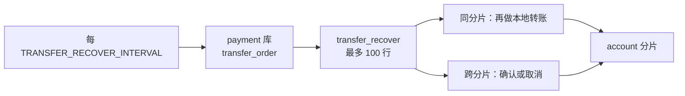
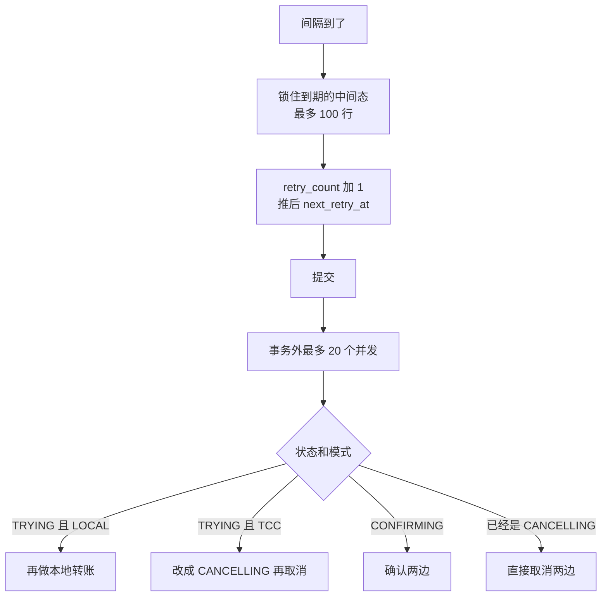

# TRF-04 转账恢复任务

| 项 | 内容 |
|---|---|
| 功能点 | TRF-04（P0，第 4 周） |
| 所属链路 | 转账 |
| 代码提交 | `5930324` `[TRF-04] recover stuck transfers on an interval` |
| 完整提交 | `593032480570ede311930c086de810924f6054b3` |
| 作者 | yym <1754476499@qq.com> |
| 提交时间 | 2026-11-08 17:33:06 +0800 |
| 分支 | `feat/TRF-04-transfer-recover` |
| 日期 | 2026-11-08 |
| 状态 | DONE |

需求里这一条标的是 `P0 · M4`。P0 表示必须完成。M1 到 M8 对应第 1 周到第 8 周，所以 M4 是第 4 周。第 4 周的网关路由还没做，这次只做卡住转账单的定时推进。

## 一句话结论

payment 每 `TRANSFER_RECOVER_INTERVAL`（默认 1 秒）抢占最多 100 张到期的中间态转账单，提交后最多 20 个并发去推进。同分片的 `TRYING` 再做一次本地转账；跨分片还没写下决定的单改成取消并撤销两边，已经决定确认的单继续确认。2026-11-08 17:09:54 到 17:13:30 的全仓集成测试和覆盖率命令退出码都是 0，`service/payment/biz` 语句覆盖率 84.9%。

## 1. 背景

### 1.1 系统简介

> pay-system 是一个用 Go 编写的小型支付后端，模拟商户收款、退款、商户间转账三条资金链路，重点在数据一致性和性能。系统由 5 个部分组成：gateway（对外 HTTP 入口，负责签名校验和限流）、payment（支付单、退款单、转账单的状态管理和流程推进）、account（账户余额与记账，数据按商户分到 2 个数据库分片）、channel-mock（模拟微信、支付宝这类外部支付渠道）、recon（对账，核对系统内外数据是否一致）。服务之间用 Kitex RPC 同步调用，或通过 Kafka 消息异步通知；数据存在 MySQL 8.4，Redis 用于防重放。所有金额用整数“分”表示，所有记账只追加不修改。当前已完成：支付、退款、转账单的创建与查询、同分片转账、跨分片协调都已完成；本次补上卡住转账单的定时恢复。网关还没有转账和退款的 HTTP 路由。

1 元 = 100 分。代码里的金额类型是 `money.Amount`，底层是 `int64`，不使用浮点数。分录是记账时追加的一行金额，只插入，不改旧行。凭证是记账的头，一张凭证下面有若干分录。借是这一行里余额减少的一方，贷是余额增加的一方，两边合计必须相等。

转账单在 payment 自己的库表 `transfer_order` 里。`TRYING` 是刚写下、还没决定确认还是取消。`CONFIRMING` 是已经决定确认、确认还没完成。`CANCELLING` 是已经决定取消、取消还没完成。`SUCCESS` 和 `FAILED` 是终态，写下之后这次恢复不再把它们改回去。

account 有 2 个数据库，叫分片。商户号是字母 `M` 加恰好 6 位数字，分片号是这 6 位对 2 取余。`M100001` 和 `M100003` 在分片 1，`M100002` 在分片 0。付款方和收款方在同一分片时，模式是 `LOCAL`，一个库里的一个事务就能转完。不在同一分片时，模式是 `TCC`：先在两边做可撤销的准备（Try），再确认（Confirm）或取消（Cancel）。这次恢复不新写一套 TCC，只调用已经存在的本地转账和确认、取消函数。

当前时间来自注入的时钟。生产用真实时钟，测试用可以拨动的假时钟。`biz` 和 `job` 这两个包不调用 `time.Now`。

### 1.2 本功能点在系统中的位置



上游是已经写在 `transfer_order` 里的中间态转账单。创建转账时把 `next_retry_at`（下一次允许被拿走的时间）设成创建时间加上 `TRANSFER_RECOVER_DELAY`（默认 10 秒），所以恢复任务要等这一列到期才拿得到。下游是 account 的分片：本地转账只碰一个分片，跨分片分别碰付款方和收款方。改成终态的那个事务里，会插入一行 outbox。outbox 是待发消息。本功能点只插入，不发送。发到 Kafka 是以后的投递功能，这里不做。消息还停在库里时，下游现在收不到这条消息；转账单的状态已经写在库里。账户调用在 payment 的事务外面，一个 payment 事务不碰账户分片。

生产进程在装好本地转账和 TCC 之后，用配置里的间隔注册后台循环，名字是 `transfer_recover`，和退款恢复挂在同一组后台任务里。集成测试直接调用 account 的业务方法，不起 Kitex。Kitex 是服务之间的 RPC 框架。生产代码不 import `service/account`。

### 1.3 为什么需要它

`M100001` 有 500 分（5.00 元），转 100 分（1.00 元）给 `M100002`。两边不在同一个 MySQL 里。两个准备都成功之后、决定还没写下，进程被杀掉：付款方已经冻住 100 分，收款方只登记了准备，转账单仍是 `TRYING`。没有恢复任务的话，这 100 分一直冻着，商户查到的状态一直是进行中。恢复把这种还没写下决定的跨分片 `TRYING` 写成 `CANCELLING`，失败码用 `TRY_TIMEOUT`。这个名字容易看成“准备失败”。在这条恢复路径上，它表示原来的请求没有把决定做完。两个准备都已经成功、进程在决定前被杀掉，也用这个码。它不表示准备一定失败了。

另一种停法，和“进程被杀掉后仍是 `TRYING`”分开：决定已经写成 `CONFIRMING`，付款方确认已经做完，收款方还没做。付款方确认从商户扣掉 100 分（1.00 元），把同样的 100 分记入付款方那个库的在途账户，凭证类型是 `TRANSFER_OUT`。收款方确认会从收款方那个库的在途账户扣掉同样的 100 分，记给收款商户，凭证类型是 `TRANSFER_IN`。收款方那个库的在途可以先是负的。两个库的在途相加，在两边都记完且金额相同之后是 0。只做了付款方时，合计等于这笔 100 分（1.00 元）。没有恢复任务的话，这 100 分停在在途里，收款方拿不到。

确认或取消去调账户失败时，单留在 `CONFIRMING` 或 `CANCELLING`，钱停在最后一次成功的那一步。下一轮到了 `next_retry_at` 再做。恢复不会把这两种中间态改成放弃。

## 2. 术语

| 术语 | 含义 |
|---|---|
| 分 | 金额单位。1 元 = 100 分。转账金额是正整数分。 |
| 分录 | 记账时追加的一行金额。只插入，不改旧行。 |
| 凭证 | 记账头 `ledger_txn` 的一行，下面挂着分录。本地转账是 `TRANSFER`。跨分片付款方确认是 `TRANSFER_OUT`，收款方确认是 `TRANSFER_IN`。只追加。 |
| 借 / 贷 | 借是这一行里余额减少的一方，贷是增加的一方。一张凭证里两边合计相等。 |
| `TRYING` | 转账单刚插入的状态。决定还没写下。 |
| `CONFIRMING` | 已经决定确认、确认还没都成功。 |
| `CANCELLING` | 已经决定取消、取消还没都成功。 |
| `SUCCESS` / `FAILED` | 两种终态。写下之后恢复任务不再把它们改回中间态。 |
| 分片 | account 的两个数据库之一。商户号 `M` 加 6 位数字，分片号是数字部分除以 2 的余数。 |
| `LOCAL` | 付款方和收款方在同一分片。一个事务完成本地转账。 |
| `TCC` | Try-Confirm-Cancel。Try 是准备，Confirm 是正式记账，Cancel 是撤销准备。转账单的 `mode` 取值也叫 `TCC`，表示这笔跨分片。 |
| 注入时钟 | 业务代码问这个时钟要“现在”，不自己调用 `time.Now`。测试可以把它拨到任意时刻。 |
| `next_retry_at` | 下一次允许被恢复任务拿走的时间。没到这个时间的行，这一轮不抢。 |
| outbox | 待发消息。本功能点只在改成终态的同一个事务里插入一行，不发送。发到 Kafka 是以后的投递功能。消息留在库里时，下游现在收不到；转账单的状态已经在库里。 |
| 冻结 | 把付款方的可用余额划进冻结金额，账面余额先不变。冻结单状态 `FROZEN`。解开后是 `RELEASED`。确认扣款后是 `CONFIRMED`。 |
| 在途账户 | 每个分片上的平台账户，类型 `TRANSIT`。付款方确认从商户扣款，把同样的金额记入付款方那个库的在途账户，凭证是 `TRANSFER_OUT`。收款方确认从收款方那个库的在途账户扣掉同样的金额，记给收款商户，凭证是 `TRANSFER_IN`。收款方那个库的在途可以先是负的。两个库的在途相加，两边都记完且金额相同之后是 0。只做了付款方、金额是 100 分（1.00 元）时，合计是 100 分。 |
| `transfer_no` | 平台转账单号，前缀 `TF`。两个分片都用它认同一笔转账。 |
| `out_transfer_no` | 商户自己的转账单号。建单看到相同的商户号加这个商户单号，不会再执行一遍。 |
| 幂等 | 同一笔转账做一次和做多次，账户效果相同，不会多冻、多记一张凭证。 |
| CAS | Compare-And-Set。改状态的更新带“当前状态必须仍是期望值”。影响 1 行表示这次改成了。抢占提交之后如果影响 0 行，表示别的请求已经改过，再读一次。抢占事务里那条只加次数的 UPDATE 是另一回事，见 3.2。 |
| `FOR UPDATE SKIP LOCKED` | 在事务里锁住选中的行。已经被别的事务锁住的行直接跳过，不等待。 |
| `retry_count` | 这张单被恢复任务抢走过几次。创建时是 0。每次抢占加 1，不会减少。 |
| `version` | 转账单版本。插入时是 0。只有改状态的 CAS 才加 1。抢占不加。 |
| `fail_code` | 失败原因字符串。恢复把还没写下决定的跨分片 `TRYING` 改成 `CANCELLING` 时，写入 `TRY_TIMEOUT`。两个准备都已经成功、进程在决定前被杀掉，也用这个码。它表示原来的请求没有把决定做完，不是说准备一定失败了。 |
| `txn_no` | 转账单上的凭证号那一列。本地转账成功时写下那一张凭证的号。跨分片有两张凭证、两个库，成功后这一列仍是空。 |
| `10003` | 已有的内部错误。代码里的值是 `errno.ErrInternal`，数字就是 `10003`，英文消息是 `internal error`。恢复日志在没到终态、且没有别的错误时用这个码。恢复任务不是 HTTP 响应，这条日志不改变建单接口自己的返回。 |
| 分支 | 跨分片时一个分片上的那一半。付款方是冻结单，收款方是 `transfer_branch` 里的一行，状态可以是 `TRIED` 或 `CANCELLED`。 |
| gauge | 一个表示“当前有多少”的数。这里是本进程里卡住的转账单张数。到达终态就从里面去掉。它会随终态减少，不是只增不减的计数。 |
| Prometheus | 一种拉取指标的系统。这次不暴露，也不加 `mode` 标签。以后由 OPS-03 做。 |
| 故障点 | 测试在指定位置杀掉进程的钩子。空的故障点列表什么都不做。这次用的三个点是 `transfer.after_try`、`transfer.after_decision`、`transfer.after_payer_confirm`。 |
| `CheckBalance` | account 的全量核对：两个分片上，每张凭证的借贷是否相等、余额是否能由分录解释。参数要求在途为 0 时，两个分片的在途加总必须是 0 才算通过。 |

## 3. 技术讲解

### 3.1 要解决的问题

恢复任务要同时满足这些约束：

- 多台 payment 同时跑，同一行只能被一台拿走。靠行锁跳过已锁的行，再靠状态 CAS 保证改状态只有一次成功。
- 重复推进不能多记凭证。本地转账、确认、取消都按 `transfer_no` 幂等。已经是终态的单不再写第二条 outbox。
- 进程在准备、决定、付款方确认之后被杀掉，重启后还能推进到终态。行上的状态就是进度。
- 账户超时或暂时不可用，结果当未知。`CONFIRMING` 和 `CANCELLING` 留在中间态，不改成 `FAILED`。
- 抢占用的“现在”必须是注入时钟，截断到毫秒，作为 SQL 参数传入。不用数据库的 `NOW()`。
- 日志不打密钥、签名、完整报文和 panic 的内容。处理失败只打 `transfer_no` 和十进制 `err_code`。

### 3.2 方案

一轮先在一个短事务里抢占，提交之后才调用账户。事务里只有查询和更新。



抢占条件是状态属于 `TRYING`、`CONFIRMING`、`CANCELLING`，并且 `next_retry_at` 已经小于等于注入时钟的现在。按 `next_retry_at` 排序，`LIMIT 100`，`FOR UPDATE SKIP LOCKED`。剩下的行下一轮再抢，不翻页。两条账户路径都装上时，SQL 就是这个条件。只装了本地转账时，只抢 `TRYING` 且 `LOCAL`。只装了 TCC 时，只抢 `mode = TCC` 的三种中间态。没装的那条路径不会被拿走，也不会去调账户。

`now` 在 Go 里算好再绑进 SQL。下面这段是抢占更新，看它写入的三列：次数、下一次时间、更新时间。`version`、状态、`fail_code`、`finished_at`、`txn_no` 都不在 SET 里。

```sql
UPDATE transfer_order
SET retry_count = ?, next_retry_at = ?, updated_at = ?
WHERE transfer_no = ? AND status = ? AND retry_count = ?
```

`updated_at` 这一列在表上是 `ON UPDATE CURRENT_TIMESTAMP`。更新时如果不显式赋值，MySQL 会把它写成数据库自己的当前时间。所以这里把同一个注入时钟写进去。写进 SQL 之前，这个时间截断到毫秒：`updated_at` 和 `next_retry_at` 的列类型是 `DATETIME(3)`，本服务其他时间戳也截到毫秒，写入的值和库里存的精度一致。

抢占这条 UPDATE 执行时，行已经在本事务里锁住。影响行数不是 1，就整笔抢占回滚，这一批返回 `10003`。这是防御：行正锁着，正常应是 1。它和后面改状态时的“影响 0 行”不是一回事。改状态发生在抢占提交之后，那时别的请求可能已经改过状态。

退避在 Go 里用整数算，用的是加 1 之后的 `retry_count`。第一次抢占把 0 变成 1，等待 `2^1 = 2` 秒。`n` 大于等于 6 一律 60 秒，不再算 `2^6 = 64`。算好的时间绑进上面的 UPDATE，不在 SQL 里做乘方。

| 加 1 之后的 n | 再等多久 |
|---|---|
| 1 | 2 秒 |
| 2 | 4 秒 |
| 3 | 8 秒 |
| 4 | 16 秒 |
| 5 | 32 秒 |
| 6 以及更大 | 60 秒 |

举例：创建时刻是 12:00:00，`next_retry_at` 是 12:00:10。12:00:10 第一次抢到，`retry_count` 从 0 变成 1，下一次是 12:00:12。若这一轮没做成终态，12:00:12 再抢，次数变成 2，下一次是 12:00:16。

这段函数就是上面的表。`n >= 6` 直接返回 60 秒；更小的 `n` 用左移，`1 << 1` 秒就是 2 秒。`n < 1` 被改成 1，只是函数里的防御。抢占传入的永远是原次数加 1，最小是 1。正常路径不会走到小于 1。

```go
// service/payment/biz/transfer_recover.go
func transferRecoverBackoff(n int) time.Duration {
	if n >= 6 {
		return transferRecoverMaxBackoff
	}
	if n < 1 {
		n = 1
	}
	return time.Second << n
}
```

提交之后，用 20 个槽限制并发。一个任务失败不会取消还在跑的兄弟。批次的上下文被取消之后，不再启动新任务；已经开始的确认或取消用自己的 5 秒超时，不跟着批次一起取消。5 秒是按调用预算估的，不是测出来的耗时。一次账户调用的预算大约是连接 100 毫秒加 RPC 500 毫秒，幂等方法再试 1 次。串行是两个分片先后各调一次，按这个预算大约 2.4 秒，再加上本库更新，所以单笔上下文给 5 秒。这 2.4 秒是预算相加，不是一次运行测得的耗时。跨分片的确认或取消内部，只要传进去的这个 5 秒上下文还没结束，就最多再试，连第一次一共 6 轮。5 秒到了，这个上下文结束，这一轮就停，单留在中间态，下一轮到期再做。抢占事务另有 3 秒超时，和数据库事务的 3 秒预算一致。

三个时间要放在一起看。循环默认每 1 秒看一次。抢占提交时已经把 `next_retry_at` 推后，第一次是 2 秒。单笔最多跑 5 秒。一次处理如果超过 2 秒，下一轮可以再次抢到同一行，两个处理会重叠。重叠是安全的：账户按平台单号 `transfer_no` 幂等，终态更新只有一个影响 1 行，另一个再读到终态，不再插第二条 outbox。

```go
// service/payment/biz/transfer_recover.go
func (p *Payments) runTransferRecoverTask(ctx context.Context, row TransferOrder) {
	taskCtx, cancel := context.WithTimeout(context.WithoutCancel(ctx), transferRecoverTaskTimeout)
	defer cancel()
	defer func() {
		if recover() != nil {
			transferRecoverPanics.Add(1)
			slog.ErrorContext(taskCtx, "transfer recover task panicked", "transfer_no", row.TransferNo)
		}
	}()
	p.recoverTransfer(taskCtx, row)
}
```

`context.WithoutCancel` 复制批次上下文里的数据，但批次上下文被取消或到达截止时间时，套出来的上下文不会跟着结束。外面再套上 5 秒，所以停止批次不会打断已经发出的确认或取消。单笔 panic 被接住，进程内计数加 1，日志只有 `transfer_no`，不记录 panic 的值。消息是 `transfer recover task panicked`，和下面的处理失败日志不是同一条。

处理时按抢到的那一行走已有函数：

处理之前先看发号器。`*idgen.Generator` 是发号器。终态事务里用它给 outbox 的事件编号。不是这种发号器就返回 `10003`（也就是 `errno.ErrInternal`），并且在那之前不调账户。跨分片恢复把同一个发号器传给确认和取消。

- `TRYING` 且 `LOCAL`：调用已有的 `executeLocal`，按平台单号 `transfer_no` 再做一次本地转账，做一次和做多次的账户效果相同。不从建单入口 `CreateTransfer` 重入。商户自己的单号是 `out_transfer_no`。建单看到相同的商户号加这个商户单号，不会再执行一遍。`executeTransfer` 是建单成功后的执行入口，它会先看有没有注入的测试执行器；那个执行器会接走所有模式。恢复不走这个入口，也不调用那个执行器。同一分片的本地转账里，账户返回余额不足时，转账单写成 `FAILED`。这是终态，不打消息为 `transfer recover` 的 ERROR。
- `TRYING` 且 `TCC`：只有 `TRYING` 还能被改成取消。CAS 把状态改成 `CANCELLING`，`fail_code` 写成 `TRY_TIMEOUT`，然后直接取消两边。这个码表示原来的请求没有把决定做完，包括两个准备都已经成功、进程在决定前被杀掉的单。不再发 Try。抢占本身不改状态。原来的请求线程如果还活着，只有在恢复已经把 `TRYING` 改成别的状态之后，它自己的决策更新才会影响 0 行。那一次是抢占提交之后的改状态，整批不会因此回滚。
- 已经是 `CONFIRMING`：走已有的确认。已经是 `CANCELLING`：直接取消，不再改成一次 `CANCELLING`。一旦写成这两种状态，恢复按这个状态往下做，不再改决定。
- 抢占提交之后再改状态，影响 0 行：别的请求可能已经改过。只再读一次。读到 `CONFIRMING` 就确认，读到 `CANCELLING` 就取消，读到 `SUCCESS` 或 `FAILED` 就结束，不再插入 outbox。仍是 `TRYING` 或认不出的状态，返回 `10003`，本轮不循环。这和抢占 UPDATE 影响行数不是 1 时整批回滚，是两处不同的“0 行”。

```go
// service/payment/biz/transfer_recover.go
func (p *Payments) advanceTCCRecover(ctx context.Context, row TransferOrder, gen *idgen.Generator) (TransferOrder, error) {
	switch row.Status {
	case transferStatusTrying:
		at := p.clk.Now().Truncate(time.Millisecond)
		got, applied, err := p.transfers.decideTransfer(ctx, row, transferStatusCancelling, transferFailTryTimeout, at)
		if err != nil {
			return TransferOrder{}, tccStoreErr(err)
		}
		if !applied {
			return p.continueDecided(ctx, got, gen)
		}
		return p.cancelTCC(ctx, got, gen)
	case transferStatusConfirming:
		return p.confirmTCC(ctx, row, gen)
	case transferStatusCancelling:
		return p.cancelTCC(ctx, row, gen)
	default:
		return row, errno.ErrInternal
	}
}
```

确认或取消的普通失败保持中间态，函数返回的 error 是 nil。恢复看到还没到终态，打一条 ERROR：消息固定是 `transfer recover`，字段只有 `transfer_no` 和十进制 `err_code`。没到终态、且没有别的错误时，这个码是 `errno.ErrInternal`，也就是 `10003`。恢复任务不是 HTTP 响应，这条日志不改变建单接口自己的返回。进入终态不打这条。同一分片本地转账因余额不足写成的 `FAILED` 也是终态，同样不打。

`retry_count` 大于等于 10 且仍非终态的 `transfer_no`，放进本进程的集合。gauge `pay_transfer_stuck` 是这个集合的大小。同一张单重复见到只算 1。次数只会越加越大，所以离开集合的正常原因是这张单到达了终态。没有 Prometheus，也没有按 `LOCAL` / `TCC` 分的标签。两台机器各自有自己的数，互不汇总。

整批入口是 `(*Payments).RunTransferRecoverBatch`。对象是空、没有时钟、转账单存储不是 MySQL，或者本地和 TCC 都没装，返回 `10003`，不执行抢占。上下文是空也返回 `10003`。上下文已经取消，则把这个取消原样返回，同样不抢。单笔失败只记日志，整批入口在派发之后返回 nil。

生产在 `cmd/payment/main.go` 里，`UseLocalTransfer` 和 `UseTCCTransfer` 之后执行 `job.NewTransferRecover(cfg.TransferRecoverInterval, payments.RunTransferRecoverBatch)`，挂到和退款恢复相同的后台任务组。循环名是 `transfer_recover`。间隔用配置 `TRANSFER_RECOVER_INTERVAL`。配置小于等于 0 时，现有的 `NewLoop` 改用 1 秒。`job` 包不 import 任何 `service/` 包。

版本的走法：插入是 0。写下决定加 1，进入终态再加 1。从未决定的 `TRYING` 被恢复取消，经过 `CANCELLING` 再到 `FAILED`，终态时 `version` 是 2。请求里已经写成 `CONFIRMING` 的行，任务开始前是 1，成功后是 2。本地转账从 `TRYING` 直接成功，只有一次 CAS，`version` 是 1。`fail_code` 只出现在 `CANCELLING` 和 `FAILED`。`CONFIRMING`、`SUCCESS`、`TRYING` 保持空。`finished_at` 只在 `SUCCESS` 和 `FAILED` 写下。跨分片成功的 `txn_no` 保持空。

### 3.3 为什么这样做

采用短事务抢占，提交后再调用已经存在的本地转账、确认和取消。从头再做准备、再调一次建单、在 SQL 里算时间，以及一个失败就取消整批，都不用。

| 方案 | 做法 | 优点 | 缺点 | 结论 |
|---|---|---|---|---|
| 采用：短事务抢占，事务外调用已有函数 | `SKIP LOCKED` 拿走最多 100 行，提交后最多 20 并发。`TRYING` 的跨分片单直接取消，已决定的单按状态确认或取消 | 锁很快放开；多实例互不等待；不复制第二套 TCC | 没到 `next_retry_at` 的行要等下一轮；gauge 只在本进程 | 采用 |
| 备选：恢复时从头再 Try | 对卡住的 `TRYING` 再跑一遍准备 | 账户恢复后有机会直接成功 | 只有 `TRYING` 还能被改成取消。一旦已经写成 `CONFIRMING` 或 `CANCELLING`，就按这个状态往下做，不再改决定。再 Try 可能在已经选择取消之后又成功，也可能和还活着的请求线程各做一次。确认和取消按 `transfer_no` 幂等 | 不采用 |
| 备选：再调一次建单 | 用相同商户单号调用 `CreateTransfer` | 入口只有一个 | 相同商户单号不会重新执行。注入的执行器还会接走所有模式，恢复拿不到卡住的那一行 | 不采用 |
| 备选：在 SQL 里写 `NOW()` 和 `2^retry_count` | 数据库自己算时间和退避 | SQL 看起来短 | 业务时间必须来自注入时钟。`SET` 从左到右赋值时，乘方用到的是加 1 之前还是之后，读代码的人会对错。整数左移没有这个问题 | 不采用 |
| 备选：一个失败就取消整批 | `errgroup.WithContext` | 失败能立刻停掉其他任务 | 会取消兄弟任务已经发出的账户调用，把本来已知的结果变成未知 | 不采用 |

### 3.4 正确性

重复执行、两台实例同时抢、进程在三处被杀掉、账户超时，最后都停在测试断言过的数据库状态上。

崩溃测试的做法：把当前测试二进制再执行一遍，子进程打开故障点，在该点收到 `SIGKILL`。父进程确认退出原因是 `signal: killed`，再拨动假时钟越过 `next_retry_at`（创建后再过 10 秒），用新的 `Payments` 跑一轮恢复。杀掉的是测试自己拉起的子进程。等待不用 `time.Sleep`。账户停用大约 1 分钟也是把假时钟拨过这段时间。

| 场景 | 系统行为 | 最终状态 | 证明 |
|---|---|---|---|
| 同一张单被再次推进 | 本地转账、确认、取消按 `transfer_no` 幂等。已经是终态就直接返回 | `TestTransferRecoverLocalAfterAccountUp` 断言成功后 outbox 是 1 条；再过 1 小时跑一轮，凭证仍是 1 张，outbox 仍是 1 条。`TestTransferRecoverAccountOutage` 断言已经成功的那张单，稍后一轮之后 `TRANSFER_OUT` 与 `TRANSFER_IN` 仍各 1 张，outbox 仍是 1 条。`transfer.failed` 和 `transfer.succeeded` 只在下面两行杀掉进程的测试里检查条数和事件类型，上面这两条只检查条数 | `TestTransferRecoverLocalAfterAccountUp`、`TestTransferRecoverAccountOutage` |
| 两个实例同时抢 | 一个连接锁住最早的 10 行，另一边 `SKIP LOCKED` 拿走没锁的行。两实例同时跑，每行只处理一次 | 被锁住的行 `retry_count` 仍是 0；没锁的变成 1。全部做完后每行次数是 1 | `TestTransferRecoverSkipLockedSplitsRows`、`TestTransferRecoverTwoInstances` |
| `transfer.after_try` 杀掉进程 | 两个 Try 已成功，决定还没写下。恢复把 `TRYING` 改成 `CANCELLING`（`TRY_TIMEOUT`），再取消两边。收款方那一半叫分支，取消后状态是 `CANCELLED` | `FAILED`，`version` 是 2。冻结 `RELEASED`，收款分支 `CANCELLED`。没有 `TRANSFER_OUT`、`TRANSFER_IN`、`TRANSFER` 凭证。outbox 一条 `transfer.failed` | `TestTransferRecoverAfterTryKill` |
| `transfer.after_decision` 杀掉进程 | 决定已提交为 `CONFIRMING`，还没确认。恢复走确认 | `SUCCESS`，`version` 从 1 变成 2，`txn_no` 仍空。`TRANSFER_OUT` 与 `TRANSFER_IN` 各 1 张。在途合计 0。outbox 一条 `transfer.succeeded` | `TestTransferRecoverAfterDecisionKill` |
| 串行模式在 `transfer.after_payer_confirm` 杀掉 | 配置 `TRANSFER_PARALLEL_BRANCH`。`true` 时两边确认同时做，不经过 `transfer.after_payer_confirm`。`false` 时先确认付款方，经过这个故障点，再确认收款方。验收 3 只测串行，金额 100 分（1.00 元） | 杀掉后在途合计等于 100 分（1.00 元）。恢复后 `SUCCESS`，在途合计 0，两种凭证仍各 1 张。并行不调用这个故障点由另一个测试证明 | `TestTransferRecoverAfterPayerConfirmKill`、`TestTransferParallelSkipsPayerConfirmFault` |
| 账户大约 1 分钟不可用 | 假时钟表示这段窗口。请求可能把单留在 `CANCELLING` 或 `TRYING`。账户恢复后由本任务推到终态。已经成功的单再跑一轮，凭证张数不变 | 相关 TCC 单都是终态。`CheckBalance` 通过：两个分片的分录配平，并且在途加总为 0 | `TestTransferRecoverAccountOutage` |
| 本来就是 `CONFIRMING`，确认又失败 | MySQL 上抢占把 `retry_count` 加 1，并按退避写下一次时间。确认失败后状态仍是 `CONFIRMING`。`CANCELLING` 上已经有失败码，再试会保留它；下面两条测试只覆盖 `CONFIRMING`，没有覆盖 `CANCELLING` | 仍是 `CONFIRMING`，`fail_code` 保持空，`version` 不变。单元测试直接调用处理函数、不经过抢占，所以它断言的次数仍是调用前的 3 | `TestTransferRecoverConfirmingRetryMySQL`、`TestRecoverConfirmingFailureStaysConfirming` |
| 抢占提交之后，改状态影响 0 行 | 只再读一次。`CONFIRMING` 去确认；已经是终态就结束且不再调账户。仍是 `TRYING` 返回 `10003`，本轮不循环。这不是抢占 UPDATE 的那一处 0 行 | 仍是 `TRYING` 时返回 `10003` 且不调账户；再读到 `CONFIRMING` 会确认一次；再读到 `SUCCESS` 时不调账户，`version` 保持 2 | `TestAdvanceRecoveredCASMissStillTrying`、`TestAdvanceRecoveredCASMissConfirming`、`TestAdvanceRecoveredCASMissTerminal` |
| 未装配 | 没有时钟、不是 MySQL、或两条路径都没装 | 返回 `10003`，不抢占，`retry_count` 保持 0 | `TestRunTransferRecoverBatchNotReady`、`TestRunTransferRecoverBatchNotWiredMySQL` |
| `retry_count` 达到 10 仍非终态 | 用抢占后的次数判断。终态后从集合删除 | gauge 先是 1，成功后是 0 | `TestTransferStuckGauge`、`TestTransferRecoverStuckGaugeMySQL` |

验收 5：`M100001` 转给 `M100003`，都在分片 1，所以是 `LOCAL`。种子余额 500 分（5.00 元），转账 100 分（1.00 元）。账户不可用时转账单保持 `TRYING`，`version` 仍是 0，没有 `TRANSFER` 凭证。账户恢复并且时钟越过下一次 `next_retry_at` 之后，本任务把它做成 `SUCCESS`，`version` 是 1，恰好 1 张 `TRANSFER`。再过 1 小时跑一轮，凭证仍是 1 张。

验收 6：付款方确认注入失败一次，转账单停在 `CONFIRMING`，`version` 是 1。此时在途不是 0。`CheckBalance` 用“允许在途不为 0”的核对，分录仍然配平，结果通过。本任务推进为 `SUCCESS`，`version` 是 2，`TRANSFER_OUT` 与 `TRANSFER_IN` 各 1 张，在途变成 0，再用“要求在途为 0”的核对通过。金额同样是 100 分（1.00 元），种子 500 分（5.00 元）。

这些测试函数没有 `t.Skip`。`go test` 里有一个测试失败，包的退出码就不是 0。全仓 `make test-integration` 退出码 0，表示这些函数当时没有失败。日志没有每个函数的单独耗时，这里不写秒数。余额不足不打 `transfer recover` 这条日志，由 `TestTransferRecoverErrorLog` 断言；它在 `make test` 里，那条命令的退出码也是 0。

### 3.5 性能

不涉及压测。一轮最多 100 行、事务外最多 20 并发、单笔 5 秒、抢占事务 3 秒，都是代码里的常数，不是测出来的吞吐。

## 4. 已完成内容

### 4.1 改动清单

下面这些文件都在提交 `5930324` 里。

| 文件 | 新增 / 修改 | 作用 |
|---|---|---|
| `service/payment/biz/transfer_recover.go` | 新增 | 批次入口、退避、20 并发、5 秒单笔超时、gauge、panic 计数、处理失败日志 |
| `service/payment/biz/transfer_recover_sql.go` | 新增 | 用注入时钟抢占，显式写 `updated_at`，不改 `version` |
| `service/payment/biz/transfer_recover_test.go` | 新增 | 退避、并发上限、CAS 再读、未装配、失败保持中间态、gauge、错误日志 |
| `service/payment/biz/transfer_recover_integration_test.go` | 新增 | 六条验收、最多 100 行、两实例 `SKIP LOCKED`、MySQL 上的重试和 gauge |
| `service/payment/job/transfer_recover.go` | 新增 | 循环名 `transfer_recover`，间隔取配置 |
| `service/payment/job/loop_test.go` | 修改 | 间隔小于等于 0 时仍是 1 秒 |
| `service/payment/biz/transfer.go` | 修改 | 注明恢复复用已有的状态更新，抢占不放进存储接口 |
| `service/payment/biz/transfer_test.go` | 修改 | 内存存储可以制造一次 CAS 未命中 |
| `service/payment/biz/fee_integration_test.go` | 修改 | 环境变量 `PAY_TRF04_CHILD` 置位时，先跑崩溃子进程 |
| `cmd/payment/main.go` | 修改 | 本地转账和 TCC 装好之后注册 `transfer_recover` |
| `.golangci.yml` | 修改 | 这份集成测试可以 import account 的业务包，和生产代码的禁止规则分开 |
| `docs/02-requirements.md` | 修改 | TRF-04 标为 DONE，六条验收打勾，补实现说明和一条变更记录 |
| `docs/04-dev-plan.md` | 修改 | 勾选写着 TRF-01 到 TRF-05 的那一行。TRF-05 查询此前已完成，TRF-04 是该行最后一个还没勾的名字。GW-09 那一行不勾 |
| `docs/database.md` | 修改 | `transfer_order` 的生命周期补上抢占方式，无表结构变化 |
| `docs/06-flows.md` | 修改 | 升到 v2.44，只在 CF-36 图下加说明 |
| `docs/interview-notes.md` | 修改 | 记下不重跑 Try、gauge 不是 Prometheus |

### 4.2 对外变化

| 类别 | 变化 |
|---|---|
| 接口 | 无。创建转账和查询转账的契约没改。未完成的转账仍由平台恢复任务推进。 |
| 表结构 | 无。不新增迁移。`retry_count`、`next_retry_at` 和索引 `idx_status_next_retry_at` 本来就有。 |
| 配置项 | 无新登记。沿用已有的 `TRANSFER_RECOVER_INTERVAL`（默认 1 秒）和 `TRANSFER_RECOVER_DELAY`（默认 10 秒）。创建转账的 2 秒超时没改。账户客户端超时没改。 |
| 错误码 | 无新码。未装配和认不出的状态用已有的 `10003`。 |
| 指标 / 故障点 | 进程内 gauge `pay_transfer_stuck`，以及 panic 次数 `transferRecoverPanics`。没有 `/metrics`，没有 Prometheus。故障点沿用已有的三个 `transfer.after_*`，这次没有新故障点。 |

### 4.3 验收对照

| 验收条目 | 测试函数 | 类型 | 结果 |
|---|---|---|---|
| 在 `transfer.after_try` 杀掉进程后恢复：转账 `FAILED`，冻结 `RELEASED`，收款分支 `CANCELLED`，没有凭证 | `TestTransferRecoverAfterTryKill` | 集成 | 通过 |
| 在 `transfer.after_decision` 杀掉后恢复：`SUCCESS`，`TRANSFER_OUT` 与 `TRANSFER_IN` 各 1 张 | `TestTransferRecoverAfterDecisionKill` | 集成 | 通过 |
| 串行模式在 `transfer.after_payer_confirm` 杀掉：重启前在途合计等于 100 分（1.00 元），恢复后 `SUCCESS`，在途 0 | `TestTransferRecoverAfterPayerConfirmKill` | 集成 | 通过 |
| 账户停用窗口用假时钟表示约 1 分钟，不用 `time.Sleep`。恢复后相关 TCC 单都是终态，`CheckBalance` 通过 | `TestTransferRecoverAccountOutage` | 集成 | 通过 |
| `LOCAL` 在账户不可用时保持 `TRYING` 且没有凭证；恢复后恰好 1 张 `TRANSFER`。金额 100 分（1.00 元），种子 500 分（5.00 元） | `TestTransferRecoverLocalAfterAccountUp` | 集成 | 通过 |
| 付款方确认失败一次停在 `CONFIRMING`，本任务推进为 `SUCCESS`，两种凭证各 1 张。卡住时在途不为 0，用允许在途不为 0 的核对；终态后在途 0 | `TestTransferRecoverConfirmFail` | 集成 | 通过 |

“通过”的意思：这些测试函数没有 `t.Skip`。`go test` 里有一个测试失败，包的退出码就不是 0。所以全仓 `make test-integration` 退出码 0，表示这些函数当时没有失败。日志没有每个函数的单独耗时。

### 4.4 验证记录

环境：macOS 27.0.1，Darwin arm64，内核 27.0.0，`go1.27.2 darwin/arm64`，golangci-lint 2.14.0（built with go1.27.1 from `114493f` on 2026-09-24T10:54:53Z）。时间从 2026-11-08 17:09:54 +0800 到 17:13:30 +0800。下面每条命令的退出码都是 0。日志里先确认了 Docker 可用。

| 命令 | 结果 |
|---|---|
| `gofmt -l .` | 无输出。real 0.06s，user 0.25s，sys 0.05s |
| `make lint` | 实际执行 `golangci-lint run --build-tags integration ./...`，打印 `0 issues.`。real 0.88s，user 1.07s，sys 3.43s |
| `make test` | 实际执行 `go test -race ./...`。real 6.59s，user 3.69s，sys 4.93s。根包 `ok` 4.982s。`service/payment/biz` 5.787s。`service/payment/job` 与 `cmd/payment` 为 cached |
| `make test-integration` | 实际执行 `go test -race -tags integration ./...`。real 100.69s，user 9.77s，sys 10.71s。根包 35.967s。`service/payment/biz` 99.670s。`service/payment/handler` 与 `service/payment/job` 为 cached |
| `make cover` | real 107.84s，user 13.36s，sys 12.87s。语句合计 35.4%（含 `kitex_gen`，这个合计不是门槛）。门槛包都 ≥ 70%：`service/payment/biz` 102.565s / 84.9%，`service/account/biz` cached 91.1%，`service/channel_mock/biz` cached 91.7%，`pkg/money` cached 100.0%，`pkg/sign` cached 100.0%，`pkg/idgen` cached 88.1%，`pkg/outbox` cached 95.0%。`cmd/payment` cached 30.4%，不在门槛里。`service/payment/job` cached 97.7% |

同一次 `make cover` 里，本功能点函数的语句覆盖率：

| 函数 | 覆盖率 |
|---|---|
| `RunTransferRecoverBatch` | 90.5% |
| `dispatchTransferRecover` | 80.0% |
| `runTransferRecoverTask` | 100% |
| `recoverTransfer` | 100% |
| `advanceRecovered` | 63.6% |
| `advanceTCCRecover` | 81.8% |
| `logTransferRecover` | 100% |
| `claimTransferRecover` | 80.0% |
| `selectTransferRecover` | 78.6% |
| `transferRecoverBackoff` | 100% |
| `NewTransferRecover` | 100% |

`make gen` 和 `mmdc` 这次没有运行。集成测试直接调用 account 的 biz，不是 Kitex。

### 4.5 同步的文档

- `docs/02-requirements.md`：版本仍是 v3.0，最后修改改为 2026-11-08。TRF-04 改为 DONE，六条验收打勾，实现说明写了注入时钟、Go 里的退避、100 行、20 并发、5 秒和 3 秒超时、进程内 gauge、未装配返回 `10003`、不重跑 Try。变更记录新增一行。
- `docs/04-dev-plan.md`：那一行把 TRF-01、TRF-02、TRF-03、TRF-04 和 TRF-05 写在一起。TRF-05 是转账查询，按单号读一行，不改状态，在 TRF-04 之前已经完成。TRF-04 是这一行里最后一个还没勾上的名字，所以整行可以勾。GW-09 那一行仍然不勾。第 4 周交付段没有改。
- `docs/database.md`：`transfer_order` 的生命周期写明已按索引抢占并推进。没有新增迁移，也没有改列。变更记录新增 2026-11-08 一行。文首 Last updated 改为 2026-11-08。
- `docs/06-flows.md`：升到 v2.44。只在控制流图 CF-36（转账恢复任务）的图下说明 `now` 是注入时钟参数、退避在 Go 里计算。图的节点没改，没有跑 `mmdc`。`mmdc` 是把图渲染成图片的命令。
- `docs/interview-notes.md`：新增 TRF-04，写抢占和请求线程的 CAS 竞争、gauge 不是 Prometheus、为什么恢复里不重跑 Try。
- `docs/05-api.md`、`docs/03-conventions.md`、`docs/01-tech-decisions.md` 这次没有改。

## 5. 未完成与风险

恢复任务的六条验收已经有测试。还没做的是对外入口和对外指标。

- GW-09 没做。商户还不能经网关用 HTTP 发起转账或退款。第 4 周交付段因此仍缺这条路由，也缺交付里的 A4（用命令行经网关把流程跑通）。
- `pay_transfer_stuck` 只活在本进程的内存里。进程重启后从 0 开始，多实例也不会加总。Prometheus 和 `mode` 标签留给 OPS-03。这次没有 `/metrics`。
- 一轮只拿 100 行。积压超过 100 张时，其余的要等后面的间隔。间隔默认 1 秒。这是代码里的上限，没有压测。
- `advanceRecovered` 的语句覆盖率是 63.6%，低于同文件里其他几个 100% 的函数。全仓门槛看的是包，`service/payment/biz` 是 84.9%，过了 70%。没有为这个函数单独补到 100%。

## 6. 如何复现

需要本机 Docker。这次核验开始时日志里有 `docker_ok`。不要把 `deploy/.env` 读进 shell。

在仓库根目录、提交 `5930324` 上执行：

```bash
gofmt -l .
make lint
make test
make test-integration
make cover
```

预期与 2026-11-08 17:09:54 到 17:13:30 的那次运行一致：`gofmt -l .` 没有输出；`make lint` 打印 `0 issues.`；后三条退出码为 0。`make test` 里 `service/payment/biz` 约 5.787s。`make test-integration` 里该包约 99.670s。`make cover` 里该包语句覆盖率 84.9%，全库语句合计 35.4%。`make cover` 会写出 `coverage.out`。

`make gen` 和 `mmdc` 这次没跑，复现上述结果不需要它们。

## 7. 讲解要点

1. **恢复为什么不再 Try？** 只有 `TRYING` 还能被改成取消。一旦已经写成 `CONFIRMING` 或 `CANCELLING`，恢复按这个状态往下做，不再改决定。还是 `TRYING` 的跨分片单写成 `CANCELLING`，失败码用 `TRY_TIMEOUT`：原来的请求没有把决定做完。两个准备都已经成功、进程在决定前被杀掉，也用这个码，不是说准备一定失败了。请求线程如果抢先写成 `CONFIRMING`，恢复这次改状态影响 0 行，再读一次后改走确认。循环默认每 1 秒看一次，抢占却把下一次时间推后（第一次是 2 秒），单笔最多跑 5 秒。处理超过 2 秒时，下一轮会再抢到同一行，两个处理重叠。账户按 `transfer_no` 幂等，终态更新只有一个影响 1 行，另一个再读到终态，不再插第二条 outbox。
2. **两台机器会不会拿同一行？** 抢占用 `FOR UPDATE SKIP LOCKED`。一台锁住的行，另一台跳过。这是抢占。抢占 UPDATE 的影响行数不是 1 时，整笔抢占回滚并返回 `10003`，因为行还锁在本事务里，正常应是 1。抢占提交之后再改状态，才可能因为别的请求已经改过而影响 0 行；那时再读一次，不循环。抢占只加 `retry_count` 并推后 `next_retry_at`，不加 `version`。
3. **`pay_transfer_stuck` 为什么不是 Prometheus 计数？** 它要的是当前还有几张 `retry_count >= 10` 且非终态的单。终态必须减掉。只增的计数做不到。这次只放在进程内存里，对外拉取留给 OPS-03。

## 延伸阅读

- `docs/02-requirements.md`：TRF-04 的规则、实现说明和六条验收。
- `docs/06-flows.md`：CF-36 转账恢复任务。
- `docs/database.md`：`transfer_order` 的生命周期。
- `docs/reports/TRF-02-transfer-local.md`、`docs/reports/TRF-03-transfer-tcc.md`：恢复所调用的本地转账和跨分片确认、取消。

## 修订记录

| 日期 | 提交 | 修订内容 |
|---|---|---|
| 2026-11-08 | `5930324` | 初稿。对应代码提交 `[TRF-04] recover stuck transfers on an interval` |
