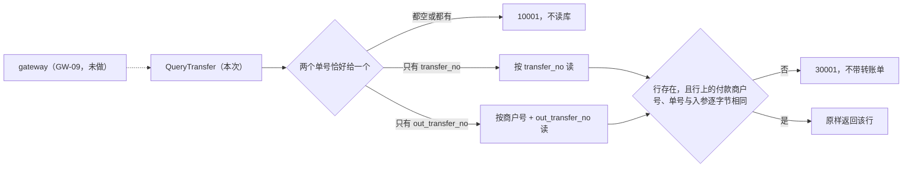

# TRF-05 转账查询

| 项 | 内容 |
|---|---|
| 功能点 | TRF-05 转账查询（优先级 P0，最高，必须完成；开发计划第 4 周） |
| 所属链路 | 转账 |
| 代码提交 | `7b0d9e2` `[TRF-05] add transfer query`（完整 `7b0d9e2acc297730a1b0001b2f14f261d3bb7316`，2026-11-06 11:40:27 +0800） |
| 分支 | `feat/TRF-05-query-transfer` |
| 日期 | 2026-11-06 |
| 状态 | DONE |

本报告写在上面这次代码提交之后，本报告不在该提交里；该提交包含 12 个文件，清单见 4.1。本次只做 payment 进程里的 RPC 方法 `PaymentService.QueryTransfer`。商户用的 HTTP 路由 `GET /v1/transfers...` 属于 GW-09（商户 API 路由：退款与转账），本次没做。

## 一句话结论

`QueryTransfer` 只把转账单返回给付款商户。商户 `M100001` 向 `M100002` 转账 500 分（5.00 元）后，收款商户 `M100002` 拿平台转账单号或商户转账单号来查，都得到已有错误码 `30001`。第三个商户 `M100003` 查询也是 `30001`。这些错误和“单号根本不存在”完全相同，响应里不带转账单。查询前后转账单的 `status`、`version`、`updated_at` 都没变，待发消息表 outbox 没有新增行。证据是 MySQL 集成测试 `TestTRF05PayeeCannotReadTransfer`。

## 1. 背景

### 1.1 系统简介

pay-system 是一个用 Go 编写的小型支付后端，模拟商户收款、退款、商户间转账三条资金链路，重点在数据一致性和性能。系统由 5 个部分组成：gateway（对外 HTTP 入口，负责签名校验和限流）、payment（支付单、退款单、转账单的状态管理和流程推进）、account（账户余额与记账，数据按商户分到 2 个数据库分片）、channel-mock（模拟微信、支付宝这类外部支付渠道）、recon（对账，核对系统内外数据是否一致）。服务之间用 Kitex RPC 同步调用，或通过 Kafka 消息异步通知；数据存在 MySQL 8.4，Redis 用于防重放。所有金额用整数“分”表示，所有记账只追加不修改。当前已完成：支付单的创建、发起、结果推进、商户关单（PAY-06，商户主动关闭还没付款的支付单）、查询（PAY-08）和查单补偿（PAY-05，渠道交易长时间停在处理中时，后台定时向渠道查询并补上结果），退款的创建（REF-01）、冻结与渠道提交（REF-02，先在 account 里冻结商户待退的金额，再把退款请求发给渠道）、结果推进（REF-03）和查询（REF-05），创建转账单（TRF-01），以及本次的转账查询。转账的实际执行（TRF-02 同分片、TRF-03 跨分片、TRF-04 恢复任务）、退款卡单恢复（REF-04，退款停在初始状态太久时由后台任务重新推进）和网关上的退款与转账路由（GW-09）还没做。

上面这段里的几个词：Kitex 是本项目用的 Go RPC 框架，RPC 指一个进程同步调用另一个进程里的函数。签名校验、限流、防重放（拒绝被截获后原样再发一次的请求）都在 gateway，本次不涉及。Kafka 是异步消息队列。分片是把账户数据按商户拆进 2 个库：分片号 = 商户号的数字部分 % 2，所以 `M100001` 在 1 号分片，`M100002` 在 0 号分片。1 元 = 100 分。本次查询不碰账户，不写任何账。

### 1.2 本功能点在系统中的位置

转账单由 TRF-01 写入：付款商户调用 `CreateTransfer`，payment 在 `transfer_order` 表插入一行，状态为 `TRYING`。TRF-02、TRF-03 完成后，同一个请求会接着调用 account 真正划转资金，再把状态推进到 `SUCCESS` 或 `FAILED`；它们还没做，所以现在库里的转账单都停在 `TRYING`。本次只负责把已经写好的那一行读给付款商户。



图里的读只访问 payment 库的 `transfer_order` 一张表。虚线表示上游的网关路由还没实现，现在只能在系统内部直接调用这个 RPC。查询不调用 account，不读商户配置，不写 outbox，不缓存。

商户配置指 payment 库 `merchant` 表里每个商户的费率、默认通知地址和状态（ACTIVE 或 DISABLED），payment 有一个带进程内缓存的读取方法。创建转账时要用它检查收款方是否存在、是否停用。查询不读它，本次在需求的实现说明里写明了这一条。理由是编码代理从代码推断的：判断“谁能查”只需要行上的 `merchant_id`，读商户配置不会改变结果，只会多一次读库或依赖缓存。代价是 payment 这一层不检查查询者是否已停用；停用商户的拦截预期由网关负责，但查询转账的网关路由还没有，见第 5 节的风险。

### 1.3 为什么需要它

付款商户 `M100001` 发起一笔 500 分（5.00 元）的转账给 `M100002`，商户转账单号 `TRF05-A`，平台转账单号形如 `TF` 加 19 位数字。转账结果可能不在创建请求里立刻给出：TRF-02、TRF-03 接入后，下游 account 超时时转账单会停在处理中状态（`TRYING`、`CONFIRMING`、`CANCELLING`），由后台任务继续推进。付款商户需要一个接口反复查询，直到看到 `SUCCESS` 或 `FAILED`。

在这次提交之前，`QueryTransfer` 固定返回 `10003`（内部错误），付款商户无法知道转账到了哪一步。如果实现得不小心，会出三种问题：

1. 收款商户或无关商户读到转账单。需求规定只有付款商户能查（需求 TRF-05 规则），但没写原因。从响应字段看，转账单带着付款方自己的商户转账单号 `out_transfer_no`，失败时还带 `fail_code`，例如 `INSUFFICIENT_BALANCE`（付款方余额不足），放开会让收款方看到付款方的内部单号和余额状况。这一条原因是从字段推断的，不是需求原文。
2. 不存在用一个错误码，属于别人用另一个错误码。无关商户虽然拿不到内容，却能从错误码试探出某个单号已被使用。
3. 查询顺手改了行。TRF-04 计划每秒扫描 `status` 是三种处理中状态之一、且 `next_retry_at <= 当前时间` 的转账单来接管。查询如果把 `next_retry_at` 推后，接管就被推迟：一笔 TCC 转账停在 `TRYING` 的时间变长，付款方在 Try 阶段被预留的钱也晚释放。查询如果改了 `status`，就绕过了 TRF-02、TRF-03 用 CAS 做的状态推进，可能让它们本该成功的 CAS 失败，或把单推到错误的状态。改 `version` 会让它不再等于状态变更次数，测试和排查都靠它判断一行有没有被改过。TRF-02~04 都还没实现，这里写的是按需求预期的后果。

所以规则是：只读；“没有这行”“行属于别的付款商户”“查询者是收款方”返回同一个 `30001`；响应不带转账单。需求原文只有一句“只有付款商户可以查询；收款商户与其他商户查询返回 `30001`”，本次把支付单查询（PAY-08）和退款查询（REF-05）的细则套到转账单上，写进需求的“实现说明”。

## 2. 术语

| 术语 | 含义 |
|---|---|
| 转账单 | 一个商户把余额划给另一个商户的记录。表名 `transfer_order`，一行一笔转账。 |
| 付款商户 / 收款商户 | 转出钱的一方 / 收到钱的一方。表上分别是 `merchant_id` 和 `payee_merchant_id`。只有付款商户能发起和查询转账。 |
| `transfer_no` | 平台转账单号，`TF` 前缀加 19 位数字，由平台生成。表上有唯一索引 `uk_transfer_no`。 |
| `out_transfer_no` | 商户转账单号，由付款商户自己定，在同一付款商户内唯一，不同商户可以重复。表上有唯一索引 `uk_merchant_out_transfer_no (merchant_id, out_transfer_no)`，它同时是创建转账的幂等键。 |
| 幂等键 | 用来识别“同一个请求”的值。同一付款商户重复用同一个 `out_transfer_no` 创建转账，只会得到同一张转账单。本次只读，不涉及创建。 |
| `merchant_id`（入参） | 查询者的商户号。设计上由网关从签名校验结果填入，商户无法自己指定。网关路由（GW-09）还没接入，目前这个 RPC 只在系统内部和测试里调用；本次的越权保护以它可信为前提。 |
| `mode` | 转账方式。`LOCAL`：双方在同一分片，一个本地数据库事务完成。`TCC`：双方在不同分片，分两阶段协调。查询原样返回。 |
| TCC | Try-Confirm-Cancel，跨库操作的协调方式：先在两边“预留”（Try），都成功再“确认”（Confirm），否则“取消”（Cancel）。本次不执行，只解释 `mode` 和状态的含义。 |
| `TRYING` / `CONFIRMING` / `CANCELLING` / `SUCCESS` / `FAILED` | 转账单的五个状态。前三个是处理中：已建单尚未决定结果；两边预留成功、正在确认；正在取消。后两个是终态。查询把库里的状态原样返回。 |
| `fail_code` | 失败原因代码，只有 `CANCELLING`、`FAILED` 时有值，例如 `INSUFFICIENT_BALANCE`。 |
| `finished_at` | 转账结束时间，只有 `SUCCESS`、`FAILED` 时有值。 |
| `txn_no` | account 记账凭证号。只有 LOCAL 转账成功时有值。它在库里，但不在 RPC 响应字段里。 |
| `remark` | 付款商户创建转账时填的备注，可选，最长 128 个字符。存在库里，不在 RPC 响应字段里。 |
| `notify_url` | 转账结束后平台通知付款商户的地址，可选，不填时用商户配置里的默认通知地址。存在库里，不在 RPC 响应字段里。 |
| `next_retry_at` | 后台恢复任务（TRF-04）下次接管这张转账单的时间。查询不改它。 |
| `updated_at` | 行的最后修改时间。查询不改它。 |
| `version` | 行上的整数版本号，每次成功的状态更新加 1。查询不改它。 |
| CAS | Compare-And-Set，带期望旧值的条件更新，例如 `UPDATE ... WHERE status = 'TRYING'`，影响 0 行说明别人先改了。本次没有更新语句，所以不用 CAS。 |
| outbox | 待发消息表：和业务数据写在同一个数据库事务里，稍后由投递器发到 Kafka。查询不写它。 |
| `10001` | 已有错误码，参数不合法，文案 `invalid parameter`。 |
| `30001` | 已有错误码，文案 `order not found`，表示单据不存在或不属于当前商户。支付单、退款单、转账单共用。 |
| `10003` | 已有错误码，内部错误，文案 `internal error`。读库失败或服务没装好时返回。 |
| `BizStatusError` | Kitex 用来在 RPC 错误里带回业务错误码的类型。本次的 `10001`、`30001`、`10003` 都走它，响应体为空。 |
| `biz_code` | 有些 RPC 把业务码放进正常响应里，和单据一起返回（例如创建转账时付款方可用余额不足，返回已有错误码 `40002`（`INSUFFICIENT_BALANCE`）并附上转账单）。`QueryTransfer` 的响应类型是 `Transfer`，没有这个字段。 |
| IDL | 接口定义文件（本项目用 Thrift，位于 `idl/`），描述 RPC 的方法和字段。`QueryTransfer` 的请求和响应早已在 IDL 里定义，本次没改 IDL。 |
| 排序规则（collation） | MySQL 比较字符串的规则。有的规则不区分大小写，有的会忽略尾部空格，于是 SQL 可能匹配到和入参字节不同的行。 |
| 逐字节比较 | 在 Go 里用 `!=` 比较字符串，大小写不同、多一个空格都算不同。 |
| 空串算没提供 | `""` 表示没带这个单号。不调用 `TrimSpace`，只含一个空格的 `" "` 算已经提供。 |
| 存储层 / 业务层 | 存储层是执行 SQL、把行读成 Go 结构体的函数（`sqlTransferStore`）；业务层是在其上做规则判断的函数（`Payments.QueryTransfer`）。 |
| 假存储 | 单元测试里替代 MySQL 的内存实现，可以按需返回指定的行或错误。 |
| `integration` 构建标签 | 带上它才编译连 MySQL 的测试文件。集成测试用 testcontainers 在 Docker 里临时起 MySQL。 |
| 覆盖率 | 测试执行到的语句占比。核心包（如 `service/payment/biz`）门槛是 70%。 |
| paycli | 本项目的命令行客户端，替商户签名后向网关发 HTTP 请求。 |
| mmdc | Mermaid 命令行工具，把流程图源码渲染成图片，用来检查图能否正常渲染。 |
| 主代理 / 编码代理 / 审查代理 | 本项目用多个 AI 代理协作开发。主代理负责分派任务、核验结果和执行 Git 提交；编码代理编写代码、测试、文档和本报告；审查代理只读代码改动并指出问题，不改代码。 |

## 3. 技术讲解

### 3.1 要解决的问题

1. 付款商户要能读到自己的转账单，字段保持库里的原值，五种状态都原样返回。来源：需求 TRF-05 的接口定义。
2. 收款商户、其他商户、不存在的单号必须是同一个 `30001`，响应不带转账单。来源：需求 TRF-05 规则，以及安全要求“越权访问返回 `30001`，不泄露信息”（需求 NFR-SEC-09）。
3. 只给 `out_transfer_no` 时必须连同当前商户号一起查。不同付款商户可以用相同的 `out_transfer_no`，不带商户号就会查到别人的单。
4. 两个单号都空或都给了，返回 `10001`，不读库。两个都给时不知道该以哪个为准，干脆拒绝。
5. 查询不写任何行，不调用 account。只执行一条单行 SELECT，不开数据库事务：没有需要放在一起保证一致的多条语句。
6. 数据库排序规则可能放宽匹配，读回来的行要在 Go 里再比一次。

### 3.2 方案

整体思路照搬退款查询（REF-05）：先校验“恰好一个单号”，再用两条 SELECT 之一读一行，读回后逐字节比较商户号和单号，任何一项不符都返回同一个 `30001`。按 `(merchant_id, out_transfer_no)` 读的 SQL 是 TRF-01 已有的；按 `transfer_no` 读的 SQL 是本次新增的。

“只有付款商户能查”落在一个比较上：拿入参 `merchant_id` 和行上的 `merchant_id`（付款商户）比，不看 `payee_merchant_id`。收款商户的商户号只等于行上的 `payee_merchant_id`，所以比较失败，和其他商户走同一条路径。

调用链是 handler → `App` → `Payments`。`Payments` 是 payment 业务层里管理支付单、退款单、转账单的对象，查询逻辑写在它上面。`App` 是 handler 持有的业务服务；`App.QueryTransfer` 只检查自己和 `Payments` 是否为 nil（是则 `10003`），然后原样转给 `Payments.QueryTransfer`。

三层各自先查什么，决定了一个请求最后拿到哪个错误码。顺序如下，前一步命中就直接返回：

1. handler：handler 或它持有的业务服务为 nil → `10003`。
2. handler：请求为 nil，或单号不是恰好一个 → `10001`，不调用 `App`。
3. `App`：`App` 或其中的 `Payments` 为 nil → `10003`。这一步不看单号。
4. `Payments`：单号不是恰好一个 → `10001`，不读库。经 RPC 进来的请求已在第 2 步过滤，这里是给直接调用 `Payments` 的代码兜底。
5. `Payments`：存储没装上或 ctx 为 nil → `10003`；ctx 已结束 → 返回 ctx 的错误；然后才读库。

所以“单号非法得到 `10001`”要看从哪一层进来：经 RPC 调用时，handler 没装好则第 1 步先返回 `10003`，handler 装好则第 2 步返回 `10001`，后面 `App` 是否装好不影响；直接调用 `App` 时，`App` 没装好则第 3 步先返回 `10003`；直接调用 `Payments` 时，第 4 步排在它的 nil 检查之前，即使 `Payments` 为 nil 也是 `10001`。

下面这段在 `service/payment/biz/transfer_query.go`，是业务函数主体。看三处：第一行的单号校验在读库之前；中间按单号选读法；最后的组合条件把“没有行”“不是付款商户”“字节不同”收成同一个错误。

```go
func (p *Payments) QueryTransfer(ctx context.Context, in *TransferQueryInput) (TransferOrder, error) {
	if !exactlyOneTransferKey(in) {
		return TransferOrder{}, errno.ErrInvalidParam
	}
	if p == nil || p.transfers == nil || ctx == nil {
		return TransferOrder{}, errno.ErrInternal
	}
	if err := ctx.Err(); err != nil {
		return TransferOrder{}, err
	}
	// ……声明 row、ok、err
	if in.TransferNo != "" {
		row, ok, err = p.transfers.transferByNo(ctx, in.TransferNo)
	} else {
		row, ok, err = p.transfers.transferByMerchantOut(ctx, in.MerchantID, in.OutTransferNo)
	}
	if err != nil {
		return TransferOrder{}, callErr(err)
	}
	if !ok || row.MerchantID != in.MerchantID ||
		(in.TransferNo != "" && row.TransferNo != in.TransferNo) ||
		(in.OutTransferNo != "" && row.OutTransferNo != in.OutTransferNo) {
		return TransferOrder{}, errno.ErrOrderNotFound
	}
	return row, nil
}
```

逐步说明：

- **单号校验。** `exactlyOneTransferKey` 在入参为 nil 时返回 false，否则计算 `(TransferNo != "") != (OutTransferNo != "")`，一真一假才通过。在 `Payments.QueryTransfer` 这一个函数里，这一步排在判断 `p` 是否为 nil 之前，所以直接调用它时，非法入参即使 `p` 为 nil 也是 `10001`，且一定不读库。经 handler 或 `App` 调用时的顺序见上面的列表。
- **依赖与 context。** 存储没装上或 ctx 为 nil 返回 `10003`。ctx 已取消或已过截止时间，原样返回 `context.Canceled` 或 `context.DeadlineExceeded`，不发 SQL。
- **按 `transfer_no` 读。** SQL 是 `WHERE transfer_no = ?`，不带商户号，所以必须在 Go 里比较 `merchant_id`。收款商户 `M100002` 用这张单的 `transfer_no` 会读到这一行，行上的 `merchant_id` 是 `M100001`，比较失败，返回 `30001`。
- **按 `out_transfer_no` 读。** SQL 是 `WHERE merchant_id = ? AND out_transfer_no = ?`。`M100002` 用 `TRF05-A` 查时，条件变成 `merchant_id = 'M100002'`，读不到 `M100001` 的行，返回 `30001`。如果 `M100002` 自己作为付款方也建过一张 `TRF05-A`，读到的是它自己的单，这是正确结果，不是越权。
- **读回再比一次，两层。** 第一层在存储函数里：`transferByNo` 读到行后比较 `transfer_no`，`transferByMerchantOut` 比较 `merchant_id` 和 `out_transfer_no`，字节不同就当没有行。第二层在业务函数里，再比一次商户号和所用单号。按 `transfer_no` 读时，商户号只在第二层比较。
- **为什么要比。** 原因是排序规则。两套环境的规则不同，见本列表后面的“两套环境的排序规则和出处”。两种规则下 SQL 都可能返回字节不同的行。
- **读库失败。** 交给已有的 `callErr`：context 错误原样返回，其他错误收成 `10003`，原因只进日志。

两套环境的排序规则和出处：

| 环境 | 库怎么建 | `transfer_order` 列的排序规则 | 会放宽的匹配 |
|---|---|---|---|
| 本地 Docker Compose 环境（代表部署环境） | `deploy/migrate.sh` 运行 `cmd/bootstrap`，`internal/bootstrap/bootstrap.go` 对 `pay_account_0`、`pay_account_1`、`pay_payment`、`pay_recon`、`pay_channel_mock` 这 5 个库执行 `CREATE DATABASE ... DEFAULT CHARACTER SET utf8mb4 COLLATE utf8mb4_bin` | 迁移文件 `migrations/payment/000001_init.up.sql` 没给表或列指定排序规则，列跟随库的默认值，即 `utf8mb4_bin` | 区分大小写，但属于 PAD SPACE 规则，比较前忽略尾部空格：`'M100001 '` 等于 `'M100001'` |
| 集成测试的临时库 | `internal/testkit/mysql.go` 每个测试建一个 `CHARACTER SET utf8mb4 COLLATE utf8mb4_0900_ai_ci` 的临时库，再执行同一份迁移 | `utf8mb4_0900_ai_ci` | 不区分大小写，也不区分重音；属于 NO PAD 规则，尾部空格算不同 |

本项目没有 compose 之外的部署环境：需求把 K8s 生产部署列为本期不做，部署要求是 `make up` 用 compose 一键启动（需求 NFR-DEP-01）；全局约定也规定库用 `utf8mb4_bin`（约定 §7.2）。PAY-01（商户与密钥）报告把 compose 环境当作部署环境的代表，本报告沿用这个口径。PAY-01 当时在 compose 的 `pay_payment` 库上手测过 `merchant.app_id` 列：多 1 个或 2 个尾部空格都能查到行，大小写不同查不到。本次没有在 compose 上测 `transfer_order`，它的列也跟随同一个库默认值，所以结论相同，这是推断。`testkit` 为什么用另一种排序规则，代码里没有注释说明。

覆盖缺口：测试库是 NO PAD，造不出“SQL 因尾部空格匹配到行、但字节不同”的情形。所以尾部空格这条在真实库上的路径没有自动化测试。单元测试 `TestQueryTransferPayeeAndOthersSameAsMissing` 用尾部带空格的入参得到 `30001`，但它的内存假存储本来就逐字节匹配，没走到“读到行再比较”这一步。业务层比较对任何字节差异处理相同，`TestQueryTransferRechecksStoredKeys` 用大小写差异验证过它。

存储层第一层的比较是审查后补上的。首版 `transferByNo` 不比较，只靠业务层；审查代理指出它与 `refundByNo`（按平台退款单号读退款单的存储函数，REF-02 时加入，在 `service/payment/biz/refund_submit_sql.go`，读回后也逐字节比较单号）、`transferByMerchantOut`（TRF-01 已有）的写法不一致。补上它有两个目的：三个存储函数写法一致；以后如果有业务层之外的代码直接调用这个存储函数，也拿不到字节不同的行。对 `QueryTransfer` 的调用方来说，结果由业务层的比较保证，有没有这一层，对外返回都一样。下面这段在 `service/payment/biz/transfer_sql.go`，看最后的 `if`：

```go
func (s sqlTransferStore) transferByNo(ctx context.Context, transferNo string) (TransferOrder, bool, error) {
	row, err := scanTransfer(s.db.QueryRowContext(ctx, transferByNoSQL, transferNo))
	if errors.Is(err, sql.ErrNoRows) {
		return TransferOrder{}, false, nil
	}
	if err != nil {
		return TransferOrder{}, false, err
	}
	// 列排序规则可能命中字节不同的单号。只认完全相同的 transfer_no。
	if row.TransferNo != transferNo {
		return TransferOrder{}, false, nil
	}
	return row, true, nil
}
```

RPC 入口在 `service/payment/handler/handler.go`。它先检查 handler 和内部服务是否为 nil（是则 `10003`），再在请求为 nil 或单号不是恰好一个时直接返回 `10001`，不进业务层。业务返回 `30001` 或 `10003` 时走已有的 `statusErr`，得到 `BizStatusError`，RPC 响应体为 nil，所以业务函数在错误旁边返回的零值转账单不会发给调用方。成功时用 TRF-01 已有的 `toTransfer` 转成 IDL 里的 `Transfer`：`fail_code`、`finished_at` 只在有值时才设置；库里的 `remark`、`notify_url`、`txn_no` 不在响应字段里。

超时和取消分两种情况，正常情况下都不会变成业务码 `10003`；SQL 执行中被中断、驱动返回的不是 ctx 错误时例外，见下文“服务端 2 秒截止”三个步骤之后那一段。

**服务端 2 秒截止。** handler 的中间件（`service/payment/handler/middleware.go`）给每次调用的 ctx 设 2 秒截止时间，与支付单查询、退款查询相同。到期时：

1. 如果还没发 SQL，`Payments` 在 `ctx.Err()` 处返回 `context.DeadlineExceeded`；如果 SQL 正在执行，`QueryRowContext` 随 ctx 中断，返回的错误经 `callErr` 原样保留。
2. handler 把错误交给 `statusErr`，它调用 `errno.RPCExit`。`RPCExit` 遇到 `context.DeadlineExceeded`、`context.Canceled` 或 Kitex 超时错误时，返回 Kitex 的 `kerrors.ErrRPCTimeout`，不是 `BizStatusError`。这样调用方能区分“结果未知”和“内部错误”。
3. 中间件再整理一次错误时保持超时不变，访问日志的错误码记为 `timeout`。调用方（自己的 RPC 超时长于 2 秒时）在约 2 秒后收到 Kitex 的超时错误。

这条路径的第 2、3 步有已有测试：`pkg/errno/errno_test.go` 断言 `RPCExit(context.DeadlineExceeded)` 得到超时错误、不是 `BizStatusError`（`context.Canceled` 的转换没有单独断言）；`TestServerTimeoutTwoSeconds` 用 `GetMerchantCredential` 方法让服务端阻塞，断言约 2 秒后客户端收到超时错误、不是业务码。对 `QueryTransfer` 只断言了截止时间取 2 秒（`TestListenAddrAndTimeout`），没有让它真的跑满 2 秒。第 1 步中“SQL 执行到一半被中断时驱动返回的就是 ctx 错误”没有测试；如果驱动返回别的错误（例如连接被中断），`callErr` 会把它变成 `10003`。

**调用方取消。** 调用方自己的 ctx 被取消或它的 RPC 超时先到期时，调用方的 Kitex 客户端在本地直接返回错误，不等服务端。按本项目使用的 Kitex v0.16.3 源码（`client/rpctimeout.go` 的 `makeTimeoutErr`），两种情况都返回 `kerrors.ErrRPCTimeout`，取消时错误信息里带 `context canceled ... by business`；Kitex 有一个全局开关能把它们细分成 `ErrCanceledByBusiness`、`ErrTimeoutByBusiness`，本项目代码里没有打开。这是读源码得到的，没有用 `QueryTransfer` 实际运行验证。服务端这次调用的 ctx 会不会跟着被取消，取决于 Kitex 的连接处理，本次没有验证；`service/payment/handler/server.go` 里也没有把调用方超时传给服务端 ctx 的配置，服务端 ctx 上只有中间件设的 2 秒截止。如果服务端 ctx 确实被取消，handler 得到 `context.Canceled`，按上面第 2 步同样变成 `kerrors.ErrRPCTimeout`。业务函数层面的取消由 `TestQueryTransferStoreErrorAndCanceledContext` 验证（返回 `context.Canceled`，不读库）；handler 把 `context.Canceled` 转成超时错误这一步，对 `QueryTransfer` 没有测试。

### 3.3 为什么这样做

| 方案 | 做法 | 优点 | 缺点 | 结论 |
|---|---|---|---|---|
| 采用：直接读当前行，只认付款商户，未命中统一 `30001` | 恰好一个单号才读；行上的 `merchant_id` 不等于查询者就是 `30001` | 读到的就是库里的最新状态；调用方无法试探单号是否存在；规则与支付单、退款单查询一致，商户只需理解一套 | 每次查询都打一次数据库 | 采用 |
| 备选：收款商户也能查 | 比较时 `merchant_id` 或 `payee_merchant_id` 相等都放行 | 收款方能看到入账来源 | 违反需求 TRF-05 规则；收款方会看到付款方的商户单号和 `fail_code` | 不采用 |
| 备选：缓存查询结果 | 同一单号短时间内不再读库 | 少打数据库 | 处理中的转账会被后台任务随时推进，缓存里可能是旧的 `TRYING`，商户误以为还没结果 | 不采用 |
| 备选：两种未命中用两个错误码 | 不存在一个码，属于别人另一个码 | 调用方能区分原因 | 无关商户能从错误码试探出单号已被使用，违反“越权不泄露信息” | 不采用 |
| 备选：按平台单号读时 SQL 写成 `WHERE transfer_no = ? AND merchant_id = ?` | 让数据库直接过滤掉收款商户和其他商户 | 收款方用 `transfer_no` 查时 SQL 就读不到行，越权拦截不只靠 Go 里的比较 | 与退款查询（REF-05）复用的 `refundByNo`（REF-02 加入）只按单号读、支付单查询只按 `pay_no` 读的写法不一致；排序规则仍会放宽 `merchant_id` 的匹配（测试库上 `m100001` 能匹配 `M100001`，部署库上尾部空格能匹配），Go 里还是要再比一次；`transfer_no` 有唯一索引，两种写法都最多读一行，性能没有差别 | 不采用，选择与 REF-05 一致 |
| 备选：只信 SQL 匹配，不在 Go 里再比 | 读到行就返回 | 少几行代码 | 按 `transfer_no` 读时 SQL 不带商户号，收款方必然能读到；排序规则放宽时字节不同的值也会命中 | 不采用 |

### 3.4 正确性

查询没有写语句，不存在“重复写”或“并发写冲突”。下表列出测试覆盖的路径，以及没测到的场景（标为未验证）。

| 场景 | 系统行为 | 最终状态 | 证明 |
|---|---|---|---|
| 收款商户 `M100002` 用 `transfer_no` 或 `out_transfer_no` 查询 | 都返回 `30001`，`Error()` 文本与查询不存在的单号 `TF9999999999999999999` 完全相同；返回值里 `TransferNo` 为空、`Amount` 为 0 | 转账单仍是 `TRYING`、`version` 0、`updated_at` 不变；outbox 行数不变；`transfer_order` 仍是 1 行 | `TestTRF05PayeeCannotReadTransfer`（MySQL） |
| 其他商户 `M100003`、空商户号、小写商户号 `m100001`、小写商户单号 `trf05-a`、不存在的 `NO-SUCH` | 都是同一个 `30001` | 同上，不变 | `TestTRF05PayeeCannotReadTransfer`（MySQL）；`TestQueryTransferPayeeAndOthersSameAsMissing`（单元，另含尾部多一个空格的三种写法：商户号 `"M100001 "`、平台单号 `"TF0000000000000000001 "`、商户单号 `"TR1 "`） |
| 付款商户用小写的 `transfer_no`（`tf…`），在不区分大小写的测试库上 | 测试先断言 SQL `WHERE transfer_no = ?` 用小写单号能匹配到 1 行，再断言存储函数 `transferByNo` 返回“没有行”，`QueryTransfer` 返回 `30001` | 不变 | `TestTRF05TransferByNoExactBytesMySQL`。反向确认：临时删掉存储层的比较后，这个测试失败（存储函数返回了 `ok=true`），恢复后通过 |
| 存储层被绕过（假存储不论入参都返回这张单） | 业务函数自己拒绝小写 `transfer_no`、小写商户号、小写 `out_transfer_no` | — | `TestQueryTransferRechecksStoredKeys`（单元，用假存储 `looseTransferStore`） |
| 付款商户按两种单号查询（MySQL，数据准备见表下） | 两次返回完全相同的一行；用 SQL 把行改成 `SUCCESS` 后，返回值带 `finished_at` 和 `txn_no`；改成 `FAILED` 后带 `fail_code = INSUFFICIENT_BALANCE`、`txn_no` 为空 | 行的状态和 `version` 是测试 SQL 设定的值，查询没有再改；outbox 0 行 | `TestTRF05PayerReadsTransferMySQL`（断言的是业务函数 `Payments.QueryTransfer` 的返回值，不经 RPC，所以能看到不在响应字段里的 `txn_no`） |
| 五种状态原样返回（单元） | `TRYING`、`CONFIRMING`、`CANCELLING`、`SUCCESS`、`FAILED` 各查一次，状态、`fail_code`、`finished_at` 与假存储里设定的相同 | 假存储里的行 `version`、`updated_at` 不变，没有插入；没有读商户配置 | `TestQueryTransferReadsPayerTransfer`（用内存假存储，不连库） |
| 单号非法：nil、都空、都给、都是一个空格 | 返回 `10001` | 存储读次数为 0 | `TestQueryTransferRejectsBadKeysWithoutRead`；handler 层 `TestQueryTransferHandler`（业务调用次数为 0） |
| 单号带前导空格 `" TR1"` | 原样交给业务层，不 trim | — | `TestQueryTransferHandler` |
| ctx 已取消；读库返回错误；存储、`Payments`、ctx 为 nil | 取消时返回 `context.Canceled` 且读次数为 0；读库错误在两种单号上都变成 `10003`；nil 依赖返回 `10003` | 不变 | `TestQueryTransferStoreErrorAndCanceledContext`（只测业务函数，没有经 RPC 测取消） |
| `App` 转发 | `App` 正常时结果与 `Payments` 相同；`App` 或其中的 `Payments` 为 nil 时返回 `10003` | — | `TestAppQueryTransfer` |
| 经 Kitex 真实 RPC，收款商户查询 | 客户端收到业务码 30001，响应不带转账单，访问日志记录方法名 `QueryTransfer` 与码 30001 | — | `TestQueryTransferRPCPayee` |
| 服务端处理超时取值 | `QueryTransfer` 取 2 秒 | — | `TestListenAddrAndTimeout`（只断言取值，没有让查询真的跑满 2 秒） |
| 两个查询并发 | 只读，没有锁和写入 | 未验证，没有并发测试 | 无 |
| 查询过程中进程崩溃 | 没有写操作，不会留下写到一半的数据 | 未验证，没有杀进程测试 | 无 |
| 下游超时 | 查询不调用 account，没有下游 | — | 代码路径里没有这类调用；测试没有直接统计 account 假实现的调用次数 |

空商户号返回 `30001` 而不是 `10001`：`10001` 只用来拒绝“单号不是恰好一个”这种请求形状错误；`merchant_id` 按设计由网关从签名结果填入，业务层不把它当参数校验，空值和其他不匹配的商户号一样读不到属于它的行，于是是 `30001`。这与支付单、退款单查询的规定相同。

`TestTRF05PayeeCannotReadTransfer` 的数据准备：测试库里插入 ACTIVE 商户 `M100001`、`M100002`、`M100003`。共用的准备函数 `openTransfers`（TRF-01 写的）还会插入一个 DISABLED 商户 `M100004`，供 TRF-01 测试“收款方已停用”，本测试不用它。假时钟 2026-10-17 11:00:00 +0800；由 `M100001` 调用 `CreateTransfer` 转给 `M100002`，金额 500 分（5.00 元），商户转账单号 `TRF05-A`。两方分片不同（1 和 0），`mode` 为 `TCC`。转账的执行逻辑由 TRF-02、TRF-03 提供，尚未实现，测试也没有接入，所以 `CreateTransfer` 插入行后直接返回，转账单停在 `TRYING`，不调用 account，不移动资金。

之后先由 `M100002` 查一个不存在的单号 `TF9999999999999999999` 作基准，再执行下面 9 次查询，全部断言为 `30001`，返回值不带转账单，且错误文本与基准相同。表中“本单号”指这张转账单的 `transfer_no`。

| # | 查询者 `merchant_id` | 单号类型 | 单号值 | 要证明的事 |
|---|---|---|---|---|
| 1 | `M100002`（收款商户） | `transfer_no` | 本单号 | 收款方按平台单号查不到 |
| 2 | `M100002` | `out_transfer_no` | `TRF05-A` | 收款方按付款方的商户单号查不到 |
| 3 | `M100003`（无关商户） | `transfer_no` | 本单号 | 无关商户查不到 |
| 4 | `M100003` | `out_transfer_no` | `TRF05-A` | 同上 |
| 5 | `""`（空） | `transfer_no` | 本单号 | 空商户号是 `30001`，不是 `10001` |
| 6 | `m100001`（小写） | `transfer_no` | 本单号 | 按平台单号读时 SQL 不带商户号，小写商户号由业务层比较拦下 |
| 7 | `m100001` | `out_transfer_no` | `TRF05-A` | 同上，SQL 能匹配到付款商户的行，存储层比较后当作没有 |
| 8 | `M100001`（付款商户） | `out_transfer_no` | `trf05-a`（小写） | 单号大小写不同也不认 |
| 9 | `M100001` | `out_transfer_no` | `NO-SUCH` | 付款商户查自己没有的单号 |

`TestTRF05PayerReadsTransferMySQL` 的数据准备：假时钟 2026-10-17 11:10:00 +0800；`M100001` 转给 `M100003` 800 分（8.00 元），商户单号 `TRF05-OWN`，备注“货款结算”。两方都在 1 号分片，`mode` 为 `LOCAL`。先用两种单号各查一次，断言两次返回值完全相同，且是 `TRYING`、`version` 0。然后测试直接执行 SQL 改行：第一次 `UPDATE transfer_order SET status = 'SUCCESS', txn_no = 'TX_TRF05', finished_at = 创建时间 + 1 秒, version = 1`，模拟一笔 LOCAL 转账成功（与“`txn_no` 只在 LOCAL 成功时有值”一致）；第二次 `SET status = 'FAILED', txn_no = NULL, fail_code = 'INSUFFICIENT_BALANCE', version = 2`。每次改完都查一次并断言字段，最后确认库里仍是 `FAILED`、`version` 2，outbox 0 行。

### 3.5 性能

不涉及。本次没有压测，没有吞吐或延迟数据。

## 4. 已完成内容

### 4.1 改动清单

都在代码提交 `7b0d9e2` 里，12 个文件，+638 / −18。文档改动的细节见 4.5。

| 文件 | 新增 / 修改 | 作用 |
|---|---|---|
| `service/payment/biz/transfer_query.go` | 新增 | `TransferQueryInput`、`Payments.QueryTransfer`、`App.QueryTransfer` |
| `service/payment/biz/transfer_query_test.go` | 新增 | 不连库的单元测试；给内存假存储补上 `transferByNo`；放宽匹配的假存储 `looseTransferStore` |
| `service/payment/biz/transfer_query_integration_test.go` | 新增 | 连 MySQL 的集成测试，构建标签 `integration` |
| `service/payment/biz/transfer.go` | 修改 | 存储接口 `transferStore` 增加 `transferByNo` |
| `service/payment/biz/transfer_sql.go` | 修改 | 新增 SQL `transferByNoSQL` 与 `sqlTransferStore.transferByNo`（读回后逐字节比较单号） |
| `service/payment/handler/handler.go` | 修改 | `QueryTransfer` 由固定返回 `10003` 改为调用业务层 |
| `service/payment/handler/service.go` | 修改 | handler 依赖的业务接口增加 `QueryTransfer` |
| `service/payment/handler/handler_test.go` | 修改 | 从“未实现方法”列表移除 QueryTransfer；nil 请求改断言 `10001`；新增 handler 与 RPC 测试；超时测试覆盖 QueryTransfer |
| `docs/02-requirements.md` | 修改 | §3 状态改为 DONE；TRF-05 小节补实现说明并勾选验收；§8.2 变更记录 |
| `docs/05-api.md` | 修改 | 版本 3.3.11；§0.2、§1、§4.9、§10.2 |
| `docs/06-flows.md` | 修改 | 版本 v2.38；CF-01 图下加说明；文件头与 §6 变更记录 |
| `docs/database.md` | 修改 | `uk_transfer_no` 用途栏；§5 变更记录 |

### 4.2 对外变化

| 类别 | 变化 |
|---|---|
| 接口 | RPC `PaymentService.QueryTransfer` 从固定返回 `10003` 变为可用。入参 `merchant_id` 加 `transfer_no` 或 `out_transfer_no` 二选一；响应 `Transfer`；错误 `10001`（单号非法）、`30001`（不存在、收款商户或其他商户查询）、`10003`（内部错误），都走 `BizStatusError`。服务端处理超过 2 秒，或服务端 ctx 被取消时，handler 返回 Kitex 的 RPC 超时错误，不带业务码（细节见 3.2 末尾）。IDL 没改，没有运行 `make gen`。商户 HTTP 路由未提供（GW-09） |
| 表结构 | 无 DDL。沿用 `transfer_order` 及已有的唯一索引 `uk_transfer_no`、`uk_merchant_out_transfer_no`；文档里给 `uk_transfer_no` 补了用途说明 |
| 配置项 | 无 |
| 错误码 | 无新增，只用已有的 `10001`、`30001`、`10003` |
| 指标 / 故障点 | 无 |

### 4.3 验收对照

需求里 TRF-05 只有一条验收。其余行是补充测试，不另立验收标准，都包含在 4.4 的整包命令里。

| 验收条目 | 测试函数 | 类型 | 结果 |
|---|---|---|---|
| 收款商户查询返回 `30001` | `TestTRF05PayeeCannotReadTransfer` | 集成（MySQL） | 通过 |
| 同上（收款商户、其他商户、未命中是同一错误） | `TestQueryTransferPayeeAndOthersSameAsMissing` | 单元 | 通过 |
| 同上（经 Kitex 收到 30001，响应不带转账单） | `TestQueryTransferRPCPayee` | 单元（本机 RPC） | 通过 |
| 补充：读回逐字节比较（存储层与业务层两层） | `TestTRF05TransferByNoExactBytesMySQL`、`TestQueryTransferRechecksStoredKeys` | 集成 / 单元 | 通过 |
| 补充：付款商户两种单号都能查到，五种状态原样返回，查询不写行 | `TestTRF05PayerReadsTransferMySQL`、`TestQueryTransferReadsPayerTransfer` | 集成 / 单元 | 通过 |
| 补充：单号非法返回 `10001` 且不读库、不进业务层；单号不 trim | `TestQueryTransferRejectsBadKeysWithoutRead`、`TestQueryTransferHandler` | 单元 | 通过 |
| 补充：ctx 取消、读库失败、依赖为 nil；`App` 转发 | `TestQueryTransferStoreErrorAndCanceledContext`、`TestAppQueryTransfer` | 单元 | 通过 |
| 补充：`QueryTransfer` 服务端超时取值为 2 秒 | `TestListenAddrAndTimeout` | 单元 | 通过 |

先写测试后实现：实现前对 `service/payment/...` 运行 `go vet`，biz 包因 `Payments.QueryTransfer` 未定义、handler 包因 `biz.TransferQueryInput` 未定义而编译失败。

### 4.4 验证记录

环境：`go version go1.27.2 darwin/arm64`，golangci-lint 2.14.0（built with go1.27.1），Docker 29.8.2，集成测试用 testcontainers 起 MySQL。下表是编码代理在审查修复之后、代码提交 `7b0d9e2` 内容上的运行结果（2026-11-06 上午，+0800）；主代理提交前另行复核了前四行，结果一致。

| 命令 | 结果 |
|---|---|
| `gofmt -l .` | 无输出 |
| `make lint` | `0 issues.`（命令为 `golangci-lint run --build-tags integration ./...`，包含集成测试文件） |
| `make test` | 退出码 0，34 个包 `ok` |
| `go test -race -count=1 -tags integration ./service/payment/...` | 全部 `ok`：`biz` 74.5s、`handler` 18.1s、`job` 1.5s。主代理复核：`biz` 74s、`handler` 18.7s、`job` 1.8s |
| `go test -count=1 -tags integration -coverprofile=... ./service/payment/biz/` | 11:41 运行。`service/payment/biz` 85.4%（门槛 70%）；`transfer_query.go` 中两个 `QueryTransfer` 与 `exactlyOneTransferKey` 都是 100%；`transferByNo` 87.5%，没覆盖的是“读库返回非 NoRows 错误”那一支 |
| 同上，`./service/payment/handler/` | `service/payment/handler` 86.4%；handler 的 `QueryTransfer` 100% |
| `python3 validate_database_doc.py docs/database.md` | `OK`。这个脚本检查 `docs/database.md` 是否包含规定的 8 个章节标题；加 `--sql migrations/payment/000001_init.up.sql` 时还比对迁移 SQL 里的表和列是否都出现在文档里（缺了会输出 WARN），结果也是 `OK`，没有 WARN |
| `make test-integration` | 未跑，原因：并行开发时根包测试冲突。根包测试 `TestBASE02Stack` 用固定的 compose 项目名 `pay-system` 启动整套本地环境，容器名都是 `pay-system-*`，开始前还会执行 `make down V=1` 删除同名容器和数据卷；多个功能点分支同时跑时，容器名冲突，还会删掉对方正在用的环境。由主代理在合并到 main 前串行运行。在此之前，其他服务的集成测试没有在这个提交上跑过；本次只改 payment，payment 的集成测试已由 `go test -race -count=1 -tags integration ./service/payment/...` 覆盖 |
| `make cover` | 未跑，原因同上（它同样会运行根包测试）。表中两条 `go test ... -coverprofile` 是 payment 两个包的单包覆盖率，不是 `make cover` 的结果 |
| `make gen` | 未运行。它用 Kitex 工具从 `idl/*.thrift` 重新生成 RPC 代码（`kitex_gen/`），本次 IDL 没改，不需要 |
| `paycli` 手工调用 | 未运行。网关还没有 `GET /v1/transfers` 路由（GW-09），走不通 |
| `mmdc` 渲染 | 未运行。只在 `docs/06-flows.md` 的 CF-01 图下加了文字，图的节点没改 |

审查代理只读审查后没有高、中严重度问题，提出 3 条低严重度问题，都在提交前处理：`transferByNo` 存储层补逐字节比较并加集成测试；`docs/database.md` 补 `uk_transfer_no` 用途；确认 `TestQueryTransferRechecksStoredKeys` 用的是放宽匹配的假存储（已是，未改）。

### 4.5 同步的文档

- 需求 `docs/02-requirements.md`（v3.0）：§3 中 TRF-05 改为 DONE；TRF-05 小节加“实现说明”，写明“付款商户”指行上的 `merchant_id`、直接读、不缓存、不写行、不调用 account、不读商户配置、二选一、空串算没提供、收款方与其他商户和未命中同为 `30001`、读回逐字节比较、五种状态原样返回、超时 2 秒、网关属 GW-09；验收勾选；§8.2 变更记录加一行。
- 接口 `docs/05-api.md`：版本 3.3.10 → 3.3.11（末位加 1，表示行为补充、不改字段）；§0.2 加一行；§1 查询转账的“最后修改”改为 2026-11-06；§4.9 补查询规则并写明网关路由尚未提供；§10.2 已实现方法列表加 `QueryTransfer`，并加一段 RPC 行为说明。
- 流程图 `docs/06-flows.md`：版本 v2.37 → v2.38。CF-01 是“商户请求管线”，即网关处理商户请求的流程图，图里已有“转账只有付款商户可查，收款商户同样 30001”的注释节点；在图下加一段 QueryTransfer 说明，节点不改；文件头和 §6 变更记录各记一条。
- 表结构 `docs/database.md`：`transfer_order` 的 `uk_transfer_no` 用途栏填“按平台单号查询（TRF-05）”；§5 变更记录加一行“仅文档，无 DDL”。
- 没改：`docs/03-conventions.md`（无新错误码、前缀、配置）；`docs/04-dev-plan.md`（TRF-05 与 TRF-01~04 同在一行，TRF-02~04 未完成，整行保持未勾）。

## 5. 未完成与风险

- 商户还不能通过 HTTP 查询转账。GW-09 将把 `GET /v1/transfers/{transfer_no}` 与 `GET /v1/transfers?out_transfer_no=` 接到这个 RPC，并将用 paycli 跑通。在此之前 `merchant_id` 的可信性取决于内部调用方。
- 现在库里的转账单实际上都是 `TRYING`。转账执行（TRF-02、TRF-03）和恢复任务（TRF-04）完成前，查询只会如实返回 `TRYING`。其他四种状态里，`SUCCESS`、`FAILED` 在 MySQL 上用测试 SQL 改行验证过字段输出；`CONFIRMING`、`CANCELLING` 只在单元测试中用内存假存储验证过。
- 全量 `make test-integration` 与 `make cover` 未在本提交上运行，见 4.4。
- 没有并发查询和进程崩溃的测试；查询没有写操作，这两类场景不会留下中间数据，但未经测试验证。
- `QueryTransfer` 经 RPC 的 2 秒超时和取消没有专门测试，结论来自代码和其他方法上的已有测试（见 3.2 末尾）。调用方取消后服务端 ctx 是否跟着取消，没有验证。
- 部署环境（本地 compose）的 `utf8mb4_bin` 忽略尾部空格（对 `transfer_order` 是推断，见 3.2），这一点只在 PAY-01 时用 `merchant.app_id` 手测过，本次没有在 compose 上对 `transfer_order` 验证。集成测试库是 NO PAD，测不到这条路径；尾部空格入参只有单元测试，而单元测试的假存储本身逐字节匹配，没走到“读到行再比较”这一步（见 3.2）。
- 目前没有任何一层检查“已停用的付款商户能否查询转账”。`QueryTransfer` 不读商户配置，不看商户状态。网关的验签中间件（GW-03，已完成）对 DISABLED 商户返回 `20004`，它在 `service/gateway/server.go` 里挂在整个商户路由上，但查询转账的 HTTP 路由（GW-09）还没注册，所以这条拦截对转账查询还没生效，也没有测试。现在能调用这个 RPC 的只有系统内部代码，它们不检查商户状态。GW-09 落地时需要验证停用商户查询转账得到 `20004`。
- 每次查询都读库，没有缓存。

## 6. 如何复现

在仓库根目录、分支 `feat/TRF-05-query-transfer`、提交 `7b0d9e2` 上执行。需要本机 Docker 可用（testcontainers 会临时起 MySQL），或已设置 `TEST_MYSQL_DSN`。

```bash
gofmt -l .                       # 预期：无输出
make lint                        # 预期：0 issues.
make test                        # 预期：全部 ok
go test -race -count=1 -tags integration ./service/payment/...   # 预期：biz、handler、job 都 ok
# 只跑本功能点相关测试：
go test -race -count=1 -tags integration -run 'TRF05|QueryTransfer' -v ./service/payment/...
# payment 业务包覆盖率：
go test -count=1 -tags integration -coverprofile=cover.out ./service/payment/biz/ && go tool cover -func=cover.out | tail -1
```

耗时随机器变化，4.4 的数字是本次实测。全量 `make test-integration` 需要在没有其他分支同时跑根包测试时执行。

## 7. 讲解要点

1. 收款商户明明知道这笔转账，为什么也返回 `30001`？需求规定只有付款商户能查。实现上只比较行上的付款商户号，收款方和无关商户走同一条路径、得到同一个错误，不用为收款方单开分支。
2. 为什么按 `transfer_no` 查也要比商户号？SQL 只按 `transfer_no` 过滤，收款方拿到单号一定能读到这一行；拦截完全靠读回后在 Go 里比较 `merchant_id`。
3. 为什么数据库已经按条件查了，还要在存储层和业务层各比一次？集成测试库 `utf8mb4_0900_ai_ci` 不区分大小写，部署环境（本地 compose，由 `internal/bootstrap/bootstrap.go` 建库）的 `utf8mb4_bin` 忽略尾部空格，两种规则下 SQL 都可能返回字节不同的行。对外结果由业务层的比较保证。存储层的比较是为了与 `refundByNo`、`transferByMerchantOut` 写法一致，并让以后直接调用存储函数的代码也拿不到字节不同的行；`TestTRF05TransferByNoExactBytesMySQL` 检查的是这一层在大小写差异上生效（临时删掉它，这个测试失败）。

## 延伸阅读

- `docs/02-requirements.md`：§4.6 转账状态机，TRF-01 创建转账单，TRF-05 小节与实现说明；NFR-SEC-09。
- `docs/05-api.md`：§4.9 查询转账、§5.3 Transfer 字段、§10.2 PaymentService。
- `docs/database.md`：§4.9 `transfer_order` 表的字段、索引与 CHECK 约束。
- `docs/06-flows.md`：CF-01 图下的说明。
- `docs/reports/REF-05-query-refund.md`：同一套规则在退款单上的实现报告。
- `docs/reports/TRF-01-create-transfer.md`：转账单如何被创建。
- `docs/reports/PAY-01-merchant-credential.md`：排序规则手测记录。
- `service/payment/biz/transfer_query.go`、`service/payment/biz/transfer_sql.go`、`service/payment/handler/handler.go`、`service/payment/handler/convert.go`（`toTransfer`）。

## 修订记录

| 日期 | 提交 | 修订内容 |
|---|---|---|
| 2026-11-06 | 报告尚未提交 | 首版，对应代码提交 `7b0d9e2` `[TRF-05] add transfer query` |
| 2026-11-06 | 报告尚未提交 | 可读性第 1 轮 21 处已改：写明三层错误检查顺序、超时与取消的两条路径、两套环境的排序规则出处与测试缺口、9 次查询明细和两个集成测试的数据准备；补备选方案、术语和未跑命令的原因。只改报告，不改代码 |
| 2026-11-06 | 报告尚未提交 | 可读性第 2 轮 9 处已改：修正“不会变成 10003”的例外、不读商户配置的表述与实现说明清单，新增“停用付款商户查询未拦截”风险，补库名、完整路径和调用方超时时收到的错误类型（读 Kitex 源码，未实测）。只改报告，不改代码 |
